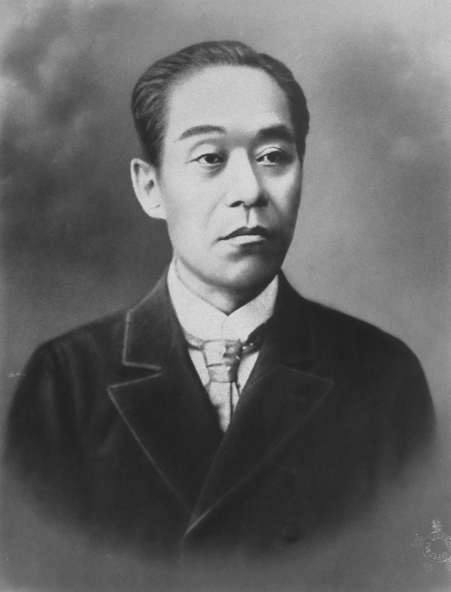
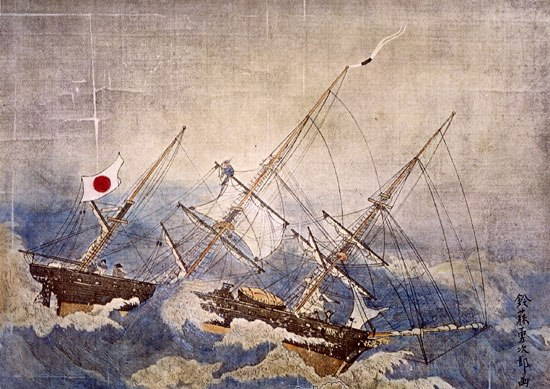
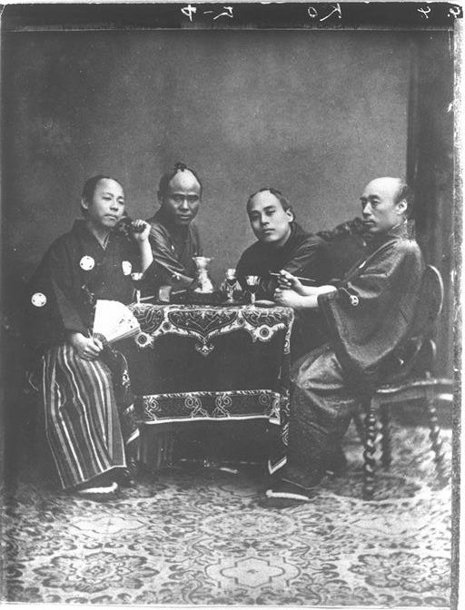
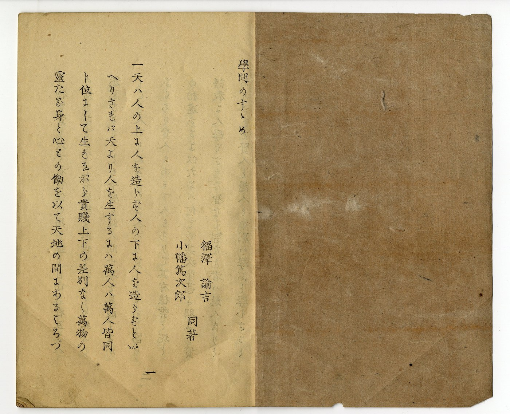
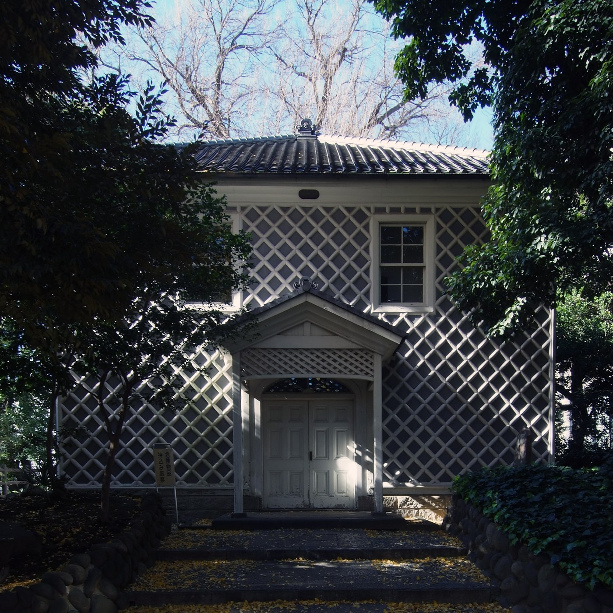
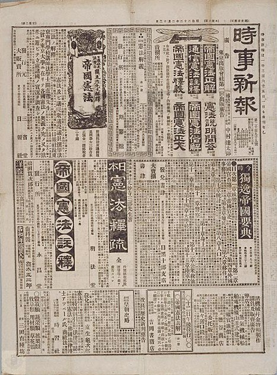

**文 / qscqesze**

## 横滨的招牌

1859年，福泽谕吉从江户到横滨，看刚开放的港口。此前，他已经在大阪学了几年荷兰文，能够阅读医学和物理书，到江户以后还试过用难解的段落考察其他学者。他对自己的本领颇有把握。横滨的商店却使他无从开口：别人听不懂他说什么，他也听不懂别人；店铺招牌和瓶子上的标签，同样认不出来。[^1]

只有一家商店给了他一点办法。店主是懂荷兰文的德国人，两人靠写字总算能够交流，福泽还买了东西。他后来把这趟出行的路程说得很辛苦，真正使他受打击的却并非走路。原先足以在学者之间取得地位的知识，到了一个外国商人正在营业的地方，连辨认商品都不能胜任。

他回江户后决定学英语，但决定与找到老师是两件事。听说长崎通词森山多吉郎正在江户，便到小石川求教。森山答应尽量帮忙，却忙于幕府的外交事务。福泽早晨去，赶上对方要出门；改到晚上，又常遇来客或官署急召。这样往返数月，始终不能形成有规律的功课。福泽知道森山确实忙于公务，仍反复前往求教。[^2]

横滨买来的荷英会话书也需要字典。他听说幕府的蕃书调所藏有可用的辞书，便先请藩里的负责人在申请上用印，取得入门资格。拿到字典后，他原想包起来带走，却被告知只能留在这里看。铁炮洲的住处与调所相隔很远，专为查词天天往返并不实际。进得去一所学校，没有同时解决能否在需要的时候使用书的问题。

转机终于由往来横滨的人带来：一部小型荷英对照词典，两册，要价五两。他请中津藩出钱购买，拿到书后开始逐字试读英文，先把它改写成自己熟悉的荷兰文，再从荷兰文理解句子的意思。后来以不依附官府自许的福泽，在转换语言的这个关口，仍需要藩的经费。[^3]

同道的反应各不相同。神田孝平也试过英语，却苦于无从着手，打算等别人摸出办法再跟进。村田藏六认为，所需的知识会由荷兰人译出，不必再学一门语言。原田敬策则愿意一起做下去。福泽与原田找人教发音，听说有长崎来的孩子会英语，便请教孩子；遇到海外漂流归来的人，也去住处打听。他们需要的是声音，老师未必非得有一张熟悉的学者面孔。[^4]

福泽起先以为，从荷兰文改学英语，等于把从前的功夫全部作废。他后来明确承认这个判断错了。两种语言的字母和语法有可通之处，读荷兰文练出的能力正帮助他理解英文。失效的是他对所处知识位置的估计，学过的东西并没有随横滨一趟出行而消失。

<figure style="margin: 1.8em 0; text-align: center;">
  
  <figcaption style="font-size: 0.88em; line-height: 1.65; color: #666; margin-top: 0.65em;">福泽谕吉肖像。摄影者及摄年未标；国立国会图书馆“近代日本人の肖像”，公版。 <a href="https://www.ndl.go.jp/portrait/datas/185/">来源</a>。</figcaption>
</figure>

## 父亲没有离开的地方

福泽谕吉生于1835年1月10日，出生地是大阪。父亲福泽百助是中津藩的下级武士，在藩的大阪仓邸办事。母亲於顺出自桥本家。一家五个孩子，长子之后有三个女儿，谕吉最小。百助去世以后，母亲带孩子们返回中津。[^5]

儿子记忆中的父亲，大部分要从母亲的讲述和留下的书去认识。百助爱读儒书，尤其推重伊藤东涯，却必须同大阪富商打交道，处理藩债及延期等事务。研究义理的愿望与经手账目的职务并不相合。福泽后来回想，父亲一直没有得到可以施展所学的位置，便把门第制度称为自己的亲敌。

这个判断来自一个后来已经离开中津的人。百助身处的选择更窄。他没有因为厌恶职务就离藩而去，对幼子的设想也是另一条可以在当时走通的道路：孩子若长得高大，将来可以做和尚，或许还能取得一点声名。谕吉后来走向外语和新式学校，是父亲未曾替他规划的出路。[^6]

一家人在中津也并不自然地融入周围。孩子们说大阪话，穿的是母亲按照旧习安排的衣服，与亲族、邻家的孩子有区别。他们因此较少出外同人混玩，兄弟姐妹往往聚在自己家里。成年后的福泽还承认，这种疏离不只是怕生：他们也把中津的其他孩子看作俗人，自觉比旁人高一等。

然而走出家门，等级又按另一套办法落到他们身上。高等武士的孩子用不客气的称呼和命令语气对待下级武士子弟，福泽则须以较恭敬的口吻应答。一起读书时，他觉得自己并不输人，玩耍和体力也未必差，言语上的高低却不会因此改变。门第不是只在任官时出现的关卡，它已经进入孩子们如何相称的日常。[^7]

父亲留下的儒家教养又使这个家庭保有一份严格。福泽讲过一则自己没有亲历的故事：百助听说大阪的老师在教孩子九九乘法，认为这样早教计算不妥，便把孩子接回。这件事是母亲后来告诉他的。日后福泽要把算术、记账和日常事务放进教育中心，与这样的家学出发点相距甚远。

但他也并非从小就拿西洋书反对父亲。他先靠汉文建立起读书的自信，熟悉篇章、讲解和会读的训练。等到家里谈起外语，他答应去试，所凭的恰是这份已有的经验：别人能够读通的文字，自己未必不能读。外语不是给毫无读书习惯的青年突然打开的一扇门，门外还放着他需要重新认的字母和词。

1854年，兄长提出荷兰炮术须读原书，中津却没有足够的学习条件。佩里来航以后，军备的问题已经传到藩内，炮术给外出求学提供了可以说明的理由。福泽跟着兄长前往长崎。他对离乡毫无留恋的强硬说法，后来写得很鲜明；实际把行程办成，仍是由兄长、藩内关系和新的军事需求共同促成。[^8]

## 长崎的食客

初到长崎，他先投靠光永寺，与藩中奥平壹岐的关系使他得到落脚处。再经奥平引介，进入炮术家山本物次郎家做食客。福泽后来称这是自己开始活动的一段。这里的“活动”并不只是翻书，他几乎什么都做。[^9]

山本眼力不好，需要有人把时势和汉文著作读给他听；儿子也要学汉文，福泽便担当教读。家中有借贷事务，他替人写信、去谈延期和借钱。男仆生病，他汲水，平日做扫除，照顾主人洗浴；女主人养猫狗，照料这些动物也落到他手里。会读书与肯做杂务，在这个寄居的安排里并没有明确分开。

山本还有一种收入，与炮术书有关。手抄本可以借给别人，但要收取相应的酬谢；别人来抄，也有费用。山本不能方便地读写，福泽便经手图样、说明和书的出借。其他藩的人来问炮的做法、希望看图，他负责接待。懂一点原文、能把图画出来、替人把事情接上，已经足以让一个新到长崎的青年成为相当有用的人。

他也承认，这份用处一度超过了自己的实际训练。他还没有见过多少真正的射击，却可以拿着图样同来客应答，使人以为已经学了很久。后来写自传，他乐于记下这种机敏。来人不只要抽象的学理，还要一张能够带回去、一份有人解释过的图。

学习语言另有一路。萨摩医学生松崎鼎甫替他写下字母，附上假名。福泽初见这种文字，很难相信区区一套字母足以用来读书。待能读一点，他又暗中衡量老师，认定对方并非高不可及，甚至希望有一天倒过来教他。几年后，两人在绪方洪庵门下再会，福泽已主持较高程度的会读，松崎进入他的课。他把这个师生位置互换的结果写得很得意。[^10]

他并不掩饰自己的争胜心。他自己就拿它同军人的功名、商人的财富相比，承认学者也有类似的野心。离开固定门第以后，读得懂、讲得出，为他提供了一种可以在较短时间里争取地位的办法。他反对出生决定一切，也很在意让别人看见自己超过了谁。

长崎并没有因此成为安稳的终点。奥平家先帮他进入山本家，随后双方关系转坏。按福泽的说法，奥平壹岐嫉妒自己进步，家中长辈便要求将他召回，借口是母亲病了。亲属写来的信同时交代了表面理由与内情。福泽决定不正面争吵，而是假装相信母病，向奥平告辞。[^11]

他关于奥平的性情和动机，是冲突一方多年后的解释。能够从这段记忆看清的后果，是求学仍受藩内上下关系牵动：他在食客家中变得能干，也没有立即摆脱最初把他介绍进来的人。正面发怒未必能够留下，离开反而给他保存了下一步活动的余地。

## 家督与四十两债

从长崎辗转到大阪以后，他进入绪方洪庵的学塾。这里以医学和通过荷兰文学习西洋知识著名，他所关心的却不限于行医。能读原书，便有可能接近炮术、物理和器械。与长崎靠主人需求分配的工作相比，学塾提供了更密集的同学和读书次序。

求学又一次被家庭打断。兄长病死，中津急信召他回去。他抵家时，葬事已经办完，亲属也替他决定了家督继承：兄长留下一个女儿，由弟弟继承这个家。在别处求学的人，没有因此取得对家中安排的完整决定权。藩内相应的职务和服丧责任接着到来。[^12]

他想再到大阪，亲属却认为既已继家，就该把奉公放在首位。叔父严厉责备，邻里也对母亲再放儿子外出感到不解。他没有办法靠辩倒所有人出发，转而与母亲商量。於顺愿意让他走，留下照料孙女。福泽在晚年的叙述里把母亲的同意记得很重，因为这一次的出走，会把孤独与家计的负担留给她。

还须先处理债务。兄长患病与在外任职花去的钱，合计约四十两，福泽把它说成对于自己家而言极大的欠款。母子商定卖家产。挂轴、刀、器皿陆续出售，数量最多的是父亲的藏书，约一千五百册。中津没有愿意拿出足够钱购买的人，他便到臼杵，借早年汉学老师的帮助，才把这批书卖给当地藩，得十五两。[^13]

他把卖出的东西和留住的东西分别列了出来。一套伊藤东涯批注的《易经》，父亲在目录中郑重写下要子孙保存，不能轻易割舍，于是留下。另有两个碗，因为店家出价太低，卖不卖对偿债都无大助益，也留在家里。多年后再讲这件事时，它们已成了笔洗。

留下的书遵从父亲的托付，卖掉的书则帮助儿子离开。一个学者家庭多年聚集的东西，换成了可以清理债务的钱，并没有保证下一程的学费充足。家里卖得近乎空了，他仍只能带着很有限的条件再去大阪。家督之名让他承担责任，读书之志又使他不肯在中津把这一责任按旧路履行到底。

这次回乡期间，奥平壹岐拿出一部荷兰文筑城书，称价二十三两。福泽很想读，却买不起，也担心对方不肯久借。他只说想看看图和目录，求借数日，拿回家后却从头抄录。按他的记忆，书约二百页，他连轮值守门时也找机会抄，怕对方随时要回。[^14]

他再到绪方门下时，把家债、卖产与抄书都告诉了老师。洪庵没有只叫他把困难藏起来自己挨过，反而想了一个不使其他学生觉得偏袒的办法：名义上由老师命他翻译筑城书，他由此作为食客留下。福泽说，这本是帮助自己解决生活的安排，后来自己却真把书译完了。老师的照料与一项实际工作，就这样同时成立。[^15]

## 一部字典的周围

绪方的学塾并不靠给每个人发一套书来运转。福泽记忆中的物理、医学原书种类有限，有的只有一部，读到较高程度以后，学生必须自己抄。谁先取得原本，抽签决定；抄完再交给下一个人。学习的进度先被书的数量限制，接着才轮到各人的理解力。[^16]

纸和笔也得自己设法。为了抄写洋文，他们处理日本纸，使墨不会随意洇开；买来原用于钓具的鸟羽管，削成可以使用的笔。书中不是只有等待解释的文字，它还有字母大小、行距和标点，必须先被准确留在纸上。熟练以后，可以一人读、一人写，也可以独自对着原本抄完，再交还给别人。

开始时要先学语法和句法，听讲、朗读，进入会读以后，办法便变了。学生围绕同一段原书分别准备，轮到谁就讲哪一部分。如果讲不出，转给下一个；有人读懂，便得到相应的记号。读得顺利又准确的，还有更高的评定。各级的进退，由持续的表现决定，不能只凭在塾里多住了几年。[^17]

字典是共同的难处。塾里有一套荷日辞书，体积很大，却仍只有一部。大家轮候查看，临近会读的晚上，字典所在的屋子尤其拥挤。另有可以用荷兰文解释荷兰文的词典，但刚入门的人尚无力依靠它。工具已经摆在那里，不等于所有人都有同样的使用能力。

福泽强调，会读所用的段落不许私下互相代解，必须自己弄通；会读之外，高年级却可以讲给新生听，也愿意帮助。竞争和合作在这里有各自的范围。主课要看一个人到底读懂了没有，其他学习又离不开已经走在前面的人。日后他把独自研究说得很响，这段集体生活仍是他形成读书能力的地方。

他后来成为塾长，主要工作是主持较难的会读，并不因此得到可以随意命令所有人的身份。旧日教他字母的松崎出现在自己主持的课上，使这份由读书程度带来的次序变得格外可感。中津的高等武士子弟不会因为输了一场会读就改变门第；这里的席次，却真会随读书表现而移动。

学塾的生活并不全然克己。福泽记过自己饮酒和带同学外出，也承认或许有人受他影响喝了酒。他成为塾长后，新生入门时另向塾长呈交的款项，给了他一些零用。住处与衣服还有老师、母亲等各处供给，有了余钱，他很容易先想到酒。他讲这些往事时，仍很留恋同窗相聚的生活。[^18]

苦学却又确实占据了日子。他记述深夜读书、倦了便伏下睡，觉得自己与同窗都把力气用到了极限。患病康复时想用一只通常的枕头，却发现平日根本没有备。这样的读书生活并没有依照健康的作息组织起来。懂医学的学塾，不会自动使学生把知道的卫生知识全部实行。

## 抄写可以换来什么

原书难得，抄书不仅是学习步骤，也能成为收入。大名和各藩需要辞书，便向会抄荷兰文的人提出委托。字母正文和日文注释的计酬不同，福泽把它们的价格与一般抄写相比较，认为足以帮助学生维持在塾生活。[^19]

他还记下一个同学的办法：先在江户靠抄书挣钱，积起钱后，再到大阪求学。江户集中了诸侯和需求，抄件价较高；大阪的学塾则更适合他想要的训练。挣钱的地方和学习的地方，不必是同一个地方。对贫穷学生而言，知识需求之间的差别成了一条实际可以走的路。

这种收入来自材料的稀缺，也来自能够准确复制材料的手。纸上抄错一个字母，会影响以后的解读；借到一部辞书的人，可能还要依靠别人一页页地复制，才使它进入更多地方。福泽后来经营出版，面对的是另外一种复制规模，但他在学生时代已经知道，文字能不能流通，与原本、时间和支付都有关。

抄来的原书也未必只能留在纸上。适塾学生照书试验，试过给铁器镀锡，也试过制取碘。他们没有齐备的西洋器具，就找替代的东西，购买海草，借用或改造瓶子。实验可以失败，福泽没有把每次尝试都说成成功。制取一种药品所生的气味使周围人受不了，有人后来索性雇船，把工作搬到河上。[^20]

他在这些回忆里讲得兴致勃勃，成功和狼狈混在一起。学生要让一个原书中的方法在眼前发生，不只需要译对名词，还要找材料、造装置，承受邻人的抱怨。正是这些步骤使“西洋学”不再只是另一种背熟的篇章。

洪庵的作用也不应被这些热闹盖住。学生可以逞强，遇到真正难解的文字时，仍请老师讲解。福泽称赞老师细密而大胆，听过讲义，又与同学谈论自己尚欠缺多少。年轻人靠超过同窗取得满足，也需要一个仍会使自己感到不足的人。

## 到江户教书

1858年，福泽到江户，在中津藩铁炮洲的宅邸教授荷兰文。开始只有几个同藩子弟，后来别处也有人来学。这所尚未叫作慶应义塾的学塾，依托藩邸、人际关系和教师已经取得的语言能力开张，不能从后来大学的样子倒推它当时就有完整的组织。[^21]

福泽是带着相当的自信来的。他在大阪已经读过难书，到江户拜访学者，遇到别人解不通的一段生理学文字，便试着解释，花一番功夫得出意思。他又故意挑容易误读的段落向前辈请教，想由此试出对方的程度。他承认这种试探在道德上未必妥当，却仍记得自己因此感到安心。

教师的把握没有维持多久，横滨便给了他一次与会读成绩无关的检验。那里的商店需要英语等语言，在大阪读熟的荷兰书，不能直接解释眼前所有人说的话。他没有停止教书再去从头当学生，而是在教授、拜访、买词典和练习之间同时进行。后来写起这段，他说自己仿佛既在教人，也在同人一道学习。

借荷兰文转换英文，是其中最关键的过渡。它把旧有能力继续留在工作中，直到新语言能较自由地使用。对于已经需要接待学生、维持生活的人，这比把过去全部放弃再重新等待毕业更实际。福泽以后劝青年不必只守着一条熟路，这个建议也来自他确曾承受过的迟疑。

英语朋友少，并不是因为别人都没看见它的用途。神田已经试过，知道难在哪里；村田藏六有他的专业需要，觉得荷兰译本足用。他们以后各自走向不同工作，在这个关口也各有衡量。福泽当时最需要的原田，则愿意与他共同承担还没有现成课本和师资的麻烦。

<figure style="margin: 1.8em 0; text-align: center;">
  
  <figcaption style="font-size: 0.88em; line-height: 1.65; color: #666; margin-top: 0.65em;">咸临丸绘画，鈴藤勇次郎作，1860—1868年。此为画作，不是航行照片。来源：Wikimedia Commons，公版。 <a href="https://commons.wikimedia.org/wiki/File:KanrinMaru.jpg">来源</a>。</figcaption>
</figure>

## 随员的舱位

1860年第一次去美国，福泽并非正式使节的首领。他希望随船出洋，先经桂川家的介绍，去求军舰奉行木村摄津守，得到作为随员同行的机会。桂川是他进入江户后经常往来的兰学家族，这条关系使一项强烈愿望终于成为可以安排的舱位。[^22]

咸临丸驶向旧金山，正式前往华盛顿的使节另有行程。福泽在叙述船上人员时，区分掌管航海、测量、蒸汽与通译的角色；中滨万次郎已有海外经验，担任通译。船上还有美国人布鲁克等人。有人原先不愿让美国人同行，担心被说成靠美国人领着航行，荣誉与实际航行需要之间已有争执。[^23]

这趟航行使他置身于一套分工协作的安排。他既依靠幕府出洋的安排，也要靠整条船上的专门工作才能到达。日本船员已经受过训练，却仍与美国船员共同面对航程。福泽晚年的叙述保存了这些不全适合写成纯粹国力壮举的细节。

到了美国，他看到一些生产和技术设施。向导以为日本人不懂，耐心解释电报、电镀或制糖，他却发现这些原理已在荷兰文书里读过。没有现代工厂作依托的知识，与工厂实际大规模运转的知识，在这里相遇。他不必假装一切都使自己惊奇，才能承认对方社会有许多还不懂的地方。[^24]

他真正觉得难以理解的是另一类事：为什么随处能见丢弃的铁制品，物价为什么那样高，一个国家的人又怎样看待政治人物的家族。日本城市火灾后有人捡钉子，铁还值得细细回收，美国岸边和废物中却能看到它。这个比较来自旅人的眼睛，不足以编成两国物价表，却使他的注意从单个器械移向物件背后的生活条件。

他问起华盛顿的后人如今怎样，得到的是对方不甚在意的答复。福泽当然已知道共和国和总统任期的说法，追问家族，却仍带着日本关于赖朝、家康后裔的预期。他后来把这件事写作社会制度比科学原理更难弄清的一例。他理所当然的问法，在另一处没有得到同样郑重的回应。[^25]

旅行也留下辞书和照片。他与中滨万次郎各买了一部韦伯斯特词典，带回的是日后仍能使用的工具。另有一张他与照相馆少女合影的照片，福泽说自己先藏着，离开夏威夷后才拿给同行看，逗他们后悔没有照样去拍。这份顽皮并没有被他排除在一个学者的生平之外。[^26]

<figure style="margin: 1.8em 0; text-align: center;">
  
  <figcaption style="font-size: 0.88em; line-height: 1.65; color: #666; margin-top: 0.65em;">1862年使节团成员在荷兰合影，福泽在左起第三位；摄影者不详。福泽研究中心来源，Wikimedia Commons公版副本。 <a href="https://commons.wikimedia.org/wiki/File:First_Japanese_Embassy_to_Europe_Fukuzawa.jpg">来源</a>。</figcaption>
</figure>

## 公文里的两种语言

回到日本，学塾继续招生，课程逐渐改为英语书。福泽自己还不能无碍地读一切英文，教授与学习仍在一起发生。不久幕府外国方雇用他，处理外国使节送来的文书。官署的事务给了他一个私人求学时不容易得到的条件：同一件外交文书，有英文原稿，也有荷兰文译稿，可以互相对照。[^27]

各国使节附上荷兰文，本来为了让日本官署能够理解公文。福泽却试着先译英文，遇到困难再看荷译，检查自己错在何处。实际职责没有与语言训练分开，他也可以借阅署里的英文书。先前为了找一部字典来回奔波的人，如今因工作进入另一处资料较集中的地方。

这份雇用又给了第二次出国的条件。1862年，他随幕府使节赴欧洲，这次有翻译方的职务，不同于第一次靠木村私下接纳的随员身份。他记得自己领到一笔旅费和津贴，分一部分寄给母亲。母亲在中津曾受关于他海外遇难的流言困扰，他却连回乡探视都没来得及，又要远行。寄钱表达了一份愧疚，不能替代回去的人。[^28]

一行经亚洲港口、埃及和地中海到欧洲，转赴多个国家。会面、参观和正式交涉构成日程，福泽则另有自己要问的问题。物理或机械的一般知识，回国后还可以查书；外国人觉得平常、往往不会在字典里仔细解释的事情，更值得趁人就在眼前时问清楚。

他想知道，医院的支出由谁承担，银行的款项怎样收付，邮政依据什么安排运作；法国实行征兵，英国采取不同办法，征兵本身又是什么制度。议会并非只需找一个日文字眼就能说明，选举、政党、反对派彼此怎样相处，也远比翻出一个词复杂。[^29]

有些问题连对方也觉得不值得问。保守党与自由党彼此攻击，却还同桌吃饭，福泽需要弄明白，他们为什么能在冲突之后继续保持正常交往。若把党争简单理解为日本各藩或武士集团的生死敌对，就会从一开始看错。他记下细节，过几日再问，逐渐把名称同实际做法连起来。

使节在荷兰问土地能否卖给外国人，又担心外国人买下后筑城设炮台，对方则觉得这种商人不可思议，双方一度不能明白彼此的重点。这件事在福泽笔下显得可笑，却也显出询问者面对的现实压力。日本谈开港、租地和外国势力，不可能只把土地看作一笔普通私人交易；翻译所要处理的，是两边问题的来路都不相同。[^30]

英国又让他看见，国家与国内的意见不能混作一团。他读到批评驻日外交官粗暴行为的材料，因而感到宽慰。先前在日本接触的外国官员，可以傲慢、强势；到了对方国内，却能遇见批评这种行为的人。认识西洋，并非把眼前每一个西洋官员的做法都收作应该效仿的标准。[^31]

## 带回来的笔记

那些随手记下的事情，回国后还要靠其他书和记忆补充，才逐渐成为《西洋事情》。福泽把自己的观察工作与最后成书连起来说，也交代了旅行本身不能完成的部分。看到医院不等于懂得医院制度，听见某个人解释议会，也不等于已经掌握它的全部历史。记录只是带回了一批可以继续查问的线索。

他的早期出版已经开始。第一次美国回来，他根据《华英通语》加以处理而出版，是后来一长列著译的起点。这样的工作利用已有读本，又针对日本读者改变表达；它与此后整理欧洲见闻不同，却同样要求决定哪些词、哪些说法能够被本国读者使用。[^32]

1866年《西洋事情》初编出版，欧洲考察的材料得到比一间教室更大的传播范围。原先等着有书的人转借原本的学生，如今开始让别人从自己编写的书中取得关于外国的知识。印行使消息不必永远随一个讲述者移动，作者也须对看不见的读者选择篇幅和顺序。[^33]

他并没有把一切归给亲眼见闻。自传里，他反复说到原书、笔记、翻译和重新编缀的关系。欧洲旅行并不是给一本原本已经写好的结论寻找插图，实地遇到的困惑改变了他以后愿意向读者解释什么。回国后的工作，则把旅人暂时得到的认识变成较稳定的文字。

出版开始形成名声时，他仍同幕府发生联系。第三次出国是1867年，又赴美国，与幕府购舰等事务相关。随行条件与第一趟已经很不同：远洋邮船通航，旅程中还要跨越巴拿马地峡，再到美国东岸。福泽见到的，不再只是日本船与一个太平洋港口，而是一条已经可以通过商业运送把数处地点接起来的路。[^34]

他对幕府的态度却日益疏远。自传记述，他在船中与尺振八饮酒议论，批评幕府以御用为名随意压价取物，又在开国与攘夷之间摇摆。谈到推翻幕府，他并不同时赞成正在反对幕府的各方，尤其怀疑攘夷者得势后会怎样行事。这不是一位已经预知新政府结局的人从容选择正确阵营的故事。[^35]

回国后，他曾奉命暂不出署，便在家继续教书、写《西洋旅案内》。后来又有人奔走，使他重回翻译职务。关于他与萨摩暗通的流言，甚至牵出已经死去十多年的兄长。福泽把它当作荒唐之说，不肯一一解释。学者想在政局之外安排工作，名声却会被局势重新解释，写书和教课也不能使他完全退出别人对阵营的猜测。

## 明码收取的学费

1868年，学塾从铁炮洲迁到芝的新钱座，用当时的年号定名为慶应义塾。这个名字沿用了变局发生时的一段旧时间，学校却要开始一套新的收支安排。学生增加以后，管理不能只靠彼此熟悉。福泽把简明的塾则印出来，每人一册，其中一项便是按月交费。[^36]

从前私塾中的礼物、入门酬谢与逢年过节的馈赠，并非完全没有金钱，只是给钱的关系不同。福泽要求把教学当作人的一种工作，公开议定价格收取，不必用礼物遮掩。他在自传里列出的数目是每个学生每月二分，汇集以后，先向担当教师的先进行给付生活所需，有余再用于学舍。

有人仍照旧把款项仔细包装，他则把多余的包裹退回。对方准备的是送给老师的礼数，学校所需的是可以点验、记账和按月支付的钱。新的做法没有使师生之间不再有敬意，却把一部分往来从临时的个人酬谢变为固定收入。教师能不能继续教，也由此同一所学校的月度收支连在一起。

按月收费使教学成为一项需要按期结算的工作。他要使教学不完全取决于某个学生是否记得馈赠，也不完全取决于一位老师另有多少家产。与在长崎替主人读书、办理杂务来换住处相比，现在要让一批人通过明确的教学职责维持生活。

同年上野作战时，他仍在课上讲经济学。新钱座与战地有距离，他判断暂不会受到流弹伤害，便没有因此停课。学生有的去看远处的动静。这段后来屡被讲述的事，在他自己的回忆里没有预先布置成一场庄严仪式，先是一项要不要继续当天功课的判断。[^37]

战争过去，新的学生接连来到。有些人刚从战场下来，佩着武器，带着战利品，难以立刻变成安静的读书人。福泽记得有人穿着从会津夺来的女装，又以此夸耀。他制定的规则于是十分具体：不许私下借贷，吃饭和作息各有时候，物品不许随意涂画。写坏的纸面须重补，连自有物也不能例外。[^38]

这些规定不像一篇文明论，却是学校在战后得以运转的一部分。同一个房间里可以有不同经历的人，不等于所有习惯都能照旧带进来。福泽还写自己怎样严厉执行，威吓学生，拆毁画有字样的物件。在这段回忆中，维持秩序用到了惩戒，也用到了福泽自许的胆气。

## 三田的房地

学校继续扩大，语言课也带来另一种偏向。福泽发觉，有些学生先读英语，反倒不擅长日常日文书信。他并不认为必须把所有汉文读完才能学新知，却要面对课程顺序变动以后出现的问题。把旧学的地位压低，只是开头；教师还得说明新生到底需要读会什么、能够去做什么。[^39]

到1871年迁往三田时，更直接的难题是房地。福泽病后不喜欢新钱座的环境，想另找住处，塾中人却希望学校也一起迁。他们看中岛原藩旧宅，地点合适，但这不是一处凭师生投票就能占用的空地。要取得它，必须通过东京府与政府，处理原藩的土地，再变为可以借给学塾的地方。[^40]

福泽并没有只站在门外声明自己独立。他请求熟识的人帮助，拜访岩仓具视，说明办学与场地的需要。后来东京府恰好也来求助，想了解西洋警察制度，改变原先由各藩士兵荷枪巡街的办法。他答应收集原书译出相关内容，同时再提借用校地一事。

按他自己的形容，这几乎是一种交换。东京府得到所需的制度材料，他争取学校安顿下来的机会。最终，土地借用与购买原有建筑分开处理，学塾得以迁入。他借官府的帮助，取得了自己主持教学的空间。办学所用的地，在当时仍须经过他不愿去任职的政府。

从长崎食客的床位，到大阪共享的一部辞书，再到江户藩邸中的课堂，福泽已经多次为读书寻找可用的位置。三田是更大的一次安排。文字、人物和经费各有来处，学校要做的，是使它们在同一个地方持续地发生关系，而不只留作一次旅行或一名教师的经历。

<figure style="margin: 1.8em 0; text-align: center;">
  
  <figcaption style="font-size: 0.88em; line-height: 1.65; color: #666; margin-top: 0.65em;">《劝学篇》初编书影，1872年刊，福泽谕吉、小幡笃次郎合著。来源：Wikimedia Commons，公版。 <a href="https://commons.wikimedia.org/wiki/File:Gakumon-no-susume.jpg">来源</a>。</figcaption>
</figure>

## 印成小册的劝告

三田的校舍容得下的学生毕竟有限。福泽又在东京以外留下了另一条联系：家乡中津筹办学校，需要向乡人解释，为何应当把子弟交给这样的学校。他与小幡笃次郎合作，把劝学的理由写成一册，原为同乡阅读，后来接受旁人的建议，用义塾的活字印行，扩大了发行范围。初编末尾的说明保留着这段经过，也并列着两个人的名字。后来被合订、被引用的《劝学篇》，起初还不是一部预先写好的十七篇大书。[^41]

它的开头提出人生来没有上下贵贱的分别，随即转到眼前显而易见的不平等：既然人同样生而为人，为何有人富贵，有人贫困？书中把差别归结到学习与不学习，要求读者先改变自己的知识和办事能力。这里有对世袭身分的直接攻击，也有一种相当严厉的判断。作者把用脑的职业看得高于体力劳动，把现实的贫富差距过多地交给个人的学问解释。读者得到一条离开旧位置的道路，同时也面对一把新的衡量人的尺子。

实学在这本书里相当具体。识字以后应当会写信、记账、打算盘、使用天平；再进一步，知道世界各地的地理，了解物怎样发生作用，读历史，懂得个人与国家怎样维持生计，学习与人相处的道理。这些知识并不都要等学生先读通外文。译书和日文说明应当承担主要的传递工作，有条件、有才力的人才进一步研读原书。福泽自己靠荷兰文与英语扩大了生活范围，他没有因此要求每一个读者都先重复自己的求学经历。[^42]

他要改变的也包括人们对读书的评价。一个学生能读难字，背熟古文，父母却担心他将来不会管理家产；这种担忧在他看来不全是家长轻视知识，也可能说明学校所教的东西离日用太远。到了第二编，他连学洋文而仍不能独立谋生的人也一起批评。掌握文字只是取得工具，不能因为知道锤、锯的名字，就自称懂得盖房子。对一个曾经依靠读外国书谋生的人，这个区别具有切身的分量。

书的议论不断向前推进。第二编特别说明，平等指的是权利与道义，并非每个人的境况、财产和能力都一样。富商有巨额财产，小贩只有卖糖点的零钱，两人守护自己所有之物的资格并不因此不同。大名与劳动者的生命也一样重要。强者不能因为自己力大，就折断邻人的胳膊。这样的例子把抽象的主张带回到身体和钱，读者无须先懂一套哲学术语，便能看出身分差别怎样变成对人的损害。[^43]

不过，他写的自由始终带着秩序的要求。初编以不妨害别人作为自由的界线，却又把挥霍饮酒一类行为视作会败坏风俗的事；第二编向政府要求保护人民固有的权利，书中其他地方又严厉批评人民无知。对读者的鼓励与训诫在同一册里并存。他并不认为解除了旧身分，就可以免除工作、守法和自我约束。

从初编到后续各编，这项出版工作延续了几年。书的篇数随着议论增加，1876年才出到第十七编。福泽面对的已不只是中津的乡人，还有日益扩大的一批读者：他们可能不进三田的课堂，也会在学业、谋职与家计之间遇到书中讨论的问题。小册子的形式容许作者回应新的事情；读者按次买到的是不断续出的论说，后来合订起来，才呈现出较为完整的一套论述。[^44]

## 官府以外的学者

《劝学篇》第四编把学校本身放进了争论。福泽问，国家的独立能否仅凭政府来维持？他的回答涉及一种在自己朋友中就看得到的选择：懂外文、有学识的人，大都希望入仕；即使并不贪图薪俸，也常认为非借助官府，便无从做成事情。留在民间办学校、办事业，反倒显得缺乏可供效法的先例。[^45]

他没有把所有官员描写成恶人。书里承认，一个人私下交往时可能通达、诚恳，进入官署共同处事以后，却会做出令人失望的决定。百姓也可能独自相处时诚实，一到官府面前就欺瞒敷衍。难题因而不能靠换上几个品德好的人便告解决：上面习惯威吓，下面习惯顺从与欺骗，双方在日常交往里不断重造旧关系。朝廷和官署的名目改了，这种习惯仍然可能留下。

因此，洋学者的任务不能只是在旧关系里换一种学问。他们应当在政府之外做成一些事情，给旁人一个可以看见的先例。这样的议论使三田的日常办学有了更大的目标。收取学费，维持教师生活，设法取得校地，都关系到一所学校能否继续存在；在福泽笔下，学校的存在又证明，人的工作与名望不必完全由官位授予。

这不妨碍他接触官员。为借地去谈判，为翻译需要去交换资料，与政府人士讨论局势，都在他的生活里发生。学校也不能只凭一句独立就免除土地、法律与财政的约束。他所维护的是保留自己的判断与事业，不必跟随每一次官员的进退一起消失。后来报纸筹办时，这种接近而又有所保留的关系，还会把他卷入更危险的猜疑。

他同样不肯把洋学者自动算作比别人高明的人。外国书读得多，仍旧不会管理家产；经济学讲得熟，个人的生活却一团混乱，这些都是书里拿来批评学者的例子。把外文作为新门第，照旧依附权势，只能改变服装和谈吐，不能完成他期待的改变。这份不满也指向自己所属的圈子。

1875年出版的《文明论之概略》，把有关风气、权力与国家独立的问题集中展开。福泽并未把西洋现有的一切都当成完善的终点。文明需要比较，也需要观察一国人民怎样思考、怎样共同办事。他关心的，是技术和制度引进以后，是否仍由少数人支配一切，其他人只会等待命令。西式物品很容易看见，改变人们判断和交往的习惯却困难得多。[^46]

他的眼光也没有离开列强之间的强弱。西方国家的自由原则与它们在殖民地的行动并不总是一回事，个人交往中的友善，不能直接保证国家利益上的公正。《文明论之概略》因此同时包含学习与戒备。日本要吸收知识，却不能把国家安危寄托在对方必然善意的想象上。对外部压力的忧虑，从他早年出洋的见闻中延伸出来，后来又会在对亚洲邻国的态度中导向尖锐得多的主张。

<figure style="margin: 1.8em 0; text-align: center;">
  
  <figcaption style="font-size: 0.88em; line-height: 1.65; color: #666; margin-top: 0.65em;">1875年建成的三田演说馆，Wiiii于2008年12月7日摄影。此为建筑后来的样貌；图片经缩小、压缩，沿用CC BY-SA 3.0。 <a href="https://commons.wikimedia.org/wiki/File:Mita_Enzetsu-kan.jpg">来源</a>。 <a href="https://creativecommons.org/licenses/by-sa/3.0/">许可</a>。</figcaption>
</figure>

## 说给在场的人听

福泽在欧洲考察过议会和各种公共机构。回到日本以后，他逐渐把注意力放到另一项需要练习的本领上：一个人怎样当着一群人的面，把自己的意见说明白。

《劝学篇》第十二编解释演说时，没有只举国会中的大辩论。商人的集会、市民的聚会、开店的仪式，只要十几个人在一起，也可以有人说明聚会的目的，陈述平时的想法，或回应眼前发生的事情。他很清楚，建立一个名叫议院的机构，还不等于参加者已经会发言、会听取别人的论证。[^47]

他讲了一个带讥讽意味的故事：一个书生多年抄录学说，返乡时把写本装船，船却失事了，结果人虽然回到故乡，学问全留在海里。他用这个故事嘲笑只把学问留在纸上的读书人。接下来他直接把同样的危险交给洋学者：倘若原书忽然被拿走，离开东京以后，还有多少知识真正留在身上？

演说在这里接上了适塾时代的读书，却又多出一个面向。阅读、观察和推理能够取得知识；谈话使知识在人之间交换；著书和演说则使它传得更远。翻译一段文字，未必能让听众理解它与眼前生活有何关系。发言者必须自己组织材料，选择次序，面对别人听懂或没有听懂的结果。这不能完全关起门来独自完成。

1874年，三田演说会开始活动；次年五月，专供演说使用的三田演说馆开馆。学校需要教室和书籍，也为这种练习单独造了一座房屋。原先围绕一本字典、几个人互相讲解形成的求学方法，已经发展到另一个规模：让学生练习作为公共发言者出现。[^48]

他并不只要求学生避免酒色和放荡。第十二编里，他不满意一所学校仅凭管束严密、学生没有惹事就取得好名声。禁止坏行为只是最低的一部分；课程是否有分量，教学是否有效，学生能不能形成自己的见解，同样必须拿出来比较。青年若仅仅比无赖好一些就满意，便把应当继续做的事情提前结束了。

然而，要求人开口，并不保证开口以后意见一致。此后东京的报刊、团体与政治运动扩展，争执也日趋尖锐。福泽自己将要面对的，正是他一直鼓励进入公共讨论的人们。他能够把一篇文章交给年轻记者，让它以另一个机构的名义出现；也可能因为朋友的仕途变化，突然成为被指认的幕后人物。

## 留学费与九个孩子

《劝学篇》第八编已把男女的关系纳入同一个问题：能否凭一人的心意支配另一个人的身体？福泽先从权势等级逐级向下推，最后推到家内。他反对丈夫放荡、妻子仍只能委婉劝谏并绝对服从的教法，认为这种要求使丈夫可以裁断妻子的过失，妻子却无从对丈夫作同样的要求。家门不能使公开承认的权利自动失效。[^49]

他对纳妾的攻击尤其尖锐。有人声称只要安排妥当，几个妻妾便不会相妨，他让这种说法倒过来，问男子是否愿意接受一名女子供养几个男妾，仍把它称作平和的家庭。他又反对拿延续后嗣替纳妾辩护，不肯因为孟子的话便接受一个人支配另一个人的安排。旧典不再是论争结束的地方，也可以成为被质问的对象。

同一编还把矛头对准以孝顺为名迫害子女的事。他批评《二十四孝》中违背人情的例子，认为父母不能因为生养过孩子，就对成年子女取得任意支配的资格。写这些议论的人，自己已是父亲，也仍是母亲的儿子。家庭礼法的变更，要在这些最近的关系中承受后果；阿锦与孩子们的生活，因而不能只用来装点一位著作者的家事。

三田的学生在成长，福泽自己的孩子也陆续出生。1861年，他与土岐太郎八的次女阿锦成婚。两人都出自中津藩，按旧藩的门第，妻家原来高于福泽家。此后家里有了四个儿子、五个女儿。福泽晚年记述这些事情时，把九个孩子都平安长大，看作生活中的幸运。[^50]

其中前五个孩子由母亲哺乳，后四个雇用乳母，他说明是为了顾及多次生育后的母亲健康。这笔开支与他年轻时的困窘已大不相同。书籍出版带来的收入，使他逐渐能够替家庭作更长远的打算；有了出洋经验，两个儿子的海外学习也成为父亲想办的一件大事。

钱却并非一开始就准备好了。明治初年，横滨一位经营学校的富商，希望请他亲自监督那所学校。福泽已经拒绝过。对方得知他正忧虑孩子将来的留学费，便提议现在给一笔钱，留存生息，待孩子长大以后使用。这样可以避免把酬报说成按月领取的薪水，又能解决他念念不忘的一项开支。[^51]

福泽在自传中把这段选择写得颇为详细。他并非对钱毫不在意：两个孩子正小，送往海外的费用又难以预料，这个提议恰好落在他最希望得到帮助的地方。但原先拒绝监督学校有其理由，若单单因为有了钱，便把已经作出的判断翻过来，他认为不能接受。父亲可以量力教育孩子，却不能为了让孩子受最好的教育，任由出资者改变自己的去向。

这是他对一次拒绝的解释，包含晚年回顾时的自得。事情的后续倒很具体：著书和翻译的收入超过原先预料，孩子尚未到留学年龄，资金先已备下。他先资助外甥中上川彦次郎赴英国，后来再送长子一太郎与次子捨次郎去美国。一本书能带来的钱，在这里不只支付纸墨与作者本人的生活，也开始支付下一代人的教育。

两个儿子1883年赴美，1888年回国。留学使一家人靠邮件维持日常联系。福泽说，自己逢邮船便写信，没有大事，也照样写；信写好以后，阿锦校看、封寄。儿子们同样被要求每逢邮船来往就寄信，哪怕只说明没有特别的事情。这项往返并非父亲单独完成，母亲也在其中工作。[^52]

信里牵挂的不只是成绩。按他的回忆，临行时反复交代的是不要过度用功损害身体；日常应当节俭，若遇到关系健康的病痛，钱能解决就应当用钱。一个早年常为买书和求学筹钱的人，此时对孩子说的却是：不必为了成为学者，带着一副垮掉的身体回家。他记得，在这几年的往返中，共写了三百多通信。

福泽也写下他期待的家庭相处方式。父母说错话、做错事，孩子可以笑；孩子犯错，父母指出，双方不必把每件事都变成维持尊卑的仪式。他不要求进门时人人按礼数迎接，出入有时走前门，有时走厨房，不愿先通知全家做好迎候。这个家里仍有年长者熟悉旧式礼法，福泽描述的做法并不等于所有家人都已经接受同一套生活方式。[^53]

说到儿女，他很不满生男时大喜、生女时只说健康便好的习惯。他宣称九个孩子之间不应有亲疏，女孩并没有较低的价值。但在紧接着的财产安排里，又保留了长子作为继承人、需要较厚分配的地位。稀有而不能分割的东西，也可以归长子。这种安排与他对儿女感情一视同仁的说法放在同一页上，家庭中的平等仍然带着家产传承的差别。[^54]

他还曾买下一批本来准备出口美国的工艺品。晚年分给孩子时，采取分作九份、抽签领取的办法，已经成家的可以带回自己的住处，暂不搬走的仍放在父亲的库房。对于遗嘱，他反对等到死后才让家人惊讶，主张活着时便让孩子看清楚，修改后再告知。遗嘱存在哪个抽屉，也当面交代。一个在书里不断说明独立的人，没有用一封只能身后开启的遗嘱，替孩子保留最后一次不可争辩的命令。[^55]

## 账目里的例外

福泽说自己害怕债务，害怕被人催索。他在适塾时不肯把衣服送进当铺，理由是终究还得准备钱赎回；真遇到急用，甚至只是馋酒，便索性卖掉。他还明确说，虽然同学有人靠抄写挣钱，自己却没有做这种工作。求学时间在他看来比这份收入更要紧，没钱便暂时不用。这个选择也有条件：母亲还会从家乡寄来夏冬所需的手织棉衣，他并非完全没有家庭供给。[^56]

钱的多少之外，他常常计算支出过后能留下什么。自传记了一次从朋友处回铁炮洲的经历，路上下雨，路边轿夫的要价使他觉得不值。他改买一双木屐和一把伞，合起来花费较少，到家以后东西还可以继续用。省下的轿费与留下的用具，被他放在一起比较。[^57]

他也拿自己的孩子实践付款的规则。1876年带两个儿子往关西旅行，返程托人买船票，拿到的却是一张成人票、两张半票。长子刚满十二岁，已越过应买半票的界线。经办者认为差几个月不妨通融，他坚持换成两张成人票。他所记的争执不是为少花钱，而是为多付本应支付的部分；与拒绝轿费一样，都被他编进自己的金钱观里。[^58]

但这套自述很快给自己留下了一个大例外。说到旧藩，他坦承原先并未把与主君的钱财往来当作人与人的对等交往。赏赐可以收下，不觉得必须回报；名义上的借款也会被看成已经到手的收入。为了替江户的学生筹钱，他卖原书，又把横滨外文报纸译出，寻找各藩驻江户办事者购买；这些收入仍不够，便把主意打到藩邸的钱上。[^59]

依他所述，先向家老逸见志摩提出借款，编了一套自己不久就有收入的理由。家老没有明确拒绝，他便到下一级负责人那里，把这句话说成已经得到批准；对方仍未作成正式指示，他又赶到掌管金库的人那里，催促赶快付款。趁几级人之间尚未互相查问，他取出一百五十两，事后并无归还的打算。这不是一笔可以用来证明他终生不借钱的材料。

晚年的福泽把它作为自己可笑、也不体面的往事说出来。故事里的同谋并不是一个新式金融制度，而是旧藩层级之间含混的应允、对家老口信的信赖，以及武士把领主的钱看作可索取之物的习惯。他批评这种习惯时，又使用了侮辱朝鲜人的类比。对自身旧行为的揭露与对邻人的轻蔑，一并留在同一段自传中，不能只取前面的风趣而跳过后面的口吻。

这些故事也划出了他的自立说所能解释的范围。他在求学阶段仍有母亲的衣物、藩里的资助，经营学校时仍要寻找付费买译稿的藩署；后来终于凭出版所得拒绝别人的条件，是在这些往来以后取得的结果。独立是他逐渐争取的生活安排，并非一项从出生起就未经违背的个人品德。

<figure style="margin: 1.8em 0; text-align: center;">
  
  <figcaption style="font-size: 0.88em; line-height: 1.65; color: #666; margin-top: 0.65em;">《时事新报》1889年2月报页，原件来源早稻田大学；Wikimedia Commons公版副本。这不是1885年《脱亚论》的刊载页。 <a href="https://commons.wikimedia.org/wiki/File:Jiji_Shinp%C5%8D_1889.jpg">来源</a>。</figcaption>
</figure>

## 没有姓名的社论

1879年，福泽写了一组有关国会的文章，交给《邮便报知新闻》的藤田茂吉、箕浦胜人。他没有要求署自己的名字，反而建议把不妨碍意思的地方略作修改，免得读者一看文风就认出作者。文章由报社刊出，年轻记者又继续发挥，引动了其他报纸的讨论。[^60]

他晚年回忆此事，把它看作自己未担任官职却参与政治的一例。不过，他也承认倡议议院的声音早已存在，不能把运动的发生都归给这次写作。后来向箕浦重问，取得旧报核对，才把连载时间记为1879年七月底至八月间。经历多年以后，他仍要借助别人保存的报纸补正日期；一篇曾经刻意隐藏作者姓名的社论，留下了需要共同恢复的来历。

他用诊病作比，解释自己愿意判断政治而不愿亲自治理的态度。医生可以指出病情，不必因此成为掌权者。这个比喻也是他给自己选择的一种说明：他不断评论政府、来往官员、试图改变舆论，政治不会因为他没有官职就与他无关。

1880年底，大隈重信、伊藤博文、井上馨等人找他商议筹办报纸。最初的说法近于公报、官报，他不愿接手。交涉往来以后，对方说明政府准备开设国会，报纸是为此作准备，他才改变了态度，愿意合作。是否接受邀请，取决于报纸要做什么；单凭官府出面，还不足以使他应允。[^61]

合作尚未正式落实，政府内部先发生了冲突。1881年，大隈离职，原先一起接触福泽的人已不再同处一方。福泽也随之被卷入传闻：有人说大隈背后由他出谋，三菱的岩崎弥太郎出钱。自传把这些说法当成荒唐的故事加以驳斥。传闻中的巨额资金不能据此列入他实际收过的钱，倒能说明公众已经怎样理解他的关系：学校、报纸、商人和政治家的往来，可能在一次政变里被拼成另一套解释。

官方的邀请没有使他得到一份报业工作，反而让他的独立受到猜疑。他留下有关事情经过的记录，也向原来的交涉者追问失约。这一段关系很难概括为始终远离政府。恰恰因为他一度愿意参与一项由政府人物提出的事业，双方目标和人事一有变化，原先可供合作的接触便成为使他受累的证据。

1882年3月1日，《时事新报》创刊。推动它的不只是福泽，义塾较早的一批门人也来劝说。他在回忆中解释，政治与商业正在变化，各方逐渐分出阵营，需要一种不受党派与个人私利束缚的议论。他认为自己已有可独立维持的生计，能够承担失败，不必把报纸的存亡和全家的生活完全系在一起，因而决定动手。[^62]

这份对风险的计算，与当年卖书还债的处境已相去甚远。年轻时，为多学一段时间，他必须请求母亲允许离乡；现在要兴办一种日复一日发生支出的事业，他可以先估量最坏结果，认定即使停办，也不至于失去生活。出版收入、学校关系和长期积累的声望，已使他的选择范围扩大。

报纸的日常经营又不能由他一人包办。中上川彦次郎先主持，后来有伊藤钦亮，再后来轮到捨次郎；会计也由不同的人先后负责。福泽自称不过问出纳细目，信任受托者处理。这种叙述显出他对同伴的倚重，也提醒人们，他所谓依靠自己开办，并不意味着工作都由自己完成。外甥、儿子、门人和其他报人，共同使报纸持续运转。

连社论也不能一律理解成他的个人文章。自传说到晚年时，主要执笔已有石河幹明、北川礼弼、堀江归一等人；他有时提供主意，读成稿，作增补。一个题目可以由他提出，却由另一人写成；一篇稿子可能经过他的手，又并非每句话都出自他。报社共同使用的发言位置，比单个人的署名更宽，也给后来的作品整理留下了难题。[^63]

他要求撰稿人批评一个人时，应当限于可以当面向对方说出的事情。激烈的论辩未必不可，但只敢在报上责人，见面却回避，便是不负责任。他用这种规矩表达对报纸的期待。这份期待与报纸实际上向公众说出的内容，并不总是一致。

## 亚洲邻国的位置

报社成为一个共同写作的地方，也使福泽的对外主张比一本署名著作更难逐篇划清。1885年3月16日，《时事新报》刊出《脱亚论》。文章开头用麻疹的流行比喻西方文明的传播，认为交通已经改变了世界，日本无法关起门来等待。到后半段，它把中国与朝鲜列为日本应当摆脱的邻伴，担忧西方把三国一并看待，从而使日本受到不利评价。[^64]

文章把两国的政治、风俗与人民用粗暴的概括联在一起，主张日本与西方文明国家一道行动，对待邻国也仿效西方的办法。这种文字中的高下区分，与《劝学篇》讨论个人固有权利时所用的尺度，形成了紧张关系。后者说强者不能凭力量侵犯弱者，前者却把避免与被视作落后的邻国混同，放在极高的位置。文明在这里也成为划开距离、决定交往待遇的用语。

这篇社论没有署个人姓名，现存资料也不容许把报上的每一句话都直接归入福泽个人笔下。研究者对《时事新报》文章的鉴定，涉及原稿、用语、执笔者回忆和后来的编选，并非看见刊载日期就能解决。它也不是仅凭缺少署名便可从福泽事业中一笔勾销的东西：这是他创办、参与立论与审稿的报纸，它曾以这样的语言向读者发言。[^65]

福泽与朝鲜的关系原本包含对当地改革者的期待。金玉均等人寻求改变朝鲜的政治，与日本人士往来；1884年的甲申政变失败后，支持改革的关系遭到严重打击。《脱亚论》出现于这一失败以后。不过，把社论解释为失望，仍不足以把其中贬抑邻国的判断变成客观事实。都仓武之有关报纸的研究，把它放回前后一系列论说之中，而不把这个标题当成一夕之间突然发生的转向。[^66]

福泽自己在晚年的自传里，也对清政府和中国的前途作出激烈议论。他认为仅靠现有政府内部出现能人无法使中国改变，甚至说再多李鸿章也没有用，主张先推倒旧政府。随即他承认，推倒以后是否能像日本维新那样办成，并没有保证。这一段有明确的个人著作归属，显出他怎样把日本的改革经历推及邻国，也显出这个类比没有解决别国改朝换制以后的实际道路。[^67]

国家的独立在他的议论里越来越具有优先地位。这项关切有被列强威胁的背景，但当日本获得更强的力量，同一套议论也可以支撑日本对他国施加压力。一个在藩内吃过门第苦头、主张人民不要凡事等候政府的人，并未因此自然接受各国之间一视同仁的安排。国内的自主、个人的权利与对外的国权，在他的事业里同向生长，也会相互抵牾。

到了1894年的中日战争，这种支持已不能仅靠匿名社论的归属问题来讨论。1894年10月5日，他写信给出征的镝木诚，祝愿奋战立功，送去佃煮和甜豆；同日又给木村浩吉寄了内容近似的信和相同的食品。木村是早年带他登上咸临丸的恩人木村芥舟之子。旧日的海外旅行关系，在三十多年后接到了正在进行的战争。[^68]

镝木曾在义塾求学，家境贫寒时做过打钟的工作，在校时间并不长。离开学校以后进入海军，成为福泽希望取得军功的人。他和木村各有自己的职业经历，福泽的信把这些年轻军人的行动与国家的荣辱联在一起。寄食品是熟人之间的照应，信中对胜利和战功的期待又明确超出了家常问候。那份支持，不因信里保留着日常的关怀而减轻。

福泽生前支持战争、以文明程度区分国家和人民的文字，与他的教育工作一道留了下来。学校、书籍与报纸使他的声音获得了传播的条件，传出去的既有对旧门第的批评，也有这些对邻国的判断。

## 把一生说成一本书

1890年，慶应设置大学部，开设文学、法律、理财三科。从铁炮洲的授课，到三田的校地，再到有不同专业的大学部，这项事业已不是几名学生围着教师读原书的规模。学校仍须筹措长期的资金，原来的学生也已在教育、报业和商界各有工作。福泽的家庭与这些工作继续交错，两个成年儿子也分别进入学校和报社的事业。[^69]

他晚年仍关心新的学术事业。1892年，曾在德国研究细菌学的北里柴三郎回国后筹建传染病研究所，福泽帮助其设立。对他而言，花钱研究高深学理已成为能够提出、也希望促成的目标。他在自传结尾列出的愿望，包括提高男女的品行、使宗教有助于人心，以及投入资金从事研究；这些事并不是把年轻时的译书再印一次便能办到的。[^70]

他自己的身体也需要越来越多的安排。他承认曾经十分贪酒，减少酒量并非一道命令就能完成。先停早晨的酒，再停中午的酒，朋友来时原先仍会破例，又逐渐戒掉这种借口；晚酌却只能一点点减。他把这一过程说成持续数年的约束，并未把自己写成从来节制的模范。[^71]

大病以后的康复，他又试过改变衣着与生活方式，丢开贴身的法兰绒，恢复较习惯的棉衣，用劈柴、舂米一类活动锻炼。身体后来好转，他却没有径直证明这些办法治好了病。自传特别留下另一种可能：也许正好到了自然恢复的阶段，与改换生活碰巧同时发生。这项保留与他在别处斩截的政治判断很不相同，至少在自己的身体上，他承认先后发生的两件事未必已构成因果。[^72]

到老年，他说时间分配已经倒过来了。过去是做文章之余抽空运动，如今要先顾及身体，剩下的时间再写作。散步、练习居合、舂米，成为他叙述日常生活的内容。他为这些安排写下过分自信的例子，也不断拿自己的年龄与体力来估量还能持续多久。学校和报纸仍在运转，个人却无法一直按开办时的方式亲自操持。

1897年末起，他开始口述一生，由速记者矢野由次郎记录。口述稿送回以后，他亲手加笔、删改，有的地方重新写过，再继续下一部分。书里谈话般的语气，因此不是未经整理的现场录音；读者看到的次序、停顿和故事，都经过作者重新安排。[^73]

他选择谈什么，同样构成这部自传的一部分。学语言时的窘迫、抄读与买书、讨学费与办报，许多细节讲得很长；另一些政治往来则有所保留。回忆1881年的风波时，他提到家中另藏详细记录，却不愿在这里全部公开。一个敢承认自己从旧藩取钱不还的人，也会在涉及仍在世的政治人物时保留叙述的边界。

1898年五月，自传稿已完成。七月，《时事新报》开始连载；九月二十六日，福泽脑出血发病。已经交出的稿子仍能继续刊登，直到次年二月连载完毕。报纸上的叙述者仍在回顾年轻时怎样远行、怎样把事办成，现实中的作者却已无法恢复原来的写作状态。

他原来还希望补写亲历的开国与幕末外交，附在自传后面。这项计划没有完成。1899年六月十五日，单行本《福翁自传》由时事新报社出版。正文之外，书里有作者照片、原稿的影印，也有其他著作和报纸的广告。一生的叙述回到那家报社，作为一种新的出版物出售；他过去赖以取得生活保障的书籍，又把他的经历送给了不能与他当面交谈的读者。

1900年，皇室给予他五万日元，以表彰著译与教育工作，他把钱转入慶应的基本金。接受这笔钱的是暮年的福泽，得到长期资金的是学校。早年为校舍到官员处交涉的关系并未变成与国家毫无来往；他的选择仍体现在款项怎样使用，事业由谁继续承担。[^74]

1901年一月，脑出血再发。二月三日，他在三田的家中去世。阿锦和孩子们留下来，学校与报纸也没有随之停止。自传未补成的部分保持着空缺，已有的书则继续重印。横滨那趟使他发现自己听不懂、看不明白的出行，已过去四十多年；他后来写出的文字，此时仍留在学生的课程、家庭的藏书和报纸的旧卷之中。[^75]

<!-- biography-body-end -->

## 简明年表

| 年份 | 事件 |
| --- | --- |
| 1835 | 1月10日生于大阪，父亲是中津藩驻大阪仓邸的武士。 |
| 1854—1858 | 赴长崎学荷兰文，继在大阪绪方洪庵门下学习；1858年赴江户授课。 |
| 1860、1862、1867 | 先后赴美国、欧洲、美国。 |
| 1861 | 与土岐氏阿锦成婚。 |
| 1866—1876 | 《西洋事情》初编、《劝学篇》各编及《文明论之概略》先后出版。 |
| 1868、1871 | 学塾定名慶应义塾；后迁三田。 |
| 1874—1875 | 三田演说会开始活动，演说馆建成。 |
| 1881—1882 | 政变使原有报纸合作破局，1882年3月1日《时事新报》创刊。 |
| 1885 | 《时事新报》刊载匿名社论《脱亚论》。 |
| 1890 | 慶应设置文学、法律、理财三科大学部。 |
| 1898—1899 | 自传脱稿、连载；1898年9月脑出血，1899年单行本出版。 |
| 1900—1901 | 皇室赠款转慶应基本金；1901年2月3日在三田去世。 |

## 资料说明

早年生活的详细经过主要见《福翁自传》。这是一部1897—1898年口述、本人多次改写的晚年回忆，书中的旧对话均以转述处理；涉及母亲告诉他的往事、冲突对方的动机、私人金额与对自身独立的评价，均保留当事人叙述的性质。书中传统计岁与明治改历前的纪年，不直接等同现代周岁和公历月日。

《劝学篇》初编由福泽与小幡笃次郎合著，后续各编构成延续数年的出版。本文据日文原文转述，没有采用当代中文译本的现成文字。《文明论之概略》的讨论参考Seifert的专题研究，未把该研究解释冒充原书直接引语。《时事新报》社论包含多人执笔、提供题意和审改的不同层次，原稿散佚及后来编选使归属存在问题；因此《脱亚论》按报纸匿名社论呈现，并另以自传与书信研究核察福泽本人对中国和战争的态度。

六幅图均附出处。五幅为公版肖像、画作、照片或印本，一幅为明确授权的历史建筑现状照片；未把现代照片、绘画或其他报期伪作传主在场的现场记录。NDL肖像原图未载摄影者及摄年，保留此项目录空缺。慶应数字馆的书目和版本说明用于研究，其限制复制的图像未直接下载使用。

## 参考文献与可核验版本

- 福泽谕吉：《福翁自传》，时事新报社，1899年6月15日初版。本文所读日文电子本据《福泽谕吉著作集》第12卷，慶应义塾大学出版会，2003年；[青空文库文本](https://www.aozora-renewal.cloud/cards/000296/files/1864_61590.html)，[版本说明](https://dcollections.lib.keio.ac.jp/en/fukuzawa/a52/116)。按小标题定位，不为未核页码另造页码。
- 福泽谕吉、小幡笃次郎：《学问のすすめ》初编；福泽谕吉：续编，1872—1876年。[青空文库全文及底本说明](https://www.aozora.gr.jp/cards/000296/files/47061_29420.html)。
- Seifert, Wolfgang. “A Perspective for Japan: Fukuzawa Yukichi’s ‘Theory of Civilization’, 1875.” Historická sociologie 2 (2021): 47–66. DOI:10.14712/23363525.2021.17。[论文](https://historicalsociology.cuni.cz/HS-47-version1-hs_13_2_0047.pdf)。
- Fukuzawa, Yukichi. “On Foreign Debt” and “On a Nation Founded on the Veneration of Economic Activity.” Introduction by Masamichi Komuro; translated by Robert Chapeskie and Masamichi Komuro. The History of Economic Thought 65(2), 2024:24–53。[原刊](https://www.jstage.jst.go.jp/article/jshet/65/2/65_2/_pdf/-char/en)。本文仅以已读导论核对著作出版经过，不援引未读译文。
- 都仓武之：“朝鮮問題②『脱亜論』の周辺”，2007年6月21日；“時事新報資料の現状”，2009年4月1日，慶应义塾大学出版会《时事新报史》。[前者](https://www.keio-up.co.jp/kup/webonly/ko/jijisinpou/16.html)、[后者](https://www.keio-up.co.jp/kup/webonly/ko/jijisinpou/22.html)。
- 平山洋：科研项目25580020成果报告，2016年10月21日。[报告](https://kaken.nii.ac.jp/file/KAKENHI-PROJECT-25580020/25580020seika.pdf)。仅采用首页所述作者鉴定方法，不援引未读的逐篇鉴定结论。
- 末木孝典：“鏑木誠”，《三田评论》网站，2026年1月9日。[文章](https://www.keio.ac.jp/ja/about/public-relations/mita-hyoron/around-yukichi-fukuzawa/20260109-1/)。
- 慶应义塾：[创办者年表](https://www.keio.ac.jp/ja/about/philosophy/fukuzawa/)；国立国会图书馆：[福泽谕吉肖像与生卒资料](https://www.ndl.go.jp/portrait/datas/185/)。用于交叉核对年份、机构及版本，未以短简介代替人物研究。

## 注释

[^1]: 《福翁自传》“江戸に学ぶに非ず教るなり”“英学発心”。横滨见闻依本人事后回忆；不把读不了店铺招牌写成此前不懂任何西洋知识。
[^2]: 同书“小石川に通う”。拜访时序、森山忙碌与本人感受均据自述。
[^3]: 同书“蕃書調所に入門”；五两为所述购买词典款，不换算现代购买力。
[^4]: 同书“英学の友を求む”。对同道的谈话为多年后重述，不作现场逐字引语。
[^5]: 同书“幼少の時”“兄弟五人中津の風に合わず”“儒教主義の教育”；公历生日、卒日另核国立国会图书馆肖像条目：<https://www.ndl.go.jp/portrait/datas/185/>。
[^6]: 同书“成長の上、坊主にする”“門閥制度は親の敵”；父亲生前动机通过家中转述及后人判断呈现，不补成亲历场景。
[^7]: 同书“門閥の不平”。族内及家内的优越感依“兄弟五人中津の風に合わず”，不能把对门第的不满扩大为他从小毫无等级观念。
[^8]: 同书“長崎遊学”；年岁有虚岁、实龄及历法差异，本文只标1854年，不拿原文年龄直接推算现代周岁。
[^9]: 同书“活動の始まり”。生活劳动、金钱文书与图样经手依本人叙述，不编山本家的财务明细。
[^10]: 同书“師弟アベコベ”。松崎是薩摩医学生，后到绪方门下；他对师傅资质的评价不当客观定论。
[^11]: 同书“長崎に居ること難し”。奥平动机、双重信件、假称母病均为福泽的叙事，未直接检查原信。
[^12]: 同书“家兄の不幸再遊困難”“母と直談”。家督继承与母子协商的过程为本人回忆。
[^13]: 同书“四十両の借金家財を売る”。四十两欠债、一千五百册藏书、十五两书款均为作者所报数目；未与独立账簿互证。
[^14]: 同书“築城書を盗写す”。筑城书二十三两与约二百页为作者记忆，本文不补书名、作者或现代技术内容。
[^15]: 同书“先生の大恩、緒方の食客となる”。名义上的翻译与实际助学依自述，夫妇之恩不能改写成一份查证过的雇佣合同。
[^16]: 同书“原本写本会読の法”。书的种类与数量为特定时期的记忆，不泛指整个适塾历史。
[^17]: 同书“自身自力の研究”。课内考核与课外协助分别叙述。
[^18]: 同书“塾長になる”“緒方の塾風”“塾生の勉強”。不照收“无人能够超过”的自赞，也不拿熬夜作现代健康建议。
[^19]: 同书“写本の生活”。原文十六文、十张与百六十四文有计数表达问题，本文不用作精确算式，也不直接由原文币价估计现代收入。
[^20]: 同书“工芸伎術に熱心”。有关化学试验只说明工作与条件，不把十九世纪术语未经核查换成现代安全操作规程。
[^21]: 同书“江戸に学ぶに非ず教るなり”；1858年为今日慶应创建所追溯的学塾开设年，1868命名与1871三田迁址分别处理。
[^22]: 同书“木村摂津守”。第一次赴美的身份为木村随员，非领使节赴华盛顿。
[^23]: 同书“咸臨丸”。日本官员职称在不同时期资料中有用法差异，本文避免把行政长官、操舰指挥与通译混为一人；不写纯日本船员完成的“第一”。
[^24]: 同书“事物の説明に隔靴の歎あり”。当地经济与社会观察只是旅人的比较，不作统计资料。
[^25]: 同书“ワシントンの子孫如何と問う”。被询问者的答语并非华盛顿血缘后代的可靠家谱，正文不据其声称列出后代。
[^26]: 同书“始めて日本に英辞書を入る”“少女の写真”。不把韦伯斯特词典输入“第一”的本人主张写成事实。女孩身份、年龄未在本文进一步推定。
[^27]: 同书“幕府に雇わる”。英文原稿与荷译稿的对照及借书条件依本人说明，不采“此前无人懂横文”的普遍化说法。
[^28]: 同书“欧羅巴各国に行く”。原文旧历文久元年十二月与次年旅程须另作公历换算，本文笼统写1862赴欧；不列未互证的各项津贴。
[^29]: 同书“事情探索の胸算”。问询主题与成书过程，不作讲述者已彻底了解全部欧洲制度的证明。
[^30]: 同书“土地の売買勝手次第”。原文对话归为作者转述；不据使节与主人互答推导当时荷兰所有土地的无条件自由规则。
[^31]: 同书“欧洲の政風人情”。批评阿礼国的材料及其阅读反应依自述，未见原件，不编社团名称和文书号。
[^32]: 《福翁自传》“欧羅巴各国に行く”开头，自述初次美国归来后刊行《华英通语》的经过。
[^33]: 《西洋事情》初编出版年见Masamichi Komuro导论，The History of Economic Thought 65(2)，2024年，第25页，<https://www.jstage.jst.go.jp/article/jshet/65/2/65_2/_pdf/-char/en>。
[^34]: 《福翁自传》“再度米国行”“太平海の郵便汽船始めて通ず”。只概述路线和差旅条件，不用原文未独立核对的购舰款与收据数目。
[^35]: 同书“幕府を倒せ”“穢多に革細工”“謹慎を命ぜらる”“福澤の実兄薩州に在り”。不复述作者用受歧视群体蔑称比喻自身雇用的辱语，也不据他的政治评价代替当时全部政治力量。
[^36]: 同书“授業料の濫觴”。每月二分与教师生活安排为当事人自述，首创授课收费的说法尚须教育史核验，不写为全日本首创。
[^37]: 同书“上野の戦争”。“五月”为当时旧历，未换算前不写成公历五月。本人称当时讲经济学，不补课堂讲本书名。
[^38]: 同书“塾の始末に困る、楽書無用”。战后学生与规则执行为本人记述，不编每个学生的后续。
[^39]: 同书“始めて文部省”。不采用唯慶应仍教洋学的“唯一”自评；英语与汉文学习顺序据其具体例子。
[^40]: 《福翁自传》“義塾三田に移る”。译警察制度、借地及另付建筑款的经过为本人回忆。
[^41]: 《学问のすすめ》初编“端书”，落款明治四年十二月，福泽谕吉、小幡笃次郎并记；所读底本青空文库，<https://www.aozora.gr.jp/cards/000296/files/47061_29420.html>。初编出版通常记为1872年，区分序文纪年与出版纪年。
[^42]: 同书初编，实学列目与外文阅读程度均据原文；开头用“と言えり”引出格言，正文不宣称这句话为福泽首创。
[^43]: 同书第二编“人は同等なること”。举例均转述，不给转述加引号。
[^44]: 《学问のすすめ》初编至十七编；出版年核慶应创办者年表1872、1874、1875、1876条，<https://www.keio.ac.jp/ja/about/philosophy/fukuzawa/>。年表年龄为传统计岁，本文不沿用为周岁。
[^45]: 《学问のすすめ》第四编“学者の職分を論ず”。此处呈现作者对政府、人民和洋学者的批评，不把其对全体国民的概括当社会统计。
[^46]: Wolfgang Seifert,“A Perspective for Japan: Fukuzawa Yukichi’s ‘Theory of Civilization’, 1875,”Historická sociologie 2/2021, pp.47–66，特别参53–56、61–63页，DOI:10.14712/23363525.2021.17，<https://historicalsociology.cuni.cz/HS-47-version1-hs_13_2_0047.pdf>。此处对《文明论之概略》的说明经由该研究，不作为原书逐字引述。
[^47]: 《学问のすすめ》第十二编“演説の法を勧むるの説”。写本海难为书中论证例子，非传主亲历。
[^48]: 慶应创办者年表1874年六月、1875年五月一日条；校史“The History of the Mita Public Speaking Event”，《Juku》225号，2000年6月20日，<https://www.keio.ac.jp/en/about/public-relations/stainedglass-1995-2010/225/>。
[^49]: 《学问のすすめ》第八编“わが心をもって他人の身を制すべからず”。本节有关三从、妻妾、后嗣与孝行的论述均据该编；其论证中关于男女出生比例的数字未经现代人口史核实，未沿用。
[^50]: 《福翁自传》“妻を娶て九子を生む”。原文男二十八、女十七为传统计岁，不擅改成周岁；乳母安排依本人叙述。
[^51]: 同书“子供の学資金を謝絶す”。原文不具横滨商人姓名，所谈款项并未收受，不作实际收入统计。
[^52]: 同书“三百何十通の手紙”；起讫年份核慶应年表1883、1888条。原文按传统方式称六年，不将其改写为满六周年。
[^53]: 同书“家に秘密事なし”“礼儀足らざるが如し”。作者对岳母内心的推测不当作岳母实说。
[^54]: 同书“子女の間に軽重なし”。平等爱护为自述，同时保留长子财产优先的限定，未删掉这项差别。
[^55]: 同书“子女の間に軽重なし”“西洋流の遺言法に感服せず”。购工艺品的精确总价、件数、分配年月为约记，正文不擅自精确。
[^56]: 《福翁自传》“金がなければ出来る時まで待つ”。这条本人不作收费抄写的自述，与前述其他学生的抄写收入分开；所谓不借钱须连同下文对旧藩的例外阅读，不能据一段话断言终生无债。
[^57]: 同书“駕籠に乗らず下駄、傘を買う”。雨、木屐和伞均来自原文，不加感官细节；这是作者多年后的回忆，并无独立商店账簿。
[^58]: 同书“乗船切符を偽らず”。年龄与票款的约数不转成精确的现代年龄；旅行年核慶应年表1876条。
[^59]: 同书“本藩に対してはその卑劣朝鮮人の如し”“百五十両を掠め去る”。正文概述其承认借款不还的经过，不采用前一标题的民族蔑称作叙述语言；一百五十两为本人自述，未经独立官署收支账互证。
[^60]: 同书“一片の論説能く天下の人心を動かす”；慶应年表1879年七月条可核参与及借藤田、箕浦姓名发表。稿件引发整个国会运动的独占因果不采用。
[^61]: 同书“明治十四年の政変”；慶应年表1880年十二月、1881年一月及十月条。自传所驳传闻不转写为真实政治资金交易。
[^62]: 同书“時事新報”；创刊日核慶应年表1882年三月一日条。所谓不偏不党为福泽的办报主张，不作为该报实际客观中立的认证。
[^63]: 同书“時事新報”。作者自述提供主意、审阅和加笔的合作过程，不能单凭报纸刊载便把全部社论列入个人著作。
[^64]: 《脱亜論》，《时事新报》1885年3月16日，日文原文转录见<https://www.jca.apc.org/kyoukasyo_saiban/datua2.html>。该转录页导语直接归名福泽，正文保留原刊匿名社论的区别，未引用导语作作者鉴定依据。
[^65]: 平山洋，科研项目25580020成果报告，2016年10月21日，<https://kaken.nii.ac.jp/file/KAKENHI-PROJECT-25580020/25580020seika.pdf>，实际读首页方法摘要；都仓武之，“時事新報資料の現状”，2009年4月1日，<https://www.keio-up.co.jp/kup/webonly/ko/jijisinpou/22.html>。据后者，《脱亚论》原稿未存，存稿与合撰加笔情况影响作者识别；不将一种鉴定法写成已解决全部争议。
[^66]: 都仓武之，“朝鮮問題②『脱亜論』の周辺”，2007年6月21日，<https://www.keio-up.co.jp/kup/webonly/ko/jijisinpou/16.html>。其对“败北宣言”、当时社会反响的进一步判断未作为本文未经限定的定论；正文仅用前后论说与甲申失败背景。
[^67]: 《福翁自传》“支那の文明、望むべからず”。明确归属其本人的晚年论说，同时保留原文对推倒政府之后能否成功的限定。
[^68]: 末木孝典，“鏑木誠”，《三田评论》网站，2026年1月9日，“福澤との関係”部分，<https://www.keio.ac.jp/ja/about/public-relations/mita-hyoron/around-yukichi-fukuzawa/20260109-1/>。两封信的日期、收件人与赠物据其书信研究，非本文直接阅览手稿；鏑木简化作镝木。
[^69]: 慶应创办者年表1890年一月条，文学、法律、理财三科；子女职业具体任职年月尚未引入，不以今日综合大学各学部追溯替代当时大学部。
[^70]: 慶应创办者年表1892年十一月条；《福翁自传》“人間の慾に際限なし”。
[^71]: 《福翁自传》“身体の養生”“漸く酒を節す”。自述节酒经过，不作医学劝告。
[^72]: 同书“病に媚びず”“居合、米搗”。疾病、衣料与运动的因果未获证明，原作者也保留自然康复的解释；不将其改为已验证治疗效果。
[^73]: 慶应图书馆《福翁自传》书目及版本说明，<https://dcollections.lib.keio.ac.jp/en/fukuzawa/a52/116>。实际阅读口述、订稿、连载、脑出血及未完补篇的说明；出版日1899年6月15日并核青空底本记录，不采用装订本奥付印刷发行日期倒置的疑误。
[^74]: 慶应创办者年表1900年五月条。注意是1900年而非1899年，赠款五万日元转慶应基本金；不把赠款写成他一生从未接受国家支持。
[^75]: 同年表1901年一月二十五日、二月三日条；NDL肖像页可核死亡公历日期，<https://www.ndl.go.jp/portrait/datas/185/>。原书传统年龄与公历生日已区分。
