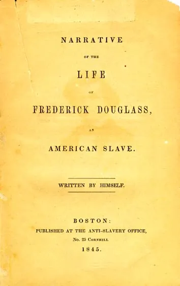
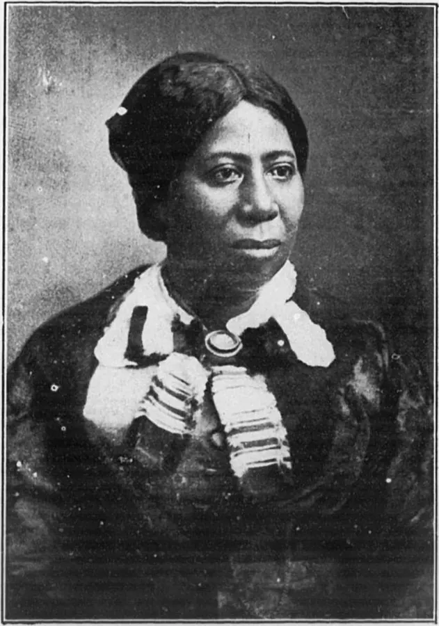
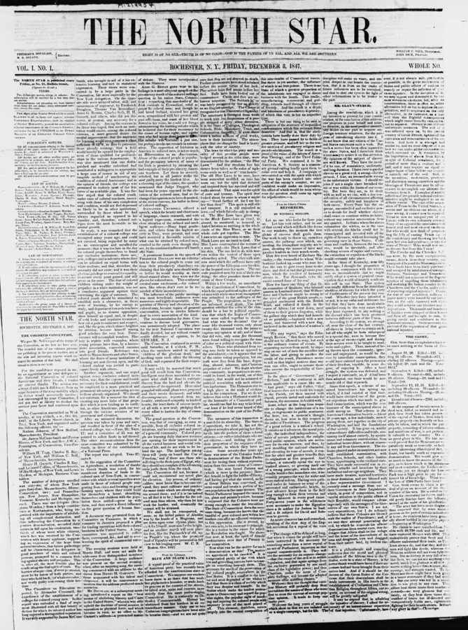
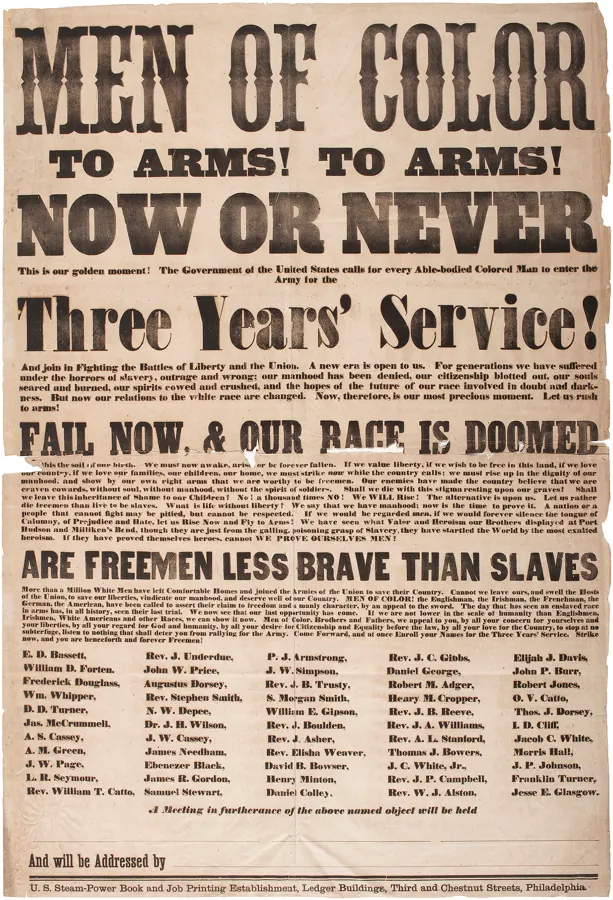
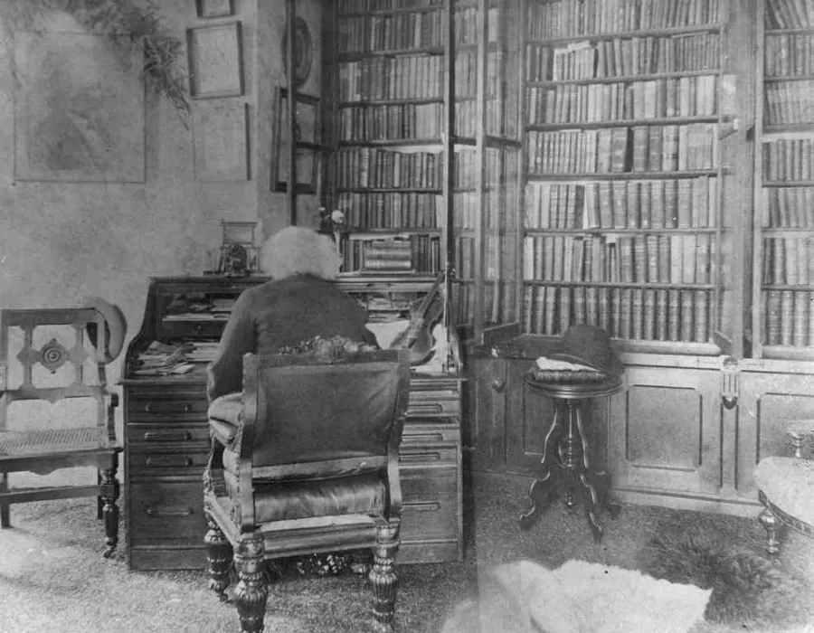
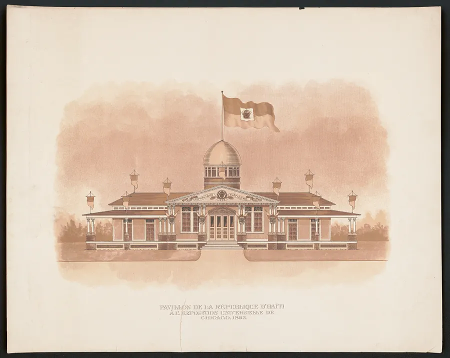

**文 / qscqesze**

一八四五年，弗雷德里克·道格拉斯在波士顿出版自己的生平。写到一八三八年九月三日，他终于摆脱马里兰州一位奴隶主的控制，本来可以交代怎样买票、借什么证件，以及第一个在纽约接应他的人从何得知消息。他偏偏在这里停了下来。他愿意让读者知道自己留在巴尔的摩要承担什么，也肯讲出两处曾役使他的人的姓名。至于出走的办法，他解释，印在书上的细节会教会追捕者堵住道路，也可能把仍住在南方的人送进监牢。印好的书可以运到他已离开的地方，承担后果的人未必和他一起搬走。[^1]

<figure>
  
  <figcaption>《自述》初版题名页，波士顿反奴隶制办事处刊印，1845 年。扫描来源为北卡罗来纳大学南方文献项目。<a href="https://commons.wikimedia.org/wiki/File:LifeOfFrederickDouglassCover.jpg">图像来源与许可</a>（公版）。</figcaption>
</figure>

他不是在一个没人认识他的地方给自己写新名字。书名把他的旧身份印在封面上，正文能让巴尔的摩的奥尔德家辨认当年在自家干活的是谁。在题名页让读者明白这本书出自他本人，对抵抗怀疑有用；对有权渡州追索的人同样有用。两种风险之间，他作了一种很难兼顾的决定。那个并不知道自己出生在哪一天的人，在纸上重新摊开自己记得的家人、工价和地点，也留下缝隙，免得一位愿借出证件的朋友同他一起被登记在案。[^1][^2]

## 马里兰的两处家

弗雷德里克出生于马里兰东岸塔尔博特县塔卡霍一带，家名贝莉。约一八一八年可以作为时间，后来他以二月十四日为生日；精确的日、月却不能倒填进幼年记录。母亲哈丽雅特·贝莉是在田里干活的被奴役者，父亲据他所闻是白人。村里有过关于父亲是奴隶主的传言，他没有把传言写成得到证明的家事。在马里兰，奴役身份随母亲传给子女，父亲是否自由不会使孩子当然自由。一家人谁可挑选住处、谁能合法用工钱买东西，是在孩子开口问自己叫什么之前便分定的。[^1][^3]

祖母贝琪在他早年生活里占的地方，比一份只记财产归属的文书大得多。母亲在别处被出租，外祖母照料他。哈丽雅特来看儿子的路按他的估计有约十二英里，要在一天的活做完之后走，到下一次出工前回去。二十八岁上下写下这段事时，他只敢数说记忆中认出母亲的几个夜晚；他不在场于母亲病终，也没能参加葬礼。把孩子放在老妇人身边、把能做田活的成人租给别家，有人从中得到收益。母子见面却要拿本已不多的睡眠和未经许可外出的风险来换。[^1]

后来他在安东尼船长的支配下住到劳埃德家庄园的中心。安东尼自己拥有农场和奴隶，也替更大的业主劳埃德管理产业。这两层关系说明，少年叫一声主人，未必指到整个产业的所有者。大宅所在之处同时发放配给、修车轮、做鞋、磨粮，监督附近各农场的人在那里取得指示。道格拉斯后来能列出成年劳工每月大致领多少猪肉或鱼和玉米面，也提到配给没有替劳工留下充足睡觉的时间：晚间还有饭食、清洗、缝补以及次日出工的准备。谷物从中央发放出去，能把许多人算在同一本账上，各户的照料只能用工余时间做。[^1]

他把亲见姨母海斯特遭安东尼鞭打写在书的开头。在那段叙述中，海斯特被命令夜间不得外出、不得接近在劳埃德手下做工的青年内德。关于奴隶主为什么执意隔开两人，道格拉斯让读者看见命令与处罚，没有提供他不可能见证的私人往来。另有一章，他写到被监工枪杀的登比，监工把惩罚说成维护命令的必要手段，周围被奴役者的见证难以变成有效的司法指控。少年从歇工时亲眼所见与工人谈起的事里，逐渐认识一处农场怎样有权调人、压下抗议，几乎不必向这些人解释。[^1]

去巴尔的摩是一次主人家作的调动。道格拉斯后来记得随小帆船从迈尔斯河出发，装载的还有羊，上岸帮忙把羊赶走以后，才到费尔斯角附近的新住处。交给他的任务是照料休·奥尔德与索菲娅的孩子小托马斯。过去留在庄园的手足即使住在同一屋下，长久和母亲分开也让彼此很少以兄弟姐妹的方式相处。少年没有把离开写成割舍完整的家庭。往城里去，恰因同辈、母亲和外祖母不能自由住在一起，才被他记成很早的一次求变机会。[^1][^3]

索菲娅最初教他辨认字母，后来又教了少量短字，直到丈夫制止。道格拉斯在两个版本里都让这项干涉占了重要位置。他理解休的意思是，对一个已开始读书的人，更难用隔绝知识来维持管束；又把索菲娅此后对阅读的戒备与屋里权力的变化放在一起。这个少年并未从此能自由上课。他能随差事上街，书和来往的孩子比庄园多，但教师随时可以被禁止再教，书也可以被收走。频繁碰面的孩子不都识得复杂的东西；他先拿面包换一点读法，再认出码头木料标记所用的几种字母，用粉笔临摹，有机会便请比自己会写的孩子比试。屋里的临字本给了他另外一种现成字样。[^1][^4]

阅读的结果之一是他找到了辩论用的语言。《哥伦比亚演说选》里的奴隶与主人对谈，以争辩的形式安排奴役和正义的关系。书里的人最终可以说服对方，现实的工钱和出行仍由奥尔德家掌握。一个读过讲词的孩子，回到码头照旧得交出所得，反而有了更多说法说明处境为何难以忍受。在一八四五年的文字里，他没有把年龄渐长后的识字写作一件始终令人快活的事。书能使他把有些以前只看得到后果的事说清楚，却不能为他当场造出一条路。[^1][^4]

安东尼去世后，道格拉斯曾被叫回东岸等待分配。他写说，同其他人一道被估价，等待分到继承人手上，分配以后有些人便去了再难相见的地方。短期又能回巴尔的摩，仍无从改变他是可再移交的财产。此后托马斯·奥尔德召他去圣迈克尔斯，把他交给农场租户爱德华·科维一年。科维手上不必一直拥有很多人，只要能从别人那里租来手脚就能经营。会用严厉的办法让年轻人服从，为他换来租用劳力的条件。地主可以通过让他管教年轻人而获益，施加惩罚的人和最终拿钱的人不必是同一个。[^1][^3][^4]

## 留在船坞的工钱

科维给道格拉斯的第一批差事包括使役牛车，早先在城里照看孩子的经验于此不很有用。按道格拉斯所记，驾牛遇险以后，错误或迟缓都可成为鞭打的理由。后来有一回他在扬谷时病倒，受到殴打，想直接去托马斯那里申诉。托马斯没有中止约定，要他回去；自述把拒绝与已经许出的一年劳力相连。求援的办法原是由租用者回到所有者，再由上一级制止伤害。他试过一次，回来的仍是原来那份雇约。[^1][^4]

桑迪·詹金斯这时接济了他。詹金斯的妻子是自由人，有一天他邀道格拉斯去她那里，并劝他随身带一点根茎，认为能免遭白人殴打。后来道格拉斯写到两人意见不同，也保留了自己肯收下根茎的细节。回到科维处，他在遭捆绑时抵抗；他记得有被叫来帮手的人没有照科维要求出力。那次争斗没有解除租约，然而照他叙述，科维在余下时间不再动手打他。他后来猜测，科维若公开求官方处罚，就得承认自己没有制伏一个年轻人，会损害招来生意的名声。这是被役使的一方给出的解释，没人能从中替科维宣誓证实他当时怎样考虑。[^1][^4]

下一处是威廉·弗里兰的农场。工作和监督的条件稍有不同，道格拉斯便同一些同伴练习阅读，也商量出走。计划利用独木舟在湾上移动，准备的通行文字佯称这是得到准许的短程外出。他们需要相互信任，因为一名持有通行纸的人可以被问到下一名在哪里。计划提前败露，几个人被押往伊斯顿，道格拉斯在牢里等其他人先被领走。他没有把最后谁透露消息说得确凿。托马斯对他的处置一度可能是送去更南方，结果他重回巴尔的摩落到休的监管之下。读写能力使他们能写纸，却不能为他们凭空增加一个愿承认那张纸的检查人。[^1][^3][^4]

在造船人威廉·加德纳的船坞，道格拉斯原要学捻缝，用工具把填料塞进板缝使船身不漏水。船坞赶造军舰，没给他从头学起的时间；因是被派来干活的，能给指令的人也不止一位。据他记述，白人工匠反对同自由黑人共事，随后他遭一群白人学徒殴打。休为此申诉，却找不到足以使案子办下去的白人证人，再把他带到自己当领班的船坞。在那里学会了熟练的捻缝手艺，到原以为自身劳动会越来越值钱的时刻，道格拉斯也正好能看出工资最后落进哪一家的口袋。[^1][^4]

他有时一天挣一美元五十美分，约定工作、完成任务、收钱三个环节都经过自己，周末却须把钱交给休。从这种做法变到获准自行揽工，他须每周固定向休交三美元，再自行支付伙食、衣服和工具。他回忆食宿每周另要两美元五十美分。有人因此可把自租工钱说成主人让出自由的做法，然而接不到活或生病的风险改由劳动者自己承担，固定款并不随着工时降下来。安排还可以由休随时收回。道格拉斯去参加宗教聚会后未按休所期望的时间回来，这份许可果然被撤去。他后来照样让休在周末收到钱，好让出走之前的工作看起来没有改样。[^1]

安娜·默里在城里同他相识，是已经自由的黑人妇女。女儿罗塞塔日后访问亲友、汇集家庭记忆，写说母亲从邻县到巴尔的摩，先后为不同家庭做家务，有能力留下积蓄。她所说的出走准备中，安娜提供了钱，也替他准备衣物；讲稿具体提及出售羽毛床所得。道格拉斯后来在自传里详写证件和列车，未相称地展开这笔钱是怎样来的。衣服可以穿走，床却不能与她一同搬家。对靠服务别人挣钱的人，在筹备者尚不确定是否能顺利抵达时处置自己的家当，这件事和在车厢里设法不上手铐一样有不能重来的后果。[^5][^6]

<figure>
  
  <figcaption>安娜·默里·道格拉斯，约 1860 年，摄影者不详。图见罗塞塔纪念母亲的讲稿，美国国会图书馆藏。<a href="https://commons.wikimedia.org/wiki/File:Anna_Murray-Douglass.jpg">图像来源与许可</a>（美国公版）。</figcaption>
</figure>

废奴后公开的第三部自传说，他借的是一位黑人水手的证件。纸上有鹰形图案，外貌描述并不十分吻合；若细审，持证人和借用者都可能有麻烦。他从巴尔的摩乘车北去，中间要渡水换乘。职业口音和服装能使所称的水手身份显得可信，但还要碰到不逐项比对描述的人。费尔斯角的技术工人与船员中有人能接上这种忙，纸之所以过得关，一半靠他敢拿出那张纸，另一半则靠查验制度把相距很远的几项判断留给一个匆忙经过的列车人员。出走成功后，他在纽约仍须想清楚谁能帮忙、谁会把人交还。[^1][^6]

## 在新贝德福德找活

使道格拉斯在纽约能够留下一张可查的婚书的人，是牧师詹姆斯·彭宁顿。道格拉斯在自传中照录了文书：一八三八年九月十五日，弗雷德里克·约翰逊和安娜·默里在见证人面前成婚。约翰逊是他此时用以避开追捕的名字；由于是他自己把这一份证明收入书中，读者才知道主持婚礼的人当时如何称呼新郎。这件事能办下来，还因为戴维·拉格尔斯为他寻到住处。拉格尔斯在纽约为可能被诱捕、带走的人奔走，也劝这个新到者别把自己长期留在追索方便的城市。道格拉斯想过加拿大；听拉格尔斯说新贝德福德可能找到本行，夫妻便先向东北走。[^1][^6][^7]

拉格尔斯给过他们五美元，启程前还准备了投奔用的介绍信。到纽波特换乘时，钱仍不足以把两人和行李都送到目的地。年老的道格拉斯讲过一个更具体的后续：车夫把行李扣下，直到有人借钱让他们补足车费，其中还包括随行的乐谱书。借钱的内森·约翰逊和妻子波莉招待夫妻，让他们先有住所。道格拉斯同意请内森另选姓氏，以免这个已经有许多约翰逊的地方再添一个。内森正在读沃尔特·司各特的《湖上夫人》，从书中选出的姓在新的住处用定，弗雷德里克则保留了幼年名字的一部分。受助之人不是到了终点才知道别人做了什么；在购不到下一段车票前，找住处和找工作的事根本无从开始。[^1][^6][^7]

巴尔的摩船坞的手艺没能立刻换到预期的岗位。这个从捕鲸业积累财富的港口也有不肯跟黑人同做一行的白人工人。道格拉斯去码头装油，随后做过多种零活。在一八四五年的版本里，他把新贝德福德的首份劳动记得分外清楚，因为第一次可以把从这种重活里挣来的钱拿回自己家。在两个港口，他都曾在别人安排下做完一项任务；差别是收工之后没有休·奥尔德在家等着把钱数走。钱够不够交房租、买食物仍可成为困境。安娜继续靠做工补贴家用，也料理家务，孩子出生后，这份生计的计算不会比北上时容易。[^1][^5][^7]

家里出现一份需要每周花时间读的报纸，是在夫妻来到港口之后。威廉·劳埃德·加里森办的《解放者》来自波士顿。刚落脚时道格拉斯觉得订不起，后来仍开始订阅；接触地方废奴活动，不再只靠遇到演说者那天有无空闲。新贝德福德有自己的黑人居民组织和互助办法。道格拉斯回忆港口有人为追索者可能夺走逃亡居民而准备集会和应对。这不是马萨诸塞州已有一部足以使所有来人安睡的法律，而是在相识的人可能失踪时，彼此知道该找谁。读报与加入聚会都让他能把过去某家特定船坞里发生的事，放到更大的北方生活里去检验。[^1][^6][^7]

一八四一年八月，来参加楠塔基特反奴隶制会议的道格拉斯上台讲了自己的遭遇。听众中有加里森，后来写序时把这次见面说成一个有新闻价值的时刻。废奴组织随后让道格拉斯参加巡回演说。这是带报酬的工作，因而他可以离开港口做一项别的事；也有固定的会面地点、交通、出面联络的人都得事先安排。资料并没有把道格拉斯在走上讲台以前描作一个与公共演说毫无关系的人；宗教生活与地方会议都给过他开口的训练。在楠塔基特以后，他要经常去一个不认识他、未必同意他、可能不让他进礼堂的地方，把听众曾推到生活之外的事再说一遍。[^1][^3][^6]

巡回并不只是把听过的话重复给人数更多的听众。组织者容易把亲历者当最可信的证人，请他多讲自己的受难，把一般的论证留给别的演说者。晚年的道格拉斯记下过这种分工给他的压抑，也知道演讲中若不明确说出受哪家役使，就有人怀疑如此能讲话的人从未遭奴役。不同问题要用相反的办法回答：想保全逃亡秘密，就不能完全公开；想消除别人对经历的怀疑，反倒得把姓名和地方印出。和加里森合作让他接触更远的听众，其中一部分人还会因他不再只讲到自己最惨的一天而开始争论。亲历是他进门凭据，若后面的发言只能重复亲历，他也没有完全决定自己在做什么。[^1][^6][^8]

一八四三年，在印第安纳州彭德尔顿巡回途中，他和同行者遭遇暴力，手受了重伤。道格拉斯在多年后回访那里，记下曾给他包扎照料的哈迪夫人。对组织会议的人来说，能不能在敲门前找到愿意主持的人，关系到一个外地来的讲者能否入场，也是遇到殴打和侵扰后由谁提供庇护的问题。台上所说的尊严从未同交通等小事分开：在马萨诸塞，他曾因拒绝接受铁路的种族隔离座位被逐出车厢；一个愿意主持会议的人不一定能逼铁路给他与白人同样的车位。[^3][^6]

## 赎买和开印

一八四五年的《自述》在题名页明说由当事人写作，卷首仍有加里森的序和温德尔·菲利普斯的信。两位在废奴界已有声誉的人能替书的写作与内容请得第一批读者；两名前辈都在序文中替作者作证。题名页已印了作者姓名，他们仍预料有读者会怀疑书中所写。道格拉斯的写法并不把自己关在最初的白人作序者介绍里。像把被转交的老人、白人船坞同事或能认出木料记号的孩子分别写实，人持不同位置，便有了读者可以检验的不同利害。篇末还附论，区别他所理解的基督教与为奴隶主制度背书的宗教实践，免得正文提及几位教徒便被理解为直接拒绝一切信仰。[^1][^8]

书出版后他远渡大西洋，既为巡讲，也避开身份变得过于容易辨认所增加的危险。安娜与孩子暂留美国。道格拉斯在爱尔兰能把书交给新的出版者，带着印好的文本前往多个城市；讲演时接待他和买书的人并不知道马里兰的小地名，却能据文字问一个事实而不只问眼前人讲得好不好。在苏格兰，他要求当地自由教会退回向美国南方蓄奴者所募的钱。那是针对一笔有来路的资助而作的要求。支持教会的人可以同意奴役残酷仍质疑将钱退给捐款人有何实际作用；演说者追问，若教会把这些来款视作平常，奴隶主便能携教友身份到国外而避开对其收入来路的讨论。活动未能迫使教会照办。[^3][^6]

他在海外曾用书信比较许多场合的待遇，并未永远免于遭到隔离。在回国前后叙事里，他说已购头等票，船公司地方代理仍把铺位给了别人；在美国之外得到的平等接待也会在美国公司相关的船运规定前终止。海外友人的帮助却能使他在返乡时拿出不一样的文件。纽卡斯尔的安娜与艾伦·理查森参与募款和联系。一八四六年十月六日，休·奥尔德在信里提出的金额是一百五十英镑。这笔钱同托马斯把权利转到休名下时所写的一百美元不是一笔；前者是为放人出的赎款，后者是奥尔德兄弟之间的交易额。转让目录、后来抄印的文本和自由文书各有登记时点，不能把谈妥价钱的日期直接写成已获释。休所签解放书落款十二月五日，随后才登记。[^3][^6][^9]

有人反对赎买，认为用钱成交就承认人能够作为财产出售。他自己后来把支付理解为赎金，理由是自己可以留在英国受到庇护，但已公开从事废奴工作，返回美国时比从前易于被辨认。他所希望买下的，实是回家之后不再能由奥尔德直接出示所有权索还。文书上的名字保留贝莉与道格拉斯两个形式，指向的是同一个人。奴隶制没有因这一回交易而废除，集钱人也没有使他的亲族都自动取得自由；具体而有限的改变，使接下来办报的地方可以放在美国而不必永久在英国。[^6][^9]

英国朋友已有送他纪念礼物的意思，他后来回忆自己要求用能开报馆的器材或钱代替。多少是赎款、多少为办报募集，应当分开。这笔钱可以出第一期，但机器再好，每周仍得找到纸、排字的人和递送报纸的办法。在美国他受到部分同事反对，何必增加一份已有同题报纸、为何不继续专做讲演，是当时可以提出的问题。道格拉斯要取得的恰是一家由自己负编辑责任的报馆：传记可以隔几年另出一种版本，报纸却能在一场地方风波刚发生不久就挑出值得追问的人和机构。[^6][^8][^10]

一八四七年十二月三日，《北极星》在罗切斯特创刊。与道格拉斯共同担任编辑的马丁·德莱尼，已有在匹兹堡经营黑人报刊的经历，了解稿件要送到怎样一群读者手里。报头宣称权利不分性别，真理不分肤色。创刊号还刊出一组能说明道格拉斯已经自由的文书。这既是面向办报人法律身份的声明，也是选择把有利害的证件给全国读者看：证件在哪个州有效、从谁的手里过，有时比一篇夸奖主人公勇气的文章更能解释个人处境。报馆成为工作地点后，他可以决定这类材料居报纸哪一栏，也必须在下周再次找出值得付纸钱的内容。[^9][^10][^11]

<figure>
  
  <figcaption>1847 年 12 月 3 日《北极星》创刊号第一版，道格拉斯与马丁·德莱尼编，美国国会图书馆藏。<a href="https://commons.wikimedia.org/wiki/File:The_North_Star-Vol1-No1.djvu">图像来源与许可</a>（公版）。</figcaption>
</figure>

创刊号给读者看的还有账面上的事：机器和用具已经买妥，营业场所已定，有人负责办公室，排字印刷的人待开工。前几期要作为样报寄给一些并未订阅的人；想继续收到就得付两美元。纸和邮资要在订户把款寄回来前付出，送得越远也未必卖得越多。道格拉斯在社论里写得很清楚，要长久办下去的一份报必须由受过奴役和压迫的人自己管事。这个要求不仅是社论署名；谁持有机器、谁有权用办公室和接受订费，和选哪些消息同样重要。[^10][^11]

## 一张报能容下几种意见

一八四八年九月，道格拉斯在出逃十周年给旧主人托马斯写公开信。写给一个人，也是给订阅者看。他把自己现在能过的生活与此前的处境相较，追问家人的去处。他想知道祖母的下落，也指责托马斯让她衰老时无人照顾。后来听到祖母曾被接回照看，他又写信更正原先的指责。后写的信不曾达到当初公开信相同的效果，也并不证明曾被分开的一家人从未受害。这件事给报人带来一个实际的难题：控诉的根据可以来自亲手承受的经历，去世与照料的消息却不由远处写信的人全知，哪怕读者已经站在他这边。[^1][^3][^12]

同年七月，塞内卡福尔斯的妇女权利会议提出包括妇女选举权在内的决议。选举权使部分与会者犹豫，他们未必反对在财产、教育与婚姻上改变规则，却担心一开始就要求选票会使其余目标也失去听取的机会。道格拉斯公开支持要求，并把议题带回报纸。报头已把权利和性别的关系写出来；遇到一场有分歧的表决，他得决定这句话对当日的决议有什么意思。于是后来人还能在会议文件和他随后发表于报纸的主张之间互相查对。[^13]

有些来信所问的，则是本周报馆能否发出下一期。英国来的朱莉娅·格里菲思参与募资、编辑与经营。她把别处的捐助者、地方废奴妇女和一份需要按期印出的报联在一起。资金使用并不光是支撑编辑旅行，也要结算雇工和材料。安娜负责家中事务，是朋友和来人接触到的另一位主人。历史学家戴维·布莱特指出，道格拉斯三部自传很少交代安娜，也极少提报业对格里菲思的依赖；报馆之所以可以把一期报准时寄出去，读者看见的作者名字远少于实际当事人。有些后来的记述把几位女性之间的事讲得很细，公信、组织记录与家庭成员的追忆对于可查实的部分各能提供分寸。[^5][^8][^10]

罗切斯特也在逃亡者前往加拿大的路上。一八五〇年国会的《逃奴法》扩大联邦执行追索的办法，逃到不实行奴隶制的州也更可能被拘押、移送。法律允许在远离原来工作的地方提出追索，受指认者不能像通常诉讼当事人那样以自己的证词对抗指认；窝藏或协助者也有受罚风险。道格拉斯夫妇已经有自己的释放文书和合法自由身份，但受他们帮助的人不少还没有。有人需要一夜住所，有人需要找知道下一段路的人。对于开报者，公开写制度伤害了谁，同不把实际收留、转送的办法写得足以供探子使用，是从早期那本书延续下来的两种工作。[^3][^5][^14]

若联邦法律的确在办这种事，曾给《自述》写序的加里森便有理由说联邦宪法与奴隶制不能分开看。立国时曾以人口折算影响众议院名额，也留下了被役使者越境可以追索的条款。在这样的安排里，加里森把拒绝与奴隶主维系政治联合、拒绝让道德运动从属于选举，视为废奴者不应让步之处。道格拉斯曾站在近似的位置。开报以来同杰里特·史密斯等政治废奴派交往，他开始采纳另一种解释。他得考虑，把宪法整个交给懂得用它维护奴役的人，会不会令废奴者也自己放下了能向全国提出的要求。[^3][^6][^15]

到一八五一年，他把转变公开，旧报易名为《弗雷德里克·道格拉斯报》，获史密斯一系支援。变化既涉及还有谁为报纸出钱，也涉及把什么候选人看作可能的盟友。后来在格拉斯哥向反奴隶制听众解释时，道格拉斯着重区别文字与制宪者未明言的意图；宪法不使用奴隶一词，序言所申明的自由和正义可成为解释条款的凭据。他把以五分之三折算人口的条款拿来反问，若只给蓄奴州计入较少人口，为何必得说那是在给蓄奴者优惠。这一读法为积极争取政治权力提供了理由，却并不能取消蓄奴州确曾从把无选票者计入代表名额中获益，也不能让已经离家的被追索者立即免于被捕。宪法条文公开了，哪种解释会落实仍是斗争的一部分。[^14][^15]

一八五二年七月五日，罗切斯特妇女反奴隶制协会请他在科林西安大厅演说。独立纪念日通常把建国者放在讲台上，他先承认反抗旧权力所需的勇气，再从全国分享同一个节日的假定中退开一步。他要求在纪念会坐着的人想到，同一部法律怎样约束方才受称颂的民众的后代，怎样送还逃亡者、默许拐卖和从被奴役者身上取得收益。他没有花时间证明黑人也是人；法律会处罚被役使者，劳动者也能自行从事许多活动，对他们的责任和能力，实际做法早就承认过。演说只要求听者接受自己每天已经据以行事的一部分判断，并看看庆典能不能真由同样的人共享。[^16]

稿子进了印刷机以后，读者可以看到演说还有后一半。他列举连亲生子女也会被带走的制度，用的是当下州法和市场交易，接着批评一批愿意为世界别处的压迫发声、在国内却接受逃奴法的基督徒。他也留下一条对宪法的不同解释，不把联邦只说成必要一分为二的东西。在同一间厅里，他既不打算代受邀组织夸贺既成的自由，也没有要求组织停止念《独立宣言》。他借用这份宣言中本来许给人人的名词，追问为什么有些人只能被指使参与国家的节日。需要他作讲演的是一群愿听批评的地方居民，这比他早年被要求只说自己挨了什么打，给了写作者更宽的空间。[^15][^16]

一八五五年，他出版《我的奴役与我的自由》。这本书让早先未详述的一些亲族、邻居、识字经验以及成为演说家的曲折占了更大篇幅，仍不公开出逃全部手续。为书写导言的是黑人医生詹姆斯·麦丘恩·史密斯。两本前有导言的书并置，会看到要求读者信任的办法略有变化：最初有波士顿废奴组织领头人担保见证的可信，十年后作者已经经营报纸，合作的人可以直接谈语言、写作与政治主张，并花更多地方讨论北方社会。回忆录仍不是可任意展开的密档。每个版本何时肯写到什么，与当时还有人被追索的处境分不开。[^1][^4][^8]

此时另有一位朋友对等待政治改变越来越没有耐心。约翰·布朗与道格拉斯早在一八四七年相识，谈过用武装力量帮助被奴役者。道格拉斯明白这种提议的吸引力，科维农场和随后押送他的牢狱便能解释，为什么一份既有规则不会靠请求自行消失。到一八五九年，布朗希望夺取弗吉尼亚哈珀斯费里的联邦军械要地。道格拉斯晚年写到两人在钱伯斯堡附近见面商量，他不赞成打军械库；隔断退路、诱来政府的优势兵力，会让这次行动难以从最初打进去延续下去。在那次商谈里，他没有说服布朗放弃，也没有加入。同行的希尔兹·格林留下，选择与布朗同去。格林是自己曾脱离奴役的人，对要不要再从远处等一个机会，他作了另一项有代价的决定。[^6][^17]

袭击在十月发生，布朗被捕受审，后被处死。道格拉斯因与他相识和先前来往而可能被牵连，离开美国，经过加拿大转往英国。他可以反对行动路线而继续承认关系，处在追究责任的人面前，这两句话不会抵消彼此。在多年后的哈珀斯费里，他用一场演说重新谈布朗，并将刊出讲词所得给斯托勒学院筹办教席。当时他已经能够回到这处地点公开讲自己的判断，但这件事同一八五九年留下来和布朗一道受审是两种不同的风险。演说把布朗的行动放到内战已经发生的年代回顾；早在出事前反对的那些理由，却不能在事后写成他已同意那次突击。[^6][^17]

## 征兵告示上没有写完的事

一八五九年离美时，道格拉斯把家庭与报馆都留在罗切斯特。次年，小女儿安妮去世，他从海外返回。战争随后让这个家里已成年的儿子有了各自要做的决定。道格拉斯并非在南方诸州开始脱离联邦时就从政府那里拿到了征募任务。联邦当局起初把保存合众国放在明处，边界奴隶州能否继续留下又是一层顾虑；即使北方有人立即要求以废奴为战争目的，能在讲话里向政府提出这件事，也并不等于所在州可以给一名黑人志愿者发军装。[^2][^3][^18]

对道格拉斯，争取让黑人入伍与争取解放是连着的。他主张，既然奴隶劳动给南方军队提供物资和服务，联邦纵容这种劳力继续被占有，便有实在的军事代价；黑人携武器参加也会使双方不能照旧把当事人当成只等别人分派归属的财产。一八六三年元旦，生效的《解放宣言》指向仍在叛乱中的指定地区，并非一步就使全国所有地方的奴役关系归于消灭。它允许符合条件的黑人进入联邦武装，也使那些原先只可提出而不能办理的征募主张有了实施的门。各州和军方仍要有人收下他们，征兵人须能回答薪资、给养和战争结束以后身份是否有着落。[^18][^19]

在马萨诸塞第五十四步兵团的招募中，道格拉斯投入自己的关系和名声。要从黑人居民散处的各地招来一个单位的人，单在马萨诸塞首府开张是不够的；需要代理跑到别处，需要把发出的消息变成家人可以讨论的选择。报刊上以征募为题的文字要说服人离开有工作、有责任的住处。它的条件远比订一份杂志重，传单上的一句劝告有时还要由各处已经报名的人向亲友说明。道格拉斯把战争和公民位置相连；如果联邦接受一名黑人为自己打仗，以后再称此人只能受治理、不能参与治理，就必须解释他被接纳时已经做了什么。[^19][^20]

<figure>
  
  <figcaption>1863 年费城征兵海报，道格拉斯与当地倡议者署名。此图来自 Cowan’s Auctions 所示印本。<a href="https://commons.wikimedia.org/wiki/File:Men_of_Color_Civil_War_Recruitment_Broadside_1863.png">图像来源与许可</a>（公版）。</figcaption>
</figure>

两个儿子刘易斯和查尔斯参加了第五十四团。查尔斯写回的信使征募不只是父亲后来回忆的一项活动，档案可读到同一家里有人怎样从军中向家里报告见闻。刘易斯随团参与了七月对瓦格纳堡的进攻并幸存。第五十四团的行动并未一举攻下堡垒，部队承受的损失却使北方报刊不得不认真谈论黑人部队的战斗。对这个家庭，则须把为人父母者可能担忧儿子生死，同接下来还要不要请别家的儿子报名分开考虑。能够向公众指着参军的儿子说这回确已入列，并不说明他已能替儿子向军方取得和白人士兵同等的条款。[^19][^21]

入伍后许多黑人士兵碰到的，是白人士兵每月通常十三美元，黑人所给十美元中还可扣三美元衣装费的待遇差异。不同部队、不同授权和后来改革有各自的支付细节，不能把这两个数直接套到战争期间每个人身上。第五十四团不少士兵拒领不等的军饷，家庭不会因拒领便停止需要钱。这和年轻时道格拉斯把挣得的钱交给休·奥尔德并非同一法律关系，然而在两件事里，都是劳动已经完成、领钱规则另有一套。父亲可以把士兵让政府遇到的问题说得很直截：联邦要他们承担一种与白人同样的危险，却把承认这份劳动的额数减了下去。[^19][^21][^22]

他还要问，被南方军队俘获的人能不能按战俘对待，他们有没有可能升任军官。俘虏如果被处死或重新奴役，战争之外原有的身份划分便跟进了战地。同在一封征募告示上，这些问题不那么容易用大字排出，给报名者却并不次要。一八六三年八月十日，道格拉斯在华盛顿向林肯提出军饷、俘虏待遇与升迁等事。会面给了他一个从战争部和白宫得到答复的场合，但不是得到立刻兑现的书面承诺。林肯仍顾虑白人士兵及舆论的反应。在这次争执里，道格拉斯并未单凭一次被总统接见的体面撤掉问题，也没有靠行政首脑愿意听，就给军队里的不平等写上结束日期。[^19][^22]

战争部当月给道格拉斯发过一项赴密西西比州维克斯堡、向洛伦佐·托马斯报到以协助征募的命令。保存下来的文书能证实这项命令存在，不能仅以行程令就断定他依令任职或进入该处。他确有替联邦军征募的活动，不须为此找一顶并未得到的军官帽。黑人从军的实际规模及军饷后来得到的调整，也不应归结成一次备忘或一个人的坚持。军营里的士兵曾用拒领表明意见，州官、报人、国会和行政官员争执了不止一个时段；道格拉斯在里面能做的，是把原先很可能只在营房里说的话带到全国听得见的地方。[^19][^21][^22]

一年后，林肯再要见他。战争胜负尚未决定，大选如果改变行政政策，尚在邦联控制区、未能到达联邦军线之后的人能否脱离奴役便更难保证。林肯问能不能把消息送进去，让更多人离开。按留下的记录，道格拉斯提出动用熟悉地情的人，把消息和出走办法送到联邦军可接应之处。这项计划没有按原设想大规模实行。他原在自己写书时不愿向全世界说清一张纸怎样带人出走，如今能与掌握军队的人商量如何开一条路，出发的理由相近，责任的承受者已有不同。路若安全，要看军队行进到哪里，不能只靠一道宣言远远写好。[^6][^22]

一八六五年三月林肯第二次就职，道格拉斯在总统的接待会上又见到他。按道格拉斯的回忆，入口有人试图挡住他，消息传进去以后才获准进入，林肯问及他对就职演说的意见。门口的那一道检查，和总统愿问一个黑人意见可以在同一天发生。重述这次见面的道格拉斯也没有说战争期间白宫所有决定都深合己意。他是在林肯尚未遇刺时听见的询问，在许多年后写进书里；人们能借此比较两人关系的变化，却不宜把事后留下的对话原样当作当晚一言不差的记录。[^6][^22]

## 谁能把名字写进选民册

战争结束前几个月，道格拉斯已开始向废奴运动的旧友追问，它何时才算完事。长年经营反奴隶制会务的人可能判断，废止奴役即将写入根本法，原组织就可歇手。对道格拉斯，法律宣布一个人不归旁人所有以后，谁能让当地官员服从法律还没解决。一八六五年他谈黑人所求，把学校、公共场合和选票都列在具体生活里：人本来可以自己走到这些地方，法律和有权拒绝他进入的人却可能使路中断。他一再反对拿施舍或监督来代替具体权利；要求他人别挡道，并不是宣称法律无需出力。[^23]

第十三修正案废除奴隶制与强迫劳役，同时保留作为犯罪惩罚的例外；它没给以前不许投票的人增发选票。第十四修正案定义出生或归化公民与平等保护，随后第十五修正案规定不得根据种族、肤色或曾被奴役而拒绝或减损投票权。三件事经过不同年代的批准，不是在南方军队缴械的一日里一起发生。更详细的选民登记办法仍有州和地方插手之处。能够抄下修正案本身的人并未因之都敢在当地登记。当恐吓针对的是可指出姓名的活动者与家属时，做一个有名的黑人共和党人在地方上会付出真切代价。道格拉斯把投票看成由此可参与决定官员和法律的人事问题。[^23][^24]

曾与他在塞内卡福尔斯站在一起的人，也要求对女性开放选票。到一八六九年，美国平等权利协会的一次会议上，大家在争一项是否可以先支持黑人男子投票的修宪。道格拉斯支持妇女选举权，在会场却主张黑人男性的选票在当时遭遇暴力的地方尤其迫切。有人问，黑人妇女岂不同时遇到他列举的危险。他承认有这些遭遇，把危险在论辩中主要归于受害者的黑人身份。这样处理没有回答一个黑人妇女能不能既按种族又按性别被排除在外。她如果承担同样的暴力，在修宪通过后仍不能凭此登记，不会仅凭听到未来还可再争取就有同样的时间表。[^25]

伊丽莎白·凯迪·斯坦顿与苏珊·安东尼等人，反对把她们要取得的投票权推迟到下一阶段。有的反对论辩使用关于受教育程度和种族的等级眼光；也有其他倡议者接受先落实这次修宪，仍将妇女选举权视为接下来要办的事。道格拉斯同以往盟友的冲突既有手段，也关系他们认得出谁因为等候付代价。这个长期被人指作逃亡者的演说者，终于能够在国会修宪相邻的场合争论谁先获权。他的选择改变了可以维持的联合，却没使早年的妇女选举权主张自动失效；它在他死去的那一天仍有当日的活动可查。[^13][^24][^25]

同一年的另一场演讲可以看出，他没有把选民册只当作美国黑人最终要挤进去的窄门。十二月，在波士顿谈《我们的多族裔国家》时，他反对由于华人出身便不许他们来美国，也不把新来的人只算作可以承担低工资的劳力。他把迁移解释为人可以主张的权利，并将移民参加政治同美国国内的人口、疆域和劳动联系起来。他的说法也有十九世纪的前提：他谈学习共同语言，认为了解美国公民职分以后应把移民纳入政治；并不假定各地已有同样的条件。争执在这里实际涉及一份法律或公共安排将人放在哪一栏：是可以由雇工市场使用、随后仍能按出身拒绝的人，还是能够定居、申请公民资格、与先到的人一道参与政治的居民。这个议题并没有从他与女权同盟的分裂里自然解开。他在不同场合分别争论种族、性别和国籍，有时同样扩大权利，有时又在现实安排中给它们排了次序。[^26]

战后二十多年里，道格拉斯仍要用报馆支付他的部分政治主张。一八七〇年前后，他参与华盛顿面向黑人读者的《新国家纪元报》，家里几个儿子也参与经营。罗切斯特时期一个编辑从旅途中寄来的稿件，到华盛顿可以摆到讨论联邦政策、黑人新选民和任职者的位置上；问题仍是有谁愿订到下个月。报业也还会同其他更稳定的收入相争。一八七二年罗切斯特的家发生火灾，许多珍藏报刊以及手稿受损或焚毁。后来人整理报纸常要从别人的订阅本一点点找回哪几期。道格拉斯已经多能进入国家政务所在的城市，失掉的材料却不能由更高的官职补办。[^3][^8][^10][^27]

## 银行门内外

这一时期，他接触到一种比周报更难向客户交代损失的经营。一八六五年由国会立法设立的自由民储蓄与信托公司，最初让黑人士兵和刚从奴役中出来的人有地方存小额工资。许多存户不能像家产丰厚的人那样靠认识当地银行家受到接待；从军的经验、教会的消息或分行的招徕，使他们知道有一家以这件事为任务的机构。银行在若干地方开设分行。后来留下的开户册之所以能够帮助后人找回家庭资料，是因为开户时有人逐项记录申请人的亲属、居住和身份。当事人到门里主要是要存钱；对出生记录往往不完整的人，姓名随存款落入册页，倒给后人多留了一种辨认办法。[^28]

银行扩张后所吸收的存款，不能由存户逐日跟着去看放贷。国会一八七〇年修改章程，使一部分钱可投入与先前不同的项目。放贷和投资中有不良安排，快速扩张、内部人交易和一八七三年金融恐慌一起使兑付越来越难。拿存折来的人只知道自己交了多少，无法从一间分行还有窗口服务知道总行还剩多少可用的准备。许多存户把国会特许和公家出面当成钱不会亏损的担保，实际并没有一份联邦保证存款完额付回的承诺。纸上有几个字可以令人信任，却需要有别的条文和资产才能兑现。[^28][^29]

一八七四年三月，道格拉斯被选为银行行长。任用有名的黑人，可以让怀疑钱有危险的客户放心，也能使许多算不清楚总行运作的储户以为这下真的由更可信的人作主。他接受时，最理解的是这家机构给存户的名义机会，对以往放款质量并无完整了解。后来的国家档案馆叙述记载他拿出一万美元以示信心；道格拉斯回忆清算时留在银行、与普通债权人一同承担风险的存款则说两千美元。两种说法涉及不同时间和款项，不能直接加在一起，或者把一个数换成另一个数来印证。他确有个人财务得失，但数以万计委托机构看管积蓄的人不可能以他的损失领回本钱。[^28][^29]

按他晚年的记载，上任不久，他便认为该公司已经不能安全保管存款，去向国会有关委员说明应停止经营。银行中有官员与受托人坚持还能渡过危机，甚至有人先前给出令他担心的资料，随后又对委员支持继续。两种说法并列在同一机构不同人送出的证词里。国会最后指定专员处置资产；存款人随后也无法立即足额取钱。负责办过报刊的人曾靠自己的声誉向读者、工人与捐助者借信用，这一回同样有人把名字看作接管时已知的风险是不是真实的担保。道格拉斯试图止住更多损失，也在自传中为自己辩解，明说导致坏账的贷款都早于他的行长任期。投资政策、旧债、挤兑和实际任职时间之外，还须追问董事们何以让名声代替对账，这个问题并不由于行长后来写得有理就能取消。[^28][^29]

在当日华盛顿，能够纪念废奴的人也可能刚经历银行停业。解放纪念碑需要一笔具体的捐款才办得出来；纪念活动的历史通常从刚获自由的夏洛特·斯科特交出五美元讲起，随后从获自由的黑人等处募集。雕像所归属的捐赠和由谁掌握造像方案，并非同一批人的决定。到一八七六年四月十四日揭幕，道格拉斯受邀演说。林肯站立，另一人跪着的造型使自由被想象为由前者颁下；讲者手里没有改动铜像的权力，却可以选择在仪式上怎样谈与林肯曾经发生的事。[^30]

他没有把林肯说成毫无条件地站在黑人一边的人。演说承认，总统最早以拯救联邦为要，又长期不得不算白人舆论。按废奴者立刻行动的尺度，他的进展有时很慢；从他所能调动的全国力量看，走出的步子又有不同后果。道格拉斯将它们放进一场纪念演说，听者因而不能用总统后来的名声提前让一八六一年已经解决奴役，也不能排除战争中权力改变所开的路。讲台上说到的林肯，是一八六三年尚未许诺立刻消除军饷差别的人，也是后来向他询问怎样使更多人抵达军线的人。台下如果有黑人老兵和捐赠者，本人的劳动与服役已有与铜像不同的记忆可以依据。[^22][^30]

揭幕过去五天，他又用报纸补讲了台上未充分展开的一层。在华盛顿《国家共和报》上，他说托马斯·鲍尔的像能表现林肯解除束缚的一面，不能把全部事实都留给这一座像。雕塑中的人虽正在起身，毕竟仍单膝着地，作品也没有把随后成为公民、取得选票的历史表现出来。他并未向读者提议取消揭幕时已经表达的敬意；他的提议是在同一座公园有地方再立一座像，让黑人以双足站立的姿态出现。五天里，从为一个仪式作讲词到向报社投信，他并没有重复同一件事：前一处可以承认纪念的理由，后一处则有机会说，这种叙述不足以替其他当事人留下位置。[^31]

## 雪松山的住处和城里的职位

重建后期，道格拉斯同共和党之间的关系开始落实为公职。拉瑟福德·海斯于一八七七年任命他担任哥伦比亚特区联邦司法执法官。这不是给一个知名讲者一处往后无事可做的安置。联邦司法文书有执行环节，首都职务在当时的社会生活中也有礼仪先例；道格拉斯任职使不同号码的门开始向黑人打开，惯例却不会因人事公告一律改变。他在自传里解释过任职条件与白宫礼仪并不相同，从前由担任这一职务的人参与引介的场合，他没有被请去担任引见人。知道总统一次愿见他，并不能推定首都所有重要聚会都接纳同样的主人。[^6][^32]

同一年，夫妇在华盛顿河对岸一处高地买下住所，取名雪松山。安娜从巴尔的摩带钱和衣物协助他出逃，到两个人在新贝德福德借钱赎出行李，再到能购买一处要长期打理的房子，四十年间家里的经济已经变了。照片里保存下来的书房，有一张他坐在桌旁的影像；这只能显示他能在自己的住宅里保存书、纸与桌子，还显示不了以往家庭工作用了多少时间。安娜承担照料、持家和接待的部分，三部由丈夫写的自传留给这些事的地方都很少。后来罗塞塔将母亲从第一次外出受雇写到料理新家，不只是告诉人那个出了名的丈夫需要帮助，也是在补一位劳动者自己如何挣到钱、如何决定怎样花。[^5][^8][^32]

<figure>
  
  <figcaption>道格拉斯在雪松山书房，具体拍摄日期及摄影者不详。美国国家公园管理局藏，FRDO3886。<a href="https://npgallery.nps.gov/AssetDetail/302B5493-1DD8-B71C-07700EA78D7CF7A3">图像来源与许可</a>（公版）。</figcaption>
</figure>

重回东岸也有另一层意思。托马斯·奥尔德年老病重时，道格拉斯去圣迈克尔斯探看他。他事后把所记的谈话写入《生平与时代》，包括对早年相待问题的交谈。读者没有必要为了保存先前给托马斯写过的控诉而删去这次来访，也不能从一次和解式的会面倒推昔日出租、鞭打与收走工钱系误会。同一个人能选择见面，本身已是两人地位变化的事实，而双方在屋里究竟以怎样的字句说了什么，只能从其中一个人许久后的记述了解。道格拉斯开始采访与自己经历有关系的人，这些信息变成第三部自传的资料，却并非每一位当事人的独立证词。[^6][^32]

后来他任特区契据登记官，工作与书中的另一件事正好有形制上的相似。早年休·奥尔德签一张释放文书，仍须在地方手续中把它变成有效记录；如今他任职的机关，处理的是当地买卖、地产和其他权益的档案。不能由这项巧合断定他每天把登记案件当作象征。他有工资和公务，要与雇员和申报人共事，也还在别处演说。一八八一年问世的《生平与时代》终于公开了从巴尔的摩逃亡的办法。书里增加了英伦、内战、共和政治和银行失败，作者在政治上的解释已不像只须说明自己是怎样被转手和怎样不再归别人所有。也因为此前的制度已经改变，水手证件才可以在纸上写出。[^3][^6][^32]

一八八二年，安娜在中风后去世，两人已共同生活四十四年。女儿在母亲纪念讲稿里辨别几次搬家和家庭开支，提醒听者，许多辛劳普通到没有人觉得有必要抄进废奴史。她所写的母亲也有朋友、信仰和对书本教育的看法；能在家安排孩子有规律地读写，与自己是否留下可出版的文章是两件事。报馆可以陆续找到出资人，家务很难按相同办法找认捐人把原先的缺口补齐。道格拉斯从前每离开家上路，安娜便多接一部分实际责任；她去世之后，留下的不止是丈夫的孤独，也是几个成年子女与父亲各有不同记忆的一段共同生活。[^5][^8][^33]

海伦·皮茨是白人，来自支持废奴的家庭，以前教过书，也从事改革工作，后来在道格拉斯的契据登记办公室任职。一八八四年两人结婚。部分亲友、子女与舆论不接受这次婚姻，理由并不相同，公开报道多把种族和年龄差写在前面。海伦已是在职业中挣钱的成人；婚后与丈夫出行，后来也随他到海地。承认她有工作和选择，不等于知道她与成年子女之间每一次争执的内容。知道这场婚姻在黑人和白人社群都引起反响的人，也不能由婚姻报道直接推知前一段四十多年生活的价值。最后会留在雪松山的文件和物品，有一部分恰要由这个后来进入家庭的人负责保存。[^8][^32][^33]

## 海地有权说不

本杰明·哈里森政府于一八八九年任命道格拉斯驻海地公使兼总领事。过去对付奴隶制时，他有过为什么一个黑人建立的共和国值得各国承认的问题；到确须替美国政府办事时，又必须让海地方面知道他没有因理念上的认同少受华盛顿的指令。海伦随他在那里居住。两人此前曾到欧洲和地中海一带旅行，旅行者可以转道，外交任职则须等候派任方与驻在国的回应。道格拉斯在英伦巡讲时有不同阶层的听众，现在他要递交公文、与政府成员往来，并问一批让美国海军满意的要求在那里能不能成立。[^2][^32][^34]

华盛顿希望为军舰取得一个供煤地点。加勒比海是从美国大西洋沿岸向外航行的通道；蒸汽舰需要在能靠泊、有给养的地点添煤，不能把每趟远航的燃料都看成船上原先已经有的东西。海地西北的圣尼古拉角接近向古巴方向的海路，被美国方面看中。对于海地政府，改动港口支配权涉及以后谁有权准别国军舰使用、谁能保有对本国领土持续作主的能力。取得使用与支配权，也会成为下次谈别处口岸的先例。[^34][^35]

美国海军军官班克罗夫特·格拉尔迪也参与了交涉，没有只让驻地公使经办。双方的判断有制度上的距离：舰队从战略和给养出发，要知道一道命令下来是否取得停靠条件；在驻地常年往来的使节，则不能因自己的船就在近海就免于考虑海地有怎样的法律与政治责任。这并不等于道格拉斯不应该努力替美国争取。他对于谈判细节留有公开说明，后来答辩时也不必把结果全归于美国国内有人对他的种族抱有成见。海地政府未同意让美国取得所求的地位，道格拉斯没有能替美国拿到这座基地，也没有权力把一个不接受条件的对手写成已经同意。[^34][^35]

在争港口的同一时期，他与格拉尔迪也曾去见海地外交部长安特诺尔·菲尔曼，讨论美国帆船在港内扣留的问题。这不是交出港口的另一种说法。按道格拉斯的公文，进口货的关税还未缴清时，海地可以暂不让帆船离港；汽船所受安排却不一样。菲尔曼说汽船公司有常驻代理可以追责，帆船有时没有固定收货方，一走便未必再到海地。美国公使有船员、船东负担等理由去争，海地外长也有收税不能徒凭善意的实际理由。四月十七日道格拉斯向国务卿报告，外长口头保证总统伊波利特将建议立法机关废去这一办法，并表示还要等书面确认。口头保证、总统建议与成法有三个时点；公文交代了进展在什么位置，也保存了现役使节怎样为美国贸易争取条件的一例。把这项工作摆到基地交涉旁边，才看得出海地拒绝的只是其中一项要求，驻地关系并没有缩成怎样评价一个人的肤色或忠诚。[^36]

这段任职结束后，他仍要解释一件美国报人可以从另一个角度写的事：有人把谈判不成看作使节对海地太同情，或者以为驻外若换旁人便会顺利。道格拉斯在一八九一年离任，并在刊物上用两部分重新讲谈判。他站在争论中为自己的工作辩护，刊出的材料有他决定哪些来往值得复述的过程。两年后的公开讲演仍坚持海地本可拒绝美国，无须把拒绝本身说成侮辱或不守信。立场并不要求相信海地没有政治动乱；在他看来，动乱也有当地掌权之争和境外逐利者介入的部分，不能从人的肤色直接推到其国家无能力独立。[^2][^34][^35]

芝加哥的世界博览会给他再次说这些话的地方。海地政府请他参与本国馆务；一八九三年一月，他在芝加哥讲海地，年内在馆务中继续工作。关于讲演与展馆奉献仪式的日期，存世小册子把一月二日的讲词与纪念海地独立的相关致辞收入同一印本，不能把整季的展出都当成一天。展馆已有图画可辨：用法文标明这是海地共和国，地面上站着一所以本国名义出现的建筑。对于一位刚离开美国公职的人，所能代表的对象又发生了变化。讲演里，他可以认真以海地革命本身为往事，让听者先记得谁组织了自己的解放，再判断一个更富裕的国家有没有当然取得港口的权利。[^35][^37]

<figure>
  
  <figcaption>1893 年芝加哥博览会海地馆彩色石印画，署名未详，美国国会图书馆藏，编号 PGA 03514。<a href="https://commons.wikimedia.org/wiki/File:Pavillon_de_la_R%C3%A9publique_d%27Ha%C3%AFti_%C3%A0_Exposition_Universelle_de_Chicago,_1893_LCCN99471617.jpg">图像来源与许可</a>（公版）。</figcaption>
</figure>

他也能在讲话中谈港外的生活。港口城市的改善、海地人自己支出的通信工程和新设学校，在讲稿里是抵抗把整个国家简化成单一成见的实例。其中有些数量来自他接受的当时报告，后人无须把讲者每一项陈述都变为独立统计，才理解说话所在。他曾在巴尔的摩看到有些人把黑人的劳动能力向买主展示，自己却不给劳动者一分发言权；在海地，他需要防备的一种论法是，先把一个地方的农民、家庭和学校从描述中抹掉，再用预先带去的结论解释余下的空白。把怎样学字、买纸、筹钱刊印这些事写细，曾使他驳倒有关自己的若干传言；改谈海地时，他也会举出一些可以要求对方核对的东西。[^1][^35]

## 写信的人还在换

博览会牵动的不只是美国同海地的关系。来自美国各地的黑人在寻找能作为本国公民展示创造和工作成果的机会；参展的席位安排本身便遭到抗议。伊达·B. 威尔斯与道格拉斯等人参与制作介绍黑人处境的小册子，让国际来客在展会期间读到官方陈列之外的叙述。海地馆提供了接触一部分来客的机会。曾需要报馆把全国读者带到奴隶制争论中的道格拉斯，在一场大型展览中仍依赖可以递到人手里的印刷品；仰赖他声誉的作者不只他自己。具体调查谁遭到私刑、谁控制地方消息的年轻记者威尔斯，拿得出的材料里有许多不在他个人能记起的范围。[^37][^38]

两人合作以前，道格拉斯已经给她写过信。一八九二年，威尔斯在孟菲斯的报纸因揭露私刑而遭破坏，本人离开当地，随后把一些报道扩为《南方恐怖》。她询问地方传媒常拿来解释杀戮的指控是否真实，用不同地点被杀的人和原有财产、职业等事实互相比较。对某些事件，她找得到当地白人报纸本来不打算作为反证提供的材料。道格拉斯给她写信表示支持，承认这种逐项调查使公众难以再以一段有关风俗的空话处理暴力。信被放进小册子前头，老人以名字向读者背书，正文的证据仍由这位记者找到。他早年的《自述》也有两位名人的推荐信；这一个位置如今由他站上去，却并不意味年轻作者要交出编辑权让他代笔。[^1][^38]

一八九四年一月九日，道格拉斯在华盛顿大都会非洲卫理公会教堂讲《当务之急》。他区分了警察与法院承担的工作和结伙的人所行的刑罚。若一项指控真实，本应经举证并让被指控者有辩护机会；由暴众先杀人，恰好使许多指控不再有可判定真假的办法。他也把凶杀所涉的新闻与选举、地方权力一起谈：一旦把被屠杀的那些人整体说成需要不断由外界管理的问题，人们便无须再请执政者解释，发生了杀戮为什么无人追究。当年联邦需要黑人参加战争，战后又有修宪的文字；那两份事实仍在，他却不得不重新说明一句很平常的话，一州之内能不能让居民受到同样的司法保护。[^24][^39]

他在晚年仍往外地讲演，能获得的公职和被邀发言皆比四十年代多得多。他也能在雪松山的书房从同一堆文献里取出战争前后不同的东西，增订回忆录。可是这不是一个看着自己的愿望依次达成之后才开始的清点。此时铁路车厢限制与地方暴力，仍能使一个黑人由买了票的旅客忽然变成被驱逐者。若年纪轻些时只说自己能够在北方找到朋友，晚年的演说便未必能逼读者知道，在华盛顿有人愿意听一个有名人物的讲话，和到别处旅行的人是否安全完全可以是两件事。他筹过印刷费，帮家庭找过下一段路；这两种事在战争结束三十年后都没有变成只需从早年的自传里读到的事情。[^6][^39][^40]

一八九五年二月二十日，他到华盛顿全国妇女理事会的会议，随后回到雪松山。在家里突发疾病去世，未能赴原拟参加的另一场活动。先在华盛顿举行葬礼，随后葬在罗切斯特希望山公墓安娜墓旁。两处地方在一份墓葬记载上合成一个人的终程：负责首都公务、出使海地的老人从华盛顿被送来，那个早年发出一份订费两美元周报的人也一直同这座城有关系。[^2][^33][^40]

他死后，雪松山并非一开始就稳妥留作纪念馆。遗产安排没能直接完成海伦想保存宅邸的工作，房屋与藏书需要付得出抵押、修护和管理费用。海伦邀请黑人妇女组织的成员到这里，寻找愿意共同保全的人；国会于一九〇〇年给纪念协会特许。她去世后其他人接着承担修屋、筹款。一部分纸张由公共机构保存，亦有材料原来就在成年子女和友人手里。罗塞塔后来讲母亲，拿出来的是另一叠关于雇主、住所、子女和来客的事，并非补写丈夫的每一本书。今日能够在同一处了解当初带着借来的证件上车的人，也能找到替他筹措路费、经营家庭的人，还因为两方面的材料都没有任它们随一座房子散掉。[^5][^40][^41]

<!-- biography-body-end -->

## 简明年表

| 年份 | 事件 |
| --- | --- |
| 约 1818 | 生于马里兰州塔尔博特县，幼时与母亲分开，由外祖母照料。 |
| 1820 年代后期至 1838 | 到巴尔的摩奥尔德家；又被调回东岸，在科维、弗里兰等处做工；出走未遂后返回巴尔的摩，做船舶捻缝工。 |
| 1838 | 9 月 3 日北上；15 日与安娜·默里在纽约结婚，随后到新贝德福德。 |
| 1841–1847 | 开始巡回演说；1845 年出版第一部自传；赴英国及爱尔兰，1846 年获得释放文书。 |
| 1847–1855 | 在罗切斯特创刊《北极星》，后改办《弗雷德里克·道格拉斯报》；参加塞内卡福尔斯会议；在罗切斯特发表独立日演说，出版第二部自传。 |
| 1859–1865 | 未参加布朗袭击哈珀斯费里；内战中为联邦征募黑人士兵，三次见到林肯。 |
| 1869–1876 | 争论投票权；参与《新国家纪元报》；担任自由民银行行长，银行进入清算；在林肯纪念碑揭幕时演说。 |
| 1877–1884 | 任哥伦比亚特区联邦司法执法官，后任契据登记官；住进雪松山；1881 年出版第三部自传；安娜 1882 年去世；1884 年与海伦·皮茨结婚。 |
| 1889–1895 | 任美国驻海地公使兼总领事，1891 年结束任职；在芝加哥讲海地、参与博览会；继续反私刑与争取妇女权利。1895 年 2 月 20 日去世。 |

## 资料与注释

三部自传写于不同的政治和生活条件，不能彼此代替。早年一段在各版本中有纪年差异，正文据较能相互校验的相对次序，避开以某一版的年月日精确定位科维时期。赎买按出价信、释放书与登记区别；奥尔德兄弟转让材料的日期及美元折算在各目录和抄本不尽一致。银行的两笔金额随具体来源与阶段标明。涉及家庭时，将罗塞塔回忆与当事人自传区分；当事人对动机的判断另作归属。

- Frederick Douglass, [*Narrative of the Life of Frederick Douglass, an American Slave. Written by Himself*](https://www.ibiblio.org/ebooks/Douglass/Narrative/Douglass_Narrative.htm)，波士顿：Anti-Slavery Office，1845。
- Frederick Douglass, [*My Bondage and My Freedom*](https://www.ibiblio.org/ebooks/Douglass/Bondage/Douglass_Bondage.htm)，纽约与奥本：Miller, Orton & Mulligan，1855；James McCune Smith 撰导言。
- Frederick Douglass, [*Life and Times of Frederick Douglass*](https://www.gutenberg.org/files/71893/71893-h/71893-h.htm)，哈特福德：Park Publishing Co.，1881；后有增订。银行另参增订本转录。
- Rosetta Douglass Sprague, [“Anna Murray-Douglass—My Mother as I Recall Her”](https://msa.maryland.gov/megafile/msa/speccol/sc5400/sc5496/051200/051245/images/2713462.pdf)，1900 年讲稿，后刊于 *Journal of Negro History* 8.1（1923），93–101。
- 美国国会图书馆 [Frederick Douglass Papers](https://www.loc.gov/collections/frederick-douglass-papers/) 及 [Frederick Douglass Newspapers, 1847 to 1874](https://www.loc.gov/collections/frederick-douglass-newspapers/)。
- David W. Blight, *Frederick Douglass: Prophet of Freedom*，纽约：Simon & Schuster，2018；文中采用[作者关于家庭档案、自传与编辑情形的访谈](https://www.loa.org/news-and-views/1448-frederick-douglass-prophet-of-freedom-recasts-the-life-of-one-of-our-major-literary-figures/)，不以访谈代替无法取得的专著内页。晚年居所与家人另参[国家公园管理局遗址研究报告](https://irma.nps.gov/DataStore/FileSource/Get/2287353?filename=FRDO_CLR_HSR_Vol1.pdf)第二章。

[^1]: [1845 年《自述》](https://www.ibiblio.org/ebooks/Douglass/Narrative/Douglass_Narrative.htm)序、第一至十一章及附录；有意略去出逃办法和婚书在第十一章。

[^2]: 美国国会图书馆，[道格拉斯年表](https://www.loc.gov/collections/frederick-douglass-papers/articles-and-essays/frederick-douglass-timeline/)；[本人文献导读](https://www.loc.gov/collections/frederick-douglass-papers/articles-and-essays/in-his-own-words/)区分不同自传版本。

[^3]: 美国国家公园管理局，[道格拉斯生平年表](https://www.nps.gov/frdo/learn/kidsyouth/chronology.htm)。某些单日记载与文书有出入，非一概采用。

[^4]: [1855 年《我的奴役与我的自由》](https://www.ibiblio.org/ebooks/Douglass/Bondage/Douglass_Bondage.htm)，导言、第一部有关东岸生活、巴尔的摩和科维的章节，以及第二部前两章。

[^5]: 罗塞塔·道格拉斯·斯普拉格，[《我所记得的母亲》1923 年刊本](https://msa.maryland.gov/megafile/msa/speccol/sc5400/sc5496/051200/051245/images/2713462.pdf)，并参[国会图书馆藏 1900 年讲稿](https://www.loc.gov/item/mss1187900021/)。

[^6]: [1881 年《生平与时代》](https://www.gutenberg.org/files/71893/71893-h/71893-h.htm)，第一部船坞部分，第二部出逃、北方生活、英国游历、布朗、林肯与重访东岸各章。早期对话均为当事人回忆。

[^7]: 国家公园管理局，[新贝德福德时期](https://home.nps.gov/nebe/learn/historyculture/frederickdouglass.htm)；《生平与时代》第二部第二章记行李、旅费、姓名与工作。

[^8]: Blight，[Library of America 访谈](https://www.loa.org/news-and-views/1448-frederick-douglass-prophet-of-freedom-recasts-the-life-of-one-of-our-major-literary-figures/)。有关出逃叙述的出版变化可与三部自传对读。

[^9]: [1846 年奥尔德来信影印及转录](https://www.gilderlehrman.org/sites/default/files/inline-pdfs/07484_FPS.pdf)，盖尔德·莱尔曼美国史研究所；[《北极星》首期所印自由文件](https://en.wikisource.org/wiki/The_North_Star_%28Rochester%29/1847/12/03/Free_papers)；[西北大学法律文书馆藏目录](https://findingaids.library.northwestern.edu/repositories/7/resources/1738)。

[^10]: 美国国会图书馆，[道格拉斯报纸档案及刊名沿革](https://www.loc.gov/collections/frederick-douglass-newspapers/about-this-collection/)。

[^11]: 道格拉斯，[“Our Paper and Its Prospects”](https://macmillan.yale.edu/glc/our-paper-and-its-prospects)，1847 年 12 月 3 日《北极星》；同日[转录所载试刊与订费告示](https://en.wikisource.org/wiki/Page:The_North_Star-Vol1-No1.djvu/2)。

[^12]: 道格拉斯，[《致我的旧主人》](https://www.loc.gov/item/mss1187900371/)，1848 年 9 月 3 日署日期；后信见国家公园管理局年表 1849 年条目。

[^13]: [塞内卡福尔斯会议与宣言](https://home.nps.gov/wori/learn/historyculture/report-of-the-womans-rights-convention.htm)，美国国家公园管理局；道格拉斯参与及会后宣传见该局[生平年表](https://www.nps.gov/frdo/learn/kidsyouth/chronology.htm)。

[^14]: [1850 年妥协案与逃奴法](https://www.archives.gov/milestone-documents/compromise-of-1850)，美国国家档案馆原文；罗切斯特的救助工作参安娜回忆与人物年表。

[^15]: 道格拉斯，[“The Constitution: Is It Pro-Slavery or Anti-Slavery?”](https://constitutioncenter.org/the-constitution/historic-document-library/detail/frederick-douglass-the-constitution-is-it-pro-slavery-or-anti-slavery-1860)，1860 年格拉斯哥讲词转录；公开转变见国家公园管理局年表 1851、1852 年条。

[^16]: 道格拉斯，[1852 年 7 月 5 日罗切斯特演讲](https://teachingamericanhistory.org/document/what-to-the-slave-is-the-fourth-of-july-3/)；演说组织者、报纸告示及地点见[国家公园管理局专题](https://www.nps.gov/frdo/what-to-the-slave-is-the-4th-of-july.htm)。

[^17]: [《生平与时代》关于布朗的章节](https://www.gutenberg.org/files/71893/71893-h/71893-h.htm)；道格拉斯，[1881 年 5 月 30 日斯托勒学院演说及刊本题记](https://archive.wvculture.org/history/jbexhibit/bbspr05-0032.html)，西弗吉尼亚州档案。对会面与袭击的叙述须分开看待。

[^18]: 美国国家档案馆，[《解放宣言》及原件转录](https://www.archives.gov/milestone-documents/emancipation-proclamation)。

[^19]: 美国国会图书馆，[“Lincoln and Frederick Douglass”](https://www.loc.gov/exhibits/lincoln/lincoln-and-frederick-douglass.html)，附 1863 年征募命令。

[^20]: [费城征兵演说原印本](https://tile.loc.gov/storage-services/service/rbc/rbaapc/15200/15200.pdf)，1863 年 7 月 6 日，及[费城版征兵告示](https://www.loc.gov/item/scsm000556/)。

[^21]: 美国国会图书馆，[内战与公民权展览](https://www.loc.gov/exhibits/african-american-odyssey/civil-war.html)，有查尔斯·道格拉斯 1863 年 7 月 6 日信；军饷与第五十四团经过见国家公园管理局[与林肯会晤资料](https://home.nps.gov/frdo/learn/historyculture/confronting-a-president-douglass-and-lincoln.htm)。

[^22]: 道格拉斯，[《生平与时代》中的林肯回忆](https://www.gutenberg.org/files/71893/71893-h/71893-h.htm)，以[国会图书馆展览](https://www.loc.gov/exhibits/lincoln/lincoln-and-frederick-douglass.html)和[国家公园管理局专题](https://home.nps.gov/frdo/learn/historyculture/confronting-a-president-douglass-and-lincoln.htm)对读。

[^23]: 道格拉斯，[“What the Black Man Wants”](https://teachingamericanhistory.org/document/what-the-black-man-wants-2/)，1865 年演说。

[^24]: 美国国家档案馆，美国宪法[第十一至二十七修正案转录](https://www.archives.gov/founding-docs/amendments-11-27)，第十三至十五条。

[^25]: [美国平等权利协会会议记录](https://civiced.rutgers.edu/conflict-resolution/volume-one-the-colonial-period-through-reconstruction/572-womens-rights-documents)，1869 年 5 月，罗格斯大学资料选编第 5 件。

[^26]: 道格拉斯，[“Our Composite Nationality”节录](https://immigrationhistory.org/item/our-composite-nationality/)，1869 年波士顿；日期及版本见 [Oxford 批校本目录](https://academic.oup.com/book/61410/chapter-abstract/533733014)。

[^27]: [道格拉斯年表](https://www.loc.gov/collections/frederick-douglass-papers/articles-and-essays/frederick-douglass-timeline/)与[报纸档案](https://www.loc.gov/collections/frederick-douglass-newspapers/about-this-collection/)，《新国家纪元报》及其家属经营。

[^28]: Reginald Washington，[“The Freedman’s Savings and Trust Company and African American Genealogical Research”](https://www.archives.gov/publications/prologue/1997/summer/freedmans-savings-and-trust.html)，美国国家档案馆 *Prologue*，1997 年夏，含开户登记与失败经过。

[^29]: 道格拉斯，[《生平与时代》增订本自由民银行章](https://en.wikisource.org/wiki/Life_and_Times_of_Frederick_Douglass_%281892%29/Chapter_35)，为他对上任与清算的自述；对照国家档案馆所载章程时序。

[^30]: 道格拉斯，[林肯纪念碑揭幕演说与附录](https://www.loc.gov/item/12006733/)，1876 年 4 月 14 日，附募集经过；[讲词转录](https://teachingamericanhistory.org/document/oration-in-memory-of-abraham-lincoln/)。

[^31]: 道格拉斯，[“A Suggestion”](https://encyclopediavirginia.org/primary-documents/a-suggestion-april-19-1876/)，*National Republican*，1876 年 4 月 19 日，第 4 页。

[^32]: 美国国家公园管理局，[雪松山遗址文化景观与历史建筑研究报告](https://irma.nps.gov/DataStore/FileSource/Get/2287353?filename=FRDO_CLR_HSR_Vol1.pdf)，第二章；白宫礼仪与任命参[白宫历史协会所载自传引文](https://www.whitehousehistory.org/frederick-douglass)及《生平与时代》。

[^33]: 美国国家公园管理局，[安娜·默里与海伦·皮茨小传](https://home.nps.gov/frdo/learn/historyculture/people.htm)，与家庭回忆对照。

[^34]: 美国国务院历史办公室，[道格拉斯派任记录](https://history.state.gov/departmenthistory/people/douglass-frederick-augustus-washington-bailey)；道格拉斯，[“Haïti and the United States”第一部分](https://www.jstor.org/stable/25102249)，*North American Review* 153.418（1891），337–345。任职争议另见国会图书馆年表。

[^35]: 道格拉斯，[《讲海地》1893 年印本编排与全文](https://canada-haiti.ca/sites/default/files/Douglass%201893.pdf)，含芝加哥奎因礼拜堂讲词和展馆致辞；美国国会图书馆[馆藏目录](https://www.loc.gov/item/02012340/)。

[^36]: 道格拉斯致国务卿詹姆斯·布莱恩，[1891 年 2 月 9 日公文](https://history.state.gov/historicaldocuments/frus1891/d593)和 [4 月 17 日公文](https://history.state.gov/historicaldocuments/frus1891/d597)，*Foreign Relations of the United States*, 1891。

[^37]: 美国国会图书馆，[海地展馆石印画馆藏](https://www.loc.gov/pictures/item/99471617/)；芝加哥大学图书馆，[威尔斯与博览会](https://www.lib.uchicago.edu/collex/exhibits/voice-for-justice-life-and-legacy-ida-b-wells/worlds-columbian-exposition/)。

[^38]: Ida B. Wells，[《南方恐怖》及道格拉斯 1892 年 10 月 25 日来信](https://encyclopediavirginia.org/primary-documents/southern-horrors-lynch-law-in-all-its-phases-by-ida-b-wells-1892/)；1893 年合著小册子[杜克大学馆藏](https://exhibits.library.duke.edu/items/show/4213)。

[^39]: 道格拉斯，[《当务之急》1894 年原印本](https://tile.loc.gov/storage-services/service/rbc/lcrbmrp/t2110/t2110.pdf)，1894 年 1 月 9 日大都会非洲卫理公会教堂讲演，巴尔的摩：Thomas & Evans，1894。

[^40]: 国家公园管理局，[人物专题：晚年、去世与安葬](https://home.nps.gov/people/frederick-douglass.htm)，与国会图书馆年表、遗址研究核对。

[^41]: 国家公园管理局，[雪松山保存经过](https://www.nps.gov/frdo/learn/historyculture/preservation.htm)，以及遗址研究报告第二章关于海伦、纪念协会和黑人妇女组织的部分。
