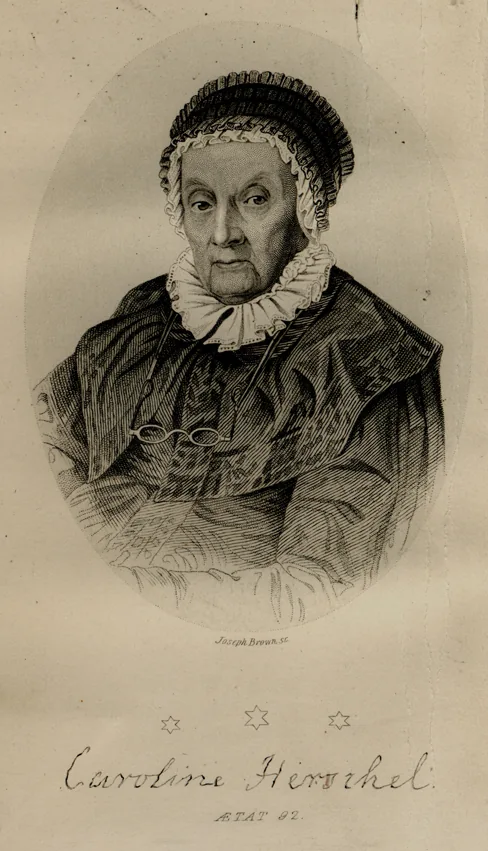
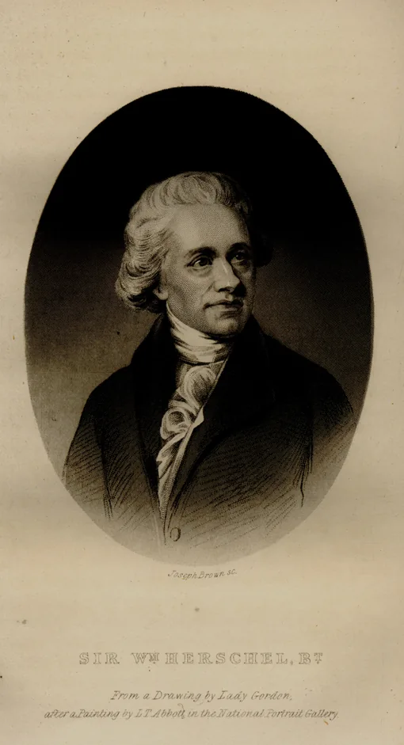
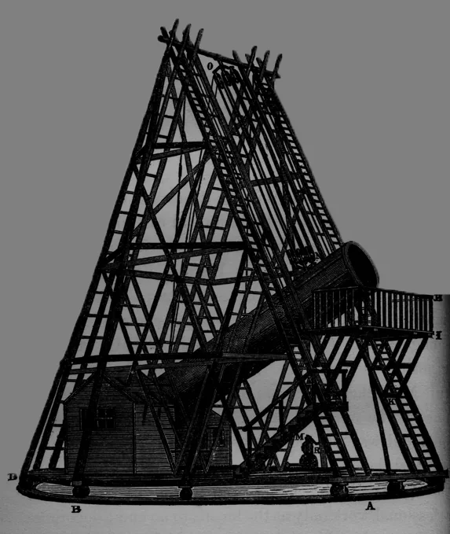

**文 / qscqesze**

一七八七年十月，卡罗琳·赫歇尔领到了十二英镑十先令。这是王室为她规定的五十英镑年薪的第一笔季度付款。她此前已经替哥哥威廉管理多年开支，也把自己的日常所需记进账里；款项从她手中过，并不表示她能够随意支配。后来回忆这笔收入时，她特意说明，这是她一生中第一次觉得有权按自己的意愿花的钱。[^1]

当时，赫歇尔家的花费远远超过这笔工资。斯劳正在建造四十英尺望远镜，木工、铁匠、铸镜工各有工钱和材料账。威廉刚又获得一笔两千英镑的资助，以及供仪器维修和夜间助手开支的一项年款。妹妹的五十英镑与这些资金同时落实，名义是哥哥的天文助手。她所获得的收入，仍与一处以威廉为中心的观测场所联系在一起。

她记得，离开巴斯以后，自己每年列作个人用途的钱通常不过七八英镑。她担心的却不止这些数目：铸镜师送来的账单过高，仪器还没有全部完成，家用每周都要付。她在回忆里承认，破产的念头曾反复困扰她。领工资使一部分不安有了着落；看见新天体、记录位置、整理目录与支付供应商，此前已在同一册工作日记里交错出现。她并不是得到这个职位才开始做天文学，也不是因为拿到了工资便停止照管这些杂事。

在汉诺威长大的时候，她曾设想靠针线和音乐谋生。在巴斯，她确实登台演唱过。到了三十七岁，王室支付的这笔钱终于为她的工作规定了一个称呼。然而，工资单上简短的“助手”还不能显示，从晚间望远镜旁的一次报数，到日后别人能够使用的星云目录，中间要经过哪些计算和判断。

<figure>
  
  <figcaption>卡罗琳·赫歇尔，Joseph Brown 刻。图题记九十二岁，载于1876年《回忆与通信》卷首。<a href="https://digital.library.upenn.edu/women/herschel/memoir/front-page.jpeg">宾夕法尼亚大学所藏印本图像</a>（原作在美国属公版）。</figcaption>
</figure>

## 汉诺威的音乐家庭

卡罗琳·卢克蕾齐娅·赫歇尔于一七五〇年三月十六日生在汉诺威。父亲伊萨克是军乐队乐师，母亲安娜·伊尔泽料理一个子女很多的家庭。卡罗琳在十名孩子中排行第八，四名手足早夭。长成的兄弟姐妹中，威廉比她大十一岁多，亚历山大比她大四岁多；最小的弟弟迪特里希后来也是家中需要安排学业与职业的孩子。[^2]

音乐既是这家人的本事，也是收入的来源。军乐队和宫廷乐团的职位、替私人学生上课、演出与抄谱，决定一家人什么时候有人在家，什么时候又要为外出的亲人准备行装。伊萨克希望儿子们成为好乐师，给他们训练，也让他们接触语言、算术和自然知识。卡罗琳记得，父亲和威廉谈起牛顿、莱布尼茨与欧拉，讨论有时拖得很晚。她也记得父亲曾带她认星座。那些接触没有组成一套连续的课程，她通常仍在做针线，或在兄弟练习时旁听。

父亲的工作又受战争支配。一七五五年，军队奉命赴英，伊萨克与两个年长的儿子一起离开。父亲把部分军饷留作家用，母亲继续纺线、做衣物，家中还有亲人搬来同住。士兵家庭的收入不能与劳作者的身体分开计算。伊萨克早年随军已损害健康，后来战事中的奔走使他的状况更坏；他归家时能够继续教课，却不再有从前的体力。

一七五七年汉诺威地区的战局改变了几个儿子的去向。威廉最终离开军乐生活前往英国。卡罗琳后来写到，家人曾把小孩子支开，自己偶然看见哥哥穿着大衣离去。她是从多年后的处境回忆这段经历，把它理解为逃开继续服役的危险。此后传回汉诺威的信，有些用英语讨论音乐理论，收信的是哥哥雅各布。对留下来的妹妹，这些信件尚不是随时可以加入的谈话。

她也上过学校，学过读写。家中与附近一些士兵的妻子需要写信时，会让她帮忙。文字给了这个孩子一种实际用处，针线则占去更多时间：她要替兄弟织袜子，补充家用织物，做家里缺少的东西。父亲偶尔教她小提琴；她记得母亲并不愿意这些学习妨碍日常工作。法语、舞蹈之类被视作多余的训练，能为家庭做事的手艺得到的许可较多。

母亲对教育的判断，还与几个儿子的离乡有关。卡罗琳在回忆里说，母亲担心更多学问会使孩子不满足于原来的生活。威廉留在英国，雅各布又不愿只接受家中现有的条件，亲人的前途因此也会成为家中争执的原因。女儿把这些事写下来时，对父亲与威廉格外亲近，对母亲和雅各布常有抱怨。这些关系没有像一份家系表那样平均分配篇幅。

一七六一年，她患了一场严重的热病。按她自己的说法，病后有几个月连上楼都很困难。康复以后，学校和家里的差事继续进行。父亲在一七六四年遭受中风，虽然仍收学生、抄写乐谱，余下几年一直受疾病折磨。他于一七六七年三月去世。卡罗琳当时十七岁，失去的是一位愿意教她的亲人，家庭也少了一个重要的挣钱者。

她没有立刻放弃另谋职业的念头。她曾在清晨与住在同屋的年轻女子一起学针线，以便家人起床以前，自己的时间还没有被占完。后来又获准向一位教授女帽和服装制作的妇人学习。一般的入门费用对家中有负担，最后商定按月交钱。她原以为自己会因交费少而只得到粗活，实际却受到教师照顾，并与同学来往。她也想过做家庭女教师，只是自己不会法语，能争取的职位因此受限。

雅各布同意她学习做衣物，附带的意思却是供她自己使用，不能据此另起一个职业。这种许可与她所考虑的谋生并不完全相同。她已经会为家人做许多东西，若要把同样的本领拿到家庭之外挣钱，还须获得另一层认可。音乐也处在这个位置：身边不断有人靠它生活，她却尚未取得相同的职业训练。

## 去巴斯试唱

威廉从英国提出一个办法：妹妹可以到巴斯，接受他的训练，试试能否成为冬季音乐会和清唱剧的歌手；如果两年以后不合适，他会把她送回汉诺威。这个安排保留了退路，也要求家中放她离开。雅各布起初似乎同意，后来又嘲笑这项计划，没有认真听她的歌声。她便趁其他人不在时练习，模仿自己听过的小提琴独奏中的装饰和颤音。[^3]

她准备出发时仍在做针线。母亲和弟弟还要继续生活，她尽量替他们备好衣物和袜子，把自己离开后可能缺少的东西先做出来。威廉则为母亲安排一笔小年金，使她能找人替代女儿的一部分工作。妹妹能否成行，不只是两兄妹谈妥一张船票的事；她原来承担的劳动也须有人接过去。

一七七二年八月，她终于随威廉赴英。旅程经荷兰与英格兰东岸，再到伦敦，最后前往巴斯。在伦敦，她特别记得随哥哥看的光学商店。哥哥已经对科学仪器有兴趣，同行的妹妹则还要适应语言：她会的英语很少，抵达以后与租客、仆役和商贩交涉都不容易。

威廉在巴斯已有一份繁忙的音乐事业。他是八角礼拜堂的管风琴师，教授学生，组织排练，也承担公开音乐会的事务。妹妹住进去以后，一天要上几次声乐课，练习键盘和发音，哥哥还教她英语、算术以及收支记账。英国的音乐生活向她开放了新的工作，管理这所住宅也成了她的责任。

她每周领一笔家用，须在英文账本上写清支出，留存没有花掉的现金。到市场买东西，是账本以外的另一种语言练习。亚历山大一度在同一住宅居住，替兄妹两人处理机械活计，也会帮助妹妹。他同时有自己的演奏工作，夏天常离开巴斯。家中可用的人手，会随演出与季节改变。

她不喜欢巴斯最初的几个月。她在后来记述中说自己思乡，难以用英语与周围人交谈，又要回复汉诺威传来的不幸消息。哥哥的朋友与学生使她有机会参加聚会，唱独唱、二重唱和重唱；有一次，她受邀到伦敦住了几周，看到歌剧与戏剧，也受到服装和外出费用的困扰。她想取得的音乐职业，还要求在社交场合中学会怎样穿着和行动。后来，她专门接受过舞蹈教师的训练。

这些学习有实际结果。她逐渐能够参加礼拜堂的排练和礼拜，在哥哥组织的清唱剧中承担独唱。她本可以继续完善这一行的本领；至少，在她自己的回忆里，能够凭音乐获得体面的生活始终是一项认真的愿望。她并没有把巴斯十年写成等待天文学开始的空白。

哥哥的时间却朝另一处流去。音乐季结束后，妹妹原以为能得到更多训练，威廉却把空下来的时间用于读天文学和光学著作。租来的望远镜让他看见书上介绍的天体，也使他想改善现有仪器。他开始向商人询价，购买别人留下的工具，继而自己制作镜面和支架。妹妹刚获得的职业机会，越来越多地与这项尚不挣钱的兴趣争用时间。

<figure>
  
  <figcaption>威廉·赫歇尔，Joseph Brown 据 Lady Gordon 摹图刻制，摹图底本为 L. F. Abbott 原画。载于1876年《回忆与通信》。<a href="https://digital.library.upenn.edu/women/herschel/memoir/118.jpeg">宾夕法尼亚大学所藏印本图像</a>（原作在美国属公版）。</figcaption>
</figure>

## 房子里的镜面和排练

望远镜起初并不只需要一位懂得计算的人。管身、镜面、支架、车床、铸造材料和磨镜工具都要准备，放置它们的空间也须找到。威廉嫌定制大镜面的报价太高，买下一个曾尝试磨镜的巴斯居民留下的工具与半成品，自己摸索。卡罗琳帮着制作纸板管，后来还参与磨镜与整理材料。[^4]

乐器和机器占用着同一所住宅。客厅要接待学生和音乐朋友，也会有人在里面做木工；一处卧室安装车床，别处又在准备镜子的配件。亚历山大擅长机械，能够把威廉的想法做成东西，却不能一年到头留在家里。妹妹不具备哥哥们的全部手艺，仍须在需要第二双手的时候到场。

对反射望远镜而言，镜面不仅得亮，还要有合适的形状。抛光过度或不均匀，都可能使它不能把远处的星光汇成清楚的像。每一次制作需要反复研磨和检验，并不是把一块金属擦得光滑就算完成。镜子变大以后，支撑它的机械装置也更重，能不能平稳转动、能不能安全到达目镜旁，开始同镜面本身一样重要。

卡罗琳记得，威廉有时长时间不肯停手，她会给他递食物，也替正在工作的哥哥读书。所读的不仅是计算材料，还有小说。她同时抄写乐谱，准备自己的演唱，料理家用。家人对时间的安排已经偏向制镜，可是房子的收入仍来自音乐。兄妹不能把已经招来的学生和付费观众暂且放在一边。

一七八一年三月，威廉观察到一个后来被确定为新行星的天体，即天王星。发现使他的姓名传到伦敦，也吸引更多人到巴斯拜访。他获得皇家学会的认可，天文学家与有地位的客人想亲眼看一看他的望远镜。卡罗琳则开始更多地抄写表格和目录，有些还是哥哥借来的整篇论文。

访客、演出和制镜继续交错。威廉曾与人合作经营清唱剧演出，并为表演者的报酬承担责任；妹妹回忆，他在这项安排上亏了钱。另一方面，为一架更长望远镜铸造的大镜面，也遇到炉体漏料和镜面冷却后开裂的失败。新行星没有使技术问题或旧职业的财务责任自动消失。

在一次前往布里斯托尔演出前，威廉仍与朋友谈论去伦敦的事情。卡罗琳要替近百名演出者收拾所用分谱。这种工作需要知道每一部分给谁，什么时候必须齐备。后来她整理观测资料时，也要面对某一张纸缺失就会使别人无法继续的情况；但当时要确保的是当天的演出能够开始。

一七八二年春，威廉把七英尺望远镜带去伦敦。原以为短期可返的行程拖长了。妹妹与亚历山大留在巴斯，学生们不断询问教师什么时候回来，他们却只能从信里知道威廉正往返伦敦和格林尼治、等待宫廷安排。威廉在信中也抱怨没有机会做自己喜欢的工作。他在天文学界获得了注意，付出的代价之一却是暂时离开自己的作坊和仪器。

宫廷要看的望远镜是一件可以移动、可以示范的实物。一次观测遇到天气不合适，威廉曾事先准备一个人造土星的图像，用它向王室成员示范。妹妹从书信中得知这些接待，也继续设法应付巴斯的事务。是否长期迁居，已不再取决于下一场音乐会在哪儿举行。

## 两百英镑的新生活

威廉终于选择接受每年两百英镑的王室收入，离开音乐职业，搬到温莎附近。卡罗琳后来记下朋友认为这笔待遇太少；对于威廉，最大的吸引力是能够把时间集中用于观测和造镜。他所接受的收入与他要建造的仪器，并不是一套事先核算妥当的预算。[^5]

兄妹于一七八二年夏天迁往达切特。新住处能提供磨镜的地方，有空地架设望远镜，也需要清理与修整。妹妹出去采购时，发现物价使她忧虑。亚历山大后来返回巴斯，继续音乐工作；没有他的长期协助，许多机械事务更难解决。几个人没有因为住在同一个家庭，就获得同一条职业道路。

这次迁居使卡罗琳放弃了已经取得的音乐位置。她在回忆里直说，自己原可通过继续训练，成为一个能够谋生的职业乐师；离开哥哥的保护以后，她又缺少独自面对公众的勇气。跟随威廉并不是从一个毫无希望的地方走向唯一的出路。她是在已有一项可能的职业时，选择进入哥哥正在建立的事业。

新的安排把天文学训练放到她面前。威廉给她适宜扫视天空的小望远镜，让她寻找彗星。实际留下的训练要求还包括双星、星团和星云；霍斯金对观测簿的研究使这些不同目标得以区分。从一七八二年八月的记录开始，她描述扫过天空时见到的显著对象。起初，她不熟悉天空，常须翻查星图，找过的东西也不容易迅速找回。能够把一个模糊天体看进目镜，与能够告诉别人去哪里找到它，是不同的工作。

她学会按照恒星辨认位置，也逐渐记录星云和星团。到一七八三年末，她记下十四个这样的对象。这个数目是她当时记录的工作范围，并不等于十四项后来都能确认为独立的新发现。很快，威廉使用二十英尺望远镜的大规模观测，又把她叫回记录台旁。她自己的扫视只能放进剩下的空隙。[^6]

大望远镜收集较多星光，能够看见更暗的对象，使用起来却更需要合作。望远镜移动时，观察者须及时描述看见什么、与附近星的位置怎样；助手要看钟、记时、写下读数和描述，之后再把夜间留下的记录计算整理。晚间最急迫的是不漏掉稍纵即逝的报数，白天则必须把那些报数变成别人能使用的资料。

卡罗琳学习使用的表格、星图和钟，都与这套工作有关。她不能只靠记住某个对象的外貌。星云目录需要稳定的位置和检索次序，已知恒星又是确定位置的参照。把旧星表改成适合当前扫视的排列方式，计算经过某一区域的时间与范围，补充索引，都是她后来日复一日承担的事。

仪器仍在改造，观测过程带着危险。她记下一次夜间机械架倒塌，哥哥此前才刚离开高处；还有一回，她在黑暗中急着调整装置，被铁钩扎伤腿部，受伤后仍须处理家中事务。她将这些经历写入回忆时，尤其在意观测是否因此中断。伤害落在她自己的身体上，记录里衡量损失的尺度却常是哥哥的工作。

他们也不能全靠两百英镑维持制镜。威廉制作望远镜供人购买，王室本身也是客户。售出的仪器带来收入，又占用加工和抛光的时间。他想造更大的望远镜，就得争取专门的资助。兄妹一面继续接单和做现有观测，一面等候足够的资金；扩大事业在他们的生活中意味着更多工人、更多材料以及更多必须有人收拾的纸张。

## 八月里的一颗彗星

一七八六年夏天，威廉与亚历山大赴德国，卡罗琳留在斯劳。哥哥不在，她有较多机会使用自己的小望远镜，但大批计算与家中支出也留了下来。七月底的日记记有付铁匠工钱、给钟上弦、为登记册做封面，以及整理以往扫视的工作。[^7]

旧记录并不总能顺利进入新目录。她尝试从后向前登记几次扫视，有些必须跳过，因为遇到尚未解决的困难。月底，她写下一个实际判断：这样进展太慢，不足以赶上星云目录的需要，倒着整理还可能带来不好的后果。于是她决定直接重新计算。这是一个熟悉资料的人对工作次序所作的调整。

八月一日，她白天处理了一百个星云条目，晚间发现一个可疑天体。它像一小团模糊的光，外观使她想到梅西耶目录中的对象；当夜还不能充分确定它是否移动。她按不同时间画出它与周围恒星的关系，把不能确认之处也留下来。次日晚间再看，位置的变化才使判断清楚：这是一颗彗星。

确定运动是关键。一个固定的遥远星云，在相邻几夜不会像太阳系中的彗星那样明显改变相对于背景恒星的位置。单次看到一团模糊的东西不足以完成区分。她需要前后记录，也需要周围那些可以重复辨认的恒星；即使一时不知道它们在目录里的名字，图中相互位置仍能帮助其他观察者追踪。

她向皇家学会的查尔斯·布拉格登写信，也通知天文学家亚历山大·奥贝尔。在说明中，她先交代哥哥赴德、自己因此得以扫视天空，再列出各次观察的时间与图形。她没有把第一晚的疑问写成当时已经确认的发现。信送出去以后，接下来还需要别人的仪器和天气允许别人看见它。

给两位收信人的说明并不完全一样。给布拉格登的一封列出大约二十倍放大率与较宽的视场；给奥贝尔的说明则提到约三十倍与较小的视场。两封信都在解释用什么条件看见这个对象。它们不能被压成一句对仪器毫无差别的固定数值。对于收信人，能否依照她给的位置迅速找到彗星，比夸赞发现者的语言更急迫。

她在信中很谦卑，甚至把自己说成算不上观察者。但同时，她把自己的观察材料寄出，要求对方帮助计算赤经与赤纬，让这个对象进入更多人的观测。她知道自己还缺少什么，也知道该把材料送给谁。谦逊的自称与主动的通信，是在同一封信里出现的。

布拉格登收到消息后，将发现告知在格林尼治相聚的天文学家，并向巴黎和慕尼黑传信。奥贝尔随后写来，说明自己已经依照她的指示找到彗星，并测量它的运动。科学交往在这里有可追踪的先后：她找到可疑对象，次夜确认，向外寄出材料，别的观察者继续观测，再把结果传回。

八月六日，班克斯、帕默斯顿等人来到斯劳看彗星。卡罗琳没有因访客到来就只做接待。日记里仍有每天计算的星云条目、为下一批资料所作的工作，还有找人协助铁匠、付款与采购。新发现获得名声时，她也在推动那份由威廉署名的目录完成。

哥哥回来之前，她已经结束这一阶段的一大批计算。彗星不是在她完全脱离协作、只做个人研究的生活里出现的。恰恰是在哥哥短暂离开的几个星期，她把原有任务和自己的搜寻同时向前推进。等到威廉回家，新的机会又须放进他安排的大望远镜观测之间。

<figure>
  
  <figcaption>斯劳四十英尺望远镜，1876年《回忆与通信》所附图，版画作者未署。此图为历史图像，非现代复原。<a href="https://digital.library.upenn.edu/women/herschel/memoir/29.jpeg">宾夕法尼亚大学所藏印本图像</a>（原作在美国属公版）。</figcaption>
</figure>

## 有工资以后

翌年，四十英尺望远镜工程继续。卡罗琳记录过许多工人轮班抛光，也记得威廉不肯让某些机械细节离开自己的监督。王室的进一步资助使工程有了条件，她的五十英镑年薪则使助手身份第一次具有自己的固定收入。她此前可以从家用中列支个人费用，现在有了不必逐笔当作哥哥开支的款项。[^1]

工资仍没有给她一间与家庭事业分开的观测所。她编索引、整计算、回复通信，自己的望远镜则在不需要协助大仪器时使用。在早餐时向哥哥问的问题，她也把答案留下；问题包括怎样把恒星的运动时间换成角度、怎样寻找水星附近的恒星、怎样调整装在望远镜上的象限仪。学习是围绕要完成的工作继续展开的。

一七八八年五月，威廉与玛丽·皮特结婚。卡罗琳不再承担原来的管家位置，后来住到附近的寓所，仍每日来工作。家庭的主人和空间安排改变了，夜间记录、白天计算以及她自己的扫视并未随之停止。一八七六年编者把一段日记的缺失同婚姻带来的痛苦联系起来；她的观测簿却仍有留存，不能把这项说法扩大成所有记录都被毁掉。[^8]

当年十二月，她又发现一颗彗星，并在次日写信通知皇家天文学家马斯基林。信里给出天琴座附近的位置和两次观察间的移动，结尾带上嫂子和兄弟们的问候。信后还有威廉补充的定位资料。一个以她本人名义报告的发现，仍带着这个家庭共同观测的痕迹。

她也开始同欧洲的天文学家往来。拉朗德写信祝贺，告诉她自己家中和其他参与计算的女性在做什么。她回信感谢，还介绍哥哥正在为她制作的一架五英尺扫视望远镜：放在屋顶，遇到不必去协助二十英尺或四十英尺仪器的时间，就能很快开始观测。它的价值不只是更大的镜面，也在于不必每次先把工作现场重新准备一遍。

一七九七年，她报告了最后一颗后来计入她八颗发现记录的彗星。为了尽快把消息送到伦敦，她曾亲自骑马赶路；这段行程使她疲惫，到格林尼治以后，未能继续照原定计划拜访班克斯。后来写信解释时，她把自己从正式的天文学通信者又说回哥哥朋友面前的卡罗琳。她已经做出过多次发现，仍谨慎衡量自己在这些交往中应站的位置。[^9]

找彗星只是她工作的一部分。她为弗拉姆斯蒂德的观测资料编索引，原为方便哥哥查找，后来在马斯基林推动下印行。一七九八年九月的感谢信里，她承认出版使自己感到得意，并顺势比较人们怎样称呼女性的虚荣与男性的雄心。那个在信中不断把自己放低的写信人，对这种称谓的差别也有清楚的意见。[^10]

## 目录没有完成的时候

一七九八年以后，卡罗琳仍在继续整理旧观测。望远镜找到的星云不会自行变成一张可靠的清单。某个对象在不同夜间可能重复出现，原有位置计算也可能需要核对；若要让另一个观察者按目录重新找到它，散在多年记录里的材料须重新排列。哥哥继续发表天文学论文，妹妹所做的许多工作则停留在手稿里。[^11]

她为弗拉姆斯蒂德资料编的索引，已经显示这类工作的用处。以往的观测若按一次次观测留下，要查某一颗星就得在不同地方寻找；索引把相关材料联系起来，也让遗漏和差错显露。兄妹现在自己的观测越来越多，相同的问题又在他们的纸张中出现。旧记录的整理并不是新发现之外可有可无的收尾。

卡罗琳把工作带回寓所，或到哥哥的书房继续处理。约翰长大以后，也参与家中的天文学活动。他是威廉与玛丽的儿子，出生时卡罗琳已经在英国住了将近二十年。姑母与侄子之间逐渐形成另一套合作：她知道过去的记录如何产生、哪些位置还需要复查，他则要把父亲的观测用于自己的研究。

威廉晚年仍愿意工作，身体却逐渐不能承受长时间接待与观测。卡罗琳的日记记着去他家住几天、替他抄写、陪他见客，以及从那里返回自己的住所。客人依旧想看仪器和著名的天文学家，家人则须考虑一次谈话会不会使他过于疲惫。几年以后，她回忆这些日子，常把工作与照料写在同一项记录里。

一八一九年威廉去巴斯时，临行嘱咐她查看书房与工作间的柜子和抽屉。有些纸包已经几十年不曾打开。她利用白天检查，晚上又继续抄写，把材料整理到能够向他报告的程度。此前她替哥哥写下正在发生的观察，现在还要使从前的工作不至于因作者年老而失去次序。

同年七月，威廉仍给她留下一张短笺，说有一颗大彗星，请她来协助准备星图和望远镜。她把这张纸保存下来，在旁边记下哥哥的字迹已经成为自己珍视的东西。这一次召唤仍是为了具体的天文学工作，同时也属于一个日渐衰弱的人与长年合作者的日常联系。

一八二二年春，她继续从《哲学汇刊》中抄录哥哥早期发表的论文；白天照顾威廉，抄写常须挪到本来可以休息的时候。她自己的身体也在衰弱，还试着整理遗嘱与物品，使侄子日后不至于为难。她并不能确定自己与哥哥谁会先离世。

那一年，她也为汉诺威的弟弟迪特里希担忧。她相信弟弟传来的困难，准备把自己五百英镑的证券转给他。办理这件事需要去银行，她又不愿在哥哥可能需要照料时离开斯劳。在她多年后的说明里，家庭、财产与能否自行作主再次连在一起；五十英镑年薪没有使她脱离亲属间的责任与依赖。

八月二十五日，威廉在斯劳去世。葬礼以后，卡罗琳决定返回汉诺威。她处理寓所的家具，分赠一些，出售一些，选择要带走的书和衣服，结清房租。迪特里希来接她，她向温莎的朋友辞行。十月，她离开居住了五十年的英国。

## 在汉诺威整理星云

她当时已经七十二岁。汉诺威是出生地，却不再是熟悉的职业环境：在那里，没有斯劳的仪器，也没有每天与威廉核对工作的习惯。她很快发现，亲属对天文学的兴趣和对她的期待，与自己设想的不同。她在信中反复后悔离开英国，抱怨住所、家人和不肯按自己心意处理的事情；这些信并不把归乡写成晚年的安顿。[^12]

她也未因此停止编目。约翰要复查北天的星云和星团，需要把父亲长期积累的观察与自己的新测量联系起来。卡罗琳继续按天区整理资料，把散在记录里的对象纳入适宜查找的次序。有关目录的通信讨论具体的工作形式，并不只互道健康。她会说明哪一种手稿更方便使用，也会为自己的眼力与体力不如从前而遗憾。

她在年轻时本来就须把观察、记时与整理分开进行；回到汉诺威以后，接近望远镜的机会大幅减少，纸张成为她延续天文学工作的主要方式。哥哥去世使夜间协作结束，却没有使过去那些记录失去用途。熟悉它们的人还在，新的观察者也确实需要使用它们。

约翰旅行时写来见闻，也把欧洲天文学家对姑母的问候带给她。一八二四年从意大利寄出的信中，他说不少人知道卡罗琳，甚至误以为她是自己的姐姐。他还介绍沿途看见的仪器和观察者，谈到哪一家的镜面制作值得注意。姑母所联系的天文学世界由这些书信继续扩展，已不止于她当年亲自见过的访客。

约翰后来改变行程去汉诺威看她。对卡罗琳，侄子不仅是能够继承和理解家中纸张的人，也是向她报告眼前科学活动的人。她会把资料送给他，安排自己身后的物品；同时又希望他不要让自己在这些安排之外变得无事可做。她说自己已经老了的信，仍常带着想继续完成工作的要求。

一八二八年二月，伦敦天文学会把金质奖章授予她，表彰的工作包括为星云与星团观察所作的整理。约翰当时担任学会会长，授奖时对亲属关系十分谨慎，由副会长詹姆斯·索思发表补充致辞。五月，约翰把奖章寄给姑母，信里也写到母亲的礼物、姑母送来的针线和食物，以及斯劳新安装的仪器。正式荣誉在家人的通信里仍与家常事务同来。[^13]

她没有亲临伦敦领取奖章。荣誉送到汉诺威，不能改变她年老、眼力减退或仍需安排生活开支的状况。她向嫂子感谢年金，又为自己活得比预期长而不安，担心这笔款项终究影响侄子。与此同时，她对迪特里希一家曾作出的财产承诺仍感到后悔，却不愿靠收回承诺激起争执。受表彰的工作与缺少把握的私人生活，同时存在于这些信件里。

## 侄子寄来的南天

一八三〇年代，约翰带着家庭与仪器前往好望角，展开南天的观测。他把工作写信告诉姑母。她离不开汉诺威，却能够在信中读到另一个半球的星云、星团和银河，也关心仪器是否可靠、观测怎样进行。两代赫歇尔之间的继承既包括姓氏和声誉，更包括前一批记录可以怎样在新的地点继续使用。[^14]

一八三五年二月的一封信里，约翰列出扫过天区时没有看见恒星的空场，接着又描写星团和银河明亮的区域。他也写自己寻找哈雷彗星的经过。给姑母看的材料带着读数与观察描述，不只是面向不懂工作的亲人的报平安信。她年轻时替父亲记录的那些句式，现在又从侄子的信里读到。

同年，卡罗琳与玛丽·萨默维尔获授天文学会荣誉会员。她写信感谢，认为把自己的姓名与萨默维尔并列是一种很大的抬举。萨默维尔也给她来信，并准备赠书。她所加入的是荣誉会员名单，不能据此把学会当时的制度写成已经允许女性以同等条件成为普通会员。[^15]

她仍会就旧工作与别人讨论。一八三五年四月，弗朗西斯·贝利正在整理弗拉姆斯蒂德的材料，卡罗琳向他回顾自己当年为什么逐项核对，又担心时间和能力的限制曾使某些错误漏过。她解释，威廉重视弗拉姆斯蒂德的观察，因此需要一份能用于确定新天体位置的可靠材料。那些对照不是为了完成一件供纪念的手工制品，使用者真的要把观测位置交给它们。

她还告诉贝利，自己把附有改正的书籍、星图与资料送给哥廷根天文台，是希望它们能交到理解其用途的人手中。她怕死后纸张被误解，或落到只想出售它们的人那里。保存工作成果，对她意味着指定去处、联系收件人、把自己的注记同书一并交出。

通信也使她面对科学工作仍在前进这一事实。新一代观察者使用自己的仪器，考察不同天区，不会把威廉的每一项判断原样保留下去。她对哥哥的依恋十分强烈，有时把新的成就也看成对他的挑战。临终后，侄女克尼平在给约翰的信里谈到这种情感，既表达对姑母的爱，也承认她在思想和生活中很难离开过去。那是另一位家属的观察，并不是卡罗琳自己给出的解释。[^16]

## 收到的一部书

卡罗琳年过九十以后，写作和生活都越来越依靠别人。贝蒂照顾她的日常，贝克多夫小姐、克尼平等亲友看望她，并把她的健康情形写信告诉英国的家人。来信不只报告病情，也保存了一个会回忆、会开玩笑、有时又很难被劝服的老人。她的生活并没有被一句尊称全部概括。[^16]

约翰的妻子鼓励她继续写回忆，把在英国的经历写到返回汉诺威为止。卡罗琳先前的记述已有删改，又在更晚的时候重写部分往事。后来出版的书，将这些回忆与日记、书信接在一起。幼年生活的细节因而丰富，也带着写信对象、回忆年月和家庭保存方式留下的取舍。

一八四七年七月，约翰给姑母寄去《好望角观测》的成书，特别说她或可看看重要星云的图版，也希望朋友分次读序言给她听。她已经不再能像早年那样从深夜记到白昼，仍活到了这部工作问世的时候。侄子把它看作父亲有关星云天空调查的延续，寄来的不是一张追念旧功劳的纪念纸，而是一部终于印成、可以使用的观测书。

她早已写下财物和葬礼的安排，留出费用，嘱咐不要让侄子在冬天赶来。亲人也知道，她希望那些有科学用途的书、手稿和器物有确定的去处。手边东西怎样分送，是她在最后几年仍不断处理的事。

一八四八年一月九日夜间，她在汉诺威去世，距离九十八岁生日还有两个多月。她被安葬在父母所在的墓地。贝克多夫与克尼平的信把消息传给约翰，也说明她临终以前受到的照护。身后的纸张则沿着她早已建立的家庭与天文学联系继续保存：观察簿、计算表、私人信件与回忆并没有留在同一个人手里。

一八七六年，《回忆与通信》出版，编者在序言中称颂她对哥哥的奉献。书页同时留下了另一类更具体的记录：一笔按季收到的工资、亲自寄出的发现报告、改了工作次序的日记，以及交代旧书应送往哪座天文台的信。斯劳的夜间观察早已结束，这些材料仍能使后来的观察者和读者辨认，哪些数据从她的手里经过，又在离开她以后去了哪里。

<!-- biography-body-end -->

## 资料与注释（工作状态）

目前为未达标的研究草稿，已形成1750—1848年的叙事骨架，1798年后部分仍须深入展开。现代研究补读、星表和彗星逐项核查、独立事实审读与文字审读、图像来源完善、构建及链接检查尚未完成。不得移入正式文章目录。

[^1]: Caroline Herschel，*Memoir and Correspondence of Caroline Herschel*，署“Mrs. John Herschel”编，伦敦：John Murray，1876，第二章末，一七八七年工资及四十英尺镜工程回忆。实际采用[宾夕法尼亚大学初版转录](https://digital.library.upenn.edu/women/herschel/memoir/memoir.html)；工资第一季为十二英镑十先令，个人用款与工程款分记。

[^2]: 同书第一章。出生日期、家庭构成、父亲音乐工作、学校与疾病、家庭内教育争执均来自卡罗琳的晚年自述与编者接续，应与同时期记录区别。

[^3]: 同书第一章末、第二章初，赴英提议、替家人准备衣物、母亲年金、旅程和抵达后的训练。新取得的原稿馆藏介绍与印本抵达日表述不一致，此稿不使用精确到日的抵达日期。

[^4]: 同书第二章，巴斯时期制镜、音乐经营与一七八二年伦敦书信。长时间磨镜、读书、排练及铸造失败为当事人回忆，不增写现场对话。

[^5]: 同书第二章，王室两百英镑年款、达切特搬迁、扫视训练、一七八三年末记录与受伤回忆。文中仪器原理的说明仍须补与现代仪器史材料互证。

[^6]: Michael Hoskin，“Caroline Herschel as Observer”，*Journal for the History of Astronomy* 36.4（2005），373–406；此处采用实际读过的373–381页，尤其374–376页对训练要求和早期星云观测的辨析。[NASA ADS公开扫描件](https://articles.adsabs.harvard.edu/pdf/2005JHA....36..373H)。尚未通读其余页，不以此注暗示全部发现归属已核定。

[^7]: 同书第二章，一七八六年七八月日记及八月二日至七日卡罗琳、布拉格登、奥贝尔通信。两封说明中的放大率和视场不同，分别保留，不擅自统一。

[^8]: 同书第三章开头与一七八八年十二月二十二日至二十七日通信。编者对结婚后心理反应的叙述含推断，正文不当成现场观察；观测簿的存续另据[皇家天文学会档案目录](https://www.ras.ac.uk/library/171-miscellaneous3/81-the-herschel-archive-caroline-herschel)，不能从私人日记缺失推断科学记录也全毁。

[^9]: 同书第三章，一七九〇年拉朗德往返信与一七九七年八月十七日致班克斯信。“八颗”是当事人及编者的汇总口径，发现优先权和现代彗星编号尚待逐项核对。

[^10]: 同书第三章，一七九八年三月八日目录誊本完成、夏季校印、九月致马斯基林信。编目内容和遗漏恒星数尚待查原出版物，不据流行简介倒填数字。

[^11]: 同书第四章及第五章回顾，尤以一八一九年整理旧纸和七月四日威廉短笺、一八二二年抄录论文及家庭财产说明为据。未从回顾中的目录总数反推每年产量。

[^12]: 同书第四章末离英日记、第五章姑侄通信，含一八二四年七月至九月约翰旅行信；星云按区编目的具体完成阶段仍待与手稿目录逐件核对。

[^13]: 同书第六章，一八二八年二月八日索思授奖致辞、五月五日约翰寄奖章信、五月九日卡罗琳致嫂子信。学会当时名称与后来的皇家称号将于事实审读时统一。

[^14]: 同书第七章，一八三五年二月二十二日约翰自好望角信及后续通信；不把信中某片天区的观察泛指为所有南天。

[^15]: 同书第七章，一八三五年三月九日致德摩根、四月二日致贝利、四月十六日萨默维尔来信；会员性质对照[学会自身的历史说明](https://ras.ac.uk/education-and-careers/100-years-and-counting-women-ras-go-strength-strength)。

[^16]: 同书第七章，一八四六年十二月八日、一八四七年七月十一日约翰来信、贝克多夫晚年报告及一八四八年一月十日与十三日家属书信。家属对其动机的解释作归属，不作未经证明的内心独白。
