**文 / qscqesze**

# 库尔斯克会战：一场预知的攻势如何耗尽德军的战略主动权（1943年7月5日—8月23日）

> **摘要**　1943年7月5日至8月23日，库尔斯克战场经历了德军“堡垒”攻势、苏军纵深防御，以及奥廖尔和别尔哥罗德—哈尔科夫方向的连续反攻。德军拥有经验丰富的装甲部队，在南翼也取得了多次突破，却始终未能完成南北合围。进攻的延误、苏军的防御组织、两翼推进的失衡与后勤压力，逐步耗去了德军的进攻力量。苏军以高昂代价守住突出部，继而夺回重要城市，将防御成果转化为战略主动权。

<figure>
  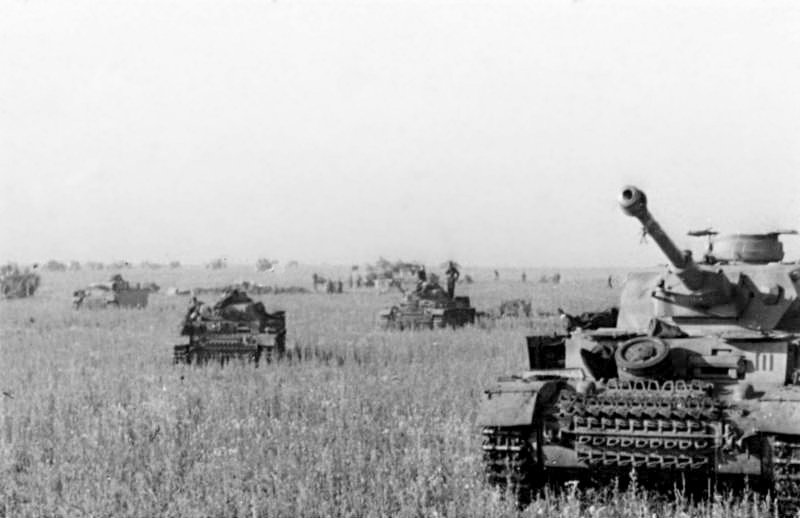
  <figcaption>德军装甲车辆在田野中展开，1943年夏。档案题名为“堡垒行动开始”。 摄影：Merz；Bundesarchiv Bild 101III-Merz-014-12A。<a href="https://commons.wikimedia.org/wiki/File:Bundesarchiv_Bild_101III-Merz-014-12A,_Russland,_Beginn_Unternehmen_Zitadelle,_Panzer.jpg">原始图档</a> · <a href="https://creativecommons.org/licenses/by-sa/3.0/de/deed.en">CC BY-SA 3.0 de</a>。</figcaption>
</figure>

## 从“堡垒”攻势到苏军夏季反攻

1943年夏天，库尔斯克突出部成为苏德双方争夺东线主动权的战场。7月5日，德军发动“堡垒行动”（Unternehmen Zitadelle），从南北两端向突出部内部突击。7月12日，苏军在奥廖尔方向发动“库图佐夫行动”；8月3日，又在别尔哥罗德—哈尔科夫方向展开“鲁缅采夫行动”。这三个相互衔接的行动构成了7月5日至8月23日库尔斯克战略会战的完整进程。日期均采用公历。

战斗留下了一个值得追问的问题：德军在南翼突破多道防线，并在普罗霍罗夫卡给苏军造成沉重损失，为何仍然失去了会战？答案要从两条进攻轴线、苏军预备队的调动，以及随后展开的反攻中寻找。德国始终未能完成南北会师；苏军则在承受大量人员和装备损失后，保住了继续组织进攻的能力。

## 一、从冬季战场留下的突出部，到夏季必须回答的难题

1942—1943年冬季，斯大林格勒包围圈的覆灭打破了德国南方集团军群的进攻态势；苏军冬季攻势又一度推进过深，遭到埃里希·冯·曼施坦因指挥的反击。1943年3月，德军重新夺取哈尔科夫和别尔哥罗德，前线遂形成一个向西凸出的巨大弧形：库尔斯克在弧形内部，北面面对奥廖尔方向的德国中央集团军群，南面面对别尔哥罗德—哈尔科夫方向的德国南方集团军群。突出部东西纵深约150公里，正面宽度随量法而异，常概称约200至250公里。铁路、公路、村庄与河谷交织在这一前沿：一旦苏军从突出部向西或西南出击，可能威胁两德国集团军群结合部；反过来，德军若从北、南根部同时向内切入，就有机会合围驻在弧内的苏军。

德国最高统帅部把这一几何形状视为难得机会。4月15日的第6号作战命令规定“堡垒”意在从奥廖尔以南和别尔哥罗德以北发动向心突击，歼灭库尔斯克地区苏军，缩短战线、恢复机动预备队并重获东线主动。北钳由瓦尔特·莫德尔大将的第9集团军承担，隶属京特·冯·克卢格元帅的中央集团军群；南钳由赫尔曼·霍特上将的第4装甲集团军与维尔纳·肯普夫集团军支队承担，隶属曼施坦因的南方集团军群。两翼预定在库尔斯克以东或东南会合，但计划书上的会合点并不等于现实中的可达目标：从北到南，德军必须先撕开已知的苏军防御带，再在狭窄道路上维持燃料、弹药、工兵与伤员后送，最后还要在苏军战略预备队赶到之前推进数十公里。

德国统帅部也讨论过其他选择。曼施坦因在战后尤其强调机动防御与反击，认为应让苏军先发动攻势，再以机动装甲群打击其侧翼；陆军总参谋长库尔特·蔡茨勒则支持尽快实施“堡垒”，担心拖延只会让苏军加固。莫德尔对本军正面防御的密度和第9集团军补充状况提出疑虑。希特勒本人在4月至6月间反复摇摆，一方面希望用新式“豹”式坦克、“虎”式坦克和“斐迪南”重型自行反坦克炮恢复优势，另一方面又担忧兵力、零件和训练尚未准备好。结果是进攻日期一再推迟。德国以延后进攻换取更多装备，同时给了苏军继续加强防御的时间。

苏军最高统帅部（斯大夫卡）面对的是另一种选择：在德军展开完成前先发制人，还是先防御、待其装甲突击耗损后反攻？格奥尔基·朱可夫、亚历山大·华西列夫斯基与前线指挥员的意见并不完全一致，但逐渐形成的方案是先守后攻。这一决定需要大规模的工程准备与兵力调动。中央方面军的康斯坦丁·罗科索夫斯基负责突出部北面，沃罗涅日方面军的尼古拉·瓦图京负责南面；伊万·科涅夫的草原方面军置于更后方，既是战略预备队，也是未来反攻的兵力池。苏军通过铁路、地方动员和工程部队，把数月时间转化为雷场、反坦克炮阵地、壕沟、通信线、预备阵地和后方集结地。苏军判断，突出部根部仍是德军实施合围最有利的出发地域。

到夏季，双方都已掌握对手的大致意图，围绕库尔斯克展开了准备与部署的竞赛。德国的目标是通过短促合围改变兵力交换与战线形状；苏军的目标是让德国把有限的精锐装甲力量投入其已准备的杀伤区，然后用未投入防御的预备队把局部防御胜利扩展成解放战役。前者需要速度和协调，后者需要时间、纵深和足够的承受力。到了7月，时间显然更有利于后者。

<figure>
  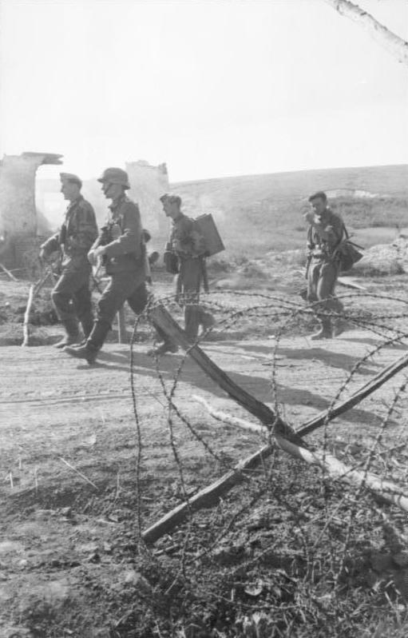
  <figcaption>德军步兵经过铁丝网与建筑残迹，1943年6月。战前照片。 摄影：Kipper；Bundesarchiv Bild 101I-022-2924-31。<a href="https://commons.wikimedia.org/wiki/File:Bundesarchiv_Bild_101I-022-2924-31,_Russland,_Unternehmen_%22Zitadelle%22,_Infanterie.jpg">原始图档</a> · <a href="https://creativecommons.org/licenses/by-sa/3.0/de/deed.en">CC BY-SA 3.0 de</a>。</figcaption>
</figure>

## 二、道路、谷地、庄稼与后勤

库尔斯克地区以开阔起伏的黑土地农业地带为主，间有低矮丘陵、林带、村庄、河谷和支流。开阔地有利于远距离观察和坦克火力，却不意味着装甲可随意横越。夏季田地、沟谷边缘、村庄废墟、铁路路堤和狭窄桥梁会把车辆压缩到少数通路；一处被炸断的桥、一片未清除的雷场，足以使后续纵队堆积，成为炮火和空袭目标。北翼第9集团军正面多为起伏地和沟壑，通向奥利霍瓦特卡、波内里一线的道路有限；南翼别尔哥罗德至奥博扬、普罗霍罗夫卡方向相对开阔，却被普肖尔河、北顿涅茨河支流、铁路堤和村落切割。地图上几十公里的距离，对靠履带、马匹和卡车运输的部队并非一昼夜可以无成本跨越。

<figure>
  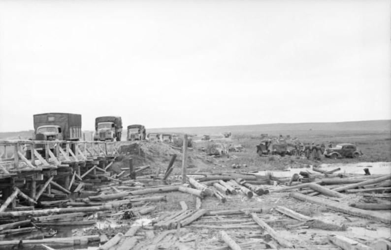
  <figcaption>卡车纵队通过木桥，1943年6月。 摄影：Wolff/Altvater；Bundesarchiv Bild 101I-022-2925-15。<a href="https://commons.wikimedia.org/wiki/File:Bundesarchiv_Bild_101I-022-2925-15,_Russland,_Unternehmen_%22Zitadelle%22,_Lkw-_Kolonne.jpg">原始图档</a> · <a href="https://creativecommons.org/licenses/by-sa/3.0/de/deed.en">CC BY-SA 3.0 de</a>。</figcaption>
</figure>

苏军防御的要点正是把这种摩擦制度化。“纵深防御”由数道彼此有间隔、又有火力和通信联系的防御地带组成：前沿警戒与主抵抗阵地牵制敌人；反坦克炮、反坦克步枪、地雷和近距离火炮组成反坦克地域；步兵据点控制村庄、林缘和道路；后方阵地留给第二梯队、坦克旅和炮兵预备队。资料中常见“六至八道防御带”的概括，各地段的深度和密度随地形、兵力及预定任务而变化。美国陆军军事史中心的研究以苏军统计说明，重点地段每公里可布置约1500枚反坦克地雷和1700枚反步兵地雷，反坦克炮密度远高于1940年法国战役中德军遭遇的水平。这种布雷密度使工兵清障直接影响坦克突击的速度：先头车一旦被雷场与炮火停住，后队便失去展开空间。

天气和季节同样有双重作用。7月初地面已较干燥，避免了春季泥泞对履带和轮式车辆的全面束缚；夏日长日照有利于观察、航空出动与连续作战。但高温、尘土、暴雨和夜间行军仍消耗部队。更重要的是，晴好天气也让双方航空侦察和炮兵观察更有效。德军不能把集结的大量装甲、弹药和工兵器材完全隐藏；苏军的大规模防御施工也不可能绝对保密。战场透明度提高，反而使“谁能更快把发现转化为火力或机动”成为关键。

后勤约束贯穿整个会战。德国从铁路终点向前线转运时，既要解决轨距和道路容量，又要把汽油、炮弹、备件、口粮和工兵材料送给持续推进的装甲集团。新式豹式坦克的可靠性问题，使“纸面到达”不等于“随时可战”；虎式和斐迪南的重型装备虽有强大火力与装甲，也更依赖桥梁承载、维修车辆和救援牵引。苏军同样并不富裕：防御区需要大量弹药、木材、铁丝、地雷和口粮，反攻时坦克集团军更依赖燃料与道路管制。但苏军是在预先选定的地域构筑阵地，并拥有较短的内线调动条件；德军则必须让补给线随着每公里推进继续向前延伸。这个差异解释了为何德军在战术上打开缺口后，越向前越难把缺口变成速度。

<figure>
  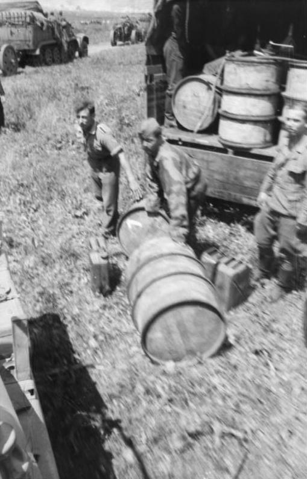
  <figcaption>德军士兵搬运燃料桶，1943年6月。战前后勤照片。 摄影：Kipper；Bundesarchiv Bild 101I-022-2923-27A。<a href="https://commons.wikimedia.org/wiki/File:Bundesarchiv_Bild_101I-022-2923-27A,_Russland,_Treibstoff-Nachschub.jpg">原始图档</a> · <a href="https://creativecommons.org/licenses/by-sa/3.0/de/deed.en">CC BY-SA 3.0 de</a>。</figcaption>
</figure>

通信也应从当时条件理解。德国装甲部队普遍拥有较好的车载无线电与战术协同传统，能够较快组织临机火力与局部绕行；苏军的无线电普及和指挥效率在1943年已有显著改善，但仍常依赖有线电话、传令与预先制定的火力计划，前线线路易被炮火切断。苏军把火力区、撤退线和预备队投入条件预先规定得更细，以降低失联对防御行动的影响。德军的优势在突击开始时最明显；随着通路拥塞、工兵伤亡和部队混杂，优势也会被地形与损耗侵蚀。

<figure>
  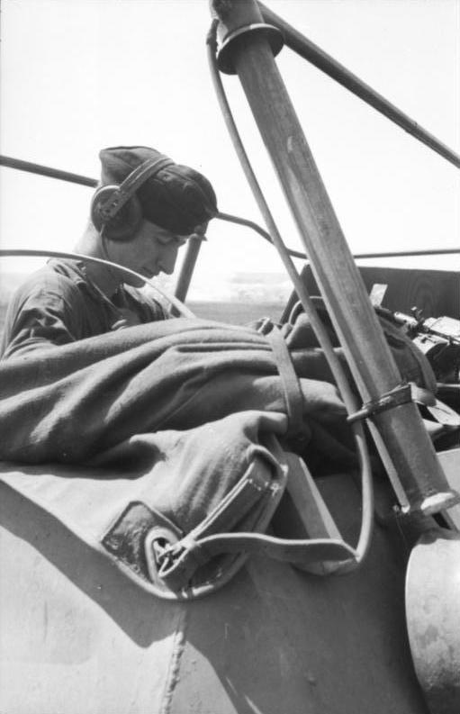
  <figcaption>佩戴耳机的德军通信兵，1943年6月。战前照片。 摄影：Kipper；Bundesarchiv Bild 101I-022-2924-11。<a href="https://commons.wikimedia.org/wiki/File:Bundesarchiv_Bild_101I-022-2924-11,_Russland,_Unternehmen_%22Zitadelle%22,_Funker.jpg">原始图档</a> · <a href="https://creativecommons.org/licenses/by-sa/3.0/de/deed.en">CC BY-SA 3.0 de</a>。</figcaption>
</figure>

## 三、两条突击轴线上的兵力与装备

双方的兵力分布围绕突出部的南北两端展开。德国把主要突击力量交给第9集团军、第4装甲集团军和肯普夫集团军支队；苏军以中央、沃罗涅日两个方面军承担正面防御，将草原方面军配置在后方。随着反攻展开，参战范围和投入兵力继续扩大。下表按开战时的指挥关系列出各部任务。

| 一方与层级 | 主要指挥体系 | 主要任务与力量 | 使用数字时的注意事项 |
|---|---|---|---|
| 德军北钳 | 中央集团军群克卢格；第9集团军莫德尔 | 第41、46、47装甲军及步兵军，向库尔斯克北方突击 | 第9集团军兵力不能等同全部中央集团军群；北翼装甲密度高但道路和防御最不利。 |
| 德军南钳 | 南方集团军群曼施坦因；第4装甲集团军霍特、肯普夫集团军支队 | 第48装甲军、党卫军第2装甲军与肯普夫部队，自别尔哥罗德方向北上 | 南翼可动用约占德军突击装甲的大部，但东侧肯普夫推进不足，令党卫军军侧翼长期暴露。 |
| 苏军北面 | 中央方面军罗科索夫斯基 | 第13集团军居前，第二梯队与坦克、炮兵预备队支撑 | 守军并非全数同时在第一线；纵深内配置是其优势。 |
| 苏军南面 | 沃罗涅日方面军瓦图京 | 第6近卫、第7近卫、第69集团军等防御，坦克军和机械化军机动反击 | 南翼承受最强突击，局部兵力与坦克损失也最重。 |
| 苏军战略预备 | 草原方面军科涅夫及斯大夫卡预备 | 后续防线、坦克集团军、步兵集团军，既可堵缺口亦可转入反攻 | 后方预备队按命令分批投入，初始部署与实际接敌时间不同。 |

德国投入“堡垒”的兵力，在文献中常见约50个师、约70万至80万人，装甲车辆约2400至2700辆的区间；若把隶属关系、维修状态和后续增援算入，数字会变化。苏军用于库尔斯克方向防御和预备的兵力常估为约130万至190万人，装甲车辆约3600至5000余辆，差距同样来自是否将随后反攻的方面军兵力、轻型坦克、自行火炮和训练/后方人员计入。这些估计涵盖的部队、日期和车辆状态不同，反映了前沿突击力量与纵深预备队之间的规模差异。

更有解释力的比较是局部时点。北翼第9集团军必须在很短正面上对中央方面军预设的反坦克地域实施突破；南翼第4装甲集团军在某些轴线上集中更强的坦克、工兵与空军支援，因而取得更深推进。可是会战不以“最大单点装甲密度”裁决，而以能否持续维持突击、掩护翼侧并在目标地域会合裁决。苏军把相当一部分兵力置于后方，意味着它在第一天不必在每一处都占人数优势；德国把最精锐的装甲集中到钳形前端，意味着每一次车辆故障、工兵损失和弹药迟滞都直接削弱不可替代的突击核心。

各类装甲车辆的作用受到火力、可靠性和保障条件的共同影响。虎式重型坦克和88毫米炮可以在良好观察条件下远距离击毁多数苏军坦克；豹式中型坦克在纸面上兼具火力、装甲与机动性，但首批大规模实战前机械可靠性不足；斐迪南火力强、正面装甲厚，却缺乏近距离自卫能力，受地雷、近战步兵和机动限制，且维修困难。苏军T-34并非在每一性能指标上压倒对方，轻型坦克更难正面抗衡重型装备；苏军优势在于数量、简化维护、火炮和反坦克体系的组合，以及把坦克用于反突击和后续突破的组织能力。装备的作战效果，取决于侦察、工兵、步兵、炮兵、航空、补给和指挥之间的协同。

<figure>
  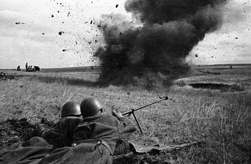
  <figcaption>库尔斯克突出部的苏军反坦克步枪射手，1943年7月20日。 摄影：Natalia Bode；RIA Novosti档案，影像4408。<a href="https://commons.wikimedia.org/wiki/File:RIAN_archive_4408_Armor_piercers_on_the_Kursk_Bulge.jpg">原始图档</a> · <a href="https://creativecommons.org/licenses/by-sa/3.0">CC BY-SA 3.0</a>。</figcaption>
</figure>

## 四、指挥体系：统帅意图、军群边界与前线权限

希特勒最终决定发动“堡垒”，但作战并非由他直接在前沿操控。陆军总司令部负责总体筹划，蔡茨勒推动迅速进攻；中央与南方两集团军群分别控制北、南钳。莫德尔擅长防御和危机处理，对第9集团军实力与北翼苏军阵地的忧虑有充分现实基础；霍特是经验丰富的装甲指挥官，南翼主攻由其第4装甲集团军承担；曼施坦因作为南方集团军群司令，拥有较强的作战判断力，却也受制于相邻部队、兵力调拨和最高统帅部对战略预备的控制。霍特、党卫军装甲军与肯普夫部队分别承担具体推进任务，而两个集团军群之间缺乏可自由调换的大预备队，限制了曼施坦因调整战局的空间。

<figure>
  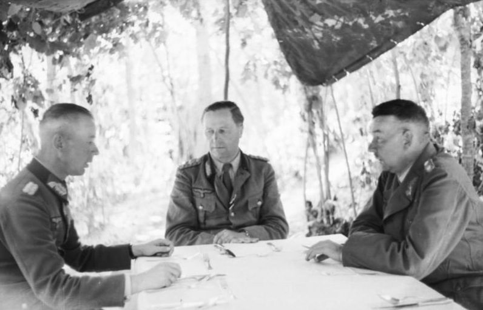
  <figcaption>肯普夫等德军军官会商，1943年6月21日。左起为沙勒·德·博略、布赖特和肯普夫。 摄影：Mittelstaedt, Heinz；Bundesarchiv Bild 101I-022-2929-01。<a href="https://commons.wikimedia.org/wiki/File:Bundesarchiv_Bild_101I-022-2929-01,_Russland,_Gener%C3%A4le_bei_Besprechung.jpg">原始图档</a> · <a href="https://creativecommons.org/licenses/by-sa/3.0/de/deed.en">CC BY-SA 3.0 de</a>。</figcaption>
</figure>

苏军的指挥结构则把方面军、最高统帅部代表与战略预备结合起来。朱可夫与华西列夫斯基代表斯大夫卡协调关键方向，罗科索夫斯基和瓦图京则负责各自方面军的具体作战：前者组织北翼防御与炮兵反准备，后者在南翼多次调动机动兵团反击。科涅夫的草原方面军需要沿铁路、公路调动，在接到命令后完成行军与集结，才能投入危险地段。苏军的系统优势，在于最高层能把“先守后攻”的总体意图与多个方面军的兵力安排连接起来；其弱点则是大规模预备队投入时容易造成道路拥堵、通信混乱和对敌情的过度乐观。

关键的政治与组织约束也不能忽略。德国在1943年已不能像1941年那样以相对充足的兵员和车辆承担高风险突击；西方盟军的地中海行动、战略轰炸与意大利局势使希特勒必须同时考虑别处。苏联承受过巨大的人员与物资损失，但工业东迁与动员体系已提供更持续的装备流，且苏军领导层必须在政治上证明能够从斯大林格勒式包围胜利过渡到正面会战与连续进攻。双方指挥官都在有限信息中行动；差别在于苏军允许防御层层消耗、再以预备队恢复主动，而德国的计划把成功定义为一场需要快速完成的合围。

## 五、战前情报与计划：真实敌情、已知敌情与被拖延的奇袭

苏军对德军意图的判断来自多种情报渠道。情报来源包括前线侦察、俘虏审问、无线电与交通征候、德国部队调动、盟国与地下网络提供的信息。不同来源提供的开战日期和攻击轴线信息，需要同前线侦察结果相互核对。可较可靠确认的是：到6月底至7月初，苏军高层已确信德军将从突出部北、南根部发动大规模进攻，并据此完成主要防御安排；7月5日凌晨，苏军还实施了炮兵反准备。多源情报与地形判断相互验证，德军的长期延误又给了苏军继续核查和调整部署的时间。

德军同样持续观察苏军的准备。莫德尔4月25日给上级的报告正说明，他已注意到北翼苏军阵地、部队补充和防御工事的增长。德国侦察可以看见壕沟、雷场迹象、铁路运输和炮兵阵地的一部分，却难以准确估计纵深预备队何时、从何处投入。德国计划因此依赖三个前提：北、南两钳都能在数日内突破；装甲兵能越过防御带进入机动空间；苏军预备队会在合围完成前被牵制或来不及封口。前两个前提受工兵、道路、雷场和炮兵制约，第三个前提则恰好是苏军战略部署最针对的部分。

苏军计划同样有风险。若德军在南翼以意料之外的轴线取得快速突破，沃罗涅日方面军的防御可能被分割；若北翼第9集团军与南翼会合，突出部内的前沿军团将面临包围。苏军决定不在最初就把所有坦克推到第一线，而是以步兵、炮兵、地雷和反坦克地域“磨钝”突击，再由坦克军、机械化军和草原方面军反击。这种方案要求指挥官在防御受压时克制地使用预备队：投入过早，可能被德军逐次击破；投入过晚，则缺口可能扩大到难以封闭。7月的实际战斗正是这一取舍的连续考验。

德军延迟还有一个被常忽略的后果：它改变了战斗的性质。若5月进攻，德军可能面对较浅防御，却也缺少后来到位的一部分装备；若7月进攻，装甲数量和新车有所增加，却面对更深雷场、更完整炮兵配置和更明确的苏军预备。在这一时间选择的推演中，两种方案都伴随明显风险。早打仍需突破双方都能预见的地形瓶颈，且第9集团军的补充与北翼条件并未自动改善；晚打的确定后果则是苏军每多一天就能增加障碍和校准火力。德国选择的是更强的战术工具，却进入了更强的防御系统。

## 六、时间线：从德军发起突击到哈尔科夫失守

| 日期 | 北翼与中央方向 | 南翼与别尔哥罗德方向 | 战役层面的意义 |
|---|---|---|---|
| 7月5日 | 第9集团军攻击中央方面军；苏军炮兵反准备 | 第4装甲集团军、肯普夫部队攻击沃罗涅日前沿 | 德军开始“堡垒”，未获战略奇袭。 |
| 7月6—10日 | 波内里、奥利霍瓦特卡方向反复争夺，推进迟缓 | 德军南翼突破较深，向奥博扬、普罗霍罗夫卡推进 | 北钳停滞，南钳成为唯一可能的会合希望。 |
| 7月12日 | 苏军在奥廖尔方向发动“库图佐夫”反攻 | 普罗霍罗夫卡地区激战；苏军第5近卫坦克集团军投入 | 德军必须同时面对原攻势正面与后方威胁。 |
| 7月13—17日 | 北翼攻势收束并转守 | 南翼继续局部作战，后逐步停止“堡垒” | 德军未达会师目标，装甲预备被牵制、调动。 |
| 7月中—8月中 | 苏军逐步夺回奥廖尔突出部 | 德军在别尔哥罗德—哈尔科夫方向整顿防御 | 主动权由局部突击转为苏军连续作战。 |
| 8月3—23日 | 奥廖尔方向作战接近结束 | “鲁缅采夫”反攻，别尔哥罗德、哈尔科夫相继失守 | 会战以苏军夺取战略主动和重要交通节点告终。 |

## 七、作战过程（一）：7月5日，炮火、工兵与第一道防御带

7月5日凌晨，双方都没有得到理想的开场。苏军根据对即将攻击的判断实施炮兵反准备，意在打击德军集结区、炮兵阵地和出发线。反准备后，德军仍发动了大规模炮火与地面突击，双方的炮兵计划在前沿交叠。但反准备的价值不只在物理损失，也在于迫使德军调整出发、增加通信和组织摩擦，并表明苏军没有被完全蒙蔽。对依赖精确时序的突破战而言，开局的几小时并非微不足道。

北翼，第9集团军以装甲军和步兵军向中央方面军第13集团军正面压来。德军步兵、工兵、突击炮和装甲车辆必须先穿越前沿的雷场与火力地域。工兵在炮火下开辟通道，步兵争夺村庄和高地，坦克在狭窄通路上等待；一旦前车触雷或道路被炮火破坏，后续车辆便难以充分展开。苏军不把所有反坦克炮摆在最前沿，而是把火力布置在纵深内，迫使突击部队反复组织攻击。德军当天获得若干局部推进，但没有形成可以快速投入后续装甲梯队的宽阔突破口。

南翼的情况更复杂也更危险。霍特第4装甲集团军的第48装甲军与党卫军第2装甲军在强大炮兵、航空和工兵支援下攻击沃罗涅日方面军防线；肯普夫集团军支队在其东侧行动，预定保障右翼并向北推进。南翼的德军在部分方向有更好的装甲集中和地形通路，因而第一天的渗透比北翼深。推进中的德军随后遇到了新的阻力：苏军各防御带之间的距离、侧翼火力与后方预备队仍在发挥作用，德军须反复清理据点和雷场。

<figure>
  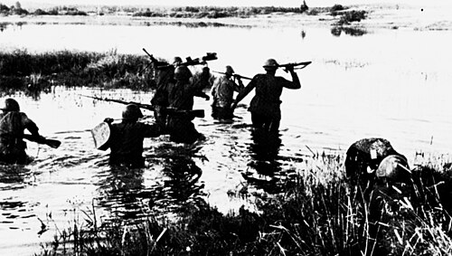
  <figcaption>苏军第7近卫集团军士兵在别尔哥罗德附近渡过顿涅茨河，1943年7月。 摄影：摄影者未署名；俄罗斯国防部（Mil.ru），经Wikimedia Commons。<a href="https://commons.wikimedia.org/wiki/File:Troops_of_the_7th_Guards_Army_crossing_the_Donets_at_Belgorod_July_1943.jpg">原始图档</a> · <a href="https://creativecommons.org/licenses/by/4.0">CC BY 4.0</a>。</figcaption>
</figure>

空中支援也影响着地面突击的节奏。双方在会战初期都集中大量航空兵，德军空军仍能在局部为装甲突击提供近距支援，苏军航空兵的规模、对地支援与防空能力也显著增长。航空兵无法单独解决雷场、壕沟和步兵据点；它的效果取决于能否及时发现目标、与地面部队联络、在强防空和敌机干扰下重复出动。地面战的节奏最终仍由工兵清障、炮火压制与步坦协同决定。

<figure>
  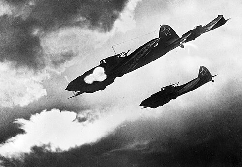
  <figcaption>伊尔-2攻击机，沃罗涅日方面军、库尔斯克突出部方向，1943年7月。 摄影：Fyodor Levshin / Фёдор Левшин；RIA Novosti档案，影像225。<a href="https://commons.wikimedia.org/wiki/File:RIAN_archive_225_IL-2_attacking.jpg">原始图档</a> · <a href="https://creativecommons.org/licenses/by-sa/3.0">CC BY-SA 3.0</a>。</figcaption>
</figure>

第一天最重要的结果，是两方的预设逻辑都开始接受检验。德国发现苏军防御的深度和火力并非侦察照片可完全呈现；苏军发现南翼承受的压力大于北翼，必须准备投入机动预备。战役尚未决定，但德军已经失去了用第一击造成体系崩溃的可能。此后每一公里推进都要以工兵、步兵、车辆和时间交换。

## 八、作战过程（二）：北翼的停滞——波内里与奥利霍瓦特卡方向，7月6日至10日

第9集团军的北钳原本是整个合围不可缺的一半。即使南翼取得较大进展，只要北翼不能穿过中央方面军防御并向南推进，德国也无法闭合包围圈。北翼的推进速度直接决定了合围能否实现。7月6日以后，德军在若干地段继续以重炮、航空、工兵和装甲强攻，目标是夺取有利高地、打开通往奥利霍瓦特卡及波内里方向的道路。苏军则以预先组织的炮兵火力、反坦克据点和局部反击不断恢复防线。

波内里附近的争夺尤其显示“据点战”如何吞噬机动力。铁路、车站、村庄、林带和高地使双方难以绕过对方；一处据点被夺后，另一方可利用炮火和夜间调动发动反击。德军拥有经验丰富的突击部队，也使用包括重型装甲在内的装备，但重装备在被地雷、反坦克炮和近距离步兵火力切割的地形中，很难像开阔战场那样自由转向。苏军防御并非静止挨打：前沿部队后撤或被压迫时，后方火力与预备队接替，局部坦克反击试图堵住通路。这样的战斗往往造成双方高损失，却不一定带来地图上的大箭头。

<figure>
  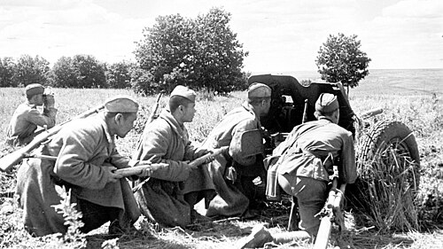
  <figcaption>波内里附近阵地上的苏军45毫米53-K反坦克炮与炮组，1943年7月。 摄影：Pavel Troshkin；Wikimedia Commons／Waralbum。<a href="https://commons.wikimedia.org/wiki/File:%D0%A0%D0%B0%D1%81%D1%87%D0%B5%D1%82_%D1%81%D0%BE%D0%B2%D0%B5%D1%82%D1%81%D0%BA%D0%BE%D0%B3%D0%BE_%D0%BE%D1%80%D1%83%D0%B4%D0%B8%D1%8F_53-%D0%9A_%D0%B2_%D1%80%D0%B0%D0%B9%D0%BE%D0%BD%D0%B5_%D0%9F%D0%BE%D0%BD%D1%8B%D1%80%D0%B5%D0%B9.jpg">原始图档</a> · 公有领域。</figcaption>
</figure>

奥利霍瓦特卡高地一线的重要性在于观察与道路控制。德军若能夺取高地，便可能改善炮兵观察、扩展装甲部署；苏军若能守住或以反击夺回，则能保持对进攻通道的火力覆盖。北翼突击正面的每一个战术目标都嵌在纵深防御内：夺下一座高地不等于越过第二、第三道防线，也不等于补给纵队能安全通过。第9集团军在推进数公里后，其装甲和步兵开始出现疲劳、损耗与混杂，攻击节奏越来越依赖反复准备炮火。

莫德尔的处境因此很矛盾。继续投入预备队，可能在某一段扩大突破，却也可能把最后的机动力量消耗在预设杀伤区；停止进攻，则意味着南钳必须独自承担不可能完成的合围。由于计划本身没有为“北翼迟滞而南翼独进”设计一个可信的替代终局，北翼的缓慢不只是局部不顺，而是从结构上否定了“堡垒”的时间表。到7月10日前后，第9集团军虽在部分地段推进，却远未接近可以向库尔斯克会师的深度。

德国部队的局部推进给中央方面军造成伤亡，却未能改变攻势的整体困境：推进速度和纵深不足以实现原定作战目的，而每一次推进都在消耗本该用于机动发展的突击力量。战役层面的失败并不需要每个战术连队都失败；它只需要关键时间窗口在目标未达成前关闭。

## 九、作战过程（三）：南翼向纵深挤压，7月6日至11日

南翼是“堡垒”攻势推进最深的方向。第4装甲集团军在7月6日以后继续穿透沃罗涅日方面军防御，党卫军第2装甲军沿其轴线推进，第48装甲军在西侧作战；肯普夫集团军支队负责东侧推进与侧翼掩护。德军的战术方法是典型的联合兵种突破：炮兵压制、航空支援、工兵排雷和架桥、步兵清除据点、装甲部队向可能的缺口突入。苏军则以多层防御、炮兵火力、反坦克炮和局部坦克反击拖慢推进，并不断从后方调兵。

<figure>
  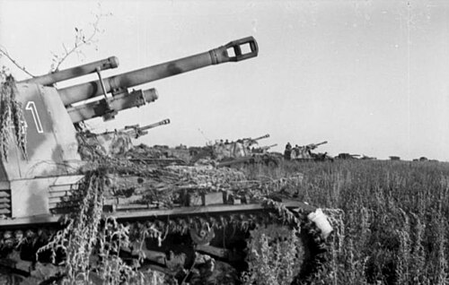
  <figcaption>波克罗夫卡附近的“黄蜂”自行榴弹炮，档案标注为1943年6月。 摄影：Lutz Koch；Bundesarchiv Bild 101I-219-0553A-15。<a href="https://commons.wikimedia.org/wiki/File:Bundesarchiv_Bild_101I-219-0553A-15,_Russland,_bei_Pokrowka,_Panzerhaubitze_%27Wespe%27.jpg">原始图档</a> · <a href="https://creativecommons.org/licenses/by-sa/3.0/de/deed.en">CC BY-SA 3.0 de</a>。</figcaption>
</figure>

德国南翼很快形成了前端突出、两侧推进落后的队形。主攻装甲部队向北推进时，东侧肯普夫部队因地形、抵抗和渡河等因素进展较慢，未能按理想速度与主攻队形齐头并进。于是党卫军第2装甲军的右翼和后方并非天然安全，它必须为自身侧翼投入注意力和兵力。西侧第48装甲军也受强烈抵抗与道路条件制约。一个钳形突击群若要把局部突破扩大为合围，侧翼部队必须同时向前，否则最前面的尖刀会变成狭长走廊的前端。

瓦图京的选择同样艰难。他不能把每一个坦克军在敌方航空、炮兵和装甲仍完整时立即投入正面碰撞；但若只依靠固定阵地，南翼防御可能被逐层压穿。沃罗涅日方面军因而实施多次机动反击与部队调换。这些反击并非都取得理想战果，有的仓促投入而伤亡很大；但其作用在于迫使德军停下来转向、侦察、部署和消耗弹药，防止其在开阔地获得不间断速度。后方草原方面军的部队也开始向危险方向机动。

截至7月10日至11日，德军南翼已逼近普罗霍罗夫卡方向，形成会战中最著名的装甲对峙。普罗霍罗夫卡是南翼推进轴线上的铁路和道路节点，附近的普肖尔河、铁路堤、沟谷和村庄限制了大兵团横向展开。苏军第5近卫坦克集团军奉命向该方向集中，意在反突击并阻止德军进一步推进；德军党卫军第2装甲军则试图继续夺取有利地域，保持前进势头。双方在有限地形中集中大量装甲，形成了密集的交战地域。

在此阶段，德国的“成功”确实具有现实内容：它穿过了苏军若干防御带，俘获和击毁不少装备，迫使苏军投入战略预备。北钳的停滞却让南翼难以把这些成果扩展为完整合围。南翼越深入，补给线越长、侧翼越脆弱、可用于继续推进的完好车辆越少。它既没有接到北钳即将会师的可信消息，也没有获得足以单独包围大批苏军的新的兵力。南翼的战术突破正在变成一场越来越昂贵的正面消耗战。

## 十、作战过程（四）：7月12日，普罗霍罗夫卡的装甲反突击

7月12日，苏军第5近卫坦克集团军向普罗霍罗夫卡附近的德军阵地发动反突击。河谷、铁路与沟壑压缩了装甲部队的展开空间，德军坦克、突击炮和反坦克炮则利用有利阵地迎击。当天及随后作战给苏军带来沉重损失，反突击未能按原定设想击退党卫军装甲军。德军保住了局部阵地，但北翼已经停滞，奥廖尔方向又出现新的危机，南翼的战术优势仍无法转化为预定的合围。

苏军第5近卫坦克集团军由帕维尔·罗特米斯特罗夫指挥，奉命在沃罗涅日方面军正面实施反突击。其可用信息和时间都有限：德军推进已构成威胁，友军阵地与道路拥塞，必须迅速从集结地域向前推进。原计划需要步兵、炮兵、航空和坦克协同，但实际接敌时，部分部队在狭窄地形和德军预设火力面前难以按教科书式展开。铁路堤、河谷、反坦克壕与村落把车辆导入可预测路线；德军党卫军部队则利用观察条件组织反坦克炮、突击炮和坦克火力，迎击苏军突击部队。

苏军坦克旅和军在若干方向迅速前冲，目的包括缩短德军远距离火炮的优势、夺回关键地形、打乱敌方部署。近距离交战确实发生，尘土、地形与混战使远程瞄准优势不能在每一处充分发挥；接近敌军之后，苏军仍需压制其反坦克火力并保持各部协同。缺乏足够步兵侦察、炮兵准备和侧翼保护的高速冲击，容易遭到分割打击。苏军部分单位突破到较近距离，其他单位则在反坦克火力、地雷和德军装甲反击下损失车辆。德军亦有损失、故障和被迫调整，却总体保持了战术上的阵地与火力优势。

战斗结束后，苏军反突击未实现其雄心勃勃的歼敌目标，并遭受沉重装甲损失；党卫军第2装甲军也未能在当日突破到足以改变战役的地域。苏军回收修复了一部分车辆，受损部队继续作战或进入重组；德军被击毁与损坏的车辆也不能只看某一日的战场报告，因“暂时损坏”“送修”“彻底损失”的口径不同而差异很大。战损记录分别涵盖不同日期、地域和维修状态，反映的是车辆退出战斗、回收与报废的不同环节。

为何一场苏军局部反击失利仍未逆转整个会战？第一，第5近卫坦克集团军后方仍有步兵、防线、炮兵和草原方面军资源。第二，德军北钳已经停滞，南钳即便击退一支坦克集团军，也无法自动补上另一半钳子的缺口。第三，7月12日苏军在奥廖尔突出部发动“库图佐夫行动”，威胁德国中央集团军群；德国不能再把全部注意力放在南翼。第四，党卫军装甲军本身也需要补给、维修和整顿，且其右翼问题未消失。这些条件共同限制了德军利用局部战果继续进攻的能力。

罗特米斯特罗夫及其上级面对南翼缺口扩大的风险，必须在侦察准备与尽快投入之间作出选择。更谨慎的分梯队投入、增加炮兵侦察与侧翼协同，在理论上可能减少损失；但道路拥塞、时间压力与德军持续推进限制了这种选择。反事实推演只能说：若反击能够更充分地与步兵、炮兵协同，或许能避免部分正面碰撞；不能说它必然摧毁党卫军装甲军，更不能说不反击便必然导致库尔斯克失守。

## 十一、作战过程（五）：7月12日后的战略翻转——奥廖尔与“堡垒”的终止

就在普罗霍罗夫卡激战之际，库尔斯克北面的战争尺度正在改变。7月12日，苏军布良斯克方面军、西方面军等部在奥廖尔突出部发动“库图佐夫行动”。其目标是打击德国中央集团军群的奥廖尔突出部，迫使其抽调预备并收缩战线。奥廖尔方向的苏军也付出沉重代价，初期推进并非一路顺利；但这次反攻把第9集团军及其上级置于防守压力之下。德军原计划本就要求北钳迅速推进，如今北钳不但未完成任务，还必须考虑后方和侧翼的安全。

7月10日，盟军登陆西西里。两天后苏军发动奥廖尔反攻，德国统帅部同时面对东线与地中海方向的压力。西西里登陆促成了装甲部队调动的讨论，库尔斯克战场本身的困难也在加剧。北翼攻势停滞、奥廖尔方向苏军反攻、南翼未能形成合围、德军装甲损耗与补给压力，已使原计划失去可实现性。7月13日的高层会议与其后的命令显示，德军领导层在继续南翼局部作战、抽调部队、应付其他战区之间反复权衡。停止攻势的决定，在此前数日的战场变化中逐渐形成。

7月13日以后，南翼战斗继续。德军继续实施有限行动，包括试图改善阵地、压缩危险突出部和进行局部进攻；所谓“罗兰行动”就是南翼收束与机动中的一环。可是这些行动的目标已从原先的远程会师转为局部战术处置和有序调整。部队仍能夺取村庄或击退反击，但行动的规模和目标已经收缩。德军精锐装甲部队此时越来越像被迫在多个危机点间调动的“消防队”，其部署越来越受相邻战场危机的支配。

苏军反攻同样遭遇了有组织的抵抗。奥廖尔方向防御坚固，德国利用预设阵地、炮兵和撤退行动减缓苏军；苏军在推进中暴露出协同、补给和伤亡问题。区别在于，苏军能以更大纵深与连续梯队把一次受阻的攻击重新组织，而德国则必须在越来越长的前线上填补缺口。到7月下旬，德国从奥廖尔突出部撤退已成必然，苏军于8月初进入奥廖尔。这个撤退缩短了德国战线，却是在敌方压力下丢失交通枢纽和既设阵地，并非“堡垒”预期获得的主动缩线。

<figure>
  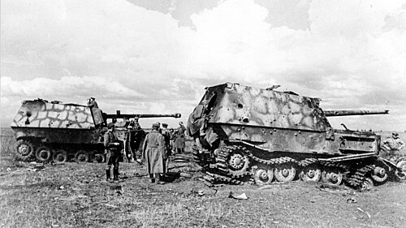
  <figcaption>苏军人员检查奥廖尔方向被击毁的“斐迪南”自行反坦克炮，1943年7月。 摄影：Pavel Troshkin；Wikimedia Commons／Waralbum。<a href="https://commons.wikimedia.org/wiki/File:%D0%A1%D0%BE%D0%B2%D0%B5%D1%82%D1%81%D0%BA%D0%B8%D0%B5_%D0%B2%D0%BE%D0%B5%D0%BD%D0%BD%D1%8B%D0%B5_%D0%BE%D1%81%D0%BC%D0%B0%D1%82%D1%80%D0%B8%D0%B2%D0%B0%D1%8E%D1%82_%D0%BD%D0%B5%D0%BC%D0%B5%D1%86%D0%BA%D0%B8%D0%B5_%D0%A1%D0%90%D0%A3_%C2%AB%D0%A4%D0%B5%D1%80%D0%B4%D0%B8%D0%BD%D0%B0%D0%BD%D0%B4%C2%BB,_%D0%BF%D0%BE%D0%B4%D0%B1%D0%B8%D1%82%D1%8B%D0%B5_%D0%BD%D0%B0_%D0%9E%D1%80%D0%BB%D0%BE%D0%B2%D1%81%D0%BA%D0%BE%D0%BC_%D1%83%D1%87%D0%B0%D1%81%D1%82%D0%BA%D0%B5.jpg">原始图档</a> · 公有领域。</figcaption>
</figure>

## 十二、作战过程（六）：从别尔哥罗德到哈尔科夫，8月3日至23日

7月中旬以后，战场主动权的争夺转入苏军连续反攻阶段。经过整顿和补充，苏军于8月3日发动“鲁缅采夫行动”，主攻别尔哥罗德—哈尔科夫方向。沃罗涅日方面军与草原方面军在炮兵准备后发动进攻，目标既包括收复别尔哥罗德和哈尔科夫，也包括迫使南方集团军群继续消耗其装甲预备。此时德军已不能选择“是否守住所有地段”：它必须在退守、反击、保留机动兵团和维持交通线之间作出代价高昂的选择。

苏军在这次反攻中吸取了7月部分反突击的教训，更强调炮兵准备、步兵突破和装甲梯队的衔接；但战斗依然血腥且非线性。别尔哥罗德较快失守，苏军向哈尔科夫推进；德军以装甲反击、后卫战和防御阵地多次迟滞对手。德军在退却中仍维持了相当的组织能力。南方集团军群在战术层面仍能组织有效反击，尤其在局部地段给苏军造成损失。问题在于这些反击的目标多是争取时间、恢复局部阵线或掩护撤退，无法恢复7月初那种由德国设定战略问题的能力。

哈尔科夫的争夺有特别的军事与政治意义。该城是铁路和工业中心，也是1941—1943年东线反复易手的象征。德军守军和机动部队试图利用城郊、道路与反击争取时间；苏军则避免把全部力量耗在正面城市攻坚，结合外围推进威胁其退路。8月23日苏军占领哈尔科夫，通常被视为库尔斯克战略会战的结束日期。哈尔科夫周边的后卫战和后续防御仍在持续，苏军则已完成从守住突出部到夺取主要城市的转换。

<figure>
  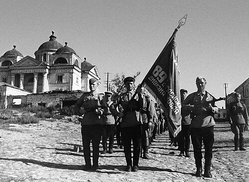
  <figcaption>第89近卫步兵师官兵在收复后的别尔哥罗德，1943年8月5日。 摄影：摄影者未署名；俄罗斯国防部（Mil.ru），经Wikimedia Commons。<a href="https://commons.wikimedia.org/wiki/File:89th_Guards_Rifle_Division_troops_in_Belgorod_5_August_1943.jpg">原始图档</a> · <a href="https://creativecommons.org/licenses/by/4.0">CC BY 4.0</a>。</figcaption>
</figure>

苏军在奥廖尔和哈尔科夫两个方向连续组织进攻，利用德军被前一阶段牵制、消耗和重新部署的时机，向相邻战略方向施加新的压力。德国可以以局部撤退避免某些包围，却难以同时保住所有突出部、交通线和城市。这一系列行动，使库尔斯克成为苏军逐渐掌握战役节奏的重要阶段。

## 十三、决定战局的五个节点

### 1. 四月至七月的延期：装备增加，时间窗口关闭

德国需要在几种方案之间选择：在春季冒较大装备与补充风险进攻、在夏季以更完整装甲部队进攻，或转入机动防御。最终选择延至7月，确实增加部分新装备，却让苏军完成更多防御工程、集结预备并确认主攻方向。替代方案“5月立刻攻击”并不能保证成功，因为北翼部队状况、地形瓶颈和苏军的基本判断仍在；但7月进攻在事实上接受了与更深防御正面相撞的条件。进攻计划的可行性随时间下降，德国却继续沿用原有的合围目标。

### 2. 苏军选择先防御后反攻：把兵力优势变为可控的承受力

苏军若在德军集结期间抢先攻击，可能打乱对方，也可能在缺乏准备的情况下撞上德军装甲预备。朱可夫等人主张先守的意义，是让德军把突破资源投入已布设的阵地。这个选择并未避免损失，南翼和普罗霍罗夫卡的代价尤其大；但它保留了草原方面军等战略预备，使苏军在德军攻势减弱时拥有可转为进攻的力量。可行替代方案是更早、更局部的先发攻击；从现有证据看，它很难比利用纵深防御更符合苏军当时的组织优势。

### 3. 北钳推进受阻：南翼失去会合对象

北翼的推进迟缓使全局产生非线性后果。南翼继续推进时，北翼仍远离预定会合地域，南翼自身的侧翼却不断拉长。第9集团军本可选择继续重押预备队，但代价是把有限装甲消耗在纵深防御中，且仍无保证突破；停止则宣告计划失去对称结构。现实中北钳的停滞早于普罗霍罗夫卡成为决定性政治符号。北翼迟滞使南翼在投入决战之前，就已经失去了按原计划完成合围的条件。

### 4. 7月12日两场战斗的叠加：普罗霍罗夫卡与奥廖尔反攻

普罗霍罗夫卡显示苏军反突击可以失败，奥廖尔反攻则显示德国不能把这次失败转化为战略自由。对德国而言，最诱人的选择是继续在南翼挖掘局部优势；但北面新威胁、装甲损耗和西西里局势提高了继续冒险的成本。对苏军而言，奥廖尔进攻并非无代价，却迫使中央集团军群从“进攻一翼”转为“防守一个更大的危机”。两场战斗发生在同一日并非偶然，它们共同关闭了“堡垒”所需的时间窗口。

### 5. 8月的连续反攻：从“挡住敌人”到“使其无处恢复”

如果苏军在7月中旬满足于守住突出部，德国可能通过撤退、修整和缩短战线保存更多机动力量。鲁缅采夫行动的价值在于不让南方集团军群从容恢复。它同样造成苏军重损失，且没有在每处完成理想包围；但夺取别尔哥罗德和哈尔科夫、迫使德军继续后退，使德国无法把“堡垒”解释为一次代价高却换得有利阵线的行动。战略主动权的转换，就发生在这种连续压力中。

## 十四、从停止攻势到撤出哈尔科夫

会战从7月中旬的攻守转换，逐步走向8月下旬的结束。就德国的堡垒攻势而言，北翼停滞、7月12日奥廖尔反攻和13日后高层决定收束攻势共同构成转折；南翼部队随后继续局部作战，并逐步调整和撤收。就整个库尔斯克战略会战而言，8月23日哈尔科夫易手是约定俗成的结束点，因为苏军完成两个方向的夏季反攻并夺取主要目标。

哪一方首先失去继续作战的能力？如果指继续发动原定攻势，答案是德国：它仍能防御、反击和撤退，却失去以北南两钳会合歼灭突出部苏军的现实能力。它没有发生一场斯大林格勒式的整体被围歼；很多部队有序后撤，并在之后很长时期继续顽强作战。这些部队的保存使德国得以继续防御，却未能挽回“堡垒”攻势的失败。德国在会战后不得不以有限的装甲兵团在东线多个危机点救火，主动发动大规模战略进攻的能力再未恢复到1943年春的设想。

苏军也没有把所有目标都以最经济方式达成。奥廖尔和哈尔科夫反攻都付出巨大伤亡，若以交换比衡量，某些局部进攻不利；包围歼灭德军主力的愿望也并未总能实现。可是其指挥体系、补给网络和预备队没有崩溃，能够在防御、反突击和进攻之间转换。战役结束后，苏军继续向第聂伯河方向推进，德国则继续后退与防御。这种行动能力的差异，比任何一日的坦克损失更能界定胜负。

## 十五、战果与损失：数字为何不同，哪些结论可以确认

| 项目 | 可较可靠确认的结果 | 数字与口径的主要争议 |
|---|---|---|
| 作战目标 | 德军未完成北南钳会师，未包围库尔斯克突出部守军；苏军守住突出部并收复奥廖尔、别尔哥罗德、哈尔科夫。 | 无实质争议；差异主要在何日视为“堡垒”结束、何日视为整个会战结束。 |
| 德军人员损失 | 德军在7—8月库尔斯克相关战斗中伤亡很大，精锐装甲和步兵单位消耗明显。 | 常见约20万上下或更宽区间，取决于是否仅算7月5—13日、是否包括奥廖尔/哈尔科夫战役和失踪、病员。不可与苏军“全会战”总数直接比较。 |
| 苏军人员损失 | 苏军在防御和两次反攻中伤亡更高，总体付出数十万级代价。 | 7月5日至8月23日三个战略行动的合计，常见统计为约86万人次，包含不可恢复损失及卫生减员。 |
| 装甲车辆 | 双方均损失、损坏大量坦克和自行火炮；苏军可通过修复与工业补充继续扩张，德军难以等量补充精锐车辆和乘员。 | “击毁”与“损坏待修”混用最严重。普罗霍罗夫卡单日数字尤其不宜脱离单位战斗日志和修复记录引用。 |
| 地域与交通 | 苏军夺回奥廖尔、别尔哥罗德、哈尔科夫，德国丢失突出部和重要铁路节点。 | 城市占领日较明确；周边后卫战与撤退线变化更连续。 |

人员损失的合计范围随作战阶段而变化。苏联战后统计常以1943年7月5日至8月23日、三个战略行动合计，给出约86万人员损失、其中不可恢复损失约25万的量级；不同编纂本对方面军归属、伤病统计与时间截点会有差别。德国方面，若只计算“堡垒”攻势的7月上旬，通常得到远低于整个会战的数；若计入奥廖尔撤退和哈尔科夫防御，数字显著上升。德国战时日报还可能把短期可修理车辆列为“暂时脱离”，苏军战报也会把战场上观察到的敌车损坏计为击毁。将一方的“永久报废”同另一方的“当日脱离战斗”相除，是没有意义的比较。

在装备损失的战略意义上，修复能力比单日残骸数量更重要。苏军固然损失了大量T-34、轻型坦克与自行火炮，并非可以无代价替换；但其工业体系、修理组织和新建部队能较快补充。德国的豹式可靠性问题、重型装备维修困难和熟练车组损耗，使同样的“损坏”在持续作战中更难恢复为可用于下一场突击的力量。同时受损的还有发动进攻所需的工兵、步兵、炮兵观察员、车组与指挥骨干。

<figure>
  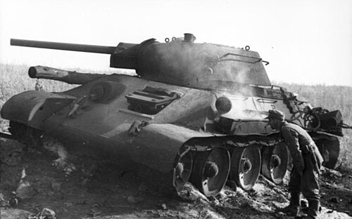
  <figcaption>波克罗夫卡附近的一辆T-34，1943年。 摄影：Lutz Koch；Bundesarchiv Bild 101I-219-0553A-36。<a href="https://commons.wikimedia.org/wiki/File:Bundesarchiv_Bild_101I-219-0553A-36,_Russland,_bei_Pokrowka,_russischer_Panzer_T34.jpg">原始图档</a> · <a href="https://creativecommons.org/licenses/by-sa/3.0/de/deed.en">CC BY-SA 3.0 de</a>。</figcaption>
</figure>

库尔斯克地区的居民也承受了这场会战的长期后果。德国占领时期的强征与暴力、前线反复移动造成的流离失所，以及炮火和地雷对村庄、农田、交通的破坏，延续到战斗结束之后。收复城市和铁路，既改变了军队的补给条件，也意味着当地居民开始面对返乡、清理废墟和恢复生产的问题。

## 十六、综合评价：为何是苏军取得战役与战略胜利

库尔斯克的结局来自战略目标、部署、地形和保障条件的相互作用。第一，德军选择在一个几何上诱人的突出部实施合围，却把主攻打向苏军最预期、最有时间准备的地域。第二，延期使新装备与更厚防御同时出现，但德国没有缩小目标或改变作战构想。第三，北翼无法按时突破，令双钳计划丧失结构；南翼的战术成果因侧翼、补给和预备不足，不能独立变成战略包围。第四，苏军以纵深防御吸收冲击，虽付出巨大损失，却保留了战略预备。第五，奥廖尔和哈尔科夫方向的连续反攻使德国没有恢复节奏的间隙。

德国在会战中仍表现出很强的战术能力。南翼装甲部队在工兵、炮兵、航空与装甲协同方面仍具有很高水平，北翼和南翼许多连、营、师都实施了有效的局部行动。苏军必须承受这些有效抵抗和反击带来的损失。苏军的组织成就也不在于每一个反击都聪明或每一辆坦克都用得经济；它在于能把情报判断、工程防御、炮兵、预备队和战略反攻连接成一个体系，允许局部失败而不让体系崩溃。

这场会战还说明，防御的成功不等于完全静止，进攻的失败也不等于没有战术胜利。防御方在正确时间和地点保留机动力量，能把地形和火力转化为消耗；进攻方若不能在消耗发生前实现速度，就会被迫在不利的交换条件中继续投入。这种防御需要充足纵深、工程时间、炮兵弹药、通信与预备队作为支撑。库尔斯克恰恰证明了战略判断必须匹配资源、时间与可达目标。

会战之后，德军仍多次组织局部反击，也仍能给苏军造成严重损失。然而，它越来越需要根据苏军选择的进攻方向调动装甲部队。普罗霍罗夫卡的局部优势、奥廖尔的撤退与哈尔科夫的失守，最终共同呈现出这一变化：德国的战术战斗力尚存，决定东线下一轮主要行动的能力却已明显衰退。

德国在库尔斯克把有限而珍贵的进攻力量投入一场对手已知、已筑、防御纵深足够、且时间越久越不利的竞赛；苏军则以高昂代价把“预知”转化成了组织能力，再把防御胜利转化为连续进攻。战役的真正遗产，是东线主动权从“谁能首先突破”转为“谁能持续组织下一场行动”。

## 参考资料与延伸阅读

1. David M. Glantz, *Soviet Defensive Tactics at Kursk, July 1943*, Combat Studies Institute Report No. 11, U.S. Army Command and General Staff College, 1986. [公开PDF](https://www.armyupress.army.mil/Portals/7/combat-studies-institute/csi-books/glantz2.pdf)。讨论苏军纵深防御、火炮配置与预备队。
2. David M. Glantz and Harold S. Orenstein (trans. and eds.), *The Battle for Kursk, 1943: The Soviet General Staff Study*, Frank Cass, 1999/2000. [出版信息](https://www.routledge.com/The-Battle-for-Kursk-1943-The-Soviet-General-Staff-Study/Glantz-Orenstein/p/book/9781315037196)。战时苏军总参谋部研究的译注本；使用时需注意其战时叙述立场。
3. U.S. Army Center of Military History, *Historical Perspectives of the Operational Art*, 2012，库尔斯克相关章节。[公开PDF](https://history.army.mil/Portals/143/Images/Publications/Publication%20By%20Title%20Images/H%20Pdf/cmhPub_70-89.pdf)。用于比较德军计划与苏军反坦克防御密度。
4. U.S. Army Center of Military History, *The Eastern Front*（政府出版物）。[公开PDF](https://www.govinfo.gov/content/pkg/GOVPUB-D301-PURL-gpo113228/pdf/GOVPUB-D301-PURL-gpo113228.pdf)。用于会战总体态势与装备量级的交叉核对。
5. Valerii Zamulin, “Why Did the German Offensive on Kursk Not Take Place in May 1943? New Documents,” *Modern and Contemporary History*，2023。[摘要与文献页](https://journals.rcsi.science/0130-3864/article/view/259848)。用于延期决策及德国档案研究线索。
6. “Документ, отсрочивший битву под Курском”（《军事历史杂志》），刊载莫德尔1943年4月25日报告及档案说明。[原文](https://history.milportal.ru/dokument-otsrochivshij-bitvu-pod-kurskom/)。用于德国方面对北翼防御与自身条件的当时评估。
7. U.S. Army Armor School, “eARMOR Battle Analysis: Operation Citadel (Kursk),” 2014。[原文](https://www.benning.army.mil/armor/eARMOR/content/issues/2014/MAR_JUN/Innocenti.html)。用于南翼联合兵种突破、普罗霍罗夫卡与战役终止的战术复盘。
8. Karl-Heinz Frieser et al., *Das Deutsche Reich und der Zweite Weltkrieg*, Band 8: *Die Ostfront 1943/44: Der Krieg im Osten und an den Nebenfronten*, Deutsche Verlags-Anstalt, 2007。德国官方学术战史传统的重要综合研究，可进一步阅读德国计划与战略语境。
9. Jonathan M. House and David M. Glantz, *The Battle of Kursk*, University Press of Kansas, 1999/2004。英文学界系统性会战研究，特别适合核对战役范围与双方行动的衔接。
10. Roman Töppel, *Kursk 1943: Die größte Schlacht des Zweiten Weltkriegs*, Ferdinand Schöningh, 2017。利用德苏档案重新检讨兵力、普罗霍罗夫卡及常见叙事，供争议部分比较。
11. Deutsches Historisches Museum, “Schlacht bei Kursk 1943.” [原文](https://www.dhm.de/lemo/kapitel/der-zweite-weltkrieg/kriegsverlauf/schlacht-bei-kursk-1943)。用于德国博物馆的基本时间与目标说明。
12. United States Holocaust Memorial Museum, “The Soviet Union and the Eastern Front.” [原文](https://encyclopedia.ushmm.org/content/en/article/the-soviet-union-and-the-eastern-front)。用于库尔斯克在整个东线战争进程中的定位与后续战略结果交叉核对。

## 附录一：把“突破”拆开看——库尔斯克的战术链条

德国装甲突击依靠一系列连续行动：侦察确定可能的通路；炮兵和航空兵压制观察哨、炮位与步兵火力；工兵排雷、炸开障碍、修桥或填沟；步兵清理壕沟、村庄和林缘；坦克与突击炮压制反坦克火力；无线电把发现的新威胁传到炮兵和邻接部队；后续梯队穿过已经开辟的通路，扩大缺口并向纵深追击。任何一环延误，装甲车就会在下一环之前等待。等待的车辆会消耗燃油，集中目标会遭受炮击，车组疲劳会增加，原本同步推进的部队也会拉开距离。

苏军的反坦克防御正是针对这条链。地雷不一定要击毁坦克；只要迫使其停车、转向或把工兵召到前面，便能让反坦克炮获得射击时机。反坦克炮不一定要击穿最重的正面装甲；它可以攻击侧面、履带、随伴步兵和较轻车辆，或把坦克逼入另一块雷场。步兵据点不一定要守到最后一个人；它只要拖延敌军，迫使其调用火力和工兵，就给后方阵地与预备队赢得时间。苏军的炮兵反准备和预先登记射击则试图打乱德军出发线、道路交叉点和炮兵观察。这些行动共同延缓突击部队的推进，并为后方兵力争取调动时间。

北翼特别能说明这套机制。第9集团军在一段正面取得战术穿透后，并不能立即把所有装甲送入缺口。首先通过的部队要面对未清理的雷场、被绕过而仍能射击的据点、被炮火破坏的道路和反坦克壕；后续车辆则在通路上积压。苏军炮兵观察员一旦发现这种密集纵队，火力效果远高于对散开车辆的射击。德国可以用工兵加宽通道、以步兵扫清侧翼、调用炮兵压制，却必须支付时间。时间又使苏军得以调来第二梯队，补上前沿留下的空隙。因而北翼的“数公里推进”不只是地图距离，更意味着德国为每一个可供履带通过的走廊重复支付代价。

南翼的条件较有利，因而更能显示战术能力与战役能力的差别。第4装甲集团军的若干战斗群能以较紧密的步坦工兵协同突破，党卫军第2装甲军也能把局部成功向前推展。但越过第一、第二道防线后，原本的突破力量出现了典型问题：最先前进的坦克与最慢的补给、步兵和工兵之间距离扩大；被甩在后面的苏军据点或侧翼火力仍可能打击道路；车辆机械故障需要拖救；伤员后送车与燃料车争用道路。德军不可能只把最好的装备留在最前端而不顾两侧，因为一支狭长的装甲纵队最怕横向反击切断其补给。南翼的肯普夫部队未能与主攻群同步，正是这种侧翼风险在战役层面的表现。

这也解释了为什么“德国在南翼击毁更多坦克”不自动等于可以继续推进。坦克战果常能提高局部安全，却不能替代步兵清扫、桥梁修复、炮弹补给和侧翼联络。战术地图上的一个箭头，往往隐藏着数百辆补给车、工兵器材、无线电站、卫生队和道路管制点。对1943年的任何装甲军而言，连续两三天的高强度突击足以使这些后方环节饱和。库尔斯克的德军没有足够余裕让一支突击军在前线休整、另一支接替继续向库尔斯克纵深冲刺；苏军却可以用预备队在后方梯次接防。两种后勤节奏的差别，是装甲数量表格无法直接显示的。

苏军也曾在战术链条上失手。普罗霍罗夫卡的反击显示，坦克如果先于步兵、炮兵侦察和道路组织抵达敌方火力地域，同样会在狭窄通路中丧失优势。1943年的苏军仍在以巨大的代价学习和改进指挥控制。但苏军拥有一项德国逐渐缺失的能力：一次突击或反突击受挫后，仍能利用后方防御带和战略预备避免整个作战体系崩溃。这种组织韧性使苏军能够承受局部失利，并继续执行防御与反攻计划。

## 附录二：空中力量、炮兵与工兵——被“坦克会战”遮蔽的三支兵种

库尔斯克在大众记忆中被称为坦克会战，但坦克之所以能在战场上出现和移动，首先取决于炮兵、工兵与航空兵。炮兵是双方防御和进攻的时间工具。进攻方用炮火压制已知火力点、切断电话线、掩护工兵；防御方用炮火打击出发线、通路、集结地和暴露的装甲纵队。苏军在战前以大量火炮、迫击炮和火箭炮组织分层火力，既有反准备，也有预定阻拦射击。德军炮兵则在较短的攻击正面集中支援突击师。某一侧“炮更多”不能直接推出效果，因为观察、弹药供应、通信和目标识别决定火力是否在正确时刻落到正确地点。

<figure>
  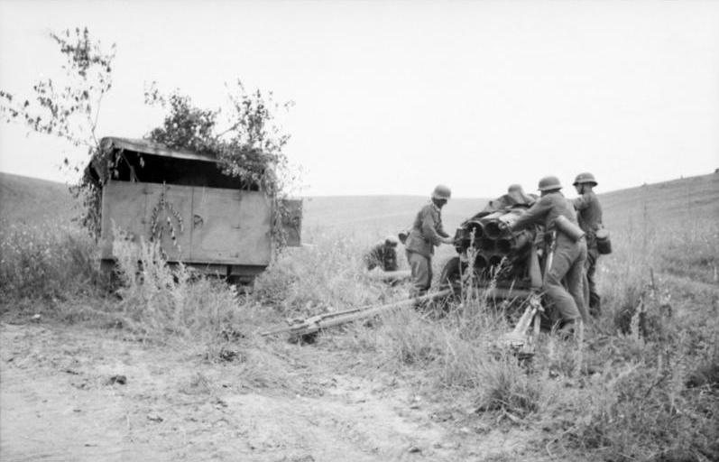
  <figcaption>德军炮组操作“烟雾发射器”多管火箭炮，1943年6月。战前照片。 摄影：Harschneck；Bundesarchiv Bild 101I-022-2943-15。<a href="https://commons.wikimedia.org/wiki/File:Bundesarchiv_Bild_101I-022-2943-15,_Russland,_Nebelwerfer.jpg">原始图档</a> · <a href="https://creativecommons.org/licenses/by-sa/3.0/de/deed.en">CC BY-SA 3.0 de</a>。</figcaption>
</figure>

7月5日的炮兵反准备，体现了苏军利用火力扰乱德军进攻时序的意图。它对集结地域和出发线实施打击，可能影响局部部队的通信和出发安排。德军随后仍完成炮火准备并展开地面攻击。对依赖同步的攻势，局部延误会在工兵、步兵、坦克与炮兵之间放大。反准备增加了德军开局的组织成本，地面阵地上的防御仍须继续承受装甲冲击。

工兵承担着打开通路和保障机动的多项任务。德军工兵必须在敌火下侦察雷场边缘、用探雷或爆破方式开辟车道、标记通路、清除反坦克障碍、修复道路、架设桥梁并协助强渡。任何一项任务都需要时间与掩护。苏军工兵则在战前敷设地雷、构筑反坦克壕、加固掩体和道路，并在战斗中补雷、爆破桥梁或修复己方通路。雷场把敌军行动压缩到可被观察和射击的空间；因此“每公里多少枚雷”只是一种密度指标，真正效果取决于炮火、据点和地形是否与之配合。

航空兵的作用也应在这种联合体系内理解。德国空军在会战开端仍有一批经验丰富的对地攻击与俯冲轰炸力量，可对苏军炮兵、坦克集结地和道路实施打击；苏军航空兵的规模和组织较1941年有显著提升，能争夺空域、打击突击纵队并掩护己方部队。双方的出动架次和宣称击毁数并不等同于实际战果：飞行员从空中观察到的起火车辆未必完全报废，地面部队也会把同一目标重复申报。更稳妥的结论是，空中力量加剧了暴露在开阔地和道路上的部队的风险，却不能取代地面兵种去占领村庄、穿越雷场或守住高地。

德军新式重装备与航空、工兵的依赖尤其强。斐迪南的远射火力若能在步兵与工兵保护下用于反坦克支援，十分危险；若在雷场、壕沟和近战威胁中与步兵脱节，其弱点就会放大。豹式的技术潜力若缺少可靠维修、燃料与回收车辆，也无法转换成持续的作战可用率。反过来，苏军较易维护的中型坦克若没有炮兵校射、步兵掩护和道路通行，也会在反坦克炮前蒙受损失。这些保障环节决定了武器性能能够在前线发挥多久、发挥多大作用。

炮兵、航空兵与工兵还决定了伤员和车辆的后送。装甲部队往前推进时，卫生队和维修队必须穿过同一条拥堵道路到达前沿，再把伤员和损坏车辆向后转运；道路被炮火切断或被撤退部队占用时，前线部队会迅速失去“可持续性”。苏军在防御阶段有预先准备的后送路线和阵地，德军则随着推进把后送线拉长。后送效率决定了一个师能否在第二天继续保持进攻能力。

<figure>
  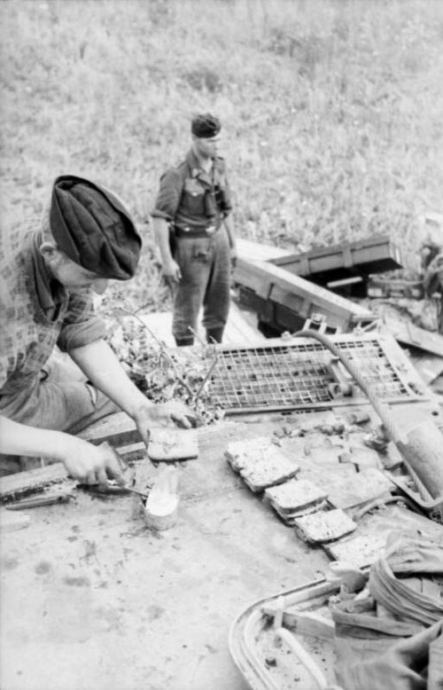
  <figcaption>德军装甲兵准备食物，1943年6月。战前生活照片。 摄影：Wolff, Paul Dr.；Bundesarchiv Bild 101I-022-2948-30。<a href="https://commons.wikimedia.org/wiki/File:Bundesarchiv_Bild_101I-022-2948-30,_Russland,_Verpflegung_der_Panzersoldaten.jpg">原始图档</a> · <a href="https://creativecommons.org/licenses/by-sa/3.0/de/deed.en">CC BY-SA 3.0 de</a>。</figcaption>
</figure>

## 附录三：兵力和损失数字的使用说明

库尔斯克的装甲统计涉及编制拥有量、当日可用量、实际投入量以及送修和报废车辆数。战斗会使车辆从可用状态转入维修，维修又会使部分车辆重新归队；撤退时无法回收的车辆，则可能从受损转为永久损失。同一支部队在不同日期的战报，因此会呈现不同的装备状况。

相关统计有四个维度。时间上，7月上旬的“堡垒”攻势与7月5日至8月23日的全会战范围不同；装备上，坦克、自行火炮、突击炮和坦克歼击车有各自的分类；人员上，阵亡、负伤、失踪、被俘和病员对应不同的减员状态；资料上，战时报功、敌情估计与战后汇总反映了不同的信息条件。

例如，苏军在普罗霍罗夫卡方向的坦克损失确实很重，但其中既有当日可见的烧毁车辆，也有可拖回修理的受损车；同样，德国部队的日报可能记录“可修复、短期不可用、长期维修、全损”等不同状态。若研究问题是“哪一方在当日保有更多可立即作战车辆”，短期不可用很重要；若研究问题是“哪一方在一个月后能恢复装甲实力”，工业、备件、车组和修理能力更重要；若研究问题是“谁实现战役目标”，又必须回到部队能否继续推进、能否守住交通线，并结合补给与后续行动考察。

同理，人员交换比不等于战略收益。防御一方若以较少伤亡使敌方攻势停滞，通常获得有利交换；进攻一方若伤亡较多却夺取关键铁路枢纽或包围大军，也可能实现战略收益。库尔斯克的特殊性是苏军在总会战范围内损失往往更大，却实现了防御、反攻和夺取地域的连续目标；德国在一些局部造成较高苏军损失，却未完成合围且在后续反攻中继续失地。两军损失的后果还取决于原定目标的实现程度，以及部队能否得到人员和装备补充。

战后的统计研究还受到资料来源的影响。战后胜利者可能高估敌方损失以强化胜利，失败者可能强调敌方更高损失以证明战术优越；两者都可能选取对自己有利的日期。现代档案研究的价值，在于把战斗日志、维修记录、兵员状态和作战地图放在一起核对；但档案也有残缺、记录延迟和定义不一致的问题。部队日志、维修记录和兵员报告之间的交叉比对，有助于确定损失的时间与类别；档案中的缺口仍使部分总数只能保留为估计范围。

## 结语：会战的尺度与历史解释的尺度

库尔斯克最值得反复阅读之处，在于它迫使观察者同时保持三个尺度。微观尺度上，工兵在雷场中开一条路、炮兵观察员校正一轮射击、一个坦克连在铁路堤旁转向，都可能改变局部存亡。战役尺度上，这些局部行动只有在能形成突破、保护侧翼、维持补给和调动预备队时才会积累为结果。战略尺度上，奥廖尔与哈尔科夫的相继失守说明，真正的胜负不在一次冲锋，而在一方是否还能决定下一次冲锋发生在哪里、由谁发起。

德国在1943年夏天仍拥有足以令人敬畏的战术工具，却把它们用于一个必须迅速成功、却又无法获得奇袭的计划。苏联军队仍会犯错，也会以惨重代价学习；但其最高统帅部与方面军能够把工程防御、火力、预备队和连续反攻组织在一起。资源、时间、组织和决策在这场会战中相互作用。道路容量、补给速度、通信条件和对敌情的判断，决定了双方可以把多少兵力送到前线，又能让这些兵力持续作战多久。

## 补充讨论：三个容易被忽略的因果关系

第一，苏军的情报判断与防御部署相互配合。它大体预见了德军从突出部两端进攻的意图，并将部署建立在相对稳定的条件之上：突出部根部是地形上最合理的突击点，德国若要实施合围便难以完全避开；大规模装甲和炮兵集结会留下道路、铁路与补给征候；德国的延期又让这些征候能够反复被观察。换言之，情报给出的是风险方向，工程、火力和预备队才把风险方向变成防御能力。

情报的作用依赖于部队将其转化为行动的能力。即使德军把开战日隐藏得更好，北翼仍要穿过同样的沟谷、雷场和纵深据点，南翼仍要保持与肯普夫部队的侧翼协调；若没有足够时间和兵力解决这些问题，战役目标仍十分冒险。反之，即使苏军知道德国将进攻，若没有足够炮弹、工程材料、训练过的工兵和可机动的预备队，情报也只能带来焦虑。库尔斯克的防御准备将情报判断转化为了阵地、火力配置和预备队的集结。

第二，德国最高层的战略选择与前线执行条件相互影响。希特勒决定进攻时间并控制战略资源的分配，对新武器的期待和其他战区的压力影响了这一过程。集团军群与集团军司令则必须在既定目标下处理北钳推进缓慢、南钳侧翼落后、补给和维修滞后等问题。高风险的合围方案一旦投入实施，前线每一次延误都会缩小后续选择；最高层仍坚持原目标，又使战术部队持续承受向纵深突破的压力。

第三，苏军逐渐改善了把动员资源转化为战斗力的能力。人员、坦克和火炮优势提供了选择空间，却不能自动使部队在正确地点、正确时刻出现。1941年和1942年苏军同样拥有大量人员和装备，却多次因指挥、通信、训练、补给和集中使用的问题遭遇严重失败。到1943年，苏军通过长期战争经验、工业动员、方面军体系和炮兵组织，把一部分数量优势转化为纵深与预备；它仍会在仓促反突击中付出惨痛学费，却已能避免单点挫败摧毁整个战线。这种学习体现在指挥、炮兵组织、工程准备和后勤保障等多个环节。

前线部队面对的情况始终在变化。道路受阻、通信中断、车辆故障与新的敌情，会使上级命令的执行时间偏离原定安排。一个军能够在地图上沿某条轴线推进，并不代表下属各部同时抵达。先头、侧翼和后续梯队之间拉开的距离，正是库尔斯克攻防中反复出现的薄弱环节。

还有一个必须保留的尺度，是人的尺度。战役史中“一个师”“一个军”的移动，意味着成千上万人在持续炮击、睡眠不足、道路堵塞、炎热、恐惧和信息匮乏中行动。指挥官的命令能规定方向，却不能立即补足耗尽的体力、失去的战友、损坏的履带或断掉的电话线。苏军防御工事和德国工兵突击的有效性，都是普通士兵在极端环境中完成的大量重复劳动的结果。疲劳、伤员后送、道路通行与维修速度，都直接影响着部队何时能够重新投入战斗。

防御与突击的效果都受到具体条件的制约。有纵深、预备队、工程时间和后勤能力时，防御者可以把对手的突击力量吸收进预设火力区；缺少这些条件时，固定防线可能只是被快速穿透的障碍。拥有优秀装甲部队时，进攻者可以在局部打开缺口；若目标、时间和补给不匹配，局部优势仍会在纵深中耗尽。战略选择最终要通过具体的人、道路、命令和物资才能兑现。

主动权体现为对下一轮行动时间、地点和规模的相对控制。1943年7月初，德国能选择在库尔斯克突出部根部集中装甲，迫使苏军考虑怎样抵抗；到8月，苏军能在奥廖尔和别尔哥罗德—哈尔科夫两个方向先后集中兵力，迫使德军决定何处撤退、何处用装甲反击、何处接受失地。德国仍能作战，仍能给进攻者造成惨重损失，却越来越难在自己认为合适的地点提出一个对方必须被动回答的战略问题。这种变化比任何一句“转折点”更能描述库尔斯克后的东线。

从兵种学习的角度看，这一变化同样重要。苏军并未因为一次成功防御就停止改进：其后续进攻越来越重视炮兵突破、工程保障、装甲梯队和后方运输之间的时序；德国也并未放弃有效的机动防御和局部反击。区别在于，苏军的学习发生在更能补充人员与装备、且能保有战略纵深的体系中；德国的学习则必须在兵力减少、多个战区分流和政治目标日益不相称的背景下进行。因此，军事技术和战术并非脱离国家资源的独立变量。库尔斯克的装甲、火炮和飞机之所以具有历史意义，正在于它们被置于两个不同的动员与指挥系统之中。

德国在南翼的推进曾迫使苏军不断增调预备队，苏军反突击的失误也使防线承受了额外风险。最终，北翼迟滞、侧翼距离扩大、补给和工兵损耗相互叠加，使德军越来越难以继续向纵深发展。苏军随后把作战重点转向奥廖尔和哈尔科夫，将德军从进攻者变为奔赴不同方向应急的防守者。库尔斯克的结局，正是在这一连串具体行动中逐步形成的。
