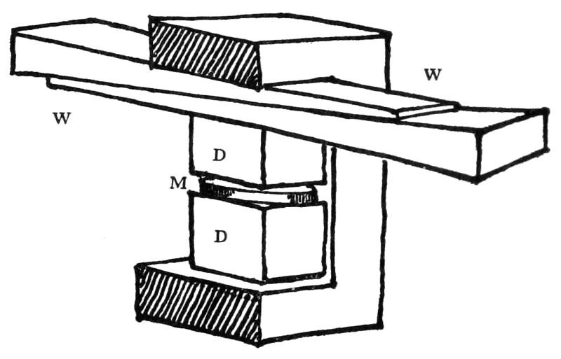
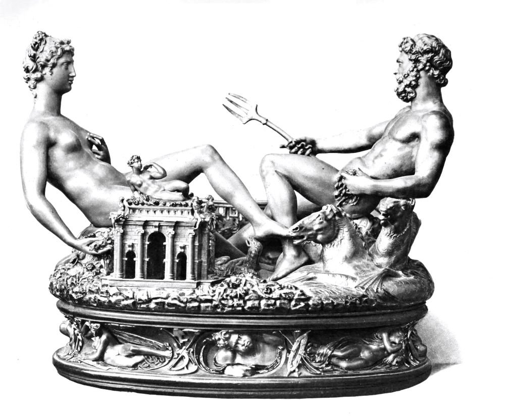
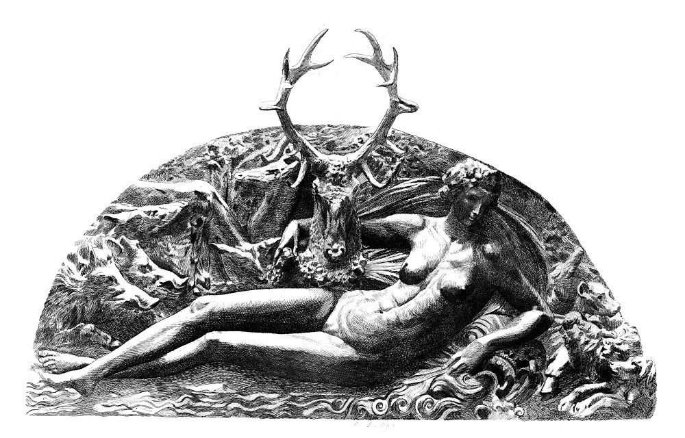
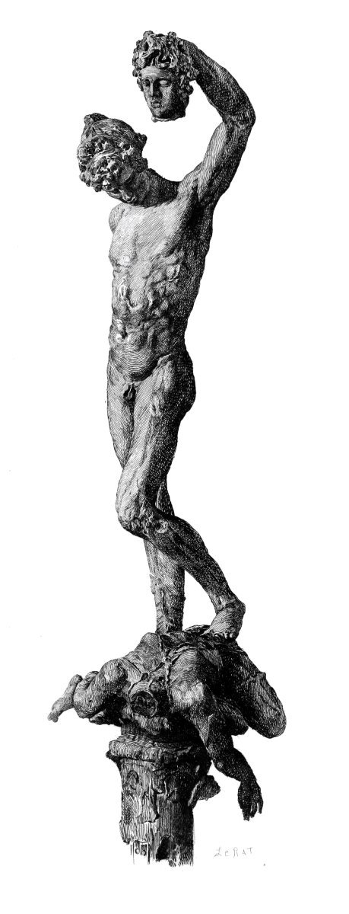
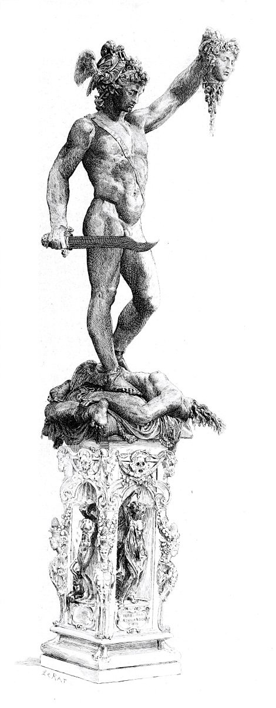
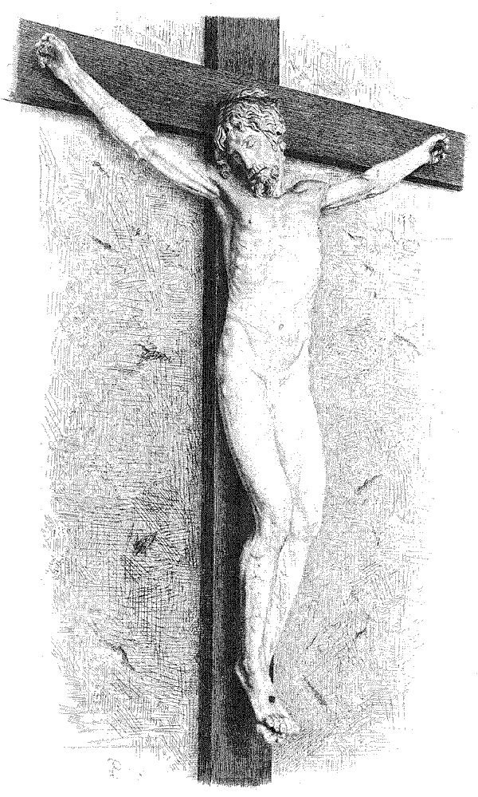

**文 / qscqesze**

## 铜像的脚

在切利尼晚年写下的回忆里，铸造珀尔修斯之前，科西莫公爵曾提出一个疑问：英雄举得那么高的美杜莎头颅，浇铸时能不能完整成形？切利尼担心的却是下面的右脚。他解释说，通向脚部的流道很长，又没有做得足够粗，金属流到那里会有困难。若为此扩大炉子和流道，还须多花钱；他宁愿预先接受一个可以修补的缺陷。[^1]

铜像没有在这一番解释之后顺利完成。按照他的记述，铸型做好，蜡已排去，模具也已烘烧，却在熔铜时出了事故。他病倒离开工场，回来时发现炉料凝结，遂重新加料、加热，最后还把家里的锡器投入炉中。过了两天，拆开外模，美杜莎的头颅成形了，珀尔修斯的头部也没有出问题。轮到承重的右脚，脚跟已有，前部却没有完全铸出。他既庆幸大部成功，又因自己先前的判断得到验证而满意。[^2]

讲述这次铸造时，切利尼已经能够回头审视它的结果。他把患病、援救和复苏写成自己的历险，把原本会使同行迟疑的选择写成胆识。然而在这套强烈的自我辩护里，仍保留着一项不大适合塑造完美英雄的承认：作品可以预先留下修补余地，工艺的安排要考虑成本。所谓完成，并不等于每一部分都在同一次浇铸里毫无缺损。

铸炉旁也不只有他一个人。他提到铸工、杂役、乡下雇工和自己的伙计，特别嘱咐跟随多年的贝尔纳迪诺照看工作。准备工序包括弄到燃料、捆牢外模、挖坑、放置排气管，把沉重的模具降低到适当位置。出事之后，又有人取柴，有人处理屋顶的火，有人料理饮食。切利尼最终把成功归到自己的判断和指挥，文字却也留下了这些人的劳动。[^3]

这件作品把他带进佛罗伦萨的公共空间。他此前在罗马做珠宝、银器和钱币，在法国为王室做金工和雕塑，如今回到故乡，要让一座大型铜像立在众人能够观看的地方。铸型里那只不完整的脚，在他的回忆中成了自己懂行、公爵不懂行的证据；但作品能否完成，还取决于公爵给多少资源、工场能调动多少人，以及他怎样支配这些人。

## 父亲的乐器

1500年11月3日，本韦努托·切利尼生在佛罗伦萨一个以手艺谋生的家庭，父亲乔万尼，母亲埃利萨贝塔·格拉纳奇。父亲既做技术工作，也是一名乐师。儿子记得的乔万尼，会制造乐器，懂绘图，能够处理机械装置。他还详细描写过父亲做的一面镜子：镜面周围安排七种美德的形象，框架转动时，形象依靠下方的配重保持直立。这个物件把装饰、机械和关于命运的寓意放在一起。[^4]

切利尼并没有亲眼见到父亲所有的早年经历。他在自传里说明，有些事发生在自己出生以前，只因家庭中熟知，才把它们记下来。镜子的来历、父亲受到的褒奖，以及父亲在不同执政者手下遭遇的得失，属于这一家人讲述自身历史的材料。乔万尼的音乐活动则进入了儿子日常的训练：识谱、唱歌、吹管乐器，反复练习。

后来写书时，切利尼把音乐称作自己不喜欢的职业，父亲偏偏在这一行里寄望于他。父子在此并非简单地争论孩子有没有艺术才能。乔万尼看见的也是一种才能，只是希望儿子把它用在演奏和作曲上；切利尼则要求把时间留给绘图和金工。他愿意为满足父亲而演奏，却不愿把音乐作为自己的主要工作。[^5]

父亲的要求带有实际的经验。他自己依靠演奏进入城市的公共职务，与权势人物发生关系。好乐师能受到赏识，有时还能得到固定职位。儿子日后到罗马，也会借这门本领进入教皇的乐队。乔万尼为他准备的道路并没有失去用途，只是用途与父亲设想的不同：切利尼不会放弃金工，音乐却会把他带到金工顾客面前。

这场争执拖了很久。在他的叙述里，父亲一度同意让他进金匠铺，旋即又舍不得儿子离开自己的视线，把他带回去。到了十五岁左右，他在安东尼奥·迪·桑德罗，也就是马尔科内的作坊里工作。切利尼称赞这位师傅既有本领又爽直。父亲没有让师傅像对其他学徒那样付工资，儿子则把这样的安排解释为可以专心学绘图。[^6]

在这个家庭中，成为金匠并不只是选中一种材料。它意味着离开父亲直接安排的日程，在另一个师傅手下承接任务，从做好的物件上获得报酬。切利尼对父亲一直保留着依恋，也反复承诺以后会让家庭分享自己的收入；但他愈想掌握这种能力，就愈需要到父亲够不到的地方去。

## 出城以后

切利尼少年时期已经卷入街头斗殴。有一次，弟弟与人交手受伤，他也参加了冲突。兄弟俩随后受到佛罗伦萨治安机关的处罚，要离城一段时间。自传把自己置于救弟弟的一方，详细陈述对手亲属如何动手、士兵如何介入。双方都受惩罚这一结果仍留在叙事里，无法只用他的辩词消去。[^7]

流离很快改变了学习的地点。他到锡耶纳寻找金匠弗朗切斯科·卡斯托罗，在那里获得工作和住处。对一个没有充分旅费、又不能留在本城的年轻人，作坊提供的不只是工钱。熟人肯不肯接纳，能不能马上做出让师傅认可的活，决定他到达下一座城市后是否有饭吃。一次处罚造成的离城，因此也变成了另一段学徒经历。

回佛罗伦萨以后，他又被送往博洛尼亚学习音乐。这次有权势人物表示会介绍和照顾，父亲为此高兴，切利尼也愿意去。他期待的是外面的世界。在博洛尼亚，他确实学了音乐，却同时做金工谋生，后来住到一位细密画家家里，继续绘图，也为名叫格拉齐亚迪奥的犹太金匠工作。自传说，原先说好的资助没有到手。[^8]

他没有把这次出行写成完全失败。音乐课照上，手艺照学，收入也来自实际交付的工作。父亲希望一条道路能够贯穿他的生活，儿子却已在使用几种本领之间的空隙：别人安排音乐，他就利用身处异城的机会寻找金匠；没有资助，他便靠已经会做的活继续留下。

弟弟切基诺又走向另一条路。父亲曾希望他学习法律，弟弟却投身军旅。自传中一件家庭小事，把父亲、两个儿子和姐妹们的处境连在一起。弟弟回家时需要衣服，姐妹们把本韦努托新置的外衣和短上衣给了他。本韦努托靠自己的劳动买下这些衣物，还在接济家里，得知此事后愤怒。父亲认为，有东西的人应该帮助缺东西的人；儿子只觉得自己被亏待，带着剩下的衣物和钱出了城。[^9]

这段回忆并没有使家人中的任何一方显得格外体面。弟弟取用哥哥的东西，父亲要求能挣钱的儿子让步，姐妹们替弟弟张罗，而切利尼把自己已有的贡献一项项列出来。成年后的作者仍记得，衣服是自己挣来的。钱使他能够帮助家庭，也使他认定自己对物件和生活已有一份不该被忽视的支配权。

他本想去罗马，却走到了卢卡，再到比萨。这次真正让他停下来的，仍是一家金匠铺。他站在铺外看师傅工作，对方问他的职业，得知他也会一些，便让他试做。切利尼说，师傅随即把金银与宝石交到他手里，晚上还带他回家。这位乌利维耶里·德拉·基奥斯特拉后来为他提供了工作和居所。[^10]

贵重材料在作坊中流转，使一个陌生人的品行与技术同样要紧。切利尼写信告诉父亲自己已经有了着落，父亲回信叮嘱他诚实。师傅读到这封信，认为父亲的教诲证明这个青年可以信任。这是儿子多年后保存的信件故事，未必能逐字复原当时的通信，却写明他怎样理解自己取得工作机会的条件：能做事，也要让别人放心把材料交给他。

## 石棺与金银屑

比萨给切利尼留下的另一种材料是古代雕刻。他到坎波桑托看大理石石棺，也看城中的其他古物。在作坊之外空出来的时间里，他描摹、学习这些形象。对一个制作小件金工的青年，雕刻的体积远比手中的首饰大，人物在石头上扭转、交叠的方式，却能够通过绘图被带回工作台。[^11]

他那时要完成的，仍是师傅手里的金银物件。石棺提供的是可以反复看的形象，临摹则使这些形象成为自己能够使用的东西。日后他会把动物、面具、人物和植物安排在器皿上，手艺需要的并不只有把金属加工得光洁；还要知道装饰怎样在有限的表面上展开。

在切利尼的回忆中，比萨的一年也因为没有吹笛而显得自由。父亲却一直写信，希望他回去，反复叮嘱不要荒废音乐。儿子越听到这样的要求，就越不愿离开。他已经尝到在另一个师傅手下生活的好处，可以工作，也可以在剩下的时间里按自己的兴趣学习。

后来，师傅要去佛罗伦萨卖掉作坊积存的贵金属碎屑，切利尼又患了病，便跟着回乡。连这些碎屑都值得专程处理，说明金匠的材料不会只在完成品上才有价值。加工中留下的残余也要收集，重新成为可以交易的金银。切利尼日后把挣钱、还债、争报酬写得很频繁，早年的工作已经使他熟悉材料和工钱之间的细密计算。[^12]

回到家里，父亲给他治病，也仍然盼望听他演奏。儿子有一次叫姐妹拿来乐器，吹给父亲听。父亲相信他外出期间音乐也大有进步，继续劝他不要舍弃这门本领。切利尼把两人的关切写得很不相同：自己想学的是金工，父亲听见的却总是还可以发展的乐师。

康复以后，他回到马尔科内的作坊挣钱，再次接济父亲和家中诸人。外出并没有消除家庭的责任，也没有立即使父亲放弃期待。手艺逐渐让切利尼获得离家的能力，挣来的钱却又把他与家里连在一起。

## 罗马的两种活

到罗马以后，切利尼进入了卢卡尼奥洛工作的金匠铺。这位从耶西来的同行擅长大型银器，能够制作复杂的器皿、把手、面具和叶饰。切利尼称他是自己此前遇到的极出色的匠人之一。两人的冲突并非起于一个会做事、一个不会做事，而是起于什么活更值得做。[^13]

切利尼在休息日到宫邸临摹绘画。在他的讲述里，一位名叫波尔齐娅的女主人看见画稿，听说他是金匠，便拿出一件钻石百合首饰让他估价。她愿意让他重新设计，还交给他钱和旧金托。切利尼先画图，再做蜡样，得到认可后才着手制作。他保留了钻石百合的主题，在周围增加小人物、动物、面具和珐琅装饰。[^14]

首饰所用的钻石属于顾客，旧金也不能被当作师傅任意取用的财物。交接时对旧料有所交代，制作前又要先看画稿和蜡样。这次委托即使像自传所写的那样带着随意谈笑，也有可以辨认的工序和责任。顾客不是只等着最后惊叹的人，她在开始时提供材料，确认方案，并保留对完成品作判断的位置。

卢卡尼奥洛认为切利尼应该回来帮忙做大型银器。他们各自都在手头做一件活，于是切利尼把争论写成了一场竞赛：两件东西做完之后，比较谁得到的报酬更多。卢卡尼奥洛做的是一件供教皇餐桌使用的大银器，切利尼继续做钻石首饰。前者有通常的付费标准，后者则需要顾客对单件作品给出不同的赏酬。[^15]

按照自传，竞赛的结果对切利尼有利。他从波尔齐娅那里获得了一包金币；卢卡尼奥洛的酬劳则是以另一种钱币计算。切利尼写金币如何倒在台面上，又写旁观者如何改变对两人的态度。他把工作的价值变成一场公开的胜负，但也顺手记录了一项不那么耀眼的分配规则：自己取得的收入，还要拿出三分之一给作坊方面。[^16]

这笔钱没有让他立刻脱离所在的组织。顾客看中了他的设计，完成品带来了赞誉，他却仍要支付使用作坊和从属关系所带来的份额。自传把这样的分配说成行业惯例。它至少说明，在作者自己的回忆里，独立接到订单和完全独立经营仍有距离。

两人的争执也没有使切利尼一直回避大型银器。通过拉斐尔门下画家的介绍，他获得萨拉曼卡主教的委托，制作一只陈设用的水器。顾客要一对，把另一只交给了卢卡尼奥洛。设计由画家提供，制作由金匠承担，切利尼又从另一位师傅那里取得可用的工作空间。他先计算自己需要多少开销，再把剩余的钱寄回家。[^17]

这是他对早先争论的一个实际回答。他要证明自己既能做小首饰，也能做大器皿，还能在别人的设计下完成复杂装饰。他对同行的轻蔑并没有消除对同行技艺的尊重。水器做成后，他让伙计保利诺拿去给卢卡尼奥洛看，而这位先前的对手后来还参加了作品估价。按切利尼的叙述，对方这次给予了很高的评价。[^18]

## 乐队里的金匠

水器尚在制作，切利尼又收到参加教皇乐队演出的邀请。父亲多年督促的音乐没有从他的生活里消失。他接受邀请，为节庆演奏排练，随后在克莱孟七世面前演出。自传把教皇听后的满意写得很充分，也让乐队同伴转述了教皇对他的询问：这名新来的演奏者究竟是谁，做什么职业？[^19]

答案是金匠。教皇愿意把这两种本领放在同一个人身上使用，切利尼却担心音乐占去做工和学习的时间。他最终进入乐队，既出于父亲的愿望，也因这份职务确实能把他带到权力中心。自传在这里写到父子相似的梦境，把决定解释为父亲的情感和神意共同作用；进入乐队以及继续做金工，才是这一段经历可以分辨的现实结果。

音乐占用的时间立刻使另一位顾客不满。萨拉曼卡主教急着要器皿，派人到作坊询问进度；使者有时找不到切利尼，主教便扬言把活取走，让别人完成。切利尼后来怨恨音乐耽误了自己，又说自己昼夜赶工。一个赞助人面前的机会，成了另一个顾客眼里的拖延。[^20]

器皿终于完成，主教并没有因得到满意的东西便马上付钱。依照切利尼的回忆，主教还要让他等待，仿佛拖欠的时间可以补偿自己催工的焦急。其后器皿的活动把手被人弄坏，又被急送回来修理。使者只想赶快把物件拿走，切利尼却希望利用东西重新回到自己手里的机会，处理尚未解决的付款问题。[^21]

他此前用一包金币证明过自己的工作值得高价，此时却必须设法拿到已经做完的活的报酬。一个人的判断得到承认，和一个人的劳动得到及时支付，可以分属两件事。教皇乐队带给他新的身份，主教餐桌上的器物带给他新的名声，作坊里仍有需要收回的工钱。

## 留在铺里的水器

水器的把手修好了，切利尼却不肯让使者直接带走。他要求先结清工钱。主教的总管承诺只要交货便会付款，不能说服他，继而带人来到铺前，准备把东西取走。切利尼在书里把这一幕写成持枪相对的冲突。他对主教及其家仆的辱骂带着鲜明的族群偏见，也把围观邻人写成站在自己这一边的人。[^22]

这段追款的起因并不难理解：一件由别人出料、在他的手里成形的东西，究竟能不能被他暂扣，以便换来应有的报酬？顾客的高位使通常的估价失去了立即执行的力量。同行说这件作品做得好，不能保证主教及时把钱交出来；顾客家中有人弄坏了把手，也仍可以派人催他快修。

切利尼最后还是把东西送进了主教的住处。他说，有罗马的权势人物保证自己不会受到伤害，也保证付款，他才答应前往，里面穿着护身的锁子甲，身上带着短刀，保利诺随后捧着水器。双方仍争执不休，主教先要他签一份已经付清的凭据，他坚持先收钱再写。按他的记述，钱终于付了，收据也终于写了。

他没有把自己写成永远拒绝妥协的人。若真要取回报酬，仍须有人居中担保，自己也须走到顾客面前。武器可以帮助他阻止人从铺里强行取物，却不能单独完成交易。收据一旦写下，顾客与匠人之间这段不愉快的账才有了结。

这些在自传里显得激烈而痛快的故事，出发点常是很小的物件：一只可以活动的把手，一块镶钻石的旧金托，一张要先签还是后签的收据。切利尼想让读者承认他不肯受欺侮，所叙述的做工生活也因此留下了许多交接、保管、估价和付款的环节。

## 金匠成为炮手

1527年，罗马的战争改变了他的工作。切利尼回忆，起初他还受人所请，为一座私人宅邸组织守卫；等到围城军队来到城外，他又到城墙察看，继而退入圣天使堡。原先给教皇演奏、为高级教士制作器物的青年，在堡里操起了火炮。[^23]

他坚持自己在城墙上射杀了敌军统帅波旁公爵。叙述却也承认，当时无法立即看清目标的身份，是后来听到消息才把自己的射击和那个人的死亡联系起来。关于致命一枪，另外还有不同归属的说法；他的防卫经历不能替自己证明这份战功。[^24]

堡中的炮手也不是一群处境相同的人。有人的家还在城里，面前是正在遭劫的房屋和亲属，开炮可能伤到自己人。切利尼把自己的行动写成对这些人的恢复和鼓励。他说自己接手点火，瞄准目标，随后被分配到堡顶指挥几门炮，还得到预付的钱与口粮。自传此时所描写的技术人员，既要操纵武器，也要听取上级指令，并为围城中的一群人服务。[^25]

教皇、枢机主教、军官和工匠退入同一座城堡，并没有使地位差别消失。切利尼描写过一场近乎酿祸的射击：他奉军官之命向堡外目标开炮，炮口附近的障碍物落下，几乎砸中下面的权贵。事情随后不再只是打得准不准，还变成谁下了命令、谁要承担报复。作者把自己写成既能打敌人，也能防止内部人伤害自己的人。这种自我形象与他追讨水器报酬时所强调的能力相通，只是面对的危险更大。

他没有继续铺写整个城市的灾难，甚至明确把话题收回自己。他愿意记录能够证明自己的人物和事，没准备为所有遭劫者留下同样的篇幅。面对这场战争，他的叙述位置始终在堡里：谁赏识自己，谁妨碍开炮，谁试图处罚，谁在关键时候保护。城市里其他人的生死，大多只能从这些缝隙里显出一角。

## 拆开的冠饰

围困期间，切利尼又被要求做一项更接近金匠本行的工作。按他的记述，教皇和一位近侍把冠饰与珠宝拿给他，命他拆下宝石。宝石分开包好，再缝进衣物衬里，金托则另行熔化。原本用于展示的权威标志，因逃亡和保全财物的需要，被重新分成可以藏起、携带和使用的材料。[^26]

切利尼叙述的重点很快又转向自己一边熔金、一边继续开炮的表现，但这件事已经改变了他与教廷财物的关系。受雇制作贵重物件，通常要确保顾客的材料没有少、形象没有坏；此刻顾客要求的恰好是破坏原来的形状，把艺术和仪式附着的外观拆掉。匠人的能力没有改变，用途却因政局而翻转。

在切利尼自己的解释里，他是奉命经手这些东西的人。多年后，珠宝案的指控会使他再次回到这段经历，并且以完全不同的身份进入圣天使堡。

眼下，他还能够离开。围城结束后，切利尼随军人一同向北，返回佛罗伦萨。他告诉父亲，军官想让自己继续从军。父亲过去曾担心金工分走儿子献给音乐的时间，现在却劝他回到学了多年的手艺，不要走向军旅。弟弟已经在当兵，一个儿子的经历没有使乔万尼愿意把另一个也送上这条路。[^27]

## 曼托瓦与家信

父亲劝他暂离佛罗伦萨，往曼托瓦找机会。当地的工场和宫廷可以接受他的手艺，也能够让他远离城中的疫病。切利尼带着这番劝告出发，把相当一部分钱留在家里。他尤其提到姐姐科萨，姐姐暂缓入修道院，留在家中照顾父亲，也照看另一个妹妹。儿子走得更远，维持家计的工作却有一部分留给了没有同样出行的女儿。[^28]

到曼托瓦以后，切利尼先找到金匠方面的工作，再拜访画家朱利奥·罗马诺。自传里，这位旧识把他推荐到贡扎加宫廷。得到举荐当然有用，切利尼仍要拿出图样和模型：他为一件圣物匣构思带着十字架的基督形象，又为枢机主教埃尔科莱·贡扎加制作印章。所谓被宫廷接受，是从一件件有具体用途的物件开始的。[^29]

曼托瓦经历没有被他写成长期安定的开始。他生病，对当地的抱怨被人传给统治者；他又认为本地金匠在其中起了坏作用。对这一套敌意的解释，仍只能归到自传作者名下。作品最终完成，枢机主教付了钱，他再度动身。对于出行中的切利尼，一次委托做成并不意味着在同一个地方留下，钱又能帮助他走到下一处。

回到佛罗伦萨，他才得知父亲已在疫病中去世，家里也有其他丧事。原本可以反复回去、争执、再寄钱的那个人，不能再收到他的成果了。弟弟与妹妹仍在，他重新找到他们。在自传里，家人重聚以后很快转而谈论婚事，死亡没有从他们的生活中消失，却与幸存者重新安家的事挤在同一个晚上。[^30]

切利尼暂时留在故乡继续做金工。他记得有顾客要赫拉克勒斯，有顾客要背负天球的阿特拉斯；他把米开朗琪罗的赞许和介绍写进这些订单。在其中一件作品上，水晶球、天象和青金石构成了随身佩戴的微型形象。作品的大小并没有使寓意变得简单，顾客想把个人的志向和感情装进一枚可以戴在帽子上的饰物。

然而，他不满意自己只能继续镶嵌宝石。虽然这一行能挣钱，他仍希望获得让设计充分展开的工作。罗马传来的邀请又把教皇放到他的选择里。他所在的佛罗伦萨与教皇之间正有冲突，公开接受召唤并非只换一份工作。切利尼说，他把钥匙交给朋友皮耶罗·兰迪，嘱咐对方按照账本里的姓名，把抽屉中的金银宝石还给各个主人，再收好家具。他本人先走，到了罗马才写信。[^31]

旅途可以匆忙开始，作坊里的责任却不能随人离去。顾客的东西仍要逐项交还，账本必须能被信任的朋友读懂。切利尼的名字再次接近教廷，留在故乡的则是他欠别人的物件、物件的主人，以及一位替他把这些事办完的朋友。

## 灰烬里的金子

回罗马以后，切利尼重新在金匠拉斐洛·德尔·莫罗的作坊找到工作。他没有立即到教皇那里去。直到替他传信的人在街上遇见他，事情才转向原先许诺的觐见。这一次，他带去的不只是求职的愿望，还要处理从圣天使堡带走的金子。[^32]

在他的解释里，当初奉命熔金后，自己清洗炉灰，回收了细小的金粒。原先应给的赏钱没有到手，他便拿这些金子换钱回家，打算日后归还。这笔承认与后来珠宝案中所作的无罪申辩并不涉及完全相同的物件。他向克莱孟七世承认有这一笔，也请求赦免。教皇把金子送给他，让他去告解、领圣餐，然后再回来接受委托。

切利尼在这里把金匠熟悉的回收技艺带进了自己与教皇之间的账。碎屑不是没有价值的尘土，炉灰里也会有金子。他能分辨、收集、兑换这些材料，却没有因经手而当然成为它们的主人。解释报酬、取得许可和恢复宗教生活，在这次会面里被连到一起。往后珠宝案再起，他对这段历史的讲述，必须同时维护自己的诚实和受到过的恩准。

新的工作是一枚礼服大扣。克莱孟希望把一颗大钻石与其他宝石安排在上面，加上天父的形象。同行们递上的图稿，与切利尼做的模型展开竞争。他批评那些图稿把钻石直接放到天父胸前，没有解决宝石与人物彼此妨碍的问题。在他的模型里，钻石仍在中央，天父侧坐在上方，下面的孩子托着宝石，周边小天使容纳其余装饰。[^33]

他对位置的说明相当具体：钻石作为顾客已经选定的贵重材料，不能因为塑造人物而被藏起；天父又不能沦为镶石的框架。设计须让两者同时成立。教皇看中模型，还要问蜡样能否变成金器；从可以任意增减的蜡到昂贵金属，仍隔着制作的风险。

他在罗马也为铸币工作。多年后的《金工论》把这项本领写成可传授的工序：先在钢料上形成反向的模，处理材质的软硬，再使金属坯片承受冲击，得到正面的图像。浮雕里一个隆起的细部，在模上对应着凹处，造型的判断须在制作工具时先完成。工具不够牢，反复打制便会损坏；只求坚硬，也不等于便于刻出精细形象。[^34]

钱币和纪念章把他的作品送到另一种观看距离。教皇的面孔、衣领和铭文要压进很小的圆面，背面的故事又要让人辨认。柏林钱币馆收藏的一枚克莱孟七世纪念章，正面是侧身肖像，背面以和平女神焚毁武器、战神受缚和雅努斯神庙的门表现止战；上面还留下作者的署名。馆方将它编年为1534年，却借用了古罗马的图像语言。[^35]

在这样的工作里，个人名声与顾客权威彼此借用。教皇通过肖像与寓意被表现，金匠通过模具、签名和得到认可的作品被记住。每当赞助人换了意图，反面图案可能也要更换。切利尼在一面小小的圆章上必须处理的，既是人物和金属，也是顾客准备怎样说明自己。

<figure>
  
  <figcaption>打制纪念章的器具示意。1898年英译本第76页插图，属后世技术说明图，并非切利尼手稿。来源：切利尼《金工论与雕塑论》，C. R. Ashbee英译，伦敦Edward Arnold，1898。<a href="https://www.gutenberg.org/cache/epub/72995/pg72995-images.html">原书</a>；<a href="https://github.com/qscqesze/qscqesze.github.io/blob/master/images/cellini-2026-11/LICENSE.md">图源与公版说明</a>。</figcaption>
</figure>

## 弟弟与庞佩奥

切基诺后来也来到罗马。兄弟俩并没有因为各自已经取得职业，就远离早年熟悉的街头冲突。切基诺的朋友与治安人员发生争斗，他得知朋友受伤，冲上前杀死其中一人，自己随即中枪。本韦努托赶到时，弟弟倒在地上，后来因伤死去。自传详细叙述双方动手的缘故和伤势；其中关于自己的亲情，始终与替弟弟辩护交织。[^36]

本韦努托先试图当街报复，被朋友拦住。此后他为弟弟安排葬礼，在佛罗伦萨人的教堂立起纪念物，并记住了开枪者的特征。往日围绕衣服和家计争吵的弟弟，在他的叙述中成为值得荣耀的军人；街头与军旅共有的荣誉观念，也使杀死另一个人被当作可以偿还这场损失的行为。

他并未止于记住仇人。继续为教皇做大扣和铸币工具时，他也跟踪那个开枪者，后来持刀袭击对方，再躲进美第奇家族的宅邸。他在书中把行动归于丧弟的折磨，并写教皇知道经过仍让他继续做活。这次报复使私人哀痛转成另一桩暴力事件，庇护者的宽容又让他得以把工作接续下去。[^37]

金匠同行之间的敌意则越来越危险。庞佩奥是切利尼口中的竞争者，与教廷内的人物有关系。礼服大扣、宝石和委托的争夺，使两人在他书里不断相遇。所有对庞佩奥的阴谋指控都出自切利尼这一边；有一点却是他自己承认的：他持匕首上前，刺死了庞佩奥。[^38]

克莱孟七世病重时，切利尼还把新做的纪念章与模具送去。教皇去世，先前的劳作和将来可能得到的酬报失去依托。罗马在更换教皇期间的骚动，也给旧仇提供了危险的空隙。切利尼写庞佩奥带人从自己面前走过，又写自己随后在街口接近他。刺杀以后，他才转向脱身，寻找朋友和枢机主教的庇护。

他为这一行为安排了几层解释：遭受过挑衅、没有打算杀人、朋友们认可自己已经忍耐得足够久。这些解释不能抵消他叙述中的主动接近和持刃攻击。庞佩奥的家人及同乡也要求惩处凶手。切利尼的前途由此不只取决于谁更会设计，关系网必须直接保护他的生命。

保罗三世继任之后，仍要他制作钱币，并给予安全通行的保护。自传中那句把出众匠人置于法律之外的话，是切利尼为教皇安排的答语，不能据以认定一条实际通行的法律。他能继续工作，却并没有从此免除危险；保护来自具体的人，也会随人的处境变化。[^39]

## 再进圣天使堡

1538年，圣天使堡对切利尼成了监狱。指控把他带回十多年前经手教廷珠宝的时刻：有人说他在罗马遭劫时侵占了大笔宝石。提出指控的，按自传，是曾在他手下工作的佩鲁贾人。切利尼又把教皇之子皮耶尔·路易吉写成意图取得财富的人。他关于告密者与权势者动机的判断，仍是被告多年后的辩词。[^40]

他记述自己在审讯中要求查账：教廷珠宝应该有登记，究竟少了什么，不能仅凭一个人声称他有钱就加以认定。他也翻出自己的服务，列举防卫城堡和制作器物的功劳。前一种答辩要求以物件和簿册来核实指控，后一种答辩则希望过去的贡献能够使审判者改变对他的态度。两者在他的话里不断交替。

技能既曾把他带进这座堡，也使指控显得可能。他懂宝石、会拆镶、知道怎样藏存贵重材料，曾在封闭空间里奉命工作。相同的专业接触，先被当作可以委托的理由，如今变成他有机会拿走财物的理由。切利尼反复强调自己不是普通盗贼，审问却使他无法只凭师傅的名声自由离开。

越狱准备是他另一个关于手艺的故事。他把床单裁成条，缝接起来，计算绳索够不够长；又藏起钳子，设法处理门上的构件。他也利用守卫对自己的信任，寻找夜里行动的机会。自传把这次离开写得曲折，结果并未像一项漂亮的工艺那样完整收束：最后一段落下时，他摔伤了腿，必须爬行求助。[^41]

朋友与贵族住宅一度给他庇护，医生处理伤腿，但宫廷的交涉没有给他持久的安全。他再度被交回，囚禁条件比以前恶劣。读经、祈祷和写诗进入他的日常。他报告自己在困境中见到异象，又把死亡威胁、身体折磨和获救的希望连在一起。在以后写出的生命故事里，这场灾难于是既是权贵的不义，也成为他宣称得到神恩的证据。

牢狱没有让他停止讲述自己。囚禁诗中，身体需要座位、衣服、纸笔与火，作者也需要听他诉苦的人。自由被剥夺之后，平日可供夸耀的器物、金钱和声望无法立即转成援助；他必须等待别人愿意把自己的处境带到教皇面前。

到1539年末，埃斯特枢机伊波利托的干预终于使他出狱。枢机与法国王室之间的联系，使一个等待释放的意大利金匠又成为国王想得到的工匠。他在自传中把决定归到一场宴席上的请求，并详写教皇的饮酒与反悔；在他的叙述之外，获释后的工作也留下了痕迹：他住进保护人的宫邸，重新得到制作器物的条件。[^42]

他先恢复尚未完成的银盆与水罐，召回阿斯卡尼奥，让年轻人继续加工。他为枢机制作的印章上刻了圣人故事，既显示设计能力，又与枢机的身份相合。这些工作也让出狱后的生活重新有了日程：并非得到自由便一切复原，丢失的工具和物件还要补，暂停的技艺要靠继续做活接回来。

## 国王的工作地点

1540年，切利尼再次前往法国，准备为弗朗索瓦一世效力。他需要的不仅是国王喜欢自己带去的小件。王室到处移动，他随行奔波，却不能在旅途中完成需要炉子、模型和许多人的工作。于是他请枢机替自己争取一个固定地点，让承诺变成可以开工的条件。[^43]

待遇也没有在到达以前完全说定。切利尼说，枢机提出的年俸远低于他的预期，双方发生冲突；他一面感谢枢机帮助自己出狱，一面拒绝把这项恩惠等同于接受任何报酬。最后他得到王室供给和巴黎的住处，但这处内勒旧建筑已有别的人使用，国王的口头恩准没有立即把里面的人与物清空。

原住者不愿迁出，官员也各有打算。切利尼在书里把所有阻力归给妨碍国王用人的人，借国王的支持与他们对抗。他动用武器、驱逐住户，也因此陷入诉讼。住所是王室赏赐，使用却要在既有权利之间落实；谁能够支配房间、庭院和附属空间，会直接决定工场能放多少模型、能容纳什么工作。[^44]

等到设备和生活安排妥当，他才开始做全尺寸的泥样。国王要一组以神祇为形象的银质持灯像，切利尼先准备朱庇特、伏尔甘、玛尔斯。他需要的银料由王室供给，人手也可以扩充。罗马作坊里两件作品的酬劳竞赛，如今变成了能够容纳多人协作的大型项目。

切利尼不愿把自己仅仅放在发号施令的位置。《自传》写国王来看时，他仍亲手锤打银片，另有人做头部、有人做腿。国王希望他多用人，保存身体，他则认为自己一停手，作品就难以达到想要的结果。这个解释既替他坚持实际操作辩护，也说明他怎样理解师傅的责任：模型要能落实到材料，判断不能完全离开手。[^45]

《金工论》后来把大型银像的做法拆开讲清。他先做与最终作品同样大小的泥像，再以模具取得各部分形状；银片经过反复锤击和退火，逐渐贴合胸背、四肢等曲面。分件的边缘必须相互配合，再通过焊接成为一体。与小件相比，大像难以整个放进炉里处理，热量如何到达接缝，就成了必须另想办法的问题。[^46]

规模扩大并未取消金匠的细节。银片能不能维持厚薄，接缝会不会破坏外观，形体在接合后是否仍与原模型相称，都要在工序中一一解决。靠银线简单固定各部，在切利尼看来还不够。他希望像能作为一个整体被观看，而不是让观者时时看到它如何被拼凑起来。

## 盐与胡椒之间

盐器的模型起先做给埃斯特枢机。两位文人各自描述了心中的题材，切利尼却坚持先让顾客看自己构思的东西。他认为语言里漂亮的形象，未必能在金属里相安无事。后来真正完成作品的机会来自法国国王。这件器物如今保存在维也纳，尺寸不到一座小型雕像，却把他处理人物、材料和寓意的能力集在一起。[^47]

海被塑成男人，陆地被塑成女人，两人相交的腿暗示海水伸入大陆。他们身旁各有一个可用的容器：海的一侧是放盐的小船，陆地的一侧是盛胡椒的小庙。于是食材的来处进入了器皿的布局。它不只有坐着的男女，下方还容纳动物、海中生物以及底座上的装饰。人的动作与物件的用途互相牵连，不能只在做完神话雕像之后随便加一只盒子。[^48]

这是一件放到餐桌上的作品。盐和胡椒都要可以拿取，宾客也会从不同位置观看。器物中的庙宇和船不能只在一个正面上成立，身体、台座和小容器之间须保留看得见的联系。作品的富丽并没有免除实际用途，它把日常调味变成了观看王室财力和工艺的时刻。

黄金本身并不能替切利尼完成这些联系。小的人物和兽形，要让表面起伏显现；珐琅、深色底座与金属的光泽又会造成不同效果。比起铺开一大块金料，他更在意让材料在曲折的轮廓和局部加工中显示出差别。作品体积小，制作的难处却并不随着体积一并缩小。

回忆早年的罗马订单时，切利尼已经用小首饰比大型银器更能获利的故事为自己辩护。如今，他既做大型银像，也做一件需要凑近观看的盐器，两种工作没有沿着单一的高低等级排列。王室的餐桌给它们各自安排了位置；他想争取的，是让不同尺度的物件都能证明自己的设计和操作值得报酬。

<figure>
  
  <figcaption>切利尼为弗朗索瓦一世制作的盐器，1543年完成，维也纳艺术史博物馆藏。1898年版图版。来源：切利尼《金工论与雕塑论》，C. R. Ashbee英译，伦敦Edward Arnold，1898。<a href="https://www.gutenberg.org/cache/epub/72995/pg72995-images.html">原书</a>；<a href="https://github.com/qscqesze/qscqesze.github.io/blob/master/images/cellini-2026-11/LICENSE.md">图源与公版说明</a>。</figcaption>
</figure>

## 工场里的人

巴黎工场有意大利人，也有法国和德意志来的工人。有人专长金工，有人处理账簿，还有人能在争执中拿起武器。他在法国承接王室和其他顾客的工作，必须记录银料和支出，不再只靠自己一双手维持所有工序。伙计从他那里得到收入，跟随他的迁移，也可能在他的冲突中受到牵连。[^49]

切利尼在叙述里要求他们忠诚，又屡次承认自己殴打下属。他把一次踢打年轻工人的事写成恰好被国王撞见的插曲，国王的笑似乎可以消除尴尬。对于被踢的人，这并不是一场关于艺术鉴赏的会面。工场的繁忙与师傅的成功，同时包含他支配别人身体的权力。

卡泰里娜在这段生活中所受的伤害更无法用制作成就带过。切利尼因怀疑她与伙计的关系而发怒，后来逼两人结婚；他还让她继续充当模特，并在书中承认反复殴打她。他写自己后悔，首先想到的却是失去一个适合工作的人，以及伤势会使她暂时不能再做模特。[^50]

家中老妇鲁贝尔塔责备他的残酷，帮卡泰里娜处理伤处。这份照料也由切利尼记下，使他的叙述保留了一个与自己的辩护不同的反应。卡泰里娜的生活没有成为另一部自传，她的声音主要在他的指责和转述中出现。作品能够留下，遭受伤害者却不能因此得到同样完整的生平。

法国期间他有了女儿科斯坦扎。关于孩子母亲让娜的身世和安排，主要仍靠他的自述：她到工场做模特，后来生下孩子，他为她作了经济安排。切利尼把这一页很快翻过去，随即继续说作品和宫廷。家庭的后果却不因叙事变换而停止存在；他日后的出行，将使不同地方的子女和母亲分别留在他的工作网络之外。[^51]

## 没有完成的宫门

弗朗索瓦的委托还把切利尼带向建筑。他为枫丹白露宫门设计大型装饰，横卧的仙女依着弯曲的门楣展开，周围安排鹿与其他动物。人物必须填入既定的弧形空间，又要让观者从下面看见起伏的身体和饰物。它与桌上的盐器使用了相近的构思能力，却要适应完全不同的距离。[^52]

如今卢浮宫保存的浮雕保留着这项计划的结果，宫门整体却没有照他的设想实现。博物馆记录指出，作品后来移装到阿内城堡，再经历征收、迁移和修复。眼前保存下来的青铜不是当年方案的全部，不能因为还能看到仙女，就推定周围所有建筑安排也都完成了。

他与普里马蒂乔的竞争，在自传里则完全被写作对方抢走自己的机会。他要求以模型比较、由国王决定，随即又以杀人威胁对方。国王的口头喜爱、文书上的委托和长期实际掌握的人手，并不总能汇到同一处。切利尼熟悉把设计摆出来接受评价，也习惯用暴力替代不能控制的结果。[^53]

银质朱庇特做成后，他又安排了一次精心展示。像的底部可以移动，手中火炬能在暗处提供光线；学徒把它推到国王面前，使新作从排列的古代雕塑翻铸品中突出。他把展示的成功归于自己的设计，也把观者可能的反对预先归咎于宫廷敌人。作品完成后的照明、位置和出现顺序，在他看来同样属于赢得承认的工作。[^54]

但一次成功展示并没有解决所有供给与待遇。切利尼关于回乡的说明中混合着报酬承诺、房屋使用、宫廷关系以及对故乡的牵挂。1545年，他回到佛罗伦萨。留在法国的工场、助手和未完计划，并没有跟着他一起变为已经结清的旧账。下一位顾客愿意怎样安排他，仍须重新争取。

<figure>
  
  <figcaption>《枫丹白露仙女》，约1542—1543年，青铜，卢浮宫藏。图示现存浮雕，非整座宫门。1898年版图版。来源：切利尼《金工论与雕塑论》，C. R. Ashbee英译，伦敦Edward Arnold，1898。<a href="https://www.gutenberg.org/cache/epub/72995/pg72995-images.html">原书</a>；<a href="https://github.com/qscqesze/qscqesze.github.io/blob/master/images/cellini-2026-11/LICENSE.md">图源与公版说明</a>。</figcaption>
</figure>

## 一所房子和一座炉子

1545年夏天回到佛罗伦萨，切利尼先看见的是需要自己照顾的家人。妹妹的家庭经济困顿，侄女们尚待安排生活，他在国外得到的名声并不能直接供给这个家。法国还有留下的助手和物品，回去继续做事并非全无可能。他最终留下，也因为科西莫提出了一个符合他当时抱负的委托：在故乡的广场上安放珀尔修斯。[^55]

他离乡时，佛罗伦萨人熟悉的主要还是一个金匠。如今若能在多纳泰罗和米开朗琪罗的作品附近立起自己的铜像，就不必再靠讲述法国国王怎样赏识自己来说明本领。这个愿望使他接受了尚未充分落实的条件。谈话中的赞许很慷慨，待到要把承诺写成具体的供给和酬劳，他却把合作寄托在公爵日后不会亏待自己的信任上。

这次同样先要有工作地点。他选中一所附带园地的房子，准备在里面安置不同用途的炉子；做金银、做模型、熔铸大型青铜，不能靠同一套小设备。他甚至带了两件由助手按自己设计制成的珠宝，希望以此担保房款，等做活挣到钱再抵偿。科西莫许诺给他房子，不肯让他先拿珠宝付款。手续随后落到管事和出纳手中，进度却远不如许诺迅速。[^56]

按照切利尼的记述，第一批送来的石料、沙和石灰少得令人沮丧。他自行垫钱、清理园地、划出工场基础，同时催促负责的人。法国的消息又使他不安：留下的事务并没有因为新委托而自行妥当。这些催索没有雕塑完成后的荣耀，却占去了开始工作的日子。他越是确信自己能做好，越难接受旁人把这项工程当作许多待办事务中的一件。

木匠塔索替他准备承托泥像的木结构。切利尼把这个朋友写得与官员完全不同：他有一门自己认可的好手艺，懂得把设计所需要的东西做出来。他们之间的合作不必先经过公爵的鉴赏，模型能否立住已经是明确的问题。切利尼的雕塑事业从金工扩大到纪念性铜像，也就必须依靠木工、铸工和搬运等多种劳动。

送给公爵看的小模型，是这套协作开始以前最有力的凭据。小像可以拿到眼前转动，可以看见抬起的手臂怎样与下方的人体相接；但把这种姿态放大，要重新解决重量、支撑、铸造和观看距离。公爵赞许模型，正担心大像能不能保持同样的精细。切利尼承诺做得更好，实际承担的却不只是一项放大比例的工作。[^57]

巴杰罗博物馆保存的蜡制小样，让这一阶段有了可见的痕迹。修复检查发现，蜡体是在插入木座的铁骨架上逐步塑成的，外层还作了模拟青铜效果的处理。也就是说，用来争取委托的模型不仅交代姿态，还试着让顾客预见最后材料的样子。柔软的蜡、内部的铁和承托的木头，各自承担不同任务。[^58]

这件小物与最终铜像不能混成同一件东西。小样保留设计过程中能够迅速调整的部分，大像则要在决定之后投入越来越难以撤回的人力和材料。直到真正浇铸以前，许多花费都还没有换来可以交给顾客的青铜。切利尼在谈报酬时强调的劳苦，一部分正来自这种长期准备，而不是只指铜液流入模具的一夜。

<figure>
  
  <figcaption>珀尔修斯蜡模型，16世纪，佛罗伦萨巴杰罗博物馆藏。1898年版图版，展示小样而非最终铜像。来源：切利尼《金工论与雕塑论》，C. R. Ashbee英译，伦敦Edward Arnold，1898。<a href="https://www.gutenberg.org/cache/epub/72995/pg72995-images.html">原书</a>；<a href="https://github.com/qscqesze/qscqesze.github.io/blob/master/images/cellini-2026-11/LICENSE.md">图源与公版说明</a>。</figcaption>
</figure>

## 把姿态留在青铜里

珀尔修斯的身体直立在美杜莎的尸身之上，一只手举起她的头。对于神话叙事，那是已经完成的一次胜利；对于制作者，却是许多尚待完成的连接：高举手臂的重量要传回躯干，躯干要由腿和脚承托，脚下又有另一个身体。远处首先看见的轮廓，必须与近处才能看清的头发、皮肤和饰物共同成立。

切利尼没有把下方的尸身仅当作一个便于加固的方座。两个人体各有方向，头颅又独立抬到高处，观者要在它们之间辨认故事。他做惯小型器物，能够在有限空间里安排几种形态；现在的区别在于，一切要在开放的广场和廊下经受多角度的观看。模型的一点含混，放大之后就可能成为整个动作的不自然。

他在自传里反复拿法国时期与佛罗伦萨的条件相比。替国王做银像时，可以调集较多工人；回乡之后，他认为人手和供给都不够，自己不得不做更多实际操作。这样的比较也有争取报酬的目的，但它指出了一项实际差别：同一个设计者换了宫廷，不能假定还能按原来的人数、工序和速度工作。[^59]

大型失蜡铸造需要预先造出容纳金属的空间。人物的泥心、外层的蜡和最后覆上的耐火材料，并非只有外观上的先后关系。蜡层所在之处将来要让给金属，泥心限制里面的形状，外模限制外面的形状。若两者相对位置改变，铜壁的厚薄就会改变；若该相通的地方不通，金属也不能靠作者的愿望流过去。[^60]

切利尼详写过把铸型捆牢、缓缓烘烧和安置到坑里的过程。那些步骤有各自的时间，急着把表面烤干不能替代内部的处理。沉重的铸型还须能承受随后进入的金属，气体则要有出口。塑像的脸和手指在模型上已经看得清楚时，工场仍要处理大量看起来与面貌无关的事情。支架、绳索、排气的管道若做坏了，前面的塑造就可能一起损失。

熔炉中的金属也须按计划准备。等待浇铸的空腔不是可以慢慢修补的一张纸，金属必须在能够流动的阶段进入适当位置。流道的长短、断面的大小和热量损失，使上方与下方不会自动得到同样的结果。开篇那只预先担心的脚，便处在这条工作链的末端。切利尼把脚的缺损讲成自己判断正确，仍不能改变它需要在铸后补做的事实。

铸造事故在他的回忆里极富戏剧性。他病倒、听见坏消息、回到炉前重新指挥，众人的失望又因他的出现而逆转。可是材料的转变并不等于所有细节都从此可信到可以照搬。他投进锡器的说法属于本人留下的操作记忆；作品真正保存下来的表面和修补，才让后人能够另从物质检查追问成形过程。这里不必把他的全部解释换成一套现代冶金结论，才能看见他面对的工艺风险。

拆模以后的工作远没有结束。铜件上的流道须去掉，表面要清理，铸出的缺处要补，各部分再加工到彼此协调。整件作品如果只有一处抢眼的补痕，观者便可能只看见那处失败。切利尼要把铸造留下的不整齐收进一个完整的人体，让经历了高温和拆模的铜重新显得像有筋肉、有皮肤的身体。[^61]

这正是金匠训练能够继续发挥作用的地方。大体积的铜并不自动有精细表面，头发、面部、头盔和各处转折，还得一处处处理。铸造提供了形体，后续的修整才使距离很近的观看也有内容。数年的收尾劳动容易被一场熔炉事故遮去，但它们占用的人手、时间与金钱，不能从作品的价格里扣掉。

他又给铜像准备高起的基座，在壁面和转角安排其他形象。观者站在下面，不能像拿起盐器那样随意选择距离；从远处先看见英雄，到走近以后再看基座，观看的顺序已由作品的高度部分决定。底座不是后来随便添上的台子，里面仍有他熟悉的小型人物与精细装饰。[^62]

<figure>
  
  <figcaption>《珀尔修斯与美杜莎》，1554年公开展示，佛罗伦萨佣兵凉廊。1898年版所录历史状态，非现状照片。来源：切利尼《金工论与雕塑论》，C. R. Ashbee英译，伦敦Edward Arnold，1898。<a href="https://www.gutenberg.org/cache/epub/72995/pg72995-images.html">原书</a>；<a href="https://github.com/qscqesze/qscqesze.github.io/blob/master/images/cellini-2026-11/LICENSE.md">图源与公版说明</a>。</figcaption>
</figure>

## 廊下的报酬

1554年，珀尔修斯终于公开展示。切利尼在记忆中保留了初次让人看见作品时的谨慎：有的遮挡先撤去，另一些仍保留，等着别人评价。他尤其看重同行的赞许，记下画家布龙齐诺为作品写诗。这些称赞对于他并非锦上添花，能够在故乡熟悉雕塑的公众面前站住，正是他回来承接委托时所要的结果。[^63]

他写各方竞相赞美，也写外地使者提出新的工作机会。这些报告仍带着本人争取声誉的用意。但广场上的作品的确使他的身份改变了：过去需要把器物带进宫廷的人，如今可以指向一件固定在公共地点的大型雕塑。他对自己是雕塑家的主张有了不能轻易略过的依据。

这个结果没有让委托自动结清。他与公爵的争论从做不做得成转到值多少钱。切利尼提出一万的价码，科西莫要找人估值；谁有资格估值，随即成为下一场冲突。切利尼拒绝把自己的作品交给一个在他看来无力做出同类雕塑的人评判，又将这套说法推到几乎无人合格的程度。[^64]

在他的书中，班迪内利正是长期遭到贬斥的竞争者。他一再拿对方的雕塑作反例，嘲笑身形和手艺。但班迪内利拥有宫廷中的位置和自己的工作，不能只因切利尼的愤怒就变成全无能力的陪衬。公爵想到让他参与定价，说明创作竞争、顾客信任与鉴定权并没有分开。切利尼最不愿接受的，正是竞争者可能取得评价自己劳动的权力。

按照切利尼转述，班迪内利起初因双方不睦而拒绝，受命以后却给出比他要求更高的评价。切利尼仍不肯接受这份赞许，认为此人对谁都没有好话。双方没有因为一次有利的估价而和解。连能够帮助收钱的话，也不能轻易改变他已经写定的敌我关系。

公爵夫人曾希望替他调停。他回头说自己应该听从，似乎承认另一种处理办法可能比当面争强更有效。在同一场纠纷中，他既坚持只有本人最懂作品，又需要别人的干预才能把认可变成付款。作品已在广场上，不能再像一件未交出的首饰那样扣在工场；顾客已经获得它的公共效果，雕塑家仍要继续索取自己的部分。

他会把公爵的表扬说成足以抵偿一切，又马上以离开故乡相威胁。这样的语言不能当作他真的不需要金钱。材料和工人的花费已经发生，家庭也靠日后的收入维持。表扬对于他既有实际价值，又远不足以结清欠款，因此同一段话里才容得下谦卑的致谢和尖锐的抱怨。

晚年的收据、请求与争执，使珀尔修斯的完成没有成为生平的终点。那件作品继续证明他做过什么，也继续提醒他哪些条件没有如愿实现。对于能在广场上取得位置的人，供养一家、保有工场和得到下一项委托仍是不同的问题，不会随着铜像的揭幕一并解决。

## 肖像、土地和一座墓

切利尼还为银行家宾多·阿尔托维蒂制作了青铜胸像。与面向城市的珀尔修斯相比，胸像要保存一个具体顾客的容貌和身份，须在头颅、胡须与衣物的安排里让人认出这个人。银行家并非公爵属下的另一个官员，他在罗马有自己的关系和财力。切利尼与不同顾客往来，也就没有完全只剩下等待美第奇委托这一条路。[^65]

《自传》把胸像的报酬与随后的投资安排连在一起：顾客给钱，他又将款项交回，希望取得持续收入。他在这种往来中不只有卖出一件作品的打算，也想把已有积累变为日后能够依靠的钱。书中各笔数目和后来的安排不能简单相加成一份清楚的现代资产表，但他试图用资金换取定期收益的意图是明确的。

他没有因而摆脱金钱的风险。一次新的土地交易，让预想中的安稳变成另一种烦恼。卖主描述的收益很可观，切利尼期待乡间的出产能补充家用；等到契约落实、需要靠文字要求对方履行时，先前说得很好的条件却不都在文书里。对一个能对金属厚薄作出判断的人，契约如何约束人仍可能成为不熟悉的环节。[^66]

他在叙述里把吃亏归到对方欺骗，也责备公证人没有把话写清楚。这与早年接受公爵口头承诺时的处境相通，结果却落在更日常的生活上：一块地能出多少东西，谁有义务照料，款项应该什么时候交，都不能只靠当时谈得投机。

大理石上的基督像起初又是另一种安排。切利尼想把它放在自己墓上，使作品与身后归宿结合。他向教堂方面争取位置，考虑雕像怎样安装，也希望死后能在它下面安葬。委托人和作者在这里几乎是同一个人，选择题材因而不能只用宫廷趣味解释。宗教形象、雕塑能力和对自己身后的打算同时进入了这件作品。[^67]

白色身体和深色十字架造成清楚的区分，头垂向一侧，躯干向下伸展。珀尔修斯可以把对手的头高举起来，这里的人体却把重量交给十字架，姿态由承受而来。切利尼并没有舍弃处理头发、胡须和肢体细部的兴趣，只是让它们服务于不同的动作与观看方式。他要证明自己不仅能在金属里完成复杂姿态，也能把一整具身体留在大理石中。

墓地和作品最终没有按最初的打算固定到一起。他曾设想在圣母新教堂安置，又调整过自己的安葬计划；雕像后来进入美第奇收藏。1576年，在切利尼死后，弗朗切斯科·德·美第奇把它作为礼物送给西班牙国王腓力二世，作品到了埃斯科里亚尔。它得以保存，所处的地方却已与制作者为自己打算的墓完全不同。[^68]

<figure>
  
  <figcaption>切利尼的大理石基督像，1550年代至1560年代初制作，埃斯科里亚尔修道院藏。1898年版图版。来源：切利尼《金工论与雕塑论》，C. R. Ashbee英译，伦敦Edward Arnold，1898。<a href="https://www.gutenberg.org/cache/epub/72995/pg72995-images.html">原书</a>；<a href="https://github.com/qscqesze/qscqesze.github.io/blob/master/images/cellini-2026-11/LICENSE.md">图源与公版说明</a>。</figcaption>
</figure>

## 失去的海神

切利尼仍希望承接新的公共雕塑。海神喷泉的竞争使他再次制作模型，试图为广场取得另一个大型形象。其他雕塑家也有方案，原料、安放地点和顾客意向在不同人之间流动。他写这些竞争时依旧认定自己的方案最好，别人受到的支持便格外像有意针对自己。[^69]

然而失败不能只靠敌手的恶意解释。宫廷要选择的不只是单独一张好看的模型，还要决定谁实际掌管大型工程、谁能在既有条件下继续做下去。切利尼在珀尔修斯上已经证明自己的能力，却也留下与供给、费用和管理者反复冲突的记录。新工程并没有必然地接到他的旧成就后面。

阿曼纳蒂取得了喷泉的委托，切利尼的全尺寸模型留在廊下。为一件作品作到这样大，已经花去材料、场地和劳动，却不能自动得到真正的石像。模型必须另找位置，放不下便有被拆去的可能。此时，他已不能通过赶快完成浇铸把局面扳回；自己没有得到的，是继续实施的许可和条件。

1565年11月27日，他写信给乔万尼·卡奇尼，提出把模型移到奥尔圣米凯莱。信中甚至说可以改变一只手臂，加上鹰，把海神改成朱庇特。他还推荐能办搬运的工匠，设想在节日操作以少妨碍其他事务。几年以前争取的是一座喷泉，如今争取的先是让已经做出的东西有地方放。[^70]

这封信并未放弃自我辩护。他指控敌人搬运阿曼纳蒂作品时故意损伤珀尔修斯，又努力说明自己并非责怪统治者。受害的报告和对公爵的恭敬放在同一份请求里，服务于眼前仍待批准的处置。被自己指责的人可以在书里遭到辱骂，决定模型去留的官员却还得收到一封能够办理的信。

对于晚年的他，大型雕塑的不易已经从炉内扩展到库房和廊下。费力做出的模型并没有取得与完成品一样稳固的位置。神的身份甚至可以通过手臂和属性物调整，保存作品的愿望也可以迫使原来的设计让步。改成另一位神，不是他完成海神方案时所要的胜利，却可能使劳动免于彻底散失。

## 没有写进历险的案子

1556年，切利尼因袭击金匠乔万尼·帕皮而遭监禁；次年，他又因与学徒费尔南多有关的同性性行为案件获罪。判决所记的监禁、罚款和资格限制，与他在自传里获得的宽免不是同一种结果。这些案子没有在那部着力叙述自身受难和胜利的书中得到同样充分的展开。[^71]

罗马牢狱曾被他写成苦难、宗教体验与脱险的长篇故事，佛罗伦萨的这段经历却留下明显空白。只靠他愿意讲的事情，读者很容易把后来失去委托全归于旁人的嫉妒。司法材料和狱中诗作使那条顺畅的解释不能继续保持原样：他自己的行为也进入了晚年处境的形成。

两案不能混在一起，也不能因为时代法律对同性关系的惩罚，就把袭击造成的伤害一并解释为艺术家受迫害。师傅与学徒的地位同样需要放进关系里理解。

在巴黎，他可以把打骂下属写成展示强悍的一部分；回到故乡以后，司法处分并未因为他造出了珀尔修斯而消失。他想把个人本领当作请求特殊待遇的理由，制度却没有在每一次冲突中都给他让路。年轻时在教皇庇护下形成的行动习惯，仍不断造成新的后果。

狱中写下的诗使这几年并非完全无声，但诗和自传一样各有表达目的。他能用祈祷、抱怨和自辩安排自己的遭遇，不能因此替受害者、证人或法官说完所有话。名声越大的作者越容易留下完整的自我形象，周围的人则仍要从零散的记录里辨认。

## 把工场写下来

他在晚年把许多时间交给文字。《自传》从童年写到1562年的一次行程便停了下来，没有以死亡给自己收尾，也没有逐项清算所有事务。书里屡次转到金钱、工具、旅程和愤怒，正因为这些原本就与作品一起占据他的生活。离开工场以后，他仍想让别人按自己提出的次序看见这一生。[^72]

写作让他得到另一种安排材料的权力。可以先写公爵赞许，再写官员拖延；可以把自己动手杀人的一刻放在许多挑衅之后，使读者先接受他的愤怒。别人的话经过他的转述，长短与出现次序也由他决定。他常把早已发生的结果写成当时已能预料的判断，铸像的脚、敌人的背叛和顾客的迟疑都因此格外适合证明自己。

但这部书也保留了许多不利于他的细节。他承认凶杀，写自己殴打模特，记下朋友责备，也记下明知条件未落实仍因抱负而留下。读者不必照着他的结论给这些事情命名，便能看见他是怎样行动的。他的叙述有时最有价值之处，恰在于事实与他为事实提供的解释并没有完全吻合。

技术论著则允许他把另一类东西说明白。雕塑完成以后，顾客可以只看作品，忘掉制造所需的一连串取舍；《金工论》《雕塑论》把分散在操作里的判断写成可以传递的内容。抛光用什么，怎样锤打，何时退火，印模怎样反复取得字母，处理的都是练习中可以遇到的难题。读者无需接受他的全部自赞，也能从这些工序理解他凭什么谋生。[^73]

他并不把秘密保留到一句含糊的诀窍里。谈钱币模具时，要说钢的准备、印模之间的关系和反复使用的方法；谈大型银像，就要说明分件、贴合、焊接，以及大件不能任意放入小炉的难处。不同项目反复出现的不是某个无所不能的灵感，而是把新尺寸、新材料和现有器具互相调适的能力。

把手艺写成文字也会遇到限制。工人能凭经验看出的温度和状态，未必能由一句话准确交给从未碰过材料的人；有些动作又需要工具、身体和反复失败才学得会。切利尼于是不断引回自己做过的东西，拿具体结果说明步骤为什么值得相信。技术说明和个人声誉在书中互相支持，没有变成两份毫不相干的记录。

1568年，两部论著在他生前印行。这与《自传》的命运不同：后者直到十八世纪才进入印刷传播。一个人后来最著名的作品，并不一定是他活着时能够公开交给读者的那一部。切利尼晚年还要面对宫廷对自己的判断，出版的技术书也仍在向提供工作和保护的家族致意。[^74]

家庭在这些年逐渐改变。皮耶拉·德·帕里吉与他共同生活、生育孩子，后来成为妻子。他不再只是离开一座城市就可以去另一处重新谋生的年轻工匠。身体疾病、住屋、收入和孩子日后的安排，使索款与财产文书有了超过个人荣誉的用途。为一个家庭保留可继承的东西，不能只靠广场上不会移动的名声。[^75]

他仍尝试经营金工业务。到生命最后几年，作坊与合伙的安排还有变动，并没有完全退到等待人们拜访的成名艺术家位置。大型公共委托减少之后，熟悉的行业依旧可能提供收入；只是在漫长的宫廷服务之后，回到这类工作，已经无法使所有旧账归于平静。

他的病也限制出行和行动，遗嘱及补充安排接连留下。1571年2月，他死在佛罗伦萨，安葬于圣母领报大殿。此后，妻子和孩子仍须面对留下的财产与安排，未完成的雕塑也要有新的去处。他为自己设想的大理石墓像没有守在墓旁，倒是珀尔修斯继续站在廊下。[^76]

曾被他仔细解释过的右脚，已经成为那具可以长久承重的身体的一部分。经过浇铸、补做和多年修整，作品终于能够离开工场，承受观看与时间。围绕它的许诺、付款、病痛和争吵没有一起凝固进青铜，留在纸上的请求和叙述里，成为雕像背面仍可追索的生活。

<!-- biography-body-end -->

## 简明年表

| 年份 | 事件 |
|---|---|
| 1500 | 11月3日生于佛罗伦萨。 |
| 1510年代 | 学金工与音乐，先后在锡耶纳、博洛尼亚、比萨等地工作。 |
| 1520年代 | 在罗马制作金银器，并在教皇乐队演奏。 |
| 1527 | 罗马遭劫，参加圣天使堡防卫。 |
| 1534 | 为克莱孟七世制作纪念章；庞佩奥凶案。 |
| 1538—1539 | 珠宝案囚禁、逃脱、再囚，1539年末获释。 |
| 1540—1545 | 在法国为弗朗索瓦一世服务。 |
| 1543 | 盐器完成。 |
| 1545 | 返回佛罗伦萨，承接珀尔修斯。 |
| 1554 | 珀尔修斯公开展示。 |
| 1556—1557 | 两起不同案件带来司法处分。 |
| 1558起 | 写作《自传》，叙事止于1562年的行程。 |
| 1565 | 致卡奇尼信，安排海神模型迁移并提出改作朱庇特。 |
| 1568 | 两部技术论著印行。 |
| 1571 | 2月13日去世，安葬于圣母领报大殿。 |
| 1576 | 基督像由美第奇赠给腓力二世，送往埃斯科里亚尔。 |

## 史料与版本说明

切利尼留下的《自传》提供了大量工场、交易与人际冲突的过程，但同时是一部辩护书。正文中的长段事件如主要据其自述，保留归属，不把其中的对话、异象、揣测和受欢迎程度当作独立确认的事实。技术论著与自传互相补充，却同属一位作者，不能因此计为独立互证。现存作品、馆藏编目、修复检查、司法研究与存世书信各自核对不同问题；物件的保存不能为围绕它讲述的一切言行担保。

两种英译本不是同期逐字记录。Symonds旧译注对艺术家、民族和女性的评价未照收。Ashbee在1898年译本导言中说明，其底本接续Milanesi整理的手稿系统，不等同于1568年经润饰的初印文本。工艺术语作概括说明，不把16世纪操作解释冒充现代实验验证。不同币种不换算购买力，估值也不当作实收款。

晚年婚年在旧传与后出研究中不尽一致：Camesasca区分1562秘密婚姻与1567正式仪式，旧英译补记则将结婚置于另一年份。正文不据单一旧说落到某一日。《自传》初版传统系于1728年；Gallucci与Rossi编2004年论文集所附初版图版说明为“传统称1728，实为那不勒斯1730”。本篇不将争议年份写成确定年款。旧式佛罗伦萨历与新式历法的卒年差异，也与误记月份不是同一问题。

六幅配图均为1898年书中刊印的历史图版，其中技术示意属于后世说明，作品图也不代表今日陈列状态；未使用生成图。完整来源、原图地址、机构核对及公版依据见图像许可表。

## 主要书目及资料

- Benvenuto Cellini，*The Life of Benvenuto Cellini*，John Addington Symonds英译，London: John C. Nimmo，1888；本文依卷、节定位，[Project Gutenberg全文](https://www.gutenberg.org/cache/epub/4028/pg4028-images.html)。晚年补记另见[Wikisource公开本](https://en.wikisource.org/wiki/The_Life_of_Benvenuto_Cellini/Notes)。旧译注的论断另行甄别。
- Benvenuto Cellini，*The Treatises of Benvenuto Cellini on Goldsmithing and Sculpture*，C. R. Ashbee英译，London: Edward Arnold，1898。[公开全文及原版页码](https://www.gutenberg.org/cache/epub/72995/pg72995-images.html)。主要阅读作者导言、金工第14及25章、雕塑第2—3章相关段落。
- Ettore Camesasca，“Cellini, Benvenuto”，*Dizionario Biografico degli Italiani*，vol.23，Roma: Istituto della Enciclopedia Italiana，1979。[条目](https://www.treccani.it/enciclopedia/benvenuto-cellini_(Dizionario-Biografico)/)。用于年序及版本问题，不代替原始叙述。
- Michael W. Cole，*Cellini and the Principles of Sculpture*，Cambridge University Press，2002。[出版社试读](https://assets.cambridge.org/97805218/13211/sample/9780521813211ws.pdf)。实际阅读导论第1—7页，未宣称通读全书。
- Margaret A. Gallucci，*Benvenuto Cellini: Sexuality, Masculinity, and Artistic Identity in Renaissance Italy*，New York: Palgrave Macmillan，2003，章“Criminal Acts and Literary Practice”，第23—43页。[章节公开摘要](https://www.researchgate.net/publication/313006569_Criminal_Acts_and_Literary_Practice)。本次阅读范围为摘要及其中的判决引文，未取得全章。
- Diletta Gamberini，“Una silloge d’autore e un autocommento di Benvenuto Cellini”，*Studi di filologia italiana*，70（2012），第183—259页。[大学书目与摘要](https://flore.unifi.it/handle/2158/648097)。本次仅阅读摘要。
- Margaret A. Gallucci、Paolo L. Rossi编，*Benvenuto Cellini: Sculptor, Goldsmith, Writer*，Cambridge University Press，2004。[出版信息、图版说明及导论试读](https://assets.cambridge.org/97805218/16618/sample/9780521816618ws.pdf)。本文采用初版图版的版本说明，未宣称读过未开放的各章。
- Benvenuto Cellini，致Giovanni Caccini，1565年11月27日，Newberry Library，VAULT Case MS 5A56。[意大利文转录](https://italian.newberry.t-pen.org/transcription/036)。

## 注释

[^1]: 切利尼《自传》，John Addington Symonds英译，卷二第74节。原文经Project Gutenberg公开整理：<https://www.gutenberg.org/cache/epub/4028/pg4028-images.html> 。此处为本人事后叙述，不把对话作现场记录。

[^2]: 同书，卷二第75—78节。锡器投入依作者自述，本文不据此断言合金的现代成分。

[^3]: 同书，卷二第75—77节。

[^4]: 同书，卷一第2—6节。祖先源流传说不采用；父亲“第一个”精通象牙等夸张说法删除。

[^5]: 同书，卷一第5—7节。

[^6]: 同书，卷一第7节。译文旧注对班迪内利的贬评不当作现代定论。

[^7]: 同书，卷一第8节。事件缘由依作者自述，不认定其所有自卫辩解均为事实。

[^8]: 同书，卷一第9节。

[^9]: 同书，卷一第10节。

[^10]: 同书，卷一第10—11节。父子信件为自传所录，尚未比对独立存世原件。

[^11]: 同书，卷一第11节。

[^12]: 同书，卷一第11—12节，spazzature为作坊贵金属残余；不作具体重量、纯度或市价推算。

[^13]: 同书，卷一第19节。

[^14]: 同书，卷一第19节。委托过程依本人自述，未认定该首饰存世。

[^15]: 同书，卷一第20节。

[^16]: 同书，卷一第21节。原文不同币种不能按枚数直接比较购买力；正文不用“收入恰好两倍”的说法。

[^17]: 同书，卷一第22节。

[^18]: 同书，卷一第24节。

[^19]: 同书，卷一第23节。梦境只是当事人的自述。

[^20]: 同书，卷一第24节。

[^21]: 同书，卷一第24节。

[^22]: 同书，卷一第24节后半，付款、收据段。原文的排外辱语不照引，也不替作者辩解为当代事实。

[^23]: 同书，卷一第34节。

[^24]: 同书，第34节及Symonds注4；不将Treccani旧文认为可相信的射杀归属直接采用为确定事实。

[^25]: 同书，第34—37节。防守成效、击杀数及本人不可替代性的说法均未独立证实，正文不用确切战果。

[^26]: 同书，第38—39节。经手财物的经历与后来侵占指控区别处理，熔金重量不采用。

[^27]: 同书，第39节。

[^28]: 同书，第40节。

[^29]: 同书，第40节。彼时贡扎加统治者尚非公爵；英文正文称Duke与译注所列1530晋爵时点需区分，正文用宫廷或统治者。

[^30]: 同书，第40节。父亲卒年另见Camesasca，Treccani《意大利人传记辞典》第23卷（1979），列1528；此处按1528年处理家丧。

[^31]: 同书，第41—42节。

[^32]: 《自传》卷一第43节，炉灰回收、兑换与向克莱孟七世告解。叙述者承认的一笔金料不能与1538年被指侵占的宝石直接混同。

[^33]: 同书卷一第44节。大扣布局、模型竞争及人物与宝石的位置依本人描述；不假定原器完整存世。

[^34]: 《金工论》第14章，Ashbee英译本第67—71页；钢印、凹凸模和热处理。

[^35]: Staatliche Museen zu Berlin, Münzkabinett，藏品18210914，Clemens VII，1534，署名与正反面图像；<https://ikmk.smb.museum/object?id=18210914> 。目录中制作方法字段有不一致，正文不据此判定这枚实物的铸打方式。

[^36]: 《自传》卷一第47—49节。兄弟冲突、伤势与葬礼均依本人追述。

[^37]: 《自传》卷一第51节，跟踪、持刀报复、躲避与再获召见；叙述只按本人承认的行为展开。

[^38]: 同书卷一第72—73节。凶案主动接近与持刃行为不依从作者的“不想杀人”辩解作无罪认定。

[^39]: 同书卷一第74节；安全通行另参Camesasca的传记条目。自传转述教皇对特异匠人的答语，不当作一条普遍法律。

[^40]: 同书卷一第101—103节。侵占金额、告密者可信度及教皇之子动机均为被告的说法，正文不据此认定。

[^41]: 同书卷一第108—110节；逃脱后再次囚禁与1539获释年序参Camesasca。身体遭遇、祈祷与异象区别于外部确认的事实。

[^42]: 同书卷一第127节、卷二第1节；释放背景参Camesasca。宴席上的私密言行只作切利尼的叙述。

[^43]: 同书卷二第10节，移动王廷与固定工作地点的请求。

[^44]: 同书卷二第13节及第27节。住所权属纠纷和驱逐行为依本人自述，不把被驱逐者写成当然无权占用。

[^45]: 同书卷二第14—15节，全尺寸模型、银料及国王参观时的分工。

[^46]: 《金工论》第25章，Ashbee译本第91—93页。

[^47]: 《自传》卷二第2节；现存盐器见1898年《金工论》图版及第12章。模型的最早构思与受款制作是不同阶段。

[^48]: 《自传》卷二第2节，海与陆地、盐船与胡椒庙的寓意。用途和视觉关系的分析依据其描述及所示实物图版。

[^49]: 同书卷二第28节及法国工场诸节。本文不将作者对各国工人的性格概括作为事实采用。

[^50]: 同书卷二第29—35节；殴打、强迫婚姻及鲁贝尔塔的责备均见作者本人叙述。

[^51]: 同书卷二第37节，关于让娜及女儿科斯坦扎的记录；不以父亲单方面的经济安排替母女补写独立经历。

[^52]: Musée du Louvre，Nymphe de Fontainebleau，MR 1706 / N 15050，编年1542—1543及流传记录；<https://collections.louvre.fr/ark:/53355/cl010091932> 。门饰整体计划不等于现存浮雕。

[^53]: 《自传》卷二第31—32节；对普里马蒂乔的威胁和模型竞争。

[^54]: 同书卷二第41、45—48节；持灯像展示、供给、回国请求。

[^55]: 同书卷二第50—53节，家人处境、与科西莫会面及珀尔修斯模型。

[^56]: 同书卷二第54节，房屋、珠宝担保、管事与塔索的工作。Symonds译注指出请求及批复存世；本文未直接检查该原件。

[^57]: 同书卷二第53—54节。对顾客观看模型及放大后问题的解释，结合现存小样与成品，不补写未记录的动作。

[^58]: Opificio delle Pietre Dure，Perseo蜡模型修复项目，档案号GR 11500，2001—2007年修复，材料与结构检查；<https://opificiodellepietredure.cultura.gov.it/attivita/benvenuto-cellini-perseo-modello-in-cera-museo-del-bargello-firenze/> 。原站参考书目中的OPD 19（2007），第67—84页论文未取得全文，未冒充已读。

[^59]: 《自传》卷二第73—75节。对法国和佛罗伦萨资源的比较依作者自述，不采其“史无前例”等夸张。

[^60]: 同书卷二第74—75节；《雕塑论》第2—3章，Ashbee译本第113—117页。此处是工序的概括解释，非现代复制实验结果。

[^61]: 《自传》卷二第76—78节；《雕塑论》第3章谈珀尔修斯铸后清理；Getty Conservation Institute，Guidelines for the Technical Examination of Bronze Sculpture，Vol.1，Repairs，<https://www.getty.edu/publications/bronze-guidelines/vol-1/4/> ，其注1也列该像多年修整及补铸。

[^62]: 意大利文化部Catalogo generale，Perseo基座及装饰记录0900286639；<https://catalogo.cultura.gov.it/detail/HistoricOrArtisticProperty/0900286639> 。现存基座原件与广场展示状态须区别，配图为1898年刊印的历史图版。

[^63]: 《自传》卷二第89—92节。作者报告的公众反应与同行诗作不等于全部市民的一致判断。

[^64]: 同书卷二第94、97节。本文只用所要求的一万这一作者所报数目，不将估价、应付总款、已领款混算；中文“一万”承接原译crowns，非现代购买力换算。

[^65]: 同书卷二第80节；Isabella Stewart Gardner Museum，Bindo Altoviti胸像，馆方编年1549，<https://www.gardnermuseum.org/isgm-rooms/modals/art-object/6833/nojs> 。自传投资数字在旧译注中已有异文问题，不据此编制精确资产表。

[^66]: 《自传》卷二第102—103节。土地收益和文书纠纷为作者说法，食物中毒及谋害推断不作为已证实事实采用。

[^67]: 同书卷二第99、101、111节；基督像与本人墓葬计划及后来的变化。

[^68]: Real Monasterio de San Lorenzo de El Escorial，Cristo Cellini，材料及1576年赠送记录；<https://monasteriodelescorial.com/basilica/cristo-cellini/> 。并参《自传》卷二第111节Symonds注。

[^69]: 《自传》卷二第98—101节；竞争者及模型。竞标失利的解释不把作者对所有敌意的揣测当事实。

[^70]: Benvenuto Cellini致Giovanni Caccini，1565年11月27日，Newberry Library，VAULT Case MS 5A56。实际阅读意大利文转录：<https://italian.newberry.t-pen.org/transcription/036> ，另读Diletta Gamberini背景说明：<https://italian.newberry.t-pen.org/essay/036> 。模型改造与搬运请求见原信；故意破坏指控属于写信人。馆方说明正文由抄手书写，仅结语和签名为亲笔。

[^71]: Diletta Gamberini，“Una silloge d’autore e un autocommento di Benvenuto Cellini”，Studi di filologia italiana 70（2012），第183—259页，<https://flore.unifi.it/handle/2158/648097> ，本次仅取得书目信息与摘要；Margaret A. Gallucci，Benvenuto Cellini: Sexuality, Masculinity, and Artistic Identity in Renaissance Italy（Palgrave Macmillan，2003），章“Criminal Acts and Literary Practice”，第23—43页，DOI:10.1007/978-1-137-12208-7_3，本次仅阅读载有判决引文的章节公开摘要：<https://www.researchgate.net/publication/313006569_Criminal_Acts_and_Literary_Practice> 。两者分别涉及1556与1557案件，未宣称查阅司法原卷。

[^72]: 《自传》卷二第113节及全文叙述顺序。止笔处写1562年的事，不等于最后执笔日期，也不是作者卒年。

[^73]: 《金工论》第14、25章；《雕塑论》第2—3章。有关写作目的并参《金工论》作者导言；不采用作者“此前无人写过”的断言。

[^74]: Ashbee，1898年《金工论与雕塑论》译者导言，初印1568及整理本沿革；初版《自传》年代存在旧说1728与后出研究1730之异，正文仅写十八世纪，详见文末说明。

[^75]: Camesasca，1979传记条目，皮耶拉、孩子与婚姻；Symonds，“Notes on the Life of Benvenuto Cellini after the Year 1562”，见<https://en.wikisource.org/wiki/The_Life_of_Benvenuto_Cellini/Notes> 。后者旧婚年说不采用，也不把皮耶拉与铸像时的无名照料者直接等同。

[^76]: 同上两种资料，遗嘱、1571年2月13日死亡及领报大殿安葬。旧佛罗伦萨历以3月起年，因此1570旧式与1571新式可同指一个日期；不能据旧译另一导言的May 13写成5月。
