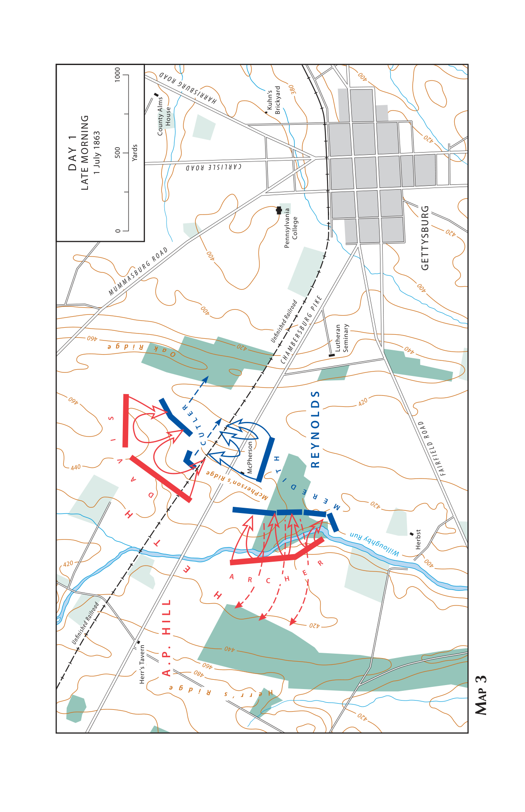
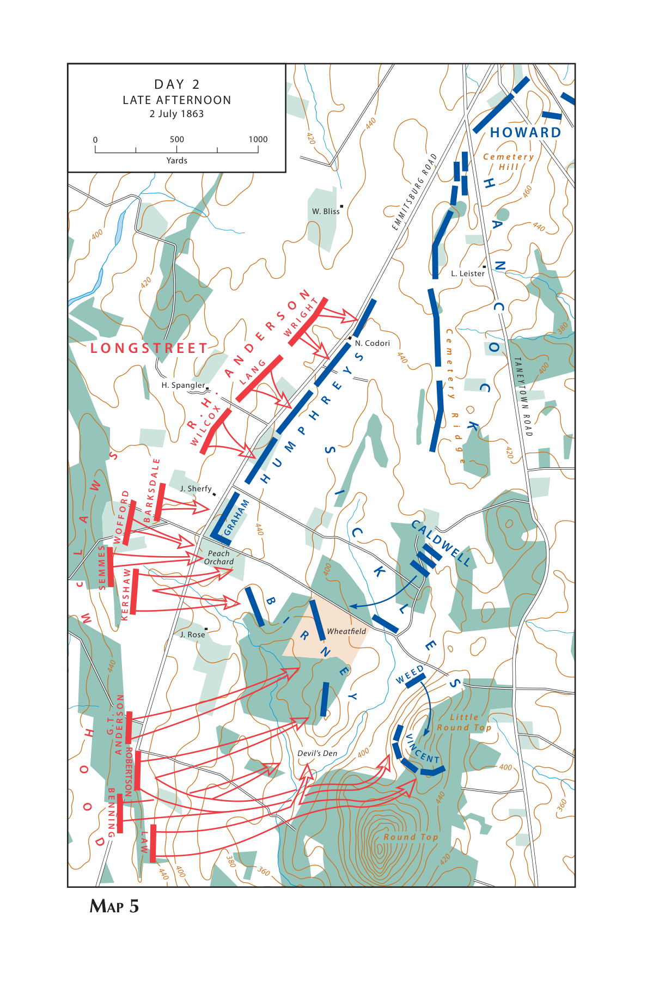
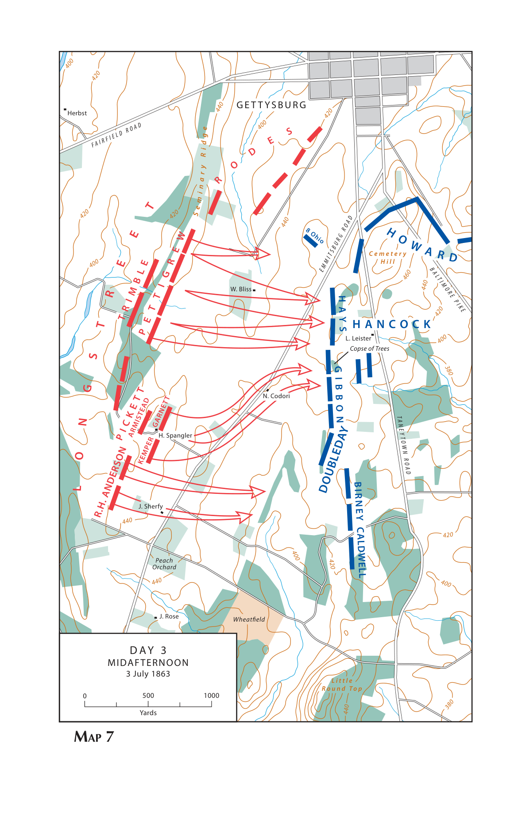

1863年7月1日至3日，美国内战中的两支主力军在宾夕法尼亚州葛底斯堡交战。罗伯特·李的北弗吉尼亚军团第一天占领城镇，第二天夺取桃园，第三天甚至有士兵越过对面的石墙。乔治·米德指挥的波托马克军团如何接连丢掉阵地，最终却迫使李撤过波托马克河？本文以公历和战场当地时间记事，追击写到七月十四日，以交代野战胜利的限度。

以下第一人称叙述依据史料重建，由联邦军司令乔治·戈登·米德的视角展开。

## 六月二十八日，接过一支正在移动的军队

我在马里兰州弗雷德里克附近接到总统的命令，接替约瑟夫·胡克指挥波托马克军团。就在这支军队里，我此前指挥第五军，熟悉一个军从收到行军命令到把步兵与大炮送进阵地的过程。现在责任扩大到七个步兵军。我首先得查明它们各自在哪里，手里还有多少可用的人和马，前一位司令的命令已经把它们送上了哪条路。骑兵还在掩护全军渡过波托马克河后的队尾，华盛顿方面拨来的骑兵也要纳入原有指挥。六月二十八日大半天，用在收拢和核对这些部队上。[^meade][^cmh]

李已经过河。按我接手时得到的情报，他的先头部队在萨斯奎哈纳河一带活动，威胁哈里斯堡和哥伦比亚，詹姆斯·朗斯特里特的军在钱伯斯堡，安布罗斯·鲍威尔·希尔的军在钱伯斯堡与卡什敦之间。从这些报告看，南方军队铺开得很远。我得到的估计甚至把李的全军算到十万以上。我的最近一份兵力报表也有十万出头，但表上有些人正在看守财物、护送车队、担任后方警戒。眼前的任务，是把分散在哈珀斯费里至莫诺卡西河口以及弗雷德里克周边的兵力，集中到能与李交手的位置。[^meade]

总司令哈勒克交给我的任务包括掩护华盛顿和巴尔的摩，同时寻求与入侵部队交战。如果把野战军径直开向最北面的敌军，李的其他部队仍可能从侧面穿过，威胁我身后的城市和交通线。如果沿着通向首都的道路逐一设防，已经进入宾夕法尼亚的敌军就能继续获取粮秣，向更多地区推进。我的军队要保持在入侵者与这些城市之间，还要能够向北走得足够远，迫使李收拢兵力。前进的方向和部队之间相隔的距离，都受这两项任务约束。[^meade][^cmh]

哈珀斯费里的部队也要重新分配。我命令威廉·弗伦奇带约七千人占领弗雷德里克，控制巴尔的摩与俄亥俄铁路沿线，其余约四千人把政府物资护送到华盛顿。这道命令没有把一万多人添进我的第一线。它给野战军留下能够利用的交通和后方，让行军中的步兵军不必自己把每一段铁路都守起来。[^meade]

六月二十九日，部队开始向北推进，左翼抵达埃米茨堡附近，右翼展开到新温莎方向。沿一条好路前进的军也得把所属各师、炮车和弹药车排成长列，把七个军挤上同一条路只会延长队尾。分路行军能够使多个军在同一天接近目标，代价是发生遭遇时，离得最近的那个军必须先顶住。我把第一、第三和第十一军所在的左翼交给约翰·雷诺兹协调。这样，前方一旦需要步兵支援骑兵，雷诺兹可以就近调动，军部无须先把每一道请求送到我这里。[^meade]

骑兵本应比步兵先看到敌人，但骑兵也得通过道路。右翼的戴维·格雷格向指定位置运动时，步兵纵队占用了路面，他的前进受到耽搁。贾德森·基尔帕特里克在汉诺威一带与敌骑接触，约翰·比福德则在我们西侧前进。到六月三十日，部队右翼已向曼彻斯特伸出，左翼三个军还在埃米茨堡周围。骑兵能够报告哪一条路上出现了多少敌人，我才能判断应该催促哪一个军，或者给远在另一端的部队预留多少赶路时间。[^meade][^cmh]

比福德从葛底斯堡报告，有相当兵力沿卡什敦方向的道路出现。我指示雷诺兹占据葛底斯堡。这座县城的军事价值首先在道路上。从西面翻过南山来的部队能沿钱伯斯堡大道接近，从北面、东北面来的部队有另外几条进城道路。我们从南面的埃米茨堡、塔尼敦和东南面的巴尔的摩大道接近，也能在这里会合。对一支军队有用的道路，同样对另一支有用。谁先占领镇中心，谁便拥有路口，可谁要在几条道路交会的开阔地上防守，也可能同时受到几个方向的压力。[^meade][^cmh]

我还为在马里兰州派普溪一带集结准备了预案。若敌情要求回到较靠南的阵地，各军需要知道往哪儿走，不能到了必须撤离时才临时寻找道路。同时，左翼继续向葛底斯堡前出。保留后方集结地点和接近前方敌军，在六月底还可以同时实行。要紧的是先确定李打算把多少兵力送到葛底斯堡，又有怎样的地面条件可以接纳我的各军。下一步取决于雷诺兹和比福德送来的军报。[^cmh][^meade]

## 七月一日，雷诺兹阵亡的消息抵达塔尼敦

我还在葛底斯堡南面的塔尼敦。西面最先与敌人接触的是比福德的骑兵。他把人马带到城外，占住来路前方的几道山脊，部分骑兵下马持枪作战。这样布置能把敌步兵从行军队形逼成战斗队形，迫使后续纵队停下、展开，给雷诺兹争取赶到的时间。骑兵也必须有人照管马匹，实际能够拿枪留在线上的人数会随之减少。比福德能支撑多久，要看对方的步兵和火炮怎样增多，以及我方第一军的前列何时能够接手。[^meade][^cmh]

雷诺兹到达时，城西的交火已经相当激烈。他让第一军的先头师绕过镇子，迎着卡什敦公路方向展开，又催促奥利弗·霍华德率第十一军赶来。前线军长的这一选择，把我们由骑兵遮护下的行军带进了步兵会战。投入得早，能够保住城外的展开地并阻碍敌军逼近。投入的是先头师，也意味着在本军其他人赶到以前，这个师要承受自己正面和侧面的危险。雷诺兹亲自在前面安排部队，很快中弹阵亡。传回我军部的重大消息，首先是左翼突然失去了负责统一调度的人。[^meade][^cmh]

第一军的指挥暂时转到阿布纳·道布尔戴手里。霍华德到场后，承担起现场更大范围的指挥，由卡尔·舒尔茨带第十一军作战。两个人要解决的是不同大小的问题。道布尔戴要把刚到的师送往城西交战线并接替死去的军长，霍华德还要判断面向西方的部队是否会受到来自北面的打击。等新的消息走完从葛底斯堡到塔尼敦的路，我所掌握的总是较早的一幕。我若在军部按这一幕直接指定某团向左或向右，命令赶到时战线也许已经改变。[^meade]

我让温菲尔德·斯科特·汉考克先去现场，代表我检查阵地，帮助安排部队，并报告葛底斯堡是否适合全军交战。他原来指挥第二军，我现在把他本人先送往北方。他能带回的情报有两部分。一部分是雷诺兹阵亡后，城西和城北还有多少成建制的部队。另一部分是如果它们守不住现有阵线，城南有没有地方既可接应它们，又容得下正在向这里行军的其他几个军。前一个问题决定今天还能守多久，后一个问题决定今夜全军走向哪儿。[^meade][^cmh]

最初的战报里有好消息。第一军沃兹沃思师的步兵向前推进，在威洛比溪附近打退对手，俘获了敌方旅长詹姆斯·阿彻和一批士兵。城西的一些部队夺得俘虏，火炮也已经投入，但第一军仍只是在源源抵达的敌军面前占住城外一线。俘虏可以帮助辨认眼前部队的番号，不能告诉军部同一条路后面还有多少兵。等敌人重新整顿，把增援展开，先前取得的距离还需要步兵和炮兵重新去守。[^meade][^morrow]

霍华德把第十一军的两个师送过城镇，在城北展开，以应付从北方接近的敌军。他留下一个师的力量和火炮在城南公墓山一带。此时位于高地的兵力，若拿去填城北的前线，可以使那里的正面再厚些。留下它们，却给已经向西和向北展开的两个军各保住一处能够辨认的集合点。各部从不同方向退下来，可以认定向同一座山去，高地上的炮也能越过退兵对追上来的敌人开火。到下午，这支暂时没有投入城外主战线的部队成了撤退得以收束的条件。[^meade][^cmh]

从前线陆续传回的情况表明，敌军已经通过两组道路增加压力。从卡什敦一面来的部队继续压向第一军，从约克和哈里斯堡方向来的敌人抵达城北。我们原来面向一条大道的战斗，变成两支军队背靠镇子、各自朝外作战。城西的部队如果把一翼向北弯折，会缩短原来的正面。城北的部队如果伸长阵线与西面的友军联接，又会把自己另一翼伸得更薄。敌方新到的部队可以打击这条线的弯折处，也可以绕过它尚未接牢的末端。[^meade][^cmh]

城北部队被压回以后，城西的第一军也不能只按自己正面的情况决定还守不守。继续留在神学院一带会使它通向城南的退路暴露在另一方向来的敌人面前。下午四时前后，各部向公墓山撤退。经过镇内街道的士兵一部分来自城西，一部分来自城北。不同单位的队伍在十字路口汇合，伤员、俘虏与撤下来的炮车也需要通行。能在街外迅速列成横队的团，进入建筑与围墙之间后只能拆开队形。许多人在镇里同本队失联或被俘。[^meade][^cmh]

汉考克抵达时，先前守在城外的兵力正在向城南聚集。他和霍华德共同安排防御。离城最近的公墓山能控制向南延伸的道路，往东另有林木覆盖的卡尔普山，往南则是起伏较缓的公墓岭。守住山头，可以使敌人从路口追出来以后还得重新展开、爬坡，不能跟着撤退的人一气冲进军队的后方。把留守的部队布好，再给撤上山的部队分配地段，也让几个钟头前失去军长的第一军重新获得明确的左右邻接关系。[^meade][^cmh]

我收到的报告逐渐指向同一个战场。敌军正在给已经发动的攻击加上更多兵力，汉考克和霍华德又报告城南地势可以利用。即使城里已有敌人，只要我们能够把后续各军送到公墓山之后，仍有机会争夺接下来的会战。反过来，若要求已经损失很大的两个军重新出发，向派普溪走，它们需要在身后有追兵的条件下离开组织中的阵地。我选择在葛底斯堡集中，发令给各军，同时让辎重车队转到威斯敏斯特后方。[^meade]

把人送往北面、把大车送往东南，是同一决定的两面。步兵、弹药和需要立即使用的炮车必须接近战场，携带其他物资的长列车辆若也随军挤到城南，会占用后续部队的来路。威斯敏斯特可以作为后方接济点，但从那里到作战地仍须靠道路运输。因而把大车留在后方也会产生新的警戒任务，需要人在车队周围维持安全。我的命令给即将交战的几万人腾出了道路，也把必须保住的交通线延长到了阵地之外。[^meade]

傍晚，第十二军和第三军的一部分赶到，斯洛克姆与丹尼尔·西克尔斯分别向已有阵地的侧翼靠拢。远处第六军还要走很长的路。部队的行军不能只按军部下令的时刻计算，师部需要把命令发下去，在野外停驻的人要重新集合，炮兵要套车，先走的单位还得给后续部队让出岔路。到夜间十时左右，我撤离塔尼敦的司令部，前往战场。约在次日凌晨一时抵达时，我已把全军的去向定在这里，还需要亲自查清它所要占领的地面。[^meade]

## 七月二日清晨，怎样把抵达的各军接成一条线

我的司令部设在公墓山南侧的莱斯特农舍。天亮以后，从城南高地看，已占领镇子的敌军就在公墓山前方，城内建筑遮住部分活动。向东，公墓山与卡尔普山之间有低鞍部。再向南，公墓岭逐渐降低，直到地形重新升起形成大小圆顶山。一支守军若在这些山脊上向外列阵，战线从一段弯曲的北端转向南方，包住塔尼敦路和巴尔的摩大道。我的指挥所、炮兵预备队以及各军之间的联系，可以留在这条弯曲线的内侧。[^meade][^cmh]

我让第十一军留守隔镇相望的公墓山。第一军的一部分补入它和更东面的卡尔普山之间，第十二军沿东面高地展开，使右翼靠近水系和巴尔的摩大道。汉考克的第二军向南接上公墓岭，西克尔斯的第三军负责继续延伸左翼。这样的布置对刚经历退却的前两个军尤其重要。它们在第一天损失了许多军官和成建制的士兵，如今可以依托容易辨认的高地，身边又有新到部队。第一军此后由我指定约翰·牛顿接掌。[^meade]

一个军接上另一个军，在地图上只需画两条相连的线，实地却有不同的难处。山脊有些地段升得很高，守军能从坡上观察远处。另一些地方地势降低，前方田野反而更高，步兵无法看到栅栏后发生的事。右端卡尔普山上的部队面对树林和不平的坡地，距离稍远便难看清来人。左端靠近南北向道路、果园、麦田和散布的巨石，炮兵要寻找能把弹丸送到敌人前进路线的开阔位置。我的总意图必须由各军长在这些不同地面上落实。[^meade][^cmh]

第五军原由我指挥，现在由乔治·赛克斯带领。我先让它担任预备队，等待约翰·塞奇威克的第六军抵达。预备队给我的选择很具体。如果右翼先受压，它可以去支援卡尔普山。如果敌人向左翼延伸，它可以填上第三军以南的地段。一旦把第五军平均摊在全线上，我就须从正受威胁的部队里临时抽人。暂时留在后方要付出代价，左翼有些地方只能靠较少部队观察。第六军一到，我便能让一支部队接替另一支的任务。[^meade]

第六军的先头于下午到达。按我报告中的行程，从前一天晚上约九时起，这个军走了约三十二英里。军长来报抵达的时候，先头、中段、队尾各自的状态并不一样。已经走到的官兵有的可以立即守一个地段，有的还须等炮车、弹药和本队余部跟上。一支刚作完长距离急行军的部队，最容易立即承担的是占据阵地，最难承担的是在陌生地面马上协调多个师反击。我令第五军向最左端运动，以第六军作为右翼方面的预备力量。[^meade][^cmh]

西克尔斯所负责的地段在这时成为问题。从我给他的阵线向前看，埃米茨堡路在舍菲农场桃园一带通过一片较高的地面。敌军若把炮设在那里，确实可以打击我方地势较低的部队。炮兵主任亨利·亨特到现场考察过地形，但军队其余各部已经按公墓岭上的连接关系部署，第三军向前走多远会改变第二军和第五军的任务。地形对一个炮位是否有利，和一个军能否靠同样的人数守住那一片田地，是我必须分别处理的两个问题。[^meade][^cmh]

下午我到左翼时，第三军已经向前突出了约半英里至四分之三英里。它的右翼在埃米茨堡路一带，来到桃园附近，阵线又折向麦田和魔鬼谷。原定位置向前移动以后，这个军正面伸长，右翼与汉考克的部队脱开，左端与圆顶山之间也出现空隙。我找到西克尔斯，正在和他谈把部队撤回的问题，对方火炮便开始射击，紧接着步兵攻击。此刻再命令整个军转身、穿过田地、回到原线，会把没有掩护的队伍交给正在进攻的敌人。我要先让它能在现地打，再安排部队填上它身后的缺口。[^meade][^cmh]

## 七月二日下午，一支预备队要救几个地方

先得保住第三军的两个端点。汉考克从第二军派兵到第三军右侧，在埃米茨堡路和公墓岭之间接应。赛克斯把第五军部队送到第三军左边，其中一部分上了小圆顶山。这两个方向相隔着桃园、麦田和林带，从桃园看不清山南坡的战斗，从山上也不能凭肉眼辨认麦田后每支正在运动的部队。我的命令把军引向危险地段，到了现场，工程军官、师长、旅长仍须决定先占哪一道坡、哪一条石墙和哪个路口。[^meade][^cmh]

小圆顶山原有我方信号人员，他们可以利用高处观察并传送信号。山上能看见敌军越过第三军左端展开，守信号站的人手却不足以阻止成建制的步兵登山。我的工程主任古弗尼尔·沃伦在这里辨明危险，催调正在附近运动的第五军步兵。斯特朗·文森特的旅转向山坡，先把四个团摆在南面山肩。若让这支部队继续走向麦田，那里很快会多一支能够立即使用的旅，但圆顶山上的缺口将继续敞开。在军部来得及重新画出全线以前，现场已经作出了选择。[^cmh]

山下的第三军在更开阔的地面上承受炮击。大卫·伯尼指挥的师由桃园向麦田和魔鬼谷延伸，安德鲁·汉弗莱斯的师沿路向北展开。前面的两个师越努力守自己的战线，越需要有人守住两者相接的折角。桃园一带能让炮兵打向来敌，同样也能挨到从两个方向射来的炮弹。更南面，岩石间的步兵可以躲避一部分射击，邻队被遮住以后却很难看见自己的侧面是否仍有人防守。这个下午送到我面前的求援，来自彼此有关联、却不能用同一支援军立即解决的几个地方。[^meade][^cmh]

炮兵在第三军阵线上所面对的问题与步兵不同。一支步兵连可以贴着石墙改变朝向，炮要改变位置则须把炮拉回前车，套上挽马，找到能让车辆通过的出口。如果附近步兵退却，炮手继续射击可以为他们争取时间，但打得越久，炮兵自己脱离的机会越小。敌人逼到很近时，炮手就算能把炮推出去，弹药车和马匹也可能留在原处。魔鬼谷的守军终于退出时丢下火炮，这又使靠近麦田的部队少了一部分能够保护侧面的火力。[^cmh]

第五军一部分兵力在山坡上挡住敌人，另一部分进入麦田周围。汉考克把约翰·考德威尔的师送去支援。沿公墓岭向南赶的部队，先在我们阵线后方运动，然后必须向西穿出，进入已经有友军向后退的地带。撤退的人要经过援军横队的间隔，援军还得保持队形，才能继续向前。传令兵能告诉他们哪一片地方最危险，却很难准确说明前面每一处树丛此刻由谁占着。到达的部队必须先识别己方前沿，再决定向哪个方向开火。[^meade][^pa116]

西克尔斯中弹重伤，退出指挥，伯尼接手第三军。各师和炮兵身旁还有能继续发布局部命令的军官，指挥全军的任务却在受攻击途中移交。第三军正面已经弯折，部队往后撤时，有的可以接到原定的公墓岭地段，有的先同别的军汇合。我的司令部需要把后面的线撑起来，使落下来的部队找到有火力保护的地点。要求伯尼重新占住原来突出在外的全部地段，会让正在收缩的部队再次分散到已经失去联系的两翼。[^meade]

敌人逐步夺下桃园。这里的失守影响很快越出一片果树的边界。从桃园向北沿埃米茨堡路展开的部队，现在既要面对正面来敌，又暴露在由南而北压来的火力之下。可以把一部分阵线向后折以保护侧面，但折回来的人越多，继续朝前的步枪便越少。汉弗莱斯的部队被迫撤离，几处炮位附近的步兵也向后退。敌人得以从突出部两肩向中间推进，有的部队甚至越过先前第三军和第二军之间的空隙，逼近公墓岭。[^meade][^cmh]

对面的步兵通过桃园和麦田以后，面对的又是一道新问题。他们要从散布着死伤者、遗弃火炮和混杂部队的田野里，继续向后方尚有守军的山脊前进。一部分人追得快，会先于左右邻队接近我方。只要在他们接近时把仍能集合的步兵送到缺口，便有机会从侧面阻止一支已经前出很远的队伍。汉考克在中央调动手边的团，有时直接向下级指挥官发出反击命令。各部用急短的攻击换取后续兵力赶到的时间，付出的损失也集中在被最先推上去的几个团。[^meade][^ny111][^cmh]

我又从第一军、第二军、第六军等部抽出兵力，在不同时刻支援左翼。这些援兵没有在同一刻组成一支由我统率的反击纵队。有的上来接替近乎耗尽的步兵，有的保护炮兵退出，有的占住山岭与道路，防止一队已越过前线的敌军继续向东。最左端的小圆顶山守住了。桃园和魔鬼谷落在敌人手中，第三军逐渐退到较靠内的地方。黄昏时，我们在不同地点让出去的距离并不一致，但李的部队未能沿着任何一处缺口打到塔尼敦路，切断左翼同军团其余部队的连接。[^meade][^cmh]

为了支援左翼，第十二军也抽走了一部分兵力。这个决定在地图上显得容易，因为从弯曲防线的一端到另一端，沿内侧走比敌人在外侧绕行短。实际上，调出的人当即离开原有阵地，能够给另一头提供帮助却还得等到走完全程。一旦道路上还有其他部队，或行进中接错方向，调兵造成的空虚已经发生，预期的增援却未必及时出现。七月二日傍晚，代价很快出现在我们自己的右翼。[^meade][^cmh]

卡尔普山的部队此前已经用木材、土石构筑胸墙。我们抽走部分守军以后，仍留在山上的乔治·格林所部尽量延长阵线。入夜，敌步兵从山下攻来，他们必须越过林木、石块与坡地，黑暗使编队的保持比白天困难。留下的士兵在工事后能集中射击，空出来的工事却会提供给先到的敌军。对方进入低处一段空防线，使我们右翼出现敌人已经上山、但高处仍在自己手里的局面。从那段被占工事再走不远，就会接近巴尔的摩大道。[^meade][^cmh]

另一股敌军从城镇的东面逼近公墓山。约在晚上八时，第十一军守地遭到攻击。有些敌步兵爬过坡面抵达炮位，炮手必须在炮旁自卫。我们的第一军和第二军都有人过来帮助，第二军塞缪尔·卡罗尔旅的步兵穿过墓园，在炮位附近重新建立防线，迫使攻上来的敌人撤走。在同一晚的报告中，公墓山上的炮位遇袭而后恢复，卡尔普山上一部分工事仍被占据。这是两个相邻高地上的两项结果，次日必须处理的任务也不相同。[^meade][^cmh]

天黑使攻上山的敌人难以发挥刚刚取得的位置，也使我方回来的部队难以立刻收复阵地。如果按出发前知道的路线，径直走回原有的木墙后，可能迎面碰上已经据守其中的敌军。回到卡尔普山的第十二军部队要先辨明尚在我手里的地段，恢复横向联系，准备天亮后靠自己的炮火和步兵夺回空缺。这样做要让敌人暂时留在高地的一部分，却使我们可以用比较完整的部队解决问题。夜色给双方留下的，都是一条尚待查明的接触线。[^meade][^cmh]

## 七月三日，从右翼工事到中央石墙

二日深夜，我在莱斯特农舍听取高级指挥官的意见。各军经历很不相同。第一军和第十一军已经作战两天，第三军在今天的冲击中损失很大，第六军则刚刚完成长途行军，有些部队已经被分派出去。眼下要决定是否继续留在葛底斯堡，留在这里以后是先攻击，还是让对手来攻，以及可以等待多久。参谋长巴特菲尔德记下各人的意见。多数人愿意继续守阵地，观察次日的变化。最后仍由我负责让部队留下，并准备应对新的攻击。[^cmh]

我们守住了两个重要端点，却还得防备敌人越过端点。圆顶山以东的塔尼敦路一带需要有部队应付可能的迂回，右端又必须先收回被占工事。把中央兵力移往两端，中央便会变薄。让受重创的第三军单独重新组织一条同昨天一样长的线，也超出了它眼前可以承担的任务。军旗和番号仍在原处，并不能保证每个军长还握有出发时那样完整的营连。我所能安排的，是在要道和高地上保留支撑部队，使一个师在次日遭到打击后仍有地方可以接应。[^meade][^cmh]

天将明时，右翼先动手。第十二军的炮兵向卡尔普山低处被占的工事射击，步兵随即与敌人交战。我们既要驱离昨晚进入工事的人，也要抵挡山下对保留下来的阵线发动的进攻。对方已经用上我们留下的掩体，原来的射口和遮蔽物现在影响的是向相反方向前进的人。山上能够使用的步兵增加以后，一个团在胸墙后打完弹药，可以让另一个团接上。只要补给的人和换防的人还有通路，正面的火力就可以持续。[^meade][^cmh]

约翰·吉里所部得到第六军部队支援。守军在工事后维持射击，同时向原阵地推进。林地把不同团所能看到的范围限制得很小，一个地段已经把敌人打退，隔着坡折的另一处仍可能在近距离接战。军部收到右翼趋稳的消息时，不能据此断定每一段工事都已经收回，更不能马上把刚送上去的部队再抽回来。战斗持续到上午较晚时分，昨晚失去的工事重新纳入我们的阵线。通向巴尔的摩大道的这一侧，终于恢复了比较完整的屏障。[^meade][^cmh]

右翼的交火没有延续成敌人在整个正面同时发起的攻击。中央步兵有时间调整地段，利用石墙和地势挖筑临时防御。公墓岭中央高度不大，也缺少两端那样突出的山顶，但炮兵能够在不同位置对开阔农地形成交叉射击。敌人若要把步兵送到石墙边，需要从西面通过有缓坡和凹地的地面，越过埃米茨堡路，再登上并不高却暴露在火力下的末段坡面。坡上步兵只需辨清自己射界内的目标，炮兵则要为敌步兵进入近距离时留下弹药。[^meade][^cmh]

约在下午一时，敌方炮群向公墓岭中央和左中段开火。我的报告估计有一百二十五门以上参与射击。开到这么大的规模，攻击就有了可见的准备，但是炮火指向哪里，并不能马上告诉我们步兵各部将在何处进入射程。我们把人留在掩体和地形的遮蔽下。炮弹有的击中炮位，打死人马、毁坏器材，有的飞越山脊，落到司令部和后方车辆附近。前排步兵能够贴地隐蔽，处在后方的传令人员和马队也同样会受打击。[^meade][^cmh]

炮击中司令部一度需要离开莱斯特农舍。建筑位于阵线后方，平时便于接收通往各军的报告，遇到越过山脊的炮弹时却很容易受击。炮兵阵地前后都可能成为弹着区，一支遭到损伤的炮队撤出以后，要有其他炮队通过这些地段进入阵位。对方远处的观察员若只看到一门炮被拖走，能够知道这一门停止射击，却难以看到背坡还有多少炮车在等候。军部对中央能否再作战的判断，也要根据仍能进入炮位的兵力，不能只数当前发射中的炮口。[^cmh]

亨特希望各炮队节制射击，让弹药能够用于逼近的敌步兵。负责左中央的汉考克也有他的难处，步兵正在承受炮击，如果本方长时间没有回应，士兵会很难判断自己的炮兵是否还在保护他们。各处回击的频率因而不同。渐渐地，我方一部分火炮减少发射，有的撤下更换。对我而言，这段时间的任务是保持下一阶段能够使用的火力。对正在对面估计炮击效果的人，同样的沉寂却可能成为判断何时放出步兵的依据。[^meade][^cmh]

接着，敌方步兵出现在公墓岭西面的农地上。一部分行列从较南的低处斜向我军左中央，另一部分从较北的方向接近。地面有起伏，行进中的人时而进入火力视野，时而又被道路以西的低地遮去。在阵线上看见某一片敌人暂时不见，不能把它当成攻击已经退回。我们的火炮重新对步兵开火，从斜侧位置可以沿着一部分行列的长度射击。越往东走，对方越需要在射击中整齐地向同一片地面聚拢。[^meade][^cmh]

埃米茨堡路及其栅栏横在一部分攻击队前面。步兵到达这里，要通过已有开口或翻越障碍，原先能同时前进的排面容易分开。一些人越过道路以后继续向前，另一些仍需停下，旁边的军官要在移动中把队伍重新理齐。接近石墙以后，人还能用步枪还击，但停下来装填射击和继续靠近目标是相互竞争的动作。此时我们两端能斜射的部队和守在墙后的步兵都开始起作用。敌人终于接触到阵线中央的一段，战斗进入炮位和石墙附近。[^cmh][^meade]

第二军方面承担最重的冲击。汉考克负责左中央，约翰·吉本指挥第二军的战斗，两人都在这个阶段负重伤。敌方有一部分步兵越过矮墙，打到我军炮位附近。放眼整条防线，此处只占很短的一段。站在缺口里的官兵却必须立刻知道两侧有没有友军，后面有没有还能用于反击的部队。道布尔戴的部队和乔治·斯坦纳德的佛蒙特旅参与支援，从正面及侧面形成火力。越过墙的人后方既要持续补入步兵，又要压住我们仍在射击的炮和枪，才能扩大缺口。后一波力量终于没有跟上来。[^meade][^cmh]

大批敌人折返，也有成队士兵在两线之间投降。我们占着炮位和石墙，有些地段却刚刚损失指挥官，部队身边聚集着伤员和俘虏。要把守住阵地的步兵变成整齐的追击部队，需要先弄清本军各旅还有谁在指挥，越过石墙以后谁负责保护它们的侧翼。对面原有的炮兵阵地和未参加此次冲击的部队仍然存在。我们向前派出兵力接触敌阵，没有在当天下午用全军越过同一片开阔地发动新的会战。[^meade][^longstreet][^cmh]

骑兵在步兵会战两端另有任务。格雷格方面在东面应付敌骑，守住通向后方的道路。基尔帕特里克在我们最左边活动，向敌方右翼施加压力。它们离第二军正面很远，不能因为同一天都在打仗，就算成投入中央防御的骑兵。此前在城西作战的比福德所部已经需要整补，后方大车也要保护。即使从阵地上望见敌步兵退回，也不能立即把不同道路上的骑兵当成一支已经集合在眼前的追击纵队。[^meade][^cmh]

## 七月四日至十四日，如何把撤退的敌军留在河这边

七月四日清晨，侦察发现敌人左翼已向后收，原来面对我方左翼的地段仍有兵力。即使李准备撤退，撤离城镇、挪动辎重与收回主力也是三个可以分开执行的动作。我让骑兵活动到敌人后方，威胁穿过山口的车辆。它们有机会截击长列大车、救出被带走的人，并报告敌人的去向。我在原阵地上还得照料伤员，埋葬死者，让脱离本队的士兵归队，同时确认山脊西面的敌人是否还会反击。[^meade][^cmh]

七月五日上午，我们查明敌军正沿费尔菲尔德和卡什敦两条道路撤走。第六军立即沿费尔菲尔德方向跟进，骑兵沿卡什敦路及通往其他山口的道路活动。直接跟在敌人后面，能保持接触，却把交战地点交给了担任后卫的人。在窄路上，对方只须留下少量有步兵和火炮支持的后卫，就能迫使我们的前锋停下来，反复从行军队形转为准备作战的队形。在后面的一整个军，能同时打到前方路障的只是一小部分。[^meade]

塞奇威克报告了山口阵地的强度。我决定留下步兵和骑兵继续扰敌，让主力改取侧面路线，先向马里兰州米德尔敦走，再通过南山，接近李要利用的波托马克河渡口。我要求弗伦奇重占哈珀斯费里，并占据特纳山口，后来得知他已部分先行执行，还派出骑兵破坏落水镇的浮桥。比福德又被送去威廉斯波特和黑格斯敦方向。步兵与骑兵的路线在这里承担不同时间要求。骑兵要在渡口和车队附近尽早造成麻烦，步兵主力要赶到能够封锁撤退的阵地。[^meade][^cmh]

在米德尔敦，我们停留一日补充物资，等待车队。此前把辎重留在战场以外有助于部队向北集中，如今主力已经改变方向，必须把粮食、鞋和弹药重新送到追击路线上。雨使道路变差，山口又限制车队靠前的速度。能继续行军的士兵还要带上随身弹药和行李，受伤者则需要向相反方向运走。骑兵可以在敌人后面取得局部战果，但要在宽大地段封住一整支军队的渡河路线，必须有能够留在当地作战的步兵和炮兵。[^meade][^cmh]

七月十二日，我们到了威廉斯波特前方。敌军把防线建立在通向渡口的高地上，河水上涨，敌人停下来筑工事，也正在解决浮桥问题。从我们的前沿能看到，有一支仍能抵抗的军队隔在我们和渡口之间。贸然冲上去，会在另一个地点承担三日在公墓岭前由敌军承担的风险。多花一天侦察，对方则多得一天完成架桥。我在十三日侦察并准备攻击。十四日向前推进时，敌人已在夜里经落水镇的桥和威廉斯波特的浅滩撤过河去。我们的骑兵追上后卫，俘获人员和火炮。[^meade][^cmh]

宾夕法尼亚的野战已经结束，我的军队把来敌赶出了州境，未能在河以北包围它。以后还要继续行军，进入弗吉尼亚作战。对在葛底斯堡受伤的人，变化来得更慢。他们必须等待医护和运输，有些人会被留在当地很久。在军团报告里可以用一段话写完的退兵与追兵，实际用了十来天。六月二十八日接到命令时找不齐的各军，如今又有许多军官和士兵永远不能归队。[^meade][^morrow]

## 战后复盘　军报之间的三处战场

米德十月一日才提交综合报告。他在开头说明，几位军长和师长受伤，所属部队的报告迟迟未能汇齐。这个细节影响了第一人称叙述的边界。七月一日，他在塔尼敦收到雷诺兹阵亡的消息，可以立即派汉考克出发。那天在城西的几个团怎样负伤、失联、重组，他要靠幸存者写下的报告才能补齐。用总司令部、军级指挥官和团级军官留下的三种视野重新检查战场，能发现一些从任何一处都看不完整的行动。[^meade][^morrow]

### 第一日，一个团从溪流打到神学院

*图一　七月一日上午稍晚的战场态势。美国陆军军事史中心战役图三，比例尺以码为单位。*[^cmh]

铁旅是联邦第一军第一师的一支步兵旅，密歇根第二十四团在旅内。团长亨利·莫罗的记录从行军写起。六月二十九日部队长途跋涉到埃米茨堡，到三十日又走了几英里，在马什溪一带停下。次日接近葛底斯堡时，部队远远听见炮声，加快步伐，绕到城西。对于米德，第一军正在加入会战。对于莫罗，首先遇到的却是部队来不及装弹的问题。他想让士兵停下来装枪，一名参谋催他继续跟上队伍。莫罗对这名军官究竟属于谁的幕僚仍不完全确定。[^morrow]

这个小插曲交代了雷诺兹到场后的紧迫程度。步兵由道路行军转为横队，既要向前，也要向左右展开。士兵停下来装弹，能给接敌时的第一轮射击作准备，却会使前进中的旅在团与团之间拉开距离。当时位于最左面的密歇根第二十四团随旅冲过高地，进入威洛比溪沟谷，俘获了阿彻旅的一批士兵。比福德的骑兵移向铁旅的侧面，步兵接替其主要正面。第一批骑兵换下来的结果，是防守者终于有足够人手渡过沟谷反击，也使步兵随即承担守住这条西线的任务。[^morrow][^meade]

阿彻被俘和一部分南军退走以后，莫罗把散兵送向前方和左侧。散兵比主队展开得稀，任务是发现敌人、使来敌必须提早展开，并给后方主线留下反应时间。下午局势变化，铁旅必须同已经增加的南军步兵在树林、浅沟和起伏地面上作战。第一波推进时位于某团左方的邻队，改变正面后可能出现在它的另一边。莫罗的报告随阵线重新成形而改变左右参照。如果只抄下早晨的位置，便会误解下午他为什么突然遭到打向侧面的火力。[^morrow]

当邻接的印第安纳第十九团后退时，密歇根人左侧暴露。莫罗试图使左翼往后弯，正面对着新出现的火力。完成这个动作，需要一端的人维持位置，另一端的人向后移动，然后重新确定和身边士兵的间隔。敌军并没有为这次变换留时间。整个团被迫向后移到第二线，又在一处浅沟之后占第三线。它退得比阵地上的伤员快，也比一些失去军官的士兵快。到后来莫罗能在手边集合的人，据他估计已不到初始兵力的四分之一。[^morrow]

团旗在这些短距离后退中有一种具体用途。指挥官可以指明下一次集结的位置，让士兵看旗重新靠拢。一个旗手受伤，旁边的人必须接住旗，否则在枪烟、树林和移动的人群中，幸存者更难找到本团。莫罗列出多名先后持旗者，至少九人接过这面旗，四人死亡。到神学院以西的障碍物附近，莫罗自己也负伤退出。阿尔伯特·爱德华兹上尉随后找到旗帜，带起还在队伍里的人，与旅一同撤向卡尔普山。[^morrow]

这一组动作把西线的失败和城南的防守接在一起。初始投入四百九十六人的团，经一下午反复集结只剩下一小股仍由军官掌握的步兵。他们已经没有足够人手在原地守原来的宽度，却还可以在全军新线的一小段上作战。若拿一日傍晚军队图上卡尔普山旁的团番号，与一日早晨相同番号下的兵力视作一回事，就会高估撤退部队的能力。若把它们全部列为溃散，又无法解释为什么当晚高地上还能出现一条可守的线。[^morrow][^cmh]

同一时刻，城北的危险发展得更快。理查德·尤厄尔的部队从不同道路赶到，罗伯特·罗兹的师从北偏西出现，朱巴尔·厄利的师从东北加入。第一军原来朝西，第十一军北出以后，各自都要兼顾两军相接的地带。罗兹的兵力使两条战线的接缝受到威胁，厄利到来又打击第十一军伸出的右翼。北军向镇子退，西边的部队仍须正对希尔的追兵。进入葛底斯堡的街巷以后，两支在野外分别部署的军，争用的是同一批向南出口。[^lee][^meade][^cmh]

李在这一日从俘虏口中确认，对面已经投入波托马克军团的两个军，其他部队正在赶来。太阳落下以前，他手里已有城镇和俘虏，仍缺少攻占城南高地的把握。一个在上午失去司令的北军左翼，到傍晚居然还能由霍华德、汉考克、斯洛克姆等人接续安排。南军同样得从已负伤或疲惫的旅长手里收集情况，再判断手中有多少人可以继续作战。在胜败变化最剧烈的这半天，两边真正能够立刻执行下一道命令的兵力，都远少于正在进入这一地区的部队总数。[^lee][^meade]

### 第二日，同一座山脚为什么出现两场不同的战斗

*图二　七月二日下午稍晚的战场态势。美国陆军军事史中心战役图五，比例尺以码为单位。*[^cmh]

朗斯特里特所部于七月一日接近战场，最前面几个师也未能参加那天下午的最后攻击。他在报告中列出了路上的一项阻碍。尤厄尔部爱德华·约翰逊的纵队从希彭斯堡方向插上同一条道路，后面跟着大队辎重。麦克劳斯师在黄昏后抵达离镇约四英里的马什溪，胡德师接近那里已是半夜。皮克特还留在钱伯斯堡担任后方警戒，胡德师的劳旅又在别处执行警戒。米德一侧遇到的道路拥堵，在李的进攻纵队身上也发生了。[^longstreet]

二日，朗斯特里特等劳旅赶到才发动迂回行军，因为在他看来，已经到场的部队不足以稳妥开战。行军途中，负责带路的工程人员找到的路线会暴露部队，纵队又需改走更隐蔽的道路。等到麦克劳斯师来到要展开的位置，当面情况与早先侦察差别很大。按原判断，南军可以接近埃米茨堡路，转向北方去打沿路以东的联邦左翼。现在西克尔斯的部队已经开到桃园和公路附近，南军绕向侧面的队伍，面前出现了一条能对它正面射击的战线。[^longstreet][^cmh]

胡德师在南军最右。约下午四时开始攻击，他本人在部队接敌后不久负重伤。几个旅的推进方向本来就不完全一样，树林和巨石又把一些相邻的团隔开。劳旅一部分阿拉巴马团向圆顶山方向推进，第四十四和第四十八阿拉巴马团却转向魔鬼谷附近有威胁的炮位。罗伯逊旅也分开，得克萨斯第四、第五团随劳旅一部分向山上去，第一得克萨斯团和第三阿肯色团进入魔鬼谷一带。后续本宁旅隔着树林看不清本应跟随的队伍，也向魔鬼谷这边靠拢。[^cmh][^longstreet]

结果是魔鬼谷的守军突然面对超出他们能够控制的步兵。巨石把步兵遮蔽起来，也挡住炮车出入。得克萨斯人与驻守石墙一带的纽约第一百二十四团交手，纽约人的反击造成伤亡，随后守军在坡上继续依托石墙，直到更多南军拥来。南方夺得阵地和部分火炮，却有许多本来可以用来进一步威胁高地的步兵纠缠在岩石之间。战斗的一个局部结果，使另一个局部战场上的南方兵力相对减少。胡德此时已离开，难以临时把几个旅从这场混战里分开。[^cmh]

小圆顶山南面，文森特的四个团由左到右依次是缅因第二十、宾夕法尼亚第八十三、纽约第四十四和密歇根第十六团。来攻的阿拉巴马人与得克萨斯人分批碰上这四个团。先有文森特右翼吃紧，接着左端的钱伯连发现有人试图绕过缅因团左侧，把自己的左翼连队向后折。这个动作保住了朝向原正面的一部分火力，同时让若干连能迎向正在绕过来的人。如果全团朝同一方向转过去，同宾夕法尼亚团之间反会裂开一道大口子。[^cmh]

缅因团多次射击以后，弹药接近耗尽，钱伯连下令装刺刀。随后该团向坡下反击，击退已多次爬坡的对手，收下一批俘虏。有关究竟哪一段先动、整条线怎样随之摆出的叙述有差别，团的位置、弹药困境与反击结果则较清楚。同一旅另一端的密歇根第十六团也一度难以维持，纽约第一百四十团及时加入，帮助保住右翼。文森特、斯蒂芬·威德、纽约团长帕特里克·奥罗克和炮官哈兹利特都在争夺中阵亡或负致命伤。守住高地的行动依靠多支部队接续，守住以后仍要解决军官损失的问题。[^cmh]

在山的西北面，考德威尔师投入麦田。它从第二军所在的公墓岭被调来，四个旅先后进入不同地段。祖克旅趋向树林与麦田西部，克罗斯旅攻击东半部，帕特里克·凯利的爱尔兰旅接近麦田西南的小高地，布鲁克旅又越过先前的部队向南推进。对手也从胡德师扩大到麦克劳斯师的部队。随着新的旅进入，一处刚被赶走的南军可能在旁边重新形成阵线，另一支又从果园方面出现。夺得麦田边缘的一个团，转眼要为自己侧后的路担忧。[^cmh][^pa116]

圣克莱尔·马尔霍兰少校指挥的宾夕法尼亚第一百一十六团属于凯利旅。按他的七月十七日报告，该部一日上午尚未到场，一日晚宿营时距镇还有约三英里。二日清晨进至能看见敌方前哨的地带，上午架好枪，等在原地。下午听见左侧约四分之三英里外开始射击，过了相当一段时间才接令集合。部队向交战方向走了接近一英里，以横队前进，迎面是从阵线间隔后撤的第三军部队。军部地图上一条从第二军画向麦田的增援箭头，对这个团是先等待，再行军，再从友军间隙穿出的连续动作。[^pa116]

进入浓密树林以后，岩块阻碍了该团登坡。敌人据守坡顶，等北军接近便开火。双方射击一段时间，凯利旅奉命前进，占到对手刚刚占据的位置，俘虏开始向后走。随后对方重新集合，局面随侧面情况改变，北军退下，有人脱离队伍。马尔霍兰最后在第二师医院附近遇到布鲁克，组织还在手边的部队。天黑后，这批人又回到早晨出发的阵地。这位少校用迟疑语气写下自己在支援第三军，说明团长能清楚记录走了多远、前面有什么，却未必在接令时就知道全军为何调他。[^pa116]

同一团翌日上午在新的地段修筑胸墙，汉考克经过时还调整过它的位置，使射界更好。第三日的大炮轰击没有造成该团直接伤亡，士兵却受热和缺水所苦。此后他们看见一部南军在前方低地停下并投降。团长记录的是自己正面失去冲击力的一群人。他的叙述并不包括数百米外冲入北军阵线的部队。把这一团的两个战斗日连起来看，士兵最危险的时刻可以是在树林里奉命前进，而全军遭遇最猛烈炮击的时刻，本团反倒因工事和弹着偏差得到相当保护。[^pa116]

### 第三日，石墙另一端的人看见了什么

*图三　七月三日午后的战场态势。美国陆军军事史中心战役图七，比例尺以码为单位。*[^cmh]

朗斯特里特手里的冲击部队来自两个军。皮克特的三个弗吉尼亚旅从相对靠南的位置出发，佩蒂格鲁代率的赫斯师和特林布尔率领的彭德师两个旅从其北侧推进。前者有一部分在斯潘格勒农场附近的低地隐蔽，后者在神学院岭背坡的林线附近，两个出发地区相隔数百码。守军在公墓岭上看到的进攻阵形，只是他们通过途中的一刻。攻击者必须沿不同路线出发，朝一个预定火力目标靠拢，在接敌前还要把两部分的步调和方向理齐。[^longstreet][^cmh]

皮克特把加内特、肯珀两个旅放在前面，阿米斯特德旅在后。佩蒂格鲁一侧有参加过第一天恶战的步兵，负伤的师长已被替换，旅的实有规模也减少。部队间隔、旗帜位置以及哪一面作为基准，在出发前都有明确用途。走得快的一翼若孤悬在前，会在同一时刻受到正面和侧面的射击。若驻足等齐，停留在开阔地中的部队就会挨更多炮弹。朗斯特里特报告中说队形一度保持得很好，联邦军看到各部后来分裂成群，这两种描述分别适用于行进中的不同阶段。[^longstreet][^cmh]

炮击使攻击的起步时刻变得尤其难选。南方炮兵军官爱德华·波特·亚历山大要向步兵说明对方火炮是否已受压制，手里弹药又在减少。他能辨认的是阵地上一些炮口停了、有些炮被拖走，还能看见另一些炮继续开火。背坡能否送来替换炮队、石墙之后步兵损失了多少，观察位置提供不了同等质量的情报。如果再轰一阵，可能进一步损伤守军，也会减少步兵前进时可用的炮弹。李事后说，步兵发动攻击时，他并不知道本方炮兵弹药已消耗到妨碍支援的程度。[^lee][^longstreet][^cmh]

联邦炮队在南军步兵越过部分开阔地后再次开火。来自公墓山方向的侧射打击佩蒂格鲁一侧，第八俄亥俄团也在它侧面制造压力。更南面，佛蒙特部队转动正面，对皮克特部打出侧射。南军仍有兵力越过道路栅栏，向第二军的石墙逼近。石墙在这里有折角，两侧的墙与山脊距离不同，过墙的人并未自动越过整条守军阵线。阿隆佐·库欣带着还能使用的火炮顶到墙旁，有些炮位在人马都损失严重的情况下继续射击，直到南军抵达跟前。[^cmh]

阿米斯特德和一部分人从较大的缺口进来，另一个较小的缺口遇到北军炮兵近距离射击。加内特已死，肯珀重伤，阿米斯特德在突破后也负了致命伤。进攻者急需一支能迅速通过缺口、转身压制两边守军的部队。此时位于较北一侧的部队已在退下，后续支援若继续冲去，可能也被前方溃退的人截断。朗斯特里特叫停部分原拟支援的兵力，令军官和参谋在后面收容失散者，并把火炮重新组织起来，防范北军反击。局部突破从这里开始倒转为撤离，守军重新掌握石墙一线。[^lee][^longstreet][^cmh]

## 兵力要按日期和道路来算

| 指挥关系 | 主要部队 | 到场及任务 | 能够用于局部交战的力量 |
|---|---|---|---|
| 联邦波托马克军团，米德 | 七个步兵军、骑兵军、各军炮兵和炮兵预备队 | 六月底由马里兰州分路北上 | 全军按不同统计约八万三千至九万余人，一日上午首先接敌的只有比福德骑兵和第一军先头 |
| 雷诺兹协调的联邦左翼 | 第一军、霍华德第十一军、西克尔斯第三军 | 前两军一日分别迎战城西和城北来敌，第三军陆续赶到 | 一日白天三个军并未同时展开，第三军主要损失发生在二日 |
| 联邦中央和两翼 | 汉考克第二军、斯洛克姆第十二军、赛克斯第五军、塞奇威克第六军 | 分别支撑公墓岭、右翼高地、左翼增援和预备兵力 | 第六军二日下午才抵达，不能计入一日战斗，二日各部也先后投入 |
| 邦联北弗吉尼亚军团，李 | 朗斯特里特第一军、尤厄尔第二军、希尔第三军、斯图尔特骑兵等 | 从宾夕法尼亚数处向葛底斯堡集中 | 全军约七万五千，一日主要由希尔和尤厄尔所部交战 |
| 邦联南翼攻击队 | 胡德、麦克劳斯两个师，另有希尔部安德森师若干部队配合 | 二日下午从北军左翼向中央推进 | 皮克特师尚未参加这一轮进攻，胡德很早受伤 |
| 邦联三日中央攻击队 | 皮克特三个旅、佩蒂格鲁所率赫斯师、特林布尔所率两个旅等 | 朗斯特里特统一指挥，另有侧翼支援 | 主攻常估一万二千至一万三千，皮克特部约五千五百，支援部队的计算随口径改变 |

表中最大的差数出在联邦方面。国家公园管理局战役条目给出联邦参战八万三千二百八十九、邦联七万五千零五十四。美国陆军军事史中心的战史在叙述六月胡克北上时给波托马克军团约九万四千有效兵力。米德十月报告回忆接任时，本军最近一次名册的合计略过十万，并称当时估计李军也超过十万。三份资料分别服务于战场参战统计、出征时有效兵力描述和接任者当时的敌我判断。缺少同一天逐单位的勾稽表，不能把数值之差直接定为掉队者，也不能把情报中的十万当成李在葛底斯堡实有的人数。[^meade][^cmh][^nps]

两军的组织名称容易遮住另一个差别。米德有七个步兵军，李有三个步兵军。从下往上看，一个军辖若干师，一个师辖若干旅，一个旅下又有来自不同州的团。李在杰克逊死后重新分配原有部队，尤厄尔和希尔新任军长，手下有许多打过硬仗的师和旅。联邦方面的某些军却只有两个师，又有老兵服役期满离队。一个南军的军和一个北军的军，兵力和能覆盖的地面相差很大。判断希尔一部能否击退第一军一个师，得从当天进入那条道路的人手来算。[^cmh]

这种差别在第三天下午尤其容易被忽略。国家公园管理局关于石墙中央区域的说明，把在树丛、石墙折角和布赖恩谷仓周围直接承受进攻的联邦兵力估为七千左右，进攻方约一万二千。沿公墓岭其他地段的侧射炮兵、能够转动正面支援的步兵，以及靠近突破口后才加入的部队，不可能全部落进这三个地标周围的同一笔数里。南军在长距离前进中也不断有人掉队、负伤或被地形分隔。进攻全程人数较多，可以和到达石墙缺口时支持力量不足同时发生。[^mark][^cmh]

炮兵要按可用火炮、挽马、炮手、弹药和炮位一起计算。举例说，一门炮被步兵冲到跟前，在战斗报告里往往算作夺炮。如果炮身仍躺在原处，炮手已经逃走，弹药前车和马队也已经撤离，进攻者能做的是暂时阻止它射击，要把它转向再用或带回本阵还差很远。李关于二日进攻的记述提到，推进较远的部队接触了北军火炮，退回时却未能带走。同一份战报另有实际带回的火炮。对照战果时应分别核对占领炮位、缴获器材和战后保有三种记录。[^lee][^longstreet]

还有一批人很少出现在这些战斗序列里。赶车、修补蹄铁、做饭、搬运和整理营地需要人手，两军都有黑人随军从事劳动。北军方面有曾经被奴役、在军队推进时逃入联邦控制区的人。邦联方面，许多劳动者处在奴役和强迫之下。把所有这些人简单按持枪兵员计算，会高估旅和团的作战实力，也会掩去军队的日常运作依赖怎样的劳动条件。北军在八九万人的范围内调动步兵和炮兵的能力，就建立在还有人照管马匹、车辆和食物的基础上。[^civil]

## 为什么李在宾夕法尼亚承担一次会战的风险

李从弗雷德里克斯堡附近出发时，对战争成本的计算与米德不同。五月钱瑟勒斯维尔的胜利迫使联邦军退回，却未能摧毁波托马克军团。留在弗吉尼亚，李须继续在已经多次征发粮草的地区养活军队，还要面对敌人依托河流和工事占住的阵地。北进可以把战事暂时移开，为部队和马匹取得物资，同时迫使波托马克军团放弃自己选择的地点。目的当中，驱使对手移动最容易检验。李六月开始向北不久，胡克确实离开原来的防区，率军寻找南军。[^lee][^cmh]

南方政府还要考虑密西西比河上的维克斯堡、田纳西和南卡罗来纳等战区。在一个地方投入兵力就要放弃它在另一个地方的用途。李主张由东部主力进攻，可以让联邦政府调兵保护北方，缓解别处压力。这个设想具有政治吸引力，也有明确的军事条件。北军必须把原本可用于其他战区的兵力调回，或者在北方战场遭到足以改变战略部署的重创，间接支援才会发生。胡克北上意味着战场转移，尚不足以替代向受围的维克斯堡送去一支实际援军。[^cmh][^lee]

北上路线先利用蓝岭山地掩护，沿谢南多厄河谷向北，过波托马克河后进入富庶的坎伯兰谷。部队可以在分散状态下征集粮食和马料，车队也能在山地遮蔽下活动。等敌方主力赶到，情形便会改变。征发队需要保护，车队必须通过有限的山口，正在许多地方收集物资的步兵还得重新集合。李在报告中为继续战斗提出过这个理由。若对手占据山口或派兵截断采集路线，就地等待也有失去给养的危险。这个解释说明为什么他认为决战代价可以接受，却不能单凭总司令战后的辩护就认定其他选择全都消失了。[^lee][^cmh]

六月二十八日晚，朗斯特里特的一名侦察人员带来消息，联邦军已渡过波托马克河，很可能就在追来。朗斯特里特把他送往总司令部，建议集中到山地以东。这个渠道很有说明力。李已深入北方，部队各自带着征集物资和破坏交通的任务，能改变部署的消息却由单个侦察人员补进来。军队并未因侦察不足而一无所知，但它对北军行军速度的判断迟到了一步。令纵队调头、发令给远方各师、规定在何处会合，都要占用这一步差距留下的时间。[^longstreet][^lee]

斯图尔特骑兵绕行给李造成了困难。把这一问题归到一个骑兵将领是否服从的判断，会忽视命令本身留有机动余地，以及军队究竟如何错开。斯图尔特带三个旅试图从北军侧后穿过，遇到已占据道路的联邦部队，只得扩大迂回。他越过波托马克河后才进一步确认，北军主力已经在自己与李之间。罗伯逊与威廉·琼斯的骑兵旅还负有山口警戒任务。李手里仍有骑兵资源，能够在所需时刻把波托马克军团准确定位的侦察力量却不足。[^lee][^stuart]

斯图尔特一路截获车辆和牲畜。李报告说最终保住一百二十五辆车及其牲畜。这对运输紧张的军队是实物收益，也会使骑兵纵队带上沉重负担。七月一日到多佛时，斯图尔特仍在打听厄利的去向，随后跑到卡莱尔，希望在那里接上友军。他在报告中明确提到口粮耗尽，又面临民兵据守和炮弹不足的问题。入夜以后才收到葛底斯堡已经接战的确切消息。骑兵能打到对方后方而主帅仍缺少情报，是一次行动同时产生的两个结果，判断成败须看李最需要它完成哪项任务。[^stuart][^lee]

七月三日的东骑兵战场也要放回这个背景。斯图尔特的报告说，他能观察通往联邦后方的道路，若主力击退北军便可利用战果。他还把保护尤厄尔左翼列为成果。战斗中下马散兵退却，他派骑兵掩护，更多部队卷入马上冲突，疲惫战马限制了继续突击的距离。对面的格雷格和卡斯特等人使南军骑兵未能从东面打进米德背后。现有两军报告能确认这场接触，却很难据此重建一个精确到中央石墙突破时刻的骑兵合击计划。东面行动能够利用步兵成功，其能否按时赶到并决定战局仍属推演。[^stuart][^meade][^cmh]

## 五次选择，哪一步还有改动余地

### 一日傍晚，尤厄尔要把胜利推进多远

李让尤厄尔在可行的条件下夺取城南高地，同时要求在其余各师赶到以前避免扩大为全军性的交战。这两层意思要由同一个执行者在现场权衡。尤厄尔确实看见北军通过街道撤退，乘势追击有机会在对方整顿前拿下公墓山。他也已让一些旅连续行军和交战，炮兵需要能从城外或城边有效射击山口的位置，侧翼又传来联邦军活动的消息。等待约翰逊师到场可以增加进攻兵力，给北军留下的时间也一样真实。[^lee][^cmh]

如果推演立即进攻，合理的起点是用已经到场的部队继续压迫公墓山，令炮兵尽快寻找阵地。收益是使汉考克不能从容安顿退兵，或者夺得某处登山通路。风险是进攻者穿过自己刚刚占领的镇子后也要重新展开，最先登坡的旅可能面对霍华德预留的步兵和炮队。在莱斯特农舍观察不到这些准备的米德，同样无法保证南军一来高地就必定守住。能够明确的因果只有一个：等待使尚在摇摆的联邦阵地得到一夜整顿。至于当时就发动攻击能否拿下高地，仍取决于哪个旅、哪一批炮弹能赶在北军援兵前抵达。[^meade][^lee][^cmh]

### 二日午后，西克尔斯应怎样处理桃园

联邦军此前在钱瑟勒斯维尔吃过哈泽尔林地炮位的亏，主动让出的高处随后被敌炮利用。葛底斯堡的桃园也确实便于炮兵行动，联邦散兵在前方林地接触到南军，又进一步说明左翼前方需要警戒。西克尔斯可以提出侦察、部署散兵，或者要求军团批准把较短的一段阵线推上前。跨出决定性一步的是把整个军移到前方折线上，却没有同时取得填补它两端的部队。[^cmh][^meade]

推演中若将第三军保留在公墓岭延长线上，能够节省的首先是退回原线时的损失，并缩短第五军赶去支撑两端的距离。会增加的风险，是对手占领桃园高处后可以布炮，攻击部队也可能更早逼近圆顶山。实际发生的前推还曾迫使朗斯特里特改变行军方向和展开方式，这部分收益在推演中同样要扣除。比较两案，军团防线的连续性更适合米德守住要路、集中预备队的总体目标。西克尔斯针对自己正面一个实际威胁采取的办法，占用了相邻几个军才能填补的兵力。[^cmh][^longstreet]

这里还有一个不同的决策时刻。等米德在炮火下赶到桃园，他面对的问题已经由是否向前移动，变为是否在敌军即将进攻时撤回来。撤退中的长列炮车和步兵会受到追击，先靠现有地形抵抗，再从后方建立接应线，可能是剩余选项里损失较小的做法。用他此时让第三军坚持的命令证明他事先同意前推，会把两次不同的决策并成一次。同理，事后查明前推代价高，也不能推出在接敌那一刻立即全军转身必然更好。[^meade][^cmh]

### 二日入夜，谁来承担从右翼抽兵的风险

从第十二军抽人支援左翼，常被概括成联邦军善于用内线。内线指同一支军队在弯曲防线内侧，从一处调往另一处所走的路相对较短。这个优势需要传令、可行的道路和能在原地顶住的部队配合。格林事先构筑的胸墙，使少量步兵能保住卡尔普山较高地段。另一段守备过薄，南军却借同样的工事站住脚跟。距离优势给予米德抽兵的可能，能否承受后果则取决于被抽走的那一端究竟剩下什么。[^meade][^cmh]

假如把更多第十二军部队留在右翼，可以减少夜间丢失工事和三日上午反复争夺的损失。问题在于二日下午，桃园突出部已开始崩溃，南军有机会切到公墓岭后方。此时军部得到的是左翼正在失地的确切消息和右翼尚可能受到攻击的威胁。就当时掌握的信息，先应对已发生的危机有合理性，更有价值的改动是准确核对被调出部队走到了哪里，给守军留下清楚的接防地段，并准备调回路线。把所有危机都预先各分一半预备队，反会丧失在任何一处形成足够局部兵力的机会。[^meade][^cmh]

### 三日中午，炮击效果由谁来判断

李希望火炮掩护步兵越过开阔地，并在步兵前进时继续靠前提供支援。朗斯特里特负责执行，皮克特、佩蒂格鲁、特林布尔分别率步兵，亚历山大要观察炮火是否达到效果。这样分工后，最能看见某个北军炮位动静的人未必知道全军还剩多少弹药，能命令步兵冲出去的人又难以看见敌后新炮队。炮击一旦开始，继续等待与立即出击都在消耗同一笔资源。若没有事先决定出现什么迹象就改作战办法，一封催促及时进攻的消息很容易同时承担战果判断和弹药告急两种含义。[^lee][^longstreet][^cmh]

南军两份高层战报在时钟上已有差别。李把开炮放在下午一时左右，朗斯特里特写皮克特约在两时报告部队就绪，随后开炮。米德也把开始时间记在一时左右。开炮信号、各炮队实际加入、观察者认为大规模炮击已经形成，原本就可能对应不同瞬间。本文采用约一时开始的常用叙述，关注的转折是北军一部分火炮减少发射、南军自身弹药消耗，以及步兵进入开阔地。凭这几份报告，给每一分钟安排一道全军一致执行的命令，会造成虚假的精确。[^lee][^longstreet][^meade]

有一种可行的推演，是缩短长距离炮战，预留更多弹药打击冲击队侧面的北军炮位，并为步兵前进保留机动炮兵。这样会减少开战前已造成的北军炮手、挽马和器材损失，还要找到能让炮车越过田野、栅栏的路线。另一种选择是放弃这轮正面攻击，承认前两天的战果不足以抵偿继续投入的风险，转向撤离或侧移。后一方案能保住更多步兵，但会让李在既定战场击败波托马克军团的目标立即落空，并把漫长车队的安全重新交给山口与后卫。两者都比事后简单要求炮兵瞄得更准，更接近当日指挥者真正能控制的选择。[^lee][^longstreet]

### 七月十三日，米德在河边还有多少时间

李在威廉斯波特附近一度受到河水和浮桥损坏的限制，这是真实的围堵机会。也是在这个时刻，南军有了较清楚的防守目标，只须保住渡口和桥头，争取工兵时间。追来的联邦军反而必须侦察陌生的野战工事，决定从哪处突破，能否在对方反击前插到水边。几个军仍在整顿军官伤亡，雨后道路不利于车辆运动。美国总统林肯期待趁河水上涨结束东部战事，军队司令所面对的却是必须在河水和桥梁状况改变以前，完成一场新的有准备进攻。[^cmh][^meade][^longstreet]

立即进攻构成可以认真讨论的替代方案。比如在十二日至十三日提前集中可用炮兵，对一段防线实施更强的试探，或许能找出尚未完成的工事和撤退准备。即使形成局部突破，还须有后续部队穿过并封住桥头，对岸和其他浅滩也要有人控制。若试探遇到完整防御，继续强攻则可能重演公墓岭前的局面。米德选择多花时间查明情况，结果是南军主力脱身。迟疑确实失去了机会，机会的存在却不能证明整支北弗吉尼亚军团已经到了举手可俘的地步。[^cmh][^meade]

## 战果怎样进入名册

| 项目 | 联邦军 | 邦联军 | 统计范围 |
|---|---|---|---|
| 战场死亡 | 3,155 | 2,592 | 前者为军事史中心采用的战役数字，后者为其所引南军医务主任吉尔德的呈报 |
| 负伤 | 14,529 | 12,709 | 含部分后来伤重死亡者，南军分项仍取吉尔德呈报 |
| 失踪及被俘 | 5,365 | 5,150 | 登记时状态可能随后修正，缺少可直接并列的独立被俘小计 |
| 上述分项合计 | 23,049 | 20,451 | 邦联呈报有漏计可能，不能视作目前公认的精确总数 |
| 国家公园管理局战役条目估计 | 约23,000 | 约28,000 | 供比较的另一组全役估计，与上一行分别使用 |
| 阵地与行动结果 | 重新控制葛底斯堡，守住两条后方道路，敌军退出宾夕法尼亚 | 一度占领镇子、桃园等处，主力撤回弗吉尼亚 | 三日会战及其直接后果 |
| 主要指挥损失举例 | 雷诺兹阵亡，西克尔斯、汉考克、吉本等重伤 | 胡德重伤，彭德受伤后死亡，加内特阵亡，阿米斯特德受致命伤 | 佩蒂格鲁在追击阶段另于落水镇受致命伤 |

军事史中心给北军的三项数字相加为二万三千零四十九。米德在十月报告所列的初始总数为二万三千一百八十六，转录中的修订值为二万三千一百九十。两个总数接近，细项却有明显移动。米德原列失踪六千六百四十三，后来的汇总列五千三百六十五。阵亡、负伤两个类别则增加。第一天在城里失去联系的士兵，有人被俘，有人倒在路旁，有人被收进当时属于敌占区的医院。最早报表只能说在集合时少了此人，进一步核实才可能改变他的类别。没有逐人记录对应关系，无法把这一千多人一律重新划到某一个栏目。[^meade][^cmh]

南军总数的不确定性更大。吉尔德的呈报提供了一套能够核查加法的分项，国家公园管理局战役条目却采用约二万八千人的估计，纪念地说明也保留了高至二万八千的说法。李说，许多失踪者是在攻击中阵亡或负伤，被留在北军控制的地面上。一些军官阵亡，原来负责点名和登记的指挥链本身也有缺口。呈报和后来的估计相差数千，并不能单从这句解释推出差数全是哪类人。较可靠的写法，是在需要理解代价规模时说明南军损失以两万计，在需要细分时指出采用的是吉尔德较低那套报告。[^lee][^cmh][^nps][^mark]

莫罗的团提供了罕见的具体检验。他按团里的报告列出七十九人阵亡、二百三十七人负伤，合计三百一十六，另有大约八十名士兵和三名军官失踪。本人负伤的莫罗一度落在敌军控制下，多数同样遭遇的伤员后来随着南军撤退被留在镇中。如果把所有一度落入敌手者都作为俘虏再加进总数，负伤者中的一部分就会被计算两次。他也怀疑某些从未回来的失踪者已经阵亡，却没有因为这一判断改写已获证明的死亡数。团级报告的这种克制，正是全军总表最容易失去的信息。[^morrow]

战斗的代价还体现在原有单位接下来能做什么。莫罗记下，副团长失去一条腿，少校失去一只眼，二人后来均离开服役。军旗受损和旗手阵亡能够在战后纪念中得到鲜明呈现，营连层级失去能集合队伍、辨认命令、把散开的士兵带回阵线的军官，影响却会延续到下次行军。北军能用较完整的其他军接替受创军守地，不等于这部分损失已经被补足。南军能用尚有组织的后卫掩护渡河，也不等于在下一次进攻中还能从同样的旅抽出同样人数。[^morrow][^longstreet][^cmh]

北军第三军遭受的损失常使人把二日的战果完全系在西克尔斯身上。纽约第一百一十一团长克林顿·麦克杜格尔的报告留下了比这种归纳具体得多的一场争论。汉考克在七月七日发通告，询问二日晚奉他指示向突破口反击的是哪个团。负伤归来的麦克杜格尔八月读到通告，写信说明自己的团约三百九十人投入，一次不到二十分钟的反击便有一百八十五人死伤，认为这符合所问的行动。他在信末仍以条件语气请求把应得荣誉给自己的部队。可以确认团长如何描述投入与损失，却不能把这封申请当作汉考克已经裁定的答案。[^ny111]

这样的文件也解释了最上层战报为何省略某些姓名和番号。一次紧急反击中，军长在现场找到一支还成建制的部队，给团长口头命令，团长立刻带人前进。军长记住了效果，却连团的番号都未能当场写下来。后来全军形成的战线，可能正由许多这种无法在总报告里逐次点名的行动维系。第三军失去的阵地究竟怎样没有变成全军溃退，答案的一部分就在这样的征询通告里。总司令发出的增援令提供了方向，在场军官找到并使用尚可行动的团，才把方向变成了实际火力。[^ny111][^meade]

装备与俘虏同样需要给数字加上地点和时间。米德的北进行动作战总结提到军旗、火炮和俘虏，还称在战场收集近二万五千件轻武器。枪械可能来自阵亡者、伤员、俘虏、撤退中丢弃的人，也可能由另一方在战斗中夺取后再度遗留。一个士兵可以掉下步枪而生还，一个伤员也可以在得救后换装。因而把枪支数量换算成南军阵亡数没有依据。米德所列整个行动的俘虏数还包括后续追击所得，再把渡口和车队战中的俘虏逐项加到它上面，就会把部分战果计入两遍。[^meade][^cmh]

## 大军离开后，伤员和居民留在原地

七月五日以后，战斗部队的命令催人向南，医务人员的任务却要求他们留下。临时医院分布在战区周围，农舍、谷仓和其他建筑收容了伤员。军医需要决定哪些人可以装车，哪些人再颠簸一次便有生命危险。北军既要照顾自己的伤员，还接收了李无法带走的南军重伤者。后来设置的莱特曼总医院为尚不能远行的人继续治疗，持续数月。对军医而言，会战的结束日期和医疗任务的结束日期之间隔着整整一个季节。[^med][^morrow]

退往波托马克河的南军车队展示了另一种医疗代价。朗斯特里特在报告中写到，夜间过浮桥时一辆载伤员的车偏出桥面，伤员落水，桥梁也受损。人被救起后分到其他车上，工兵修桥约两小时。为防在滞留期间遭到追击，他还让一个师回到桥头工事附近，炮兵恢复部署。一次车祸同时成为医疗、交通与后卫战术问题。只要伤员车列、炮车和步兵共享同一个狭窄出口，再小的事故也能影响整支部队的撤出次序。[^longstreet]

公墓岭上的农舍属于生活在那里的人。米德司令部所在的莱斯特农舍和田地是寡妇莉迪娅·莱斯特经营的家产，三日炮弹越过山脊击中后方时，房屋和农场受到严重损坏。北端布赖恩谷仓附近的战斗，则波及亚伯拉罕·布赖恩一家十二英亩的农地。地图上的建筑能遮挡火线、标记部队集结点、给指挥机关提供屋顶。换到房主的处境，同样几天意味着离开住处、失去财物并面对战后的修复。[^civil]

布赖恩一家属于当地自由黑人社区。对他们而言，选择逃离还有另一重迫切原因。南军进入宾夕法尼亚期间，有黑人居民被掳走并送往南方，原有自由身份也无法在一支入境军队前提供可靠保护。国家公园管理局记录，布赖恩一家离开家园，到联邦军获胜后才回来。李在战报里赞扬部队在北方保持纪律，这反映的是指挥者对自己军队的评价。居民面对的人身威胁和土地损失为这份评价划出了边界。会战牵涉南方以奴隶制为基础的战争目标，也具体改变了在这片土地上维持自由生活的可能。[^civil][^lee]

北军需要安葬死者，地方社会也需要处理大量临时坟墓。十一月十九日，林肯在国家军人公墓落成典礼上讲话，将阵亡者的牺牲同平等原则、公共责任和民选政府的存续联系起来。那篇演说后来比任何一名团长的报告都更为人熟知，实际所回应的起点却很具体：成千上万死者需要安置，许多家庭不能亲自带遗体回乡，战场的一部分土地要永久承担安葬功能。这个公共纪念空间的形成，也是会战改变葛底斯堡的后果。[^lincoln][^morrow]

## 胜负在哪一天确定

| 时间 | 战场行动 | 对下一阶段的影响 |
|---|---|---|
| 六月下旬 | 李军过河进入宾夕法尼亚，联邦军北上，二十八日米德接任 | 两军分路前进，逐渐向山口以东收拢 |
| 六月三十日 | 比福德报告城西道路上有敌军 | 雷诺兹奉命前出，派普溪仍可作为后备集结方案 |
| 七月一日上午 | 城西骑兵阻击，第一军投入，雷诺兹阵亡 | 第一军与现场总指挥分别交接，米德派出汉考克 |
| 一日下午至夜间 | 希尔、尤厄尔所部从西、北压入，联邦军穿城撤上高地 | 李得到城镇，米德获得一处能够接应全军的阵地 |
| 二日下午 | 朗斯特里特攻击突出在桃园一带的第三军 | 桃园和魔鬼谷失守，小圆顶山及公墓岭主要防线保住 |
| 二日傍晚至三日上午 | 公墓山东侧和卡尔普山遭攻击，第十二军返回反击 | 南军失去在北军右翼扩大突破的立足点 |
| 三日下午 | 炮战后皮克特等部向左中央进攻，局部越墙后被逐回 | 李失去打破米德阵线的现实机会 |
| 四日至五日 | 南军车队、伤员及主力相继撤离，联邦军展开追击 | 争夺转向山口、车队与渡河设施 |
| 七月十三日夜至十四日 | 南军通过浮桥与浅滩过河，后卫仍有战斗 | 主力保存，未在河北遭合围 |

在战术上，李第一天占领了镇子，第二天夺得原来无法使用的炮位，第三天也有人进入对方阵线。决定性的区别在于这些局部所得能否用于下一项行动。城镇街道把追击部队同炮兵分开，刚夺到的桃园确实能布炮，却必须拿新炮弹和有组织的步兵配合才能把北军逐下公墓岭。越过石墙的人则已经失去把更多力量带过来的条件。米德能够将一日退下的部队用于二日防守，将二日退下来的部队放到另一条线上，李最后的突入队形却无法再向前发展。[^lee][^meade][^longstreet]

在战役层面，判断更清楚。李的军队离开弗吉尼亚时，希望迫使对手移动，取得有利交战机会，并扰乱北方夏季行动。他成功地改变了战场位置，随后没能打败到场的波托马克军团，原先在宾夕法尼亚分散活动和取得补给的条件也告结束。米德必须保护通向首都和巴尔的摩的方向，并使敌军退出北方。他完成了这项任务，但即使配合河水和浮桥破坏带来的机会，也未能在敌军撤回弗吉尼亚以前将其消灭。两军仍有持续作战能力，七月十四日的渡口说明了这种胜利有多大，也说明了边界在哪里。[^lee][^meade][^cmh]

在战略层面，七月四日维克斯堡投降。葛底斯堡和维克斯堡在相近日期带给联邦两场胜利，但两场作战的结果有具体差别。格兰特接收的是一支被围部队的投降，米德击退的军队却保持着指挥体系、后卫和撤退秩序。林肯听到李已渡河后，于七月十四日给米德起草了一封批评信，最后没有签发。把这份留在纸上的不满当成米德战场上收到的总统命令，会让战争中两个不同位置的人拥有完全相同的信息。总统看的是还要付出多少代价才能结束战争，军长看的是一旦此刻冲击失败，手里还有什么能够继续执行任务。[^cmh][^letter]

李此后提出辞职，戴维斯没有接受。南方失去彭德等有经验的指挥者，胡德等人需要养伤，北军失去了雷诺兹，汉考克也要离开前线治疗。两军的损失同样沉重，替补兵和器材以后能以怎样的速度补回，以及新军官能否接续原有指挥，才决定一次失败向以后延伸多远。米德继续指挥波托马克军团，李也继续指挥北弗吉尼亚军团。后来两人还要面对其他战场、不同兵力和新的上级关系。七月的胜利为联邦保住一支野战军并遏止北侵，尚需后续行动把这些成果变成战争的最终结局。[^cmh]

第一天下午被迫离开葛底斯堡的士兵，经过镇内街道时只看见眼前的退路。莫罗团留下的一面旗被带上卡尔普山，第二天另一个军的士兵在那座山上修起胸墙，到了第三天，刚从左翼回来的部队又能在那里换班射击。这条具体的接续关系，解释了米德何以在丢掉一座镇子后还能打赢会战。每一次后退之后，仍有人掌握下一处可守的地面，仍有一支能够抵达的部队，也仍有人能够接过命令。李的士兵最后越过石墙时，恰恰缺少把同样的机会交给下一批人的条件。[^morrow][^meade][^lee]

## 参考资料与注释

[^meade]: [乔治·米德，1863年10月1日战役报告，美国陆军部《叛乱战争官方记录》第一辑第二十七卷第一部，Searching for George Gordon Meade 转录](https://searching4meade.com/2012/10/17/meades-report/)。

[^lee]: [罗伯特·李，北弗吉尼亚军团战役报告，美国国家公园管理局节录](https://www.nps.gov/gett/learn/historyculture/official-report-of-general-robert-e-lee.htm)。

[^longstreet]: [詹姆斯·朗斯特里特，第一军战役报告，美国国家公园管理局](https://www.nps.gov/gett/learn/historyculture/official-report-of-lieut-general-james-longstreet.htm)。

[^stuart]: [詹姆斯·尤厄尔·布朗·斯图尔特，骑兵战役报告，美国国家公园管理局](https://home.nps.gov/gett/learn/historyculture/official-report-of-maj-general-james-e-b-stuart.htm)。

[^morrow]: [亨利·莫罗，密歇根第二十四步兵团战报，美国国家公园管理局](https://www.nps.gov/gett/learn/historyculture/official-report-of-colonel-henry-morrow.htm)。

[^pa116]: [圣克莱尔·马尔霍兰，宾夕法尼亚第一一六步兵团战报，Stone Sentinels 转录](https://gettysburg.stonesentinels.com/union-monuments/pennsylvania/pennsylvania-infantry/116th-pennsylvania/official-report-of-the-116th-pennsylvania/)。

[^ny111]: [克林顿·麦克杜格尔，纽约第一一一步兵团战报，Stone Sentinels 转录](https://gettysburg.stonesentinels.com/union-monuments/new-york/new-york-infantry/111th-new-york/official-report-for-the-111th-new-york/)。

[^cmh]: [Carol Reardon、Tom Vossler，The Gettysburg Campaign, June–July 1863，华盛顿，美国陆军军事史中心，2013年，CMH Pub 75–10](https://www.govinfo.gov/content/pkg/GOVPUB-D114-PURL-gpo37413/pdf/GOVPUB-D114-PURL-gpo37413.pdf)。

[^nps]: [美国国家公园管理局，南北战争战场数据库，Gettysburg，PA002](https://home.nps.gov/civilwar/search-battles-detail.htm?battleCode=pa002)。

[^mark]: [美国国家公园管理局，The High Water Mark，葛底斯堡第三日突击正面](https://home.nps.gov/places/the-high-water-mark.htm)。

[^civil]: [美国国家公园管理局，On Freedom’s Tenuous Edge，葛底斯堡非裔居民及其产业](https://www.nps.gov/gett/learn/photosmultimedia/on-freedom-s-tenuous-edge-virtual-tour.htm)。

[^med]: [美国国家公园管理局，Care of the Wounded，战地医疗与莱特曼医院](https://www.nps.gov/common/uploads/teachers/lessonplans/Care_of_Wounded_Guide-508.pdf)。

[^lincoln]: [美国国会图书馆，Lincoln as Commander in Chief，林肯与内战军政档案展](https://www.loc.gov/exhibits/lincoln/lincoln-as-commander-in-chief.html)。

[^letter]: [亚伯拉罕·林肯，1863年7月14日致米德的未寄信稿，美国国会图书馆林肯文书](https://www.loc.gov/resource/mal.2480600/?st=text)。
