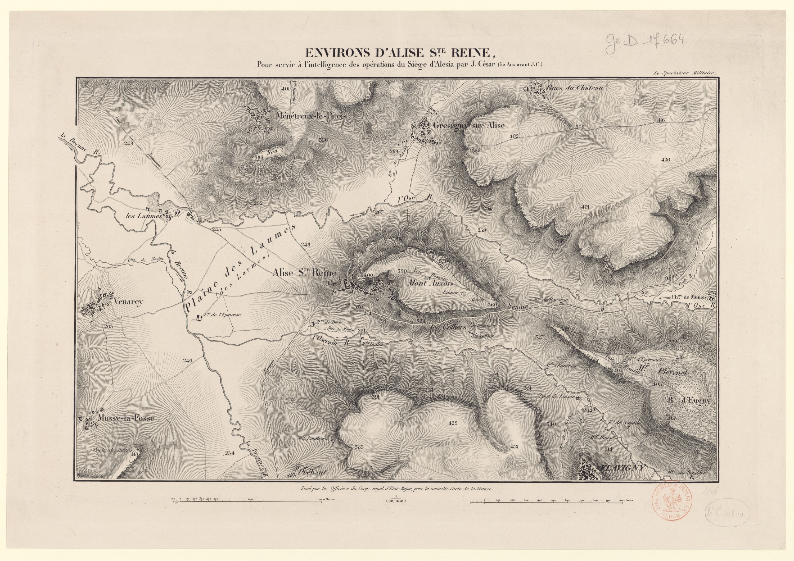

以下第一人称叙述依据史料重建，主视角为罗马统帅盖乌斯·尤利乌斯·凯撒。

公元前五十二年夏末至秋，在今天法国勃艮第的阿利斯圣雷讷，维钦托利率领的高卢联军进入阿莱西亚。几星期之后，城外来了另一支高卢军队。两军之间只隔着罗马人的围城阵地，一边可以看见另一边出兵。为什么援军有机会打到罗马壁垒跟前，仍没能把城里的人接出来？下文使用公元纪年，战斗按相对日序叙述。现存记录留下了夜间更次、午间出击与日落前的攻防，无法把每一步可靠地换算成现代月日。[^bg][^site]

## 行军以前，先给骑兵换马

我从卢瓦尔河边走到这里以前，失去过一座储存军需的城。诺维奥杜努姆有粮食、钱款、人质，还有从意大利和西班牙买来的马。我们把它放在埃杜伊人的土地上，依靠的是他们同罗马结盟多年。等到他们改变立场，原来替我们保存这些东西的人，也最有条件一举把它们搬走。金钱和马匹被分掉，人质被转移，粮食能装船的装船，余下的投进水里或烧掉。那时我的几个军团还在拉比埃努斯手里，远在塞纳河一带。立刻向南回到行省，会把他留在另一头。[^bg]

在热尔戈维亚，我已经付过一次在高地下作战的代价。出动各部队的时候，我能把目的交代给军团指挥官。士兵越过前面一道石墙以后，接下来吸引他们的是敌人营地和前面可接近的城门。我让人吹号收兵，跟我在一起的第十军团停下，隔着谷地的队伍却还在上坡。等到对方人手从别处回援，一开始进去的人已经劳顿，后续部队还得向上赶。为了接回这些士兵，我在坡下另放部队。我们失去一些很有经验的百夫长，走出营地发动一次攻击的代价，可以一直追到下次集结军队的时候。[^bg]

离开这处高地以后，我修复阿利埃河上的桥，渡河寻找通往北方各军的道路。卢瓦尔河水涨，到了适合涉渡的位置，士兵仍须把武器举高。骑兵布在水里分开水势，步兵得以过河，部队能在另一岸得到粮食和牲畜。拉比埃努斯也从自己的战场退回我们存放辎重的阿根迪库姆。两支部队重新会合，才有一起向下一处战场转移的余地。此前我面对的是两支相距过远的罗马军，此后要解决的则是一支合起来的军队一天要吃多少东西，能由哪条路接近南方。[^bg]

在高卢南部，罗马早就设有行省。它能供给军队，也有人家、商路和边界要保卫。卢基乌斯·凯撒担负那一带的防务，从全省征集起来的二十二个大队要分头应付威胁。一个大队是军团之下可以独立领受一段任务的步兵单位。在南边守河守城的二十二个大队，即使都在我的战争范围内，也不能在我转向东南时骑马赶到纵队外侧，替掉缺少的骑兵。意大利买来的马已经落在别人手里，从行省取得新的帮助也有通信的困难。[^bg]

我派人到莱茵河对岸招集以前作战时已经建立联系的人群，来的是日耳曼骑兵和习惯与骑兵一起交手的轻装步兵。这些人能打仗，他们带来的坐骑却不适合眼前的任务。我从军团高级军官、罗马骑士和老兵手里调出马匹，交到新来的骑手手中。一个人在队列里地位如何，与交战那天谁最需要骑上他的马，是两件可以分开处理的事。与其沿路带着两批人，一批有马、一批适于在前线打骑战，不如在接敌以前就把两者调到一起。[^bg]

从林贡人的边境向塞夸尼人的地方前进，可以使我们较易接应行省。对一支带着辎重的军队来说，一天行军的结果要看最后一部分物资到了哪里。先锋向前走得再快，只要后面运粮、载工具的人还在路上，骑兵就有一段相当长的纵队可以攻击。倘若把军团全放在队尾，敌人可以去队首堵路。倘若优先送走辎重，留在开阔地的物资就需要另外一支军队保护。我的骑兵只有同各军团相互策应，才能护住这支行军的队伍。[^bg]

## 路上的骑战把两军引向同一座山

消息送来说，敌骑从三个方向出现。一路在前方阻住我们的去路，两路分别压向两翼。我同样把骑兵分成三部迎击，同时让主力停下，把辎重收到各军团的队列里面。原来对方可以追着一列不断前移的车马打，现在要从任何一侧接近车马，先得对付已经站定的步兵。代价也很明确，只要我们站住，这一天还能向原定方向走多远，就由骑战多久才能结束来决定。[^bg]

三面都接了战，我所能调动的力量还有留在骑兵后面的军团。哪一头受压，就令步兵转向那一头向前推进。这样打，步兵无须追上正在奔驰的骑手。只须占到败退的我方骑兵可以靠拢的位置，对面追过来的人就要决定，还值不值得再赶一程。原来单靠马力和人数可以扩大的优势，到有序步兵面前会缩小。支持一翼时也得顾及另外两翼，如果整个行军队列都跟随第一处告急转过身，很快就会把辎重亮给从另一侧上来的人。[^bg]

右翼的日耳曼人拿到一处高地，把对面的骑兵赶下去。他们一直追到河边，维钦托利的步兵部署在那里。其他方向上的敌骑也开始撤走。交手时三支骑兵各有一面要打，到退的时候，任何一支都要顾及先退了的那一面。我们的军团仍在，骑兵却能从防卫纵队转为追击。这次抓到的俘虏里有几个埃杜伊人的要人，其中有科图斯，曾经争当本邦最高官员，如今担任骑兵指挥。人们在会议里能号召多少人上马，到河边有多少人还肯留在一起，是这一仗替双方作出的检验。[^bg]

维钦托利把步兵和辎重带向曼杜比人的阿莱西亚。我把我军的辎重移到就近的一座山上，留两个军团守着，带其余能出动的人追上去。此前的命令是把行李收进步兵中间，以便停住迎战。此刻敌方已经先走，为追上他的后卫，就不能让同一批人仍跟着整支辎重队前进。留守两个军团意味着我少带了一部分步兵，也使追击的队伍能够按还剩多少白昼来定行程。当天攻击的是落在后面的敌人，我在战记中把杀伤估为约三千人。第二天在阿莱西亚扎营，面对的是还能够借城而守的一支军队。[^bg]

这座城在山顶，山下两侧有水，正面展开一片约三个罗马里的平地。一个罗马里约合今天一点四八公里。在平地以外，还有一系列离中央山丘不太远的高地。站在这样的外围高处，部队可以看入平原，却不能穿过谷地立即出现在对面山坡。要截住从城里出来的人，必须处理两座高地之间较低的地方。只占最显眼的山头，部队在山上也许安全，山间的路还在别人脚下。要是所有人都下到底部，又得承受高处逼来的敌人。[^bg][^redde]

高卢军在朝东的山坡上一直布到城墙下面，还挖了沟，砌起一道约六罗马尺高的石墙。要攻城，就得先把守在城外的这一部分人赶上去，再追到高处的正式城防前。高卢步兵在这段路上即使后退，身后还有可以接应的地方。我们若向上追得过急，军团的一头在坡上打，另一头还在山下等命令，日前在热尔戈维亚吃过的亏就有可能重新出现。我勘察地势以后，令部队开始筑垒，把这座城围起来。[^bg]

围线绕城约十一个罗马里，需要一些能独立站住的据点。我军在有利处立营，设置二十三处小堡。白天派哨兵监视城内出动，夜里各处增加守兵。小堡里面的人有两个不同的责任。第一批守卫要在别人还在掘土、伐木的时候看见敌人，第二批在黑暗中即使看不清来敌人数，也得使出城的人没法从一个空口直接穿过。两种差事要求的值守人数不同。一处能望见谷道的岗位，到了夜里并不会因为白天看得远就更容易守住。[^bg]

## 工事还没合拢，平原上又打了一仗

围城开始后，双方骑兵在山前的平原上交锋。这里给了骑手比河边和山坡更大的活动余地，也让守在营前的步兵看得到骑兵的进退。我们的骑兵受压，我让日耳曼人上去支援，又把几个军团列到营前。此刻高卢步兵还在山城下面有工事可依。他们若从那里出来，可能截住已经出营的骑兵。我派出的第一道援兵赶去参加骑战，列出的第二道援兵则先保持完整，朝着高卢人可以下来的地方。[^bg]

在前面交手的人有了一个可以退回的阵地。另一方面，从敌军骑手的方向看，他们也有一道能退回去的壁垒。区别要到他们真的败退才显出来。日耳曼人追赶的时候，撤回去的马匹和人挤到仅有的狭窄入口。营门原可使少数步兵挡住外人，当成群骑兵从同一边退回来，先到的马只要稍稍放慢，后面的人就会被压在外面。有人抛下坐骑，要自己过沟攀墙。日耳曼骑兵已经追到他们的防御设施跟前，骑在马上逃走原有的速度优势，在这里用尽了。[^bg]

我把已经列在壁垒前面的军团再向前推了一段。骑兵率先接触敌营，后面的罗马步兵开始跟进，守营的人得决定究竟要关哪一道门，留多少人保护外面的营地。敌人中有人奔向山城。维钦托利下令关城门，使营中守军不能一拥而散，把墙外的阵地全留给我们。前线追击以缴得马匹、杀伤对手告终，我军没有越过所有这些防守层次去抢城门。带一个军团往前走一点，足以改变守军对于下一步的处置，也仍容许我把步兵带回正在施工的围线。[^bg]

那时我们还没有把每一处都封住。接下来，逃来的人和俘虏带来消息，维钦托利已经趁夜把骑兵从工程未完的地方送出去，叫他们各回自己的邦，征集援军。留在城外驻地的部队被接入城内，粮食集中起来，牲畜分配下去。按我得到的说法，他们照原来库存约可支持三十天，还能省着用。这个数字既关乎我们要围多久，也关乎会有谁在围城期间赶来。如果送出去的骑兵各自带回本邦人马，面朝城里的壁垒外面，很可能再有一条正面需要守。[^bg]

我能据此下令筹粮，却无法从一个俘虏说出的存粮日数，知道另一个邦的步兵已经走到哪条路上。城内的人比我们清楚当地还有多少谷物，城外的人比城内清楚出发时带了多少粮。我们在中间，一方面能截断后来往城里送的消息，另一方面也很难叫所有正在集结的部队都出现在同一名斥候眼前。得来的情报足以确定工程要防两个方向，至于外侧第一次真正受攻击时能有多少人上墙，只能靠我们自己的部署先作安排。[^bg]

## 把军队分给伐木、运粮和两面防线

我先在其余工程前方掘了一道大沟，沟壁陡直，上下宽度接近。主线和这道沟之间留出约四百罗马尺，换成今天的长度近一百二十米。掘沟的人每次只能掘进一小段，在这一段之外，却得为还没有露面的敌人预留距离。白天，城里的人能向施工的士兵投射兵器，夜里可以突然集中起来，跑过没有人守的地带。一道沟如果使他们在离工地还有一段距离时就降低速度，即使还无人能整晚沿整圈防线肩并肩警戒，也能替工作的人多争得一点反应的时间。[^bg]

靠近驻兵的地方开两道壕沟，在低而平坦处从河中引水进其中一道。引水要靠落差。我们在平原上能让河流做的事，在一段向上攀升的坡地上便要换种办法。沟里掘出的土与随处取得的材料可以用来筑起壁垒，上面留给人投掷和掩护身体的遮挡，再设置向外伸的桩木，阻止已经爬近垒顶的人舒展手臂向上攀。人守在这些东西后面，才有较安定的位置朝靠近的人使用手中的兵器。[^bg][^redde]

我在战记中记下壁垒高十二罗马尺，楼塔间隔八十罗马尺。塔与塔之间留的是步兵能够守卫、从两旁也能观察的正面。被攻击的人如果只看见自己脚下，离开他稍远一点的沟边就可能成为看不见的地方。在较高处驻人，既为对付接近的敌人，也让不同段落在有人看得见的情形下共同作战。守卫分配给各处以后，哪一处已有人，哪一处缺人的消息能够送来，旗号、营门、塔楼才会由一堆木材和挖出的土变成一支军队可以使用的阵地。[^bg]

同一批士兵还要伐木、筹粮，不能光把他们画在一条已经完成的城墙上。有时取材的人离营很远。城里的人却能从几个门同时出动。我一天之内可能需要守在垒上的人数，和可以在垒上找到的人数有差距。增加固定障碍的命令便在这个时候下达。挖沟、搬木头本身也费力，但工程完了以后，一个守卫所能照顾的地段会比只在平地上对着敌人站岗长些。要叫一小队人挡下一大队人，先得使冲过来的许多人不能同时抵达他们面前。[^bg]

一类障碍用粗树枝或削尖的树干，根部埋稳，枝杈在地面上交错。容易连根拔起的桩木挡不住人，埋下以后还得固定。这些东西有个军中的叫法，原词也有界桩、墓标之意。另一些障碍藏在挖成渐窄形状的小坑里，木桩顶部削尖，用火处理，底部拿土夯实，上面盖细枝。士兵以花朵的样子给这些坑起名，叫它们百合。在更靠外的地面还散埋带铁钩的短木。只有走到跟前的人才最需要看清这几样东西，偏偏掩护、黑夜和前面人的身体都会妨碍他看清。[^bg]

在这样的地带，敌人要是肯花时间，依然能填沟、盖住木尖、拖掉枝杈。真正能阻止他们的，是他们必须做这些事的时候，我们还在后面用兵器对着他们。因而各处准备防守用的投射物，同掘坑一样有必要。白天我还要考虑敌方把人集中在一处施工，夜里则得防他们已经悄悄走近。防线对于守军也不是一条处处方便进出的路。需要出击的一方得有出口，需要迅速支援的队伍得能从一堡赶往另一堡。围城至此，两边都在凭借事先修好的通路决定哪些人可以投入、哪些人只能留在后头。[^bg]

我又依地势在外面修筑一圈面向外来的敌人的工事，周长约十四个罗马里。该取平地的地方尽量取平地，绕行的距离也有上限。在北面有一座高地，没有连它全部圈进来，营地只能放在坡势对我们较不利的地方。那里由雷吉努斯和雷比卢斯两名副将率两个军团驻守。让军团占据一块地，只能说明已经有人负责，附近地面带给攻守双方的高下之势仍旧存在。要是把那一整片高处都纳入外线，别的地方又得为延长的工程和警戒距离出人。[^bg]

我让大家备足三十天的谷物和草料。一匹需要连续作战的马不能拿步兵的一份口粮过一日，一支奉命留在堡里的部队也不能天天到外面现割草料。援军一到，出去找粮的人和护送他们的人都可能在围外遭截击。料到这件事并不能让粮食自己进营，仍有一段时间得一面把人派远，一面防城里出击。围城越晚完成，守卫缺人的日子就越多。围城越早完全关闭，对方出入的机会越少，我们再派大批人外出同样越要谨慎。[^bg]

城中被逐出的曼杜比人来到我军工事前，有妇女和孩子。他们求得食物，愿让罗马人收为奴隶。我在壁垒上设守卫，命令不许放他们进来。于是离开山城的人停在城防和罗马防线之间。前方沟壕原先要拦的是从各门一起出动的武装人员，这一次它拦住的是居住在这里的人。我的这道命令有明确的执行者，也有就站在对面的对象。关于他们此后每个人的下落，我的战记没有留下名册。[^bg]

## 援军抵达，先在两军都看得见的地方较量

来援的人马占据高地，营地离我们的防线不到一个罗马里。过去只消看着山顶和几处城门，便能确定主要的敌人会从哪里出动。如今背后的营地离我们相当近，如果把守内线的步兵全领到外面列阵，山坡上的敌人一路下行，走到我们的工事跟前时，等于已经走到我们军队背后。援军同城中人是否已约定出兵、究竟约在哪里，是他们的事。安排哪一队人先守何处，则是我现在就能决定的事。我给两面的部队分派位置，使每一个人知道有事时自己该到哪里。[^bg]

次日，高卢援军把骑兵放进平原，步兵离开骑兵有一段距离，在较高处展开。骑兵可以沿平地寻找交手处，步兵站在高地上还能接应他们。山城那一头也看得见这番部署。接应并不一定要靠信使从一道环垒走到另一道环垒，一支规模相当的军队出现在开阔地，就足以告诉守军，他们等待的人已经来了。城里部队开始出来，在城前扎下，把可以垫在沟上的编枝和泥土运向最近的障碍。我们要同时留意两件事，哪一边开始行动，哪一边在为下一步清路。[^bg]

我让骑兵出营迎战，步兵按分配好的岗位守住内外两面。援军刚到时，它的步兵在高处，骑兵在平地，如果我要打它的步兵，就得把自己的步兵也从垒中领出去。出动骑兵则还有余地，退回来有人接应，进到平原有人掩护自己的营垒，可以去检验对面骑兵能否把我们的队伍压回门内。倘若让平原全归援军控制，城里搬运填沟材料的人便更有把握接近我们的内侧。即使外面暂时只打骑战，两道防线上的人也得准备好接步兵的仗。[^bg]

起初两军骑兵交错的地方给我方造成损失。在敌人的马队中，有弓手和其他轻装步兵。他们分布在骑兵之间，当前面的骑手向后退、我方骑手趁势向前时，这些步兵仍可以攻击。骑兵原先判断前方是否有路，凭的是看对面马头有没有转过去，突然遇到来自较低处的箭矢或投射物，得重新掂量追多远。我军有人负伤，退出交战。与我们带来的善于协同作战的日耳曼人一样，对面也知道怎样把徒步的人放到骑战中有效出手的位置。[^bg]

城里和援军那一头都为自己的部队喊叫。我们驻军的高处也能望见战斗。援军先前只须在本邦召足人来，进入这一片可以相互望见的地面后，第一次交锋的结果便会传到山上，不论他们是否打算把坏消息带给围中人。假如骑兵始终占住平原，修路填沟的人便能保持在外。倘若骑兵被赶走，城上还会看见步兵是不是跟着下来接战。双方都把相当多的步兵摆在还没有投入的位置上，就这样从中午打到日头将落，骑战仍在进行。[^bg]

到了一侧，日耳曼骑兵集中成较密的队形冲击。对面的骑手后退后，原来夹在他们之间对付我军追兵的弓手失去保护，日耳曼人得以把这些步兵围住攻击。从援军的编组来说，把轻兵分散到马队间本来很有用，当整个地段的骑兵被迫同时离开时，这些徒步者却比起受了伤还能骑马撤下的人更难退出。此后我方其他方向的骑兵也追向高卢人的营地，使他们无法马上重整。城里已经出来的部队看见这个结果，撤回山城。[^bg]

这一日我军占了平原上的上风，援军在高处的步兵尚在，城防也仍由维钦托利掌握。我们的骑兵追到营地附近，并无命令要把所有守垒的步兵一并拉出去，跟在他们后面上山。继续追的距离越长，马队就越需要步兵支援，一到敌营面前，局势同骑兵在平原上赶逐弓手时已有区别。山上的高卢守军今天能够看到他们的骑兵败退，下一次外侧的部队下山时，他们照样可以看见。我们必须把今天留在岗位上的人留给下一仗。[^bg]

## 一个声音传到城内，两支部队却没有同时到沟边

隔了一天，新的攻击在半夜到来。平原上的援军悄悄离营接近我们的外垒，忽然大声喊叫。这样，城内可以知道他们已经走到足以开始进攻的地方。维钦托利一侧继而有了军号，守军也从城里出来。白昼骑战时，双方能够从高地一路看着骑手的进退。现在交战各方判断另一处是否已动，主要靠夜色里传来的响动。外面喊声一起，能叫山城立即有所动作，却不能把山城和外垒之间还须搬走或越过的东西一并消除。[^bg]

来攻的人带了枝条编成的垫材、梯子和铁钩。他们先往前丢编枝，又用投石索、箭和石头要把我军从胸墙上打下去。对于守军来说，先得保住可以立足和露出身体还击的位置。站在墙后也有被击中的时候，看不清对方究竟到了哪里，贸然沿着声音探出身去，同样会吃亏。守军使用预先放在垒上的长桩、大石和各种投射物，器械也发射兵器。双方都有人受伤。可以投出许多东西和可以看清每一下打中谁，在当夜是相距甚远的两件事。[^bg]

守这一带的两名副将是马库斯·安东尼和盖乌斯·特雷博尼乌斯。他们从比较远的小堡调人，送往已经知道受压的地方。这里的远近指的是离实际攻击处有多远。有些部队离敌人原来的营地未必更远，今晚没有遭到主攻，便可以抽出一部分来。先前已经知道自己该守哪一段的队伍，出现伤亡和缺口时有具体地方可以报，增援也有明确的岗位可接。不必等一个人看清整条战线上所有来敌之后，最近的守垒者才能得到援助。[^bg]

敌人距离尚远时，他们一起发射的兵器有一阵相当有效。逼近以后，木桩、暗藏的铁钩和高处掷下的兵器开始起作用。一个人不必真的踩中木尖才被它拦住。前面的人忽然停下、侧身找踏脚处，后面抬梯子的人也跟着慢下来。编枝垫过一段沟壕，落脚的两头还得有地方，抬着钩子的人还得站稳才够得到胸墙。防守者能够从塔上和垒顶向同一片近地攻击。此时一批冲过最外层障碍的敌人，未必比最初站在远处一起射击的队伍更能压住我们。[^bg]

夜战中，援军始终没有迫使我军放弃一段完整的外线。到了天将明时，他们开始后撤。较高处还有我军的营，那里若有人从侧面出击，已经走下平原、正在处理梯子和伤员的部队，就得一面离开沟壕，一面防备侧袭。我在战记里把这一点列作对方撤退的顾虑。我们没有必要等到这处营垒真的开门冲出一队人，才算它对平原战斗起了作用。守在那边的部队仍有能力选择什么时候动，接近天亮以后，对手便要为这个选择留出退路。[^bg]

山城方向也在行动。维钦托利让人运出先备好的器材，先填离他们最近的壕沟。对外面的攻击者来说，喊过那一声时，他的队伍已经走完了出营接近的路。对里面刚听见信号的人来说，走过这段路、带齐材料、把材料铺稳，都得从那一声以后算起。等到这边得知援军已退，他们还没能逼到罗马主垒跟前，最后重又回到山上。安东尼等人能把远处的守兵送往急处，很大程度上也有赖于同一夜里另一面没有同时发展到同样吃紧的地步。[^bg]

退回去的援军还有组织。在这天之后，我能知道的，是平地工事挡住过一次夜间突击，北面的坡营仍旧比其他几处更容易被居高临下的部队压住。知道营地较险，并不能让我把守城那一面的步兵都移过去。前一次出击，城里的队伍虽然动得晚，却带出了能用的工具。如果下一仗在白日发动，守城的人不必等到黑暗中传来的一声吼叫，便可能较早拿定行动方向。我必须留有向两头的人下命令的办法。[^bg]

## 北面的坡营先告急，城里的人也改走陡坡

最后一次进攻起时，我们在平原上看得到骑兵，在援军营前看得到别的部队展开。北面那处坡营也遇到大队人马进攻。对我而言，山势限制了眼前的选择。守军没有在山最高的地方设营，一些敌人可以比我们的士兵站得更高，还能够利用向下的坡势。我原先让两个军团守此，他们今次所能调动的兵器和人手不能拿全军总数计算。别处有人看见这边告急，要帮忙，还须先从自己的驻地移到他们真正要守的那一段。[^bg]

城内的部队从高处看到友军行动，也带着先前准备好的长钩、活动掩体和攀攻用的工具下来。出城的人可以选择自己看起来较薄的地方接近。外面正有人进攻，我军沿长长的阵地分开，得不断算还有多少兵力可以挪动。正在朝城下战斗的士兵听见背后的喊声，转身看不见正在那里抵挡的战友。坦然把后背留给一处有人守住的营垒是一回事，在听见的激烈呼喊中仍能确信那处营垒还在，则需要旁处的守卫实实在在撑住。[^bg]

我选在有利于观察的位置，向受压的部队派出支援。高处适合判断哪一条线上有大股人群接近，也适合观察某处的守兵是不是正在退。要向北面营地发出带有条件的命令，还得有人把话送到实际领兵的人那里。与此同时，外面的攻击者已经把松土堆到工事跟前。在平地夜战中必须一处处摸清的木桩和坑洞，被一起运上来的土盖住。土坡越高，朝垒顶进攻所需克服的高度也就越小，前列便有机会在更多同伴支援下接近守军。[^bg]

敌军中的一些人在投掷兵器，另一些人把盾牌接在一起掩护接近。累了的人可以让后面新上来的人换下。对坡营的守卫来说，这样的战斗还会带来一种先于全线崩溃的危险。他们的投射物会用尽，手臂也会疲乏，而城里的部队还在向另一面打。不能因为北面的守军今天没有后退，就认定他们再经过下一次轮替仍有同样的战力。我调给拉比埃努斯六个大队，让他带去支援那里。[^bg]

我的命令还有后一层。如果实在无力坚守，他可以把大队集合起来，向外出击，只有必要时才这样做。六个大队先到达并协助防守，是这道命令要实现的第一件事。是否需要让步兵走出受保护的工事，在地势不利的一面同敌人展开近战，我把现场判断留给拉比埃努斯。若要他在发现守不住时先跑回来重请一次命令，军团在等待期间用去的时间不会有人补回。若我现在就叫他一到便出击，则可能在壁垒还能守时先失去它的保护。[^bg]

我自己到其他正在交手的部队那里去。这时城里出战的人已经觉得平原上的壁垒难以突破，转向爬起来更陡的地段，把器械带到那里。这改变了里面那一面的战斗。坡度陡有助于警戒，一旦有足够多的人顶着掩护上来，某些原来以为不必像平地一样布防的地段，仍会在短时间内面临很大压力。城内的兵不必抱定最初路线一直走下去，他们仍然能看着工事决定在哪儿把钩子真正用起来。[^bg]

密集的投射物把一部分守军从塔上打退，下面的攻击者用泥土和编枝填沟，开出通路，钩住壁垒和胸墙往下扯。先有人用兵器压住高处，拿着填沟器材的人才有可能在垒下多待一阵。通路既开，手拿长钩的人站到合适的位置，对原先阻挡他们的遮蔽物下手。要是只从远处看见一群高卢步兵出城，很难知道他们已经具备把这几步接起来的能力。现在我们遇到的，便是在几处地段上那些动作接起来以后的结果。[^bg]

我先派年轻的布鲁图斯率部支援，随后再派副将盖乌斯·法比乌斯带另一批大队前去。前面已经调出拉比埃努斯和六个大队，方向不同。眼前这支部队的任务是让遭受钩拉、抛射的守兵能够站住，再把靠近的人赶走。先后投进去的两支部队不能合成一个从战斗一开始就在垒后等待的整军。第一个命令传到，先解一处急，战斗继续，才有后一个命令和第二批抵达的人。得到第一批人手的时候，这条线上的守军还不知道最终要用多少人才能把对手推回去。[^bg]

这里拖得越久，北面的拉比埃努斯可以从我处得到的助力就越有限。我最后亲自带上新的人手支援这边，使战斗再度有力，迫退敌人。对一支刚从山城下来，已经越障、运土，又拖动长钩的军队来说，垒顶有人站回去，会使刚刚清出的通道变得很危险。挤在前面的人可以进，后面的人还在上来，最先想退的人未必能立即向后走。到这边的局势够我离开，我才转向拉比埃努斯所在的方向。[^bg]

从最近的小堡我再抽出四个大队。我把骑兵分成两部分，一部分跟随我，另一部分绕外侧的工事前进，打敌人的背后。沿着营垒可能绕行得更远，却有机会使骑兵从对手集中身体、盾牌和投射物所朝向的另一面出现。跟我在一起的骑兵则是可以被前面守军看见的一支支援。哪怕一边已经派出马队，也还有人要正面承受敌军的冲击，好让绕行者抵达时，对手仍然朝着原来的方向。[^bg]

坡营的防御到了壕沟与土垒都已难以阻止敌人上前的地步，拉比埃努斯给我派来传信的人，说明自己打算怎样做。我赶到这一处时，坡地高低使正在交战的人能看见沿低处而来的队伍。我平日临阵穿的衣服颜色容易辨认，跟随的骑兵和大队也进入视野。敌军随即接战，双方的喊声传到周围各段工事。先前高度差使营地陷入不利，现在同一个高度差也让守军能看到来援的部队确在路上。[^bg]

我军放下标枪，持剑迎战。投射物适合在敌人还隔着距离、成队走来的时候用，到了持盾的人相接的地步，手里的短兵器要对付已经挤到跟前的对手。此刻被派到外面的骑兵出现在敌后，其他大队从前面压进。高卢军原可借背后连续送上新的人替换疲乏者，等到后面出现骑兵，就必须从还在进攻的那一列中腾出人去应对新的危险。原来可以轮换的路，马上又成了败退的人要用的路。[^bg]

攻击者转身撤走。正面刚刚还要靠盾牌和掩护一点点接近的步兵，只要队伍分散，追击他们的骑手就有机会赶到他们前面。勒莫维基人的首领塞杜卢斯战死，率这路高卢军的韦尔加西劳努斯在逃走时被生擒。我收到七十四面军旗。这些实物到手，能说明有如此多的旗帜离开战斗时的持有者，送到了我的军中。受到攻击的各部分敌人四散以后，其中究竟有多少人已死、多少人分别逃回营地，远不像点算军旗一样有把握。[^bg]

回到城防一侧看，守军已经从高处看到向坡营进攻的同伴败走。他们从我们的工事跟前退回去了。昨天要同另一支军队约定半夜一起上前，必须发出声音，组织出营，还要行进和填沟。今日一支军队溃退，另一支从远处就能看见，撤兵的决定用不着再等信使进城。随后消息传到援军的营地，那里的人也放弃集结，向各自的地方逃去。围城并没有在一个敌人倒下时就结束，我们至少还得确定这支援军是否能在高地重新列阵。[^bg]

一整日向各处驰援下来，我军士兵已经疲乏。立即用步兵把退走的人全部追回，超出部队当时所能承受的负担。午夜过后我又派出骑兵，追上敌人的后卫，有人被俘，有人被杀，其他人分路回到自己的邦。这是又一次追击，和白天马队从坡营外侧出现、在攻击者刚散开时截击，要分开看。白天要救的是正在承受冲击的本军，夜间追赶的已是离营而去的援军。我们保住了营垒，也保留了能再出营的一部分力量。[^bg]

## 次日受降，随后才有冬营

维钦托利遣来的使者到达。我要求交出武器和首领，在营前设位。高卢首领被带到面前，维钦托利也被交出，武器放下。城外败逃的援军当中有人回到自己的邦，仍能自己决定往哪里去。留在城里的军队如今在这里交付武装，才使罗马军不必继续面对城防一侧作战。两个群体此后承担的后果也相当不同。在山城等了许久的士兵，即便最终未在坡上战死，也有可能失去自由。[^bg]

我把埃杜伊人和阿维尔尼人分别留下，要通过这些人使他们的邦再次服从。其余俘虏作为战利分给军中士兵。随后我进入埃杜伊地区，阿维尔尼人也派来使者，我索取人质，把约两万人交还给这两个邦。围城前散在各处的物资和担负不同任务的盟邦，围城后仍得一个一个处理。受降当天我能够要求一支败军放下武器，到冬天要取得各地的粮食，则需要还有人能代表一个邦来履行承诺。[^bg]

拉比埃努斯领骑兵和两个军团前往塞夸尼人的地方。法比乌斯等人去雷米地区，以防附近的贝洛瓦基人加害与我军结盟的雷米人。雷吉努斯和雷比卢斯也离开此前共同守过的坡营，各领一个军团赴不同地区。另有部队驻在索恩河一带料理军粮，我在比布拉克特过冬。围城时我令部队向一个环形阵地聚拢，分赴冬营的命令则承认，现在必须靠分布在更广地区的军团维持战果。待这些命令落实，阿莱西亚作为我的战场，才告结束。[^bg]

## 战后复盘　谁能命令谁出兵

先离开凯撒所在的营垒，回到此前在比布拉克特开过的一次会议。在高卢众邦中，长期同罗马交好的埃杜伊人有人质、有财富、有长期经营的盟属关系，转而反抗罗马以后，他们有条件做的不止是加入维钦托利已经指挥的那支军队。他们一度要求担任最高指挥。最后由各方共同决定，仍由出身阿维尔尼的维钦托利领兵。罗马读者在军报上可以看见一名敌方统帅，高卢各邦在会议上实际处理的是，这个人作出的决定，有多少邦愿意拿自己的马、粮和人去执行。[^bg]

会上也有人始终缺席。雷米人和林贡人仍然站在罗马一边，特雷维里人远处另有战事。把反抗罗马的人统称为高卢联军，便于叙述战役，同一名称下却有向罗马提供协助的近邻、试图在两者间保留余地的人，以及兵力已经在别处使用的群体。出城的骑手可以沿着原有关系回本邦求援，这条关系也是限制。曾争取全军指挥权的埃杜伊人，并不因此就肯把在自家领土上组织、供应一支新军的权力也交给山城里的人。[^bg]

维钦托利的早期命令强调用骑兵使罗马人找不到草料和谷物。他可以相对少用步兵同罗马军团争一块平地，多让罗马纵队的下一餐出问题。这种办法的成败取决于田里的粮食和各邦自己的房舍。烧掉自家辛苦贮下的谷物，足以使过路的罗马人吃苦，同时也使即将被征召的人少了出发时可以带走的口粮。动员所宣称的共同利益分散到各个聚落，要由具体的人先承担损失。凯撒能够召来莱茵河外的骑兵，而维钦托利要不断向各邦索取人质、要求出骑兵，两套指挥制度都要借助某些并不直属统帅的人。[^bg]

凯撒这次也有理由把自己的行军讲得很清楚。热尔戈维亚的伤亡已有记录，行省方向又受到攻击。如果他把军队往能够接应行省的方向领，罗马读者可能关心，他还能否保住此前数年的征服。高卢一方则有理由趁部队和辎重还在移动时出击。罗马军能否得到补给、能否援助那些仍愿意同它站在一起的邦，会影响今天仍未加入叛盟的人明天的选择。胜负的重要性由此可以大到超出城镇本身，却不等于其中任何一位统帅早就在地图上圈定阿莱西亚，要在那里解决所有问题。[^bg]

战前罗马一侧有两种不同的人才受到考验。拉比埃努斯过去已经能在分离的战场上独立行军，收到的是方向和任务，具体怎样把部队从复杂地形带回会师地点要自己处理。到坡营吃紧时，凯撒再次给他附有出击许可的命令，就有一段已经实际发生的指挥经历作基础。安东尼和特雷博尼乌斯在夜里承担的职务又有不同。他们必须熟悉这一段堡垒，知道哪里的队伍可以抽走。按一次攻击中的能见度和行动自由度来分派责任，能说明为何最后决战会留下许多副将的名字。[^bg]

高卢一侧也有多位指挥者。除城中的维钦托利以外，救援队伍推举了阿特雷巴特人科米乌斯、两位埃杜伊领袖维里多马鲁斯与埃波雷多里克斯，以及维钦托利的亲族韦尔加西劳努斯。各邦还派出参与议事的人。科米乌斯此前曾协助凯撒在不列颠的行动，从与罗马建立的关系中得过利益。后来援军征召贝洛瓦基人时，要求他们出一万人，对方却愿自己决定如何同罗马作战，到最后是借同科米乌斯的私人关系送来两千。这一例足以看到，四名首领里有人对某个邦能施加别的首领没有的影响，人数由此发生实际变化。[^bg]

这也说明援军为什么不能仅凭一声命令动用全高卢所有成年男子。维钦托利让骑手回去时希望尽量动员，到实际征集的时候，各邦首领决定按邦指定数额，理由包括难于驾驭过于庞大的队伍、难于区分各自人员和供应谷物。城中统帅从自己剩下的天数考虑，希望来得越多越好。外面的首领则要把这些人从分散的家乡带到同一座城，还得让他们到了以后能吃饭、领到命令，数额限制本身就是救援计划的一部分。城里和城外的高卢人立场相通，所能作的安排依然各由一套现实条件限定。[^bg]

| 位置与时点 | 实际指挥关系 | 可辨认的兵力 | 统计边界 |
|---|---|---|---|
| 行省，围城前 | 卢基乌斯·凯撒负责当地防务 | 二十二个大队 | 战区兵力，未列入阿莱西亚围军 |
| 环垒内 | 凯撒，拉比埃努斯等副将分段指挥 | 遗址机构采用十个军团，另有骑兵、轻装步兵及随军人员 | 各军团实到人数不明。留守辎重的两个军团属于早期时点 |
| 北面坡营 | 雷吉努斯和雷比卢斯，后由拉比埃努斯带援兵 | 原驻两个军团，后有六个大队等驰援 | 调动单位来自全军，不能在军团总数之外重复计入 |
| 山城及城下前营 | 维钦托利 | 凯撒转述城中有八万选兵 | 城内一度另有当地居民、牲畜，骑兵在围线合拢前离去 |
| 城外救援营 | 科米乌斯等四名领袖与各邦代表 | 凯撒称约二十四万步兵、八千骑兵 | 名单、征召配额与到达的战斗员分别讨论 |
| 最后一日北侧突击部队 | 韦尔加西劳努斯 | 凯撒称从援军选出六万人 | 原数可信度有限，为援军之一部 |

*兵力口径据《高卢战记》第七卷第六十五至八十七章及遗址营地说明。*[^bg][^walk]

## 两支高卢军怎样先后走到围墙前

换到高卢一侧，从第一次路上交手起，维钦托利连续几次改变了对步兵的用法。最早进逼罗马纵队时，他把骑兵分成三股，自己在营前、靠近河流的地带把步兵摆出来。凯撒写到，那时罗马人最可能因保护物资而不能前进，或者丢下物资自行脱身。实际发生的，是罗马人让物资停住，步兵能够保持秩序转向，骑兵仍能从步兵旁边出击。高卢步兵完成了给骑兵提供后方的那一半任务，却没有一个机会可以从容穿进散乱的罗马辎重从中分割队列。等到日耳曼人追到河边，步兵留在一起的价值转成了掩护撤退。[^bg]

撤向阿莱西亚的队伍仍能把辎重带上，到了城下，还能在朝东那一面保有一处有沟有墙的驻地。对于一支刚打输了骑战的军队，这保留下来一项极其重要的能力，可以通过营门出去打下一次战斗。城墙外尚且有营地，表示守军没有把全部活动都限于从城门下山再回山这条路线。诸军中即使有被追击的后卫，前营仍能接住退回的人和马。直到第二次骑战被赶回去，狭门处出现拥堵，外营里的人也有人开始退向城内，维钦托利才必须明确决定是继续守在城外，还是把主要防御收回山城。[^bg]

高卢统帅先下令关门以保住前营，又在随后夜间派骑兵从未封死处离去，接收城下部队入城。这两步间有一个很容易在事后消失的区别。关门的那个时刻敌骑追在自己骑兵背后，广开城门无法使全军完整上山，反会引起尚能坚守的人抛掉阵地。夜里派骑兵走，守军则可以选择出发的时机、目的地和任务。前一次是要维持当下仍有防御力的队伍，后一次是把它拆分，将最适合远行的人送过围线。倘若城门第一次便被退兵挤开，还能否在第二更有秩序地把骑兵派出去，就成了另一道难题。[^bg]

派走骑兵后，留下的人面对的是粮食的分配。有牲畜可以分到人，谷物却要集中到统帅手里按量支给。许多曼杜比人本来就把牲畜赶到了这里，云集的战士吃的是本地原有财富的一部分。粮库的掌管者可以推算能支撑几天，却不能宣布援军在那一天一定到场。从一道墙以内看，罗马人还在不停修外向的工事，本身是有关援军的重要消息。他们舍得把人派去干这种活，说明仍把外来的兵力当成现实威胁。可是守军也无法拿对手的行为来验证救援日期，壁垒可因预防而修，援军可因调度而迟到。[^bg]

援军先头未见之时，城中已经开会，凯撒列出的选择有交出自己、趁人还有体力时突围，以及继续坚持。在他的文本中，阿维尔尼贵族克里托格纳图斯主张把还能作战的人留下，并提出一个极端的求生办法。站在后面读战记的人很容易跳过缺粮怎样改变行动，把注意力全留给那段惊人的演说。真正落实的是驱逐被认为无法作战的人，其他办法留待事态发展。城内一旦选择继续等，就要延续口粮分配，此后出去填沟和拖钩的人，也是从这些靠紧缩口粮才得以留到援军出现的人中来的。[^bg][^dio]

等到援军骑兵第一次进入平原，山上能看到开阔地展开的新部队。守军重新在城前占位置、开始对最近的沟做文章。这里有一个词值得辨清，记载里说他们处理的是眼前最近的沟。山上出击的人和城外援军逼近的是两道不同正面上的障碍。想象两伙人已经分别来到同一道薄墙的两边，只等翻过它握手，就会低估山城一侧每次出战都得重新走的距离。凯撒让主要壁垒与前方工事保持间隔，单把近旁的一道沟填平，后面仍有守军能施放兵器的地带。[^bg][^redde]

骑战打到日落，城中出动的人退回，援军营中却保留了许多还没接战的步兵。隔开的那一天，他们编起大量垫材，准备攀登用的梯子和可以挂住障碍的铁钩。这些东西的实物数量未知，不过其准备顺序合乎当时面对的实际困难。白日可以用弓手配合骑兵在开阔地造成伤亡，却不能只凭射箭让大队人马连同武器一起跨过壁垒。制造数目足够的器具，意味着许多本可站在阵上的人暂时得退出战斗。若不花这一天，发动一次有机会打通的夜袭就更难。山城还剩多少粮，直接决定他们有多少个这样的白天可花。[^bg]

夜袭发生时，城外的人已经走近外线才发声。哪怕城内守军把号吹得再快，外面用来从营地走到壕沟的时间，也没有交给他们。双方无法简单约定听到信号便同时接战，因为山丘、岗哨以及各自出发的位置相隔甚远。城内这批人要带沉重器材出门，天黑了往前走还可能认错已经铺好垫材的地方。守军久经消耗，外侧的援军比较新锐，也不能把外面部队走一段路所需的时间，机械套给城内的人。战记恰好保存了一组可以比较的结果，外侧坚持到将明仍未破垒，内侧此时仍在处理接近主垒以前的障碍。[^bg]

换个角度观察安东尼从远堡调兵的动作，便可以明白这一次高卢人给对方留下了什么。罗马步兵在夜里也会受伤和辨不清方向，却有一条事先约定的路要走，从自己守的那座堡，到报告受压的另一处罗马阵地。高卢步兵同样在黑暗里运动，目的地却是尚未由同伴控制、没有人能够保证落脚的地方。就算走的实际距离相似，后一种运动也慢得多。援军撤走以后，城内的战士重新回山，那些丢在垒外的物资却难随步兵一起带回。至少在这一夜，他们没有形成足以交给第二拨人使用的一条持续通路。[^bg]

## 韦尔加西劳努斯绕山以后，六万人能一起动手吗

连续两次从平原一带用兵未能解围，援军首领请熟悉当地的人说明罗马营地的情况，又派人侦察。这一步把对手摆在眼前的工事和他们自身所能取得的本地知识接到了一起。上次进攻曾顾虑被较高处的营地侧击，现在被选中的却是另一处坡势不利的罗马驻地。从统帅的位置看，各处营地都属于同一道外线，从本地人的位置看，一处营墙背后是不是还有高地、能绕到哪里歇脚、从哪面接近可能先被望见，区别都很大。北面坡营最重要的特征，是罗马人把部队驻在这里，并未把相邻山势全纳入防线。[^bg][^redde]

援军选出人马，交给四名首领中的韦尔加西劳努斯。按凯撒所记，他们在第一更离营，将近天亮时已走完大部分路，藏在山后休息，临近中午才上攻。古人把夜间分更，一更的长度随季节夜长而变。比给他们指定一个现代钟点更有把握的，是从记载中区分出这支部队三次明显不同的动作。夜里走一条绕行路线，黎明前利用地形暂停，在白天能见度好的时候接近目标。第一次使他们摆脱正面平原上的视线，第二次让队伍有机会重整，最后一次则让城里的人看得到同伴开始行动。[^bg]

夜里把相当多的人带离营地而让罗马人不知其确切目标，本身就是一次成功。韦尔加西劳努斯挑的是被认为勇武的各邦兵员，记载说有六万。沿山路移动的人数越多，后队等前队通过狭处的时间就越长。拂晓前说部队已大致走完，不等于六万人在同一瞬间列在同一山口，也不能断言他们全在当日接触过罗马守军。就算主攻部队人数比实际更大的战报夸多了一层，择路、隐蔽和等候之间的先后关系依然解释得通。它们比单独报一个惊人的整数更能显示这支军队的执行力。[^bg]

外面的其他高卢军并未跟着全部绕山。骑兵趋近平原，留在原来营地的人在营前示威。罗马军总共能够抽出多少人支援两军团，取决于凯撒有没有把面前的示威判定成今后还能变作进攻的威胁。援军首领不需在每一处都准备同样激烈地攻城，只要有一部分留住了原本可以去北面的敌人，分兵便对主攻有利。城内的维钦托利的确看到了城外的动作，可见这一阶段用高地间的视野解决了夜袭时存在的信号迟滞。两面在同一时期真正打到了围垒，最后一仗也因此危险得多。[^bg]

坡营前的人选择运土，办法相当切实。尖桩和带钩短木针对跑动的人和马，一群人不再直冲，而在可以得到同伴掩护的位置把土带到掩埋障碍的地方，原有的工事可能很快失去作用。攻击者同时向较低的罗马阵地投射兵器，以盾牌掩护另一些人上前。最初堆的土是盖住尖刺，后来堆上去的土就成了后队可以站高攻击的地面。处理隐蔽陷阱未必非要一根一根找出来拔掉，这个做法还改变了守军发射兵器和使用胸墙掩体时所能利用的高差。[^bg]

这处战斗能维持下去，还有人源源不断换到前头。援军最初的优势不是六万人能够一起碰到两个军团，而是自己能够决定先把可用的人集中到一处，退下一个再顶上一个。雷吉努斯与雷比卢斯手下的人已经各有地段要守，起初只有自己营内可以轮替。等到拉比埃努斯领六个大队到，防守的一方才开始重新得到这种能力。战斗进行到凯撒绕向坡营时，拉比埃努斯仍然要在原有驻军、带来的增援及可以从邻近据点抽来的人员之间编排出击。在此以前，坡前攻击者已经确实逼得对方考虑放弃单纯凭垒而守的打法。[^bg]

城内守军当日攻陡处也有相似的进展。外侧用土盖陷阱，内侧以抛射物压制塔上人员，用编枝和泥土处理沟壕，再以钩子撕开垒上结构。控制同一块地方，至少有三个不同层次。赶走一名守卒，可能只是一座塔暂时不能投射。让人靠到胸墙时能站住，有机会损坏一截工事。让后一批携带武器和食物的人也能通过，才可能把一次破坏变成解围。前两层在这一天确实达到过，这一点恰恰保存在凯撒自己的叙述里。内外两处都出现过危急，也恰恰都没有稳固到足以交给另一支军队使用。[^bg]

最后出现的罗马骑兵究竟绕了多长的路，战记只留下绕外部工事抵达敌后的命令以及最后被看见的结果。若把全程画成绕着二十余公里防线连走一周，就会让命令与几支步兵同时抵达的叙述很难相容。更合理的理解，是根据出发处选择有利出口，在外侧完成对这一批攻击者的迂回。实际途经哪个门、哪一段地上还有其他高卢部队、有没有短暂碰撞，证据不足以逐处落点。能够在战术上产生巨大作用的部分恰在最后，高卢人面对的罗马步兵刚开始接近战，他们用来接替前队的后方出现了本来不该在那里的骑兵。[^bg]

这时攻击队伍的组织在一个部位破裂，消息很快传到两个仍有战斗力的部位。先是山城守军看到突击者退走，从自己正在进攻的工事边退回。再是援军原营得知失败，也撤离高地。拿下坡营本来是给整支援军打开局面的行动，失败却让尚未全力参战的人也失去了一个共同可以执行的目标。他们可以各自保存回本邦的力量，很难让刚经历败退的跨邦军队趁黑再选一名指挥者，重新侦察、重发器材、另定日期进攻。战报里显得突然的全面逃散，背后有一个从一开始就存在的条件，那支军队是各邦为了救人临时集结起来的。[^bg]

## 把军报的尺寸放回地面

*法国军方测绘的阿利斯圣雷讷地区地形图，法国国家图书馆藏。原图按比例绘制，图下方保留比例尺。图中阴影表现坡势，读者可沿中央山丘向西辨认莱洛姆平原。它记录的是近代地形。*[^map]

在今天的地形图上找到欧苏瓦山，顺着两侧的奥兹河与奥兹兰河向西看，便可以区分两种很不同的距离。骑兵在莱洛姆平原上可以赶一段相当长的路，换到环山的沟谷地带，即使直线距离短，带盾步兵、担土的人和驮着东西的马却要按可走的坡道前进。凯撒从高处看见来援的人，与他把援兵送到目的地，本来就得分别计算。读图时尤其要留意，从山城中心看，北侧主要危险地段实际更偏西北。换到营垒间的观察位置去看，叫它北面的山并不难理解。现在能旋转地图、对着北箭头说出的方位，不宜硬塞进一段统帅写给罗马读者的叙述。[^redde][^map]

地面留下的最有分量的证据，是内外两道围线、大小营地和中央高地之间的关系。单凭高山、河流和一片平原，法国有别处也能找到几项相似的特征。两道大规模军事工程以不同朝向围住同一处高卢山城，其间又有罗马军事遗物、钱币、武器以及可以确定古地名的铭文，证据的组合就比单找一处所谓最像古书的山强得多。反过来，即使已经确定战场所在，也不能从某一道排水沟单独证明某日某时骑兵经过那里。遗址解决了战场的空间关系，守军和援军各次行动的次序大部分仍需靠文本。[^redde][^arch][^museum]

十九世纪的发掘者在相当广的范围寻找古代工事，有一种行之有效的办法，在疑有长沟的地方挖狭长探沟横切过去，看土色和填土是否改变。只要在若干地点都截到同一走向的古沟，就有可能用较小的工作量恢复相当长的一段围线。这个办法做得到的是认出大致路线。古代埋在沟前的一组小坑，要在狭窄断面里凑巧撞上才会留下记录。即使撞到一个，也可能难以看出它周围以什么间距排列。到二十世纪末，发掘者重新探查并在一些地方扩大揭露范围，才能从不同区段的完整平面着手检验障碍组合。于是新旧发掘的差别还告诉我们，前人为什么会留下一幅大致正确、细部却需要不断修订的工事图。[^dig][^arch]

凯撒喜欢给读者一个便于记忆的剖面。读到他写的深沟、垒墙、塔楼，再读到木桩、百合坑与铁钩，一个工事样本便有了。这是解释军事用意的好办法，却会使人无意中把样本复制到十几公里长的每一个断面。参加现代发掘的米歇尔·雷代指出，在不同地段能见到一道、两道或三道沟，塔距也有变化。某些平原段靠近山城的壕沟确有引水迹象。至于那道被称为二十尺的大沟，把十九世纪指定的遗迹再行探查，形态、位置和测量结果都没有使它与文本一一吻合。如果要替参观者画出标准横截面，最稳妥的图注便是指出它代表哪一处，以及其中哪些构件属于依据文字所作的复原。[^redde][^dig]

同样是营门，今天称作甲营的地方至少有两个不同处理办法。一个门内侧有弧形障碍，另一门正面有横沟。前者使冲进来的人需要转向，后者让人难以沿一条直线加速抵达门洞。两者都让出入变慢，但对于从营里主动出击的队伍，通路的形状同样重要。坡营守卫如果已经靠不住胸墙，需要抽出大队反击，首先就得有容许自己人快速成列、依次出去的地方。从某一处门的形状推不出拉比埃努斯确从那里走，现场至少帮我们看见，一道受保护的出口在两种不同作战方式之间承担了什么功能。[^walk][^bg]

在南面弗拉维尼高地的乙营，石灰岩的地面和营内遗物又提供另一种观察角度。遗址保留下来的有便携磨具的残片和加工木石的工具。谷物运到军队手里，到人能吃进嘴里，中间还有处理粮食、保持工具可用等工作。山城上集中分配谷物、罗马营中准备三十日储备，表面上是两句对称的话。一个古代营地里的磨具提示我们，集中起来的谷物要在各驻地转成可食用的口粮。把支援某段阵地的人抽走，原驻地日常的活也得由别人接替。这类看似普通的残片，对判断一个军团离开一块阵地以后还能工作多久，可能比一把形制漂亮的战剑更有启发。[^walk]

另一处小堡的壕沟直接切入坚硬岩层。设想一个指挥官要求士兵在一日内同时开挖若干段等长、等深的沟，软土里掘起来快的地段与岩石地段很难同日完成。可用的替代办法包括利用高差、先占住能互相望见的小堡、在某一段增加有形守兵，让那里的人工障碍稍后完善。从地面上看到的施工差异，因此只能作为某种具体选择的结果来读。说它一定出自一个统帅在某一夜的单独命令，超出了材料。能确定的是，工程的质量可以表现为一种差别，让每一处都做足本地需要的那一部分，而毋须在岩石上机械复制一幅理想图。[^walk][^redde]

## 粮食够多少人吃，战报里的人数该怎样读

把山城八万选兵、援军二十四万步兵与八千骑兵都写在一张表上，会给人一种错觉，好像三份数字来自对手军需部门的三次点验。其实八万同维钦托利求援的理由相连，二十四万和八千伴随各邦集结的叙述，六万又是从援军中挑出的兵。山城的存粮天数，据说是被围统帅按当时库存所作判断，凯撒得知这些事的渠道包含逃来者与俘虏。能把古人的说法追到文本中的某一段，与能把一个总数追到实际名册中的每一个人，相隔很远。凯撒没有把这些名册交给读者，现代研究也不能拿另一个整齐的整数把所有问题消掉。[^bg][^redde]

可以做一个不依赖古代军粮定额的推演。单就援军步兵这一项，假定每人每天仅支取半公斤谷物，二十四万人就需一百二十吨，连续五天需要六百吨。这里的半公斤是为了显示数量级而取的假设值，真实饮食还可能包括其他食物，骑兵、马匹与运输人员都没有算入。即使把二十四万缩小为一半，单日的这项需求仍以数十吨计。动员地上收集到的粮食，须有车辆或驮畜送进营，负责运送的牲畜又要吃。这个算法无法给出真实参战人数，却能让人理解，为什么城中的统帅希望能来的人都来，城外实际带队的人却坚持在召集以前先规定各邦数额。[^bg]

反过来，围城持续若干星期后出现极端缺粮，也不能当作城里肯定住了八万战士的证据。同样一个结果，既可能由城中人口庞大造成，也可能来自短时间内来不及集中地方存粮，或者大部分能够储粮的生产地早就在围线外。曼杜比人的牲畜确实赶进来过，但牲畜能提供多少天食物，与供养它们所需的饲料和水也有关。军队带入城里的人口会挤压居民，是否把口粮留给还能持械作战的人，又把同一份库存的不足变成不同人群承受程度很不相同的饥饿。单凭一场人道灾难的严重程度，不能倒算出一份可靠的户籍。[^bg][^dio]

罗马侧也有相似的账目问题。遗址机构用十个军团说明围城部队规模，讲解南侧营地时还按照营地容量估算，可容纳一个减员军团的量级。营地能住多少人，属于空间推算。从军团数出发展开标准编制，属于制度推算。某日可以派去救一个军团的人有多少，属于出动记录。三种数有时相互校验，有时各自都成立却不能相加。罗马士兵经过行军和热尔戈维亚的伤亡，还有看守、运粮和施工等任务。用名义满编的军团去除对方的名义总兵力，算出来的胜负赔率对坡营前真正要投出下一支标枪的士兵并没有多大意义。[^walk][^bg]

如果要在这场战役里找到比较扎实的局部兵力关系，最好先问谁能替下疲乏的人。援军刚到时，其步兵大部留在高地，箭手却同骑兵一道进入平原，能够突然伤到追来的罗马骑手。山城里的军队虽有数以万计的说法，在夜袭中却没有在外军撞上壁垒时同时投入。北面的守军起初有两个军团，到了最后关头，直接影响战斗的是凯撒先向哪里调若干个大队，拉比埃努斯身边还有谁可以出击。一个部队有时间走到交战处，占得下地面，前面的同伴还没遭到击溃，这三个条件凑齐，它才变成相对于敌人的实际优势。[^bg]

## 四个可以作出另一种选择的时刻

第一处在行军与围城的交界。凯撒原本打算沿路靠近行省，在骑战取胜以后可以回到这一目标，把被击败的对手暂留在山城。这样会少一次筑垒与断粮的冒险，却留下维钦托利、成建制的步兵，以及已经显示过动员能力的盟邦关系。直接强攻又是另一条路，可以少给各邦集结的时间，却让士兵先在东坡工事前消耗，再仰攻城防。在热尔戈维亚，攻击一旦从在地面上驱走敌人发展为士兵争相登城，吹收兵号也没能即时止住损失。围城把必须在一天内解决的坡上进攻，换成了许多天可以陆续修正的工事和粮食安排。后来出现的援军说明这个选择带来风险，但并不能因此把沿路撤走或立即攻山说成没有代价的捷径。[^bg]

第二处在骑兵出城的夜里。留下骑兵可以加强守军出击，也可以在罗马人出营取木、取粮时集中袭扰。困难是马要占用地方和草料，主力骑兵此前已经在平原上被赶回狭门，罗马人封锁得越紧，能让它们展开的宽度就越小。派马队出去，既给各邦带去消息，也给他们带去一批见过围线和罗马军队的人。可以推演的另一方案是让部分步兵也随之分散突围，减轻粮食负担。可是这些人的行进速度、穿过空隙的时长会与骑兵不同，还可能使整次行动较早被发现。留下足以吸住罗马军的兵，送走机动与通信价值较高的人，从当夜条件看有其分寸。此后援军失败，无法反过来证明夜里本可把整支步兵安全撤走。[^bg][^dio]

第三处是夜袭信号的选择。高卢人本可更早喊叫，让山城守军多得一点搬运器具的时间。付出的代价是罗马外线上比较远的小堡也同时获得警报，安东尼和特雷博尼乌斯可以在第一批梯子到达前就从容调人。如果设法在白日约定共同的出击时刻，城内外隔着两重工事，能否传入足够精确、不会被截获的消息，又是另一个前提。还有可能先在一侧小规模佯动，诱使罗马人抽兵，再在另一侧强攻。这要求佯动部队既有足够声势，又不至于被敌人识破或在无援时受重创。援军最后改以白昼显露兵力配合山后绕行，实际上已经作过一次相当有针对性的修正，绝非三次把同一个办法照做一遍。[^bg]

核对这里的兵力还要面对版本差异。第七卷第八十六章明写拉比埃努斯率六个大队，第八十七章中两位副将先后支援的队伍，在本文参照的旧英译本里各有数目，而通行拉丁文整理本只说布鲁图斯领着大队、法比乌斯随后带其他大队到达。几句之后，从最近小堡抽调四个大队的数目又很清楚。于是可以恢复两路增援的先后，却不应从旧译给出的每个数目推出全军那一刻恰好剩下多少预备队。[^bg][^latin]

第四处是拉比埃努斯收到的出击权限。守到最后一刻的好处，是还能依靠熟悉的垒墙和投射距离，别处来援的步兵也知道向哪里找自己人。若敌前土坡越堆越高、墙内的人只剩疲兵，继续站在原地便可能从依托工事变成挤在一处不能重整。此时让仍能列队的若干部队转攻，能在敌人尚忙着送土和攀垒时改变交战距离。推演上也可以从一开始就放开坡营，让军团撤回其他坚固地段。这个退却决策最难的是，罗马军本人可以成队走，留出的通路却也可以由高卢援军占用，城内的战士还有可能从另一侧前来接应。对于需要维持完整封锁的一方，主动放弃一段围线的后果很难局限在那一段。[^bg]

## 放下的武器与没能回家的人

| 时段 | 行动 | 结果 |
|---|---|---|
| 围城前 | 罗马军在通往塞夸尼地区途中遇袭，将辎重收入队列 | 骑战转为罗马追击，维钦托利退向阿莱西亚 |
| 次日及施工初期 | 罗马军立营修堡，再在城前平原投入骑兵 | 高卢军退到城下工事，罗马围线尚有空隙 |
| 围线合拢以前的夜间 | 维钦托利遣骑兵求援，收粮入城 | 城外各邦着手集结，罗马军修筑外向工事 |
| 援军到达后次日 | 双方骑兵由午间战至近日落 | 援军骑兵退去，高卢守军回城 |
| 间隔一天后的夜间 | 外军半夜攻平原防线，内军闻声出战 | 将明外军撤，内军未能同时逼至主垒 |
| 最后攻势 | 韦尔加西劳努斯夜行绕山，中午前后攻坡营，内军攻陡处 | 罗马步兵驰援、骑兵绕击，外军突击队败退 |
| 当夜至次日 | 罗马骑兵午夜后再追，城中派使者受降 | 外军分散，守军交出武器和首领 |
| 战后 | 凯撒分配与释放不同来源的俘虏，部署冬营 | 战场上的胜利转为人质、驻军和粮源的安排 |

*时间线取自《高卢战记》第七卷第六十六至九十章。*[^bg]

| 战果或损失 | 罗马方面 | 高卢守军、援军及居民 |
|---|---|---|
| 人员伤亡 | 战记提到骑兵负伤退出及夜战双方受伤，缺全役死伤、失踪与疾病总表 | 路上后卫约三千人死亡为凯撒自报。北侧突击队、夜间后卫均有死伤，合计未知 |
| 指挥人员 | 多名副将随后仍受命领军，不能据此反推部队伤亡轻微 | 塞杜卢斯战死，韦尔加西劳努斯被俘，维钦托利在次日交出 |
| 人员处置 | 部分俘虏分给士兵，约两万埃杜伊人与阿维尔尼人获返 | 外援中另有自行逃回者。居民中被逐出者单列，确切人数未知 |
| 武器与营地 | 凯撒称收到七十四面军旗，随后接收守军交出的武器 | 山城及外营失去军事作用，器械、牲畜与武器没有完整损失清单 |
| 战役结果 | 环垒守住，取得敌方统帅并恢复对若干邦的控制 | 解围失败，联军丧失集中进行下一轮作战的条件 |

凯撒用分给士兵的战利品来描述被俘者的去向。一人分得一名俘虏的说法很容易被拿来乘上某个假定的罗马兵力，再加战后归还者，计算出一个精确总数。这样做的每一步都需要文本没有交代的条件。究竟哪些人参加分配、各营当时有多少可领者、返还两万人与其余被俘者是否按同一时点统计，都需要另有凭据。法国国家考古博物馆介绍这次战役时采用约七万人遭押离、其中许多人沦为奴隶的概数。战记中能逐项追查的处置，比后来汇总的数目可靠，两种口径应当分列。尤其不能把战死、被卖、被留作人质和后来获释的人一概累加成被歼人数。[^bg][^museum]

古代作者对被逐居民也留下了不一样的结尾。凯撒让读者看到的是罗马守卫拒绝放行，他的这一段停在命令执行处。写作晚得多的卡西乌斯·狄奥继续描述夹在两方之间的人因缺粮而死。晚出的记载值得保留，读者同时需要知道，没有一份可以同它逐户核对的人口记录。至于克里托格纳图斯在会上曾被写成提议以人的身体充饥，凯撒自己也把它作为提出但留待日后的极端手段。一个在罗马文学中被描写得分外生动的提案，同一个已经执行、有明确受害群体的驱逐命令，需要分别对待。[^bg][^dio]

投降场面后来也越来越容易被画出来。普鲁塔克笔下的维钦托利身着盛装，骑着装饰过的马，在凯撒面前下马、卸下装备。凯撒自己强调使者先来、武器和首领必须交出，他在营前受降。前一幅画面适合写成一场两个人的会见，后一种叙述让读者看清这座城失去独立作战能力的手续。普鲁塔克距战事已远，也没有留下一位高卢目击者来证实每一项动作。在确定城内已经同意交人这一层次，材料相容。到了统帅穿戴什么、有没有绕行以及他心中如何看待凯撒的地步，让后来的传记提供一种后世记忆已足够。[^plut][^bg][^dio]

受降还有一段很长的余波。维钦托利被拘留，终于在凯撒凯旋时被处死。科米乌斯则没有在阿莱西亚交到凯撒手里。关于此后高卢的战争，《高卢战记》第八卷由希尔提乌斯续写，里面仍有对贝洛瓦基人的行动、对分散抵抗者的追逐和另一次严厉的围城。罗马军要把控制维持到下一季，还须在不同地区继续打仗。尤其值得注意的是，次年的敌人不必再在同一座山城约齐，罗马本身也不能重复把所有可动用的军团放进两道环垒之间。阿莱西亚摧毁了能把许多邦集中起来的一次联盟行动，许多以后要面对的人仍活着，仍熟悉自己的地面，也还有各自能够动员的力量。[^bg][^dio]

希尔提乌斯记下了冬营部署接受检验的第一件事。留在比图里吉地区的一个军团，足以使罗马在那里保有据点，仍不足以同时看住散布各地的城镇。凯撒把营地交给安东尼，亲自去找第十三军团，再调来邻近的第十一军团，留下两个大队看守辎重，带其余人进入物产丰富的地区。这是阿莱西亚之后才行得通的一次调动。有了同埃杜伊人重新建立的关系，统帅可以在比布拉克特过冬，要再次用兵时也有军团可以在近处会合。城下交还俘虏、随后分兵驻屯，两件事在这里显出了同一个后果，罗马可以在原来需要同大批敌骑争夺的地区先行一步。[^hirt]

罗马骑兵袭击的是仍在耕地、来不及进城的人。凯撒还下令不放火，以免火光提前替远处聚落报警，或者把自己的部队随后需要的草料和粮食烧光。围阿莱西亚时，高卢军曾希望通过毁弃粮食使罗马人被迫离开。到了这个冬天，统帅能在何时禁止纵火，已成了罗马军保持机动与隐蔽的一种手段。两次行动之间可以找到一条连续的线索。无论是逼迫对手饿着肚子留下，还是让自己的人有吃的继续前进，最后被征走粮畜、来不及逃走的人，往往并没有坐在决定是否开战的会议上。[^bg][^hirt]

这支部队在冬季冒寒行军，士兵获得了额外报酬的承诺。希尔提乌斯给出的数额是普通士兵每人二百塞斯特尔提乌斯，百夫长每人两千，以此替代在当地获取的战利品。这个有来由的金额不应拿来估算阿莱西亚一个俘虏值多少钱。它所揭示的是罗马指挥者有不同办法偿付战斗和行军的代价。在山城受降后，许多人直接作为战利品被分配。等到统帅需要部队在一个将向他交人质、提供物资的地区节制掠夺时，又可以用货币奖赏来改变士兵的行为。诸邦听说邻居交人质后仍得以生存，也会据此决定自己抵抗多久。[^hirt]

罗马围攻乌克塞洛杜努姆的经过更能限定阿莱西亚的军事经验。那一次，围城者得知守军还有相当多的粮食，便转而设法切断取水通路。在地势陡峭、河流深切的山下，简单改河道行不通，弓手、投石兵和器械先去控制比较容易下到河边的路线。那座山城的主要问题同样是生命所需的物资，实际决定行动方向的却是当地河谷形状和守军存货。高卢战争在不同据点的解决办法各不相同。将双重围垒当成凯撒在任何高地都能套用的一张工程蓝图，反而会错过阿莱西亚当时最值得注意的地方，统帅必须同时挡得住里面的人，又防得住外面来的人。[^hirt][^redde]

站在罗马的方向，元老院在收到战报后决定举行为期二十天的谢神仪式。向远方听众讲述一支有秩序的罗马军如何压倒众多敌人，对凯撒是有政治价值的。看清这种利益，不妨碍认识他的实际成就，但会改变最值得相信的证据顺序。一名副将带多少个大队去向哪个方向、哪一处营地本来地势吃亏、罗马调来的骑兵何时开始改变双方能做的事，这些可同前后行动相互印证。敌人统帅的长篇演说、部落精确到千人的总数，以及若非疲乏便能全歼的想象，则更多体现胜利者希望后方如何理解这场仗。[^bg][^redde]

战场上最后仍躺着一个很具体的问题。援军实际能把土送抵壕前，城里的人也确实抓住了罗马人的胸墙，为什么没有救走哪怕这份成功原本要接应的一支有组织部队？因为要让城内的人出去，得有一个能留住的出口，还得在出口另一边有人接住他们。韦尔加西劳努斯在坡营前得到过地形和新锐兵力的优势，攻城守军也得到过一段暂时失去掩护的罗马阵地，但是两者没有在同一条路上接起来。罗马人先在一面使急迫的威胁退开，再利用小堡、援队和骑兵从另一面收回主动。最后那段路上的控制权落在谁手里，决定了战后谁能够走回自己的邦，谁得在营前放下武器，等候别人处置。[^bg]

## 参考资料与注释

[^bg]: 盖乌斯·尤利乌斯·凯撒，《高卢战记》第七卷。W. A. McDevitte、W. S. Bohn 英译，Caesar’s Commentaries，纽约，Harper and Brothers，1870—1872 年。热尔戈维亚与会师见第45—62章，行省与骑战第63—70章，工程、征集和驱逐居民第71—78章，三次解围行动第79—88章，受降及冬营第89—90章。[塔夫茨大学 Perseus 整理本](https://github.com/PerseusDL/canonical-latinLit/blob/master/data/phi0448/phi001/phi0448.phi001.perseus-eng2.xml)

[^hirt]: 奥卢斯·希尔提乌斯续撰，《高卢战记》第八卷，第1—4、32、40—44、48章，出版信息同上。用于核对围城之后的冬营调兵、军饷、后续围城和科米乌斯的活动。[Perseus 全书电子文本](https://raw.githubusercontent.com/PerseusDL/canonical-latinLit/master/data/phi0448/phi001/phi0448.phi001.perseus-eng2.xml)

[^dio]: 卡西乌斯·狄奥，《罗马史》第四十卷，第39—42节，Earnest Cary 英译，Loeb Classical Library。用于比较居民命运、投降过程与后续抵抗。[芝加哥大学所藏 LacusCurtius 电子本](https://penelope.uchicago.edu/Thayer/E/Roman/Texts/Cassius_Dio/40%2A.html)

[^plut]: 普鲁塔克，《凯撒传》第27节，Bernadotte Perrin 英译，Loeb Classical Library。用于比较后世传记中的受降仪式。[第27节全文](https://lexundria.com/plut_caes/27/prr)

[^redde]: Michel Reddé，《Alésia. Du texte de César aux vestiges archéologiques》，UNA Éditions 开放版。作者比较围线、壕沟、陷阱组合、塔距与战记的标准化描述。[研究全文与平面图](https://una-editions.fr/29-alesia-du-texte-de-cesar-aux-vestiges-archeologiques/)

[^dig]: 《Fouilles et recherches nouvelles sur les travaux du siège d’Alésia》，法国铭文与美文学院会议报告，1993年。用于区分早期横向探沟与现代现场调查能回答的问题。[Persée 学术期刊档案](https://www.persee.fr/doc/crai_0065-0536_1993_num_137_2_15213)

[^walk]: 阿莱西亚遗址博物馆，《Le parcours découverte》。使用营地甲、乙及第十一小堡的地表与出土记录，核对营门、工具、磨具和围线尺度。[遗址分点说明](https://alesia.com/parcours-decouverte/)

[^arch]: 阿莱西亚遗址博物馆，《Archéologie》。使用十九世纪起围线调查、武器和钱币发现以及此后考古项目的沿革。[遗址考古](https://alesia.com/archeologie/)

[^museum]: 法国国家考古博物馆，《Vercingétorix et Alésia》。用于交叉核对地点、馆藏出处及押离人口估数。[馆方条目](https://musee-archeologienationale.fr/vercingetorix-et-alesia)

[^site]: 阿莱西亚遗址博物馆，《L’histoire du site》。用于核对高卢山城、围城与后来的高卢罗马城市所处的不同历史阶段。[遗址沿革](https://alesia.com/histoire-du-site/)

[^map]: 法国军方测绘，《Environs d’Alise Ste Reine, pour servir à l’intelligence des opérations du siège d’Alesia》，法国国家图书馆藏，Gallica 编号 btv1b8495275h，公有领域。图版保留全幅并缩小像素尺寸。[原图、馆藏信息与授权](https://commons.wikimedia.org/w/index.php?oldid=1129392723)

[^latin]: 凯撒，《高卢战记》第七卷，参照第86—88章的拉丁文本，校核援兵数与调动方向。[The Latin Library](https://www.thelatinlibrary.com/caesar/gall7.shtml)
