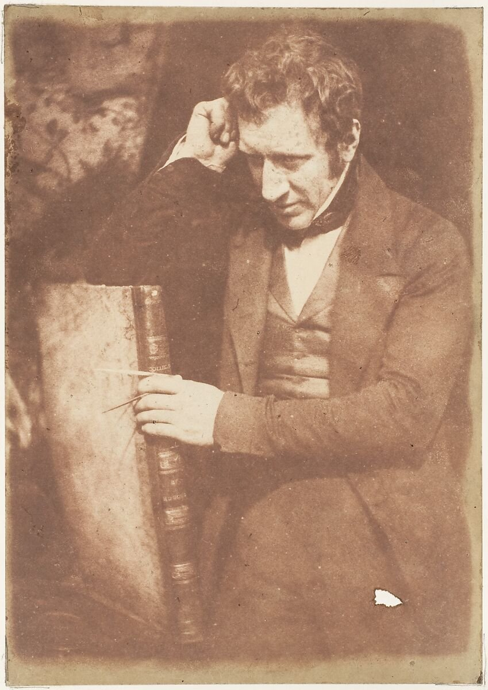
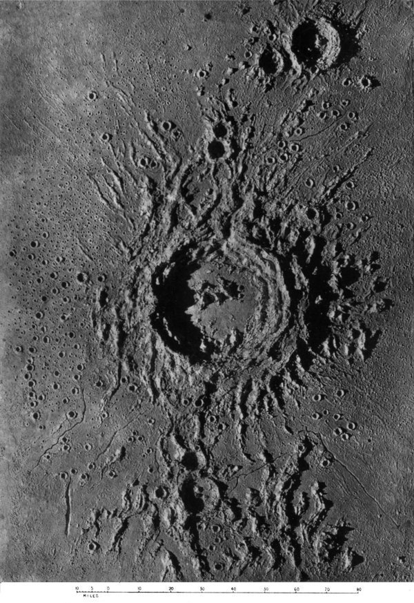
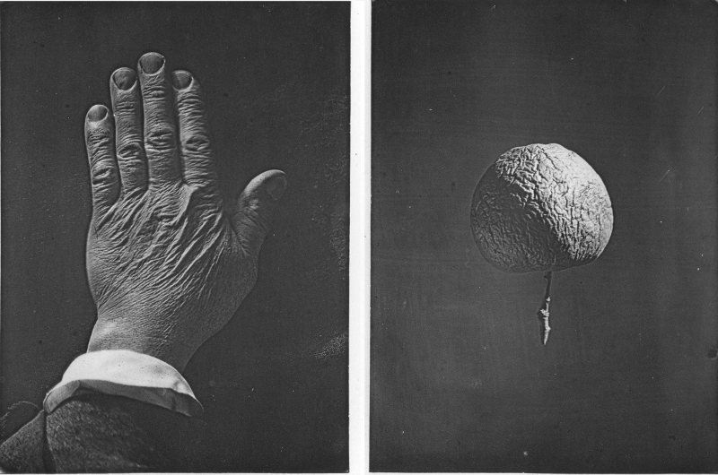
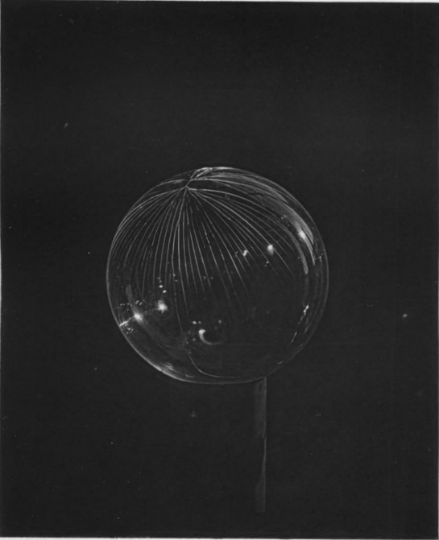

**文 / qscqesze**

1842年春，詹姆斯·纳斯密斯到法国勒克勒佐参观施耐德公司的工厂。他已经向欧洲的机器制造商出售设备；这趟旅行也包括为法国海军工场商谈机床。在勒克勒佐，他看到一种自己在英国还没造出来的东西：直接利用蒸汽升降锤头的锻锤，正在实际工作。[^1]

几十年后，他把这次访问写进自传。依他的叙述，法国工程师弗朗索瓦·布尔东曾在他不在场时看过他的设计册，带走了图样，又照图造锤。他还记下布尔东承认来源的对话。但这段对话只有他这一方的追述，不能替布尔东作证。法国方面将1841年工作的蒸汽锤归于布尔东；发明权之争没有因纳斯密斯的自传问世而消失。[^2]

有一点可以确定：从法国回国以后，纳斯密斯很快申请了英国专利。钱由亲属帮助筹出，借款还附带未来收益的安排。画在纸上的机器，现在牵涉谁先制造、谁可以制造、由谁收取报酬。他三十三岁，经营自己的工厂已有多年，仍须为几百英镑的专利支出另找办法。[^3]

这时的他尚不是晚年肖像里那位安居肯特郡、向朋友赠送月球图册的老人。他在英国工业城市之间跑订单，在工场安排人手，给客户画图说明。制造一台机器，只是这些工作中的一部分。

<figure class="technical-figure">
  
  <figcaption>纳斯密斯，1843—1847年，希尔与亚当森摄影，纸负片盐纸印相。纽约大都会艺术博物馆藏，37.98.2.126，公版。</figcaption>
</figure>

## 一、画家的儿子

纳斯密斯生于1808年8月19日，家在爱丁堡约克广场。父亲亚历山大是风景画家，母亲芭芭拉出自福利斯家族。家里能提供绘画、工具和与知识界来往的机会，却没有足以让每个孩子不必谋生的财产。成年后的纳斯密斯强调自己靠工作立足；在这条路的起点，他已经拥有父亲的作坊和父亲的朋友。[^4]

亚历山大的画室和机械兴趣并行。他认识工程与自然科学界的人，也愿意动手处理材料。詹姆斯从父亲那里学到的，首先是一种观察和记录物体的办法。父亲把砖块或代替砖块的小木块随意放下，让他画出轮廓、比例、受光和阴影。功课的对象很平常，要求却明确：不能画一个概念中的方块，须把眼前这些块体相互遮挡、各面长短的关系画对。[^5]

这种训练后来进入他的工程通信。寄一封说明机械方案的信，他会在文字之间添上草图；与不熟悉英语的外国客户谈结构，也可以借助图样。零件的方向、支点的位置、空间够不够，往往在图上更容易看清。他成年后仍把绘图叫作一种语言。那是从画家的日常训练里得到、又被带进机器制造业的本领。

家里其他孩子同样靠近艺术。哥哥帕特里克成为风景画家，移居伦敦；姐妹们也参与家庭的艺术生活。詹姆斯后来到伦敦求职，可以去看哥哥，父亲可以带他拜访相识的画家。对一个尚无职位的青年，这些关系意味着能够进入一些人家、得到介绍、有人愿意听他说自己想干什么。其作用不必夸大成一切已经安排妥当，也不能从后来那则带模型求职的故事中删去。

他的兴趣很早就从画室延伸到城里的工场。学校同伴的家庭、熟识的匠人，为他打开铸造和金工的门。他接触的材料有不同的工作次序：木模得先按铸件形状做好，型砂要能保留细节，浇进去的金属冷却后还要清理和加工；一块外表合适的料，未经这些步骤，不能直接成为可靠的机器零件。这些事情靠读一个名称学不会，工人的操作让他看见了前后关联。[^6]

父亲也带他步行出城。爱丁堡附近的岩石、山丘和古建筑，有时与画家同行，有时与自然科学家同行。他听大人讨论地形与火山遗迹，后来把这类经验与月球表面的观察联系起来。但少年时代的地质谈话并不预定他必然成为天文学家；当时更切实的影响，是他习惯了边走边看、画下形状，再问那些形状怎样产生。

1820年，他离开爱丁堡高中。日后回忆学校，他不喜欢把古典语言当作教育的主要尺度，说自己学到的拉丁文不多，也没有希腊文。他继续上私人课程，尤其重视算术和几何。欧几里得的证明为他提供了一套与手工经验不同的约束：一个结论不能只因看起来像，就算成立。绘图、几何和在作坊里接触材料，逐渐合成他自己的学习方式。

父亲给他的空间也有代价。家用车床、旧金属料、在家中作实验的便利，都需要家庭容忍并承担。他后来能很自信地告诉青年，应当自己把一台望远镜从头做出来，那种要求出自他熟悉的环境。对他来说，原料、工具和愿意指导的成年人，确实曾经近在身边。

## 二、把模型卖给课堂

1821年，爱丁堡艺术学校开课，纳斯密斯成为学生。这所学校的“艺术”包含实用技艺，课程安排在晚上，使白天做工的人也能来听。化学、力学、几何不必等到进入一门正式职业之后才接触。纳斯密斯连续数年参加课程，将它看作自己工程教育的重要部分。[^7]

讲解蒸汽机需要可见的东西。一个全封闭的汽缸可以真正运转，却把内部运动藏起来；只画剖面，又不容易让观众把活塞、汽道、阀门和连杆的关系连在一起。他制作的教学模型，便把机器的一部分剖开，使观众能在部件运动时看见内部位置怎样改变。模型既要讲明白原理，也要做得足够准确，否则课堂演示本身就会出错。

艺术学校购用他的模型，爱丁堡大学的约翰·莱斯利教授也订了一件，用在自然哲学课堂。莱斯利给他免费听课的资格。于是少年为学校制作仪器，学校再向他开放知识；他进入大学课程的路径，有一部分是通过手里的工作换来的。后来他又以出售模型的收入，支付其他课程的费用，包括化学以及几何、数学。[^8]

他在自传里留下了这项生意的价目：模型每件十英镑。收入的三分之一交给父亲，作为家中生活费用的补助，其余用于课程和自己的需要。这个数字不能直接换成今天的一件玩具价格。模型包含制作木模、铸造、锉修、车削、装配等多种工作，买家是拿它授课的人；每次能否可靠运转，关系到下一次订货。

他的工作地点也没有学校实验室那么整齐划一。自述中有一套在卧室壁炉里改造的小炉：用铁板与耐火砖围出熔炼空间，通过烟道获得抽力，燃料还用到家中留下的焦炭和煤渣。他把旧铜件、废料熔化，按需要调整合金，再浇入自己准备的砂型。这里的“在家里制作”实际包含热、烟、材料消耗与失败的风险，并非只在书桌上拼装现成零件。[^9]

每一个模型还是一次小规模生产安排。他要先知道讲课者准备说明什么，决定哪些部分可以做成剖面，哪些地方必须保持强度；做完以后，又得让比例、运动与观看条件相容。他后来很擅长把一台庞大机器缩成能放在桌上的说明物，最初的买家已经在要求他做这种转换。

模型订单随着技工教育机构增多而扩展。阿洛厄的机构、外出讲授机械课程的人，以及对父亲的画感兴趣的来客，都可能成为订户。父亲的绘画生意和儿子的机械生意偶尔接在同一位访客身上。对纳斯密斯而言，绘图、演示与出售作品，从青年时代起就没有完全分开。

到1827年前后，他又参与制造蒸汽公路车。苏格兰艺术学会的成员看过小模型，私人集资六十英镑，希望得到一辆能够载人的实验车。这个委托比课堂模型更接近工程项目：重件要交给利斯的安德森铸造厂，纳斯密斯在那里借助设备和有经验的技工，完成发动机与车体的工作。自传还特别提到机械工罗伯特·麦克劳克兰。[^10]

车做成后，在爱丁堡附近道路上反复试行。按纳斯密斯的回忆，有时载八名乘客，行驶数英里。这里的成功指车辆在试验中能跑，未形成定时客运，也没有因此建立一家造车企业。他把机器中的废汽送入烟囱底部帮助抽风，后来知道别的工程师也已这样做，并没有据此取得这项原理的独有功劳。

这段实验最后以拆车结束。学会将装置送给他，他卖出两台小型高压发动机和锅炉，得款六十七英镑。他没有沿着公路蒸汽运输继续投入，而把精力转回学习和为进入工程业作准备。对一个年轻的制作者，结束一项能运行的实验，同样是一种选择：把可出售的设备换成钱，腾出时间，去追求更完整的训练。

1828年，他患了一场严重的斑疹伤寒。自传说父亲原已担忧他把铸造、学习和其他工作排得过密。疾病经过不能简单归咎于勤奋，但它使他的下一步暂时停下来。恢复后，他继续参观爱丁堡附近的发动机，尤其注意到邓迪卡迈克尔兄弟所造机器的质量。追问工艺来源，他听到越来越多关于伦敦亨利·莫兹利工场的消息。[^11]

优良的成品把他的兴趣引向了制造成品的工具。为什么同样叫蒸汽机，有些做得更准确、运行更可靠？答案部分在图样，部分在材料，也在车削和加工的手段。靠一位手艺很好的工人逐件修配，可以把一台机器做好；如果准备连续制造，怎样让准确性不只留在那个人手上？他想去伦敦看一看。

## 三、每周十先令

1829年5月，父亲陪他从利斯坐船到伦敦。随行的行李中有蒸汽机模型和机械图样，都是为求职准备的。纳斯密斯知道家庭付不起一笔高额学徒费，也听说莫兹利已经不再接收付费来学的青年。他仍想把自己的作品送到对方面前，让成品代替尚不存在的职业资历。[^12]

父亲先前认识莫兹利，这使他们得到会面的机会。第一次参观时，莫兹利仍表示不愿收那类学生。纳斯密斯在回忆里把转机写在提出展示作品之后：第二天，模型与图样送进工场，由莫兹利和合伙人约书亚·菲尔德检查。结果是一份助手工作，地点在莫兹利的私人作坊。他得到的是受雇与近距离工作的机会，没有签下一份通常的付费学徒合同。

莫兹利的设备和工作规矩给他留下了深刻印象。最有用的细节之一，是螺纹。螺栓与螺母看起来不起眼，但如果每一组都按各自尺寸临时修配，拆下一台机器后，就必须设法让原来的螺母回到原来的螺栓上。装配和维修会被大量细小差异拖住。要改变这种处境，不能只要求工人更细心，还得在制造螺纹的工具和检验办法上建立重复性。[^13]

纳斯密斯参与调整莫兹利的一种制螺纹装置：钢制刀刃按一定角度接触旋转的软金属圆杆，先产生螺旋痕迹，再用合适的刀具加深。改变刀刃方向，可以形成相反旋向；控制角度，则影响螺距。他看到的不是从无到有的一个神奇零件，而是怎样用有约束的运动，代替徒手沿线切削所带来的不稳定。

他还参与一套船用发动机模型的制造。模型需要许多按比例缩小的螺栓、螺母，有些螺母还带着凸肩。若逐一用锉刀做六个面，费时且难保证一致。他提出用旋转刀具加工，把小零件固定在带分度的装置上，按次序转过各面，使每一面在同样约束下接受切削。这个夹持和分度的办法，比他单独手工做出一个漂亮螺母，更容易移植到成批的工作里。[^14]

莫兹利允许他制造这套装置，后来更大的版本进入工厂。纳斯密斯自己开业时也采用这种螺母加工办法，并出售相应机器。一个为模型解决的小困难，成为可以卖给其他制造者的设备。此后几十年，他反复做的也是这类工作：先在自己的任务里遇到不便，再把处理不便的办法做成其他人也能使用的工具。

学习机会并没有免除生活开支。第一周结束，他向出纳提出每周十先令的工资。依其自述，房租每周三先令六便士，饭食尽量自己料理。他还请白铁匠依图做了一套小型炊具，连油灯花费十先令，以很小的火力缓慢加热食物。设备本身要花掉一周工资，使用它的目的，则是把日后的吃饭费用压下来。[^15]

他当时并非一文不名。来伦敦前出售模型余下二十英镑；带去求职的那台机器找到买主，又收入三十五英镑。他把这些钱存起来，作为周薪之外的储备。每周十先令怎样生活，是他刻意给自己设下的预算；有储蓄托底，与完全没有后路仍有分别。第二年工资增至十五先令，他在回忆中用终于可以给面包加黄油来记这次变化。

父亲在伦敦的熟人还帮他接近了科学界。亨利·布鲁厄姆给法拉第写介绍信，法拉第后来到莫兹利作坊看他。这些访问把工厂里的加工工作与科学仪器的需要联系起来。精确刻度、可靠传动、适当的材料处理，对实验室与造船厂都重要，只是尺度和用途不同。

他参与修整一台从法国购入、用于复制铸币模具的机器时，又看到这层关系。设计能将浮雕模型的细节转刻到钢模上，原理吸引人，机械细节却还不能稳定承担工作。他与技工詹姆斯·谢里夫合作，在莫兹利指导及造币厂人员的试验下改良。最初的方案、修整、操作、实际检验，出自不同的人。[^16]

1831年2月，莫兹利去世，纳斯密斯最看重的工作关系突然结束。他留在菲尔德处几个月，参与绘制泵用发动机的工作图。菲尔德提醒他注意维修时能否接近零件：一个易损部位如果埋在结构深处，处理一处小毛病就得大拆机器，设计上的不便会在以后变成停工时间与费用。纳斯密斯把这条经验记下来，日后设计中仍加以使用。

菲尔德还有一套记录业务谈话的办法。来客谈机械方案，他在装订本上画图，旁边记姓名、地址、日期和要点。散纸上的草图很容易在谈话后被扔掉，装订、按年排列并编索引，却使下次来访可以从上次停下的地方继续。多年以后，它们还可能成为查考某项方案何时提出的材料。纳斯密斯后来使用的设计册，也处在这种把草图留存为工作记录的传统里。[^16]

到8月，他准备返回爱丁堡。菲尔德准许他取得一套车床的铸件，供他回乡加工。与带着成品来伦敦时相比，这次行李多了一种可能性：他可以用这些铸件造出生产设备，随后再制造别的设备。

## 四、先造一间工厂所需的工具

回到爱丁堡，纳斯密斯在乔治·道格拉斯铸造厂后面租到一小块地方，搭起临时作坊。它离父亲家不远，长二十四英尺、宽十六英尺。他把父亲的脚踏车床搬进去，添加自己制作的刀架和减速装置，开始加工从伦敦带回的铸件。先有一台能用的旧车床，才能把较大的新车床做出来；新车床再去做刨床所需的部件。[^17]

这样积累工具，较慢，也占用资金，却使他将来不必从头向别人购买一套设备。制作中的每个尺寸和装配问题，又让他熟悉设备的限度。车床让工件转动，刨床用受约束的往复运动加工平面，钻、镗设备处理孔。它们的用途各异，合在一起才使小作坊能承接较广的机械任务。

他需要有人帮助操作。阿奇博尔德·托里来到这里求职，曾学磨坊机械，能做木工，也会用金属工具。纳斯密斯答应每周十五先令。托里后来随他去曼彻斯特，长期留在企业，逐步成为总工头。关系最初并非主人和天生忠诚的助手，而是一份工资明确、技能彼此需要的雇佣安排。纳斯密斯需要一个能跨工种办事的人，托里也在寻找能使用这些手艺的职位。[^18]

另一笔钱来自一位愿付五十英镑、让儿子在作坊学习一年的父亲。纳斯密斯在伦敦曾试图避免支付学徒费，如今自己的技术又可以成为收费教学的基础。这笔收入帮助维持托里的工资，但两人不能一直只造自己的设备，还需要真正的订单来支持开支。

罗伯特·斯廷恰在这时委托他制作一台旋转式蒸汽机。斯廷相信它比普通机器更省燃料，纳斯密斯表示怀疑，却接受了工作：客户答应按周付款，要求是给方案尽可能好的制作质量。机器做成以后，燃料消耗没有实现发明者所期待的优势；客户仍愿相信自己的方案，纳斯密斯则得到了一段稳定的现金流。

这项委托把设计判断和合同责任分开：纳斯密斯不赞同客户的性能预期，仍按约制造；机器没有省下预期的燃料，制作者则完成了客户要求的工艺。自己的机床进度被拖慢，资金却因此得以接续。开业以前，他已经在处理这种交换。

到1834年，他把下一站放在利物浦与曼彻斯特之间选择。利物浦铸造业者约翰·克拉格提出过让他接手业务的机会。那家企业有现成基础，也有较专门的铸造产品；纳斯密斯更愿做机械制造与机床，因而谢绝。这个决定留下风险：他选择的城市不会自动给他订单，一批自制工具也不会自动变成生意。[^19]

曼彻斯特有纺织业和不断增加的机械需求。他得到约翰·肯尼迪等人的介绍，找到戴尔街一座旧厂房的楼层，那里可以分用楼中的动力轴。租下空间，便不必立刻负担一整套独立锅炉、发动机的燃料和看管费用。楼中起重设备还能把铸件送到门前。对资金有限、却必须搬动重物的制造者，动力和吊运条件直接决定了能接什么活。

格兰特兄弟愿在需要时提供信用，银行家爱德华·劳埃德后来也愿给他授信。这些支持使他不至于因一周工资或一笔材料款周转不过来就停工。纳斯密斯称自己没有用到格兰特那笔备用信用；它仍是一种保障。后来传记把创业写成带着很少现金独自成功时，容易漏掉的正是这类未必实际提取、却可以随时求助的安排。

他通知爱丁堡，把工具装箱运往曼彻斯特。托里也跟着来了。到这一步，他拥有了一个还很小、却能立即工作的位置：工具是自己的，动力可以租用，铸造可以外协，客户则得逐笔争取。

## 五、楼下的玻璃器皿

纳斯密斯记下的第一笔曼彻斯特订单，来自爱德华·图特尔的缫丝设备。驱动设备的蒸汽机需要更换活塞，客户希望第二天正常开工。纳斯密斯与托里赶在夜间取出旧活塞，换上新件，再作试车。对方可以直接检查他们交付的工作：停工多久，修好以后能否按时恢复生产。[^20]

他的刨床还用来加工印刷机器的铸铁墨台。楼主雷恩与贝内特本来就参与印刷设备制造，能够提供这类附属工作。邻近的希思铸造厂替他浇铸铁件和铜件。他带来的一台发动机暂时用不上，恰好希思需要动力带动鼓风设备，于是把发动机转给对方，以铸件抵价。这种往来减少了必须立即拿现钱购买材料的压力。

纳斯密斯的设备也因此不断在工作。来访者看到刨床加工出来的平面，再问设备能否订制，原先为自己造的工具便成为商品。他说有些订单先付三分之一、交货时结清；这种付款方式让一部分材料和工资由客户预付承担。企业扩张的基础，不仅是加工更快，还包括不让资金长久压在已经交出去、却未结账的机器上。

订单越多，楼层就越不适合。楼下的玻璃加工者开始发现天花板掉灰，担心沉重机械压坏建筑。纳斯密斯有过一笔二十马力发动机订单，机器太高，便在楼上横着装配。等到准备拆卸运往爱尔兰时，横梁一端撞穿了楼板。楼下的玻璃器皿和楼板一同承担了这次扩张的后果。[^21]

房东要求他迁走，也承认业务已需要更方便的地方。纳斯密斯转而寻找独立厂址，选中曼彻斯特西面的帕特里克罗夫特。那里一侧接布里奇沃特运河，另一侧靠利物浦—曼彻斯特铁路，还有道路可以进出。原料和煤可以用船运来，成品也不必全部在拥挤街道上拖运。铁路既运货，也让他往返城市与工厂。

土地属于特拉福德。他取得约六英亩地的长租约，自传记为九百九十九年、每平方码年租一又四分之三便士。这种安排避免先花大笔资本买地，代价是持续承担地租。银行家劳埃德帮他判断条款，又介绍律师办理。创业故事中那个选中空地的个人决定，随后必须由地主、代理人、银行家与律师变成可执行的契约。[^22]

纳斯密斯先急着卸掉戴尔街的重物。他从利物浦购买新不伦瑞克松木，锯成厂房所需的板材和屋架，经运河送到地块边。托里监督木工搭建临时工场，机器逐步迁入，最初动力由他在爱丁堡造的一台四马力发动机提供。地里的黏土后来供烧砖，地下砂岩也适宜承重；厂房逐步由木构换成砖造，而不是第一天便具备后来图画中的规模。

1836年8月，布里奇沃特工厂进入运作。促使他迁址的爱尔兰发动机顺利交付后，又带回一笔四十马力机器的订单，成为新址的早期大活。每一次扩建都希望由后续工作承担费用，工场的设备、厂房和订单因而彼此推动。他给企业取名，是向运河建设者布里奇沃特公爵致意，也是在说明它实际依赖的运输条件。

靠着运河并不等于可以免费使用码头。纳斯密斯在租地办妥后，曾面对一项使他难以接受的码头费用，认为对方抓住了他已经搬来的处境。后来管理改变，弗朗西斯·埃杰顿愿提供便利；他仍要求写成正式安排，每年象征性支付五先令。纳斯密斯既珍惜有地位者的友善，也希望把友善固定在可据以办事的协议里。[^23]

工人住房随工厂一起增加，后来又租入土地。搬运、起重、铸造、机加工和装配不再挤在同一层楼里。过去限制他的楼板和层高，被更大的场地取代；更大的场地又带来更多必须维持的岗位、更多在制品以及更多需要兑现的交期。

<figure class="technical-figure">
  
  <figcaption>布里奇沃特工厂早期图像，1839年或更早刊本，作者署名难辨。运河、铁路与工场的相邻关系清晰可见；公版，图源Wikimedia Commons。</figcaption>
</figure>

## 六、账房、浇包与工头

独立厂房使纳斯密斯可以安排更多种工作，也使一个人兼办一切越来越困难。他愿意处理机械组织、图样和制造，却需要有人料理账房、来信与收支。早先有人愿投资作静默合伙人，他没有立刻接受；在企业的这个阶段，他希望资金之外，还能得到一个实际分担事务的人。[^24]

霍尔布鲁克·加斯克尔有利物浦铁材贸易的经历，也有资本，经人介绍来到工厂。两人订立合伙，加斯克尔负责商业部分，不需技术解释的通信也交给他；机械事项仍由纳斯密斯处理。尤其碰到需要草图的信，画图者本人参与，可以减少文字转手造成的误会。这种分工让企业既能接触客户，又不使每笔普通账务都停在工程负责人手中。

加斯克尔也参与如何花钱的决定。他后来不愿在需求低迷时先为蒸汽锤专利投入大笔费用：尚未拿到订单的构想，在账上首先是一笔支出。两人共同经营多年，机械前景与眼前收支有时会把他们推向不同意见。

工厂还有另一种不能由设计者独自完成的判断。大铸件刚加工到一半，搬动时能夹在哪里，吊起时哪里必须留空，运到下一台机器前怎样放下，都会影响已经投入的工时。纳斯密斯尤其称许来自沃斯利运河一带的工人，认为他们处理重物的经验很有价值。搬运在工资和名目上或许属于较低岗位，却直接影响昂贵工件能否安全走完下一步。[^25]

他从这些人中挑选操作机床者，按其工作表现提高工资和岗位。在自传的说法里，这证明人能越过原有职业等级；在日常生产中，也确实给他一个扩大人员来源的办法。谁来判断合适、谁有权决定升迁，则仍掌握在厂方和工头手里。这一点在工会提出自己的资格标准时，便会成为冲突的所在。

托里承担的任务逐渐超过在小作坊帮工。他可以组织抢修，安排人力，使停摆的发动机重新运行。詹姆斯·赫顿比纳斯密斯年长，纳斯密斯早年已向他学习工艺；这些人进入企业，带来的不是一张等候老板填满的白纸。技术经验有自己的来路，也会在工头与工人之间继续传递。

厂里对材料流动的控制，有时体现在很小的机构上。浇铸大件，要把装有数吨熔铁的浇包移到砂型上方，再倾倒。旧式操作依靠多人握持手柄和杠杆，动作不稳可能溅出熔铁。纳斯密斯为浇包加入蜗杆与蜗轮，让操作人转动机构、逐渐改变包体倾角，避免主要靠众人同时出力保持姿态。[^26]

这项改良兼有两种效果。倾倒者离突然失控的熔铁远一些；铁流也更稳定，不易因一下太急、一下又停而影响浇铸。配套的挡渣装置把漂在上面的杂质拦住，减少用手持工具临时撇除。这里不需要一台比原来更巨大的机器，需要的是让本已存在的重量按可控制的方式转动。

他把改良记在1838年，没有申请专利，向其他铸造业者寄送图样说明。后来奖章与传记赞扬了这个安全装置。他对推广范围的表述十分乐观；能够确认的贡献，是把具体结构公开，供别的工厂采用。那种公开并未阻止他在其他发明上寻求专利，两个决定各有资金、用途与时机上的条件。

加斯克尔最终因健康原因退出这项合伙，后来从事化学工业。纳斯密斯自己退休时，另一位合伙人亨利·加内特仍与企业有关；自传脚注称加内特长期是静默合伙人。早年不肯随便收进投资者，并没有变成一生不使用这种资本的原则。厂子的产权、工作分工与他个人的发明活动，随着岁月一起调整。

## 七、谁有资格站在机器旁

纳斯密斯最喜欢的机器，是把动作预先约束好的机器。刀具沿规定方向走，工件被夹牢，一次加工完成后再重新定位。原本依赖工人持续用手引导的动作，有一部分移入床身、导轨、进给和夹具。由此可以增加产量，也可以让没有走完传统学徒程序的人承担某些工序。[^27]

在他的工场，青年和普通劳动者开始看管机床，表现好的人被推荐加薪。他相信这种工作会培养精确感，使人逐步承担更复杂的任务。他反对必须先经过固定年限的学徒合同，才许从事某类机械工作；更愿以能否完成眼前任务作为判断。这个主张也与他自己未作正式学徒、却在莫兹利身边工作的经历相合。

但在已经完成学徒训练的工人看来，职业资格关系到饭碗。厂方训练新手、改变分工，会影响现有工人可以要求的报酬和能够守住的岗位。纳斯密斯把工会的干预称作阻碍能力自由流动，工会则试图维持其认可的职业边界。争执并非一句工人不肯接受新技术就能交代。

自传记载的一次冲突中，工人代表要求解雇那些没有完成七年学徒期、却在做机械工作的雇员。纳斯密斯和合伙人拒绝。随后半数以上工人离厂，厂外设置纠察，邻近招工难以补足人手。厂方先争取客户放宽交期，再转向苏格兰报纸刊登招工广告，通过爱丁堡代理人选人。[^28]

依其回忆，最终有六十四人来到工厂，有的还带着妻子、孩子及家用物件。他们先由两名代表看过工作与住房条件，再决定迁来。这些人并不是从储备仓库里调出的劳动力；换一份工作意味着整户迁移，也要判断老板对新工作的说明是否可信。纳斯密斯把他们的到来写成厂方战胜工会的转折，留下的文字却几乎没有原先罢工工人的声音。

后来更大范围的劳资冲突，又涉及一个人能否看管多台机器，普通劳动者和青年能否继续占据这些岗位。机器需要较少持续的体力引导后，厂方发现同一人可以多做些事；工人组织担心岗位因此减少。厂方提出加钱，也不一定能解决分工权归谁的问题。纳斯密斯在这类争执后继续增加自动机床，扩大自己对招工来源的选择。[^29]

他对工会常带敌意，谈工人饮酒、缺勤时也格外严厉。这些概括服务于他所主张的工厂管理办法：让老板减少对少数熟练工人的依赖。在他提出的替代方案里，技术安排、任用与晋升的主导权归于厂方，工会试图共同维持的规则则受到排斥。

这种管理也不是把所有知识都锁进机器。他依赖工头观察人、判断做工质量、推荐升迁；夹持和重新定位仍需要人，吊运更不能交给一个“永远不会出错”的抽象装置。他自己谈到搬运者时知道判断的重要，歌颂自动机床时却又常把这种持续劳动说得过分轻松。两种说法并存在同一位经营者身上。

工厂创造的机会与它施加的约束，都在这些关系中发生。托里得到长期升迁，一些原来的普通劳动者进入机加工；另一些工人则为失去职业控制而抗争。这些冲突在纳斯密斯的书里以订单恢复、企业继续发展收束，原先的职业边界已经改变。

## 八、成家与尚未兑现的图纸

1838年3月，纳斯密斯在前往约克的商务途中停留，拜访巴恩斯利附近一家铁厂的管理者哈托普。两人先前因机床往来相识，哈托普曾邀请他来看工厂。这次访问使他结识了安妮·哈托普。到三十岁前后，他才觉得自己的经营状况允许认真筹划婚姻。[^30]

哈托普家庭也经历过生意上的挫折。纳斯密斯后来赞赏他们在缩减开支后仍有秩序的生活，把安妮写作能够理解实际事务、与他交谈的伴侣。他的记忆非常温情，无法据此复原安妮每一次选择；能够确定的是，这段关系经过一段等待，才与工厂逐渐稳定的前景一起落实。两人于1840年6月16日在温特沃思结婚。

婚后的住宅靠近工厂，纳斯密斯称之为“炉边”。它让他步行很快便可到工作地点，家中的花园后来又安放望远镜。夫妻没有子女，住房没有随家庭人数扩大。在成家以前，姐姐玛格丽特曾到巴顿照料他的居家生活；亲人的这些工作，为那个总在处理订单的人提供了日常条件。[^31]

安妮后来随丈夫参加科学集会、旅行，在退休后的园子里种花，以绘画与针绣记录花卉。她在他的叙述中经常出现，记载清楚的是这些生活和艺术活动。两人生活有共同兴趣，也各有具体活动；定期的科学旅行给安妮提供了接触丈夫同行和朋友的机会。

结婚前后，他正试图让另一类构想成为产品。铁路扩张带来机车和设备订单，客户开始要求更大的零件，原来的工具尺度未必跟得上。他为大西部铁路提供过机车，又为拟造的大型轮船“大不列颠”号制造机床。在这一连串业务联系里，出现了蒸汽锤的需要。[^32]

“大不列颠”号最初计划采用明轮推进。连接巨大明轮的锻铁轴，要求当时锻造设备处理很厚的工件。纳斯密斯记载，工程师弗朗西斯·汉弗里斯在1839年11月来信求助，说找不到肯承接这根大轴的工场，询问能否改用铸铁。他把11月24日标作自己画出蒸汽锤草图的日子。日期与半小时内形成完整方案的速度，来自他对发明经过的追述。[^33]

旧式大型锻锤沿袭手锤的杠杆形状，锤头随长柄摆动。把锤做大，可以增加重量，却仍受摆动范围限制。厚工件放上砧子，会占去本来可供锤头下落的空间；最需要强力的地方，反而剩不下足够的加速距离。纳斯密斯抓住的便是行程与工件尺寸之间的这个矛盾。

他在设计册上画的方案，把锤头接在向下的活塞杆上，上方竖立汽缸，左右用支架和导向件约束运动。让蒸汽进入活塞下方，便能抬起锤头；排出蒸汽，锤头沿竖直方向落下。砧子与锤头之间不再受一根摆动长柄的几何关系同样限制，可以为大工件保留较宽的工作空间。

操作者控制进汽与排汽，不必每一击都用尽全程。抬高一点再落下，和抬得很高再落下，效果不同；连续轻击、较慢重击也可以切换。这使机器不仅增大力量，还能改变锻造者指挥力量的方式。锻件形状会不断变化，工人需要在各部位选择不同的击打，单有固定节奏的重击并不能完成一切工作。

纳斯密斯把图寄给汉弗里斯，对方及项目相关者表示赞同。但轮船推进方案随后改为螺旋桨，那根使锻造者为难的明轮轴不再需要，原来期待的使用场合消失。蒸汽锤并没有跟着那封回信马上进入工场。对它的称赞和购买意愿，是两件相隔很远的事。[^34]

铁业又遇上低迷，已经有锻锤的工厂连现有设备都未必能用满。纳斯密斯寄出图样，收到一些赞许，仍没有订单。他的合伙人不愿先花接近五百英镑为没有买家的构想申请专利。纳斯密斯自己的资金也已经在企业里。即使相信机器能工作，他仍须在维持现有生意与为未来技术花钱之间作选择。

他继续向访客展示设计册。客户到帕特里克罗夫特看机床，图纸和工作中的设备都会成为销售手段。他的解释是，外国工程师迟早会从专利图或技术刊物取得知识，与其只防止别人知道，不如争取由自己承接制造。这个办法有利于打开市场，同时也让尚未保护、尚未落地的构想越过工场边界。

勒克勒佐的施耐德和布尔东是否从他的册子里取得决定性设计，后来成了争端核心。纳斯密斯说他们来访时他不在，是加斯克尔接待并展示了册子；他自己直到1842年法国之行才知道。以这一面之词指控抄袭，证据并不充分。布尔东也在面对大型船用锻件的问题，在施耐德的工厂组织制造设备；法国博物馆的记载把1841年的蒸汽锤归于这位实际主持机械工场的人。[^35]

两个制造中心的需求相近，机器原理也有前史。瓦特和威廉·德弗雷尔早已提出过直接以蒸汽推动锤的构想。纳斯密斯的图、布尔东的实物、早先的方案，不能排成一条只剩一个聪明人的故事。究竟何时具备想法、何时制成能工作的机器、何时取得法律权利，必须分别看待。

1842年回国以后，纳斯密斯才把英国专利办下。姻亲威廉·贝内特出钱相助，约定从收益中优先偿还，并分享专利期中的利润。专利日期为6月9日，编号9382；法国施耐德的专利更早在同年4月获得。它们各有法律范围，并不自行判定全球发明史上的归属。[^36]

1843年初，帕特里克罗夫特造出实际工作的蒸汽锤。其后的改进包括在活塞上方进汽，利用蒸汽压力补助重力；还有使锤自动反复动作的机构。后一项不能全部塞进纳斯密斯一个人的名下：经理罗伯特·威尔逊被记录为其发明者，旧传记也保留了这项权利主张。自动机构使用过一段时间，较大的锻锤又常回到人工操作阀门，以便根据锻件需要控制一击。[^37]

由图到机器，纳斯密斯已走过三年多。让他得到财富的，也不只是纸上的那一刻：专利费用需要筹措，第一批实物需要运行，别的工场才会来买，而每一位客户都还要看它怎样处理自己的锻件。

<figure class="technical-figure">
  
  <figcaption>蒸汽锤结构图，刊于查尔斯·汤姆林森编《实用技艺百科》1854年版，取材于大博览会机器；非1839年原始草图。美国国会图书馆藏印本图像，公版。</figcaption>
</figure>

## 九、送到海军船厂

锤头能够压碎酒杯上鸡蛋的演示，常跟着纳斯密斯的名字流传。他自己确实记过这类表演：让沉重锤头只触破蛋壳，而不毁掉玻璃杯，再用同一台机器锻打大铁件。演示要说明的是控制范围，观看者容易记住的则是大小悬殊的两个物体。纳斯密斯不仅设计产品，也知道怎样把产品的特点变成一眼能懂的比较。[^38]

这种可见性对海军客户很有用。他早在1840年便向爱德华·帕里展示蒸汽锤图样，希望皇家船厂采用，未得结果；图样得到好评，与采购机关愿不愿承担引入新设备的责任，还隔着一段距离。等到机器在别处真正运转，海军部于1843年派人前来考察，情况才改变。

纳斯密斯让来人看自己的锤，还带他们去看客户工厂中较大的那台，观察大小锻件怎样加工。相较一份性能宣称，这种安排让官员有机会检查工作现场：操作者是否能控制，设备是否只能做一种任务，旁边还需要什么炉子、吊具和空间。随后收到的德文港订单包含五十英担锤头的蒸汽锤，同时配有锅炉、起重机和锻炉，是一套工场装备。[^39]

他亲自带技工去安装，留在现场让机器投入工作。这种跟随产品的服务，既是为了把设备装好，也让制造者能当着实际使用者展示并解释。蒸汽锤所做的强力锻打并非独立发生：铁件先被加热，由起重机移到砧上，再由工人调整位置，配合锤头的动作。没有这些安排，一根能够上下运动的重铁块还不能成为稳定的生产能力。

锻造大件所耗费的不止是敲打时间。把多块铁结合，要让接合部达到适当温度，再通过锻打使之结合，并尽量排出夹杂。尺寸越大，热量和操作越难安排。蒸汽锤可以扩大一次处理的体积，在较长时间内维持强力、可调的击打，因而对大轴和锚特别有吸引力。纳斯密斯把这种变化写成告别旧式分块接合，但再好的锤也不能自动保证每块铁内部没有缺陷。

模具提供了另一种用途。把热铁放在下模上，用上模约束成形，可以较快制造重复的形状。枪械业在小件上已经用过这类办法，蒸汽锤使一些较大的模锻任务更容易实施。于是客户购买的还包含重复生产的可能：同一种形状需做许多件时，先制造模具，再让动力持续完成相似动作，成本与手工逐件修配不同。

德文港的设备之后，其他海军工场也下订单。纳斯密斯在自己的回忆里把一次成功表演与大批采购紧紧相连；实际交付却仍要逐厂安装、供给附件、适应工作。赢得一位官员赞许，没有替他省去这些劳动。设备的名声，就是在随后一批批可用的实物中积累的。

皇家造币厂后来使用的一台纳斯密斯小型蒸汽锤保留下来，现藏科学博物馆。它的制造年代是1845—1855年，用于造币厂机械和工具的制作维修。这个并不以体量取胜的实例，说明机器不只用于让观众惊讶的巨大锻件；可控的反复击打，也能进入较小而经常性的修造工作。[^40]

## 十、四分半钟与十二小时

在德文港，海军还准备扩大基厄姆船坞。要把潮水挡在外面，再建成可工作的船坞，须修围堰、打下大量木桩，形成稳固的施工基础。承包商贝克父子看到蒸汽锤，便与纳斯密斯商量，能否把相似力量用在木桩顶上。这对他的设计是一次用途转移：工件不会留在砧子上等着改形，而会在连续打击中向地面以下移动。[^41]

他已为打桩用途考虑过结构，并取得相关专利。委托落实后，他准备工作图，制造两套装置。按他的描述，每台四吨锤头，汽缸、导向框与锤头合计约七吨，由木桩上端支承。敲击装置随着桩下降，重量一直作用在桩上，不必每打一击都把整套设备重新吊到高处。

这区别于主要依靠绳索反复提升重物的旧办法。蒸汽活塞直接抬锤，排汽后迅速下落，可在较短行程内频繁击打。纳斯密斯还用顶部空气的压缩与回弹，帮助改变运动。锤头自身的运动、整个机架的静重及木桩的下沉，被安排在同一条竖直线上。

设备必须能够沿着围堰继续工作。一座带轮的平台承载锅炉和小发动机，在预先修好的轨道上移动；小发动机还参与吊起下一根木桩。蒸汽经可以适应高低变化的管路送往锤的汽缸。如此，打入一根以后，机械能够沿线推进，重复吊桩、定位和打击，而不是每次都从头重搭一座架子。

1845年7月3日，这套设备准备试用。纳斯密斯把当天写成一次竞赛：两根同样尺寸的木桩，一边用旧式设备，一边用他的蒸汽装置；他的桩四分半钟打到规定深度，对方用了十二小时以上。每分钟约八十击，以及木桩七十英尺长、十八英寸见方，也来自他的记录。[^42]

这些数值属于一个具体工地的自述，不能当作不同地层、不同桩型普遍适用的效率比。但比较指向的问题很实在：承包工程按期限结算，大量重复打桩占用人手与工期，减少一次循环中的提升和等待，可能改变整个工程的安排。机器所节省的，并不只是某个工人挥动手臂的几秒钟。

纳斯密斯很喜欢这个应用，后来回顾时给它很大的篇幅。他在这里能同时展示几种本领：从原理换出用途，把部件组合成能沿工地行动的系统，又用一场有明确开始、结束的试验证明价值。演示与实际工作重合得比破鸡蛋更紧，结果也更容易成为下一位承包商考虑的依据。

技术的推广于是经过另一条渠道。制造厂用蒸汽锤锻铁，土木承包者用打桩机修港池、围堰和其他水工基础，两类客户的预算、使用场所与人员都不相同。纳斯密斯靠出售完整装置和说明其作用，在这些行业之间移动。他的企业所能交付的，也从单台机床走向与整个工序有关的设备。

## 十一、一条绳索的制造

布里奇沃特的业务没有被蒸汽锤占尽。铁路、船厂、兵工厂需要的机床、发动机和各种加工设备，仍持续进入订单簿。纳斯密斯去伍尔维奇时，看到的是要按百计生产相似铁件的军工机构；蒸汽锤、模具、炉子和起重设备，在这里又组成另一种生产配置。[^43]

他与约翰·安德森等人往来，向官员与工头解释设备，也从他们的工作需要中找到改进方向。公共工场为他提供了规模较大、可供其他来客参观的使用现场。外国采购者能够看到英国工场的实际运转，再向供应商订购，而不是只从商业说明中判断。

纳斯密斯对此并不采取全面封锁的态度。他认为机器已在工程刊物中公开，设备也会被仿造，拒绝外国来客，未必能长期保住知识。能够在对方自己制造以前承接订单，才是眼前可以取得的利益。这与他对蒸汽锤发明权的坚持并存：知识的流动有利于卖机器，利润与名声的归属又必须尽可能说清。

通过中间商，工厂为西班牙的费罗尔、卡塔赫纳以及哈瓦那海军设施供应机器。1849年，又接到俄国在黑海尼古拉耶夫海军工厂设置制绳设备的订单。任务从处理麻料一直延伸到拧成粗大缆索，要求安排的不止一台单独机器，而是相继完成的各道工序。[^44]

纳斯密斯说自己为此专门研究制绳。纤维准备、排列与捻合的需要，不能完全照搬锻铁经验；但他熟悉怎样把一个产品拆成连续动作，再思考每一步需要怎样的动力和引导。订单中也有俄国军官持续监督，来人要检查细节并报告本国。所谓一位工程师把想法实现，在这种项目里包含客户代表、制作者和使用机构之间的往返修订。

1851年7月，机器装船运往黑海，之后安装。纳斯密斯收到科尔尼洛夫海军上将邀请，希望他乘船前往，亲眼看机器运行，也参观塞瓦斯托波尔工场。他没有完成这次访问。后来英国与俄国开战，早先的技术往来置于新的政治关系中；他的回忆把那位相处融洽的俄国军官与战争造成的死亡联系在一起。

他对这些海外客户的称许，常着重于对方是否能看懂机械、是否选派懂行的人。那是供应者熟悉的评价标准。机器用于哪一支海军、哪些政治目的，他谈得远不如制造和验收细。到这时，企业的地理范围已经远超过曼彻斯特，却仍依靠同样具体的环节：图样能否解释，人员能否沟通，货款与运输能否办妥。

## 十二、未能成为另一把蒸汽锤的办法

1854年，纳斯密斯申请了一项把蒸汽用于搅炼铁的专利。搅炼工要在高热前用长杆拨动金属，使之脱碳并逐渐聚集成可锻的团块；这是一种艰苦的手工劳动。纳斯密斯多次看过，想让蒸汽同时承担搅动和部分化学作用。[^45]

他用中空管代替实心搅杆，让蒸汽通到熔融金属内部。气流上涌造成扰动，他又希望分解蒸汽产生的作用有助于除去过多的碳。这个构想仍沿着他熟悉的方向：用可持续供应的动力代替人的体力，把工人不易长期维持的动作交给设备。

博尔顿的托马斯·利弗·拉什顿支持试验。纳斯密斯认为产物强度、韧性和质量很好，劳动与时间也节省下来，但出现了足以削弱收益的问题：若操作人没有仔细控制汽流与持续时间，过度氧化会造成铁的损失。能够在一次试验中得到好铁，与能够按可接受成本反复生产，仍有距离。他在回忆里承认，这个商业困难尚未解决，别的工艺已向前走去。

亨利·贝塞麦在1855年取得自己的相关专利，采用空气鼓入熔铁的路线。1856年切尔滕纳姆英国科学促进会会议上，贝塞麦宣读报告，纳斯密斯在场。他后来记述，自己既感到方案被超过的失落，也公开表示赞赏。自传里那段拿着铁样、准备回家撕掉专利的慷慨发言，实际上依据多年以后贝塞麦提供的回忆，不能当成当年逐字记录。[^46]

更有价值的是两人后来对试验顺序的说明。贝塞麦解释，他在准备自己的专利时查到纳斯密斯等人使用蒸汽的专利，也试过蒸汽，但在他的工艺条件下，蒸汽带走热量，促使金属凝固。材料状态与温度条件不同，同一种介质会产生不同结果；把两项工艺都叫向金属里面吹气，并不能说明它们已经等同。

纳斯密斯把自己看作沿着同一条路先走了一段的人，仍然愿意在自传中说明前后联系。这与蒸汽锤争论中的激烈护权不完全相同：在这里，他承认另一人超过自己，也保留自己作过探索的位置。哪一个方案更有商业生命力，最终不能只靠谁说得更谦让来判断。

贝塞麦后来提出分享专利利益，纳斯密斯说自己谢绝了。此时他已经准备离开企业，所得足够支撑往后的生活。若再接受一项充满吸引力的新事业，可能又要投入尚未预见的工作与风险。不能以贝塞麦后来取得的财富，倒算纳斯密斯在1856年本来必得多少；他面对的是还在发展、仍有待解决难题的技术，而他想争取的东西也正在改变。

退休并非突然由这次会议决定。1853年，画家戴维·罗伯茨已写信谈他的退意，盼他能在身体尚好的时候继续观察其他世界。纳斯密斯逐渐感到长期紧张工作影响神经，眼睛也出了问题。他可以减轻事务、继续持股或参与，却不相信自己能对仍有责任的企业保持一半关心。最后定下的，是在1856年底退出。[^47]

## 十三、把收入与订单分开

他退休时四十八岁。工厂从1834年起经营二十二年，已有其他人可以承接工作，他和合伙人预先办好继续经营的安排。离开的是个人的日常管理，不是把机器停下、工人遣走。此后布里奇沃特仍制造设备，纳斯密斯则不必再靠下一张订单支付自己的生活费。[^48]

这层分离由投资安排支撑。他把积累的主要财富投入年息三厘的英国公债，收益率不高，但合乎他希望收入稳定的要求。安妮在他的记述中把这种投资叫作有益健康的证券。他不再追求让每一笔钱都取得最高回报，而希望资金不要不断把他叫回商业事务。

他与安妮到南方寻找住房，从报纸广告挑选，最后在肯特郡彭斯赫斯特买下原属画家弗雷德里克·理查德·李的房产。需要改建时，夫妻先在西德纳姆住了几个月，常去水晶宫听音乐。搬家于是有一个过渡期，工厂生活与退休生活没有在一夜之间切换成两幅完全不相干的画面。[^49]

他给新家取名“锤田”，将家庭徽记中断裂锤柄的形象与自己的职业连接起来。房屋增加空间，花园不断扩展，工具、望远镜、图画和收藏从北方搬来。他没有以不再动手作为休息；一间配置齐全的私人作坊，仍是新居的重要部分。过去制作工具为了开厂，此时保留工具，是为了随时能够制作自己想做的东西。

园子也接受他的安排。他喜欢针叶树，又用山毛榉、白桦等不同形态和颜色作搭配；种得过密以后还要间伐。安妮照料的花卉进入温室，也进入她的画与针绣。他们不用从这些作品取得足以偿付工厂工资的收入，这种经济条件使兴趣可以容纳缓慢、反复以及没有买主的结果。

两人仍与兰开夏的朋友往来，也能从附近铁路到伦敦。科学集会、画廊、音乐与拜访朋友，占据新生活的一部分。他曾认为自己青年时靠节约从十先令中挤出余地；退休后的自由则来自另一种余地：不必每次制作都问它是否马上可以出售。

这种改变没有使他忘掉旧工具。他在晚年特意提到父亲那台脚踏车床，仍能使用，并把它视作自己后来机械生产的祖先。他也不愿看见个人旧物在主人死后被当作杂物拍卖。这些物件的价值包含家人、师傅与工作经历，无法由一份性能表说明。工厂可以由别人接续，自己的那些旧工具却以另一种方式留在私人作坊里。

在退出以前，他已经观察月球多年；新家提供的，是把原来挤在工厂工作以外的研究，放到日常生活中央的机会。退休释放出的时间并没有全部归于回忆。他仍在制作新的观察工具，并准备把观察的结果做成别人也能看见的东西。

## 十四、从熔炉到目镜

纳斯密斯对望远镜的兴趣开始得比蒸汽锤早。父亲的一架小型望远镜曾让他看见月面，自己青年时也做过反射望远镜。在伦敦，莫兹利从柏林回来说起天文台的仪器，想拥有一架较强的望远镜；纳斯密斯便与他讨论金属反射镜的办法。老师和青年助手，在这一项工作上有了与日常任务不同的关系：助手熟悉一些可以提供给老师的知识。[^50]

反射望远镜用镜面汇聚光，金属镜的制作包含几道相互关联的工作。先要铸出足够可靠的毛坯，再磨到合适的曲面，最后取得能清楚成像的表面。铸造、冷却、研磨、支承与检验相互关联；毛坯若内部已有问题，后面耗费的磨制工作可能全部失去意义。纳斯密斯的铸造经验，到了这里成为仪器制造的条件。

他与威廉·拉塞尔长期往来，两人讨论如何自己制镜。拉塞尔也是从事本业之外投入天文的人，具备自己的制作经验；纳斯密斯向他介绍铸造中的办法，也从交流中改进观察工具。1840年，沃伦·德拉吕来访时看到纳斯密斯铸造十三英寸镜坯，后来请他代铸，自己再研磨与安装。这样的合作让一面镜子在不同人的作坊里先后完成。[^51]

对纳斯密斯而言，望远镜与机床有一项很相近的要求：有效的结构，要使人能够使用。大型望远镜的目镜如果随筒身升到很高，观察者便须攀梯，操作也不方便。他的二十英寸反射望远镜设在可转动的支承上，将观察光路引到一侧中空耳轴，让观察者在较方便的位置看天，不必一直追着镜筒上端爬高。[^52]

这并非仅仅增加镜面直径。仪器再强，如果移动困难、观看不便，就会缩短人愿意留在它旁边的时间。设计支承、安排目镜位置，在他的工作中与制造镜面同样具体。器材并不替人完成全部观察，却决定了人在一夜中能做多少次细察和记录。

1842年，他开始较系统地研究月面。在灰色纸上使用黑、白粉笔，把选择的区域画下来。白与黑不只表示山脊和凹处，也表示同一地形在一定照明下呈现的明暗。月面面对太阳的角度变化，阴影也会变化；观察者须反复见到同一对象，才能逐渐区别地形的轮廓与某一次照明造成的印象。[^53]

他没有把第一幅画就当作定稿。多年以后，与詹姆斯·卡彭特合写《月球》时，两人在前言中特意说明，图画经过重复绘制、修订，并不断回到望远镜里比较。眼睛也需要训练，熟悉一个对象以后，才更容易分辨细节。一本书里的清楚图像，由许多次不那么完整、也未必同样清楚的观察积成。

1850年，他把月面图与一张六英尺直径的地图带到爱丁堡的科学集会。回到青年时代居住的城市，他如今可以把自己几十年间积累的观察拿出来讨论。安妮同行，他们把这类会议当作科学活动与探望朋友的假期。1851年的展览又给这些绘图带来奖章；在退出经营以前，另一个工作领域已为他取得承认。[^54]

退休后，旧工具和新的磨镜设备继续放在私人作坊里。他还试过用屋顶风车驱动磨制。拉塞尔在信中提醒：天气会使风车停工；若有水可储存，或许能调节动力。纳斯密斯自己也承认小蒸汽机更稳定。那个曾把机器不会罢工写得十分肯定的人，在家中仍须面对另一种不听指挥的动力供应。

<figure class="technical-figure">
  
  <figcaption>大型望远镜的耳轴与转台结构，纳斯密斯《自传》1883年刊图。图中可见侧方观察位置；历史图版，公版，图源Wikimedia Commons。</figcaption>
</figure>

## 十五、在日光下重新做一轮月球

1871年3月，约翰·赫歇尔从病中写信，感谢纳斯密斯送来的月面模型照片，并鼓励他出版。赫歇尔知道照片拍的是什么，还建议加入看起来不像火山的山脉。这封后来收入自传的信，把作品制作过程里的另一层交流保存下来：观众不必把图当成直接拍摄，仍能认为它有科学和表现上的价值。[^55]

当时已有真实的摄月照片，德拉吕等人也在推进天文摄影。但纳斯密斯想表现的局部细节，不容易直接以现成摄影手段得到满意结果。他选择另一条工序：观察，绘图，把图变成立体模型，再照相。照片与月球之间，隔着眼睛、手、模型材料与布光的多次转换。

制作模型必须决定哪些地方升起、哪些地方陷下。二维图上的阴影暗块不能原封不动地堆成黑色材料；造型者要把它解释为高低关系，再让表面在斜射光下产生相应的暗部。他把模型放在太阳光下，调整方向，使光照尽量对应观察图的效果，随后摄影。这样取得的图像有真实物体的明暗连续性，也仍然含有造型者已作的判断。[^56]

1874年，《月球：作为行星、世界与卫星》由约翰·默里出版，作者署名纳斯密斯与卡彭特。卡彭特来自格林尼治皇家天文台，参与将多年观察整理成书。书名页、前言与图版共同宣布的，是一项解释月球表面现象的工作。作者没有把计算月球运行或重新绘出全部地名当作主要目标，更关心这些山、坑、裂缝究竟怎样生成。[^57]

全书配二十四幅图版，并有不少木刻插图。开头的前言明确说明模型拍摄的过程，读者不必等到后来的研究者揭穿，才知道照片不是从月面直接取来的。这种坦白也属于作者的可信性主张：模型经过长时间观察校正，日光又按自然规律投下影子，所以他们相信成图比其他手段更能传达目镜中的效果。

哥白尼坑的图版便可让人看出这种追求。坑内中央高地、阶梯般的壁面、四周较小坑穴，都被安排在强烈明暗之中。图下尺度提示读者，它要表现的是巨大地形，却以桌上能够处理的物质做成。未经说明便把这张图标成十九世纪拍下的月球近景，会把最有意思的一层制作史抹掉。

<figure class="technical-figure">
  
  <figcaption>《月球》1874年版，第VIII图版“哥白尼”。根据观察绘图制成模型后摄影，非直接摄月；纳斯密斯与卡彭特著，公版，扫描源Project Gutenberg。</figcaption>
</figure>

不同印制办法还影响读者看到的层次。初版使用数种图像复制技术，后续版本又有分图、重排和修整。纸上图像不是按下快门就已全部完成，印刷者还要使阴影、亮部和表面纹理在书页上可辨。现代科学史研究据此强调，纳斯密斯的图像包含一连串制造过程；人工介入并没有阻止十九世纪观众赞赏它的准确。[^58]

这些赞赏也进入纳斯密斯自己的回忆。他保存画家、天文学家和朋友收到书后的反应，其中有惊讶于照片、再惊讶于模型制作的读者。对一位从青年时代就靠模型向课堂解释蒸汽机的人，晚年的书又接上了旧的工作方式：把肉眼难以直接掌握的对象做成可见物，供另一个人观察。

两者的检验条件却已不同。教学蒸汽机可以拆开，能反复启动，可以和真正机器逐项比较；月球模型的形状，主要凭远距离观察去核对。模型与照片会让观察结果更鲜明，也会让它所依据的解释显得更完整。书中接下来用来说明成因的物件，就从月面地形转回了地球上的材料。

## 十六、手背、苹果与玻璃球

《月球》里并不只有模仿地形的模型。第二图版把手背与干缩的苹果并列，表面都有皱纹。作者用它们说明一个内部缩小、外皮相对多余的球体会怎样起皱，再将这类现象用于解释山脉。图像很节省说明：读者看自己的手、再看苹果，便容易理解作者想象的变形。[^59]

第三章还带着铸造工场的经验。作者讨论熔铁中的固体块、表面浮渣的运动，以及冷却时材料状态的变化，试图从熟悉的炉中现象推论天体。他们也向炼铁业者询问炉渣的表现。月球的形成在他们笔下不是纯粹几何题，涉及热、凝固、体积改变与外壳受力；纳斯密斯把自己在工厂看过的材料现象带进来，成为解释陌生世界的参照。

但从铁到岩石、从浇包到月球，尺度与物质都变了。某种类比可以帮助提出问题，不能仅凭外观相似就把相同机制确定下来。纳斯密斯对火山成因的信心，部分来自这种熟悉：他知道热物质能冷却、凝固，也见过表层被内部力量破坏，因而倾向于用相近过程解释月面的大批环形坑。

<figure class="technical-figure">
  
  <figcaption>《月球》1874年版，第II图版。手背与干缩苹果被用于解释收缩和起皱，是作者论证中的类比图；历史解释，公版，扫描源Project Gutenberg。</figcaption>
</figure>

第十九图版的玻璃球尤其明确地把实验放在论证中。书中解释，他们在球内灌水、密封，放入较热的水浴；内部与外壳的膨胀不同，使球破裂，裂纹从一处向四周伸展。摄影把这个结果固定下来，供读者与月面从环形坑向外展开的亮纹比较。[^60]

他们不满足于说两张图相像，进而提出月壳内部压力使之开裂、熔融物沿裂隙涌出的解释。可是同样放射状的图形可以由不同过程产生，玻璃实验也没有把月球上的成分、重力、热史和撞击条件一起重现。后来对月球的研究将大量环形坑归于撞击，明亮辐射纹主要与抛出的物质有关；照片保留下来，书里的成因解释却不能照旧作为定论。[^61]

<figure class="technical-figure">
  
  <figcaption>《月球》1874年版，第XIX图版“被内部压力裂开的玻璃球”。用于模拟放射裂纹，非月面照片；公版，扫描源Project Gutenberg。</figcaption>
</figure>

纳斯密斯晚年继续用工具，磨镜、观察，也写作。1883年出版的自传，由塞缪尔·斯迈尔斯编辑。两人早已有联系，斯迈尔斯为工程人物著作搜集资料时曾向他求助；这次则由本人回顾一生，再经编辑删订。定稿保留了对家庭、师友和配偶的感谢，也保留了经营者维护自身功劳与管理办法的论辩。[^62]

他把自己的人生画成一张弧形图，将成长、工作盛期与衰老分成不同区域。在这张回顾里，1839年画出蒸汽锤与1856年退休都是标点；那些没有单独年份的工作，工头的安排、妻子的生活、合伙人的账房与许多次试验，则散在正文各处。直到书末，他仍记录家中风车驱动磨镜不够稳定，宁愿用小蒸汽机。已经退出企业的人，还在比较两种动力究竟哪一种更好使。

1890年5月7日，纳斯密斯在伦敦南肯辛顿的贝利旅馆去世，八十一岁。布里奇沃特工厂没有在这一天停止；蒸汽锤也早已由不同厂商制造、改良，用在他不曾亲到的地方。他的书留下另一组仍能检查的物件：哥白尼坑的模型照片、干缩苹果与手背、破裂玻璃球。翻到1874年版前言，还可以读到他和卡彭特对这些图怎样做成的说明。[^63]

<!-- biography-body-end -->

## 资料与注释

正文使用的自传为Gutenberg所据1897年通俗版转录，初版出版于1883年，编者序落款1885年。自传属于晚年追述，其中转录的信件与作者概括分别看待；未取得原信手迹的，不称已经查读原件。引用采用节制转述。涉及布尔东和威尔逊的功劳，不以纳斯密斯自述单独判定。文中旧实验与天文学解释按当时观点叙述。

### 主要书目

- James Nasmyth, *James Nasmyth, Engineer: An Autobiography*, edited by Samuel Smiles, London: John Murray, first edition 1883; used text: popular edition 1897. [Gutenberg全文](https://www.gutenberg.org/cache/epub/476/pg476-images.html)。电子转录无稳定原书页码，以下按章定位。
- James Nasmyth and James Carpenter, *The Moon: Considered as a Planet, a World, and a Satellite*, London: John Murray, 1874. [原书转录与图版](https://www.gutenberg.org/files/56305/56305-h/56305-h.htm)。本书引页为转录保留的原页码。
- Richard Bissell Prosser, “Nasmyth, James”, *Dictionary of National Biography*, vol.40, London: Smith, Elder & Co., 1894, pp.110–112。[原书扫描及转录](https://en.wikisource.org/wiki/Page:Dictionary_of_National_Biography_volume_40.djvu/122)。这是承接自传而成的旧传记，不能把重复叙述当作独立证实。
- Joseph Wickham Roe, *English and American Tool Builders*, first published 1916, used reprint New York: McGraw-Hill, 1926, chapter VIII。[全文](https://www.gutenberg.org/cache/epub/72046/pg72046-images.html)。本章明确依赖纳斯密斯回忆，自动机构部分另作归属说明。
- Boris Jardine, “Made real: artifice and accuracy in nineteenth-century scientific illustration”, *Science Museum Group Journal*, Autumn 2014, published 8 October 2014, DOI:10.15180/140208。[论文](https://journal.sciencemuseum.ac.uk/article/made-real/)。本篇采用其纳斯密斯图像制作案例，不把整个现代论文近似改写为传记。
- Daryl Green, “James Nasmyth’s ‘Moon’ images, 1874”, University of St Andrews Collections, 19 July 2019。[馆藏比较](https://university-collections.wp.st-andrews.ac.uk/2019/07/19/james-nasmyths-moon-images-1874/)。
- Science Museum Group, “Nasmyth’s Steam Hammer”, object 1933-520。[藏品记录](https://collection.sciencemuseumgroup.org.uk/objects/co46229/nasmyths-steam-hammer)。
- Anne-Laure Carré, “Marteau-pilon à vapeur du Creusot”, Musée des arts et métiers, object 03120。[馆方说明](https://artsandculture.google.com/asset/marteau-pilon-%C3%A0-vapeur-du-creusot/KQHJiifdN6tE9Q?hl=fr)。
- NASA, “Moon Craters”。[现代撞击成因说明](https://science.nasa.gov/moon/lunar-craters/)。

### 注释

[^1]: Nasmyth, *Autobiography*, ch.XIII–XIV，法国海军工场任务与1842年访问；这里不采用其中布尔东承认来源的对白。
[^2]: 同上，ch.XIII；Carré，“Marteau-pilon à vapeur du Creusot”，明确记布尔东1841年构想与工场职务；Science Museum Group，“Nasmyth’s Steam Hammer”，对单一发明者叙事的纠正。
[^3]: Nasmyth, *Autobiography*, ch.XIII，William Bennett出资及分润；Prosser，pp.110–111，专利日期。
[^4]: Prosser，p.110，出生、父母与求学；Nasmyth, *Autobiography*, ch.II、VI–VII。
[^5]: Nasmyth, *Autobiography*, ch.VI，砖块练习、父亲教画与工程绘图。
[^6]: 同上，ch.VI；Roe，ch.VIII引用Patterson工场回忆。父亲家中的艺术环境参自传ch.II–III相关叙述。
[^7]: Nasmyth, *Autobiography*, ch.VI，1821年开课、夜间安排及1821—1826年就读。
[^8]: 同上，剖面教学模型、Leslie免课费及Hope、Wallace课程；模型的可见性讨论据作者所述结构。
[^9]: 同上，每件£10、收入三分之一交父亲、卧室熔炼与材料来源，均为作者晚年记忆。
[^10]: 同上，1827年前后的公路蒸汽车，£60为学会成员私人集资；重件由Anderson工厂协助，Robert Maclaughlan参与。
[^11]: 同上，拆车卖设备£67、1828年疾病、Carmichael与Maudslay工艺的联系；Prosser，p.110。
[^12]: Nasmyth, *Autobiography*, ch.VII，1829年5月赴伦敦、模型与求职过程。自传ch.VIII的起工日期存在星期与日历不合，正文不用该具体日。
[^13]: 同上，ch.VII–VIII，莫兹利的螺纹工具与原始制螺纹装置；未将工场内部实践写成当时已有全国统一标准。
[^14]: 同上，ch.VIII，模型螺母、圆刀与分度加工、后续放大使用。
[^15]: 同上，周薪10先令、次年15先令、房租3先令6便士，储备£20及出售模型£35；小炉费用10先令。不换算为现代购买力。
[^16]: 同上，ch.X，法国复制币模机器的修整，James Sherriff、Maudslay与造币厂Wyon参与；莫兹利1831年逝世、转Field及回乡参Prosser，p.110。
[^17]: Nasmyth, *Autobiography*, ch.X，Old Broughton临时工场、车床铸件、刨床与其他工具。
[^18]: 同上，Torry的技能和每周15先令；付费学习的£50及Steen订单的按周付款。
[^19]: 同上，Liverpool/Manchester选择、Cragg提议与拒绝、Dale Street厂房；Prosser，p.110，1834年开业。
[^20]: Nasmyth, *Autobiography*, ch.X，Tootal活塞、印刷墨台、Heath以铸件抵发动机价及预付款。
[^21]: 同上，ch.XI，楼板事故和Londonderry订单。未添加房东、玻璃工或纳斯密斯的现场对白。
[^22]: 同上，Patricroft六英亩、999年租约、每平方码年租1¾便士及Lloyd引荐律师。条款金额均来自此自述。
[^23]: 同上，1836年8月投产、初始动力、码头协议和后续土地；5先令为象征性年费，不是全部地租。
[^24]: 同上，Gaskell商业分工、十六年合伙及退出；ch.XX脚注另记Henry Garnett静默合伙，不能据早期态度否认后者。
[^25]: 同上，ch.XII，Worsley搬运工及工头Torry、Hutton。岗位价值讨论据其工作内容，不采用作者有关民族/遗传天性的概括。
[^26]: 同上，ch.XI，1838安全浇包、蜗杆蜗轮和挡渣结构；作者对“所有危险消除”的评价未照录。
[^27]: 同上，ch.XII、XVII，选人、青年工与自动机床。不将作者关于机器绝不出错的赞语作为技术事实。
[^28]: 同上，ch.XII，第一次冲突、招工和64人迁来。具体过程仅有雇主叙述，罢工工人的感受不能由其代证；未查准独立日期，正文不定年。
[^29]: 同上，ch.XVII，多机看管与后期劳资争执。两个阶段没有混为一次“1836年罢工”。
[^30]: 同上，ch.XIII，1838-03-02访Hartop、两年等待及1840-06-16婚礼；Prosser，p.112。初识时天气等细节虽有自述，正文未作场景铺陈。
[^31]: Nasmyth, *Autobiography*, ch.XI、XX–XXI，姐姐Margaret、Fireside住宅、无子女及Anne园艺和艺术活动。
[^32]: 同上，ch.XIII，铁路订单及大不列颠号项目；没有把铁路与轮船的不同委托方合并成同一家法人。
[^33]: 同上，汉弗里斯来信及1839-11-24设计册；日期、速度均按作者归属，不将“半小时”作为独立证实的计时。
[^34]: 同上，旧锤行程限制、竖直式锤结构、轮船改螺旋桨和行业低迷。没有沿用自传把汉弗里斯疾病归因于失望的推测。
[^35]: 同上，关于来访和设计册的回忆；Carré及Science Museum Group前引藏品说明，分别保留法国制造者角色与优先权争议。
[^36]: Prosser，pp.110–111，英国1842-06-09专利No.9382、法国同年4月19日专利；Bennett安排参自传ch.XIII。不将“法国1841年已有实物”误写为同年已经取得最终专利。
[^37]: Prosser，p.111，英国首台1843年初、自动机构No.9850及Wilson主张；Roe，ch.VIII注100将自动机构归Wilson。后续手动控制参Nasmyth ch.XIII。
[^38]: Nasmyth, *Autobiography*, ch.XIII、XV，鸡蛋酒杯演示；Science Museum Group亦记录其推广方式。这里只转述已记录演示，不添加观众对白。
[^39]: Nasmyth, *Autobiography*, ch.XV，1840 Parry接触、1843考察、德文港50英担锤头与配套。英担为英国重量单位，不将其误作50吨。
[^40]: Science Museum Group，1933-520，藏品年代1845—1855、皇家造币厂用途；关于模锻和锚的旧方法参自传ch.XIII、XV，不采用彻底消除缺陷的绝对说法。
[^41]: Nasmyth, *Autobiography*, ch.XV，Keyham工程、Baker父子与1843专利的打桩用途。
[^42]: 同上，1845-07-03、四吨锤头、七吨总重、每分钟约80击及4½分钟/12小时比较；数值为作者记述的一次示范，非独立控制试验报告。
[^43]: 同上，ch.XVII，Woolwich设备、模具以及John Anderson等工作联系。
[^44]: 同上，西班牙、哈瓦那设备、俄国1849制绳订单、1851年7月发运及Kornileff邀请。未采作者对其具体阵亡时刻的夸张表述。
[^45]: 同上，ch.XX，1854-05-04专利No.1001与Bolton试验、过度氧化损耗；这里叙述其工艺意图，不作为现代炼钢操作指导。
[^46]: 同上，Bessemer后来所写来信、1856 Cheltenham报告及回忆中的发言。贝塞麦试验顺序为其自述，由纳斯密斯转录；没有冒称查读会议速记。
[^47]: 同上，1853-06-02 David Roberts函、眼睛和健康自述、退出意向；Roe，ch.VIII，相关技术发展简述。
[^48]: Nasmyth, *Autobiography*, ch.XX，1856年底退休及继续经营安排；Prosser，p.112，48岁。
[^49]: Nasmyth, *Autobiography*, ch.XX–XXI，公债、房产购买、Hammerfield、花园、旧工具和夫妻活动；资金总额未有明确核对，不补造财富数字。
[^50]: 同上，ch.VI、X、XVIII；Prosser，p.112，早期反射望远镜。
[^51]: Nasmyth, *Autobiography*, ch.XVIII，Lassell、1840 De la Rue来访与十三英寸镜坯。具体铸造和研磨各归其人，不混为纳斯密斯独自制作所有设备。
[^52]: 同上，ch.XVIII；Prosser，p.112，20英寸反射镜与中空耳轴观察。1839蒸汽锤图不能当作这架望远镜的设计日期。
[^53]: Nasmyth, *Autobiography*, ch.XVIII，1842开始、灰纸黑白粉笔；Nasmyth and Carpenter, *The Moon*, preface, pp.vii–ix，反复绘制、核对与模型摄影。
[^54]: Nasmyth, *Autobiography*, ch.XVIII，1850爱丁堡展图；Prosser，p.112，1851展览奖章。风车及Lassell信见自传ch.XXI末段。
[^55]: Nasmyth, *Autobiography*, ch.XXI，1871-03-10 Herschel信转录。信明言模型照片，不将赫歇尔当作受骗观众。
[^56]: Nasmyth and Carpenter, *The Moon*, preface, pp.viii–ix；模型、日光、拍摄工序为作者公开说明。
[^57]: 同上，title page、preface及list of plates。自传所述出版月份与其他接收史未在本次完全互证，正文只记1874。
[^58]: Jardine，2014，Making scientific photography段；Green，2019，初版与第三版图像和工艺比较。现代解释采用范围限于本段，具体作者意图仍据原书。
[^59]: Nasmyth and Carpenter, *The Moon*, ch.III, pp.19–30及plate II；手背、苹果的类比与材料推论，均按当时学说归属。
[^60]: 同上，ch.XI, pp.133–140及plate XIX，玻璃球实验、辐射纹与熔融物解释；非月球表面实拍。
[^61]: NASA，“Moon Craters”，撞击、抛射物和亮纹说明。这里只纠正相关成因，不用现代知识代写纳斯密斯当时的心理。
[^62]: Nasmyth, *Autobiography*, Smiles前言及ch.XXI末段；初版1883与作者死亡日期另据Prosser，p.112。
[^63]: Prosser，p.112，1890-05-07、Bailey’s Hotel, South Kensington。终段回到可核验的1874书图版，没有虚构临终活动。

### 简明年表

| 年份 | 事件 |
|---|---|
| 1808 | 8月19日生于爱丁堡 |
| 1821—1826 | 参加爱丁堡艺术学校课程，制作并出售教学模型 |
| 1827—1828 | 制造、试验公路蒸汽车 |
| 1829—1831 | 在伦敦莫兹利及菲尔德处工作 |
| 1834 | 在曼彻斯特开业 |
| 1836 | 帕特里克罗夫特布里奇沃特工厂投产 |
| 1839 | 设计册中的蒸汽锤图标记11月24日 |
| 1840 | 与安妮·哈托普结婚 |
| 1842—1843 | 法国访问、英国专利、英国蒸汽锤实物与改良 |
| 1845 | 蒸汽打桩机用于德文港工程 |
| 1854 | 取得蒸汽搅炼相关专利 |
| 1856 | 年底退出工厂经营 |
| 1874 | 与卡彭特合著《月球》出版 |
| 1883 | 经斯迈尔斯编辑的自传初版 |
| 1890 | 5月7日在伦敦去世 |

### 图像说明

七幅均为历史图像，无生成或重绘史料。四幅保存压缩副本，三幅Commons文件下载遇到403，采用合法公开地址；原件、年代、作者与公版依据见[逐图记录](/images/nasmyth-2026-11/LICENSE.md)。模型照片与玻璃实验图已明确标注其制作性质。
