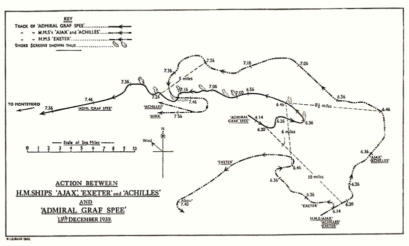

以下第一人称叙述依据史料重建，主视角是英国皇家海军南美分队指挥官亨利·哈伍德。

一九三九年十二月十三日，两艘英国轻巡洋舰在烟幕掩护下脱离战斗。重巡洋舰已无法跟上，德国装甲舰却还能以二十余节向西行驶。为何四天后，毁在蒙得维的亚港外的是德国军舰？这场发生在第二次世界大战初期的海战从南大西洋上的接敌写到十二月十七日德舰自沉，向前追溯决定接敌地点的部署。日期均用公历。除注明者外，海上时刻取哈伍德战报的舰队区时，比格林尼治时间晚两小时。港内外交时限另按当地记录。[^h][^g]

## 十二月三日，把一艘还在非洲附近的船画到南美海图上

十二月二日下午，英国商船多里克星号在南纬十九度十五分、东经五度五分报告遇袭。第二天格林尼治时间五时，又有一艘身份不明的船从前一位置西南约一百七十海里处发来类似报告。能收到第二份报告，是因为商船在被制止以前有机会发射无线电。我手中有的是两个位置和时间，德国舰此前从哪里来、以后往哪边去，尚待判断。在广阔海面追着一个已经过去的位置跑，一支巡洋舰分队很可能一直赶到对方下一次改变航向以后。[^h]

我按十五节巡航速度向前推算。一节是一小时行驶一海里。德舰可以在十二日上午抵达里约热内卢附近商船汇聚的海域，也可以在十二日下午或十三日上午抵达拉普拉塔河口外的交通汇合区。如果目标是福克兰群岛，则可能在十四日出现。十五节是拿来比较航程的假定，海上没有人不断告诉我德国人还在按这个速度行驶。舰长可以加速，也可以停下来搜查商船、接人、补给，甚至完全改道。比较三个时间的价值是能在三种风险中挑出一处，赶在敌舰有可能出现以前集结。（战报第2—3段）[^h]

我选择河口。这一带出入的船很多，其中粮食和肉类贸易尤其重要。商船到了大洋可以分路绕行，越靠近装卸货的港口，能走的航线越相似。若袭击舰也想接连找到有价值的目标，它要解决的搜寻难题和我相近，它自己的武器又容许它逐艘拦截缺少掩护的货船。我不必保证对方已经选中河口，便有理由先守在这里。判断错了，至少会保护一处值得保护的贸易区。将分队拆开，把巡洋舰平均留在三个可能的地方，判断对了的那艘也很难独力作战。[^h]

三日下午十三时十五分发出的信号调整了原有部署。坎伯兰号重巡洋舰留在福克兰群岛，照旧自行检修，保持能在短时间内用两根轴航行的状态。阿基里斯号从里约一带南下，八日到蒙得维的亚加油。埃克塞特号九日上午从群岛向河口来，一路掩护载有返程志愿人员的拉福尼亚号。旗舰阿贾克斯号预定在十日与阿基里斯号会合，另给埃克塞特号一个十二日早晨应该经过的位置。万一它没有按计划找到我们，届时再给它指示。（战报第4—6段）[^h]

油船奥林萨斯号也收到一项改变，它要留在海上会合区，暂缓前往福克兰。假若我让所有炮舰都赶来，却让本来可以提供燃油的船沿原方向走，接敌以后能保持高速多久就得听任各舰油舱作数。留住油船不会在开火的第一分钟增加炮弹重量，但一旦要盯着一艘能连续航行的大舰，不能等到需要加油时才开始找油船。坎伯兰号在检修，油船留在海上，三艘能够会合的巡洋舰按各自航程赴约。这是同一道命令里的事。[^h]

发过这组指示后，我们严格保持无线电静默。这样就得接受一个后果，途中有些事将由各舰按最后一次知道的任务自行办理。需要走长路的重巡洋舰有明确的时间和地理位置，两艘轻巡洋舰有自己的先行会合点，油船也知道等在哪里。不断向各舰确认到了没有，当然可以减轻旗舰对自己人的无知，却也可能把分队的位置和正在集结的事实送给对方。在一个侦察主要还靠海面视野、舰载水上飞机和偶然截获消息的战区，通信的次数同命令写得够不够完整有直接关系。[^h][^r]

十二日七时前，三舰已经集中。我把航线引向南纬三十二度、西经四十七度附近。在标注商船动向的图上，改走替代航线的船只在那里一时最为密集。沿岸固定的灯塔、岛屿和浅滩可以在任何一天的图上找到，这些商船在某一时段汇合形成的目标却每天会变。把巡洋舰驶向图上那个点，目的在于遇到能对商船造成最大损害的敌舰。沿着中立港口外缘等候，也有可能等到商船已经在离港很远处被截，港内仍不知道出了什么事。[^h]

在阿贾克斯号上，舰长查尔斯·伍德豪斯管本舰航行与战斗，还兼我的主要参谋。我指挥的另外两位舰长是阿基里斯号的威廉·帕里和埃克塞特号的弗雷德里克·贝尔。阿基里斯号属于皇家海军新西兰分队，此时和我们同用英国海军的信号与操舰办法。埃克塞特号有八英寸炮，两艘轻巡洋舰装备六英寸炮。口径是炮膛的直径，八英寸约合二百零三毫米，六英寸约合一百五十二毫米。各舰可以一起航行，可是到了发射距离，舰上最适于发挥作用的兵器和必须承担的危险会有区别。[^h][^m]

## 会合后的一个傍晚够练什么

十二日中午我向各舰说明遇上一艘德国装甲舰时的办法。无论昼夜都立即攻击。白天分成两个作战单位，第一分队由阿贾克斯号与阿基里斯号组成，两舰集中火力。埃克塞特号向不同方向分开，从另一方位作战，并为侧面观察弹着创造机会。到了夜间，通常各舰保持较宽的间隔一起行动。在地图上把三条航迹画成相隔很远的三条线，看起来能从更多方向射击，但是我要保住两艘轻巡洋舰一起打同一个目标的能力，也需要让重巡洋舰舰长能自己判断该走多远。（战报第7—8段）[^h]

从侧面看弹着有何用处？敌舰、自己和弹着水柱如果大致排成一线，常能辨出一轮炮打偏左或偏右，却难断水柱究竟起在敌舰前面还是后面。换到另一条视线上，有机会看出射程偏远或偏近。观察者还得把结论送到射击者那里。如果侧面的舰只恰好挨打、天线或舰桥失去联系，预期得到的帮助就未必会有。分队仍有第二层作用，即使不能互报弹着，敌舰也必须考虑它把重炮合在一处对付我方某一舰时，另一方向的对手会利用这段时间做什么。[^h][^r]

晚间我再发一项信号，说明碰上鱼雷威胁时怎样转向。平时可以让各分队按一定次序转到新航线。这次另约一项信号，让各单舰从后向前起转，以便避雷，同时有机会横过敌舰艉后。接到信号时不要留在友舰射线上，应驶向新领舰的后方。新的领舰自己决定怎样把距离维持在可以取得决定性结果的范围里。这样的命令不会预先告诉舰长明天哪一分钟要转，只让他看到当时悬起的信号就明白，转完后该跟谁、谁可以先开火。我们在十二日傍晚练了一遍。[^h]

我在旗舰上发动作战，各舰舰长须在自己的舰桥上把命令变成实际航向。一条队列若在敌舰来向正好交叉，排在后面的人有时明明已装填完毕，却不能让炮弹从友舰上空或舰身所在方向穿过。转弯时船头已经摆过去，舰尾还没有跟上，后舰也要选择转过前舰舰首还是舰尾。让每位舰长只等旗舰发下一组精确的舵令，会拖慢最应当自行闪开的那一艘。我们的演练只有一个晚上，这次演练首先要让舰长弄清楚，交战后哪些事可以自行决定。[^h]

## 十三日六时十四分，左前方的烟

十三日五时二十分，分队位于南纬三十四度三十四分、西经四十九度十七分。趁破晓最后一段时间又练过机动信号，随后恢复单纵队，航向六十度，速度十四节。阿贾克斯号领头，阿基里斯号居中，埃克塞特号在后。六时十四分看见三百二十度方向有烟。我让埃克塞特号接近调查。六十度是我们的航向，三百二十度是从我们这里看过去的方位，两者之间夹着一百多度。看到烟并不意味着正迎头开到德国人的炮口，我们还有改变相对方位的余地。（战报第9—13段）[^h]

六时十六分，贝尔报来初步识别，他认为那是一艘德国袖珍战列舰。这里指的是英国人常用的称呼，对手是以重炮打击巡洋舰和商船的装甲舰。又过两分钟，德舰开炮。由旗舰一侧看，它似乎把一座十一英寸炮塔指向埃克塞特号，把另一座对着我们。我所能凭借的是炮口方向、弹着与舰长报告，对于敌舰里面究竟按什么次序下达射击命令，此刻还没有其他说明。重巡洋舰已经在查明目标，确认需要作战不必等它回到原来纵队。[^h]

我给第一分队转向三百四十度的信号，向敌舰逼近。贝尔照前一天商定的办法独自转向西，最初航向约二百八十度。各舰加速。埃克塞特号在六时二十分开火，阿基里斯号二十一分，旗舰二十三分。三舰射向同一对手时，并没有在同一分钟、同一距离、同一角度同时打出理论上能打的全部兵器。我们首先要让可以瞄准的炮开始工作，然后缩短距离，让更多舰炮得到合适的射界。埃克塞特号这时与我舰分开，接下来将有自己的一场仗要打。[^h]

第一份敌情通报开始拟发，六时三十四分播出，此后又几次发补充报告。我们此前保持静默是为了避免让对手知道巡洋舰正集中到哪里，此刻敌舰已经目视发现我们，再要求静默便会让海上的英国商船和能从别处来援的人一同失去消息。一道电报能说明哪一刻见敌、在什么位置、往哪里走，其接收者却可能只能听到一段，或者要等另一个台站转发。海面炮战中十几分钟已经足够使两艘巡洋舰驶上不同航线，远方听到的敌情不会像旗舰舰桥这边一样新。[^h]

阿贾克斯号和阿基里斯号先各自射击，到约六时二十五分，舰与舰的无线电射击联络建立起来，两舰开始集中射击。集中射击的前提不仅是大家都朝同一艘船开炮，还得让火控人员知道哪组水柱属于哪一组齐射，哪些观测能用于修正下一轮。两条船的炮弹从各自舰上飞出，到落水已经过了一段时间。所在位置、当时航向和开火时刻稍有不同，即使方位很近，也不等于可以把两个测距误差当成一个误差一起修正。[^h]

在此期间我能看出埃克塞特号受到重炮攻击。起初敌舰炮塔似乎几度换目标，后来重炮集中朝向贝尔。第一分队则继续高速接近，帕里自行调整阿基里斯号的位置，尽量贴近旗舰而避开被遮挡的射线。从最初一道转向信号以后，到决定脱离以前，我没有沿途替两舰逐道发出改变航向的信号。这不妨碍在特定时刻要求阿基里斯号从我舰尾经过，也不妨碍命令加速。指明目的和保持危险海面上的每一次安全距离，本来就分属不同层级。[^h]

当第一分队不断取得较好的目标方位时，德舰的轻重火力并未都离开我们。它的副炮在两艘轻巡洋舰之间换目标，有些弹着已很近。要确定舰上正在使用的是哪套火炮，可以看射击的方向、齐射的规模、水柱和来弹节奏。正在接近的两舰都在运动，敌舰本身也可以把前后两组主炮交给不同的控制人员。对于我来说，对方具有再次分出一座重炮塔的能力，就足以使接近的航路带有危险，不必先断定刚才的每一发距舰身多少码。[^h]

## 六时三十一分至七时零八分，两条看不见的通信线路

约六时三十一分，阿贾克斯号接连三次遭十一英寸炮跨射。跨射是同一轮炮弹中既有近弹又有远弹，目标处在这些弹着之间。它不能自动计作命中，却明白显示德国炮手已经掌握一个危险的射程。第一分队略向外转以干扰敌方解算，然后又在六时三十四分左转，重新缩短距离。不断沿直线接近方便我方估测，也方便对方把已经跨中的目标打得更准。略转开再转回，换来的只是炮手重新估计的一点时间，若就此一直向外驶去，白日接近敌舰的原定目标也会一并放弃。（战报第18—21段）[^h]

六时三十七分，旗舰把水上飞机从弹射器上送出去，飞行员是爱德华·卢因。当时舰尾两座炮塔正朝前方射击，舰长要让弹射与射击都能实施。飞机一旦离舰，便有机会把本来重叠在海平线上的敌舰、烟幕、弹着分开看。空中有人看到结果与旗舰上有人能使用结果之间，还有一段无线电联络。直到六时五十四分，我们才收到第一份校射报告。那十七分钟里，不能因为飞机已经上天，就认为所有海面测距问题已经解决。[^h]

德舰在六时三十七分左右以很大的角度左转，借烟幕驶向西北。我舰与阿基里斯号先转向北、再向西，全速跟上，以重新取得有利方位，暂时放弃让全部主炮都能指向敌人的角度。从我们的观察位置可以确认对方改变了航向。究竟是我方重巡洋舰先前射出的鱼雷促使它转舵，还是两艘轻巡洋舰的集中射击也起了作用，写战报的时候我仍只能作为解释提出。作战中没有条件等待对方先说明缘故。它若继续向西北走，跟不上的舰就将退到不利位置。[^h]

同一段海面上，船的速度越高，敌我射线的夹角会改得越快。炮手想让整舷一起对着敌舰，指挥航行的人却得使船头更多地对准目标，才能缩短正在拉开的距离。舰尾炮塔有上层建筑挡着，没法隔着烟囱和舰桥向正前方发射。因而暂时不能使用舰尾火炮，是用舰艏争取更好距离要付的代价。两艘轻巡洋舰协同有利的一面在这里很实际，第一分队舰长能从前舰转向看出它要追什么方位，毋须让旗舰分心为每一座后炮塔找射界。[^h]

这一段，埃克塞特号仍在还击，旗舰却没有它全舰的损伤清单。它能转向，炮还在发射，火光能说明有些炮位仍能工作，却不能说明舰桥仍可以直接传令到舵机，也不能证明所有炮塔在同一套火控指挥下。它后来报来还能走多快和哪些炮位尚存以前，我须按两端分别打下去的现实使用手里的第一分队。若只凭它还在动就指望它能从另一侧按原定强度连续施压，轻巡洋舰会在敌舰转回炮口时付出代价。[^h]

约六时五十六分，阿贾克斯号与阿基里斯号转向西北，重新打开全部主炮可以射击的角度。德舰却屡次改变航向，从七时起大量使用烟幕。烟层能挡住目标上部的一部分，也能把两处本来距离不近的弹着遮得只剩水柱上端。我们已经收到了飞机报告，射击仍出现偏差。旗舰的炮火一度落得过远，直到七时零八分才重新找回目标。那时我能看见的是正在发生的结果，至于空中观测与两舰无线电之间究竟在哪一步出了问题，要等各岗位的记录放在一起才好说明。（战报第24—27段）[^h]

敌方航向和烟的方向也在不断变化。屏障在敌舰身后时，追击者可能还看得见它上层建筑的一角，却看不清舰体与水面的交线。看不清这一条线，就难判断某一团水柱是否在目标之前。空中校射的价值正来自观察位置不同，同时也使开炮者必须先分清空中所指的是自己的哪一次射击。没有观测只能冒着未知误差发射，采用错误的观测则可能把本来较接近目标的下一发主动调得更远。战斗并不在舰桥收到一条清楚消息时才推进，等待判断的一段时间里，弹药仍以齐射的速度消耗。[^h]

## 七时十分至七时四十分，一条少了主语的弹药报告

七时十分，敌舰距离第一分队仍有一万六千码。我让两舰尽最大速度向西靠近，即使为此有一阵只能用部分炮塔射击。一万六千码约合十四点六公里，对十一英寸炮来说仍是能有力还击的距离。两舰每多在这里停留一轮，付出弹药和挨弹的代价，却未必已进到能改变战局的地步。埃克塞特号在另一边打了将近一小时，若把能继续追的两艘舰也留在远处，原先分成两组迫使德舰分配火力的好处只会逐渐消失。（战报第28—33段）[^h]

七时十六分，德舰在烟后大角度左转，四分钟后又转回西北，把全部主炮转向第一分队。旗舰在约一万一千码的距离三次遭到跨射。它的副炮射击显得比较散，弹着多越过我们落在第一分队两艘舰之间。对面一套火炮打得不整齐，另两座炮塔仍能接连跨射。一艘装有不同火控系统的军舰，本来就可能在同一分钟一侧极其危险，另一部分失去准头。看到德舰舰身中部有火，也不足以判断它还剩多少能打穿巡洋舰的炮。[^h]

要使六英寸火力真正充分发挥，我们还得转到侧向。七时二十分第一分队向右转，让全部主炮对敌。到了七时二十四分，我判断敌舰可能维持西北航向向我方逼近，阿贾克斯号转向右，在约九千码距离上打出四条鱼雷。鱼雷离管以后需要时间到达预计的交会处，给定的是根据敌舰当时所走航线推算的提前量。对面如果循原航向，可能进入雷路。只要及早大幅转开，鱼雷就会从它原本应该经过的水面穿过。德舰随即大幅左转，约三分钟后折回西北。它是否亲眼看到了发射，当时只能推测。[^h]

在这几次转向之间，七时二十五分一枚德国重炮弹穿进旗舰舰尾上层建筑。结果很快显出来，舰尾两座双联装炮塔都不能使用。对一个在舰桥上指挥接近动作的人，这意味着前一刻才以转舵换取的齐射条件，下一刻便少去半数炮管。只要敌人能继续向西，舰尾炮位即使取得再好的射角也没有用了。中弹处的损管和伤员搬运要在舰上继续进行，但眼前也不能为弄清每一处下层机械破坏便停船让人检查。敌方距离还在很快缩短。[^h]

七时二十八分，两舰又向约二百六十度方向走，想再拉近距离。三分钟后飞机报告鱼雷正在接近，判断将从我们前面通过。我仍令转向正南，把目标移到自己的右舷继续作战，同时令阿基里斯号从阿贾克斯号尾后通过，使它被前舰挡住射线的时间尽可能短。面对一个只差一点便会被遮住的目标，后舰有动机向更有利于射击的一侧让开，而旗舰的第一需要是避开来雷。预先讲过单舰换位的用意，此时只要说明从哪一端过，帕里便能把自己的机动同旗舰接起来。（战报第34—40段）[^h]

敌舰在七时三十二分转向西，在烟幕下走曲折航线。到七时三十六分转向西南，它又能让全部重炮打我们。阿基里斯号的射击看来很好，旗舰也在用仍能工作的主炮。到三十八分双方相距只剩八千码，换成公制约七点三公里。我这时收到报告，旗舰可用弹药只剩两成，八门主炮中能开火的是三门。舰尾两座塔已经停止工作，舰艏第二座塔又有一套扬弹装置失灵。收到这一消息时，德舰仍能准确射击，从舰桥上看不出它已有足以使重炮哑火的损伤。[^h]

八千码比开火时近得多，也意味着对方重弹飞行的时间较短，舰桥发现它跨射后再用转舵干扰，并无头一轮交手时那样宽的余地。如果按两成弹药计算，继续用三门炮去压住能再度用全部主炮对着我们的敌舰，即使再命中几发，也可能让本舰在天黑之前完全失去进攻手段。我决定结束这一轮白昼近战，等黑暗再寻找接近机会。七时四十分，两艘轻巡洋舰施放烟幕向东转离。最后几轮敌弹中有一轮打断旗舰主桅上部，毁掉天线。舰上随即着手架设临时天线。[^h]

后来查清，两成说的是舰艏第一座炮塔的弹药情况，它已经连续射击八十余分钟。报告传到我这里时，我理解成全舰都到了这个地步。阿贾克斯号的另一座舰艏炮塔和舰尾炮塔本来就有各自的弹药供给，要把某处尚存的炮弹用到仍能打的炮上，也有运送和供弹的具体问题。然而在决定向东转离的那两分钟，我手里没有按各塔分列、并经核实的存弹表。我也没理由告诉没有接到那份原始报告的帕里，旗舰只是因为一项统计还没查清才转向。最先要传给友舰的是我们现在往哪里走。[^h]

德舰没有趁我方转向东而调头追逐。它稳在大致向西的航线上，以约二十二节朝河口走。向东拉开六分钟后，我率第一分队重新朝西，却把两舰分置敌舰的两个后侧方。阿基里斯号负责其右后方，旗舰在其左后方，距离约十五海里。这里亲眼看得出日间炮击与保持接触的区别。之前我愿意暂时失去部分炮的射界以换取接近，现在更多舰炮也许能指向敌人，但我要的是在足够安全的远处看见它改变航向。此时的能见度好，德舰高大的指挥塔在远处颇易辨认。[^h]

## 仍在射程边缘的一整天

八时零七分，旗舰的天线还未恢复，我让阿基里斯号代为向英国商船播发敌舰位置、航向和航速。此后旗舰按小时续报，上午和下午另有给海军部的通报。一艘商船若从本分队最早发报时的位置估算，到午间会与德舰实际位置相差一百多海里。商船的航速又往往远低于军舰，待真正见到陌生舰影才开始离开，转向这件事本身已经来不及使它远离。我们的炮尚未摧毁德舰，广播却能让一连串船长赶在相遇以前改变自己的行程。（战报第41—44段）[^h]

九时十二分，阿贾克斯号回收卢因的飞机，再接着跟踪。水上飞机能用弹射器离舰，归来时要先在海面降落，母舰选择合适航向，以舰上设备回收。这样做会中断本舰原来最适合跟踪的运动，另一艘的位置于是十分重要。两舰在敌舰两侧后方保有目视接触，即使旗舰为了飞机短时改变航行状态，帕里仍有独立的观察线。上午使用飞机时遇到过校射混乱，但到了这里，回收它能为天黑以后或敌舰进入河口再出动保存一项工具。[^h][^w]

九时四十六分，我给坎伯兰号发信号，命它从福克兰群岛全速赶向河口。该舰舰长沃尔特·法洛菲尔德先前只断断续续收到一些消息，自行在正午出航，收到明确命令便全速行驶。旗舰把信号发出去的钟点早于它离港，不表示舰长开航一定是由于已经完整读到了这条命令。远方听见不清楚的电讯、凭既有任务自行行动，和收到我的命令后加速，是战后把两边报告对在一起才能明确区分的过程。[^h]

十时零五分，阿基里斯号错估敌舰速度，与它的距离缩小到二万三千码。德舰改变航向，向它打了两轮各三发重弹。第一轮明显打近了，离舰还远，第二轮已在舰旁落水。两次之间的间隔使帕里认为对手有意先观察前一轮弹着再发下一轮。阿基里斯号全速转离并放烟，在较远处恢复跟踪。我们离开近战并不表示敌舰已因伤打不到这里，一舰只要按较高的敌速推算该保持多大速度，真正跑得较慢的对手就会在它还以为自己留足余地时拉近到有效距离。[^h]

十一时零四分，看见一艘商船在德舰附近停住，正在向外放蒸汽。随后在商船使用的频率上接到以旗舰战前呼号发来的消息，斯佩伯爵海军上将号请我们去接英国轮船的救生艇。如果海上确有落水者，单舰继续远远跟踪便会使他们留在船后。若分队为此完全转离，敌舰则可能利用这段时间消失。驶近后辨认出是英国的莎士比亚号，各艇都还吊在船上。它答复我的询问，表示自身安全，无须援助，并正在向南侧离开。愿意核实一艘具体商船的状态，是我们被派来这里的职责，也是跟踪过程中一次实在的时间开支。[^h]

差不多同时，十一时零五分，埃克塞特号来报，所有主炮塔都已失去作用，前部进水直到十四号隔舱壁，不过还能达到十八节。我让它按不会使隔舱壁承受过重压力的速度自行前往福克兰。之后它再报告舰尾炮塔上一门炮可就地射击。从外表上看，一艘尚能走十八节的重巡洋舰似乎还可以参加追赶。但是随着舰艏损坏，船头迎水前进会使受压的部位更难维持。只要保障浮性的舱壁顶不住，再有一门能打的炮也救不了船。给它的命令由舰上实际承受能力决定速度，不能把接报的十八节变成回程中必须保持的指标。[^h]

十三时四十七分，我通知驻布宜诺斯艾利斯的英国海军武官，德舰正向河口直去。此时联系岸上的必要性已经开始改变。白天还在外洋时，武官可以给当地商船提警告。若对手在中立港口停留，谁看见它何时起锚、驶哪条航道、是否补给与维修，就会成为海上分队难以自己取得的情报。一支船队能驶在敌舰两侧后方，但没有一艘可以同时停在蒙得维的亚港池内等着看它的缆绳。把目前所知告诉岸上，也是为接下来从岸上取得消息建立联系。[^h]

十五时四十三分，阿基里斯号又报告看见一艘舰，后来怀疑是装八英寸炮的巡洋舰。十六分钟后它撤销了报告，随后辨认出那是商船德莱恩号，流线形烟囱使它在很远处看似一艘德国重巡洋舰。倘若新来的是敌方重舰，继续分在斯佩伯爵号两后侧会有被各自击破的危险。可见从远处认出一艘正在跟踪的老目标与判断另一处新冒出的烟和轮廓，是难度很不相同的事。我们在能见度不错的大洋上也花时间更正过误判，此后港内看向外海的人所报舰名，同样不能自动当成已经查明的兵力。[^h]

## 入夜，跟在港外与堵住港门是两回事

到傍晚，对手直驶拉普拉塔河口的意图愈来愈清楚。十九时零二分，我让帕里在它越过洛沃斯岛向西后继续跟进，旗舰则到英格利希浅滩以南，以防德舰折回走南边。帕里可以利用靠乌拉圭海岸一侧的水域保持接触。他后来把阿基里斯号带到岛内侧，近岸跟踪。我们没有让两舰像白昼炮战时那样贴在一起，正因为地理环境变了。白天在海上只消驶在两个方位，转头就可以重新寻找高大的指挥塔。在有岛、有浅滩、航路可能分开的河口，敌人一旦转入另一条通道，原处的舰再快也要先绕出可走的水。（战报第46—52段）[^h]

十九时十五分，德舰转舵，朝阿贾克斯号打了两轮炮。当时相距约二万六千码，旗舰施放烟幕转离。第一轮落在近处，方向对准我们，第二轮落到转弯后留下的航迹里。近一小时内要发生的事，一边是把并不受我操纵的敌舰继续送进可以看见的水域，另一边是避免自己为了更可靠地看住它而受重弹命中。白天能在敌后保持十五海里的方法，到了航路收束、岸灯出现时还得由各舰随时修正。即使对手只打两轮，已经足够迫使一艘跟踪舰在重要时刻改变位置。[^h]

日落后不久，德舰又朝阿基里斯号打了三轮，最后一轮逼得很近。帕里还击五轮，看来形成过跨射，当时阿基里斯号刚驶过内格拉角。旗舰在另一边不能亲见他舰上每项操炮动作，只能依据其保持接触的通报安排自己的位置。二十一时十五分左右，乌拉圭炮舰乌拉圭号接近旗舰，像在执行巡逻，随后被我们留在后面。舰队作战图上又多出一个行为者，它有自己的海岸要守，也没有受我的命令去挡住德舰。[^h]

二十一时三十二分、四十分和四十三分，德舰还向阿基里斯号零星打了几轮。向东看已很难辨清目标，从阿基里斯号一侧望去，德舰先在西面的暮光中显出轮廓，后来又有蒙得维的亚灯光作背景。二十二时，帕里已跟近到约五海里。黑夜降临在同一片海面，两边能否看见对手却很不对称。此前我打算入夜后再接近，是希望取得白日没有的机会，现在有了光线优势，附近的浅滩和中立海岸又给交战设置了新的边界。黑暗本身不会把使用鱼雷或舰炮的机会送到每一艘船上。[^h]

二十三时五十分，我令两舰从河口撤出一点，按分属南北的扇区巡逻，天亮以后再向里走。德舰沿英格利希浅滩北面进去，十四日零时五十分停泊在蒙得维的亚锚地。它进去以后，我们有可能从岸上知道它停在哪里，同时也有可能被一条错误的出港消息引向不该去的航道。我的首要任务是让英舰始终留在它与外海之间，还要避免在黎明时让自己舰体被东边的天光衬出。不能因为刚才在灯光前看得清楚，就指望几个小时以后同一观察位置仍然合适。[^h]

## 十四日至十五日，少一艘重巡洋舰怎样守三条航路

十四日我请英国驻蒙得维的亚公使尽量使德舰推迟离港，建议让英国商船先开，利用军舰与敌国商船离港须相隔二十四小时的办法，为赶来的增援争取时间。我已经知道皇家方舟号航空母舰、声望号战列巡洋舰以及其他巡洋舰和驱逐舰被调来。这些舰中的远方援兵至少需要五天才能到。海军部已经调动它们，和今晚它们就能在浅滩外开火，中间差一个航程。港城每天流传着各种有关地平线外舰只的说法，我必须凭自己实际能给谁发战斗命令来安排夜间阵位。（战报第53—55段）[^h]

最先到的坎伯兰号说它能在十四日二十二时抵达，行程用了三十四小时。我让它负责鲁昂浅滩和英格利希浅滩之间，阿基里斯号在它北侧，阿贾克斯号在南侧。它替回了八英寸炮这一层火力，却没有使舰数从三艘变到四艘，埃克塞特号正驶向修理地。有它加入时，先碰上敌人的一舰要设法跟住，其他舰在外侧足够远、可以协同行动的水域集中。若把三艘各贴在一条航路的最窄处，也可能只有其中一艘与德国重炮交手，另外两艘虽在图上离得近，却被浅水隔在别处。[^h][^w]

十五日奥林萨斯号奉命到鲁昂浅滩一带，旗舰前往加油。坎伯兰号上前在北面保持目视距离，掩护正在与油船作业的旗舰。港内突然起锚的消息倘若没有及时传到，北面的警戒舰仍可能在德舰接近加油处前给出警报。当天实际天气不利，缆绳断裂，连粗缆的连接部分也出问题，阿贾克斯号只接了约二百吨油便离开。这是三日部署时特意留在海上的油船，到了真正需要时它确已在约定地点，能否把需要的油全部接到舰里，还得看两艘在波浪中相对移动的船能维持多久。（战报第56—59段）[^h]

十五日十一时三十五分的新命令明确提出，目标是摧毁敌舰，为了能集中兵力，可以接受它有较大机会逃脱。阿基里斯号守英格利希浅滩以北，重巡洋舰在浅滩以西，白天让蒙得维的亚方面可以看见它。若德舰在当晚二十一时以前离开，先发现的舰在最远的可视距离跟，各舰向它集中。若到了二十一时对手还没有走，我们按时间离开原先的岗位，到圣安东尼奥角外会合。两套安排是根据可见光线和互相会合所需时间设的条件，不能等德舰实际出现才开始商议。[^h]

夜间若要让坎伯兰号的飞机继续盯住德舰，还得考虑它在什么地方能降落。我的命令容许必要时在背风处降落，承担落入中立国扣留的可能，次晨再试图同英国船联系。若原定办法落空，还有次日晨在指定经纬度会合的后案。飞机挂在弹射器上时是一项随时可用的装备，一飞出去就有机组、燃油、夜间寻找母舰和海面降落的全部限制。把最坏情况下怎样找回友舰解释在先，才可能让机组把余下精力放在真正需要报告的敌舰上。[^h]

十五日白天得知德方已经派出送葬人员，又听说它获准继续停留作适航修理，总时限为七十二小时。关于中弹的报告从岸上传来，有说多达六七十发。我眼前所知仍是十三日它还能向二万余码外准确还击，而且一路驶了这么远。真正受到哪一类损害不能仅凭命中总数决定。十九时英国商船阿什沃思号出航，德方接受在它出港后二十四小时内暂不能离开的约束。这个结果对我有利，仍不能保证下一夜就不必巡逻。遇到德国舰长决定违反时限时，最先承担后果的终究是港外的船。[^h]

## 十六日至十七日，起锚的消息到了

十六日零时三十分，三艘巡洋舰在圣安东尼奥角外会合。天将明时向河口接近，旗舰放出水上飞机侦察港内，要求它不要飞越领水。八时三十分机组返回，说能见度太差，一无所见，在汽笛浮标一带还遭到射击。可能的解释之一是斯佩伯爵号正趁雾突围，我让舰只进入战斗岗位。蒙得维的亚不久即来报，德舰仍在港内。我通知英国公使飞机遇射的事，提出调查也许能推迟德舰开航。他回复开火者肯定不是斯佩伯爵号，可能是阿根廷警戒炮舰，究竟是谁仍有疑问。（战报第60—64段）[^h]

海军部给我在三海里界线外与敌舰交战的自由。越过一条距离线只是获得许可，射出炮弹是否合适还要由我决定。若在蒙得维的亚近海贴着这条线同敌军交火，舰只没多少机动余地，远弹还有可能落到乌拉圭境内。我把巡逻区移到英格利希浅滩北面和东面。这样在海图上看像是给港门留出更多空间，但在那里可以让坎伯兰号的八英寸炮一开始就有射界，也可以根据对方冒出来的位置集中全队。为在敌舰离港的第一分钟看见它而把自己放在不能安全打它的地方，违背了我这次部署的用意。[^h]

十六日下午十六时十五分的形势判断列出对手可走的方向。它可以走英格利希浅滩以北，可以从英格利希与鲁昂两浅滩间出去，也可以从鲁昂浅滩与圣安东尼奥角之间走，走上任何一道还可以折回。我打算靠岸上消息获知起锚时刻和最初航向，此后靠坎伯兰号的飞机报后续动向。舰队保留在东面，根据时刻和所得消息从一处移向另一处。两支作战单位间隔约八链，阿基里斯号跟在旗舰舰尾，交火以后各分队可自由机动。一链约为十分之一海里，这样的间隔首先是为重巡洋舰的火线留出位置。[^h]

十七时又有一艘英国商船邓斯特格兰奇号离港，英方要求再留出安全间隔。另外的消息称德国人维修进展很快，随时可能离开。两件事并不互相否定。前一个消息关乎乌拉圭怎样要求它，后一个关乎它能否行动。入夜后，分队在英格利希浅滩灯浮东面五海里沿南北线巡逻。油船先往海上去，约好如果德舰还没突围，次晨到鲁昂浅滩。只要港内的船还有自行开动的能力，我便得保留一艘能较快接敌的舰，同时把下一艘将缺油的舰列入次日安排。[^h]

十七日上午轮到阿基里斯号加油，其余两舰在看得见的距离上警戒。下午三舰一起巡航，预备再守一个夜晚。消息说德舰已将借用的焊接器材送还岸上。这样一个动作最能说明的是某项修理工作已经停止，接下来可以是出战，也可以是放弃舰只。十五时四十分，传来约三百至四百人转到停靠在外港附近的德国商船塔科马号上的消息。十七时二十分的新报告把已经转移者增加到七百以上，还有个人行李和部分给养。判断德舰可能准备自毁，到这一步才有了更直接的根据。（战报第69—76段）[^h]

随后是起锚的报告。我转向汽笛浮标，把航速加到二十五节，让阿贾克斯号的飞机前出，同时查明斯佩伯爵号和塔科马号的位置。报告称德舰于十八时十五分离港，缓慢向西，商船随后跟出。我令全队保持最高一等的战斗准备。卸掉并非作战所必需的人员，可以为全舰弃船作准备，也可能为一次预期伤亡很重的突围减轻负担。只要两舰还靠得近，甚至不能完全排除在港外重新转运人员。这一刻能证明两艘船正往哪里走，仍未证明舰炮将不再向我们开火。[^h]

飞机看见斯佩伯爵号在蒙得维的亚西南约六海里的浅水区。二十时五十四分，机组发来敌舰已经自行爆炸的信号。分队从英格利希浅滩北面继续驶向港外，旗舰在接近全黑的条件下收回飞机。随后打开航行灯，驶过汽笛浮标，距燃烧的残骸约四海里。直到可以放下防备，把照明方式从作战改为航行，这支数日来随时准备再次交炮的分队才结束了针对德国舰突围的行动。舰长们还要处理伤员、燃油与修理。次日坎伯兰号留在巡逻线上，两艘轻巡洋舰去加油，随后驶往福克兰。[^h][^w]

## 战后复盘　四艘军舰各自在打什么仗

哈伍德最早收到的那份商船电报，也到了德国人的战争里。对英国，这是能在海图上确定袭击舰位置的破绽。对德国，一艘货船把遇袭或位置报告送出去，留在附近继续寻找下一个目标便越来越危险。破坏海运的价值来自一次出航期间能在不同地方给对手带来的损失，一旦袭击舰的位置众所周知，货船会改变航路，巡洋舰会向这里赶。在大洋上能使敌人分兵的舰，到一个出口固定的港内就会替敌人解决如何集中兵力的问题。这一前一后的变化，解释了为何十三日的海战必须连着十七日港外的结局一起看。[^r][^g]

一九三九年欧洲战事开始前，德国已经把这艘装甲舰和补给船阿尔特马克号派入大西洋。海军希望它给英国航运施加压力，尽可能避免同军舰作无益的交战。破交作战有两部分收益，沉掉的船舶和货物是看得见的一部分，为寻找袭击者而不得不在遥远海区调动的军舰则是另一部分。前者有时可以从沉没商船清单上查到，后者即使没有一发炮弹打出去也已经产生。柏林并没有一座设在南大西洋、能随时给军舰换炮管补主炮弹的海军基地，远离这种支援去交战会改变全航次余下的可能。[^g][^r][^m]

这也说明为何兰斯多夫舰长能在击沉货轮后取走人员，却要为他们找到去处。遇上商船先行拦检、转运船员或乘客，耗去时间，舰上还多了需要食宿、看管的人。补给船有时接收这些人，兼负供应舰队与运走俘获人员两种作用。到了最后一次会合，德舰将多名俘虏交给阿尔特马克号并取油，此后又截到从蒙得维的亚载小麦返航的英国轮船斯特里昂斯哈尔号。它碰上的这条航线直接显示河口贸易值得一找。但敌对商船也可能发报，把寻找它的巡洋舰引向同一片水面。[^w][^r]

双方并非把一个完全相同的问题摆在各自地图上。哈伍德要保护的船多，三艘巡洋舰无力守住南美沿岸每一个出口，却有英国在当地的海运情报网络。兰斯多夫只要抓到没有护航的一船货物，就能让这个航次的作战清单增加一项。可一旦受了影响远航的损伤，不能就近加入另一支德国舰队。在南美见敌时，英国巡洋舰可以把一艘伤舰送走、从福克兰群岛把替代者叫来。德舰的最高机动力、重炮与装甲都集中在同一具船体上，无论哪一处被迫入港，其余部件也只能一起停下。[^r][^g][^h]

| 十二月十三日晨的单位 | 指挥与位置 | 主要可用火力及任务 |
|---|---|---|
| 阿贾克斯号 | 伍德豪斯上校，哈伍德准将旗舰，纵队首舰 | 四座双联六英寸炮塔，组织第一分队集中射击，放出校射机 |
| 阿基里斯号 | 帕里上校，纵队第二，属皇家海军新西兰分队 | 同为八门六英寸炮，独立避开友舰火线，后来在德舰右后方跟踪 |
| 埃克塞特号 | 贝尔上校，原在队尾，随后向西分出 | 三座双联八英寸炮塔及鱼雷，担负另一方向的进攻 |
| 斯佩伯爵海军上将号 | 德国海军上校汉斯·兰斯多夫，独舰 | 两座三联二十八厘米主炮塔，八门十五厘米级副炮及鱼雷，执行破交 |
| 坎伯兰号 | 法洛菲尔德上校，十三日晨尚在福克兰 | 重巡洋舰，十四日夜间到河口，替补已退出的埃克塞特号 |
| 奥林萨斯号与阿尔特马克号 | 分别服务于英方与德方，均未参加十三日主炮战 | 前者此后两次给英国轻巡洋舰供油，后者此前接收过商船人员并为德舰补给 |

*表内炮数是接战前的装备，实际在同一时刻能开火的炮数随航向和受损情况变化。*[^h][^w]

两国战报采用了方便自己读者的口径称呼，德舰二十八厘米级主炮在英方报告中称十一英寸，十五厘米副炮常列为五点九英寸。英国战列巡洋舰声望号若到场，携带的又是另一量级的重炮。把德舰俗称中的“战列舰”三字直接拿来比较，就会忽略这艘舰设计上要做的事。它能用明显重于八英寸的炮弹与巡洋舰对射，靠柴油机支持远航，有限吨位里却装不下真正战列舰全套防护。十三日晨轻巡洋舰打出的炮弹即使不能把主装甲区打穿，也能破坏位于防护区之外、同远海生存有关的部位。[^w][^g]

若只按齐射重量计算，英国三舰理论上能合用十六门六英寸炮、六门八英寸炮。德国仅六门主炮，每发却约重六百七十磅，此外还要算能向交战一侧射击的副炮。只作数量级比较，一发德舰主炮弹大致相当于好几发英国六英寸炮弹的重量，后者的优势则是可以较快再装填。真正落到贝尔舰桥附近的，是单发弹丸爆破后向上、向后铺开的破片。真正落到兰斯多夫舰上的，是多处不必穿进主机舱也会让它停止远洋巡航的损伤。把双方开战时炮管数列齐，尚得问清打的距离、可用射界、落到哪里，才能说明有什么战术后果。[^w][^h]

## 埃克塞特号从前桥转移到舰尾的十分钟

*英国政府出版物中的交战航迹图，附指北针与海里比例尺。图右下是英国分队发现烟迹的位置，左下是埃克塞特号退出的方位。粗线代表共同机动的两艘轻巡洋舰，读者可沿各线标注的时刻比较同一分钟的舰位。*[^map]

把钟拨回十三日六时二十分。埃克塞特号开始用前面四门八英寸炮射击时，约距敌一万八千七百码，舰尾一对炮又过了两分多钟才取得射界。第一次朝德舰驶去辨认，使它较早能开火，却没有因此让全舰最初就处于最优的侧向射击位置。德国人的较重弹丸已朝它飞来，战史把约六时二十三分的一枚近失弹记在右舷一带。它在水面爆开，破片杀伤右舷鱼雷发射部位的人员，打坏通信和探照设备，舰上飞机也受到破坏。杀死一个鱼雷岗位的人未必使鱼雷管本身永远不能用。管上的机械还能工作也并不保证舰桥可以沿原来的线路指挥发射。[^w]（战报第14—17段）[^h]

约一分钟后，埃克塞特号已打出八轮，第二座前主炮塔正面挨了一枚重弹。塔不能再开火，横扫过去的破片还打到舰桥，贝尔与少数军官以外，原来在那里的人员大多伤亡。操舵通信断了，下部指挥位置接管。船还在向前走，舵也并未必被炸死，只是站在前桥看得见敌舰的人，失去了借助原设备去控制舰艉那副舵的能力。在一艘正高速转向的军舰上，比损失两根炮管更为紧迫的问题，很可能是下一分钟连最后面那对完整的炮也将被本舰舰体挡住。[^w][^h]

鱼雷军官史密斯在冲击下倒地，恢复行动后发现舰首已在向不利方向摆动，设法把命令传到下部指挥位置，使舰转回。贝尔本人决定把指挥转到后部，一路过去才发现到了那里也没有完好的通信可以使用。接下来的做法是把舵令送往舰尾操舵处，中间用人员接力传话。此时舰长、炮术军官和掌舵者依然在同一条船上，相隔远不到海上舰与舰之间的距离，可一条被炸断的线路造成的延误，已经不亚于分队旗舰给它发不进来的一道信号。能找到接收命令的人，能沿还可通行的地方把话传给他，再听到实际执行的回应，船才重新具有可控制的航向。[^w]

后部指挥位置附近还有本舰末座炮塔开火时的冲击。受损飞机漏出的汽油又洒到这一区域，构成实际的起火危险。舰员把损坏的两架飞机推入海里。这意味着该舰从此失去自属空中侦察、校射能力，也使继续与德舰交战的人不至于在一处被汽油淋到的指挥部位旁等爆燃。与此同时阿贾克斯号的飞机却即将离舰，后来还会从空中来看贝尔处境如何。同样列在各舰装备表中的水上飞机，战斗一刻钟里一边变成负担，另一边变成分队唯一正在空中工作的眼睛。[^h][^w]

六时三十二分，埃克塞特号用本地控制操作右舷鱼雷，随后敌舰转向。约六时三十八分，它又大角度向右转，让左舷鱼雷得到射界。这一时期再有两发重弹命中，一发使最前方炮塔也停转，另一发在舰中部的军士长住舱一带爆炸。舱内起火，水管爆裂，四英寸弹药库进水。若不注意管路与舱室的关系，会把损失全解释成敌人在水线上轰出一个洞的结果。实际上水还可以从本舰被打破的系统流进本不该进水的舱室，灭火、隔离、维持供电因而成了相互牵制的几项任务。[^h][^w]

此时从阿贾克斯号飞机上望过去，重巡洋舰一度整个没入烟火，观察者担心它已经完了。它又从烟里驶了出来，只剩后面一座主炮塔可在本地控制下射击。炮术军官詹宁斯在后部探照灯平台指挥这两门炮，舰长回不到原有指挥系统，陀螺罗经的复示器也不能用了，改用小艇罗盘。只利用尚在运转的部件，可以使一点火力在计划之外继续存在。它已经无力按演练时的方式帮助另一分队判读弹着，但对方若把所有重炮拨去打轻巡洋舰，就要承受这两门八英寸炮从旁边继续射来的可能。[^w][^h]

埃克塞特号当时向右倾斜约七度，舰艏下沉，舰长需要用航向让仅存的炮一直够得着对手。留在舰尾的是一座可以转动、却仍需得到动力和弹药供应的炮塔，舰上其余主要部位多在前面。受水浸影响，约七时三十分这座炮塔的动力也中断。它只能向东南慢航，把抢修和使船能够安全航行置于首位。其后来报告有一门炮又能就地发射，恰好显示“全炮不能用”也有具体时刻。若把十一时收到的整舰情况搬到七时，就会看不见这艘舰如何在一段相当长的时间里边受损边作战、最后才退出。[^h][^w]

炮战结束后的海面距离拉远，旗舰还曾让飞机传意，请埃克塞特号靠拢。分队向一艘已经失去中央控制的舰发布指示，与这艘舰能否安全复归队列，再次成为两件事。维修人员要先处理水密状况，通话恢复前要把情况送到舰长手里，舰长才可能报告主力锅炉、可用舵和最高安全航速。它能在中午以前告知自己尚具航行能力，并非从开始就稳操的结果。倘若只把八十二分钟写成三艘巡洋舰围打一舰，失去的正是重巡洋舰在多数时间里怎样逐步耗尽、又使自己师友还能利用的一部分战斗力。[^w][^h]

## 一发没有碰到舰体的炮弹怎样打乱了空中校射

六时四十分，十一英寸弹在阿基里斯号舰桥侧前方的水面爆炸，破片穿入主炮指挥塔。这里集中了测距、判断弹着和传达射击诸元的人。炮术军官理查德·沃什伯恩被打伤，短时间内头脑受到冲击，他让后部备用指挥位置接替。舰桥上的帕里也受伤，一度发现火炮未对准目标，须用通话管查问火控岗位到底出了什么事。从设备表上说，德国人并未直接把四座炮塔中的任何一座打掉。从射击程序上说，一个集中许多人手的小舱遭到破片击打，足以在几个关键齐射周期里使整舰八门炮的射击难以维持。[^w][^nz]

沃什伯恩的记录具体到哪些人还在岗位上。两名无线电人员受了致命伤。担负变化率测定的瓦茨帮助伤者，轮到仪器需要他又回去操作。观察弹着的特林布尔负伤后仍留在岗位。医疗人员来抬伤兵时，塔的右侧门被破片打得卡住，搬运本身另费力气。指挥塔的结构主体还能用，幸存者重新承担死伤人员的任务，几分钟后恢复控制。伤员能否及时出去并不能简单按军医人数计算，纵然医护人员已在门口，那扇卡住的门仍是伤员与下一级救治之间最实在的障碍。[^w][^nz]

十来分钟内发生了两次不同性质的转换。一次是本舰主指挥位置不能正常工作，由备用位置接替，又把工作交回。另一次是阿基里斯号用于同阿贾克斯号集中射击的无线电接收能力衰减，大约从六时四十六分起只能独立打。恢复本舰中央火控，只能解决全舰各炮能否按照同一套诸元工作，未能自动修复跨舰联系。正因为人们很容易把听说“火控恢复”理解成一切恢复，第二种问题会从一艘舰内部扩展到两艘舰之间，使无损的设备也参与制造错误。[^h][^w]

独立射击初期，阿基里斯号在确定方位线上有困难，炮弹一度落得很近。空中的飞机看见这些水柱，向旗舰报告需要如何调整，阿贾克斯号的火控人员却以为集中射击仍在继续，把所报偏差用在自己的炮上。于是本来已经偏近的弹群还在那里，另一些炮弹却越过了敌舰。空中有人看到了真正的近弹，舰上照收到的情况改正，两边每一项单独判断都有理由，组合起来却把下一轮射击调错了。七时零八分以前那段没能有效把握住目标的时间，由此得到可追查的解释。（战报第24—26段）[^h]

这不是后来才出现的抽象通信理论，炮手承担着可以计数的后果。阿基里斯号炮塔人员在交战以后才知道其中一塔用了二百八十七发，远超他们自己当时印象中打出的轮数。连续装弹的动作、楔闩的启闭、炮弹和发射药的传递，在前一轮未必有好效果时也要一次次做完。对下面的炮班来说，炮位确实在按命令放出弹丸。对旗舰来说，除非知道这些弹丸的落点究竟属于谁，最快的射速也可能只让错误更快地延续。新西兰战史记录的这组基层材料，给集中射击的失败补出了海图上看不到的物资与人员开销。[^w]

同样的协作在动力舱里反而表现得相当顺畅。阿基里斯号从巡航逐步开到全功率时，四根轴平均每分钟约二百八十三转，轮机读数合计约八万二千马力。锅炉舱有年轻司炉兵以前没在舱下经历过全功率航行，舰炮开火的冲击会扰动炉口火焰，维持燃烧和通风仍要靠人员照管。相比之下，埃克塞特号有锅炉舱因附近重弹爆炸失去照明，破片由进风处下来，电缆损坏，指令要靠人送。两舰都在要求马力，执行者面前却一边是系统完整而工作强度骤升，另一边还要在设备受损之中保持响应。[^w]

再看旗舰那枚使两座尾炮塔同时停转的炮弹。弹丸穿过若干舱室和第三座炮塔的下方结构，毁坏机械，最后在准将住舱爆炸。炮弹底部碎块又打到第四座炮塔座圈附近的转动装置，把它卡住。统计时可写一发重弹命中、两座炮塔失效、四门炮退出。对修理方则是两个不一样的问题，一塔下部机械遭严重破坏，另一塔因局部部件损坏而不能转动。再加上第二座炮塔一侧扬弹故障，才成为七时三十八分只剩三门的战术事实。全舰弹药还有多少与这三门炮实际能用上多少之间，在此形成另一道不能省略的差别。[^h][^w]

舰队脱离后，埃克塞特号独自回港，阿基里斯号继续追到夜里，旗舰尾炮塔则不可能因重装了天线就重新转动。若从表上把三艘英国军舰全算作“幸存”，便看不出各舰此后几天还有多大的行动余力。反之，若认为十三日早晨未能击沉任何一方就没有军事结果，也无法解释德方为何要在当天自行停止破交、为何英方不得不把检修中的坎伯兰号调来。海战在第一阵炮声停后已经改变了双方能选的任务，毁船这件更引人瞩目的事到十七日才发生。[^h][^g]

## 来到蒙得维的亚的德国战报

德方如何叙述最初的接敌？新西兰官方战史所采用的德国叙述说，最先认出一艘巡洋舰，另两艘被当成驱逐舰，兰斯多夫推测有船队在附近，决定趁对手尚未加到全速迅即接近。英国方面看到的正是对手朝三舰靠过来的动作。交叉对照可以把这两件事合在一起，但要留意识别的时点。后来德国舰上有人当然知道对手都是巡洋舰，知道得越来越清楚的时候，距离已经同最初看到三处舰影时不同。不能把柏林以后责问舰长为什么放过埃克塞特号，倒推成它付诸进攻的第一分钟便应掌握对手整套作战方案。[^w][^r][^g]

对方是两艘驱逐舰，还是两艘各装八门六英寸炮的轻巡洋舰，对破交舰有截然不同的意思。如果是驱逐舰，远距离炮战时主要对手可能只有一艘重巡洋舰，迅速压倒它便有机会接触船队。不过若让驱逐舰闯进鱼雷射程，舰长又不能只顾着与重巡洋舰对射。如果是三艘巡洋舰，任何一艘都能边跟踪边播发敌情，还可能从另一个方位发射能威胁上层建筑的炮弹。十三日德方在真正识别之后几次转移主炮目标，与英方预先设计的两个方位相遇，给炮术效率加上一个很具体的负担。前塔和后塔都向同一目标射击比较容易统一观察，分打两处就要保持两套不断变化的距离资料。[^w][^h]

兰斯多夫在接敌后的初报写本舰受到十五发命中，贮藏食品的部位和厨房被毁，决定驶入蒙得维的亚，见于德国海军作战部门当月战争日记。这是司令部当日能收到的简报。新西兰战史后来引述的德方战斗记录列二发八英寸、十八发六英寸命中。新西兰海军博物馆的综述又采用二十三次命中。十五、二十和二十三都与几天后传到哈伍德手中的六七十相去很远。存在先后盘点、统计破口或命中方式不同的可能，缺少逐发损伤图和共同标准时，很难把它们裁定为三个可以互换的最终结果。[^g][^w][^m][^h]

资料对其中几项损害有比总数更具体的共识。舰艏破口在有大浪时进水，前部光学瞄准设施受损，弹药已有消耗，许多用来维持全员伙食的设备被毁。德舰轮机并非当天就不能驱动螺旋桨，它向西的实绩、突然转舵的能力和主炮多次还击，都能由对方观察证实。若要从南美穿过大西洋、甚至进入北大西洋冬季海况，适航性这个词就有比“今天能开到港口”严格得多的含义。旅程长度将一项能暂时绕过的故障变成累积负担，破口还可能在下一个海况恶化时增加进水。[^g][^w]

有关它的燃油，流传很广的一条解释把全舰困境集中在燃料处理设备上。新西兰海军博物馆强调蒸汽设备与燃油处理之间的关系，新西兰国防军的纪念文章采用只余十六小时可用油的说法。德国指挥机关收到的较详电报另列舰壳、光学、厨房和面包房、主副炮弹药与重高射炮等问题。参加评估的人认为在当地现有条件下，需要大约两周才能使舰恢复适航。列出的问题有些关系到第二次交战，有些关系到出洋后很多天的生活。一条关于可用油时数的说法，既不能从航行了一天便推翻，也不足以独自确定何时必须弃舰。尤其不能把“某种设备处理后可直接使用的燃油”与“舰上所有舱里还有多少燃料”当成同一个数量。[^g][^m][^def]

主炮剩弹也有口径差别。新西兰战史所引德方报告称还余三百零六发，约为原有数量的四成。海军博物馆称打了四百一十四发以上，并采用约耗去七成的说法。两者未给出完全相同的分母和逐库清册，本文不据此算一个折中百分数。对于舰长，主炮还能齐射，和能不能指望用这些弹药打过港口外的敌军、再对付航路上下一次截击，是两个层次的判断。对英国追踪者来说，只要德国舰上还有足以实施几轮准确射击的弹药，就必须留出距离。对德国舰长来说，只算眼前交战要用的弹药还不够，往后每一次遭遇都得从同一批库存中支取。[^w][^m][^g]

十二月十六日当地凌晨，兰斯多夫向上级报告，除巡洋舰与驱逐舰外，皇家方舟号与声望号也在夜间严密封锁。他把强行出外海回国判断为不可行，提出若可用余弹闯向布宜诺斯艾利斯便尝试，否则请求裁示，在无望伤敌而本舰必毁时，可否在河口浅水自沉，或者接受扣留。由这个电报可以确证，重舰已经到场这一错误情报进入了决策。不能据此确证一通假电话或一个人故意透露的消息就是造成判断的全部原因。岸上有人确实认出坎伯兰号，舰上的炮术人员还有自己看见声望号的报告。部分识别正确，能使夹在同一批消息里的错误识别显得格外可信。[^g][^m]

英国海军调重舰来的消息也并非全是假话，只是这些舰尚在途中。德国主力舰一旦离开中立港，究竟在港外第一道线上遇到什么，与它在下一次穿越航路时会遇到什么，仍有差别。英方最成功的疑兵效果，在于让未来可能赶到的力量提前在德国人的当前作战图上占了位置。舰长若相信要与舰载机和战列巡洋舰的重炮同时交手，轻巡洋舰尾塔被打坏的已知事实便不再那么有价值。德舰当时无法用自属飞机核实远海敌情，又要在限时内使用岸上与中立国消息，纠正错误的机会就比产生错误的途径少得多。[^g][^h][^w]

柏林十六日的答复同样有先后条件。尽力争取延长停泊时间，赞同舰长电报里关于尝试去布宜诺斯艾利斯的安排，拒绝在乌拉圭被扣留。倘若实行自沉则须保证破坏彻底。德国海军作战部门的讨论显示，浅水中留下容易被对手勘查的舰体很不理想，尽可能先给敌人造成损害也是一种考虑。这些意见并不组成一道规定几点在某地爆炸的具体命令。兰斯多夫仍须在当地作出执行选择。战后若只说希特勒命令炸舰，就会把他所受的限制、上级允许的若干动作和最后由谁实际作决定混成一件事。[^g]

## 乌拉圭怎样计算自己的期限

蒙得维的亚港务人员、外交官、海军技术调查人员和港内各国商船，实际又形成了一个不能由英德两方任何一方独占的战场条件。舰长想要约两周修理时间，英国公使最初却力陈德舰仍具航行能力，希望它很快离开。海上哈伍德的需要正相反，他盼它留到增援能到。把英国方面对外的一切说法合起来，容易让人以为伦敦从头到尾都在按一个剧本延长时限。实际上，在中立国维护自己的贸易与法律立场，同在浅滩外只有两艘受过打击的轻巡洋舰，足以使两位英国负责人首先看到不同风险。[^m][^h][^u14]

海图上还有一条不能与三海里领海边界混淆的线。战争刚开始，美洲共和国在巴拿马会议上提出，各国保持中立期间，不希望与欧洲战争有关的敌对行动在美洲附近、对区域贸易至关重要的海面发生。这片安全区远大于乌拉圭领海。英国军舰驶离岸炮可能误伤陆地的距离，不等于它的行为自动得到所有美洲国家理解。反过来，美洲国家提出共同安全主张，也没有在每条商船航线上放一艘本国军舰，可以当场使欧洲交战双方停火。双方争论的根源在于有几条不同的线同时经过作战图，每条线背后各有不同的执行能力。[^pan]

十五日华盛顿发给各驻美洲国家使团的通电，建议就炮战讨论发表共同声明，并送去一份草案。美国人认为若不迅速抗议，先前的安全区宣言可能失去意义。草案另一方面保留了“据报”的意思，特别是究竟哪艘商船正遭德舰追截、是否由此引发炮战，仍待查明。这些语句把即时海军行动带进另一种讲究证据的工作。哈伍德从烟迹判断可能是德舰便得在几分钟内下令转向，各政府若要据此确定首开事端者以及该向谁交涉，就需要分清商船报告、外交人员听来的经过和军舰司令送回的记录。[^pan][^h]

次日给驻巴西大使的另一份电报把这个次序说得更具体。先表明各国重视安全区，再谈查清责任以后是否联合向德国抗议，以及将来德国军舰若重犯、进入美洲某港时如何处置。它提议讨论的是此后如何行动，并未追认任何一艘英国军舰有在蒙得维的亚港池里自行解除德舰武装的权力。对乌拉圭而言，与多国交换意见有助于使一个小国免于单独承担强制力量不足的压力。对哈伍德而言，多国正在讨论同一个港口，却不会替他的舰队多堵住一条深水航道。这是外交文件补足战报的地方。[^brazil][^u16]

十四日美国外交人员与华盛顿的通话中，记录有乌拉圭方面起初允许四十八小时、必要时或可因修理再行延长的说法。电话中一些海战消息来自英方使馆和当地消息来源，还有误把埃克塞特号说成正在护航一艘法国商船的情况。它显示港内观察者很快看见一艘德国大舰泊在眼前，却不必因此就能说明十三日晨几百海里外发生的每一次交火。到十六日夜乌方同美方讨论时，谈的是次日晚八时这一具体期限。把早期交换意见时的四十八小时和最终期限区分开，两份电报就能帮助读者看懂政策怎样一步步确定。[^u14][^u16]

一九〇七年关于中立国在海战中权利义务的海牙第十三公约给当时的争论提供了用语。允许恢复适航性与禁止提升战力可以同时成立，修到哪一步应由当地当局认定。另一项规则限制交战国军舰在敌方商船离开同一中立港口或锚地后二十四小时内起航。英方持续让商船出港，既有可实际出发的一条船，也有可以诉诸的一项规则，二者合起来才可能多出一夜等待时间。若已经接近乌方设定的最终期限，则不能简单把每次出航都加二十四小时，机械算出德舰可以无限期停泊。最后是否批准、若不遵守怎样处置，仍须由掌握港口主权的政府回答。[^law][^h][^u16]

十六日夜，乌拉圭外长瓜尼对美国驻当地代表讲出一个本国必须面对的困难。如果期限到、德舰既不走也不肯被扣留，乌拉圭自己没有足够的军事力量强制执行。他要将这种情形告诉美国，还打算通知阿根廷和巴西。同一次会谈里，他说自己愿向本国总统建议由海军专家重审，但要求德方先承诺接受结论，德国公使没有作这一承诺。英方又在追问期限到时乌拉圭究竟准备干什么。一面有法律权限、一面欠缺压倒性现场武力，是中立国区别于港外英舰的处境。这封电报能补上海战叙述常欠缺的一方，它担心的既有德舰挑战，也有英国据此获得自行行动的借口。[^u16]

哈伍德那架未能看清港内情形的飞机，还出现在这次外交会谈的另一头。对海上舰队，有射击报告就意味着可能正在突破，要先进入战位。对英方公使，这件事可以成为找乌方调查的理由。对瓜尼，它又像是英国在为指责乌方无力维护中立寻找凭据。同一件未能查实开火者的事，在一处影响值更和舰炮准备，在另一处影响主权交涉。可以从两边同时留下的文件看出三方怎样使用这个消息，无须为了让故事有一个明确反派，硬指定究竟是谁在雾中开了炮。[^h][^u16]

德舰离港后的处置也区分了舰和人。兰斯多夫于十八日从布宜诺斯艾利斯发报，称约一千人在离港前已转到塔科马号，后由阿根廷拖船接走，留下的爆破队四十二人完成工作从舰上小艇转移，引爆本身没有再致伤亡。他报六枚鱼雷战斗部与剩余弹药参与破坏，舰上燃油也被点燃。另一端的哈伍德在十七日看到的是先三四百、再七百余人转移的阶段性报告，于是既考虑自沉也考虑有人重新登舰。后来确定的总数补足了动作全过程，并不能证明分队在收到第一份消息时就理应知道最终结果。[^g][^h]

德国舰长所报起爆时间是格林尼治时间二十二时五十四分，换成英国分队区时正是二十时五十四分，与飞机发来的消息吻合。英国官方战史还使用晚七时五十六分的岸上叙法。海港在自己以夜间八点为限的制度下安排处置，海上舰队按自己的区时记报，德国指挥机关又要以世界时收发。若仅把三个钟面上的数字顺序排列，会制造出一次不存在的长时间爆炸延迟。比起争论哪一分钟火焰第一次看得见，两个互不隶属的海军在相同世界时附近分别确认毁舰，更足以把战役结束与十三日拂晓炮战的结束区别开来。[^g][^h][^r]

## 四个有实际余地的决定

第一是集中在河口，还是分守三个海区。把一个支队留在里约、另一个靠近福克兰，确有机会在德舰走别处时更早发现它，也能减少不同海区商船完全没有巡洋舰的危险。代价是发现者可能要从有利的追踪位置长时间呼叫支援，受损之后无人接替，而援舰沿途又须知道敌方新航向。哈伍德依据的是可见的商船流量与先前无线电呼救，算出的十五节并不神奇。这个手段只在对手仍以打商船为首要任务、可疑位置还没过时、己方来得及集结时有效。他保留坎伯兰号按计划整修，是接受有些可能目标得不到眼前保护，同时让最接近的后续力量仍保有出动能力。[^h][^r]

第二是德国舰长要不要在认出有英国军舰时就拉开距离。作为推演，沿较远航线交战或先转离可以利用重炮射程，争取多几轮在六英寸炮尚难起效时射击的机会。它需要早期识别、合适方位及足够可用速度，想脱离的一方又慢过英国轻巡洋舰，无法保证看见英国人便能甩掉他们。若判断对面是一支有货船的护航群，率先冲上去抢在对方加速以前削弱其最危险的军舰，也有可解释的军事收益。德国计划的根本弱点在于，第一批目标一旦判错，进入接近航线所损失的海上距离，很难再用一次转舵立即拿回来。[^w][^g][^h]

第三是哈伍德在八千码处脱离。推演上，如果准将知道两成弹药只涉及一座塔，也许可再打几轮。但还能用的三根炮管不因澄清报告而变多，重巡洋舰的有效射击已经将尽，德舰主炮仍可跨射。如果他立刻向另一侧的阿基里斯号确认弹药、要求旗舰详细清点，得到答案时可能已经又挨一轮重弹。较可行的改进落在报告格式，优先说明哪一塔、哪一侧的提升装置、能否把余弹转送到尚能发射的位置。这样的补救不要求舰长预知结局，却能防止把一个局部故障误报成全舰极限。真实作出的脱离决定也没有使德舰消失，六分钟后恢复跟踪是它仍保有效果的重要条件。[^h][^w]

第四是兰斯多夫能否尝试奔向布宜诺斯艾利斯。真实电报表明，这个方向确曾在备选之列，并非后来凭地图想出的办法。它需要港务限制容许、航道和吃水合适、过河过程不被截住，还要求阿根廷一侧在政治与修理条件上真能提供比蒙得维的亚更好的结果。即便摆脱哈伍德第一道巡逻线，德国舰也没有在当地无限补弹的渠道。另一条路是接受扣留以保全船员和舰体，柏林指示又明确排除了在乌拉圭扣留。这些条件留下了舰长的判断余地，却把能同时保舰、保人、重返破交海域的方案压得极少。英国重舰尚未到达使尝试突围比德方想的稍有希望，不能因此推演为一定可以成功穿过整个大西洋。[^g][^u16][^w]

## 战果该从哪一刻算起

| 时段 | 已发生的行动 | 实际改变 |
|---|---|---|
| 十二月二至三日 | 两次商船遇袭消息发出，哈伍德比较三个海区并调舰 | 巡洋舰得以在敌抵达河口航路前集结 |
| 十二日 | 三舰会合，规定分队与夜间转向办法并演练 | 贝尔、帕里以后可自行占位 |
| 十三日六时十四分至六时二十三分 | 发现烟、辨认目标、分成两组，四舰先后开火 | 德舰在不同方位间分配火力 |
| 六时二十四分至七时零八分 | 埃克塞特号前桥失控，尾部接替。阿基里斯号火控受创。旗舰飞机开始校射 | 英方同时有射线、幸存炮位和校射失配三重问题 |
| 七时十分至七时四十分 | 两舰高速拉近，旗舰失去尾炮，八千码处决定转离 | 日间主炮交战结束，追踪接替近战 |
| 十三日其余时间至十四日凌晨 | 德舰西驶，英舰跟踪，沿途及日落后仍有炮击 | 德舰停泊蒙得维的亚，海上监视继续 |
| 十四至十六日 | 坎伯兰号到达，商船先后出港，乌方确定停留期限 | 英方恢复重巡洋舰火力，德方仍高估封锁力量 |
| 十七日晚 | 德舰离港后由本舰人员自行炸毁 | 破交任务终结，船员转往阿根廷 |

*海上行动依据哈伍德报告，外交期限对照蒙得维的亚的同时代电报。*[^h][^u16]

| 项目 | 英方 | 德方 |
|---|---|---|
| 炮战阵亡、负伤 | 按沃特斯战史表，埃克塞特号61死23伤，阿贾克斯号7死15伤，阿基里斯号4死9伤，共72死47伤 | 十四日初报36死60伤。新西兰海军博物馆采用37死57伤。统计时点及差异原因未能逐人核定 |
| 炮战后的船况 | 埃克塞特号重创退出，两艘轻巡洋舰继续跟踪 | 主炮尚能作战，舰艏及其他设备受损，停止破交并进入中立港 |
| 主战兵器与损失 | 旗舰两座尾炮塔一度同时失效，重巡洋舰前炮塔瘫痪，两架飞机被推入海 | 初次简报称中弹十五发，后续记录口径不一。舰体在十七日自毁 |
| 俘虏与非战斗人员 | 被俘商船人员有的早已转移，不能全算成此次解救 | 舰员大部转往阿根廷，其后奉令扣留。舰长称自沉行动没有新增伤亡 |
| 战区结果 | 河口贸易与大西洋船运的一项威胁消除，一部分增援舰返回其他任务 | 失去一艘装甲舰及其远海作战能力 |

*伤亡列取新西兰官方战史第四章与德方当时通报，另列馆方异数。无从复原的疾病、疲劳减员和逐项物资损失留缺。*[^w][^g][^m][^u18]

埃克塞特号伤亡特别集中，不能用三舰平均伤亡形容炮战烈度。八英寸炮只配在一舰上，它所在方向也最早吸引德国主炮集中，舰桥和舰艏受创后又在受限条件下继续行动。阿基里斯号在主要装甲部位没有吃进重弹，指挥塔附近的近失仍留下死者，另有重伤人员到福克兰才转送医院。二十一日两艘轻巡洋舰抵达群岛，次日阿基里斯号把三名重伤者送往爱德华国王纪念医院，埃克塞特号与旗舰的部分伤员也在那里接受治疗。两艘轻巡洋舰还派人去帮助埃克塞特号修理。表格上一天的伤亡与损伤，实质上又占用了后续很多天的泊位、人手和医疗条件。[^w]

帕里随后向新西兰海军当局报告，来自埃克塞特号和旗舰的重伤者约三十人，另有自己舰上的三人。群岛日常使用的小医院原来约有二十张床，其中五张给产妇预留，只有两名医生及很少的护理人员。对一处只有约三千居民的殖民地，这已经是按平日需要设置的设施。对同时作战的三个舰长，能把伤员送到英国控制的港口，只解决了后送的前一半。抵港的人数一旦超过床位，伤员还要靠岛上临时组织的人力，以及来自南美大陆的物资才能得到持续救治。[^w]

布宜诺斯艾利斯的英国侨民组织自筹费用，为一百人的医院提供设备，一位放射科医师和十四名护士随拉福尼亚号前往群岛。这艘船正是战前调动中原由埃克塞特号顺路掩护的轮船。送去的设备赶不上最初一星期，后来到达的照射设备却能帮医生查找和处置伤处。哈伍德在图上把优先点选在河口时，看重的是当地粮肉贸易；他的部队受到重创以后，沿岸商路、客货船和居民又把一座小岛原先没有的救护能力送回到舰员身旁。这种地理联系在战前的重炮支数比较中全然看不见。[^w]

德国自沉舰员抵达布宜诺斯艾利斯后，阿根廷政府发布扣留舰员的命令。兰斯多夫本人于数日后自杀，他留下的信把处置舰与自己名誉联系在一起。美国驻乌人员转述德舰长对该国政策的不满，并按当时外交立场评价德国人。德国司令部记录则显示，柏林在得知浅水自沉后仍需解释和评估舰长的行动。两类文书共同证实处置发生，制定它们的人要说明的问题并不一样。若只把结局写成德舰长被假情报吓倒，便略去了他怎样把船员转移、为何不能接受在乌拉圭扣留，以及为什么要使水浅处仍难以彻底掩没的舰体尽可能失去使用价值。[^g][^u18][^r]

英国人从这场胜利里取得的直接利益，是让一项无法由船长单独解决的海上风险消失。斯佩伯爵号整个袭击航次击沉九艘英国商船，总计约五万吨的数字在官方战史里属于商船吨位统计，不是十二月十三日击沉的货物重量，也不是拉普拉塔河口炮战的战果。兰斯多夫攻击这些没有防卫能力的商船时未造成英方人员死亡，保护被截人员不等于货船和船上货物得以保全。一艘军舰退出以后，盟军无需再为它把同样多的巡逻力量维持在几个相距遥远的海区。护航和搜索其他威胁的工作依然存在。[^r][^w]

英国官方发布消息和十四日广播时，海上行动尚未结束。公众最早能听到的是英舰接战、埃克塞特号退出、德舰在中立港。这时维持士气的报道不可能已经知道十七日舰长会怎样处置自己的船。阿基里斯号次年二月返抵新西兰时受到欢迎，它在这场战斗中的地位也从皇家海军分队的实际任务，转化成新西兰可指认的一段战争经历。史书后来写出的整齐胜负，很容易使人误以为十三日晚海上指挥官也已预见会有这种结果。他当时能给出的命令却是留在德舰与外海之间，以防第二天还须以不完整的火力再打一仗。[^bbc][^after][^h]

拉普拉塔河口最有解释力的两个时刻相隔四天。七时四十分，英国轻巡洋舰转开，德国大炮还能把旗舰的天线打断。如果胜负按谁最后还有能力继续打炮来定，这一刻只能得到很有限的答案。十七日夜，英舰打开航行灯驶过燃烧的残骸，这时决定胜负的已包括一份能发出的商船警报、一个留在远处等候的油船会合点、坎伯兰号从修理状态出动的三十四小时、一个中立政府不肯放宽的期限，以及德国人对地平线之外舰队的错误估计。它们之间没有哪一项单独足以炸沉军舰。是能够继续跟在后面的两艘英国舰，把一场没有击沉对手的炮战带进这个四天后的结局。[^h][^g][^u16]

## 参考资料与注释

[^h]: Henry H. Harwood，《The River Plate Battle》，1939年12月30日提交英国海军部，1947年刊于《伦敦公报》补编第37989号。按报告段落引用。第2—8段为部署与演练，第9—52段为海战与跟踪，第53—76段为封锁与自沉，第86—94段为技术检讨。[公报首页影印](https://www.thegazette.co.uk/London/issue/37989/supplement/2759/data.pdf)及[报告全文转录](https://www.kbismarck.com/river-plate-battle.html)。

[^g]: 德国海军作战部，《War Diary of German Naval Staff (Operations Division), Part A, Volume 4》，1939年12月，战后美国海军英译本，1948年。核对13—19日舰长电报、适航调查、德方情报、柏林指示及毁舰报告。它记录的是岸上司令部收到的消息，部分消息后来得到纠正。[美国海军战争学院馆藏](https://www.usnwcarchives.org/repositories/2/digital_objects/808)及[英译扫描本](https://archive.org/details/wardiarygermanna41939germ)。

[^w]: S. D. Waters，《The Royal New Zealand Navy》，惠灵顿，新西兰内政部战争史处，1956年，第三至第五章。使用书中引用的舰长、轮机、炮术及医疗记录，核对操作过程、损伤与战后处置。[战史电子本](https://www.22battalion.org.nz/publications/histories/navy.pdf)。

[^r]: S. W. Roskill，《The War at Sea 1939–1945》，第一卷《The Defensive》，伦敦，HMSO，1954年，第七章。用于核对德国远海破交、英方兵力调动、港外结局及商船损失的统计范围。[英国官方战史第七章](https://ibiblio.org/hyperwar/UN/UK/UK-RN-I/UK-RN-I-7.html)。

[^m]: 新西兰皇家海军国家博物馆，《The Battle of the River Plate》，用于核对南大西洋的作战任务、弹药、命中估计、德舰辅助设施与外交活动。[馆方战役资料](https://navymuseum.co.nz/explore/by-themes/world-war-two-by-themes/the-battle-of-the-river-plate/)。

[^nz]: 新西兰文化与遗产部，NZ History，《The battle》，收录阿基里斯号炮术军官沃什伯恩的陈述及舰员交战资料。[炮战与见证记录](https://nzhistory.govt.nz/page/battle)。

[^def]: 新西兰国防军，《Remembering River Plate》。其燃油时数说法与同期德舰适航评估分别列出。[国防军纪念资料](https://www.nzdf.mil.nz/media-centre/news/remembering-river-plate/)。

[^u14]: 美国国务院，《Foreign Relations of the United States, 1939》，第五卷，第121件，1939年12月14日华盛顿与美国驻乌拉圭代表的通话记录。用于区分初期消息与最终港规时限。[档案正文](https://history.state.gov/historicaldocuments/frus1939v05/d121)。

[^u16]: 同卷第133件，1939年12月16日蒙得维的亚晚十时电。记录瓜尼对延期、技术委员会、强制扣留能力与英国压力的陈述。[外交电报](https://history.state.gov/historicaldocuments/frus1939v05/d133)。

[^u18]: 同卷第140件，1939年12月18日蒙得维的亚电。包括舰长致德国使节函在当地公布的情况，编者附注说明阿根廷下令扣留人员。[外交电报与注](https://history.state.gov/historicaldocuments/frus1939v05/d140)。

[^law]: 《关于中立国在海战中的权利和义务的公约》（海牙第十三公约），1907年10月18日，第16—17条。用于说明敌对商船先行与修理界限。[条约英文本](https://www.legal-tools.org/doc/727a73/pdf)。

[^bbc]: 英国广播公司，1939年12月14日关于河口交战的同期新闻，新西兰文化与遗产部整理。用于核对自沉前公众能得知的情报。[广播及文字稿](https://nzhistory.govt.nz/media/sound/bbc-news-report-battle-river-plate)。

[^after]: 新西兰文化与遗产部，NZ History，《After the battle》，阿基里斯号返航接待与战后影响。[战后记录](https://nzhistory.govt.nz/page/after-battle)。

[^map]: 英国政府出版物，十三日交战航迹图，HMSO，公有领域。以其原有海里尺度说明海面相对位置。[原图与权利说明](https://commons.wikimedia.org/wiki/File:HMSO_Graf_Spee_battle_map.jpg)。

[^pan]: 美国国务院，1939年12月15日致驻美洲各国使团的通电，FRUS，第五卷，第123件，附巴拿马安全区声明草案。[通电与草案](https://history.state.gov/historicaldocuments/frus1939v05/d123)。

[^brazil]: 美国国务院，1939年12月16日致驻巴西大使电，FRUS，第五卷，第130件，讨论即时声明与随后认定责任的区别。[电报正文](https://history.state.gov/historicaldocuments/frus1939v05/d130)。
