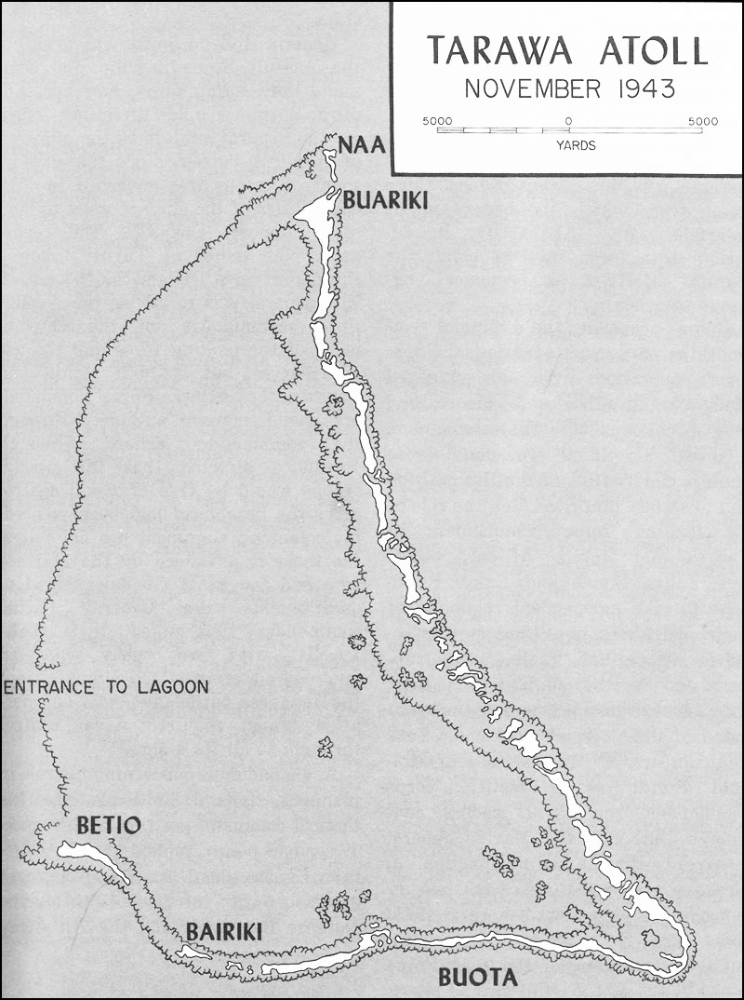
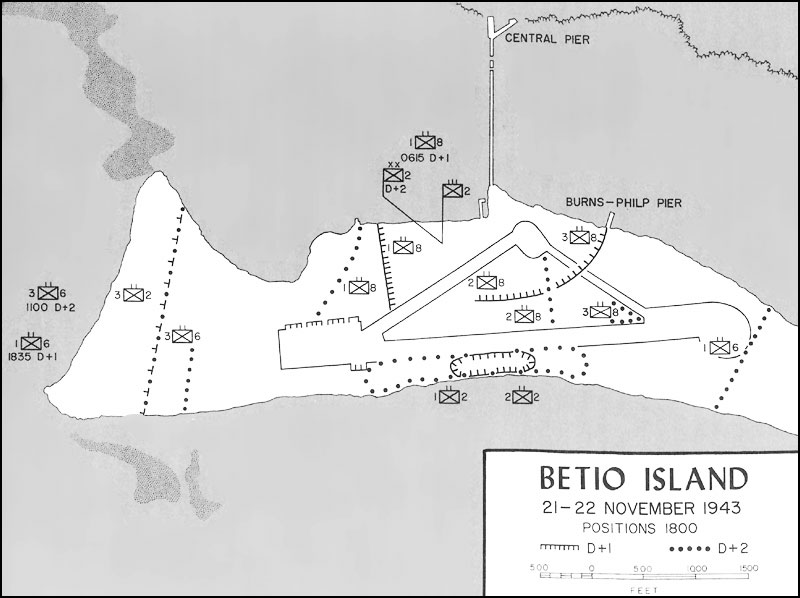

以下第一人称叙述依据史料重建，主视角为美军第2海军陆战师师长朱利安·史密斯。

1943年11月，美军拥有能够轰击整座小岛的舰炮，却不能保证把一个完整步兵营送过岛外的浅水礁盘。塔拉瓦的难题就在这段距离里：海上优势怎样才能变成岸上的优势？本文以11月20—28日的塔拉瓦作战为范围，重点叙述20—23日贝蒂奥岛的登陆与争夺，并写到环礁清剿、部队撤离和基地移交。日期采用公历，战斗日与时刻沿用美军作战记录；战后研究者的复盘接在第一人称叙事之后。

## 一、我接到的是一座环礁的任务

1943年夏天，我在新西兰指挥第2海军陆战师。部队从瓜达尔卡纳尔回来，首先需要恢复健康、补充人员和重新训练。丛林作战留下的损耗并没有随着登船离开而消失，疟疾患者仍需治疗，补充兵需要加入连队，指挥机构则要把此前分批投入战斗的团重新组织成一个师。我的下一次任务，需要这个师从海上展开，在一个此前没有陆军阵地可以依托的地方建立战场。[^alexander][^usmc3]

8月，斯普鲁恩斯带来的计划把吉尔伯特群岛放在我们面前。中太平洋进攻需要向西推进，马绍尔群岛是下一步的重要方向。陆基飞机如果始终从更遥远的基地出动，能够用于侦察和持续攻击的时间就受到航程限制。夺取新的机场，可以把下一场行动的准备工作向前推进。塔拉瓦的价值因此既在它本身，也在它能支持的后续行动。[^stockman][^usmc3]

最初的目标讨论包括瑙鲁，后来改为马金。对一个登陆师来说，地图上的两个名称意味着两套海岸、两批守军和两条卸载线。我向上级提出的判断，是塔拉瓦本身就需要全师的步兵力量。最后确定的“电流”行动由多支部队分别实施：我们攻取塔拉瓦，拉尔夫·史密斯的陆军第27步兵师部队攻击马金，阿帕马马也在整体行动目标之内。海军必须同时照看这些部队的运输、支援与海上安全。[^smith][^usmc3]

我所能决定的事情有明确边界。尼米兹统筹太平洋战区，斯普鲁恩斯指挥这次中太平洋行动，特纳负责两栖作战的总体组织；荷兰·史密斯是第5两栖军军长。到了塔拉瓦，海军攻击部队由哈里·希尔指挥，我负责登陆部队。希尔必须使舰艇在敌方飞机、潜艇和可能出现的水面舰队威胁下完成任务，我则要使步兵能够上岸、展开并得到持续补给。两者的决定在一条海岸线上相遇。[^dyer][^usmc3]

这里最先出现的分歧，是时间应该花在哪里。我们的初步设想包括先占附近岛屿、布置炮兵，再对贝蒂奥发动主攻。这样可以先取得陆地上的射击阵地，给登陆部队增加一层直接支援。但它也会延长舰队在目标附近停留的时间，暴露行动方向，并把兵力分散到多个登陆点。上级决定先直接夺取贝蒂奥，将登陆前的集中火力准备压缩到攻击当天早晨的有限时段。[^stockman][^alexander]

同时，第6陆战团被指定为军预备队。我仍是这个团的师长，却不能在自己的登陆计划中把它当作随时可用的第三个团。它要保留给整体行动，在获得释放命令之后才能投入塔拉瓦。这使原本可以用两个团展开、一个团预备的构想，转变成以一个加强团为第一梯队，再从另一个团抽调营补充的安排。对如此狭窄的目标，所有部队也无法同时展开；但能够轮换的完整部队，仍是突破坚固阵地所需要的力量。[^stockman][^alexander]

我们掌握的航照已经显示，这不是一次面对空旷海滩的登陆。贝蒂奥沿岸布有火炮、机枪阵地、障碍物和掩蔽部。敌人把机场以及保卫机场的阵地放在同一座低平小岛上。陆战师情报部门能够辨识许多武器位置，也能大致判断驻军规模。实际困难在于，知道某处有一座掩体，并不等于知道多少炮弹能够使它停止射击，更不等于知道炮击停止后里面还有多少人员能够重新操作武器。[^stockman][^usmc3]

我们所面对的是一场以港湾和机场为目标的联合行动。步兵在地图上画出的推进线，必须经过舰艇航路、换乘区域、礁盘和卸载点才能开始。一个营的兵力只有连同机枪、迫击炮、通信人员和工程兵一起抵达，才算真正具有预定的攻击能力。制定计划时，师部要考虑的单位既是营、团，也是每一波能够运送多少人员的车辆与小艇。

## 二、选择北岸，也就选择了穿过浅滩

*图1：美国陆战队官方战史《Central Pacific Drive》地图2，1943年11月塔拉瓦环礁。沿用原图比例尺，单位为码；Betio为贝蒂奥，Bairiki为拜里基，Buariki为布阿里基。[原图](https://www.ibiblio.org/hyperwar/USMC/III/maps/USMC-III-2.jpg)。美国政府战史图版，公共领域。*

贝蒂奥位于塔拉瓦环礁西南端。小岛东西狭长，西部较宽，东部逐渐收成细长的尾部。机场占去岛内很大一片空间。这里缺少能够掩护大部队运动的高地，海岸防御线背后很快就是跑道、道路和日军设施。对登陆者来说，上岸并不立即意味着获得纵深；不少部队最先得到的掩护，只是一道椰木海堤的背面。[^stockman][^alexander]

岛南侧面向外海，北侧面向潟湖。南岸海岸线的弯曲，使守军能够从两侧对来艇形成夹射；西岸虽然可以接近岛端，却会让越过海滩的部队在机场两边分开推进。北岸的障碍物还没有全部建成，潟湖内的水面条件较便于小艇组织，向北伸出的长码头又通向较深水域。我们最终把北岸作为主登陆方向。[^stockman][^usmc3]

从潟湖望向岛岸，西端到中央依次划为红一、红二、红三滩。红二在长码头西侧，红三在码头东侧，红一靠近岛的西北端。每段滩头大约六百码宽。红一与红二之间有一处向内凹入的海岸，这使两段海滩之间形成一组能够互相支援的火力位置。地图上连续的红色线段，并不能保证登陆部队上岸后马上连成一条连续战线。[^alexander]

我们把西岸称为绿滩，留作后续选择。它的意义要等到有人从陆上清除附近守军才能充分显现。第一波如果在那里登陆，仍须解决岸防火力、礁盘以及上岸后的狭窄展开问题。计划不能只看某一段水面是否平静，还要看登陆之后向哪里进攻，能够在哪里卸下火炮，以及与相邻部队如何联系。

围绕小岛的珊瑚礁，是所有方向共同面对的障碍。普通登陆艇需要足够吃水才能越过；当水深不足时，艇首跳板距岸仍可能有数百码。乘员若在这里离艇，就必须把人和装备一道带过水面。步枪手、机枪组、背负无线电的人与运送炮弹的人，面对的负担各不相同。海底的坑洼又会使同一条前进路线忽深忽浅，队形很难维持。[^stockman][^crowl]

我们取得了熟悉当地海域的人员提供的意见，也研究了潮汐资料。弗兰克·霍兰少校长期生活在这一带，他对小潮期间礁盘上的水深提出警告。各人的估计并不完全一致，计划者对能够出现多少水深也没有统一把握。第2陆战师的安排从一开始就包含登陆艇可能无法越礁的风险，因此才需要用两栖履带车担任先头运兵工具。[^stockman][^dyer]

两栖履带车简称LVT，能够在水中航行，也能用履带爬过礁面。它原先主要用于输送物资，我们现在要让它载着突击部队穿过火力区。师里有一批使用过的车辆，经过修理和加装防护，约七十五辆可以参加行动；后来又得到五十辆新车。它们能让最先几波部队不依赖登陆艇所需要的水深，却不足以连续运送整个师，也没有使乘员免受岸上重武器攻击的装甲。[^stockman][^alexander]

新车的到来还受运输舰艇和航速约束。载运它们的坦克登陆舰要在另一条航线上与主力会合，车辆与大多数步兵无法一起完成最后演练。我们还获得十四辆谢尔曼中型坦克。它们的七十五毫米炮可以直接攻击坚固阵地，但坦克从船上到岸上同样需要通过礁盘，步兵也需要学习怎样与它们共同前进。这些新装备增加了攻击力量，同时带来尚未充分磨合的协同问题。[^alexander]

承担第一波攻击的是戴维·舒普指挥的加强第2陆战团。舒普原来参加师部作战计划工作，在原团长因病不能继续任职后接掌部队。他知道计划中的每一项安排，现在要在敌火中指挥这些安排的实施。红一由第2团第3营登陆，红二由第2团第2营登陆，红三由配属过来的第8团第2营登陆。第2团第1营作为团预备队；第8团另外两个营由我掌握。[^stockman][^alexander]

|部队与指挥官|最初任务|实际可用关系|
|---|---|---|
|第2陆战师，朱利安·史密斯少将|夺取塔拉瓦|师部起初位于“马里兰”号|
|加强第2陆战团，戴维·舒普上校|统筹首波攻击|含配属的第8团第2营|
|第2团第3营，约翰·舍特尔少校|红一滩|首波营|
|第2团第2营，赫伯特·阿米中校|红二滩|首波营；阿米阵亡后指挥调整|
|第8团第2营，亨利·克劳少校|红三滩|首波营|
|第2团第1营，伍德·凯尔少校|支援突击团|团预备队|
|第8团第3营，罗伯特·鲁德少校；第1营，劳伦斯·海斯少校|后续增援|师预备队，分次投入|
|第6陆战团，莫里斯·霍姆斯上校|最初为军预备队|20日下午获准交师使用|
|第10陆战团各炮兵营、第18团工程兵及坦克、履带车部队|火力、工程和运输支援|分批登陆，配属关系随战斗调整|

*编制与指挥官据斯托克曼和亚历山大。陆战团的英文名称常省略“团”字；本文统一用“第某团第某营”。表中营的存在，不代表它的全部人员、重武器和车辆同时到岸。*

11月在埃法特进行的演练，让部队熟悉登艇、编波与海上集结，却不能完整复制贝蒂奥。航空兵和舰炮演练与步兵登陆之间存在分离，新型履带车没有到齐，中型坦克也缺少实际卸载和协同机会。第6团第1营练习了使用橡皮艇；这项当时显得特殊的训练，后来会为一个完整营打开进入战场的办法。[^alexander]

我的参谋长梅里特·埃德森有此前在太平洋作战的经验。他与舒普关心的是火力准备结束时，第一批步兵是否已经接近海岸。舰炮能够在短时间内投下大量弹药，但步兵与炮火之间的距离同样重要。防御者只要还有活着的炮手、可用的枪炮和射界，便可能利用炮击停止后的几分钟重新开火。登陆进程能否与支援火力对上时间，是计划最紧绷的连接处。[^alexander][^dyer]

11月19日，我向官兵说明次日的任务，并强调海军将继续提供支援，后续守备部队也将接替我们。部队在瓜达尔卡纳尔的经历，使支援是否持续具有切身意义。舰队已将我们送到目标附近，真正的考验则从各营离开运输舰开始：海上编好的队伍能否按照预定顺序，成为岸上可以运用的战斗单位。[^stockman]

## 三、11月20日清晨：火力计划和登陆队形逐渐脱节

20日凌晨，运输舰队在塔拉瓦外海展开。我的指挥所设在“马里兰”号战列舰上，与希尔共同面对登陆开始后的消息。舰艇的位置、部队下船、履带车集结和航空兵到达，都必须按时间接上。运输区的位置出现偏差，部分舰艇还要调整，已经下水的小艇也随之移动。尚未接敌，部队从运输舰到编队位置的过程就比演练复杂。[^crowl][^alexander]

我们安排的登陆时刻原为8时30分。按计划，航空兵先攻击，舰炮接着轰击，最后再由飞机扫射海岸，掩护部队完成最后接近。日军却在天亮前先向舰队开炮。约5时7分，美军战列舰开始还击。舰炮因此提前进入战斗，时间表上不同支援阶段的衔接，必须临时重新安排。[^crowl]

5时42分，舰艇停火等待预定空袭，飞机却没有按原定时间到达。航空攻击安排已经改变，舰队未能及时得到相应通知。此后舰炮恢复射击，飞机再投入攻击，海上与空中的强大火力并未始终按照同一个节奏运行。对旗舰来说，能够下令射击和能够使每一种火力在正确时刻作用于正确位置，是两件需要分别落实的事情。[^crowl][^alexander]

扫雷舰和驱逐舰进入潟湖。它们需要确认航道、设置控制位置，并把炮火带到更接近北岸的地方。进入潟湖也让舰艇暴露在守军直接瞄准的火力之下。“林戈尔德”号受到命中，却继续承担支援任务。海军的近岸火力能够针对步兵后来指出的阵地射击，但在部队上岸以前，海堤内侧的射孔和掩体仍有许多不易看清。[^crowl]

履带车队已经出发，但它们的实际速度没有达到计划所需。海况、载重、潮流和旧车的机械状况共同拖慢队形。整个艇波必须让最慢和位置最不利的部分也能够保持基本秩序，否则到岸之后就会出现单位分散、支援脱节。原定8时30分登陆已经无法实现，希尔先把时刻推至8时45分，再推至9时。[^crowl][^dyer]

调整登陆时刻应当同时改变炮火停止和飞机扫射的时刻。然而并非每一支支援单位都及时得到变化。部分飞机仍按照原定时刻执行，舰炮又必须避免与空袭冲突，因而出现间歇。到第一批履带车真正抵岸时，炮击所造成的压制已经不能完整覆盖它们的最后接近。这一段时间里，步兵无法加快已经迟缓的车辆，也不能用自己的轻武器替代舰炮的压制。[^crowl][^alexander]

最先进行的一个专门动作，是夺取长码头。威廉·霍金斯中尉的侦察狙击排和工程兵接近码头，清除上面的火力点。码头伸向较深水域，本来就位于我们将反复穿越的通路上；如果守军继续从那里射击，艇波会从侧面受到威胁。取得码头还可以为后来卸载、疏散伤员和派遣联络人员提供一个固定位置。[^alexander]

履带车越过了礁盘。这个结果说明，战前为先头部队准备的办法确实能够跨过水深障碍。但车辆到岸以后又遇上海堤，只有少数能够直接越过。士兵必须离车，寻找通路，或在海堤边组织最初的攻击。车辆停在这个位置，既吸引敌火，也会阻碍后续车辆靠近。能够越礁，并不自动保证能够从海滩继续向内陆推进。[^alexander]

三个滩头实际登陆并不同步。各营后来汇总的先头抵岸时刻，大致是红一9时10分、红三9时17分、红二9时22分。这些分钟反映的是不同部队的先头到达，不能理解为每个营在相应时刻整体完成登陆。有人已经伏在海堤边，有人还在车辆中，有人则仍在礁盘外等待换乘。[^alexander]

随着第一批消息传来，我所能得到的情况远比计划图破碎。红一和红二受到凹岸阵地的侧射，红三的先头相对顺利，却很快在向内陆推进时遭遇阻挡。我们并没有同时获得三个相互连接的滩头。原本应该按营识别的部队，正被射击、搁浅和偏离航线拆成许多小群。

此时必须区分“第一波上岸”和“登陆成功”。先头车辆把一批步兵送到海堤，只完成了建立立足点的第一步。他们需要重武器、弹药、水和更多人员来向前扩大阵地，而普通登陆艇在礁盘边停住了。第一批履带车可以解决一次运送，后续攻击则要求它们往返。车辆伤损、油料消耗和伤员后送开始争用同一批有限的运输工具。[^stockman][^alexander]

## 四、20日上午：我收到的是三个无法接合的滩头

在红一方向，舍特尔的第2团第3营受到严重打击。舒普与他的无线电往来表明，艇队被礁盘阻住，士兵在水中遭到射击，营长无法与最前面的部队保持联系。舒普要求他转向红二登陆，再向西进攻。这样的命令在地图上可以画成一个转弯，但执行者首先要找到还能够载人的艇、可以靠近的路线，以及能够带上岸的人员。[^stockman][^alexander]

红一与红二之间的凹岸阵地，使从海上看似并列的两个营同时受其影响。那里射出的火力并不限于正面：它可以横扫相邻海滩，也可以打向在水里向岸上移动的增援。只要这一组阵地继续存在，增加登陆人数就有可能先增加水中的伤亡，岸上的兵力却得不到相同比例的增长。

我们后来才把这个时段的情况拼合清楚。在红一更靠西的位置，迈克尔·瑞安少校把陆续抵岸的人员收拢起来。他所在的L连遭到损失，附近又来了别的单位的士兵。他所形成的是一个临时混合部队，依托岛西端相对能够利用的地面继续行动。当我在旗舰上评估西侧是否已经崩溃时，这支部队仍在组织攻击。[^alexander]

红二的营长阿米中校在登陆过程中阵亡，副营长又被送到偏西的位置。随队观察作战的沃尔特·乔丹中校承担起现场指挥。这不是师部预先安排的一次正常接替，而是指挥人员损失以后，由在场军官把还能够联系到的部队重新组织起来。旗舰一度并不知道阿米已死，也不知道乔丹正在指挥。[^alexander]

这条信息差决定了我不能把无线电的沉默直接解释为阵地已经丢失。电台可能进水，操作员可能伤亡，指挥人员可能正在离艇或涉水。与此同时，也不能因为地图上的营符号还在，就假定那个营仍有完整通信、迫击炮和机枪。到岸的人员、实际在战斗中的人员与师部能够指挥的人员，开始成为三个不同的数目。

红三由克劳指挥。他的先头部队在最初登陆时损失较小，部分人员越过海堤，接近机场的边缘。然而东侧有能够相互掩护的日军阵地，北岸又受到机枪与其他武器覆盖。先头上岸的成功很快转变成如何扩展狭窄阵地的问题。克劳要守住师的左翼，也要使红三与长码头附近的友军建立联系。[^alexander]

舒普本人同样需要从海上到达指挥位置。他的登陆艇受到礁盘阻挡，换乘的履带车又遭到射击。到他最终能在岸上建立指挥所之前，无线电、码头和个人联络成为他控制部队的主要手段。他曾在接近岸边的过程中负伤，但继续指挥。对我来说，最迫切的事情是让这个前沿指挥所得到足够兵力，同时保持它能够向师部报告。[^stockman][^alexander]

团预备队凯尔的第2团第1营于是被投入红二。部分人员找到履带车换乘，其他人仍要涉水。这使一个预备用于恢复攻击的营，在到岸以前就开始被拆开。步兵营原有的连、排关系，很难在数百码受火水域里保持；人们必须先到达可以生存的位置，然后才有机会重新寻找指挥官和同伴。[^alexander]

中型坦克的登陆也没有按预期带来迅速突破。坦克离开运输它们的艇后，要沿海底向岛岸前进，水下弹坑和障碍物会使车辆陷住。岸上引导人员受到射击，车组对地面的观察又受到舱体限制。有些车辆终于上岸，却没有与步兵建立足够稳定的配合，在寻找目标时受到日军反坦克火力攻击。[^alexander]

舒普发回有关坦克效果不佳、需要其他直射武器的报告。这个报告描述的是当时能够使用的战斗力量，而不是对坦克这种装备作最后评价。此时的师部不能依靠远处运输舰里的车辆判断岸上火力：只有能够越过礁盘、找到通路、得到引导并继续射击的坦克，才真正能够帮助步兵。[^alexander]

我们的岸上单位已经在同一座小岛上作战，却并不总能互相支援。红一到红三的距离不大，中间却隔着守军控制的火力区。绕过一个阵地去增援另一个营，可能意味着再次暴露在海滩或机场上。距离短，压缩了命令在地图上的路线；强火力则延长了命令在现实中完成的时间。

我把第8团第3营交给舒普使用。鲁德的营要进入红三，以增强克劳方向，并帮助扩大登陆场。到它接近时，能够组织成批换乘的履带车已经不够。舒普指示他们尽量乘艇接近，再涉水上岸。鲁德接到这个任务以后，与舒普的直接联系又中断了，双方都无法连续修正对方掌握的情况。[^alexander]

后续艇波遇到的射击比先头波更有组织。守军已经辨明主要登陆方向，许多射手从轰击中恢复过来，搁浅和被击毁的车辆又让可用路线进一步拥挤。鲁德的先头人员受到重大损失，其余人员或向码头靠拢，或零散抵岸。把一个营作为增援投入，并没有立即让前线多出一个完整营。[^alexander]

副师长利奥·赫姆勒也试图帮助控制海上与海岸之间的混乱。不同层级的军官掌握的局部消息并不一致，给前进部队的指示因此可能发生冲突。鲁德要到傍晚才能带领部分人员真正向岸上集结。这个过程中，师部的命令、团部的任务和海上对迫近火力的判断，未能一直合成一条清楚的执行路线。[^alexander]

## 五、20日下午与夜间：预备队获准使用，命令仍在水面上失落

中午，舒普终于在长码头内侧附近建立岸上指挥所。他所在的位置靠近一个尚有日军的坚固掩体，必须布置警戒，周围路线也受敌火威胁。通信兵、传令兵和前来报告的军官，使这个地点逐渐成为岸上不同残部之间的连接处。指挥所的作用，不只是发出新的攻击命令，也包括查明还有哪些人可以执行。[^alexander]

我在旗舰上仍然缺乏可靠全貌。水上飞机的观察能够看到登陆场范围，难以判断每道海堤之后是哪一支部队、剩下多少弹药。无线电里的局部危急报告又容易放大某一个方向的困难。面对这种信息，我首先需要增加可以动用的预备队，而不是等到所有滩头情况完全清楚再行动。

13时31分，我向荷兰·史密斯请求释放第6陆战团，说明局面仍不确定。第8团第1营也已被我送往出发线，师内能够按原编制使用的步兵预备队接近耗尽。在等待上级答复的同时，师部还着手从炮兵、工程和勤务单位中组织应急力量。这些人员能够持枪作战，但把他们抽走，也会削弱部队卸载、构工和火力支援的能力。[^alexander]

13时43分，我派赫姆勒到码头一带了解情况并报告。从旗舰到码头，理论上只是一段小艇航程，实际却受到换乘、路线、敌火和混乱的交通影响。他的行程耗去数小时。师部需要一个能够亲眼观察的高级军官，这个要求本身又使他的报告比无线电传输慢得多。[^alexander]

我又收到舍特尔仍未与其登陆部队恢复联系的消息，便命令他上岸、重新控制自己的营并继续攻击。他最终在日落前后到岸，但要与更西面的人员接合，仍需时间。一个营长在海上无法指挥岸上的残部，到了岸上也不等于马上掌握全部残部的位置。恢复指挥关系，是穿插在攻击和防御之间的持续工作。[^alexander]

15时25分，第6团获准交我使用。我现在有了新的选择：可以安排完整营接替最疲惫的部队，可以向岛侧登陆，也可以堵住守军从贝蒂奥向其他岛屿转移的道路。但这只是使用权限的变化。预备队仍在舰上或艇上，艇只、礁盘和敌火仍决定它何时能够进入战斗。[^alexander]

我担心东部守军在夜间集中攻击红三方向。当时能够确认的登陆场很浅，岸上各营之间还有空隙。于是我曾命令第8团剩余部队向岛的东北端登陆，向西与现有部队接合。这个选择需要在一个情况还不充分清楚的海岸另开登陆点。我当时所掌握的信息，足以说明现有左翼受到威胁，却不足以准确证明新登陆点会比红滩容易。[^alexander]

命令没有顺利传到第8团团长埃尔默·霍尔手中。稍后，观察报告称有部队向红二方向运动，我和埃德森把它理解为第8团开始行动，而且方向与命令不同。实际上，那是准备登陆的炮兵。这个误认使师部一度以为最后的师预备营已投入战场，而霍尔与海斯的部队仍在艇上等待。[^alexander]

赫姆勒也陷入相似问题。他到达码头附近后，我发出让他接管岸上部队的命令，但命令没有送达。我的判断与他的实际任务因此出现分离：我以为已完成指挥交接，他仍按了解情况、协助交通和联络的要求工作。直到后来核对通信，才能知道一个高级军官为什么没有执行一项他根本没有收到的命令。[^alexander]

舒普也派埃文斯·卡尔森回旗舰作面对面报告。卡尔森在下午出发，却直到18时左右才到达。前线需要表达的，不只有伤亡和阵地，还包括部队仍将坚持战斗的情况。这类个人报告能够修正过于悲观的远距离印象，但它抵达时，消息又已经比现场迟了数小时。[^alexander]

瑞安在西端取得的进展，是另一个没有及时抵达我的消息。舒普下午得知，那里已经有数百人和坦克向岛内推进。瑞安的部队利用坦克炮攻击阵地，扩大了可利用的地域。但他们缺少足够的喷火器和爆破材料，不能保证经过的掩体已经彻底清除。到了傍晚，瑞安收缩阵地，形成能够守夜的防线。[^alexander]

这次收缩并不等于放弃所有进展。对一支混合部队来说，在天黑以前确定哪些位置能够互相支援，关系到它能否留在岛上。只用手榴弹压住一座掩体，未必已经消灭里面的守军；继续向前，可能让那些阵地在夜间重新开火，切断后方。瑞安保住的立足点，次日将成为引入完整预备队的基础。

炮兵在这一天也努力上岸。舒普与里克西中校调整第10团第1营的登陆位置，改在靠近长码头的红二一侧卸载。七十五毫米山炮能够拆成部件运输，一部分借助剩余履带车抵岸，一部分由人员从搁浅小艇向前搬运。它们的口径小于战列舰主炮，却能在岸上根据步兵需要持续射击，把支持前线的火力留在同一片陆地上。[^alexander]

补给艇则在海上越聚越多。物资从运输舰卸下，不代表岸上已经得到需要的物资。弹药、水、血浆、担架、无线电和履带车燃料，都必须找到实际需要它们的单位。舒普要求把最急需的东西先送到码头，岸上人员逐步建立转运秩序。运输效率在这里不是统计卸下多少吨，而是前沿能否在弹药耗尽之前拿到下一批弹药。[^alexander]

到第一天夜晚，大约五千名陆战队员已经抵岸，其中约一千五百人死伤或失踪。这是战后整理出的概数；当天夜里的我并没有一张完整伤亡表。能够确认的是，登陆部队只控制了岛的一部分，各营防线曲折，红一和红二之间仍有敌方阵地，红三左翼也需要防备反击。[^alexander]

我与希尔向上级报告，局面仍未明朗。岸上部队则在各自能守住的位置准备过夜。我们必须假定敌人仍可能组织反击，不能把整个晚上寄托在对手不行动上。加强火力联系、组织预备力量、把弹药送进去、把伤员送出来，这些事项与白天的进攻同样决定登陆场能否维持。

夜间没有出现我们所担心的全岛规模反击。日军究竟还保有怎样的指挥能力，我当时不能知道。对师部而言，夜晚提供了调整第二天登陆安排的机会，也暴露了白天错误判断的后果：到了21日凌晨约2时，我才明确知道霍尔与海斯仍在出发线附近的艇上，第8团第1营根本没有完成预想中的登陆。[^alexander]

舒普希望增援靠近码头进入红二。赫姆勒通过驱逐舰转达了这一建议，我遂修改原来向东端登陆的安排。方向的修正很重要，但具体位置的细节在转达过程中没有完整保留。第二天，海斯要执行的是在红二登陆的命令，他并未得到与岸上现场判断同样清楚的“紧靠码头”要求。[^alexander]

## 六、21日：第二次代价高昂的涉水，和西岸终于打开的通路

海斯的第8团第1营在小艇里等待了一夜。到接近红二时，水深仍不足以让普通登陆艇直接驶到岸边。部队再次被迫下水。从师部的兵力安排看，这是把一个尚未投入的营送到已有立足点；从登陆者的位置看，他们仍然要穿过守军已经能够反复瞄准的开阔浅水区。[^alexander][^crowl]

红二西侧尤其危险。凹岸强点还在射击，前一天留在海上的部分残骸又被日军利用。海斯部队中向西偏得较多的人进入交叉火力之下。岸上的舒普和炮兵试图压制有关阵地，飞机也攻击海面附近可能被利用的目标，但近距离支援又增加了误伤风险。各方在同一片狭小区域内行动，必须不断修正射击和前进位置。[^alexander]

海斯约8时抵达舒普处，能够随他集结的只有一部分人员。该营在登陆中已有三百余人伤亡，喷火器、爆破器材和重武器损失尤重。它本应为岸上增加突破能力，结果首先需要依靠岸上已有的力量重新装备。舒普让海斯准备向西进攻，正面对的就是此前持续杀伤登陆部队的那组坚固阵地。[^alexander]

这里的损失有一种会继续传递的后果。失去步枪手会减少攻击人数，失去工程兵器材则可能使剩下的人无法破坏掩体。即使人已经到达，攻击仍可能停在射孔之前。因此，师部在判断“增援到了没有”时，也必须问清它带来了什么，哪些武器还能使用，哪些连排已经失去军官。

舒普安排的岸上行动沿三个方向展开。凯尔和乔丹的部队继续向南，争取越过机场周围到达岛南岸；克劳与鲁德的部队向东攻击，扩大红三登陆场；瑞安则清理西岸，为绿滩创造安全的接近条件。各方向并不是孤立争夺土地：南进有助于切开岛的防御，东进保护左翼，西岸的成功则可能改善整个师的登陆方式。[^alexander]

在西部，瑞安必须把坦克和步兵协调起来。他已有前一天的经验，知道坦克独自前进难以发现近处火力，步兵独自攻击又缺乏破坏工事的力量。舰炮先针对有关阵地射击，坦克随后与步兵一起推进。约11时20分开始的一次攻击，使他的临时部队在随后一小时内控制了绿滩。[^alexander]

这条消息传到旗舰时，给了我不同于继续从红二添兵的选择。绿滩背后已有友军，可以掩护后续人员抵岸。一个新的营不用先在守军正面射界里被打散，再由岸上军官重新收拢。只要能够把它送过去，就有希望保留连排组织、重武器和指挥机构，从上岸开始便按营执行任务。[^alexander]

我与埃德森、霍姆斯商议第6团的使用。最后决定让威廉·琼斯少校的第1营乘橡皮艇在绿滩登陆，第3营准备后续进入。与此同时，收到日军可能从贝蒂奥东端向拜里基转移的报告，我又命令雷蒙德·默里的第2营登陆拜里基，封住这条通路。第6团因此承担两个互相联系的任务：把新的攻击力量送进贝蒂奥，同时限制守军离开主岛。[^alexander]

这些命令仍要通过海军运输体系才能落实。琼斯的部队准备离开“费兰德”号时，运输舰因潜艇威胁警报而转移，登艇随之延误。潜艇是否真正构成立即危险，要由舰艇指挥系统判断；对我来说，其直接结果是已经安排好的岸上增援时刻再次推迟。海上安全与岸上需求无法分开，任何一端受到干扰，都可能让另一端等待。[^alexander]

轻型坦克也未能迅速卸下。它们的位置不便于优先取出，前面卸载造成的货物与设备移动又增加了困难。我们可以在电报上指定某种武器急需，却不能让埋在货舱深处的车辆越过挡在上面的货物。作战装载的价值就在这里：不仅要装得下，还要按照战斗需要的先后顺序取得。[^alexander]

舒普在岸上不断询问第6团何时能够到达，并要求尽可能带来喷火器。新的登陆点已经打开，完成预备队投入仍需要协调运输舰、小艇、橡皮艇、履带车和岸上的接收部队。琼斯若在天黑以后才上岸，便难以立即进行同日计划中的进攻；但在友军掩护下完整登陆，仍比在红滩再次遭受严重损失更有价值。

下午，补给和后送也逐渐形成较有秩序的通路。长码头外端成为转运位置，控制人员限制送入的物资种类，把仍能使用的履带车安排在最急迫的任务上。岸上医疗人员在能够利用的掩体中处理伤员，海军又把部分接收任务移到更近的位置，减少小艇往返远处运输区的时间。[^alexander]

“多延”号进入潟湖接收重伤员，是这种调整的重要部分。把运输舰送到更靠近海岸的地方有风险，但原来漫长的后送航程同样消耗伤员的生命与有限船艇。医疗力量与作战运输共用通路，改善伤员转运也意味着让车辆和艇只更快回到补给任务。所谓后勤，正在海岸和水面上直接参与决定当天还能发动多少次攻击。[^alexander]

16时左右，舒普的情况报告表明，尽管伤亡很大，岸上部队正在取得优势。这个判断与当天早晨的困难并不矛盾。红二的增援仍付出了高昂代价，但西岸已经打开，炮兵开始持续作用，部分部队向岛内深入，弹药和水的输送也有所改善。师部终于能够在几个方向上安排接续行动。[^alexander]

默里的第2营在傍晚前后登陆拜里基，抵抗较轻。炮兵随后也在这座邻岛展开，逐步为贝蒂奥提供支援。战前希望先取得的那一处陆上火力位置，在主攻开始后的第二天才得以实现。它无法取消先前的伤亡，却增加了之后进攻和夜间防御能够使用的火力。[^alexander]

琼斯的部队则由登陆艇拖带橡皮艇接近礁盘，再乘橡皮艇划向绿滩。橡皮艇可以越过水深不足的地带，却使队形控制困难，也不能提供装甲防护。瑞安部队已经压住岸上威胁，才使这种办法能够奏效。同行的补给履带车仍有一辆触雷损失，提醒我们西侧通路已经改善，却远未成为安全的港口。[^alexander]

第6团第1营终于以基本完整的组织上岸。其价值体现在次日能够投入一个有自己军官、连队和支援人员的攻击营。第3营仍要等待，轻型坦克也分批寻找上岸办法。第一天的战斗把部队打散，第二天的重要成果则是开始恢复部队的整体性。

当夜，我派埃德森上岸，统一指挥贝蒂奥和拜里基的部队。他约20时30分到达舒普的指挥所。舒普继续负责自己的加强团，埃德森协调更大的战场。岸上已经有多个团的营和不同岛屿上的炮兵，继续让最先登陆的团长独自承受全部协调任务，已不适合不断扩大的指挥范围。[^alexander]

## 七、22日：完整营向东推进，我终于登上贝蒂奥

*图2：同书地图3，21日与22日18时位置对照；短线齿状边界表示21日，圆点边界表示22日。原图带英尺比例尺，中央长码头在上方，岛西端在左侧。[原图](https://www.ibiblio.org/hyperwar/USMC/III/maps/USMC-III-3.jpg)。美国政府战史图版，公共领域。*

埃德森在22日凌晨发出新的攻击部署。琼斯的第6团第1营沿南岸向东，与已经深入岛内的第2团部队会合；海斯的第8团第1营从红二向西，继续清除凹岸阵地；第8团其余部队向东扩展。第6团第3营则准备从绿滩进入，成为能够接替攻击的另一支完整部队。[^alexander][^crowl]

从地图上看，两支美军在岛西部沿相反方向运动：海斯向西，琼斯向东。两者之间有机场及敌方阵地，需要明确攻击地带，避免互相射击或误判对方位置。狭小战场没有使协调自然变容易。越是接近，炮火、坦克和步兵越需要知道友军在哪一条线上，以及哪一段射界必须暂时保留。

埃德森的命令一度无法通过无线电送到琼斯。托姆金斯少校于是携带命令，从指挥所前往绿滩。穿过友军与敌军位置交错的地带花费了很长时间，他要避免被警戒人员误认，也要避开尚未清理的阵地。到他接近目的地时，无线电又恢复了联系。传令兵的努力没有因此失去意义：在无法保证电台恢复时，前线必须有第二条传达途径。[^alexander]

琼斯把工程兵、机枪和坦克纳入自己的攻击部署。他借用瑞安手中的谢尔曼，要求坦克不要远离先头步兵，并安排直接联系。部队沿南岸推进的正面很窄，队形因此不能完全按照开阔地攻击的方式展开。狭窄正面使火力能够集中，也要求后续连按顺序接上，不能一拥而入。[^alexander]

这次进攻很快显出完整部队的作用。坦克用炮火打击掩体，步兵防止近处敌人接近坦克，工程兵处理仍需破坏的据点。琼斯的营在上午推进到第2团控制的位置，与凯尔、乔丹方向接合。此前分别存在的西端立足点与中央登陆场，开始通过陆上控制区连在一起。[^alexander][^crowl]

这不仅扩大了美军控制的面积，也改变了交通条件。人员与物资不再只能沿受火海滩进行孤立转运，绿滩登陆的部队可以沿已经控制的地域向前。先前残部承受的压力也有机会交给较完整的单位。但沿线仍有未被彻底清除的掩体，后方安全需要持续检查，不能仅凭一次通过就认定所有敌人已经消失。

海斯的方向远没有这样顺利。他从东面向凹岸阵地进攻，工程兵使用炸药和爆破器材，轻型坦克靠近射击，却难以迅速摧毁坚固工事。七十五毫米炮的半履带车随后加入，提供较强直射火力。部分部队能够从内陆绕到阵地后面，但靠海的据点仍然阻住进展。[^alexander]

凹岸强点的持续抵抗，意味着我们即使已经占有大片岛内地域，仍不能自由使用北岸全部航路。那里既影响海斯的攻击，也能继续向海面射击。一个被其他部队从侧面绕过的阵地，只要还保有射界和弹药，就仍然可以干扰补给与指挥人员移动。

红三方向也在继续处理彼此支援的几个据点。靠近伯恩斯—菲尔普码头的钢制火力点、椰木阵地和大型掩蔽部，共同限制克劳与鲁德向东推进。22日上午，迫击炮命中与坦克直射帮助摧毁其中部分位置，原有互相支援的关系开始断裂。步兵与工程兵随后攻击大型掩蔽部。[^alexander][^crowl]

大型掩体的问题在于，外面遭到轰击，并不一定立即使内部人员失去作战能力。攻击者需要接近入口、射孔或通气位置，利用炸药和火焰破坏守军继续留在内部的条件。邦尼曼中尉等工程兵参与的攻击付出了人员伤亡，仍然推进到掩体上方和入口附近。守军向外反击，又在较暴露的位置受到美军射击。[^alexander]

这组阵地被压倒后，第8团向东的道路才真正有所扩大。它不是由某一种武器一次命中就自动产生的突破：炮击削弱部分目标，坦克提供近距离火力，步兵维持包围与掩护，工程兵完成最后破坏。任何一个环节缺席，都可能使相邻阵地继续保有互相掩护的作用。

当天接近中午，我在绿滩上岸。那里已能让第6团第3营陆续进入。我同瑞安了解情况后，仍需要前往靠近中央的前沿指挥所。沿水路转向长码头看似直接，却仍经过凹岸守军能够射击的海面。小艇遭火力击中，艇员伤亡，我和随行人员被迫入水，再由履带车协助转移。[^alexander]

到接近14时，我才抵达埃德森与舒普所在的指挥所。这段行程使师部命令中常用的“前往”变得十分具体。距离没有变，沿途的敌方射界也没有因为地图上的美军控制区扩大而全部消失。师长要到达自己的前沿指挥所，同样依赖仍能运行的车辆、熟悉局面的军官和可用的通路。[^alexander]

埃德森已经安排下午继续东进。琼斯的营沿南面前进，第8团沿北面推进，炮兵和舰炮先对前方地区提供支援。霍尔说明，他的两个营已经从登陆首日持续作战，能够再发动一次攻击，之后需要换下。埃德森准备让拜里基的第6团第2营接替他们，但运输艇仍然不足，这个轮换不能立即完成。[^alexander]

下午的进展比上午慢。琼斯的部队遇到新的坚固阵地，必须再次让坦克与步兵靠近处理。上午较快推进的营，到了下午也开始承受伤亡、炎热和缺水的影响。换上一个较完整的连，可以维持攻击队形，却不能完全消除连续作战带来的疲劳。运到岸上的水必须继续送到前沿，师部不能只看海滩物资堆的数量。[^alexander]

第8团在越过先前阻挡它的据点后，也逐渐耗尽继续推进的力量。到了夜间防御准备阶段，各营需要明确相接位置，特别是机场开阔地上的间隙。那里未必处处有步兵占领，只能依靠机枪、炮兵预定射击和相邻阵地的火力覆盖。前沿线是一套由人员与火力共同维持的关系，不能只用连续的壕沟来理解。

16时，我向仍在旗舰协助工作的赫姆勒报告，迅速清除贝蒂奥的前景并不乐观。日军仍保有许多掩体，前线和后方都有尚未消灭的据点，军官伤亡也使领导和协调更加困难。我当时估计，还可能需要至少五天才能完成占领。这个判断后来被战斗进展超过，但它准确反映了22日下午我们面对的阻力。[^alexander]

到19时30分，我正式接掌岸上作战指挥。霍姆斯随后统筹第6团，次日由肯尼思·麦克劳德的第3营通过琼斯营向东进攻，较疲惫的第8团部队准备撤往拜里基。第2团及配属的海斯营继续处理西北凹岸强点，重一些的一〇五毫米榴弹炮也准备登陆。我的部署是继续用完整部队接替消耗严重的部队，以更强火力推进。[^alexander]

## 八、22日夜至23日：守军从掩体中反击，战斗速度随之改变

当我准备次日攻击时，琼斯的营正在构筑当晚防线。他把步兵连部署在机场与南岸之间，安排机枪和迫击炮，并与炮兵观察员、海军火力联络人员划分支援区域。较近处由陆战队炮兵射击，更远处由舰炮接上。弹药、手榴弹和水被运到前线后方，准备应付夜间持续战斗。[^alexander]

约19时30分，一批日军穿过阵地之间的空隙，进入琼斯部队的防线。前沿不再只是向外射击的问题，也需要把已经进入的敌人找出来并消灭。营部与支援人员被用来阻止渗透扩大，炮兵则阻断后续敌人接近。前线形成的缺口经过近距离战斗才重新封住。[^alexander][^crowl]

琼斯向后方寻求增援。第2团已经受损严重，能够提供的只有一支较小的混合队伍，随后第6团第3营也将人员前推支援。这个时刻能够调来的力量，取决于各单位的实际状态，而不是它们在编制表上的人数。师部拥有多个营，不代表每个营都能立刻抽出一个完整连。

稍晚，日军再次攻击。不同方向的压力使防御部队必须判断，哪些是牵制、哪些是主攻。美军用近距离火力和炮兵支援抵挡，阵地没有被整个冲开。夜战的空间十分狭小，照明、弹药补充与对友军位置的掌握都很重要。把炮弹打到足够接近攻击者的位置，同时避免落到自己的前沿，需要观察员和炮手持续配合。[^alexander][^crowl]

23日黎明前，约三百名日军发动了更大的一次攻击。这次攻击集中冲击第6团第1营的前沿。步兵、机枪、陆战队炮兵与潟湖里的驱逐舰共同开火，攻击者仍有部分接近和进入美军阵地。战斗经过近距离搏斗后，美军保持了防线。[^alexander][^crowl]

琼斯营在这一夜付出了严重伤亡，亚历山大所列概数为四十人死亡、百人负伤。天亮以后，前沿近处和炮兵杀伤区域发现大量日军尸体。对师部来说，这些报告意味着次日攻击面前的敌军力量可能已经发生变化。此前需要逐一从掩体里驱出的许多守军，已经在反击中离开保护，并被集中火力杀伤。[^alexander]

我不能在反击开始时就把它当作即将结束战斗的保证。只要美军前线被击穿，日军便可能重新威胁炮兵、指挥所和补给区。我们仍需守住，然后确认对手的损失和剩余抵抗能力。到早晨获得较清楚的情况以后，我才向希尔报告，夜间反击被挫败已大幅削弱敌方力量，当天有望完成贝蒂奥作战，并请他上岸了解守军工事。[^alexander]

麦克劳德的第3营按照命令通过琼斯的阵地，向东进攻。这一次仍以炮火准备开始，坦克、工程兵和步兵共同推进。一个得到接替的营可以整顿伤员和队形，一个相对完整的营则把前一天积累的火力与战术经验继续用于攻击。轮换没有使战斗中断，反而使进攻能够维持组织。[^alexander][^crowl]

岛的东部越走越窄，守军能够使用的纵深也随之缩小。第3营遇到一处仍有抵抗的据点时，没有让整个营一起停下。麦克劳德留下部队处理，由其他人员从可以通过的侧面继续前进。掩护、包围与继续推进在同一时间进行，使一个局部据点不再拖住全营。[^crowl]

与此同时，舒普仍在指挥对西北凹岸阵地的最后攻击。海斯从东，舍特尔重新控制的部队从西侧与南侧靠拢，另有人员和七十五毫米武器从礁盘方向压制面向海面的射孔。原先能够向不同登陆波次自由射击的强点，现在从几个方向同时承受压力。工程兵与直射武器逐步处理剩余掩体。[^alexander][^crowl]

这场战斗的最后阶段因此有两个终点：向东推进的部队抵达岛端，西侧最顽固的强点被消灭。只完成其中一项，都不能说明全岛主要抵抗结束。东端的进展较快，西侧的攻击仍需在近距离逐个破坏工事。师部必须等待两个方向分别报告，才能判断贝蒂奥已不再存在成片的有组织抵抗。

约13时到13时30分之间，这些报告陆续到达。麦克劳德的部队抵达东端，凹岸阵地的抵抗也被压倒。我与已上岸的希尔向上级报告贝蒂奥有组织抵抗结束。13时30分，贝蒂奥被宣布肃清，主要攻击任务完成。[^stockman][^crowl][^alexander]

结束有组织抵抗以后，部队仍要搜查掩体、处理零散射击、清点人员和运送伤员。先前通过的地域并非每处都已彻底检查，死亡与失踪的名册也还没有完整形成。机场开始显露出基地的用途，工程部队修复跑道，后续人员准备接管。对刚打完的步兵而言，清理、掩埋和整理装备，是战斗停止后的第一批任务。[^alexander]

## 九、24日至12月4日：清剿环礁，移交基地

贝蒂奥只是塔拉瓦环礁中的一座岛。主要机场与最强防御在那里，环礁其他岛屿仍需要侦察和控制。第2团、第8团的部队开始撤离，前往夏威夷休整；第6团承担后续任务。各单位离开时间不同，整个师不可能在同一天收拢登船。岸上还需要警戒、清理和为来接替的部队提供情况。[^alexander][^stockman]

第6团第2营由默里指挥，沿环礁岛链推进。侦察人员与当地居民提供的情况表明，北面仍有一股日军。部队在岛屿之间移动，有些地段需要涉水通过沙洲。这样的推进与贝蒂奥争夺具有不同条件：堡垒密度较低，植被更可能遮蔽敌人，小分队的侦察与前后联络更加重要。[^alexander]

炮兵也必须跟上。部署在埃塔的第10团第3营最初能够为推进部队支援，但步兵继续前进后便逐渐超出射程。因此，部分炮兵随队向前。地图上连成一串的小岛，不能让炮兵从固定阵地始终覆盖全部路线。部队每前进一段，就需要重新确定火力从哪里来，弹药如何送到，以及伤员能够沿哪条路线后送。[^alexander]

26日傍晚，默里的前卫在布阿里基接触到日军，双方短暂交火后停止接近。27日晨，第2营继续攻击。这里没有贝蒂奥那样完整的工事体系，但日军利用密集植被抵抗。交战距离迅速缩短，炮兵只能在最初提供有限支援，此后敌我混杂的近战使继续射击困难。[^alexander]

这次交战消灭了约一百七十五名日军，美军记录三十二人死亡、五十九人负伤。它发生在贝蒂奥宣布肃清之后，说明“主岛失守”与“整个环礁完成占领”需要分别表述。更北面的岛屿随后经过搜索，没有再发现成建制敌军。28日，我报告塔拉瓦剩余敌军已经被清除。[^alexander]

后续基地工作继续进行。移交并不只是把一面旗帜换到另一个单位名下，还包括机场、海滩、码头、警戒地段与遗留危险的安排。陆战师需要把还留在当地的力量交给新的指挥关系，腾出自己进行休整和下一次作战准备。12月4日，塔拉瓦指挥权转交前进基地指挥官；至此，我在这次作战中从夺岛到移交的职责完成。[^stockman]

我交出的，是一处能够继续开发的基地，以及必须重新补充和恢复的部队。最初几天里，我们曾把一个完整营投入海面，得到的却是伤亡和分散的残部；后来，西岸通路、岸上炮兵、指挥交接和完整营的接续投入，使攻势重新获得连续性。战役怎样取得这样的结果，还需要把我当时看不到的另一面，以及战后整理出来的记录放在一起检查。

## 十、战后复盘：日军守住了哪些条件，又失去了哪些条件

第一人称叙述到此结束。把双方记录放到一起，最先需要修正的是“一个师攻击四千多名精锐士兵”的简单图像。贝蒂奥的日方人员包括正规战斗部队、设营人员和大量朝鲜劳工。美军第2陆战师参加这次行动的人员也包括步兵以外的炮兵、工程、运输、医疗和勤务力量。亚历山大列第2陆战师参战陆战队员与海军人员共18,088人，其中约55%有战斗经验。首日抵岸者约五千人，22日晚岛上美军约七千人，显示全师参战总数与某日岸上人数相差很大。两边的总人数都不能直接换算成同一时刻在海堤交火的步枪数量。[^crowl][^alexander]

|日方单位|美军官方战史整理人数|主要性质|
|---|---:|---|
|第三特别根据地队|1,122|海军基地守备与作战人员|
|佐世保第7特别陆战队|1,497|主要战斗部队|
|第111设营队|1,247|营建人员，含朝鲜劳工|
|第四舰队营建部门分遣队|970|营建人员，朝鲜劳工比例较高|
|合计|4,836|战后整理估计，包含非正规战斗人员|

*据克劳尔、洛夫第四章及斯托克曼附录C。不同出版物有4,800余人及4,856人的写法；本文采用能够与分项相加一致的4,836人。*

前两项合计二千六百一十九人，是更接近正规战斗兵力的数字。设营部队中的日籍人员也可能持械，但训练和组织不能与特别陆战队等同。克劳尔与洛夫据此提出，能够有效参加作战者约三千人是较稳妥的估计。他们同时指出，部分劳工的军事编组可能主要停留在纸面。这个推算比把每一名劳工都计为战斗兵更有解释力，也仍然保留估计性质。[^crowl]

日军的优势首先在位置。枪炮事先选择射界，人工障碍把来艇和涉水步兵导向可预测方向，掩体让人员在炮击后重新进入射击阵位。低平地形对防御者也有限制，但他们已经把有限的保护设施建在自己需要的位置。攻击者到达同一片地面时，则必须边受火边寻找掩护。步兵数量在这种条件下无法直接抵消位置优势。

北岸的十三毫米机枪等武器既能攻击人员，也能对防护有限的履带车和登陆艇造成伤害。许多武器采取侧向射击方式，覆盖障碍物前方，迫使攻击者在水面上接受长距离火力。所谓岸防不只包括能向远处战舰开炮的大口径火炮。舰队迅速压住部分重炮之后，杀伤登陆者的较小武器仍可能完整保留。[^crowl]

防御体系的另一面，是它对既定位置和通信的依赖。日军有坚固据点，却缺少宽阔纵深，受到登陆部队分割后难以从海岸另一端迅速调来有组织的增援。空中和舰炮轰击对地下掩体的破坏不充分，却损坏了通信线路。各阵地可以继续独立抵抗，指挥官要把它们合成一次全岛范围的机动或反击，却越来越困难。[^crowl][^usmc3]

柴崎恵次的命运也应放在这一结构里判断。早期和较晚的叙述对他的死亡时刻、地点存在分歧，亚历山大的1993年战史仍将其死亡放在后段战斗的混乱中。现有材料足以支持日军指挥联系在登陆首日受到严重破坏，却不足以让本文用一个无争议的死亡分钟解释全岛行动。史密斯也没有实时掌握敌方司令部情况。因此，第一夜没有总反击，不能只归因于一个确定时刻的“斩首”。[^alexander][^crowl]

日方并非完全不重视通信防护。克劳尔和洛夫引用的日军材料显示，9月空袭后，柴崎要求修筑保护通信设备的掩体，部分新设施仍在建设之中。这个事实使问题更加具体：日军知道通信易受攻击，也采取措施，但整个岛上有线联络、备用传递与反击组织仍没有形成足够可靠的体系。指挥设备有掩护，与每一支前沿部队都能收到命令，是不同层次的要求。[^crowl]

从更大范围看，守军也没有等到足以改变战局的外援。日军曾设想把潜艇、陆基航空兵和舰队行动结合起来，在美军向前推进时发动打击。但1943年秋，所罗门方向的危机不断吸收力量，舰载航空兵被投入拉包尔地区并遭到重创。岛上驻军所依赖的外部反击条件，与它修筑堡垒时期待的条件已经不同。[^crowl]

这并不表示海军担心的威胁都是虚构的。日军潜艇和航空兵仍然能够攻击美舰，马金附近“利斯科姆湾”号的沉没证明这种风险真实存在。只是这些损失没有切断塔拉瓦登陆部队的海上支援。美军舰炮继续射击，运输舰持续卸载，预备队仍能进入。守军能够打断某一条路线，却没有办法使整个海上输送体系停止运作。[^alexander]

把战争中的岛屿只当作堡垒，也会遗漏占领给当地带来的后果。塔拉瓦原属英国殖民管辖区域，海岸监视网络中有军人、通信人员与太平洋岛民。新西兰文化与遗产部的资料记载，1942年10月15日，日军在贝蒂奥杀害十七名新西兰海岸监视员和五名欧洲平民。它发生在此次登陆之前，应独立记述。这段经历说明，争夺机场以前，这里已经是情报活动、殖民统治与暴力占领相交的地方。[^nz]

朝鲜劳工的处境也影响伤亡数字的含义。他们参与构工，却不因此全部具有与正规守军相同的自愿参战身份、训练或武器。战后被俘者绝大多数是朝鲜劳工，岛上死者中也有大量劳工。分析日军抵抗能力时必须识别他们的存在；讨论近乎全歼的结局时，更应避免把所有死者都写成主动选择战死的突击队员。[^crowl][^dpaa]

## 十一、五个关键决策：哪些风险被承担，哪些机会后来才出现

第一个关键决策，是直接攻击贝蒂奥。美军的战略目的并不要求每个日占岛都逐一攻取，瑙鲁被从这次任务中替换，已经表明绕过某些目标是实际选项。塔拉瓦受到重视，是因为它的位置、机场条件以及对后续马绍尔行动的支援价值。争议的核心因而是如何取得这个基地，以及是否值得为选定方法支付代价，而不只是小岛面积有多大。[^usmc3][^dyer]

先占邻岛、设置炮兵，是真实提出过的方案。它的好处包括增加可持续的近距离火力，减少对登陆当天短时舰炮准备的依赖，并给主攻部队提供另一处补给和观察位置。代价则是延长整个行动、暴露意图、占用原已有限的部队和艇只，并使大型运输舰在敌方可能反击的海域停留更久。史密斯不能只凭地面攻击需要，就独自决定全舰队增加多少风险。

这里可以提出一个受约束的推演：如果给塔拉瓦更多可用步兵和运输工具，并允许更长准备时间，先占邻岛的方案确实有机会改善主攻条件。但是这些新增资源必须从其他任务中调来，舰队也需要承担更长暴露时间。这个方案具有军事可行性，不等于在当时所有约束下必然优于直接攻击。它应被评价为一项被否决的有价值选择，而不是一种无需成本即可避免伤亡的捷径。

第二个决策，是在潮汐判断存在分歧时照常实施。战后叙述常把这一点写成“意外退潮”，容易使读者以为规划人员完全不知道礁盘可能阻艇。实际资料显示，地方专家提出过警告，作战文件讨论过异常或不规则潮汐，师部也因此寻求更多履带车。海军史家戴尔对预报、时区和地方经验进行了详细比较，并强烈反对把问题说成无人考虑潮汐。[^dyer]

不过，知道风险与拥有足够办法承受风险之间仍有距离。美军的办法主要保证最先几波越礁，未能保证后续营、火炮、车辆、补给和伤员都拥有同样的运输条件。只要普通艇无法越礁，履带车就要同时承担更多任务；而这些车又在火力下不断损耗。风险由“可能涉水”迅速转变为“整个登陆体系的运输能力不足”。

如果把登陆推迟到更有利的潮汐窗口，可能改善普通艇的接近条件，但需要同时改变舰队行程、航空支援和后续行动日期。即使水深增加，也不能自动消除海堤火力和水下弹坑。更有针对性的替代办法，是增加能够越礁的载具、准备明确的换乘控制、让后续单位熟悉涉水和转运方案，并取得更接近攻击时刻的水深资料。这些改善各自有资源和侦察风险，不能假定在1943年11月已经现成存在。

第三个决策，是把第6团留在军预备队。军级指挥官同时面对马金与塔拉瓦，需要应付某一方向出现预料之外的困难。把唯一有经验的陆战师的一个团保留在上一级，给整体行动提供了保险，却使最强防御目标的师长只能先用部分步兵发动攻击。双方争论有各自合理的风险尺度。[^stockman][^usmc3]

20日下午释放第6团，是战局转变的重要条件，但该团没有立即改变当天的岸上态势。授权到登陆之间，还隔着运输、海岸选择和时间。若更早释放，第6团是否就能避免最初的灾难？证据无法支持这样的简单断言。红滩通路仍受火力封锁，把更多人送到相同位置可能使更多部队被打散。它最有效的使用，发生在绿滩已经被友军控制之后。

因而更准确的评价是：保留军预备队增加了史密斯最初承受的压力，及时释放又避免了他在次日缺少完整部队。真正使预备队产生作用的，是释放权限与新通路先后具备。若只讨论“有没有多一个团”，就会忽略一支预备队必须以什么组织状态进入战场。

第四个决策，是放弃把最后的师预备营送往东端，改向已有登陆场增援。最初东端方案希望牵制守军、保护红三左翼，在当时有限信息下可以理解。问题在于，对新海滩的抵抗强度、地雷和障碍物了解不足，而且部队将与现有登陆场隔开。战后检查发现，那个方向并非可以轻易利用的空白。[^alexander]

通过赫姆勒传来的前线建议，史密斯调整了方向。这展示了现场信息如何修正远距离判断；但“靠近码头”的细节没有完整传达，又使正确的大方向没有转变成同样准确的实际路线。海斯营仍在第二天遭受重大损失。决定质量与执行质量在这里分得很清楚：选择红二可以优于未知东端，红二具体从哪里进入则仍能决定大量人员的生死。

第五个决策，是利用绿滩并以完整部队接续攻击。瑞安的战术成功并非师部提前设计好的全部步骤。他在混乱中收拢残部，守住西端，次日与坦克、舰炮配合扩大战果。师部得到消息后，把它转化为新登陆安排。琼斯营以橡皮艇进入，第3营随后接上，才有22日和23日连续东进的组织基础。[^alexander]

这个节点的替代方案，是继续从红滩把预备队投入正面。它不是完全不能实施，但已有经历显示，那里会让新营先损失重武器和干部。绿滩的价值因此能够根据当时已经发生的战斗判断，而不需要借助后见之明。史密斯抓住的，是前线创造出来、并且能够立即改善投入方式的具体机会。

## 十二、火炮为什么没有“扫平小岛”，坦克又为什么后来有效

舰炮准备的成败，需要把摧毁和压制分开。摧毁意味着工事、武器或人员受到足以失去作战能力的破坏；压制则可能只是让守军暂时不能露头和射击。一座掩体在炮击时保持安静，并不能证明它已被摧毁。炮火一旦转移，幸存人员可能重新进入射孔，几分钟就足以恢复对接近部队的威胁。

贝蒂奥的坚固掩体、椰木结构、砂土覆盖和小型射孔，使大量弹药的视觉效果与实际结果出现差别。岛上烟尘、爆炸和火焰很明显，舰上观察员却不容易看清每处火力点内部的损伤。一枚没有从合适角度命中要害的重炮弹，可以改变周围地貌而未摧毁掩体。大量炮击确实损坏了日军设施与通信，但留下来的少数有效火力点已经足以杀伤浅水中的部队。[^stockman][^usmc3]

特别值得注意的是，守军需要打击的目标极易辨认：履带车、停在礁盘上的艇，以及逐渐接近海岸的人员。攻击者则需要从烟尘、残骸、海堤和植被中找出射孔。双方的观察条件很不对称。美军火力总量占优，仍必须通过更准确的目标识别和射击修正，才能把优势用于那些真正阻止前进的位置。

这也是为什么炮击持续时间和停止时刻都重要。更长时间可以增加观察、修正与重复命中的机会，但若在步兵尚远时就全部停止，仍会给守军恢复射击的空隙。塔拉瓦的计划与执行之间，恰好在这两个问题上都有困难：准备火力时间受限，第一波又比预定晚到。战后改进需要同时处理精确破坏和连续掩护，单纯增加弹药重量不足以解决全部问题。[^stockman][^alexander]

红三最初较低的伤亡，也提醒我们谨慎使用流行解释。常见叙述把它归功于潟湖驱逐舰始终不停地射击，亚历山大却指出，舰艇日志记载的停火与恢复射击时间并不支持“全程不断”的说法。较近距离的此前轰击仍可能产生有效压制，但这一机制不能与不停射击混为一谈。结果可以确认，原因需要与具体记录逐项对照。[^alexander]

登陆之后，岸上观察员能够为驱逐舰提供更具体的目标，舰炮的价值因而显著提高。前沿军官不是要求舰艇平均轰击整座岛，而是指向妨碍当前行动的据点。持续联络使海上火炮逐渐成为步兵能够调用的支援。这种有效性有条件：必须知道己方前沿，观察员要活着、通信要工作，舰艇也要有合适的射击位置。

坦克的变化同样如此。十四辆谢尔曼并未在登陆日变成十四个有效攻击支点，水下弹坑、岸防火力、缺乏引导和协同都造成损失。按亚历山大叙述，首日结束时只有两辆保持可用，维修人员随后又恢复部分车辆。这个数字描述某一时刻的作战状态，不等于其余车辆全部永久报废。战损、机械故障、进水和可修复损伤需要分别统计。[^alexander]

后来的坦克攻击有更明确的配合方式。步兵帮助观察近处目标，保护坦克不被敌人贴近；坦克用直射炮火压住或破坏掩体；工程兵带着爆破器材完成近距离清除。坦克只要远离步兵，就可能看不清威胁；步兵只要失去坦克掩护，又可能无法接近坚固射孔。双方互相补足，才形成比单独前进更强的能力。

轻型坦克也不是没有用途，但它的三十七毫米炮对某些坚固工事效果有限，不能被看作中型坦克的等量替代品。海斯方向对半履带七十五毫米炮的需要，说明前线缺的常是特定的破坏能力，而非笼统的“装甲车辆”。判断装备作用，要问它对什么目标、从什么距离、在谁掩护下射击。[^alexander]

喷火器与爆破材料尤其适用于掩体的最后清除，却要求操作人员接近目标。它们无法独立越过开阔火力区，也不能代替压制和侧翼保护。工程兵伤亡较高，正因为其任务常处在攻击最危险的末端。把这些武器写成一经出现便决定胜负，会抹去把武器送到使用位置的步兵、坦克和火力联络人员的工作。

战后被俘的日军军官太田清，其供述经美国陆战队官方战史转述，认为许多有防护的人员能熬过轰炸，而潟湖驱逐舰的应召射击及步坦协同更具威胁。这个证词可用来与美方战术观察互相印证，但它来自一名俘虏的局部经历，不能代替全岛每处工事的实际调查。其意义在于支持“火力如何使用”比“拥有多少火力”更接近问题核心。[^usmc3]

## 十三、通信、运输和医疗：比地图上的箭头更慢的系统

塔拉瓦的通信失败不是单一设备坏掉。舰上电台相互干扰，战列舰主炮射击震动影响精密设备，岸上电台进水、供电不足或操作员伤亡，艇上的指挥人员又处在不断运动的位置。一个消息从营到团、再到师，可能经过不同平台和多次转达。每一步都有遗漏、延迟和改变语义的可能。[^usmc3]

因此，命令“已经发出”不能作为“已经执行”的证据。史密斯让赫姆勒接管岸上部队，却没有形成实际接管；他一度以为第8团已登陆，实际该团仍在海上等待。这两个例子不仅说明设备问题，也说明确认机制不足。指挥机关需要知道对方是否收到、如何理解、何时行动，以及实际到达哪里，才能让地图跟上战场。

同样，来自观察飞机的消息需要与其他证据结合。看到一群艇向红二运动，不能据此确定它们载的是某个步兵营。海上各种单位使用相似平台，观察员未必能辨认人员和货物。师部把炮兵运动理解为步兵登陆，是在信息不足时作出合理但错误识别的例子。战后复盘应追问识别依据，而不能简单责怪指挥官没有看见自己当时无法看见的事实。

传令兵和联络军官在这时有不可替代的作用。卡尔森把岸上判断带回旗舰，赫姆勒借驱逐舰转达登陆建议，托姆金斯把命令送往琼斯部队。人的传递可以解释背景、回答问题，却比无线电慢，也使传递者暴露在敌火中。有效的指挥体系需要两者互相备用，不能把临危救急的个人奔走当作长期可靠的正常办法。

补给管理也体现了同样的区别。运输舰按程序卸载，追求尽快腾空舱位和完成任务，有其海军方面的理由。但岸上当时可能最缺饮水、弹药和担架，而不是任何已经装进艇里的物资。若小艇被不急需的货物占满，它们就不能用于接走伤员或运送预备队。海上卸载量增长，甚至可能伴随前线紧缺加重。[^alexander][^usmc3]

控制转运点逐渐缓解了这个问题。码头外端承担了临时海滩功能，把不同船艇的物资先汇集，再分配有限的越礁工具。这个地点并非天然安全，仍受到射击，也十分拥挤；但它让需求、货物和运输工具有机会在固定位置相遇。混乱一旦减少，同样数量的车辆就能完成更多有用的往返。

履带车的损失不能只从第一波抵岸时计算。车体带伤后返回深水可能进水沉没，长时间航行会消耗油料，驾驶人员和车上机枪手也会伤亡。它们既运兵又运物资、接伤员，任务不断增加，可用数量却下降。后续师团要求增加履带车数量和改进防护，正是针对这种贯穿全程的消耗，而非仅提高第一波成功率。[^alexander]

饮水在贝蒂奥尤其直接影响行动。士兵连续战斗，无法按正常节奏进食休息，热环境又加重体力消耗。水从运输舰到达海滩以后，还需要越过受火或拥挤地带送到前沿。体力不足会降低搬运弹药、操作武器和移动伤员的能力，使缺水成为影响全营节奏的问题。部队需要的补给总量与能够送到具体人员手中的数量，经常相差很大。

医疗人员同样在这个系统之中。他们需要尽快止血、处理休克、把伤员转到能够手术的位置，却不得不使用与增援和补给相同的艇只。把接收船前移，可以缩短后送时间；岸上利用掩体建立救护点，可以先处理危急伤员。医疗工作不是等攻击结束再开始，它在攻击持续时保存人员，也影响后续运输安排。[^alexander]

对于第一线士兵，疲劳还包括无法确定哪里真正安全。海堤后方有敌方射击，已通过的掩体可能仍藏有人，夜间要识别友军和渗透者。正常休息需要警戒体系、相互信任和较安全的地域。第6团完整营接替已经作战两天的部队，不只增加人数，也增加了尚能保持组织和判断能力的单位。

这些经验后来推动改进专用指挥舰、无线电防水、海滩交通控制、水下侦察以及作战装载。它们不是与勇敢无关的行政细节，而是减少勇敢必须填补的组织缺口。若没有这些改进，下一次登陆仍可能需要传令兵在敌火下补救失联，需要步兵以涉水伤亡承担运输不足，需要医护人员在缺少合适后送工具时抢救。[^usmc3]

## 十四、损失怎样计算，胜利留下了什么

塔拉瓦的伤亡数字很难只用一个合计交代。最常见的范围有三种：贝蒂奥20—23日的主要战斗；塔拉瓦环礁及其清剿；第2陆战师参加整个“电流”行动的损失。还有舰队在吉尔伯特群岛周围作战的损失，那又是更大的范围。不同范围放在同一张表里并非不可，但必须明确标注，不能用舰队损失扩大陆战师伤亡，也不能用贝蒂奥数字覆盖布阿里基的后续战斗。

|项目|资料所列数字|范围与使用方法|
|---|---:|---|
|贝蒂奥战斗中的美军死亡、失踪及随后伤重死亡|1,021人|DPAA塔拉瓦项目当前历史说明口径|
|第2陆战师参加“电流”行动的陆战队死亡|997人|亚历山大所列全师行动统计|
|同一全师统计的海军医护人员死亡|30人|配属师的医疗人员，不能再与全师合计相加|
|同一全师统计的陆战队失踪、推定死亡|88人|统计分类，不等于现代仍未查明身份人数|
|同一全师统计的陆战队负伤|2,233人|与同表死亡、失踪合成该书总数|
|同一全师统计的海军医护人员负伤|59人|同上|
|上述亚历山大全师各项合计|3,407人|采用该书口径；不与DPAA的1,021相加|
|布阿里基11月27日美军损失|32死、59伤|环礁清剿中的具体交战；不再另加到全师总数|
|日方及朝鲜劳工被俘|146人，其中日籍17人、朝鲜劳工129人|斯托克曼与亚历山大采用的战后统计|
|日方及劳工死亡估计|约4,690人|旧战史按4,836名驻岛人员减146名俘虏所得估计|

*数字分别据亚历山大、斯托克曼附录C及DPAA。不同时间、地理和身份范围保留原口径，表内各行不能全部相加。*

亚历山大的全师数字相加得到三千四百零七人，内部算术是清楚的，但他的文字又把塔拉瓦代价与七十六小时的贝蒂奥战斗紧密相连。读者如果把这一修辞直接当作统计范围，就会忽略环礁清剿和全师行动的界线。陆战队官方战史也承认，战斗期间通信中断、人员分散，战后重新登船又造成统计不完整，早期损失回报并非一次就准确完成。[^alexander][^usmc3]

现代DPAA项目为了寻找和辨认遗骸，采用与传统战史汇总不同的工作范围。其贝蒂奥说明列一千零二十一名死亡、失踪或随后伤重死亡人员。这个数字不能拿来简单判定旧书的全师统计全部错误，也不应在缺少逐名对应资料时，强行把两者差额分配给某次战斗。本文保留两个口径，让读者知道各自回答的是什么问题。[^dpaa]

日方四千六百九十名死者同样带有估算性质。它来自战后采用的驻军总数与俘虏数之间的差额，不是一份逐名核实的完整死亡名册。总数中包括劳工，驻军分布与后续移动也使地理范围需要谨慎处理。可以较可靠确认的是，贝蒂奥主要守备力量被摧毁，能够被俘存活者只占很小部分；精确到个位的死亡数字则不应获得超过来源本身的确定性。[^stockman][^crowl]

装备统计也存在类似问题。履带车在第一波损失、当天停止工作、后来能够修复，是不同状态。亚历山大称一百二十五辆参战履带车最后只剩三十五辆，反映运输力量严重消耗；这不能直接等同于九十辆均被敌火完全炸毁。坦克亦如此。能够确认的军事后果，是师的运输与装甲支援能力在短时间内遭受重创，必须依靠抢修、重新配属与补充恢复。[^alexander]

伤亡的分布比平均比例更能解释部队状态。一个全师约五分之一的损失比例，会把猛烈受创的登陆营与尚未同时投入的勤务人员放在一起。首波营的军官、重武器人员、履带车驾驶员和医疗人员，承担了不同于全师平均的风险。部分营即使还有不少幸存者，也已经失去按原编制持续作战所需的指挥关系和支援手段。

因此，第2团和第8团撤往休整，不能被理解为战役结束后立即恢复完整战斗力。重新补员只是第一步，原有班排关系、干部经验和协同训练都需要重建。舒普因这次作战获得荣誉勋章，其他军官与士兵也得到表彰；但个人荣誉无法替代单位遭受的损耗。评价胜利的成本，应同时看死亡、负伤，以及幸存部队重新可用需要付出的时间。[^alexander]

死者的善后持续得更久。战斗中及战后形成的临时墓地，后来受到基地建设、墓标移动和纪念性整理影响。部分标记改变位置，遗体却没有随之移动；一些墓地具有纪念作用，未必对应下面的实际埋葬。战后寻找遗骸时，地图、标记与实地便难以一一对应。DPAA的说明把这种变化列为后来识别工作的主要困难之一。[^dpaa]

2015年重新发现一处失去位置记录的墓地，随后开展的系统调查与鉴定，使一些失踪者得到身份确认。这一过程需要档案、考古、法医和遗传学共同工作。它说明战役的结束有多个尺度：守军停止有组织抵抗可以精确到一个下午，环礁军事接管需要更久，而为死者恢复姓名和归葬，可能跨越几代人。[^dpaa]

## 十五、塔拉瓦改变了什么，又没有证明什么

从战术层面，美军夺取了贝蒂奥并清除了塔拉瓦环礁的主要日军。日方未能阻止机场与岛屿落入美军之手，也没有通过外部反击切断登陆场。守军在浅水区制造重大损失，证明了礁盘、预设射界和坚固工事的杀伤力，却未能把这种局部优势转化为全岛范围的主动行动。

从战役层面，美军取得可以建设机场与支援设施的地域，逐步将舰队临时到访的海域变成能够持续使用的前进基地。贝蒂奥原有机场经过修复扩建，塔拉瓦其他地方也建设新的飞行设施。1943年12月，轰炸机开始进入塔拉瓦，随后以此进行对马绍尔方向的轰炸与侦察。基地的实际使用，比地图上美军向前画了一段箭头，更能说明夺岛如何支持下一步行动。[^usmc3]

从战略层面，吉尔伯特行动加强了中太平洋进攻的基础，也改善了与南太平洋方向联系的条件。塔拉瓦本身没有使日本立刻失去继续战争的能力。它的作用需要通过后续机场运转、侦察情报、运输安排和马绍尔作战才能发挥。把它称为关键一步，应当说明这一步如何接到下一步，而不能仅用“转折点”代替实际因果。[^dyer][^usmc3]

战后尼米兹、斯普鲁恩斯、希尔和朱利安·史密斯都维护这次行动的必要性，荷兰·史密斯则提出尖锐批评。不同判断与他们在行动中的责任、所关注的成本和对替代方案的看法有关。海军强调基地与舰队安全，地面指挥官更容易从海滩上的伤亡审视直接强攻。两种关注都与真实问题相连，不能因最后胜利就取消前者需要解释的决策，也不能因伤亡惨重就取消基地发挥的作用。[^alexander][^dyer]

官方战史把塔拉瓦视为两栖作战理论得到验证的重要战例，确有依据：在猛烈抵抗下，海军、航空兵和登陆部队仍能夺取一个坚固岛屿。但“能够夺取”与“执行已经成熟”之间存在明显距离。胜利过程中出现的失联、误认、延误和运输瓶颈，说明许多关键环节依赖临机补救。理论的基本可行性与具体程序的重大缺陷，可以同时成立。

此后改进的价值，在于把塔拉瓦暴露的问题转化为可重复的组织能力。更充分的目标侦察帮助区分真实阵地与假目标，更有针对性的炮火准备处理坚固工事，水下侦察提供最后接近所需的信息，专用指挥设施改善通信，更多两栖车辆保证后续波次，步坦工程协同则使上岸后的攻击不再主要靠个人临时协调。[^stockman][^usmc3]

这些改变也不应被写成“只有牺牲这么多人才能学会”。战争中的学习可以来自演练、技术试验、他人经验和战场分析，具体损失是否全部不可避免，无法由后来的进步反向证明。能够确认的是，美军认真整理了这次战斗的经验，并在随后作战中使用；无法证明的是，每一处失误都必须先以塔拉瓦的方式发生。

塔拉瓦最有解释力的结论，是海上力量转化为岸上战斗力需要连续的过程。舰队可以运来一个师，礁盘却可能让它只能一小群一小群抵岸。炮舰可以投下大量炮弹，留下的几个射孔仍能阻止推进。预备队可以获得使用许可，没有合适通路也不能完整投入。每一个局部障碍都能把总体优势暂时截断。

美军最终恢复了这条连续过程：岸上的小部队保住立足点，西侧进展打开新的入口，通信和转运逐渐得到整理，炮兵进入，完整营接替残部，坦克与工程兵配合破坏工事，海军继续维持支援。日军则在被分割的阵地里不断失去能够组织协同的条件，最后反击又加速了人员消耗。胜负由这些具体变化累积形成，也由无法挽回的伤亡衡量其代价。

## 战役时间线

|日期|行动|意义|
|---|---|---|
|1943年7—10月|美军确定吉尔伯特行动，调整目标，制定塔拉瓦登陆计划|基地需求、舰队安全和兵力限制共同影响方案|
|11月7—13日|埃法特演练与出航|新装备协同仍不充分|
|11月20日晨|舰炮、航空准备；约9时10分起首波抵岸|履带车越礁，后续登陆艇受阻|
|20日下午|第6团获释为师使用；舒普在岸上组织指挥|可用预备队增加，运输问题尚未解决|
|21日上午|海斯营登陆遭重创；瑞安清理绿滩|西岸提供新的增援入口|
|21日傍晚至夜间|第6团第1营登陆绿滩，第2营占拜里基；埃德森接管岸上协调|完整营与岸上炮兵形成接续力量|
|22日|美军从西向东推进，史密斯上岸|中央控制区扩大，仍有坚固据点抵抗|
|22日夜—23日黎明|日军多次反击被击退|守军剩余力量严重削弱|
|23日约13时至13时30分|东端和西北强点分别失守，宣布贝蒂奥有组织抵抗结束|主岛战斗结束，清理继续|
|24—28日|环礁清剿；27日布阿里基交战|28日宣布剩余敌军清除|
|12月4日|移交前进基地指挥官|陆战师此次夺岛与交接职责结束|

## 参考资料与注释

[^stockman]: James R. Stockman, *The Battle for Tarawa*, Historical Section, Division of Public Information, Headquarters, U.S. Marine Corps, 1947。本文使用其战前计划、登陆组织、总结与附录C、D等内容。[原版扫描本（美国政府出版局）](https://www.govinfo.gov/content/pkg/GOVPUB-M-PURL-gpo86578/pdf/GOVPUB-M-PURL-gpo86578.pdf)；[分章转录目录](https://www.ibiblio.org/hyperwar/USMC/USMC-M-Tarawa/index.html)。
[^alexander]: Joseph H. Alexander, *Across the Reef: The Marine Assault of Tarawa*, Marines in World War II Commemorative Series, History and Museums Division, Headquarters, U.S. Marine Corps, 1993。[全文及原书图版](https://www.ibiblio.org/hyperwar/USMC/USMC-C-Tarawa/index.html)。用于各日战斗、命令与报告、基层处境、后续清剿及全师损失统计；文中的个人回忆与战时记录仍按各自性质使用。
[^crowl]: Philip A. Crowl and Edmund G. Love, *Seizure of the Gilberts and Marshalls*, United States Army in World War II, Office of the Chief of Military History, Department of the Army, Washington, 1955。[第四章“The Enemy”](https://ibiblio.org/hyperwar/USA/USA-P-Gilberts/USA-P-Gilberts-4.html)；[第九章“The Capture of Tarawa”](https://ibiblio.org/hyperwar/USA/USA-P-Gilberts/USA-P-Gilberts-9.html)。用于日方编制与外部战略、首日火力安排、末段进攻和战役结束时刻。
[^dyer]: George C. Dyer, *The Amphibians Came to Conquer: The Story of Admiral Richmond Kelly Turner*, Department of the Navy, Washington, 1969，[第十八章](https://www.ibiblio.org/hyperwar/USN/ACTC/actc-18.html)。用于海军指挥关系、潮汐资料争议及战略价值分析；其维护海军决策的立场与陆战队叙述对照使用。
[^smith]: Julian C. Smith, “Tarawa,” *U.S. Naval Institute Proceedings*, November 1953, Vol. 79/11/609，[文章页面](https://www.usni.org/magazines/proceedings/1953/november/tarawa)。本文核读可访问的前段，主要用于师长对初期任务和保留军预备队的回顾；属战后十年回忆。
[^usmc3]: Henry I. Shaw, Jr., Bernard C. Nalty and Edwin T. Turnbladh, *History of U.S. Marine Corps Operations in World War II*, Vol. III, *Central Pacific Drive*, Historical Branch, G-3 Division, Headquarters, U.S. Marine Corps, 1966。[第二部第一章“Preparing to Take the Offensive”](https://www.ibiblio.org/hyperwar/USMC/III/USMC-III-II-1.html)；[第二部第五章“The Importance of GALVANIC”](https://www.ibiblio.org/hyperwar/USMC/III/USMC-III-II-5.html)。用于战略与侦察、通信与战术改进、伤亡统计限制、机场使用；太田清供述经本书转述。
[^dpaa]: Defense POW/MIA Accounting Agency, [“DPAA Tarawa Accounting Efforts Fact Sheet”](https://dpaa-mil.sites.crmforce.mil/Projects_WWII_Tarawa_InfoSheet)，访问于2026年11月12日。用于贝蒂奥死亡与失踪口径、劳工构成和战后遗骸寻找、鉴定工作。
[^nz]: Manatū Taonga—Ministry for Culture and Heritage, [“New Zealand coastwatchers executed by the Japanese”](https://nzhistory.govt.nz/new-zealand-coastwatchers-executed-japanese)，更新于2025年7月15日。用于1942年10月15日海岸监视员及平民遇害事件，本文未将其计入1943年战役损失。
