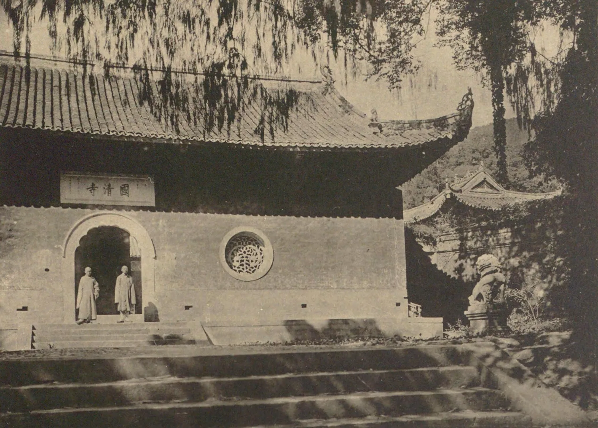
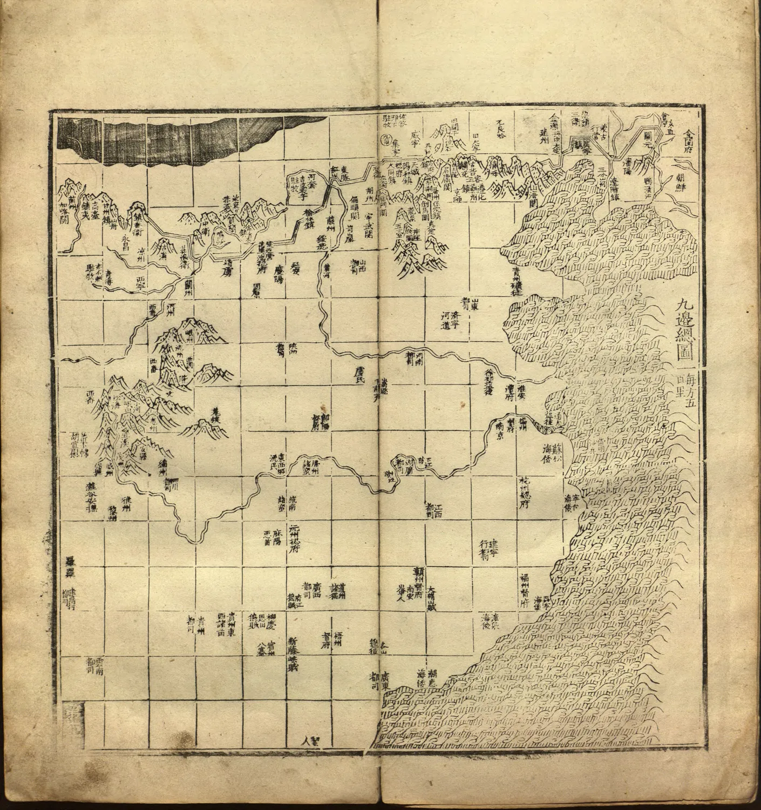
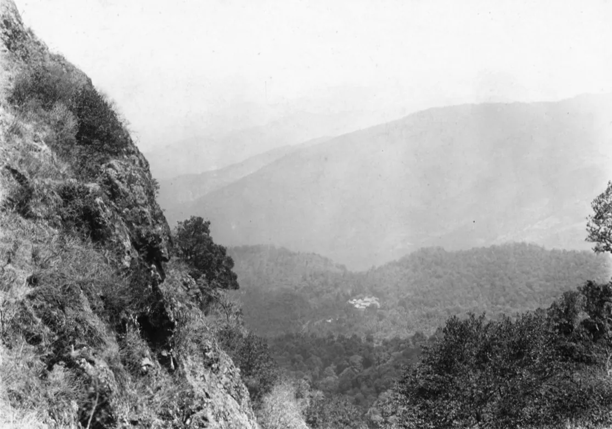
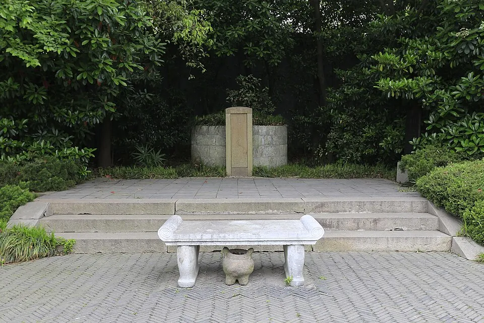
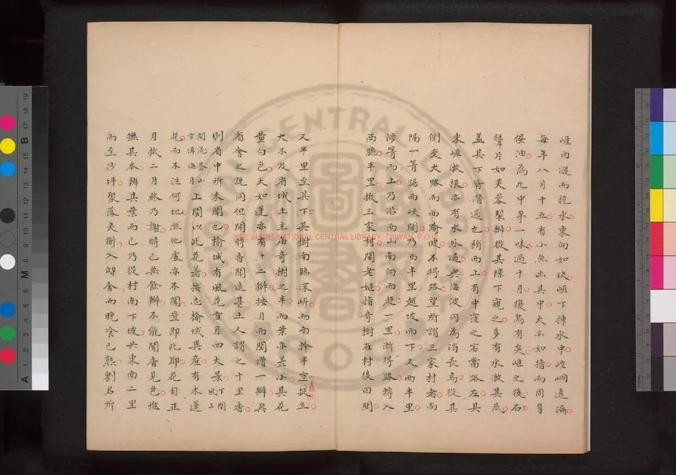
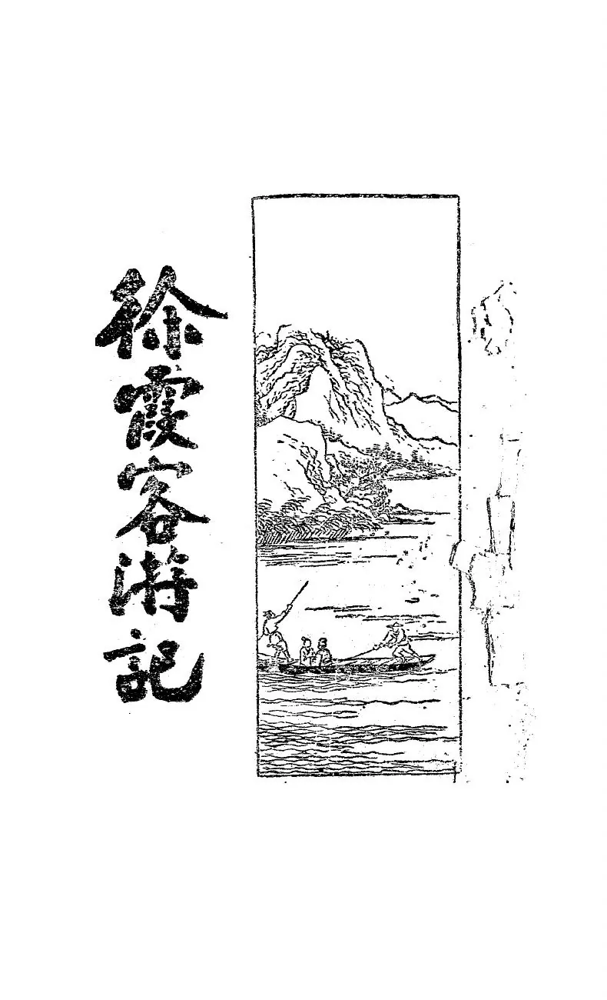

**文 / qscqesze**

崇祯十年二月，徐霞客在衡州等一笔借款。刚从湘江的劫船上逃出来时，他丢了衣服、路费和一部分书，头发里仅留下一件银耳挖。他把它给了一位借衣服的同船客人，又把借来的裤子让给受伤的顾姓仆人，自己穿着一件短衣上岸。几天后，他寄住在金祥甫家，打算借钱继续西行。金祥甫愿意设法筹措回乡的衣装，却未立即答应供给此后数千里的路费。[^1]

回家并非全无可能。徐霞客在日记里写明自己的顾虑：倘若这时回去，再想带钱出门，妻儿便不会答应。他只好留在衡州等待，二十六日金祥甫终于答应借二十金，他为此立下一张涉及二十亩田租的契券。旅途得以继续，要用家乡的收入承接远方的损失。[^2]

跟他一起等候的僧人静闻，在劫船上受了两处伤。静闻曾冒险留下救经卷，又从水里捞米，给幸存的人煮粥。徐霞客将这些事逐件记下，同时记下获救的行李里有哪些书、哪几封介绍信失去了。绵延数年的西行从这里继续，带着伤员、债务，以及一批再也没有找回的纸。那时他还不知道，静闻不能活着到达鸡足山。[^3]

## 一、母亲的田产与家中的碑

徐霞客名弘祖，字振之，万历丙戌年生于江阴梧塍徐氏。保存其家庭生活的文字，来自家族纪念、石刻和友人传述，其中许多篇原本是为褒扬父母而作。陈继儒笔下的徐家，既有世代传下的田地，也有分家、疾病和盗乱造成的损失。弘祖的父亲豫庵公曾将分得的中堂让给长兄，夫妇另住较小的房屋，清理荒地，安排园圃。家里种田、存粮，也有供乘坐的轿和船，有可以吩咐办事的家童。这些田地、船和人手后来也给儿子远游提供了条件。[^4]

父亲受伤后行走需用手杖，晚年又久病。王氏承担照护、家务和产业经营。陈仁锡为她撰写的墓铭，将许多劳作并列在一起：操持公私事务、照管农事、营建屋舍、哺育儿子。墓铭当然着意写她能干，但这些事情也说明，弘祖长大以前，家产并不是自行运转的。他后来离家时，留下的家庭已有几十年经营的秩序。

王氏的丈夫还有一位侧室所生的幼子。按陈继儒的记载，丈夫临终嘱咐她，给这个儿子的产业不必与前两子相同；王氏却将田庐分作三份，尽可能公平。陈仁锡的墓铭也记她照料季子、分给产业并另供赡田。这两篇文字各有赞母的写作目的，对于处置财产的大略却相近。弘祖与母亲共同居住，家中其他成员的生活则靠这次分配继续。远游从未使他与分家后的田租、亲属义务断开关系。[^5]

他先娶的许氏早亡，留下幼子，家人称作卯孙。王氏把孙子带在身边养育。弘祖后来续娶罗氏，陈仁锡与罗氏的父亲罗济之有亲缘和交谊，故而对这个家庭并非全无所知的题碑人。墓铭写许氏身后王氏照顾孤孙，也写罗氏事奉婆母。这些家庭内部的接续，比一则母亲鼓励儿子走天下的故事更长久：儿子出门以后，年长母亲、妻子和其他家人仍须照管孩子与居处。[^6]

陈继儒还记王氏织布，布匹的质地能被买者认出。她在篱边种豆，带着孙子和婢女料理，秋后又把豆藤收起作燃料。描画这些生活的《秋圃晨机图》，得到高攀龙、文震孟等人的题咏。诗中有机杼、豆花、白发、读书的孙子，常用的材料都来自这个家庭愿意示人的日常。图与题诗把一位乡居妇女的勤俭做成了可以携带、出示和传阅的纪念，也为弘祖结交江南士人提供了话题。[^7]

弘祖不是因一夜决意而离开这一切。他在江南的亲友往来、奉母生活与外出之间，逐步形成可以反复出入的办法。友人后来为王氏立传时，极力说明游山与孝养并不冲突。这样的说明本身就有分量：一个有母亲、有妻儿的成年男子，若将大量时间用在没有官职或商业收入的旅行上，总得向家庭和交游圈解释自己的选择。

王氏也接受儿子对山水的热爱。陈仁锡记她送行所说的话，先是要谨慎，再是认识好人、游好山水。她与儿子在八旬之年同游句曲、荆溪，也是两篇纪念文字反复称述的事。她没有只在家里等他回来，晚年还曾亲自进入他的游历。墓铭甚至称她行路在儿子之前；这是颂文里的赞语，可以看出当时人怎样赞许母子的相处，却不能据此计算她每日走了多少里。[^8]

在游山以外，王氏也指示他做家族之事。有一年米价上涨，她让弘祖拿出数十石粮赈济，并以先祖的旧事为依据。弘祖想为她另建居处，她却提出应当先整治先人墓碑与旧文纪念。儿子照办，求名家撰写或书写，逐渐把家族文字刻石保存。对他而言，带出去的名帖与带回来的题字，都有家乡的用途。远道求文和亲自看山，常在一次行程中交错。[^9]

年轻时，他先从江南水路走起。据陈函辉记下的自述，万历丁未年，他泛舟太湖，访东西洞庭两山；己酉年北往齐鲁，又登泰山、到孔林和孟庙。从太湖边到齐鲁之间的行程，今天不能像后来西行那样逐日核对。他讲起这些旅行时已经过了多年，留下来的地名大半是愿意说给朋友听的地方。可以看出的是，外出并未从一开始就以探江为务：去哪里，既取决于山水，也取决于旧书、故迹和听人说起的去处。[^10]

## 二、天台山上分开的担子

现存《游天台山日记》从癸丑年三月晦日写起，即一六一三年旧历三月的最后一天。徐霞客自宁海出西门，走到梁隍山，听说路上有虎伤人，当晚便住下。接下来的行程没有一条始终向前的直线。雨后路滑，他舍弃坐骑步行；到筋竹庵吃饭时，同桌的国清寺僧云峰提出，通往石梁的路险，带着重行李不便，不如让担夫先把行李送到国清，他自己轻装走山道。[^11]

徐霞客接受了。他与莲舟上人走向石梁，担夫跟随云峰走另一条路。旅途被拆成两条线：一边负担住宿和衣物，一边保留翻山探看的自由。轻装登山所以可能，恰恰因为有人把重物送往下一处会合地点。国清寺、沿途山庵和寺僧彼此熟悉的道路，在这里构成了实际可用的安排。

他抵达天封寺后，打算登华顶。日记留下对放晴的盼望，也留下改变行程的时机。上到黄经洞附近，见有僧人把洞口用石封住，以避从洞中吹出的风，他觉得可惜。僧人要在这里住下，旅人要看洞口原有的形势；同一处洞穴因此有两种不同的需要。徐霞客记录了封洞的理由，却没有把自己喜爱的自然景观当成当地人唯一应该保存的东西。[^12]

这一天，他从华顶折往方广、石梁，随后再走断桥与珠帘水。连续的瀑布使他不断变换观察位置：水先在斜合的石块间破碎，转成潭，再受两石相夹，最后从较宽的潭口流出。他说明各级有转折，不能站在一处看全。文字的次序与人的位置一同移动，使后来读者能够分辨，他何时在上面，何时下到潭边，何处因为岩石遮挡而看不见。

莲舟不能陪他走完所有地方。他赤足进草莽，抓着树木沿崖探看，到天暗才返。次晨又去石梁，从桥上走过，俯瞰深潭而感到恐惧，走到尽头却发现大石拦阻，不能通向对面，只好折回。同一段水，他先从下面看，次日再从上面看；走过仍不能贯通的地方，也明确留下了不能前进的结尾。[^13]

回到国清，他与先到的云峰再见，商量下一段路。云峰提出先骑行至寒、明两岩，再步行经过桃源、桐柏，可以顺路看完赤城等处。徐霞客照此雇骑出门，在无筏可渡的溪流边，又需仆人背负过水。日记没有给这位仆人留下姓名，却写了水过膝、过溪费时。对于主人，这是一段阻路的水；对背负他的人，水深与流速便直接变成身体承担的重量。[^14]

寺僧的指点也会出错。护国寺附近的桃源已经难寻，当地人说不清旧迹，云峰带他走小路，直到日落仍没有找到可以住宿的地方，最后绕到坪头潭。地图上似乎可以相接的名胜，在荒废的寺址和居民不熟悉的旧名之间断了。他把误路算进里程，不把向导每次的判断写成正确答案。

后来寻到琼台、双阙时，起初仍无人能准确指引。走了几里才访得所在，又与云峰登上山顶，赶在天黑以前辨认出夹峙的峰和绝壁间的平台。当天没有时间再登相对的峰，他便止于对面。收束行程的，是可用的白昼与返寺的路，而非把所有名目逐一完成的愿望。[^15]

这篇早期日记中，山色、水声、古松与山花仍有很多篇幅。他会比较哪一处更好看，嫌某些僧舍遮掩岩穴，遇到奇景便延迟回程。与此同时，坡向、溪水的来处、道路是否可通、旧名能否对应现地，已经不断插入赏景。此时的两种兴趣没有清楚分开。日后需要用来辨别江流的习惯，在一次次找路与折返中练习着。

<figure>
  
  <figcaption>关野贞摄，1918年9月27日，后收入《支那文化史蹟》第6辑。照片记录的是二十世纪的国清寺。<a href="https://commons.wikimedia.org/wiki/File:Tiantai_Guoqing_Temple_(Vajra_Hall).jpg">来源</a> · <a href="https://creativecommons.org/publicdomain/mark/1.0/">公版</a></figcaption>
</figure>

## 三、黄山的粮与雪

初游黄山时，徐霞客先从白岳下来，越双岭，跟随樵者行走，抵达汤口。上山之前，他到温泉沐浴，记录池的深浅、砌石和池底冒起的水泡，又记同行人对浴者太多的抱怨。旅人所到的山并非空无一人。樵夫知道近路，寺院接待香客，温泉有人共用，山顶的僧人还须靠山下运粮。[^16]

积雪使这套安排受阻。在慈光寺，他听僧人说，先前派上山送粮的人，走到雪没腰深处便回来了。眼前的消息改变了他的兴致，他暂时下山。次日天色晴朗，他再找向导，带着手杖上路；阴面结冰的石级太滑，他持杖凿孔，先容一只脚，再凿下一孔，同行者才照着通过。

这一次前进并不证明此前的警告多余。上面走下来的僧人说，已经在雪中受阻多月，此次是为了找粮才下山。他们说明前海哪些庵已离人，后海哪些路未通，指出莲花洞仍可走。徐霞客要去光明顶和石笋矼，接着选择方向时，依据的正是这些临时消息。能在雪山中继续走下去，与知道哪里还有住人和食物的庵不可分。[^17]

到了平天矼，他已经饥饿。庵里的主僧智空先给粥，随后建议，若尚有余力，可趁天光先登光明顶，回来再吃饭，下午仍赶得及到石笋矼，并宿在另一位僧人那里。他按此上山，再回来吃饭。智空又替他指出可以住下的狮子林，主僧霞光已在庵前相候。当天的游览能延长，靠的是前一处庵为后一处庵做好接续。

霞光并未只给他一间宿处，还让他先看庵北的两座峰。他循峰脊走过断崖上的木架，攀石探看下方诸峰，随后再从石笋矼另一面回望。前后所见不一样，他把峰回、岫转造成的差别记下来。远处初看平齐或相接的山，走到侧面会露出另一条谷；一个位置所见的景物，须靠另一个位置补充。[^18]

翌日他继续往下走，经过乱石和新崩的路段，到松谷一带。路似乎已落到山脚，询问才知，还须再下两重岭才能到平地。这样的误判，给他留下了比形容山高更具体的参照：旅人的感受会被连续下降欺骗，判断一个盆地或缓坡是否已经出山，要看后续地形，不能只凭脚下忽然平坦。

接连几天的雨雾也限制了判断。他原想继续探石笋深处，却因雾太厚改道，偶然遇到山庵便住下。另一位僧人称赞西南诸峰不逊于石笋，他与同行者前往比较，回来却认为还不能并列。寺僧的推荐能让他找到新路，至于景观的评价，他仍保留自己的尺度。[^19]

下山途中，他又专记溪流走向。黄山的水，有些直接向北，有些在山麓先向南，后来却转北汇入大江；另有一路则趋向徽州府城。他试图把几天来上山、下山经过的水连起来，分辨看似向南的水是否最终仍从北面流出。高峰与奇石在这段结尾渐渐退开，留下山地怎样分水的问题。[^20]

他没有测量仪器提供连续的高程与坐标。里程来自路上的估计和询问，水的远端有时只能听人说明。日记的用处在于保留了他怎样走到一个判断：从哪里进山，何时以为到了平地，又在什么地方修正。读者仍可能查出误差，却也能依他走过的路线回查。

## 四、看山的人也会走错

崇祯六年北游，到恒山之前，徐霞客从五台一带北行。他记下途中几重山的关系，有的山远望不高，到了北面才突然露出石崖；有的谷中溪水先向南流，越过山嘴以后却转而北去，进入浑源的范围。他沿溪入峡、翻岭，又循另一条溪走出，视线在几次跨越中逐步拼合。[^21]

这条路也有意外所得。龙山虽然早有名，却不在他出发时对恒山的想象中。先从西边走入，再从北边看，他才看清它与恒山并立的形势。山脉的知识在这里依赖行进方向。他没有一到山脚便获得整体，只在换到另一面以后，才明白前面经过的是什么。

到了峡口，大路上已有往来车骑，石壁间留着早年凿出的孔和少数悬木。他由遗迹推想，水涨时原来或有插木成路的安排。继而看见悬空寺，记下殿阁如何依岩安排，屋内怎样利用有限的进深。这一次，他赞许建筑与岩石的配合；在天台嫌僧舍掩盖洞穴的人，并非走到哪里都反对人工营建。判断取决于建筑怎样占据眼前的山。[^22]

登恒山那天，他经过北岳殿和会仙台，还要攀上殿后的山顶。灌木与枯竹在陡坡上勾住衣服，又会在借力时折断。他终于上去，从顶上辨别南、西诸山和浑源州城，随后想从先前见过的危崖下山，却发觉太险，不敢走。登顶时的决心没有替他解决下山问题。

他回头看见高处另有一人，再上去询问，才从指点找到了东南松柏间的路。走入树林后，先前在顶上看来细小如草的松柏，已是合抱大树。他由崖隙下到寝宫附近，发现出口只与原来上攀的隘道隔着一片崖。登高让他看得更远，也使近处的尺寸失真；最后出险，仍须一个熟悉道路的人指出脚下的通路。[^23]

在这些记录里，徐霞客时常站在高处判断山势，却又不断受制于人走的路。一次登山未必能使他把整座山看透。返回同一地区，重走另一侧，是补足此前所见的办法。早期各篇中长短不同的行程因此能够并存，不能简单排成每日一地、从不折返的一圈全国大旅行。

## 五、出门时先去看人

天启五年，王氏病重。陈函辉写她患病以后，弘祖长期在旁侍候，后来守丧期满，又到父母墓前辞行。这之前，远游者须一程一程回来，向母亲讲在外见到的人与山；此后，他可以把归期放得更远。母亲之死与最后一次远行之间仍隔着多年，中间还有闽、广等处的出游和访友。在日后写给陈函辉的信中，他把这次西行说成不知何时再返。[^10]

丙子年九月十九日，即崇祯九年，徐霞客终于开始早已计划的西行。日记开头说，事情已经拖延两年，自己将老，不能再迟。他原想先见黄道周，也想与族兄仲昭告别，前者音讯未至，后者没有南来。他前一天特地去土渎庄见仲昭，当晚又与来访的叔辈饮酒，随后放舟。同行的是静闻。[^24]

离家以后，船先走到无锡，又经苏州，他连续拜访故交，托人带家书、求取介绍，取订好的物品。在半塘替仲昭买竹椅，在阊门取染绸和裱帖。长途旅行刚刚开始，账里还有旧书的价钱要付，也有人情上的差事。他后来到乌镇见程尚甫的儿子，拿出行囊里的钱还早年的书款。这些支出挤在路费中，并不会因为目的地很远就消失。[^25]

九月二十四日，他上岸经过佘山一带，先看见故人的旧园已败，寺院也已改观，再去陈继儒的顽仙庐。陈继儒本来见来客便要避开，认出他后才出来，留他夜谈，并要为他写信给鸡足山的两位僧人，因而又留一晚。翌晨信写成，另外备了相送的礼物。徐霞客带着它们才正式转向西走。

介绍信使尚未见过的僧人有了接待他的理由，送给木氏等人的文字又能把江南名士与西南的接收者连在一起。信的用途只有到远方才能兑现，但要在远行以前就准备。几个月后，湘江劫船把其中一批带走，他惋惜的便不只是纸张和字迹，还有难以重新取得的引荐。[^26]

到杭州，他仍尝试打听黄道周的行踪。没有见成，便写信投到友人家；再写寄仲昭和陈木叔的信，把过重的行李交人带回，买铜制炊具与竹筒。最后又向湛融师借银十两，补足旅费。僧人有自己的信仰与资财，也能向一位相识的旅客借贷。行囊减轻了，债务却多了一笔。[^27]

他此时已认识到，往后的路难有方便的送信人。江南水路密集，旧交多在一两段船程之间，一旦过了这些地方，家信与介绍信就不容易补寄。西行开头的数日因此兼有告别和置办的性质。喝酒、买物、偿债、寄信，与此后山中的攀援属于同一趟旅行，不宜为了一个决然出走的形象，把它们从起点删去。

## 六、转向河道的脚步

九月以后，他由杭州往临安、分水方向走。在全张的白玉庵，听庵僧讲曾经赴日之游；第二天过乾坞岭，发现一段不甚高的平缓山脊，两边的水却分别归入苕溪与浙江。他特别写下，平坦的地方竟然也在分水。山的高度并不能单独说明水向何方，低脊两边的田畦与溪流给出了另一种辨别办法。[^28]

他随后连记三九山周围的水。与其只看一座山峰，不如循着山麓走，看水从何处绕出，在哪里与另一支合流。他把桥、祠堂、村落当成沿路可辨的点。山脊在某一段很平，换到侧面却有陡壁，只有把两侧的流水分别跟住，才不至于因外观相近而误将不同的山合成一处。

到了洞山，先安顿行李，让仆人找炊饭的地方。当地两位吴姓人来帮忙，一位供饭，一位送蜡烛供他入洞。他便拿一柄有名人题书的扇子答谢。带来的书画在远方有了临时交换的用途；灯烛进入洞穴之后，又决定他能够走多深。

洞里先有高处的干道，再有低处的水道。他脱去袜子，沿水走入，见到石田般的层层边缘和积水，又穿过小门，听见水从裂隙下坠。他不因听到声音便声称已经追到尽头：水在里面从何处来，越过洞底后往何处去，仍不知道。写到这里，他保留了眼前可见的范围，后来者能够区分已经走过的通道与尚未查明的暗水。[^29]

当天原可继续走，担夫却说前面的马岭无处住宿，劝他留下。徐霞客认为，担夫只是家住附近，想回家过夜，于是在日记中记下自己的不满。两个人的目的并不一致。担夫想在当天结束工作后回到家里，雇主则想多走一段。日记只留下雇主的解释，没有担夫自己的说法；但这一次停宿，确实由搬运行李的人影响了决定。

翌晨，长随的王二不见了。徐霞客又找担夫，耽搁以后才出发，原先想从陆路走淳安的计划也随之改变。他转而搭船往分水、桐庐一带走。因为没人分担行李，水路反而成为能够继续前进的办法。在记流水方向的段落旁边，失去一个帮手便改变线路的经过也留了下来。[^30]

改搭的船未必合适。为了赶上，来不及去买米；到了夜里，只好借船上余米煮饭。接下来数次换船，米舟在浅水处等待转运，他也只能重新寻找可以前行的船。到了兰溪，官府为即将到来的军队封桥、聚舟，不准船只上下，他又让顾姓仆人留在旅店守行李，自己与静闻改去金华三洞。战争尚未直接落到他身上，征用交通已经切断原来的水程。[^31]

在金华，他询问城与洞的位置，才发现自己乘船走偏了：若先前从陆路过去，半天即可从中道入山；而现在已经随船到城边。徒步、搭船、询问与误路交替发生，留下的地理记录就是这样一点点增加。徐霞客没有一套可以预先排尽不确定性的路线，他在每一段重新组织人手、粮食和方向。

## 七、湘江以后的一张契券

次年正月，徐霞客一度与静闻分路。他把行李交静闻随船前往衡州，约好在草桥塔下会合，自己带顾仆走陆路，探茶陵、攸县一带的山。山里的寺院因虎患而散了僧人，问路者都劝他不要进去。一位当地人得知他仍想去，回家找来三人，带着火具与器械陪同入山。日记保留了这位未具姓名者的帮助，也记他们抵达空寺以后退出，搭船时又因衣服湿冷而无暇细察岸上的石崖。身体不适会使观察中断，他没有把赶路时错过的东西补成亲见。[^32]

二月离衡州再乘舟南上，船上有本郡的艾行可，也有原籍苏州的石瑶庭。徐霞客判断，这些人熟悉此间道路，便没有反对泊在新塘站上流对岸。黄昏以后岸上传来哭声，众舟都不敢多问。他猜也许有人布下骗局，让可怜者先来求助，再有人尾随勒索，并没有料到将发生持械劫掠。

静闻上岸询问，对方自称年幼，躲避严酷的主人。僧人劝他回去，安慰之后返船。不久盗众便冲了上来。这一前一后的时间关系后来成为指控静闻的口实，但徐霞客的记录没有证实静闻参与其中。船客事后迁怒救助者，与事件本身须分开。[^33]

他先把装路费的匣子移到可以下水之处，随即想从船尾逃走，那里却已有持刀的盗众。几次躲避后，人们挤在一处，有人受伤，他最后也从篷隙落水，被竹缆绊了一下，倒栽入江。重新站起，水只到腰间，才得以走到邻舟藏身。日记把这次幸存归于侥幸；其后他听到有人传说他身受四伤，还觉得那是讹言。后来知道，受伤的是顾仆。

这一夜，别的船也不断移走。静闻仍守在原船，先求盗众留下经卷，后又救书、救衣物。水里捞起的船篷被他当作筏，往返转移东西，到第三次船已经沉下。他又从水底取几件湿衣。不同船客的财物混在一起，得救后各人来认领，石瑶庭甚至斥责静闻，怀疑他上岸引盗，想侵占箱子。徐霞客为此在日记中写了一大段愤怒的辩护，强调静闻冒火、冒水的经过。[^34]

被带走或焚毁的书各有来历。张宗琏的《南程续记》是家藏二百余年的手迹，徐霞客曾费心向其族人求得；还有带给丽江木氏的文字、家书、家中《晴山帖》数本，以及途中备查的名胜书、云南志等。他逐项写出它们与皮箱、果饼、针、瓶、壶放在何处，怎样被掠取。这份清单使他的行囊变得具体：既装用来吃饭、喝水的器物，也装将要查阅的地方书和托人转交的信。[^35]

次晨与静闻重逢，三人都还活着。静闻给他干衣，又潜入水里取铁锅和湿米，煮粥先给其他遇难者吃。他们到深夜才返衡州。艾行可却始终不见，后来才在下游找到遗体。徐霞客去见其母，再与静闻拜奠。同船的艾行可没能回来；对生者而言，筹款、养伤和继续行路也都须从头安排。[^36]

金祥甫的帮助并非立即兑现。徐霞客先想向藩府借数十金，托金作保，等他回江南再还；金说没有可借的银子。又有向多人募助的主意，静闻甚至提出，自己本想为寺院购置斋僧田，如能先让众人接济徐霞客，待他回乡，可按受助数目为寺置田，并刻石记下出钱人的姓名。这样的办法要把远方旅费与寺产的将来收入相接，徐霞客起初也觉得为难。日记没有留下这项设想最终照数实施的记录。[^37]

等待时，他去看朋友，也出城游园，看花，登石鼓。受难不曾让日记只剩一味悲苦。他仍能记蕨芽与葵菜的滋味，比较花木的颜色。但决定往哪里去时，他又进入水府殿，问神求签：从荆州走，还是从广西走，哪一处能够筹得钱。就在这段求助神灵的记录旁，他又斥责城中轻信神农、黄帝将要降临的传言。对自己认为可信与不可信的信仰，他有不同判断；那些判断未必符合后来替他建立的统一形象。[^38]

二十六日，金祥甫得到一会百余金，徐霞客知道以后再求，终于获允借二十金。他用二十亩田租立券交付，接着又等了数日。到三月初二，款项终于收到，他将大部分仍封存金家，只携少量出门，先去道州、九疑一带，让静闻留候另一笔接济。刘明宇送来钱与绢布，又携糕果追到舟边相赠。所求的借款与零星馈赠，终于使停顿的行程重新活动起来。[^39]

## 八、静闻不能同行的日子

静闻的病逐渐影响旅行。一六三七年六月，在洛容准备往柳州时，徐霞客预先雇马让他乘坐，谁知僧人才上马便跌下来，再换一匹仍不能坐稳。改用车也不妥，道路上下坡时还要下车推挽，只会更艰难。最后只得高价请来三人抬轿，待到上午才走。徐霞客先到前面的铺舍等候，担心轿子快，自己跟不上；到了那里却迟迟不见人，轿到以后，静闻已经更加疲惫。[^40]

同一段路，对两个人是不同的距离。徐霞客仍在看隔江石山，辨别洞口朝向，写柳江两岸分属哪一县；静闻却需要不断更换承载的办法。雇马的钱不能变成身体承受马背颠簸的能力，改抬轿又添费用与等待。顾仆既随看病人，又照管行李，徐霞客自己的探看则间歇进行。他们很难再像初行时那样，轻易约定下一个会合地点。

八月到贵县、横州，徐霞客还是想另走陆路看山，再在前方会合船只。舟人不愿明确答应，担心他从山里下来时船已过了，或船等人而误程。错过南山以后，他在日记里细算水路的弯曲，觉得若先知船停哪里，自己本来可以去成。这是他与船上人争取时间的老办法，只是在此时，行李和两名病人都在船上，不能为了登山任意延迟船期。[^41]

中秋那天，他把他们安顿在南宁舟，自己渡江登宝华山。到寺里扣门良久才获准进入，想看的瀑布被丛木遮住，路也不通，他独自上岭，只听见瀑声，终未见瀑。夜间寺僧以酒和果物待他，他又写下月色与对坐。

九月，静闻留在南宁崇善寺，徐霞客另行向西。二十二日已经去告别，翌日船未开，他又想起静闻嫌窗前进风，而寺中迟迟没有修补，便再带一点钱去，让他雇人修整。僧人索要此前买的布鞋与衡州茶，他起初不肯给，觉得等对方能起身，自己还会回来相会，不必此时索取。寺中有人能替静闻整理卧具，也有人没有履行答应的事。[^42]

船终于移到窑头，他仍在想布鞋与茶的请求。静闻可能盼身体稍愈便自己去鸡足山，不愿继续等待；自己若去了别处，对方走了便再遇不到，若只打算等对方死后回来带骨，又违背病人尚要活着前行的心愿。徐霞客在日记里留下这番反复，随后重新上岸，走回崇善，把东西付他，再一次告别。那天回船已经很晚。

辞别静闻后，他沿左江上行，他记录左右两水如何交会，看江流在石根留下的形状，仍会因新见的岩洞而欣喜。在新宁，船先为本乡人停泊饮酒，他便趁空入城看州记，询问当地父老，然后把亲见的石峰与所读文字相互比较。没有病僧在旁以后，旅程在继续，先前的照顾却没有因此得到圆满的结果。[^43]

到十二月，静闻已经死去。徐霞客回到南宁，要把遗骨带往鸡足山。此前他也担心道路有阻，带着遗骨会更加难行，又到天宁寺佛前求签，最后决定带走。实际接取远比一句负骨西行麻烦。他要买香烛、蔬食，找人办理，又要向寺僧索还静闻留下的经卷和衣物。关于遗物归属和领取手续，他与寺里人反复交涉，还试图请官府出面。[^44]

这里的寺院已与他在黄山得到粥饭、指路的经历不同。负责接手遗物的僧人不肯立即交付，徐霞客指责他们想瓜分物件；住店的梁姓主人又不肯作证。他写领条，找见证，往返求告，最后只求取戒衣、册叶与竹箱，对能卖钱的其他物件不再追索。他的记录极为愤怒，所写动机仍是争执中一方的判断；能从中看到的，是客居者遇到保管遗物的人时，未必有足够办法使约定兑现。

十二月十七日，他从埋骨处捡取遗骨，用纸反复包裹，带回住处，又缝好置于大竹箱下层。连日求车夫都无着落，先约好的人临时不肯走，街上看见的车次日也找不到。十九日终于雇到一人，对方要价很高，他只得答应，还须经过一番推索才能出发。静闻的遗愿于是连同另一个人的负重，一起上了道路。[^45]

## 九、百感洞的三股水

他回南宁接取遗骨之前，曾在南宁以西的向武住了十六天。那里的石山中，流水时隐时现。他探看百感等洞，临走才合记当地山水，把走过、经过而未登、听说而未到的地方分别列出。走过的有七处，路过而没有登的有三处，另外两洞只听人说很奇。这份清单既让人知道他搜寻之广，也使记录的边缘保持可辨。没有走到的地方，不因为纳入综述便成了亲历。[^46]

枯榕江遇到横列的石山，在山西分成三股。一股顺山北入峡，一股循山南流下，一股在田间绕行。徐霞客沿不同方向去看，记录它们如何进入地穴，又怎样在百感一岩之中汇合，从山北重新流出。外面分开的水，山里面可能相通，若只在一处河口问水名，就很容易把它们当作彼此无关的几条溪。

他解释地下相通的部分时，用了推想的语气。中江突然落入土穴，他认为也可能潜通百感；这个判断来自各处水的高下和流向，不等于他从一个入口一直走通了另一出口。入洞亲见的通道、在洞外看见的落水处、由位置推断的连通，须在同一张叙述中分清。[^47]

百感洞的入口在高处。当地已有沿崖的木栈、悬梯，借树与石壁固定，踏上以后，一边是崖，一边是深壑。里面却不全是未经人事的空洞：有人用竹子设护栏，在高处存粮，又在洞内礼佛。徐霞客记这里能取水，那里可以储谷，也记洞口的自然光怎样从不同方向照入。道路与设施让他得以进入，人们避乱、储粮和修行的历史也使洞穴具有了日常用途。[^48]

另有一处水洞，他原想让村民扎筏而入，村民却说，未得土官的命令，不敢扎。直到黄氏命人送他去，方能继续。接待他的地方权力同样决定能看什么。一个自远方来的访客，即使体力足、意愿强，缺少舟筏与引导，也只能站在水外。当地统治者能支配的人手，替他打开了一段并非凭脚力便能抵达的路。[^49]

他说某洞冠于西来诸洞，仍是赏景者的品评，同时又花很长篇幅说明一山的前后、洞口的高低与水的来路。两种文字相连：先沿栈道攀入，再见光暗转换，最后把水流与山外的三条支流接起来。若只留下所谓奇险，那段地下水的判断便失去依据；若只提取水系结论，洞中住人、储粮和出入的条件又会消失。

## 十、在三里停五十天

接取静闻遗骨以后，徐霞客并未很快走到云南。他绕往三里，向驻守当地的陆参戎投书，并附上哭静闻的诗。陆氏是镇江人，两人先谈乡里，接着又约见。徐霞客带去的礼物有些被退回，劝说以后，陆氏收下其中一卷。书画、诗和乡谈，在陌生的营署里重新成为互相接近的办法。[^50]

陆氏让他住进署东的阁中，供给衣袜鞋裤，让他看新旧邸报。徐霞客这才得知黄道周在京的处境，又读到江南友人入狱等消息。来自远方的政治消息，与身体所住的屋舍在这时相接：一个在山中走路的人并未完全离开朝廷，只是要等有人拿出旧报，才能把沿途无法及时知道的事情补上。[^51]

他在那里过了年。雨多的时候不出门，稍停便与陆氏及其子侄游岩、看灯、看捕鱼。住得久，使他可以反复去同一处，分清洞的上层下层，几支溪水先在城外哪里会合，又从哪个峡口流出。他写三里周围的山，解释东西两界石山怎样环抱中间土山，城依哪一段尽处而建。能得到这样的整体，不只靠一次穿过，也靠住下以后反复走动。[^52]

留下来还有身体的原因。一次游青狮岩后，他病倒在东阁，卧了两日。病稍好，又想去另一岩，却被同行者以雨中路险、久无人游为由挡住，只得回来。陆氏替他择定出发日期，亲属分日设宴相送，临行又给路费、马牌和荐书，并派人送出。账里从此又多一批别人提供的资源，路上也将多几个愿意接待他的地方。[^53]

从旧年十二月二十三日住到次年二月十三日，日记自己算为五十日。人们若只按地图把旅行画成一根线，这五十天便很容易缩成一点。对他来说，那里包含了养病、交友、获知故人消息与勘察一地山水的时间；别处未必能提供同样的条件。他带着陆氏给的荐书离开，把已经画进文字中的水系留在身后，遗骨仍与行李一同向北搬运。[^54]

<figure>
  
  <figcaption>1558年刻《广舆图》卷二九边总图一，朱思本原图、罗洪先重编，美国国会图书馆藏。为明代舆图实例，并非徐霞客使用过的那一册。<a href="https://commons.wikimedia.org/wiki/File:Guang_yu_tu_-_er_juan_LOC_2008623187-1.jpg">来源</a> · <a href="https://creativecommons.org/publicdomain/mark/1.0/">公版</a></figcaption>
</figure>

## 十一、从都匀带走的问题

崇祯十一年春，徐霞客进入贵州。到了都匀，他先写信投访地方官，随后去文庙，向在廊下读书的人打听曾谪戍于此的邹元标。他问的第二样东西是郡志。那人的朋友回去取了书给他看。志书给当地凑足了八景，却没有交代大小马尾两道水从何处起、又流进哪条河；城西新建的一座九孔石桥，横在大水之上，也没有收入景目。他觉得书里有名目的地方未必值得看，有东西可看、可查的地方，书里却可能没有名目。[^55]

批评过郡志，他还得继续用志书。城东十里的九龙洞，他拿《一统志》所载的都匀洞来比对：距离相近，前后两门的朝向也合得上。当地新志却在一个条目下注两洞，一东一西，反而叫人难以分辨。这样的校对不需要断定哪一部书处处可靠。旧书记得清楚的方位可以留下，新书的地名也有用；但两者不能原样叠合，得有人走到洞前，辨认哪一道口朝北、哪一道朝南。

他在都匀看城，看的也是这些关系。城倚东山，街巷与城门随岗地展开，西侧临大溪；官署与文庙又朝向城外的山。郡志把一座山换了一个雅驯些的名字，他解释旧称所据，是峰头一条像蛇一样蜿蜒的石脊。城里人的称呼、山上的石头、文人给景点排定的次序，彼此并不总是相合。后来的读者要用这份日记找一个地方，能依靠的是具体的相对位置。

从省城南行，经华仡佬桥后，他走上一段平缓的岗地。先见路东的水跌入东北的山峡，路西另有一道水注入西北的坑里；再往前走，南侧的水已经向南。两旁山峰高，真正隔开南北水流的却是中间不甚显眼的独木岭。日记写他在路旁同几个人歇息，随即在记录里把这道岗定作分水之脊。辨认分水岭未必得上到全境最高处；如果两侧的水各有出口，矮岗也能把它们送往不同地方。[^56]

越岭后见青崖桥，水从桥下折向东南。他把定番州、泗城界及都泥江接入笔下的水路。青崖城本身还有另一种边界：地方属广顺州辖，屯却属贵州前卫，且有总兵驻扎。走路的人用同一座城记住宿与方向，管理田地与军屯的人却各有一套归属。写江流时如果只顺着行政区划排下去，容易误把州界当成水的断点；反过来，光顺着水走也解释不了关津为何在那里、下一段路从谁手里借得到人。

到普安，他又在城外用三座桥来认三支水。三溪在城东北一带汇合，绕过城东，出南门后流进水洞。这里的州与卫同处一城，另有龙姓土官和朝廷任命的知州并治。徐霞客记下当地曾受兵围、城破后重新收复，十多年过去仍可见损伤。日记对参与冲突的人沿用当时官书的称呼；比这些称呼更能说明地方生活的，是山岚洞一类地方怎样被用来避兵。当地人告诉他，从洞口沿水进入，里面有大塘，避难者可用舟渡。水洞既是他想辨明来去的地下通道，也是人们临急时知道该往哪里藏身的处所。[^57]

附近丹霞山上的庙也有被毁和重建的历史。徐霞客记僧人置田、种豆，以供朝山者吃用，却难于汲水：平日从岭畔取，遇旱须走得更远。庙里的粮蔬能由山麓庄田补充，水却不能由香客多寡来决定。他在三里看到筑城的花费，在普安看到山寺的用度，水道在这两处都连着人留居的条件。

五月初一，他把行装寄在普安旅店主人符心华那里，轻身去看丹霞。经过南门石桥，眼见溪流折入深谷水洞，因赶去丹霞，当时没有下去细看。后来从岭上走，路两旁屡见下陷的穴口，他才把这些地方与下方中空的水洞连在一起。哪些可以回头再看，哪些只好当日略过，始终由腿力、日程和存放行李的地点来定。最终写成的连贯路线，背后仍有不少没走进去的岔道。

## 十二、同名的两条江

《盘江考》不是从一处峰顶俯瞰得来的。他得把相隔很远的几趟路放到一起：在贵州遇到的桥与河，在滇东看到的海子与分水岭，以及此前在广西打听的河道。两条江都叫盘江，志书又以为它们出于一山，并在南宁府西的合江镇会合。地名彼此呼应，很容易让人相信是一幅完整的图；只要把其中几处实际走向串起来，图上便出现接不上的地方。[^58]

徐霞客在滇东曾到交水一带，看过他所认定的南盘水头；又听说从西面来的水更长，便往石屏去追。沿途看到的不是又一条自始至终叫作盘江的河：石屏西面的水先下为塘，再汇入异龙湖，出了湖另有泸江之名，穿颜洞之后才向东汇入盘江。倘若只将各处名称抄在纸上，塘、湖、洞和江会变成四个互不相干的条目。对他有用的是它们能不能按水往下走的顺序接上。

经过罗平时，他继续找人问下游。此前在广西府问当地人，未得确答；到罗平，问得江由师宗往罗平东南，经寨落、水口与各支流，再往泗城方向去。他把问来的路纳入文章。没有亲历的一段仍可记，但它的凭据与桥边实见不同。有时不同地方的人熟悉的是各自取水、渡河的一小段，跨出这一段，谁也未必说得出同一条河在远方叫什么。徐霞客要做的事有一半是问，另一半是比较答案的适用范围。

他在杨林附近看到另一个大湖，注意到出水北流，经过峡口再与寻甸、马龙一带的水汇合，便据此追论可渡河、北盘江的来历。《一统志》把南北二盘的源头都归于较近的东南支水，他觉得这个说法解释不了自己一路见到的远端来水。他并未取两道同名江的一个相似地名作为共同源头，而是分别追查它们从哪个湖口出发，在什么地方转弯，何时接纳另一道水。

接着是会合点。南宁府西确有左右江合流，合江镇并不是志书凭空造出的地方；错在把那两股水等同于北盘、南盘。徐霞客按自己整理出的线路，认为一股要经南宁，另一股到象州一带，直到浔州府境，才以黔、郁等不同名称接到一处。他把源头、途中误认的汇流、最后的会合分成三项驳正。这个分法比一句志书不可信更有用：后人可以分别查问每一个桥、每一段河，而不必整篇赞同他的判断。[^59]

《盘江考》也不能当成一份可直接替换今日水系图的报告。徐霞客对若干上游与支流的归属仍有推定，未能沿每一段水路查到底；所用州、司、渡口也属于当时的名称。它留下的是订正的步骤。一条水在不同地域里改换名称，恰好是官书和口传最易失手的地方；一个走了两三年的旅人，才能把一些本来相互隔离的消息带到同一张纸上。

入滇之初的日记如今不全。能见到的《游太华山记》只是一部分。他从云南省城搭船，先过田地夹水的一段，后来水面布满芦苇，舟只循苇间窄道而行，到高峣才舍舟登岸。上太华寺眺望，主要看到的仍是草海；想看开阔的池面，得再往罗汉寺以南。日后阅读这些条目的人，可以分辨他在船里如何看，在寺上又如何看，却不能拿一篇保存下来的山记代替缺失的几十天。[^60]

## 十三、古梅间的一包遗骨

崇祯十一年十二月，徐霞客来到鸡足山。此前在省城遇见来自这里的仙陀和纯白，他已同两位僧人商定，进山后料理静闻的遗骨。沿路仍有往日熟悉的安排：行李走大道先到寺里，他从岔路折去找白石崖；山洞有锁，他没能从门进去，又绕开堵路的荆棘，转探崖侧。可是这次寄放行装时，箱子里不只装着被褥和书。自南宁启程，他始终带着同伴的遗骨。[^61]

他初到鸡足山，先投宿大觉寺，第二天见悉檀寺的弘辨、安仁，两人请他移住。大觉寺的遍周有足疾，已约了相见，他没有立即搬。等见过遍周，弘辨等再来相迎，他才同去悉檀，把遗骨暂悬寺中的古梅之间。仙陀此时在山坡上督造塔基，徐霞客饭后登坡去找他。这件事并非他一到山脚便可自己办完：要有早先肯出面的人，也要有寺院肯安顿行客的地方。

到次年正月初八，他随诸长老去本无塔院祭扫，经过静闻葬骨处，登而拜之。午后，仙陀、纯白还带供品祭了静闻，他折返向仙陀道谢。日记把这一日写在寺院各人的祭扫次序中，没有只留下旅人的一件功劳。陈函辉后来在墓志里说他负骨至迦叶道场，并记一位闪姓文士为塔作铭；徐氏日记则记下遗骨怎样暂置、葬后如何致谢。对静闻而言，鸡足山原是他自己要去的地方；他没能活着走完的路，最后靠几处寺院里的人接续。[^62]

山里的生活不只关乎葬事。年末朝山的人多，诸寺之间开集，俗称街子。集市旧在石钟寺前，后来迁得离大觉寺更近。徐霞客在集上买鞋，顾仆买帽，两人在这里办的是继续走路必需的事。年关前日，他去兰陀寺看一块记迦叶事迹的碑。碑曾从华首门一带挪动，现在平放着，刻字两面都有，下半无法直接读。艮一拿出根据碑文誊写的挂轴，他放低卷轴，移案就录。因为文长当天抄不完，他让顾仆下山取被褥，索性在寺里住一晚。[^63]

就这样，一个用于宗教纪念的刻石，成了将来可以编入山志的文字。碑在什么地方，为何从原处移走，眼下只能直接看哪一面，抄录者所据又是哪一份转写，都是决定其可信度的细事。艮一告诉他，先前曾有人要把碑拖到山顶重新磨刻，是他出面阻止。既没能搬回旧处，便将碑留在兰陀。徐霞客的抄本继承的是这条并不直的保存链；若是僧人没有备下转写，客人就算亲临，也抄不全碑文。

悉檀寺里还有可供众人沐浴的池。池水从隔壁釜中加热，耗时很久；入池的人须先在池外冲洗，浸过一阵再出来擦洗，然后复入。他把这些动作记了下来，连众人入水后尽量不动、免使污垢落在池里的规矩也写明。寺院肯容纳游人，须有生火、引水、清洁的一套办法。行过三里以后，他在云南多借温泉洗浴，像这样经过安排的共浴很少遇见，因此值得细记。

除夕，他写完碑文，上山去见莘野，在楼中受留。另一边，弘辨、安仁还托顾仆带话，希望他早点回来，以免寺里惦念。两处都肯留一个远客，他最后留在楼上过年；向下看，朝山者的火光在谷间彻夜不绝。日记所记的是一个已有许多人沿路上下、停宿、交易的宗教场所。后来若把鸡足山仅当作徐霞客单独发现的山水，便无法解释他那晚为何在楼上，又是谁让他可以在这里度过年关。[^64]

<figure>
  
  <figcaption>《亚东印画辑》第3册第180图，亚东印画协会，1927—1928年辑刊。照片摄于后世，图题为云南鸡足山。<a href="https://commons.wikimedia.org/wiki/File:亜東印画輯_03_180_%22鷄足山（雲南省）%22.jpg">来源</a> · <a href="https://creativecommons.org/publicdomain/mark/1.0/">公版</a></figcaption>
</figure>

## 十四、谁把水送上山

新年后，顾仆说，大士阁后有一道瀑布，是此前行李沿大道走时他看见的。徐霞客听从他的指路，到了观瀑亭，又绕至跨水的玉龙阁。眼前的瀑布使他想起天台石梁，却不完全是旧景重来：这里水从哪两条山支之间出，阁怎样坐在峡口，亭上能够看见瀑布的哪一段，都有各自的位置。早年云峰带着担夫走与他不同的路，晚年顾仆也因此知道主人没见过的山水。两条线路再会时，有时能交换所见。[^65]

在大觉寺东轩，他又注意到池心的一根锡管。水从管里向上喷，有将近三丈高，却不会再升得更高。他此前便怀疑，这股水不是小池自己涌出的，另有一道更高处的水从地下伏行，到了池心转向上喷。问过寺僧才知道，轩左确有高崖，落水从崖上接进锡管，管埋在地下，延伸到池中立起。水向上所到的高度受来水的高度所限；若管路漏水，也难有原来的水势。他把见到的水柱和问到的管路合起来，写出池里看不见的部分。[^66]

马鞍岭塔盘的工地，有另一种引水。峰头没有水，附近东峰有较高的水源，中间隔着凹处。造塔的人立起成排木柱，在上面架起刳空的木沟，把水从凹地上方引到工处。徐霞客借鹊桥形容它，却特意转过来写：平常是桥把人送过水，这里是把水送过山。写下这个区别，便也写下了造塔的人怎样让工程在原本缺水的峰上继续。

他既看这些人工引水，也用当时习惯的龙砂、虎砂说山形。在他笔下，一座塔能否补足山势的缺处，与水如何从两峰间泄出，可以并列在同一段。这些方位词沿用的是他和僧人熟悉的堪舆说法；池里的锡管则有具体来处，可以沿路查找。[^67]

## 十五、木增请他校书

己卯年二月，徐霞客在丽江见到木增。日记称他木公，前来送信的有把事，接待外客的有通事。徐霞客借住通事的楼，不是在木府正厅里连续受宴的贵宾。一次从雪山南麓回来，使者以为他尚未离开解脱院，带着酒肉冒雨去迎，反在他返城途中相遇。二人一起走过府治前，越玉河桥，他回到楼里，才展开木增的信。[^68]

几天前，他已在解脱林替木增整理《云过淡墨》。鸡足山僧人从省城带回一部誊清的书，字写得整齐，篇章却有重出、颠倒，连抄错的字也不少。徐霞客先作标记，随后建议把内容分类。木增有祭事要走，留下大把事等他办完。他把文稿分成八门，赶着连夜校定。寺后的拱寿台和狮子崖，本来就在他寄居的屋舍上方，日记说因赶校书，两处都没有上去。[^69]

信里有两项请托：向黄道周求一篇序，另请徐霞客写信引介吴方生。此前谈及江南文士时，徐霞客推许黄道周，认为此人难见，文字也不易求；至于同乡吴方生，当时谪居云南省城，倒可以先凭书信相约。给吴方生的信可以托来人带往省城，向黄道周求序则还要另觅机会。徐霞客带到丽江的本钱，除了能走远路，还包括多年交游积下的信誉：他知道哪一封信可以代写，哪一篇序不能随口应允。

第二天，木增使人送来礼物，答谢他校书，又请他修《鸡山志》，并在出关前到木家院替第四子校文。他答应下来。此前在鸡足山抄碑、访寺的文字，本是随行所得，现在可以用在山志里。这项委托和校书一样，需要他给纷杂的材料排出次序。[^70]

木增能供给旅人坐骑和礼物，却不能让每一条路恢复通行。徐霞客想去北边的古冈，使者劝他不要冒险。他怀疑对方只是在推托，随即记下从当地听到的缘由：上年用兵不利，伤了几名头目，北境道上不安全，外铁桥也已被烧断。这些是他在丽江所得的消息，不能据此复原一场边地战争，却能说明他为什么没能按自己的愿望继续北行。后来传记把他的足迹写到昆仑和西域。这一次北行的安排却停在通事楼，古冈没有成行。[^71]

他问到的地方事务还包括天花。丽江人避痘，发现患病者便隔离迁出，往来因而中断。木家几位儿子中，有的人已经出过痘，有的人还在山中避居。日记照录当地将疫病同寅年相联的说法，那不是可以据以推算发病周期的医学记录；这时谁能够回府、谁只能在外等候，便与避痘有关。木增请他为第四子校文，也就有了一个可见的家庭背景。

同一日记还写了引水经过的田地。出城往木家院，徐霞客沿坡行走，北望三路水在桥边相会；先前过雪山下时，则看到一条原来有水的深沟已经干涸，水被引向东边的坡地。若循旧沟寻河，眼前没有一滴水；沿人新开的方向走，才知道水到了哪里。他需要把天然来水和开渠后的去向分别记明。住在平坝的人用水来灌田，旅人由灌田的水回过头来辨认平坝的来龙去脉。[^72]

## 十六、两条河怎样接成一条

丽江东北的金沙江迫近雪山，然后向东走；徐霞客从木家院一带看地势，又据沿路所闻记其在东山外转向南方。这里的水与丽江坝里的玉河不同：坝中几道水合流，出山口往鹤庆，金沙江则隔在另一重山外。要知道后者入川以后接到哪一条江，单在丽江看一眼江面还不够。与在盘江辨同名异水一样，他得把不同地方的名称和方向逐段配起来。[^73]

《溯江纪源》开篇不在雪山，而在他的乡里江阴。江水到家乡已很宽，当地人日常行舟，容易知道它有多大，却未必能说清它有多远。他说自己渡过淮水、走到黄河边，看到的河面不像大江那样宽，由此反问：如果黄河发源极远，长江只从岷山起，为什么两条河到下游会有这样的差别？一处河面的宽度当然不能算出一条河的长度；对他而言，那次比较提出了一个要靠上游来回答的问题。

他把宜宾一带看成判别处。由成都一带而来的岷江在这里加入，金沙江则从丽江方向经乌蒙等地而至。他用行程里数估计，金沙一线比岷江长，便不同意因岷江一线便于行船、名称为人熟知，就把它当成大江最远的源流。长江上游有的水段交通方便，官书得以记得明白；峡谷中道路不通的部分，即使水量大、来路长，也容易在读书人的印象里退居次要。他把这样的可见程度和江流本身的远近分开。[^74]

经书的用字也给了他一个办法。《禹贡》写岷山导江，他解释这个导字关乎禹治水所从事的地段，不必等于水从那里发生。照此说，岷山仍是书中有意义的地点，长江的上游也不必止在岷山。他不是通过改动经文来迁就自己的行迹，而是把一句常被用来定源的文字改作治水史上的定位。陈函辉知道这个说法，与江阴、靖江的地方文献发生联系；今天可读的篇章有由旧志转出的编者说明，不能把存文当作未经移录的原稿。[^75]

他没有去到今天所说的长江源区。把长江和黄河都系到昆仑、以三条大山脉解释诸水来去，仍是他用以组织远方知识的办法，文中甚至把金沙一线与佛书的河名相合。不能因为他在宜宾以上选对了主流方向，就把这些推论一并判作实测。反过来看，某些用来解释大地的说法不成立，也并不抹去他在地方之间所做的拼接。后来谈到他的地理见识，最具体的一点，是他让丽江人所知的金沙、宜宾人所知的上游与家乡所见的大江，成为可以相互核对的三个地方。

## 十七、永昌的一封家书

离开丽江后，徐霞客的日记仍没有变成一篇只讲大江的考证。到了腾越，官署送来州志，李姓主人又邀他去绮罗。他一边沿来凤山麓走，一边辨认田间分出的饮马河和绮罗水。罗汉冲的水入平地后分向南北，使他修改了此前对来凤山山脉走向的猜测。他还留意到，向城东的一股是当地人开浚出来的。至于开渠是否伤了地脉，他仍用当时山脉贯通的观念作答；这部分解释不能替代他所记的事实，即城边一条可见的水路有人工来历。[^76]

端午那天，一位老人认得陪同的李君，把二人请进家里，以腊肉和酒相待。饭后仍去罗汉冲看温泉。一处水温而浅，不能入浴，他还想往另一处去，李君着急回家，遂带他折返。陪客的人有自己的端午，不能任由客人把一日分成无数段。隔天，徐霞客令顾仆带卧具，另外去找马鹿塘的路；雾里走错，到一个屯中才问明自己已经走过了岔口。昨天有熟人相引却未能到泉边，今天可以自己选择去处却先走偏了。日记就这样同时保留两类不顺，不把它们改成必然抵达的旅程。

西行到永昌，钱粮问题没有因丽江的馈赠而消失。他在馆中抄书，朋友俞禹锡的仆人要回乡，可以捎带家报，他起初推辞。日记记下他的盘算：离乡已久，家里或许已经不以生还为期；信若寄到，得知他还活着，日后若再有变故，反而多受一回牵挂。当天晚上他没睡着，又另写一封，翌日送到俞馆。家中收信后的反应没有留下来，能看见的只是他两次动笔，终于把信交出去。[^77]

第二天他又记断粮，写信向潘莲华求助，并回信给省中的吴方生。等不及答复，他趁放晴出去看乾海子。过九隆池往山里走，他记一段深涧的水到谷口伏下，在园中和泉池两处重新出露，推想两处所见出自同流。此处仍可辨认他写作的两种时间：饭粮要等回信，水道趁天气能走便去查。生活的急迫未使他只剩求粮一件事，兴之所至也未能把粮食从账上勾销。

## 十八、钥匙交出以后

己卯秋，徐霞客又住进悉檀。此前经过一些地方后，他身上多处出疹，自以为与当地所谓瘴、风有关。在寺中以药草汤浴，他觉得稍有好转。寺里的体极给他看抄来的碑文，准备向丽江通报修志之事；这些碑有些是木增先命人抄下的，不全出自徐霞客的手。他在北楼写记，几天有雨也没有停止。到九月初九，他想去大理取寄存的衣囊，体极请他先等丽江方面回信。他留下来与僧人上山，当晚借宿狮林。[^78]

和光要下山，徐霞客让顾仆同去，因担心顾仆没有被子，又把箱笼钥匙交给他。次日早晨，顾仆没有回来。悉檀派人上山，说长老见他背着包囊往大理方向走，问过和光，怀疑并非奉命。徐霞客下山开箱，发现所存物件已失。体极、弘辨准备派两寺僧人去追，他阻止了，理由是未必追得及，追到也不能硬要人回来。事情经过只由留下的人记述，顾仆为何走、去了哪里，没有他的自述。徐霞客写得最痛切的是三年相依之后自己被弃远地，这份怨言也是一位失去长期帮手的主人对关系破裂的解释。[^79]

他此前曾因顾仆看到了自己错过的瀑布而改道，也曾带着顾仆在劫后缺衣少食中借钱。日记从来没有给两人留下对等的篇幅，仆人的劳作多半在主人需要取物、问路、找宿处时才写到。这次，给主人送来消息的人、准备去追的人都有记录，离去的人却从此不再作答。徐霞客要继续住山、整理记稿，原来由顾仆承担的事，只能另找人帮助，或者就此作罢。

此后的日记还有一场谈话。他同熟悉大理附近水道的史姓旅伴夜谈，对方说梁王山一带有溪本来南流，后来有人凿开峡口，引一支水入洱海。徐霞客曾经走过附近，对山脊所在有自己的猜测；如果凿水分流一说可信，过去所见便须换一种解释。他用的是假设口气，随即感慨实地走过仍不能少了讨论的人。次日又一起上山，他循引水木槽辨出一处崖下接连几层出水，各被附近静室引取。供僧人住下的水槽给他指了路，他反过来从这些人工支槽推想地下水可能相通。[^80]

现存日记到九月十四日便中断。季梦良附记说，王忠纫告诉他，九月十五日以后没有小纪；又据木增托修山志和编纂所耗时日，推想他留在悉檀做这件事。末尾的空白不能变成一份已经写好的归程表。留下来的《鸡山志目》和志略，让人看到他怎样把山支、水源、寺院与遗文分项安置；此前从遍周处问到的引水，从艮一处抄下的碑，从体极处得到的旧文，此时各有进入山志的机会。[^81]

## 十九、回乡的路与纸上的缺口

陈函辉记，徐霞客后来患足疾，不能像往日那样行走，木增安排人和轿送他东归。辗转坐轿，至楚地身体更加困顿，才得地方官备船回江口。墓志把这次归来系于庚辰，即崇祯十三年；徐霞客卒于次年。陈函辉说，他回家以后已不能如常接客，身旁放着带回来的石头。又说他遣长子徐屺去探在狱中的黄道周，临终前仍托人送书给故友。这一部分是友人所作的身后叙述，归家年份和主要关系可与其他传记相参，病榻上的逐句谈话则不必视为现场笔录。[^82]

<figure>
  
  <figcaption>江阴徐霞客墓现状，Zhangzhugang摄于2015年4月24日。图片缩放、重新压缩。<a href="https://commons.wikimedia.org/wiki/File:Jiangyin_Xu_Xiake_Guju_2015.04.24_10-10-34.jpg">来源</a> · <a href="https://creativecommons.org/licenses/by-sa/4.0/">CC BY-SA 4.0</a></figcaption>
</figure>

在陈函辉笔下，一六四二年三月初九，徐家将他葬在马湾。墓志给出了生年干支与旧计年齿，也把许多亲友所称道的游历合写到一起。其中静闻遇劫便死的说法，与徐霞客在广西照看他、后来返回南宁取骨的日记相冲突；昆仑、星宿海和西域的叙述，也不在已知行程可以落实的范围内。作者认识徐霞客，不等于跟着他走过这些路。墓志可用来认识徐家丧葬、故友往来及他们如何看待死者，而不能拿来填满缺日。钱谦益的传同样将传闻拉到远方，清初为游记作序的潘耒已经指出，钱氏未见游记，传里有不实处。[^83]

死者留下的散帙需要编次，家中塾师季梦良参与抄整，王忠纫和徐仲昭等人也在早期记录里出现。编者并非一开始就有一部从头到尾字迹清晰的原本。现存《滇游日记一》开头，恰好保存了一段缺册的来历：乙酉年七月，季氏一位族人去避难，见到游记，带走一册滇游文字；不久徐虞卿被杀，房屋遭焚，那一册没有回来。季氏还说，原稿后来又经抢散，此集一度失而复得。书的损失不是一次抽象的天灾，它发生在借书、避难和几户人家的先后变故之间。[^84]

希望曾寄在宜兴曹骏甫所抄的一部上。季氏记曹来吊祭，又来借遗书，为刊刻誊抄，原稿过了一年多才归还。后来陈体静追述，李寄从宜兴史氏处寻到曹本的传抄线索，所得却只有太华、颜洞等几篇，开头八十七日日记仍不见。陈氏推测曹在抄时可能以为《盘江考》已经含有若干经行概略，便没有逐日收录；这只是他的解释。读者能确认的是，抄本确实留下了别处没有的文字，却没有补全原来那册。李寄一辈人的劳动有成果，成果里也留下未能补救的空格。

<figure>
  
  <figcaption>清初钞本《徐霞客游记》书页，抄者未详，国立中央图书馆藏，索书号210.6 04027。图中保留馆藏扫描水印。<a href="https://commons.wikimedia.org/wiki/File:NCL-04027_2_徐霞客游記.pdf">来源</a> · <a href="https://creativecommons.org/publicdomain/mark/1.0/">公版</a></figcaption>
</figure>

康熙年间，杨名时借来岳父刘南开的抄本，花两个月誊录，后来又有重录序。潘耒读这部书时，看重的是徐氏能先辨山水大势，再逐处查问。他写序所赞的办法与旅人的原意并不必处处重合，却说明私人行旅怎样被后来的读书人转作一部有用的地理书。到乾隆四十一年，徐镇刊行游记；嘉庆十三年，叶廷甲比校他本，修换朽版，又附补编。乾隆间馆臣收入《四库全书》的则是杨名时编订的一系，不能仅凭书名相同便当作同一传本。[^85]

<figure>
  
  <figcaption>大中书局约1929年本《徐霞客游记》封面，中国国家图书馆藏。封面画作者未详。这一版并非丁文江的商务印书馆本。<a href="https://commons.wikimedia.org/wiki/File:NLC416-13jh008965-62267_徐霞客遊記.pdf">来源</a> · <a href="https://creativecommons.org/publicdomain/mark/1.0/">公版</a></figcaption>
</figure>

民国地质学者丁文江重新编读游记，为它配上年谱与路线图。对一份逐日写成、又经过不同人传抄的书而言，标点、校记和地图会改变人翻阅它的方法：过去须翻几卷查找一段山路，现在可以顺着图回到相应的日期。张雷研究近代的徐霞客评价，指出地理学界在选择和解释他的事迹时，尤其看重实地考察；这是近代读者对材料的一次重排。回到最早的传抄题记，季梦良着急找回的仍是刚入滇的那一册。后世可以画出已经知道的路线，在五月初九到八月初六之间，抄本却没有把每天发生的事交还给读者。[^86]

<!-- biography-body-end -->

## 年表

| 时段 | 事迹 |
| --- | --- |
| 万历丙戌年 | 据陈函辉墓志，生于江阴梧塍徐氏。 |
| 1607—1613年 | 墓志记曾游太湖、齐鲁；1613年天台行程见日记。 |
| 1624—1625年 | 为母亲祝寿，母子曾同游；母亲去世后居丧。 |
| 1636年九月 | 离江阴西行，静闻同行。 |
| 1637年二月 | 湘江遇盗，在衡州借款。 |
| 1637年秋冬 | 与静闻在南宁分别；后取遗骨继续西行。 |
| 1638年 | 经三里、都匀和普安入滇。 |
| 崇祯十一年十二月至次年正月 | 到鸡足山，将静闻遗骨安葬于山中。 |
| 1639年 | 游丽江、腾越、永昌；返鸡足山，顾仆离去，日记止于秋。 |
| 1640—1642年 | 病中归乡，1641年卒；1642年葬马湾。 |
| 1776、1808、1928年 | 徐镇刊本、叶廷甲重刊、丁文江整理本相继问世。 |

## 资料与注释

日记的月、日用原记农历；表中公元年份与年号并列时指对应纪年，不以干支年起点推定具体公历生日。日记以篇名、日期定位，异体字及断句从所读版本酌取。早期家事以陈继儒、陈仁锡记文为主，长途行程以日记为主；墓志、传记中的未证远游和临终对白不作事实展开。附入游记的序、跋、缺卷按与当事人日记分开使用。

- 徐弘祖：《徐霞客游记》，参阅[日记与附编转录](https://zh.wikisource.org/wiki/徐霞客遊記)、[清初钞本书影](https://commons.wikimedia.org/wiki/File:NCL-04027_2_徐霞客游記.pdf)及[大中书局约1929年本](https://upload.wikimedia.org/wikipedia/commons/8/81/NLC416-13jh008965-62267_%E5%BE%90%E9%9C%9E%E5%AE%A2%E9%81%8A%E8%A8%98.pdf)。
- 陈继儒：《豫庵徐公配王孺人传》，见陈思修修、缪荃孙纂《江阴县续志》卷二十三，[转录](https://www.shidianguji.com/book/LG2JYXXZ/chapter/1lxzzlxk01896)。
- 陈仁锡：《王孺人墓铭》，[宗谱所录文本转引](https://cnxxk.com.cn/list_32/1733.html)；陈函辉：[《徐霞客墓志铭》](https://zh.wikisource.org/zh-hans/徐霞客墓志铭)；钱谦益：[《徐霞客传》](https://zh.wikisource.org/zh-hans/徐霞客傳)。
- 张雷：《再造徐霞客——民国科学地理学》，《地理学报》2017年第72卷第9期，[全文](https://www.geog.com.cn/article/2017/0375-5444/0375-5444-72-9-1695.shtml)。

[^1]: 徐弘祖：《徐霞客游记·楚游日记》，丁丑二月十一日至十三日。[原文转录](https://zh.wikisource.org/wiki/徐霞客遊記/楚遊日記)。本文日、月沿用旧历，未转换为公历月日。
[^2]: 同上，二月十三日、二十六日，三月初二日。二十金与二十亩田租不能等同卖田二十亩。
[^3]: 同上，二月十二日；静闻后事见《粤西游日记三》《粤西游日记四》。
[^4]: 陈继儒：《豫庵徐公配王孺人传》，见陈思修修、缪荃孙纂《江阴县续志》卷二十三石刻记三。[转录](https://www.shidianguji.com/book/LG2JYXXZ/chapter/1lxzzlxk01896)。
[^5]: 陈继儒，同上；陈仁锡：《王孺人墓铭》，见汗竹《求证务实 去伪存真——徐母王孺人籍贯考》所录宗谱原文。[墓铭转录及转载说明](https://cnxxk.com.cn/list_32/1733.html)。此处据宗谱转录。
[^6]: 陈仁锡，同上。“卯孙”为原文称谓。
[^7]: 《江阴县续志》卷二十三，《题秋圃晨机图》及陈继儒传。
[^8]: 陈仁锡《王孺人墓铭》。母亲纪年、年龄采用原文层级说明；正文未换算生日。
[^9]: 陈继儒《豫庵徐公配王孺人传》。原文“甲子”岁粮价与建碑事，不补造具体银额。
[^10]: 陈函辉：《徐霞客墓志铭》，壬申秋叙游及天启甲子、乙丑段。早年行期为墓志所记自述，母亲病中叙述为友人转记，不采用“心动知母病”之说。
[^11]: 徐弘祖：《游天台山日记》，癸丑三月晦、四月初一。[原文](https://zh.wikisource.org/wiki/徐霞客遊記/遊天台山日記)。
[^12]: 同上，四月初二、初三。
[^13]: 同上，初三、初四；恐惧为日记自述，未复原对白。
[^14]: 同上，初四、初五。
[^15]: 同上，初六至初八。
[^16]: 徐弘祖：《游黄山日记》，初二至初五。[原文](https://zh.wikisource.org/wiki/徐霞客遊記/遊黃山日記)。所用转录未在篇首标明年月。
[^17]: 同上，初五、初六。
[^18]: 同上，初六。
[^19]: 同上，初七至初九。
[^20]: 同上，十一日；水流判断为徐氏当次记录，未冒称已作现代水文图核验。
[^21]: 徐弘祖：《游恒山日记》，初九、初十。[原文](https://zh.wikisource.org/wiki/徐霞客遊記/遊恒山日記)。北游年份参看朱钧侃、潘凤英、顾永芝《徐霞客评传》第三章，[江阴市档案史志馆扫描本](https://www.jydaszg.cn/upload/202008/1smzw5288eb7s/徐霞客评传.pdf)。
[^22]: 同上，初十。
[^23]: 同上，十一日。
[^24]: 徐弘祖：《浙游日记》，丙子九月十九日。[原文](https://zh.wikisource.org/wiki/徐霞客遊記/浙遊日記)。
[^25]: 同上，九月二十至二十七。
[^26]: 同上，二十四、二十五日；《楚游日记》二月十二日所列失物。
[^27]: 《浙游日记》，九月二十八至三十。
[^28]: 同上，十月初三、初四。
[^29]: 同上，十月初四。
[^30]: 同上，十月初四、初五。担夫动机仅为徐氏判断。
[^31]: 同上，十月初五至初九。
[^32]: 《楚游日记》，丁丑正月十一日。
[^33]: 同上，二月十一、十二日。儿童身份与盗众关系未独立证实，正文不作裁断。
[^34]: 同上。救物部分为徐氏依据静闻转告所写，徐氏落水以后不可能亲见全过程。
[^35]: 同上，二月十二日。所列《游记》合刻，不能擅自认作徐氏此前全部日记原稿。
[^36]: 同上，二月十二、二十三日；遗体发现与伤势为亲属所告，不采用所叙异象。
[^37]: 同上，二月十三、十六日。
[^38]: 同上，二月十九至二十五日。
[^39]: 同上，二月二十六日至三月初五日。原文“鬮一會”，不补造具体会名与运作制度。
[^40]: 徐弘祖：《粤西游日记二》，丁丑六月十三、十四日。[原文](https://zh.wikisource.org/wiki/徐霞客遊記/粵西遊日記二)。
[^41]: 同上，八月十二至十六日。病名未确诊，不将疲惫直接归于湘江受伤。
[^42]: 徐弘祖：《粤西游日记三》，九月二十二、二十三日。[原文](https://zh.wikisource.org/wiki/徐霞客遊記/粵西遊日記三)。内心反复是日记明确自述，未补造未记载的心理。
[^43]: 同上，九月二十四至二十六日。卒日不详。
[^44]: 徐弘祖：《粤西游日记四》，十二月十一至十六日。[原文](https://zh.wikisource.org/wiki/徐霞客遊記/粵西遊日記四)。
[^45]: 同上，十二月十七至十九日。有关僧人动机与威胁仍是徐氏叙述；非独立调查的结论。
[^46]: 《粤西游日记三》，十一月十八日附记。
[^47]: 同上，枯榕江三水及百感岩附记；“想亦潜通”是原文的推断层级。
[^48]: 同上。石洞储粮数量为原文估计，本文未照录数字当作测量结果。
[^49]: 同上，十一月十四至十六日。
[^50]: 《粤西游日记四》，十二月二十三至二十六日。
[^51]: 同上，十二月二十六日。邸报部分涉及错讹与派系议论，正文仅采用获报与故交处境，不照录其中罪名为事实。
[^52]: 同上，戊寅正月及二月十三日地形总述。
[^53]: 同上，正月二十八至二月十三日。
[^54]: 同上，二月十三日。五十日采用日记原计，不套公历月长重算。
[^55]: 徐弘祖：《黔游日记一》，四月初二日，[都匀访志、桥与洞](https://zh.wikisource.org/wiki/徐霞客遊記/黔遊日記一)。
[^56]: 同上，四月十四日。独木岭及青崖是徐氏沿途记名，所述入都泥江为他的水路归并。
[^57]: 徐弘祖：《黔游日记二》，普安、山岚洞及五月初一日，[原文](https://zh.wikisource.org/wiki/徐霞客遊記/黔遊日記二)。山岚洞避难及庙宇沿革含当地访闻。
[^58]: 徐弘祖：《盘江考》，[原文](https://zh.wikisource.org/wiki/徐霞客遊記/盤江考)。广袤里数、河道归并和历史地名均依原文论证，不作现代河源认定。此处的广西府为滇东旧府名，与广西省不是一处。
[^59]: 同上，文末所列三项订正；关于南北盘江线路为徐氏当时的解释。
[^60]: 徐弘祖：《滇游日记一》附《游太华山记》，[缺卷按语及附文](https://zh.wikisource.org/wiki/徐霞客遊記/滇遊日記一)。
[^61]: 徐弘祖：《滇游日记五》，戊寅十二月二十二至二十四日，[原文](https://zh.wikisource.org/wiki/徐霞客遊記/滇遊日記五)。入山时见仙陀等的叙述兼回记在唐大来处议葬。
[^62]: 徐弘祖：《滇游日记六》，己卯正月初八日，[原文](https://zh.wikisource.org/wiki/徐霞客遊記/滇遊日記六)；陈函辉《徐霞客墓志铭》亦记葬骨及塔铭，[转录](https://zh.wikisource.org/zh-hans/徐霞客墓志铭)。墓志称撰铭者为“闪太史中畏”，未见塔铭原件。
[^63]: 《滇游日记五》，十二月二十八、二十九日。
[^64]: 同上，十二月三十日。
[^65]: 《滇游日记六》，正月初四日。
[^66]: 同上。高度用日记估量，未换算成现代测量值。
[^67]: 同上，正月初八日马鞍岭塔工。
[^68]: 徐弘祖：《滇游日记七》，己卯二月初八至初十，[原文](https://zh.wikisource.org/wiki/徐霞客遊記/滇遊日記七)。黄石斋即黄道周；吴方生为日记所称。
[^69]: 徐弘祖：《滇游日记七》，己卯二月初四至初七日，记省城抄本、校勘和分为八门。[原文转录](https://zh.wikisource.org/wiki/徐霞客遊記/滇遊日記七)。
[^70]: 同上，二月初九日。礼物为校书之酬，修志是随后请托，未据此推定固定薪俸。
[^71]: 同上，二月初八日。外铁桥烧断与边情为徐氏所闻。
[^72]: 同上，二月初八至初十。出痘周期为当地说法。玉河及引水的方位从当次记载。
[^73]: 同上，二月初十日；《溯江纪源》所述金沙一线，[原文](https://zh.wikisource.org/wiki/徐霞客遊記/溯江紀源)。
[^74]: 徐弘祖：《溯江纪源》。所举里数不是现代实测里程。其水源解释另含昆仑、三龙和佛书河名，不能以今日地理替他改写。
[^75]: 《溯江纪源》篇前冯土仁按语、篇末陈体静按语；陈函辉《徐霞客墓志铭》。
[^76]: 徐弘祖：《滇游日记十》，己卯五月初四至初六，[原文](https://zh.wikisource.org/wiki/徐霞客遊記/滇遊日記十)。
[^77]: 徐弘祖：《滇游日记十一》，己卯七月初一至初五，[原文](https://zh.wikisource.org/wiki/徐霞客遊記/滇遊日記十一)。
[^78]: 徐弘祖：《滇游日记十三》，己卯八月二十九日至九月初九，[原文](https://zh.wikisource.org/wiki/徐霞客遊記/滇遊日記十三)。关于疾患采用自述，不作诊断。
[^79]: 同上，九月初九至十一日。
[^80]: 同上，九月十二、十三日。
[^81]: 同上，卷末季梦良附记；徐弘祖《鸡山志目》，[目录原文](https://zh.wikisource.org/wiki/徐霞客遊記/雞山志目)。季氏所推修志时段有别于逐日日记。
[^82]: 陈函辉：《徐霞客墓志铭》，晚年及归葬段；钱谦益《徐霞客传》，[转录](https://zh.wikisource.org/zh-hans/徐霞客傳)。两篇也有共享传闻，不能按两个独立目击者计算。
[^83]: 陈函辉《徐霞客墓志铭》；潘耒《徐霞客游记序》，见《遂初堂集》，[转录](https://www.shidianguji.com/book/HY0887/chapter/1klg3fsfw36lk)。
[^84]: 《滇游日记一》篇前季会明、陈体静及徐镇按。季会明即季梦良；文中所称介翁为李寄。八十七日是陈氏所计。
[^85]: 杨名时《徐霞客游记序》，[四库本所录](https://zh.wikisource.org/wiki/徐霞客遊記_%28四庫全書本%29)；国立中央图书馆藏清初钞本，索书号210.6 04027，[藏本书影及著录](https://commons.wikimedia.org/wiki/File:NCL-04027_2_徐霞客游記.pdf)；徐镇原序与叶廷甲相关序跋，见约1929年大中书局本卷首，[国图扫描](https://upload.wikimedia.org/wikipedia/commons/8/81/NLC416-13jh008965-62267_%E5%BE%90%E9%9C%9E%E5%AE%A2%E9%81%8A%E8%A8%98.pdf)。
[^86]: 张雷：《再造徐霞客——民国科学地理学》，《地理学报》2017年第72卷第9期，1695—1701，[全文及书目](https://www.geog.com.cn/article/2017/0375-5444/0375-5444-72-9-1695.shtml)。丁文江配年谱、图的经过据该研究，不把不同商务印书馆印次当作同一物件。
