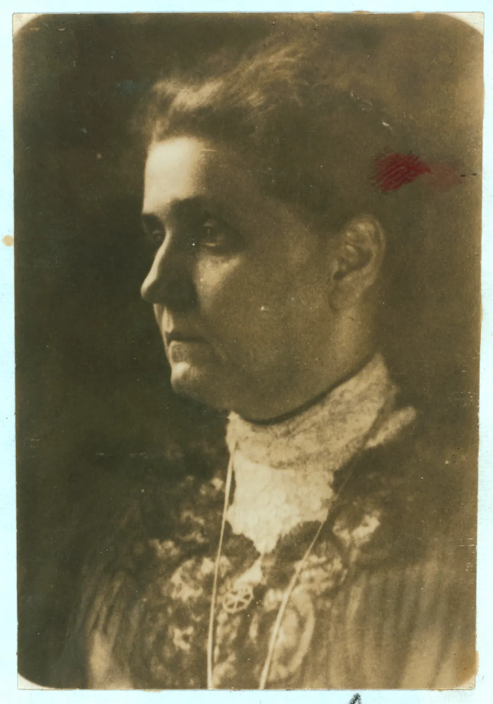
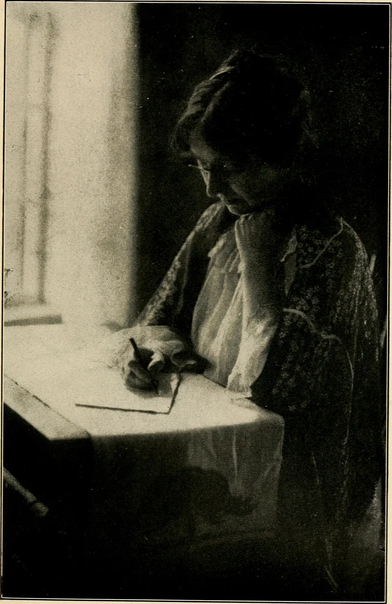
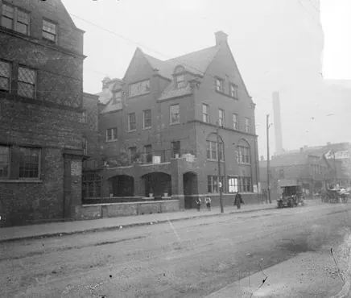
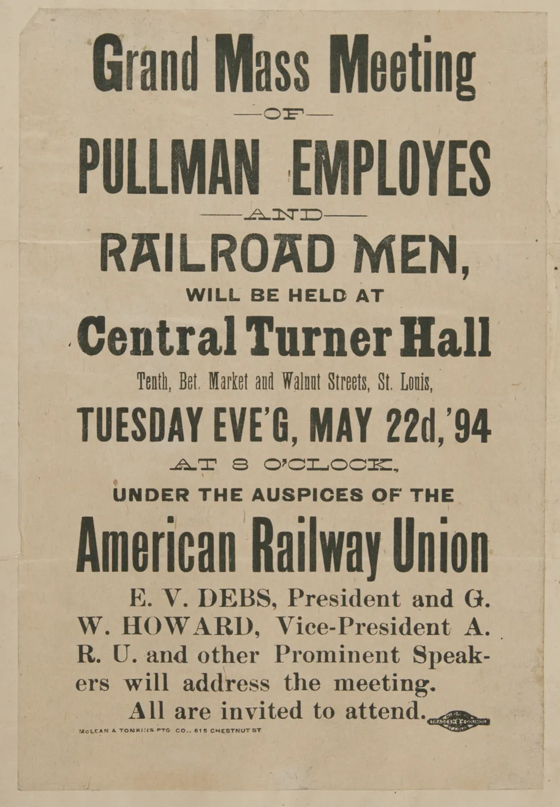
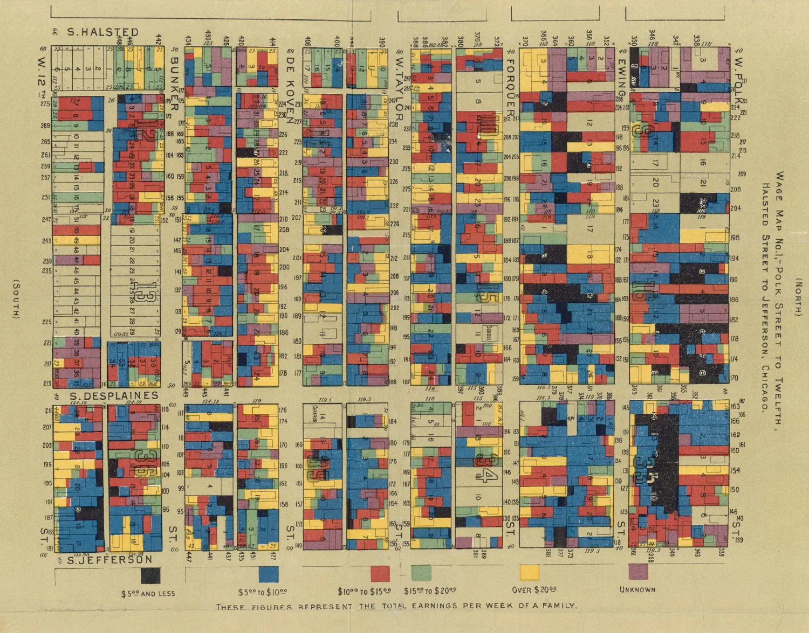
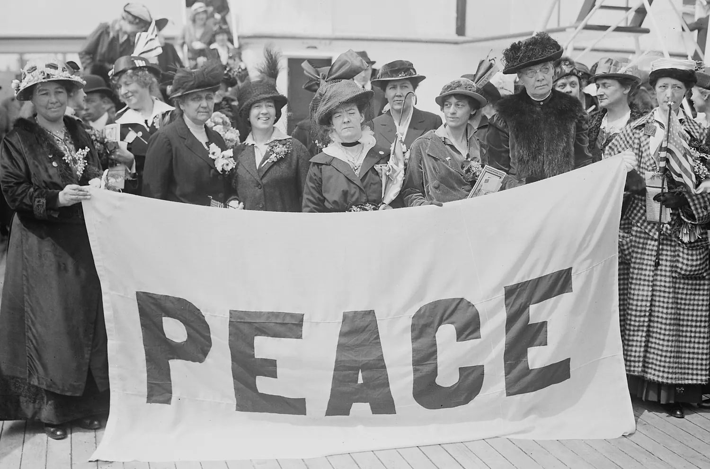

**文 / qscqesze**

一八九五年春天，简·亚当斯向芝加哥市政府投了一份标书。她要承包第十九区的垃圾清运。赫尔馆的邻居已经沿着街巷查了一个夏天，递给卫生部门的报告有上千份；不称职的巡查员换了几任，后巷还是原来的样子。两位商人愿意支持她投标。标书最后因手续问题被退回，市长却任命她做这个区的垃圾巡查员。按她后来记下的数字，职位年薪一千美元。一个习惯由政治关系安排的差事，交到了每天会去查车的人手上。[^1]

她清早跟着垃圾车走，看车什么时候开工、走到哪里、漏下多少东西。承包人原来只出九辆车，她要求加到十三辆，后来又加到十七辆。对方告诉她，每多派一辆车都赔钱，前任曾准许他用更少的车应付。业主不肯预备合格的垃圾容器，可以被告上法庭；租客试图让车运走马厩废物，同样要受管束。出了巷子，她要到市里交代巡查的结果；走回巷子，她还得分清哪些事归房东，哪些归租客。这一职位给了她在街区少有的行政权，却不能单靠一个人的坚持改写合同。[^2]

到芝加哥以前，她没有打算做垃圾生意。她学过一点医，跑过两趟欧洲，在家照顾过亲属，带回过画片和书。开设赫尔馆时，她和埃伦·盖茨·斯塔尔想到的是让一栋房子向邻人开放。后来几位住在附近的妇女肯在一天的洗衣、熨烫和做饭之后，继续查巷子，才有了她随车出门的工作。那一连串分工，从这栋房子开始，却没有止于它的门口。[^3]

<figure>
  
  <figcaption>简·亚当斯，约1913年。路易斯·海因摄，美国国会图书馆藏，nclc.04836。<a href="https://commons.wikimedia.org/wiki/File:Jane_Addams_of_Hull_House,_Chicago,_Ill._LOC_nclc.04836.jpg">来源与公版说明</a></figcaption>
</figure>

## 父亲选的学校

劳拉·简·亚当斯一八六〇年生在伊利诺伊州北部的锡达维尔。父亲约翰·休·亚当斯经营磨坊，担任州参议员；母亲萨拉·韦伯在她幼年去世，父亲后来与安娜·霍斯泰特·哈尔德曼结婚。两家的子女一起生活，一些人的关系又因婚姻重叠：简的一位姐姐后来嫁给了安娜的儿子亨利。几年以后，简因脊椎病卧床，给她做手术的正是这位既是继兄、又是姐夫的医生。家庭给了她选择学校和远行的余地，也参与决定她在何时能够离家、什么情况下应当回来。[^4]

亚当斯在五十岁前后写父亲，最具体的地方有时不在议会。她说，父亲给读书付钱：讲得清一篇普鲁塔克传记，可以得五美分；读完欧文的华盛顿传一卷，所得更多。她很在意父亲怎样看她，也曾在礼拜日学校见到外来客人时，故意挨着叔父走。她在自传里把这件事同脊背弯曲、走路时头偏向一侧联系起来：她盼别人看见父亲，却不愿让他们立即看出她是谁的女儿。这段回忆是她多年后自己挑出来的。读书能挣几个硬币，身体却无法照自己的愿望站直，两种童年经验都被她留在了纸上。[^5]

她父亲的政治生活在她的记忆里还有一份具体遗物。约翰曾收到林肯来信，信上用他的姓开玩笑，点明亚当斯的拼法有两个字母d。简把这个细节写在关于林肯的一章里。她认识的是会在自家村镇教主日学的父亲，对林肯的认识也先从父亲怎样说话、怎样收存书信开始。后来写普尔曼罢工，她仍以林肯说明一个有权者怎样对待平日不会在同一屋子里发言的人。用父亲的旧信解释她后来每一个政治选择当然太早；那封信至少显示，国家政治从来不是只在她成年以后才突然进入家门的陌生事务。[^6]

十七岁时，她想去东部的史密斯学院。父亲给女儿安排的是另一种教育：在近处读书，随后赴欧洲旅行。三个姐姐都上过洛克福德女子学校，他又是那里的董事。简的村校只教过一点拉丁文和代数。她进了洛克福德，几周后适应了寄宿生活。她入学时，校名仍是洛克福德女子研习院，学校当时还没有授出学士学位。学校里有赞成提高课程和资格的教师，也有把教育理解为传教准备的人。对学生而言，这些争论关系到读完书以后手里有什么凭证，以及凭证可以拿去做什么。[^7]

她在洛克福德认识埃伦·盖茨·斯塔尔。斯塔尔没有在洛克福德读到毕业，后来在芝加哥教书。两人的经历不完全对称：一人继续读到毕业，还能在停学后长时间旅行；一人先有了城市学校的工作，能够把后来同伴带入已熟悉的教师与妇女社团。亚当斯一八八一年结业，翌年才获学士学位。她还在做学生时主张让女性参与校董会，后来自己也进入其中。她已经有过在一所学校争取发言位置的经验，却还没有选好职业。[^8]

<figure>
  
  <figcaption>埃伦·盖茨·斯塔尔，1906年照片，摄影者未详。见1911年版《赫尔馆二十年》，北伊利诺伊大学藏本。<a href="https://commons.wikimedia.org/wiki/File:Twenty_years_at_Hull-house,_with_autobiographical_notes_%281911%29_%2814775070024%29.jpg">来源与公版说明</a></figcaption>
</figure>

父亲在一八八一年夏天的家庭旅行中去世。秋天，她和姐姐萨拉·艾丽斯到费城的宾夕法尼亚女子医学院学医。女医学生有了临床与解剖训练的入口，她也通过了第一阶段的考试；但脊椎问题加重，学业中断。西拉斯·威尔·米切尔参与治疗，亨利后来为她做手术。在自传里，她把此后漫长的卧床与阅读联系起来：在床上翻开卡莱尔的腓特烈传时，她由衷庆幸眼前不是格雷的解剖学。她既受身体限制，也明白自己并不热衷回到解剖室。后来她没有重新就读医学院；在她的机构里，受过完整医学训练的人将是另一些人。[^9]

## 两次渡海之间

一八八三年，亚当斯和继母等人乘船赴欧。伦敦东区给了她一个此后多次讲起的晚上。带他们去的人是一位传教士，游客从公共马车上看街边售卖不宜久放的蔬果。有人拍得一棵卷心菜，就坐在路缘吃起来。这个故事见于亚当斯二十多年后的书。她能写出带路人的职业、交易的缘由和自己停在什么位置，却没有写买菜人的姓名，也没有同他谈他的生活。她所见的贫困极近，近到能分辨人怎样吃东西；她在街上所处的位置又很远，只能随车离开。后来赫尔馆要调查工钱时，访员必须走进房里，让答话的人报出本周做了多少工。这是两种取知办法，中间还隔着好几年。[^10]

从欧洲回来，她有一段时间住在巴尔的摩。继母在那里接近正在约翰斯·霍普金斯大学求学的儿子乔治，简也因家庭的安排住到城里。她去过当地收容年老体弱黑人的机构和黑人孤儿院，随后又返回亲属身边，帮姐姐照料孩子。这些工作不是欧洲旅行的余波。它们发生在何处，要看继母在哪座城市安家、姐姐何时生产，也要看哪些公益组织准许年轻访客进去。她比许多同龄人有钱、有时间移动；这些时间仍要在别人的需要与自己的打算之间分配。[^11]

第二次赴欧，有斯塔尔和洛克福德教师萨拉·安德森同行。到德国乌尔姆，她看教堂座席上并列的先知、圣徒与古代人物，在笔记中试着为不同信仰的人共同办事找一种说法。在罗马，她接触早期基督徒的墓窟；几年后在芝加哥的教会训练学校讲课，能拿来讲的就是这次不算长的阅读和访问。她在欧洲也因坐骨神经痛休息过一阵。病中停下并不曾为往后的生活排好一条直路；能重新出发的时候，她仍在做旅行者可以做的事，找人介绍、听讲、进教堂和博物馆。[^12]

马德里的斗牛在她后来书里有很重的分量。她把自己看完表演后对无休止准备的厌倦写进回忆；但一八八八年还有另外一项可以追踪的行动。到了伦敦，她拿着一封介绍信去汤因比馆，并在给姐姐的信里把这次参观列为在伦敦最有兴趣的经历。那是一个已经开门的机构，有人把居所设在工人住的区内，从那里组织读书和课程。愿不愿意服务，可以在演说里表明；把床和书搬去什么地方、每晚由谁留在屋里，却要找一个看得见的办法。斯塔尔同她回国时，已有可借鉴的办法，也有下一步要亲自办的事。[^13]

亚当斯那年秋天受洗加入锡达维尔的长老会，并参与组建当地的基督教妇女禁酒会。第二年她在芝加哥给教会训练学校讲课。后来有董事因赫尔馆没有宗教课程而反对她继续参与，她没有再去开会。她并没有先断绝与教会的往来才开始做社区工作；恰恰是同教会接触过后，她和斯塔尔必须决定哪一种关系能带进新房子。那里可以住下有信仰的人，也可以借助教会中的朋友，但进门参加活动不能以接受一种教义为代价。[^14]

## 借来的一幢房子

一八八九年初，亚当斯和斯塔尔先住进芝加哥北区的一家公寓旅舍。她们向牧师、女社团成员、学校职员和记者解释计划，托熟悉街道的人带路。亚当斯在自传里说，两人起初打算自己支付费用，并没有在每一次介绍会上募钱。托马斯·戴维森听了便提出异议：一群有教育的人若住得太紧密，可能把相互陪伴当成了解城市。她们答辩说，集体住宿并非不能变动，甚至可以各自搬到附近公寓。实际走到找房这一步，她们还是需要一处能够容纳聚会、能被街上人找到的地方。[^15]

霍尔斯特德街和波尔克街相交处有座一八五六年建的砖屋，原属查尔斯·赫尔。周围已经不再是原来的住宅环境。屋子在长期转租中做过别的用途，旁边开着酒馆和殡葬铺。赫伦·卡尔弗是赫尔的亲属，也经管他的商业事务；她先把一部分房间租给两位创办人，随后让她们免租使用整幢屋子。一八九五年，随着赫尔馆成立法人组织，又订了二十五年免租安排。开始有一间可用的客厅，与日后能在这块地上盖更多楼，是不同的事。卡尔弗给出去的是许多年可以使用的地产，因此不仅免了账上的租金，也改变了其他人愿不愿在这里捐建一所幼儿楼或一间会堂。[^16]

<figure>
  
  <figcaption>从南霍尔斯特德街望赫尔馆史密斯楼，1910年。《芝加哥每日新闻》图片，芝加哥历史博物馆馆藏，国会图书馆数字编号 ichicdn.n056251。<a href="https://commons.wikimedia.org/wiki/File:Hull_House,_Smith_Hall.jpg">来源与公版说明</a></figcaption>
</figure>

九月十八日搬进来的还有玛丽·凯泽。她起初负责家务，在邻里间做的事日渐增多；亚当斯后来写，她去世时许多邻居来悼念她。若只记两个受到教育的创办人，屋里每日如何打理便失去一段来历。斯塔尔和亚当斯把欧洲带回的画片同家里的几件家具摆进去，有意按照自己肯住的样子布置。第一晚波尔克街一侧的门忘了关，没有失物。亚当斯把这当成邻人并不可怕的一个例子。次日以后，每开一天门，就有人要打扫、做饭和接待访客。[^17]

斯塔尔熟悉学校里的学生和老师，也相信艺术品可以离开富户的私室。会馆既有讲座，也供人借阅和集会。在创办初期，它同周围家庭相识，往往是从有人愿意告诉她们一件家务起的。亚当斯记最早来访的一位年轻女子来自附近租屋，母亲是遗孀，夜间到市中心擦洗剧场。剧场同赫尔馆都有装饰和文化活动，但这位妇人进入前者是去擦地。她的女儿到后者的客厅来，在亚当斯的书里没有留下姓名。[^18]

附近的人本来就有聚会的地方。婚礼、洗礼和舞会常可租酒馆的厅，钱未必主要花在租金上，而要按双方习惯从柜台上花出去。赫尔馆把较大的活动空间与咖啡馆配在一处，可以让青年跳舞、开会，再到楼下吃喝。经营者试过各种不含酒精的饮料，没能让爱喝啤酒的人都改去咖啡馆。真正稳定下来的是教师、附近厂里的人和几个俱乐部的聚餐。另一项以营养为目的的厨房实验更慢：埃伦·理查兹的波士顿办法能把便宜肉菜煮得营养又省钱，但从不同地方搬来的家庭各有熟悉的吃法。工厂肯买一部分汤和炖菜，邻居不一定想把它们搬上自己的饭桌。两个项目都开在附近，起作用的办法却不同。[^19]

有些女人所缺的是下班以后可以负担的住处。赫尔馆帮助成立后来被称为简俱乐部的合作宿舍，出钱置家具并付头一个月的租金。房子从附近两套公寓起步，接下来要由成员自己分担。会馆居民同她们读过比阿特丽斯·波特谈合作经营的书。到了交租的时候，成员们仍须自己商量开支和谁能住进来。按亚当斯的回忆，到第三年，俱乐部已有约五十人，用到了那栋楼的六套公寓。独立管理不等于没有外部帮助；头一笔房租和家具降低了起步成本，但付了这笔钱的人没有因此长期替所有住客做决定。[^20]

租屋毕竟不是按照集体生活设计的。准备筹钱另建时，一位董事找到一笔据称可达两万美元的捐款。直到谈到捐款者是谁，赫尔馆的几人才知道，那人以给女工低薪闻名。她们拒绝了。亚当斯回忆，这位董事很难回头向出钱人交代，因为募集本是他发起的；拒绝也不宜拿出去当公开抗议。她说这件事时没有留下对方姓名，不能从叙述倒推出某家厂就是那名捐赠者。后来俱乐部能建新楼，靠的是玛丽·罗泽特·史密斯和她姑母萨拉·波特·史密斯的资金。拒绝一笔钱之后并不是无钱建馆的人只凭决心盖成了楼。亚当斯能把条件说得这样明白，是因为另有人肯负担开支。[^21]

早期的妇女俱乐部原本接续幼儿园教师组织的母亲聚会。成员带来的问题，常比会馆预先列在课程表上的多。她们后来不仅去查后巷，还用衣物箱为生病或突然缺衣的家庭备东西；会员的孩子可以在会上得到学业奖励，家属也能来听音乐会。路易丝·德科文·鲍恩主持俱乐部后，出资添建有图书室与会堂的楼。一九〇五年她把钥匙交到亚当斯手中。赫尔馆当年添置的房屋并不是同一种钱盖成的：史密斯的父亲先出资建儿童楼，卡尔弗为几项建筑提供土地，鲍恩后来还出资建男孩活动楼。钱捐到房屋上，意味着会议能在哪些时候开，有没有地方可以留给孩子练习，而不是只在年度报告上多出一位捐赠者。[^22]

鲍恩支持亚当斯，也有自己的社区工作。她参加妇女俱乐部早期活动，推动俱乐部有自己的阅览与集会空间；后来支持建在城外的夏令营。年幼者放假能去哪里，早先和人行道、后巷是一道问题；把一批孩子送到城外，又要支付场地、交通和照看的人手。早期会馆以把自己搬到邻人住处附近开始，到了拥有这些条件时，它也能把活动的一部分搬出街区。谁能参加、由谁带去，仍须有人在城里和家庭挨个商量。[^22]

## 从衣片到厂法

第一年圣诞节，亚当斯给孩子发糖，有些女孩不肯接。她们就在糖果厂做工，已经不想再看见糖。按她后来记下的说法，旺季里一连数周，她们从早上七点做到晚上九点。同一个冬天，常来参加活动的几个男孩在附近厂里被同一台机器伤到，其中一人死去。赫尔馆的人以为厂主会装上并不昂贵的护具，所见却是工厂没有改装。父母有时还会先签下有关伤害索赔的放弃书。与其反复给孩子们安排一次节日，调查者必须知道厂主为什么可以照旧开机，雇员家里又为什么敢签下这样一张纸。[^23]

做衣服的人并不都坐在同一间工厂。布由集中裁剪的作坊发出，可以在小承包人手里再分，到最后成为某家租房里的一包针线活。孩子抽线，母亲缝制，活送出以后再按件结算。官员沿街去找挂有厂名的建筑，可能完全看不到这份劳动。要知道工钱，既要找到成衣厂怎样发包，也要进屋问谁动了手，工做了多久，收到的钱有多少。说这户人家每周有多少收入，同说某一件衣服一共给了多少钱，是两个问题。两者若不分开，工厂付出的工价很容易被误看成每个家庭实际拿到的工钱。[^24]

凯利看到的分工还可以细到一件外套：裁衣的人完成上游工序，缝合、锁眼、收边和熨平可以分给不同的人，成品回到厂里还有检验。她说，裁剪工组织得比较有力，因而能坚持较好的工钱和工时；即使留在厂里缝衣的人提出同样要求，厂方也可以把活外发。外包并不需要总把每道工序移出去，只要能在谈价时移动其中一道，厂内雇员就多了一个不得不考虑的对手。买衣服的人最后见到的是一件有统一牌号的成品，不会从领口分辨谁在什么地方缝了它。[^25]

未做好的衣片要送回来。按凯利所举的一类案件，承包人带走厂方交付的半成品，可以因不归还货物被追究刑事责任，甚至从州外追回；工人要讨他欠下的工资，却往往须自行走民事程序，不能让原来持有衣片的大厂替他还。货物有主，债务另有归属，这并不是一道只用提高工价便能解决的算术题。孩子在出租屋里做衣片，赫尔馆的来访者若要找一位能对整件事负责的人，从收到衣服的一头找过去，可能要经过几个各自只肯对一截工序负责的雇主。[^25]

把这样的调查做成州政府工作的，是弗洛伦斯·凯利。她一八九一年到了赫尔馆，有三个孩子；在那之前她念过康奈尔大学，在苏黎世学习，译过恩格斯关于英国工人处境的书。州劳工统计机关采纳她调查小作坊与童工的建议，给她职位。她在州报告之后继续参与立法，后来经州长约翰·彼得·奥尔特盖尔德任命，领队到现场执行。工人团体在居民们写报告以前已组织过调查；在推动州议会表决时，工会还替缺少经验的会馆居民找到可一起游说的人。问题既不是创办人一人发现的，法也不由一个写了报告的人单独送过议会。[^26]

一八九三年的法给检查人员进入作坊、检查卫生和儿童年龄的依据，规定受其覆盖的工厂、作坊不能雇用十四岁以下的孩子，并限制女工工时。凯利的办公室设在波尔克街，离住处很近，阿尔齐娜·史蒂文斯既住赫尔馆，也是她执行工作的重要同事。法条在州议会得到通过，不代表工头承认前来查看的女人有权开口；掌握一张凭证、能把情况带上法庭，又和只凭邻里关系登门不同。女工工时条款不久受到司法挑战，后来被州最高法院推翻。卫生检查、童工规则和女工工时的命运并不相同，因而不能说整部法律一经判决便消失，也八小时工作日虽写进法条，却未能保住。[^27]

亚当斯晚年回忆立法时说，她起初连游说这个词都不喜欢。去工会、教会和社团开口，仍然比替不相识的童工安排一晚的活动费事得多。反对者可以说，孩子不做这份工家里就少一份收入；还有雇主坚称离开儿童无法生产。赫尔馆也遇到靠十几岁女儿挣钱过日子的大人。亚当斯在书里对一些父母颇严厉，偶尔把挣钱能力和性格、出身绑在一起；但她同时留下一个更具体的事实：会英语的孩子有时比刚来美国的父母更能找工。禁止雇孩子之前，已经有一套用低价雇他们、让家庭支出依赖这笔钱的安排。法院能够判定州能否限制一份合同，却不必替这一家人筹下星期的饭钱。[^28]

## 去普尔曼镇

一八九四年，芝加哥铁路车辆公司所在地的工人罢工。经济萧条之中，工人说工资和工作机会减了，住在公司镇的生活开销却没有相应降下来。公司既付工钱，又从房屋取租；一位工人可以少挣，却不能请同一个业主按同样比例减免。管理方把营业和出租分开，认为两边各有账可算。对领工资付房租的人，这两笔账每天在一个家庭里相遇。工人尝试把争执提交仲裁，公司没有接受。芝加哥市民联合会组织调停，亚当斯在其中，还亲自去镇上查访，但没有见到乔治·普尔曼。[^29]

赫尔馆曾受这家公司创办人的馈赠：他出过一笔钱，供赫尔馆的男子俱乐部置办设施。这层关系能够让她知道企业也愿意出钱办某些公益，并不能保证调停委员会一到，公司便愿接受仲裁。工人委员会同样需要辨别来人究竟是谁请来的，是否打算在他们停工以后只劝他们返回厂里。路易丝·奈特从当年的材料重建这段经过，没有找到亚当斯向工人说辞的逐字记录。能查到的是各方会见、拒绝和要求，不能用她许多年后写成的文章替当日会议安排一场对白。[^30]

<figure>
  
  <figcaption>美国铁路工会1894年5月22日集会传单，纽伯里图书馆所藏普尔曼档案。<a href="https://commons.wikimedia.org/wiki/File:Pullman_Strike_Mass_Meeting_Broadside.jpg">来源与公版说明</a></figcaption>
</figure>

罢工后来牵涉全美铁路工会对普尔曼车厢的抵制。小镇的厂房与房租争执扩展到整条铁路线上，公司联盟、工会与联邦政府依次介入。火车能不能开动，既牵涉别处的工人是否接挂车厢，又牵涉邮件运输和司法禁令。亚当斯的姐姐玛丽·凯瑟琳·林恩当时在威斯康星州基诺沙病重。家人要从芝加哥赶过去，却也一时找不到可乘的车。姐姐七月六日去世，亚当斯随后成了外甥女埃丝特和外甥斯坦利的法定监护人；斯坦利有时跟她住进赫尔馆。她回去面对工人家庭时，住所的卫生突然关系到一名她须亲自负责的孩子。后来她说，察觉这一点才加紧行动，自己并不因此值得夸奖。[^31]

八月她向联邦调查委员会作证，说明自己同救济委员会的人看过房子，还在镇上同几个女工吃过晚饭。市民联合会提出，请房地产行业选三个人，估算公司镇的房租与相似郊区相比是否偏高。调停者希望由容易估价的部分先打开会谈；工人开会同意接受仲裁，却不愿让决议写成只争房租，便把其余诉求保留下来。她到场见过公司的代表，对方以没有可仲裁事项为由拒绝。证词记她把这次努力称为失败。她随后在演说中用《李尔王》讲这次罢工，写成的《现代李尔王》到一九一二年才发表。她让一向被称道的模范镇主人与莎士比亚笔下的国王相对照：管理者给员工安排了住处，也在习惯中把接受安排误作接受他的全部权威。她仍要求读者理解普尔曼希望维持公益名声的愿望，也责备工人在关系破裂时缺少体谅。这种写法并没有撤回她对拒绝仲裁的批评，却给她的判断留下了边界。一个工人家庭交不出房租，与一个资本家受公众谴责，并非同一种损失；文学类比可以让她说清权威如何养成，却不负责替双方把损失结平。[^32]

## 在后巷核账

跟车以前，赫尔馆的妇女俱乐部里有十二名成员参加过巡查。一些人住在爱尔兰裔居民较多的街上，最严重的死亡状况却出现在更拥挤的住区。她们要查的是别处的后巷，也可能因查得太近与邻居争执。亚当斯在回忆中记下八九月一共送交一千零三十七份有据的违例报告。这个数字来自她的叙述，表示投入过多少检查工作，不能单凭数字判断卫生部门办了多少宗，或每宗都应由什么人负责。[^33]

做了巡查员以后，她发现垃圾也有去处与售价。会馆把空铁罐送给用它制作窗户配重的工厂，送得多到对方用不完，更谈不上全都付钱。城里另外给人钱负责拉走死动物；据她查问，那承包人却让警用车辆搬运，尸体装上货车送往印第安纳州的肥皂厂。她说承包人还在那家厂占有股份。这是当事人事后记的账，仍值得看它指出了哪一处需要查证：街区居民只能催人拉走废物，知道转运以后的人却还能从废物里收钱。[^34]

有条窄街清出厚厚的废物，下面露出旧路面。市里档案随后也找到这段路原已铺过的记载。接着要争的是由谁负责把路面恢复出来；垃圾督察可以清掉一层，街道部门却掌握铺修的工序。亚当斯请市长亲去看，才让两个岗位之间有了结论。另一次她跟一位刚因公开批评而生气的业主看房。那一片租屋和马厩没有接入街上的下水道，业主愿给赫尔馆免租使用。有人劝会馆先收租，再用所得做公益；她们最后拆去最破的房子，把地开成操场。留下的好房卖掉挪开，场地后来交给城市管理。[^35]

会馆报告说，街区清洁改善时，死亡率在各区的名次也降了。亚当斯把变化归于巡查与其他原因共同作用。与她不和的区议员后来推动调整职务，把清运、道路清理和维修合并到一区的总管名下。新岗位要考试，开始只准男性报考。亚当斯丢了职位，赫尔馆的人才明白，一项工作若只凭现任官员得以维持，改一个职位的名称和资格便能拆掉它。区议员也有自己的支持者；一些居民愿意选他，正因为他们从他那里找到工作或熬过临时的缺粮。亚当斯后来写地方政治，要面对的是在政治关系下实际过日子的人。把他们都称作受骗的选民，解释不了一个有组织的改革团体何以难以赢过区议员。[^36]

第十九区后来仍遭遇伤寒。住进赫尔馆的医生艾丽斯·汉密尔顿在一九〇二年发病高峰之后发表调查报告。她一开头就拿到两个可以比较的数字：同为七至九月，芝加哥上一年死于伤寒的人数为二百一十二，这一年增至四百零二。她又从湖水、抽水站和卫生部门每日所取的水样写起。要找传病的路径，不能只因为巷里有臭味，就把发病一律算给没及时拉走的垃圾。她后来检查到访过污物处的苍蝇，提取微生物来比对。一九〇四年又专门写信给期刊，说明用来鉴别的血清反应强度不够，原来的证据有薄弱之处。亚当斯巡查时能命车夫多跑几趟；在汉密尔顿这项工作中，改善已经知道的一处环境，仍不能使医生跳过检验。[^37]

## 一张地图所能回答的事

垃圾巡查走过的是后巷，另一群人的工作则要走进后巷里的房子。早在一八九三年，联邦劳工部门受国会委托调查大城市的拥挤住区，芝加哥的调查点与赫尔馆相邻。负责到户询问的人把住户的就业和居住情况填入表格，带回后再从中取出工资、来源地等资料。会馆居民阿格妮丝·辛克莱·霍尔布鲁克将这些项目画在勘测底图上。刊于一八九五年的《赫尔馆地图与论文》把图同居民撰写的文章放在一起。亚当斯写序，也写了社区会馆与劳工运动的关系；画图、访谈和说明的劳动则各有署名。[^38]

沿图上的波尔克街往南看，房子并不是一整片色块。图上把临街和后排的住屋都画出来，同一地块可以有不同颜色。工资图给读者一把按周收入划分的尺：五美元及以下是一档，再向上分开，最高一档超过二十美元。在街上看，两栋房子的砖墙或许相似；从图上看，才能注意到后排的几户与前排邻居未必靠同样的收入过日子。也能反过来问：这些数目是哪个时段问出来的，算的是谁的所得，访员能不能进到每一间屋。颜色不能替问卷作答。[^39]

霍尔布鲁克在书中交代，来访的四名联邦调查员从四月六日工作到七月十五日，填写的是住屋与家庭两套表。底稿每天送回凯利处，寄往华盛顿之前，一位住馆者抄下作图要用的部分。画工资图时，不能把访问当天的周薪直接算成一年五十二个星期都有的收入。访员问过去一年失业几周，把有工作时的周薪乘以实际工作的周数，再除以五十二；一家有几个人领工资，就把各人的年平均周薪加起来。因此在地图上同为十美元的一户，可能每周拿十美元，也可能在有活时拿得更多，过后有一段时间一分钱没有。用地图评估一个家庭怎样买粮时，断工的长短比平均值还要紧。[^40]

房屋的大小也没有直接规定颜色占多少。一个地块住了一个人或许多人，图面仍用同样大的一块地方；多人有不同类别时，国籍图按个人分地块，工资图按家庭分。房客中付膳宿费的人另算一个单位。拥挤程度因而不能用眼睛数色块直接得出。霍尔布鲁克还写到，家庭受疾病、失业或欠租驱赶会不断搬家；她解释的是一年调查画下的住区，而不是永远不动的人口。研究者若想知道房子里实际挤了多少人，就要回到附表或政府的统计。地图让买不起大屋的人在街道上可见，但它不可能把他们每一笔支出都同时放上纸面。[^40]

<figure>
  
  <figcaption>赫尔馆工资图第一幅，1895年。阿格妮丝·辛克莱·霍尔布鲁克等据调查资料绘制；图版来自西北大学整理的扫描。<a href="https://commons.wikimedia.org/wiki/File:WAGEMAP1.pdf">来源与公版说明</a></figcaption>
</figure>

另一套图绘的是国籍与调查者划定的出身类别。这一套图比文字所说的街区多种人混居更细，有时能把同一街面上的差别读到几户之内。但住户若来自彼此政治边界与自称都不相同的地方，落在某一种颜色里，并不表示他们自认彼此相同。亚当斯用过不少今天看来粗略的人群称谓；图的优点在于把一群居民放进可以找得到的位置，它的局限也在这里：能定位的人仍要靠图例规定怎样被读。地图不是邻居自己在纸上留下的自画像。[^41]

论文补上了图不能容纳的内容。凯利讨论衣服离开大厂以后如何在小作坊加工；她与史蒂文斯还写到挣工资的儿童。斯塔尔的题目是艺术与劳动。对她来说，一件东西怎样被做出来，和它完成后能不能在美术馆展出，同样关系到制作者的生活。并排的文章说明会馆里没有一门统一的学问：到户调查的人问一周工资，写厂法的人问谁对这些工作负责，教艺术的人又问劳动给制作者留下了什么。如果把这些问题全缩作创办人的一项贡献，连书的目录也解释不了。[^42]

会馆后来安排一项劳动博物馆的工作。亚当斯把它的起点写成一次在街上看见年长的意大利妇人纺线。她担心移民子女熟悉新城市，便不再知道母亲的手艺在旧家怎样使用。于是有经验的女工被请进馆里，在众人面前演示怎样用纺锤、纺车或织机。工具可以同照片、织成的东西一起陈列，知道某种方法的人还可以当面纠正观众。让妇女来到这栋楼里，并非总为让她们听课；手艺若没有被带进门，讲课的年轻人便少了一种自己不会的本领。[^43]

不过，亚当斯同样会把自己喜欢的乡村旧手艺，与她觉得过于急躁的城市生活相对照。一位妇人可以乐于教别人纺线，又不愿用纺线的所得来支撑一家人的日用。手艺被承认为知识，并不会消除服装业在计件价上给工人留下的难处。博物馆把发问的方向暂时调转了，仍不能代替隔壁正在进行的工厂检查。赫尔馆能同时办两件事，是因为纺织既是文化记忆，也是会弄伤人、会拖欠工钱的工作。

一八九六年，亚当斯和史密斯一同去欧洲。头年秋天她得过伤寒，身体迟迟未恢复；旅行既是养病，也让她看同行者怎样办事。在英国，约翰·伯恩斯带她看巴特西用街道清扫物制成铺路材料的装置，也看教砌砖和水暖的学校、学童上游泳课的公共浴场。过去她是跟着一辆漏下废物的车去垃圾场，这次她能问负责市政的人，扫起的东西还能做成什么。她和史密斯又去见奥克塔维娅·希尔，后者把收租、管理小屋、供应共同活动场所放在一起。英国同行者提供的是不止一种做法，赫尔馆既可以自己试，也可以要求市政机关试，不必照汤因比馆的组织复制到底。[^44]

到俄国，她去见自己长期读过的托尔斯泰。此前她已经疑惑，不从事工人每天做的体力活，只在隔壁为他们开课，究竟算不算共同生活。按她后来写的相见经过，托尔斯泰注意到她黑衣袖子的布料足够给小女孩做一件衣服。芝加哥的工厂观察使她能从另一头想这段谈话：衣袖的宽窄涉及她怎样花钱，但少用一片布不会替裁衣和缝衣的人决定他们在工厂里每周能做几个小时。托尔斯泰把日常消费拉回眼前，亚当斯回芝加哥要处理的则还有租约、工作和市政。与其让会馆所有住客穿同样的衣服，她后来仍把较多时间花在查工价、写作和组织共同活动上。[^44]

## 议员的名片

在垃圾职位之前或之后，到赫尔馆请人办事的居民仍有另一处门可以敲。第十九区议员约翰·鲍尔斯懂得哪家有人去世、哪家冬天没有燃料、谁想找一份市政工作。亚当斯后来记，有人早在搬进区里不久便会见到议员；他能参加葬礼，也会在市政雇用的名单上替某人说话。她和支持改革的人则把注意力放在街灯、清运和市议会的公共决策上。选民知道两边有什么区别，并不等于有余钱等一次公共改革发生。一个男人能不能下星期拿到工资，是那张名片当时就可能解决的事。[^45]

赫尔馆男子俱乐部支持的竞选几度失败。亚当斯没有因此撤去对议员的批评。在一八九八年的文章和后来收进《民主与社会伦理》的篇章里，她试着解释，人们可以赞许一位议员亲自照顾亲邻，同时没有把他在市议会里的做法看成对自己的伤害。她也批评那些只在选举时来到街区、讲一遍制度原则便离去的改良者。他们以为已经向选民指出了更长远的利益，却没有问这些人在平日依靠谁，哪件事非得通过议员才能办成。[^46]

她还从移民家庭得到过另一种政治知识。有人愿意借一辆车、陪病人去医院，在城市的正式办事机构帮助太少时，这样的援手无法任意撤掉。公共制度若不能提供相当的服务，只要求选民舍弃他们熟悉的门路，损失首先落在有急事的人身上。亚当斯这样解释，并没有说个别帮助应当兑换成控制一票的权力。不过在文章里，她有时也把不同群体分到由低向高的道德发展阶段；讲清具体的人为何求助之后，又会把他们说成尚不理解公共利益的人。这一点同她在门口遇见的许多有判断力的选民并不完全相称。[^47]

那本书在一九〇二年出版。四月，亚当斯在大西洋城写信给玛丽·罗泽特·史密斯，信里惦记她在法国的行程和身体，也谈自己对新书不满意。她想过重做一遍，甚至想过换一种题献方式。作者在书里议论市政、慈善与工厂，在寄给伴侣的信上却可以说出书使自己有多么不安。史密斯也不是只在出版之后接过一本书的人。她出资助会馆扩展，两人互通旅行、病情与家属近况；一九一四年还共同置办了缅因州的夏季住所。亚当斯与她没有婚姻文书，书信所见的相互照料和共同生活却有各自的经济与感情分量。[^48]

麦金莱总统遇刺以后，赫尔馆过去接待俄国无政府主义者彼得·克鲁泡特金的事被报纸重新翻出。亚当斯在自传中说，一名无政府主义报刊编辑及他人被拘留，朋友们来求她帮助，告诉她被扣的人不能见律师。她去找市长，原意是要求他们有申辩和法律援助的机会。市长只肯立即给她一张探视许可，于是她自己去了警察看守的地方。编辑先问妻子和女儿在哪里；她能做的是告诉他外面的情形，不能凭一次探视替律师办事。她回来后面对记者和来信，原来在警察门前争的一条程序，已经被一些人说成她赞成被捕者的主张。[^49]

这不是会馆最后一次遇到这种指控。一九〇八年，俄国犹太青年拉扎鲁斯·阿韦尔布赫在芝加哥警察局长家中被枪杀。他为什么去那儿并不清楚；警察把他当作可能发动袭击的人。亚当斯后来写，西区的居民担心一个人的名声会压到一整个街区身上，警察又搜查了印刷所、餐馆和私人住处。会馆居民认为应先弄清楚发生了什么，不要急于用一个政治名词解释青年为何站在那里。她并未亲眼看见枪击。赫尔馆可以听死者亲友的说法，争取调查，却无法在彼此冲突的证词之间制造一个没有缺口的结论。[^49]

到一九〇七年，她已把一些关于城市的讨论写成《和平的新理想》。她注意到附近意大利移民的互助团体会列队游行，庆祝彼此出钱为患病或失业预留一层保障。组织的人照样用旗帜、鼓乐和归属感，但支撑这些仪式的是付会费、给同伴应急的办法。她由此讨论国家保险能否承担互助组织难以独力负担的风险。一个在移民住区办了多年会馆的人写和平时，先写的仍可能是怎样保障工作失去后的一家人。她也认为工业可以比征服更好地调动人的能力；赫尔馆所知的成衣业已经说明，工业自己并不会兑现这种希望。书中关于劳动法规和工会的议论，要放在她同时看见发包人、工人与失业者的经验中读。[^50]

赫尔馆经费需要反复筹集。一九〇九年，亚当斯在募款文字里说，一周利用会馆教育、社交或市民活动的有约九千人，另有四十五名自行负担生活的住馆者和每周从别处来的两百名助手。这些是募款时列出的数目，不能据此计算九千人都来过几次。它们能说明的是，楼一幢幢增加，人员、维修和活动随之成为连续开销。捐助者可以建一所楼，给它指定名字；每周的教学、托儿和来访则要有人在开放的时候到场。一个不向访客收足成本的机构，不能只凭创办人的存款承担这些费用。[^51]

## 法官可以任命谁

阿尔齐娜·史蒂文斯原来替州政府查过工厂，到一八九九年又在库克县少年法庭工作。会馆与警察打交道时，附近警署曾准许住馆者暂时照管因小过失被扣的孩子。遇到少年拿走东西或卷入街头纠纷，可以先知道家人在哪里，再决定要不要送进成人也在的拘留处。到另设法庭时，史蒂文斯成了早期的缓刑监督员。法官可以给监督员职责，新法却不准从公款支付这批人的薪金。一九二二年联邦儿童局回看这段历史，解释最初支持法案的人担心预算过不了，也担心职位一列进公款便成为分给政治亲友的差事。头几年的薪金只能从私人认捐中来。[^52]

莱思罗普与露西·弗劳尔等人支持设立这个法庭。实际开办以后，需要募钱的人要同能把案子交过来的法官合作，监督员又必须有时间到孩子家里。私人捐款没有保证每个区都能配上足够的人，政府雇员也不该只凭谁替他说话获得岗位。到后来改用县里的文官考选，亚当斯参加出题和阅卷。她和同事保留考法律的题目，也给出涉及具体家庭的情形，想知道应试者会怎样对待孩子和父母。亚当斯写道，一百五十六人参加第一次考试，一百人合格，原有职员中有十人因名次较高，随即转入县的薪资名册。委员会还继续付钱给县里未雇用的人员。在这里，公共部门接手不是在某一天将一切开销全转给纳税人，而是逐人把原有工作交到新的名册上。[^53]

给少年另设程序也不等于公家从此不再干预家庭。调查员需要知道孩子晚上在哪里，家里有谁照顾，所得材料会影响法官把孩子留在家中还是送到别处。会馆原来希望孩子不因贫穷或偶然触法便被塞进成人监牢；新办法给了法庭更多按家庭处境作决定的机会，同时也让公职人员能够进到过去不归法庭细问的日常生活里。亚当斯日后为莱思罗普写传时，所回望的正是这种又要给人帮助、又必须说清权力如何使用的工作。[^52]

## 四美分的口袋

一九一〇年九月，给男裤缝口袋的工人听到工价降低。研究芝加哥制衣工罢工的苏·韦勒把事端追到哈特、沙夫纳与马克斯公司的第五车间：汉娜·夏皮罗和同事离开机器，争的是一只口袋原来付四美分，此后要少四分之一美分。对坐在办公桌旁核算的人，这是计件价格表上一小处改动；对一件又一件重复加工的人，它会在周末那笔钱上累积出来。工人各自抗议很容易被换掉，离开工位的人要让其他车间也停下来，才有机会要求公司重新谈价。[^54]

赫尔馆同衣厂老板和劳工组织都有往来。亚当斯参加了厂方哈里·哈特与工会代表托马斯·里克特的早期会面。多年以前，普尔曼的董事对她有礼而不同意仲裁，这一次房间里的人员不全相同，难处却仍是如何使对面承认工人派来的人有权谈判。十一月她给史密斯写信时，对能否仲裁已经很悲观。斯塔尔不肯接受这么快判断罢工会败，继续站在工人一侧。两位创办人不需要在每个决定上意见一致：一个还试着沿私下联系找谈判的机会，另一个更直接地参与罢工支援。[^55]

停工后最先要补的是食物和工资的缺口。劳工联合组织、社会主义团体、妇女工会联盟与市民委员会都参与其中。工会组成的委员会给各车间保留与罢工成员沟通的渠道；有的店发供应券，有的给独自在城里做工的人安排饭食。原先在同一条街上每天等着上班的人，此时须想办法让自己和同伴挨过冬天。部分女工又去报社或社团讲工作：旺季整天留在厂里，淡季还是要候工，却只有很短工时的工资。关于四分之一美分的争执可以从一张计件表开始，拖上几个月后，所争的已包括怎样申诉，谁能代表一个车间开口。[^56]

一九一一年，哈特公司的解决办法发展出处理劳资争议的程序。不是每家厂都同时答应，也不能把获得协议写成一次有影响的访问便结束。夏皮罗等人的行动先使损失无法只留在单个工人的工资条上，随后才有外部团体筹款、调查和谈判。此前凯利查的是家里一小包一小包送去的衣片；这次，做衣服的人能把相隔的车间接起来，在企业之外的城市组织里找到支持。亚当斯能够参与的工作也随之改变：她不必替人证明有工资上的争执，却要弄清在何处尚能让双方谈条件。[^57]

## 从乳品到选票

亚当斯在一九一〇年的文章里，拿孩子喝的牛奶说明为什么妇女需要投票。她写道，一位意大利移民家庭的女孩给母亲讲，从前在意大利自家门前挤山羊奶时，一家人知道奶从哪里来；芝加哥买到的奶已经走过许多英里，母亲无从一路去看。有没有人检查，预算给不给钱，已不在家里的水壶与炉子之间决定。亚当斯借这样的例子向习惯把家务交给女人、把政治留给男人的读者解释，一座城市接手供水、卫生与教育以后，两种事务本来就不再分开。[^58]

这个论证能说服一部分原来不赞成女性参政的人，也有它所用的前提。她常先承认母亲承担对子女的责任，再说责任延伸到市政决策。没有孩子的女人，或不愿把自己的权利从照料别人推导出来的女人，未必需要用同样的话争取选票。亚当斯自己就没有子女；她抚养亲属，在会馆工作并受任公职，经历远超文章所设想的家庭范围。她没有等到各人的理由完全一致才参加全国妇女参政协会的巡回演讲。[^59]

一九一二年，她在进步党大会上附议提名西奥多·罗斯福。为了使选票成为政纲的一部分，她把本人和赫尔馆已有的声望带进一次党派竞选；这也不同于向市政部门提交一份巡查报告。下一年，伊利诺伊州通过有限度的妇女选举法，把总统选举人和一部分地方职位的选举开放给女性。州宪法已有专门规定的职位不能由这项普通立法一并改掉。它是多年由州内妇女组织推动的法案，亚当斯在国外参加会议时才收到消息，不能因为收到电报的人有名，便把其他游说者从州议会门前抹去。[^60]

在芝加哥，另一群公民要面对已有的权利也无法平等实行的问题。亚当斯参与全国有色人种协进会，芝加哥分会的组织会议一九一二年在赫尔馆举行。她可以让大会用那间房，却无力凭一间房解决城市住房的隔绝。后来一九一九年的种族暴力发生，她在委员会听证中所能提供的是会馆附近居民的情况。街区的边界、黑人新迁来时能够租到哪里，以及某条街出了事以后警察怎样行动，都另有必须追问的人和材料。亚当斯在早年的文字里对移民和黑人有过不一致的判断，参与组织并不能使旧文字里那些等级想法自动消失。[^61]

## 船上的代表

一九一五年一月，欧洲已经打了几个月仗，美国仍未参战。妇女和平党在华盛顿组织起来，亚当斯被选为主席。她们提出的办法不是等交战方自己声明愿意停战，而是由中立国家发起可以持续的调停。谁先说想谈，可能被对手和本国报纸解作先认输。由第三方询问交战国愿意接受什么条件，可以让政府在不先作公开承诺的情况下答话。这个设想能绕开开口的难处，却仍要国家同意出面，私人组织没有权力替它们递交正式提议。[^62]

春天，荷兰医生和参政活动家阿莱塔·雅各布斯等人筹备在海牙开会。她们没有得到交战国政府的授权，决定以妇女组织的名义参会。亚当斯与美国同行者乘诺尔丹号渡海。艾米莉·格林·鲍尔奇后来在合著《妇女在海牙》中记起，刚上船时她并不确信这次聚会到底办不办得成。旅行的手续和国籍已决定谁能到场。英国的支持者很多，能通过关卡出席的却很少；战区妇女能不能自由通过边界，也不由主办者决定。能在会场听见几种口音，本身已靠一群不在主席位上的人办妥船位、护照和联络。[^63]

<figure>
  
  <figcaption>赴海牙的妇女代表在诺尔丹号上，1915年4月。贝恩新闻社发布，美国国会图书馆藏。<a href="https://commons.wikimedia.org/wiki/File:Noordam-delegates-1915.jpg">来源与公版说明</a></figcaption>
</figure>

雅各布斯在开幕活动里问，为什么不等打完再开会。她的理由是，一旦胜者和败者已经各得其名，要把两边的人再请到一处也许更困难。德国代表安妮塔·奥格斯普格、英国代表克里斯特尔·麦克米伦同她分别主持公开晚会。白天要议决的事，包括领土不能仅由战胜者划转、以仲裁或调解处理将来的争端、外交接受公众监督，以及女性获得同等政治权利。这些是大会主张，不能说是十二国政府共同签的约。她们所能当场兑现的一项，是让一国的人听到对方国内也有人反对继续作战。[^64]

大会把持续调停写成一项具体提议：请中立国开会，同时接触交战政府，听取并转递可接受的方案。加拿大代表朱莉娅·格雷斯·威尔斯还解释过怎样在战事尚未停止的情况下开始。若把先停火设为开谈门槛，眼下相互拒绝停火的人就始终见不到对方；若先允许谈判继续，军事行动仍可能发生，提议也不至于因一次拒绝而撤销。会后分组去访问各国首都。亚当斯与雅各布斯参加的一路见到英国首相阿斯奎斯、德国首相贝特曼·霍尔韦格等人，后面还有罗马、巴黎和伯尔尼的会见。把决议送进去让政府知道有这份方案，却没有使这些政府同意签字。[^65]

鲍尔奇走的另一组向北，队伍中有匈牙利的罗西卡·施维默、荷兰的拉蒙特－赫希曼，也有英国同行者。英国人不能借道德国，海路又找不到合适的客位。最后威尔斯先搭一艘能载一名乘客的小货船走，麦克米伦留在荷兰继续料理多语种会议记录。亚当斯没有参加这一组的每段行程。出版合著时，鲍尔奇写北方诸都，艾丽斯·汉密尔顿写交战国首都，亚当斯写她所得的反战声音及阻碍议和的原因。三人的篇章放在一起，才显示这场活动怎样在旅行受阻时分组推进。[^66]

在亚当斯所写的答复里，各国官员常说本国不能首先发出议和信号，否则将被看作较弱的一方。她认为这是中立方必须在场的理由。对方却还可以给出另一种答法：即便愿意听中立者的意见，也不能承诺在国内正进行动员时接受公开调解。二十年前她已听过企业代表说没有什么可以仲裁，这次的规模与后果更大，也没有哪一间屋可以由她决定开门。代表团最后发表自己的宣言，战争没有因此停下。[^67]

## 纽约的讲台

亚当斯七月回到美国，在纽约卡内基音乐厅报告欧洲之行。她要说明，能够见到的反战意见并不限于美国或中立国。有些来自军人，有些来自亲属与医护人员。她同时承认，没有接触到能替军方作答的机关。在举证时，她提到在不同国家听说士兵在某些冲锋前服用刺激物，并列举德国、英国和法国的说法。讲稿留下的词句比一则否认与士兵勇气有关的传言更具体，也因此更容易让听者把这些说法理解成她已经查实的军事惯例。[^68]

战地记者理查德·哈丁·戴维斯反驳，她所说的英法部队情形和他所见不合。争议传开以后，亚当斯又解释消息从哪里听来，以及她原本要指出的是杀人的代价。这些解释只能恢复证词的层次，不能替她补上未做过的独立调查。新闻的反应也不仅在于听众不赞成议和：她把各处的见闻从小范围访谈带到大讲堂，所用的国别例证让人觉得她在对从未会见过的一群士兵下总判断。在普尔曼，她可以指给调查官看哪一处两间房收了什么价；在欧洲这一回，她没有可以列出的一套同等详细的查访记录。[^69]

身体也限制了下一步行动。一九一六年初她因肾部结核等问题接受治疗，不能靠接连旅行维持此前活动。她又出版一本讨论妇女记忆的书，写到赫尔馆传闻中的魔鬼婴儿。听到消息来敲门的人想看那孩子，馆里并没有这样的婴儿；有些来访妇人仍留下来，讲起自己家里曾遭的恐惧和损失。亚当斯不必证实一个怪谈，才能听懂老妇人为什么用那故事开头。她把这件事写下来时，能记录的是来访者说了什么、在故事里把什么难处连在一起，无法用这些谈话替她们填出一部完整家史。[^70]

关于婴儿的来访故事有几个版本。在亚当斯记下的一个意大利家庭的说法里，父亲毁掉圣像，孩子便成为他所侮辱之物的报应；在另一个犹太家庭的说法里，一位已有六个女儿的父亲不肯再要女儿，怪婴才出现。两种说法并不争孩子的真实姓名。它们把母亲和女儿很难当面要求更改的家中规矩，变成一个可以带到隔壁客厅里讲的故事。按她的书，有人只想看热闹，还有人听完否认仍要说自己的遭遇。她把老年人的选择性记忆看成一种可以改变现在的力量；即便同情这番用意，读者也仍得看到谁最后选择了可以印出来的故事，以及在印本里只剩一段话的是谁。[^71]

## 粮食和征兵

一九一七年四月，美国对德宣战。亚当斯没有因此撤回反对征兵的立场。十四日她到众议院军事委员会陈述，用澳大利亚的公决举例，主张愿参战的人可以出于自己的意愿入伍。议员立即追问，澳大利亚是否已有普遍军事训练。她回答，已有的训练针对本土防御，争执的是强制送人出境作战。听证记录使这场争论保留了来回，而非只有一篇预先写完的反战演讲。她也判断美国人一旦知道征兵的后果会反对，预言未能阻止国会通过征兵法。[^72]

参战后仍有人请她做事。美国食品管理部门要居民节约粮食，以增加可供出口的数量；亚当斯到各地作演说，要求居民不要浪费食物，解释歉收、运输和购买力怎样使短缺在各国分布不均。负责食品事务的赫伯特·胡佛曾在欧洲参与救济。他向公众说明节约有战争需要，亚当斯则继续强调，饥饿也会落到敌国的母亲和儿童身上。两个人能在劝说美国人节粮这件事上合作，却不一定对粮食应送往何处、何时可以送去抱同一判断。把她的演说说成她直接给战地的每一户发放粮食，会把动员、采购、运输和发放几道工作混成一件。[^73]

芝加哥妇女和平党的建议列了节粮，也列了儿童福利、兵士的待遇和公民自由。反对政府征集兵员，与要求已经被征集的人受到公平对待，在这些人看来可以同时做。反战团体所遇到的麻烦在于，批评国家行为此时很容易被指成破坏军务。亚当斯在有关间谍法案的听证中担心紧急措施损害公开异议，一些过去愿意刊登她文章的刊物，此时不愿继续。她的名声还够用来走进国会的房间，却不再能让她在熟悉的刊物上发表意见。[^74]

一九一九年初，有人把她列入呈交参议院调查机构的所谓不忠者名单。名单是作证者提交的材料，不是法院判她有罪。这个区别对她此后的生活仍很重要：正式的罪名并未成立，听众、编辑和募款对象却可能先据名单判断要不要与她打交道。她在赫尔馆早就见过，因为某个词先被贴到一个人身上，连听懂对方唱的是什么都会被当成偏袒。现在议论所绕着的，是她在大战期间还愿不愿意同敌方民间人士联系。[^75]

## 停战以后还要运粮

一九一九年五月，各国妇女在苏黎世聚集，后来使用的组织名称是妇女争取和平与自由国际联盟。会址不在制定条约的会场。苏黎世大会看到停战并未让粮食自动抵达中欧，要求参加巴黎和会的政府立即解除封锁，把为战争筹集运力、资金和物资的协调机关改作救济用途。决议甚至写到船位不够怎么办：先停运非必需品，把基本食物和防疫用物送到需要的地方；若供应不能覆盖需求，还得各地实行配给。在和谈仍继续的日子，这些代表已经在议船位和配给：如何装货，先运什么，谁家可以分到一份。[^76]

亚当斯把决议的要点电告伍德罗·威尔逊。大会另选代表试图将有关决议送到巴黎，名单不只有她，也有英国、法国、意大利和瑞士的代表。威尔逊有书面答复，不能说她一句话也未获回应；但她没有亲自把文件呈到他面前，也没有得到立即采纳封锁决议的承诺。大会批评拟订中的条款认可密约的收益、把惩罚留给失败国。德国代表在和约条款表决中回避，区别于关于饥荒和封锁的电报。即使站在同一会场的人同意救饥，谈到本国政府与自己怎样投票时，也不是一句妇女天然赞成和平就能概括。[^77]

她随后调查德国的粮食处境，回美又承受批评。到一九二一年，联盟下一届大会设在维也纳。与海牙时不同，代表已经知道这场战事会打多久，也见到了巴黎决议没有消除的生活困难。亚当斯次年写道，有欧洲家庭须依照城市安排腾出一部分住房，也有人依赖补贴维持面包供应；她把这些情形写进对战后经济的报告。至于俄国饥荒，她写自己参加筹款，向农业团体要求把玉米加工后运出去，也请议员拨款收购美国剩余粮食。国内生产剩余与海外严重缺粮可以同时存在；要使余粮真正变成别处的饭，须有人买、加工、装船，还须有组织让它到达家庭。[^78]

她没有等一份条约认可这个想法才去见农人。另一方面，募得粮食只能缓解已经发生的饥饿，不能替她改变关税、债务与边界。她在一九二二年发表的文章里，把国际联盟的交往、和平使团和战后救济并列，主张几项工作可以彼此接续。一个请会议通过决议的人也可以去找谁承担运费；两种本领有时出现在同一个人的行程表里，办成其中一件并不保证另一件办成。[^79]

## 仍在写别人的书

到二十年代末，她已不能像从前那样一趟接一趟出行。一九二六年在都柏林主持联盟大会后，年表记她出现心绞痛；一九二九年布拉格大会推她为终身名誉主席，那也是她最后一次亲自参加该组织的大会。名誉职务保留了她同联盟的关系，会议地点、日常账目和信件得由能够到场的人继续办理。一九三〇年，赫尔馆庆祝成立四十周年。朱莉娅·莱思罗普、凯利、汉密尔顿和约翰·杜威都出席活动，斯塔尔因脊椎疾病从病床上致意。会馆里已经有太多人的履历，不可能从两位创办人的搬家日直接跳到一张奖状。[^80]

一九三〇年出的续编，跨度从一九〇九年到一九二九年，书名仍从赫尔馆出发，副题却说它要记述一种逐渐扩大的世界意识。出过第一本自传时，她可以围绕住馆者怎样发现一桩又一桩地方事情组织章节；现在欧洲战争和美国对移民的限制，同邻居一家还能不能团聚也发生关系。续编出版的那年，会馆还能办周年活动，她却已知道一些过去能在附近常见的人不会再来。周年典礼请回的是活着的旧同事；书可以在他们不能回来时继续记录她认为做成和没有做成的事。[^81]

她也开始专门写过去的朋友。一九三二年出的《卓越终得长存》写到过会馆教师珍妮·道、早年支持者玛丽·威尔马思和史密斯的母亲萨拉。它们是她选来纪念的人，并不包括地图上可以找到的每一户家庭。由创办人留下的叙述有一项很实际的偏向：她见过许多穷人，却更容易知道同事去过哪里、支持者付过什么钱，也更容易把他们的照片和名字同一份记录放在一起。史密斯生前在信里处理的许多小事，并未都成为会馆的官方故事；一九三四年的讣告和葬礼能记录谁在场，却无法把两人多年的家庭生活逐一还原。[^81]

一九三一年，她与哥伦比亚大学校长尼古拉斯·默里·巴特勒分享诺贝尔和平奖。颁奖那天，她在巴尔的摩约翰斯·霍普金斯医院，不能前往奥斯陆，次年医生也认为不宜远行。她拨出相当一部分奖金支援设在日内瓦的联盟总部。奖励给了两位得主，组织还得按月付开支；钱到总部后有用途，并不是给她的观点追补一项国际协定。她同巴特勒并不共享完全相同的战时经历，授奖也没有把那些分歧从二十年前的文字里擦去。[^82]

一九三四年二月，史密斯因肺炎去世。亚当斯也正在病中，照料她的是老同事汉密尔顿。悼念仪式由来往多年的朋友协助，会馆的音乐学校参加。此时已没有当年收信的伴侣可以跟她商量文章写得怎么样。她还在编写莱思罗普的传记，写的是一位同住者在儿童救济及公共行政中的工作。赫尔馆有时只是这些人的共同地址；莱思罗普后来主持联邦儿童局，有自己的政策、预算与交涉对象。她所留下的事情并不只有创办人从她那里得到多少帮助，正因如此，也不能只用一章会馆自传代替。[^83]

一九三五年春，亚当斯到华盛顿参加联盟周年活动，又从广播电台发言。回芝加哥后她继续料理莱思罗普的稿件，也与住在赫尔馆的人用饭。五月因腹部疾病住院，二十一日去世。悼念在会馆举行，遗体随后由火车送回锡达维尔，在家族墓地安葬。那年十一月，麦克米伦出版《我的朋友朱莉娅·莱思罗普》。书上署着简·亚当斯，题目里是另一个人；她卧床时仍在写的那部稿子，就这样在芝加哥的秋天有了印本。[^84]

<!-- biography-body-end -->

## 年表

| 年份 | 事迹 |
| --- | --- |
| 1860 | 生于伊利诺伊州锡达维尔。 |
| 1877—1882 | 在洛克福德读书；父亲去世后赴费城学医，中断学业；获洛克福德学士学位。 |
| 1883—1888 | 两次赴欧；1888年访伦敦汤因比馆。 |
| 1889 | 与埃伦·盖茨·斯塔尔迁入赫尔馆。 |
| 1893—1895 | 参与厂法游说、普尔曼调停，任垃圾巡查员；《赫尔馆地图与论文》出版。 |
| 1899—1907 | 赫尔馆参与少年法庭早期工作；出版《民主与社会伦理》《和平的新理想》。 |
| 1910—1913 | 参与制衣工罢工调停与妇女参政运动；伊利诺伊州通过有限选举权法。 |
| 1915—1917 | 赴海牙；美国参战后反对征兵，并参与节粮宣传。 |
| 1919—1922 | 参加苏黎世与维也纳大会，推动战后救济，出版《战争中的和平与面包》。 |
| 1931—1935 | 分享诺贝尔和平奖；1934年史密斯去世；1935年亚当斯去世，莱思罗普传同年出版。 |

## 资料与注释

亚当斯的自传写于赫尔馆创办多年以后，按主题重组经历；校订时以同期文件区分事情发生的时间和她后来发表判断的时间。工厂、港口、民间组织的名称按所引文件；赫尔馆门牌后来因芝加哥重新编号而变动。没有原始材料可确定的对白未作复原。战争期间访谈保留其访闻性质。

- Jane Addams, [*Twenty Years at Hull-House, with Autobiographical Notes*](https://www.gutenberg.org/cache/epub/1325/pg1325-images.html), New York: Macmillan, 1910；所引电子转录按章定位。
- Residents of Hull-House, [*Hull-House Maps and Papers*](https://libsysdigi.library.illinois.edu/oca/Books2008-08/hullhousemapspap00newy/hullhousemapspap00newy.pdf), New York: Thomas Y. Crowell, 1895。
- Jane Addams, [*Democracy and Social Ethics*](https://www.gutenberg.org/cache/epub/15487/pg15487-images.html), New York: Macmillan, 1902；[*Newer Ideals of Peace*](https://www.gutenberg.org/files/69879/69879-h/69879-h.htm), New York: Macmillan, 1907。
- Jane Addams、Emily Greene Balch、Alice Hamilton, [*Women at the Hague: The International Congress of Women and Its Results*](https://archive.org/details/womenathagueint00adda), New York: Macmillan, 1915。
- Louise W. Knight, [*Citizen: Jane Addams and the Struggle for Democracy*，普尔曼节选](https://press.uchicago.edu/Misc/Chicago/446999.html), Chicago: University of Chicago Press, 2005。
- [Jane Addams Digital Edition](https://digital.janeaddams.ramapo.edu/)，Ramapo College 的 Jane Addams Papers Project，所用信件、演说、听证记录逐条列在下方。

[^1]: Jane Addams, *Twenty Years at Hull-House*, Macmillan, 1910，第十三章；[全文](https://www.gutenberg.org/cache/epub/1325/pg1325-images.html)。任命年见[Jane Addams Papers Project年表](https://janeaddams.ramapo.edu/about-jane-addams/chronology/)。
[^2]: 同上，第十三章，跟车、运力和容器规定。
[^3]: 同上，第十三章，妇女俱乐部的邻里调查。
[^4]: [档案项目年表](https://janeaddams.ramapo.edu/about-jane-addams/chronology/)，1860年代、1881—1883年；Addams，自传第一、四章。
[^5]: Addams，自传第一、三章；童年感受是本人事后叙述。
[^6]: Addams，自传第二章，约翰·休·亚当斯与林肯的通信；参见《现代李尔王》后半部所用林肯例。
[^7]: Addams，自传第三章。
[^8]: Addams，自传第三章；档案项目年表，1881—1884年。
[^9]: Addams，自传第四章；档案项目年表，1881—1883年。米切尔治疗与亨利手术不可混为一事。
[^10]: Addams，自传第四章；档案项目年表1883年10月27日。人物动作只转述作者所记。
[^11]: 档案项目年表，1885—1887年巴尔的摩及两位姐姐家中经历。
[^12]: Addams，自传第四章；档案项目年表1887—1889年。自传罗马段年份与年表不合，未据自传断年。
[^13]: Addams，自传第四章末；档案项目年表1888年4月、6月及所引信函，通信内容从档案项目年表所引，未直接引述信件。
[^14]: 档案项目年表1888—1892年；Addams，自传第四章末。
[^15]: Addams，自传第五章；档案项目年表1889年初。
[^16]: Addams，自传第五章；档案项目年表1889、1895年。
[^17]: Addams，自传第五章，搬家、凯泽及陈设。
[^18]: 同上，第五章；斯塔尔见 *Hull-House Maps and Papers* 目录所列“Art and Labor”。
[^19]: 同上，第七章，厨房、咖啡馆、健身房。
[^20]: Addams，自传第七章；自传把首两套公寓系于1891年5月1日，档案年表将正式开业记为1892年5月1日，正文不合并这两个说法。
[^21]: 同上，第七章；档案项目年表1898年秋；捐款金额与对雇主的评价属亚当斯回忆。
[^22]: Addams，自传第十五章，妇女俱乐部；[档案项目年表](https://janeaddams.ramapo.edu/about-jane-addams/chronology/)1895年12月、1905年3月、1907年1月、1912年6月。
[^23]: Addams，自传第十章开篇，圣诞、机器伤害与放弃索赔书。
[^24]: Florence Kelley, “The Sweating-System,” 收入 *Hull-House Maps and Papers*, T. Y. Crowell, 1895；[版次及目录](https://cdm17475.contentdm.oclc.org/digital/collection/PRO/id/25785/)。分包过程结合 Addams 自传第十章与凯利原书27–31页对照。
[^25]: Florence Kelley, “The Sweating-System,” *Hull-House Maps and Papers*, 1895，27–31页。[伊利诺伊大学馆藏扫描](https://libsysdigi.library.illinois.edu/oca/Books2008-08/hullhousemapspap00newy/hullhousemapspap00newy.pdf)。
[^26]: Addams，自传第十章；档案项目年表1891—1893年。
[^27]: Addams，自传第十章；档案项目年表1893年。另见伊利诺伊州最高法院判决 [Ritchie v. People, 155 Ill. 98 (1895)](https://hallapproved.com/il/cases/supreme/1895/7062100/)，本案针对第五条。
[^28]: Addams，自传第十章。
[^29]: Louise W. Knight, *Citizen: Jane Addams and the Struggle for Democracy*, University of Chicago Press, 2005，[普尔曼一章节选](https://press.uchicago.edu/Misc/Chicago/446999.html)；档案项目年表1894年。
[^30]: 同上，调停委员会、劳方会面；档案项目年表1894年6月。
[^31]: Knight，同上，6月下旬至7月初；档案项目年表1894年7月；Addams，自传第十三章。
[^32]: Jane Addams, [“A Modern Lear”](https://digital.janeaddams.ramapo.edu/items/show/8932), *Survey* 29, 1912-11-02, pp. 131–137；Knight，同一节选。参见联邦调查报告[亚当斯证词转录](https://fromthepage.com/chajo/jane-addams-papers/1895-testimonyonpullmanstrike)，印本645–647页。
[^33]: Addams，自传第十三章，妇女俱乐部与八九月违例报告。
[^34]: 同上，垃圾转运段；有关转运商人的利益关系为作者回忆。
[^35]: 同上，铺路与操场两段；档案项目年表1894年5月。
[^36]: 同上，第十三章，名次及岗位调整；关于鲍尔斯的选民基础，见下文《民主与社会伦理》“Political Reform”及档案项目释读。
[^37]: Alice Hamilton, [“The Fly as a Carrier of Typhoid”](https://jamanetwork.com/journals/jama/article-abstract/854676), *JAMA* 40, no. 9 (1903), 576–583；[次年致编辑的补充](https://jamanetwork.com/journals/jama/article-abstract/458583), *JAMA* 42, no. 16 (1904), 1034；本文只采用公开可读的开篇与补充节录。
[^38]: Jane Addams等，*Hull-House Maps and Papers*, T. Y. Crowell, 1895；[馆藏书目](https://cdm17475.contentdm.oclc.org/digital/collection/PRO/id/25785/)。参看亚当斯1894年关于调查过程的[同期陈述](https://socialwelfare.library.vcu.edu/settlement-houses/hull-house-sociological-laboratory-1894/)。
[^39]: [1895年工资图第一幅原图](https://commons.wikimedia.org/wiki/File:WAGEMAP1.pdf)及其图例；分档和采样细节见Holbrook原书7–9、20–22页。
[^40]: Agnes Sinclair Holbrook, “Map Notes and Comments,” 同书，7–9、13–15、20–22页。图例区间指家庭全年平均每周工资，付膳宿费者另计；并非当周所有家庭实得收入。
[^41]: 同书国籍图与图说；调查类别不等同今日个人认同，参Holbrook原书15页起。
[^42]: 同书目录，凯利、史蒂文斯、斯塔尔及亚当斯各篇。
[^43]: Addams，自传第十一章，劳动博物馆与纺织陈列。
[^44]: Addams，自传第十二章，伤寒后旅英及访托尔斯泰；档案项目年表1896年。
[^45]: Addams, *Democracy and Social Ethics*, Macmillan, 1902，“Political Reform”，[全文](https://www.gutenberg.org/cache/epub/15487/pg15487-images.html)；[档案项目释读](https://janeaddams.ramapo.edu/2017/07/19/battling-a-ward-boss-addams-vs-powers/)。
[^46]: 同上；“Why the Ward Boss Rules,” *Outlook* 58, no. 14 (April 2, 1898), 879–882，版次依档案项目；此处主要据1902年正文。
[^47]: Addams, *Democracy and Social Ethics*，“Political Reform”；有关道德演变的措辞属作者解释。
[^48]: Addams [致Mary Rozet Smith，1902-04-11](https://digital.janeaddams.ramapo.edu/items/show/1285)，并参档案项目年表1914年5月1日。
[^49]: Addams，自传第十七章，事后记述；对读其[1910年杂志刊本](https://digital.janeaddams.ramapo.edu/items/show/7211)，并不把同一作者的两版当成独立证据。
[^50]: Addams, [*Newer Ideals of Peace*](https://www.gutenberg.org/files/69879/69879-h/69879-h.htm), Macmillan, 1907，导言、第三至四章。
[^51]: [档案项目年表](https://janeaddams.ramapo.edu/about-jane-addams/chronology/)所录1909年募款数字，未当作独立核算。
[^52]: U.S. Children’s Bureau, [*The Chicago Juvenile Court*](https://fraser.stlouisfed.org/title/chicago-juvenile-court-8386/fulltext), Bulletin No. 104, Washington, 1922，“Origin and Development of the Court”；Addams，自传第十四章。所述最初不领公款及私人认捐见报告第5–6页。
[^53]: Addams，[“Probation Work Under Civil Service”](https://digital.janeaddams.ramapo.edu/items/show/4240)，1906-03-17；考试和转入县薪资名册数字为她在文中所列。
[^54]: N. Sue Weiler, [“The Uprising in Chicago”](https://temple.manifoldapp.org/read/a-needle-a-bobbin-a-strike-women-needleworkers-in-america/section/6f10c237-0c36-4ba3-972a-92c8bf2c201a)，*A Needle, a Bobbin, a Strike*, 第四章；日期及计件价据该章。
[^55]: Weiler，同章及该章注41所列通信；未采用直接引语。
[^56]: 同上，联合委员会、口粮及工人陈述。
[^57]: Weiler，同章，调停与协议段；注意个别公司达成协议与全市复工不是同一日期。
[^58]: Jane Addams, [“Why Women Should Vote”](https://digital.janeaddams.ramapo.edu/items/show/6155), *Ladies’ Home Journal* 27, 1910年1月，21–22页。转述为亚当斯文章所举事例。
[^59]: 同上；档案项目年表1911—1914年。
[^60]: [伊利诺伊州档案馆，1913年选举法](https://www.ilsos.gov/departments/archives/online-exhibits/100-documents/1913-il-suffarge-act.html)；档案项目年表1912、1913年。
[^61]: 档案项目年表1912年1月及1919年12月至1920年11月。此处仅据档案年表定位证词，不以她概括街区外事态。
[^62]: [Jane Addams Papers Project 年表](https://janeaddams.ramapo.edu/about-jane-addams/chronology/)，1915年1月；Addams、Balch、Hamilton，*Women at the Hague*，Macmillan，1915，附录三及威尔斯方案，[1915年原刊扫描及OCR](https://archive.org/details/womenathagueint00adda)。
[^63]: Emily G. Balch，*Women at the Hague*，第一章，出航与出席限制。
[^64]: 同上，第一章，晚间发言；附录三，第150页起；Addams，[大会主席演说](https://digital.janeaddams.ramapo.edu/items/show/9907)，1915年5月1日。
[^65]: *Women at the Hague*，Hamilton第二章，Addams第四章（会见名单见第93页），附录三。会面所述态度为代表团记录。
[^66]: 同上，第五章，第99页起；各章作者见卷首目录。
[^67]: 同上，第四章，第92–96页。代表团自行发布的宣言见附录。
[^68]: Addams，[卡内基音乐厅演说](https://digital.janeaddams.ramapo.edu/items/show/10041)，1915-07-09；对照[*The Survey*刊本](https://digital.janeaddams.ramapo.edu/items/show/10107)，1915-07-17。
[^69]: John Palmer Gavit、Jane Addams，[“Liquor and Bayonet Charges”](https://digital.janeaddams.ramapo.edu/items/show/10932)，1915-10-14；档案项目年表1915年7月9日。具体战地使用情况不作已证事实。
[^70]: 档案项目年表1916年；Addams，*The Long Road of Woman’s Memory*，Macmillan，1916，“The Devil Baby at Hull-House”；对读原书导言及第一章。
[^71]: Addams, [*The Long Road of Woman’s Memory*](https://www.gutenberg.org/cache/epub/69234/pg69234-images.html), Macmillan, 1916，导言及第一章。
[^72]: Addams，[关于征兵的证词](https://digital.janeaddams.ramapo.edu/items/show/10356)，众议院军事委员会，1917-04-14。澳大利亚制度按听证中的区分呈现。
[^73]: Addams，[“Food Conservation”](https://digital.janeaddams.ramapo.edu/items/show/10451)，1917-10-16；档案项目年表1917—1918年。
[^74]: [芝加哥妇女和平党战时工作建议](https://digital.janeaddams.ramapo.edu/items/show/21680)，1917年5月；Addams [有关间谍法案的证词](https://digital.janeaddams.ramapo.edu/items/show/10361)，档案项目年表1917年。
[^75]: 档案项目年表1919年1月；提交名单的性质与法律判决不同。
[^76]: [苏黎世大会报告之决议部分](https://www.wilpf.de/wp-content/uploads/2020/08/WILPF_1919-Congress.pdf)，“On Famine and Blockade”。
[^77]: 同上，“Peace Terms”；[亚当斯致威尔逊](https://digital.janeaddams.ramapo.edu/items/show/18627)及[威尔逊回复](https://digital.janeaddams.ramapo.edu/items/show/18755)，均1919-05-16；档案项目年表1919年5月。
[^78]: Addams，[“Peace and Bread: The Witness Borne by Women”](https://digital.janeaddams.ramapo.edu/items/show/20293)，1922-02-25，筹粮、封锁及维也纳所见。
[^79]: 同上，国际联盟、跨国组织、调停与救济段。
[^80]: 档案项目年表1926年8月、1929年8月、1930年5月。
[^81]: 档案项目年表1930、1932、1934年；两书写作的背景不等于已逐章阅读。
[^82]: [诺贝尔奖机构资料](https://www.nobelprize.org/prizes/peace/1931/addams/biographical/)及档案项目年表1931—1932年。
[^83]: 档案项目年表1912、1934—1935年；[Mary Rozet Smith档案人物条目](https://digital.janeaddams.ramapo.edu/items/show/164)。
[^84]: 档案项目年表1935年5月及11月；Addams，*My Friend, Julia Lathrop*，Macmillan，1935，[1935年版书目](https://books.google.com/books?id=mX1DAAAAIAAJ)。
