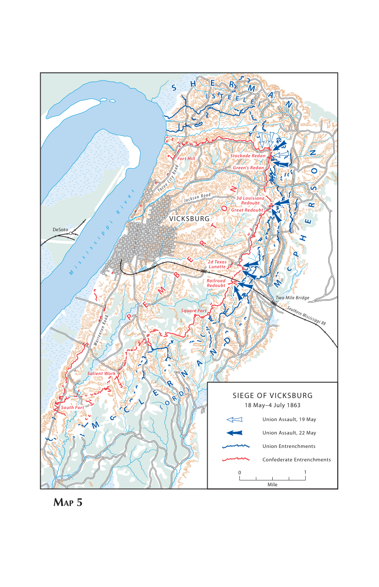

以下第一人称叙述依据史料重建，主视角为联邦田纳西军团司令尤利西斯·格兰特。

1863年5月，格兰特把一支接连败退的敌军逼进维克斯堡，却在城外两次遭到击退。为什么追击中的优势到了土墙面前便失去效力，而六个多星期以后，同一座要塞又交出了整支守军？本文讨论5月18日至7月4日的维克斯堡围城，前面的渡河与野战用于说明围城如何形成，后面的受降与撤离用于交代战斗如何结束。日期采用公历，时刻沿用当时当地作战记载。

## 一、我要夺取的，是一段能够持续通航的河流

到1863年春天，我指挥的田纳西军团已经围绕维克斯堡转战数月。密西西比河把美国中部腹地与墨西哥湾连接起来，也把邦联西部的得克萨斯、阿肯色和路易斯安那同东部战场联系起来。维克斯堡位于河岸高地，它的炮台能够威胁经过的运输船。我们即使把一部分军舰送过炮台，也还不能把这段河流当成安全运输线。要让补给船不断通过，需要解除岸上守军对航道的控制。[^gabel]

我的任务受到水路和陆路的共同限制。1862年末，从密西西比州北部沿铁路向南推进的行动，因为后方仓库和交通线受袭而失去继续深入的条件。谢尔曼从河上靠近城北，在奇卡索河湾遭到击退。那里低地与高地之间的落差，使进攻者很难把兵力展开。此后尝试开运河、寻找支流通道，也没有替我们解决最后一段接近要塞的问题。地图上的蓝线很多，真正能让运输船、火炮和步兵一起通过的路线却很少。[^gabel]

我最终把军队沿河西岸向南调动，让波特的舰队在夜间穿过城前炮火，再到城南协助渡河。4月30日，部队开始在布鲁因斯堡登上东岸。这个位置把我们送到维克斯堡陆上防御体系之外，使我能够从内陆接近城市。渡河后的军队不能把所有时间用来修筑一条一直延伸到旧基地的道路；我让部队利用沿途供应，携带能够带走的给养，集中力量对付前方的敌军。河运仍是整个行动的基础，只是最后一段陆上推进暂时采用了不同的供应办法。[^gabel][^grant]

此前的推进在本文中有一个直接结果：彭伯顿与约翰斯顿没有会合。5月14日，我们进入杰克逊，随后转向西面。16日冠军山战斗结束后，彭伯顿退向大黑河；17日，他在河边的防御又被突破。我的三个军已经能够向维克斯堡前进，而约翰斯顿仍在东面组织兵力。把两支敌军隔开，为我争取到了围城的机会，也留下了一个持续存在的危险：城内的军队尚未解除武装，东面的军队还会增长。[^gabel]

我能调动的是一支由不同经历的部队组成的军队。谢尔曼指挥第十五军，麦克弗森指挥第十七军，麦克勒南指挥第十三军。军下面分师、旅、团，前线行动通常由这些下级单位实施；军团司令规定方向、时间和兵力分配，无法站在每条沟谷旁监督每一个团。部队向城外集中时，三个军走的是不同道路，先头到达、炮兵到达和整个师能够展开，是三个不同的时点。[^grant][^gabel]

我与这些军长之间也存在不同的关系。谢尔曼对先前的渡河计划提出过保留意见，但在执行中承担了迅速行军和保障北翼的任务。麦克弗森受过工程训练，在渡河、修路和后来围城的工事组织中都有相应职责。麦克勒南有政治影响力，也有独立指挥部队的经历。我的命令必须通过他们落实，而他们给我的报告又决定了我如何理解前线。围城中最严重的一次指挥分歧，恰恰发生在一份宣称已经取得突破的报告上。[^grant]

海军不在这三个军的编制里面。戴维·迪克森·波特指挥密西西比河舰队，负责舰艇行动、运输护卫和水上火力。我的步兵可以占领河岸高地，却不能代替军舰巡逻河道；波特可以把炮弹送进城内，却不能用舰艇守住东面的每一条道路。我们需要把陆上的封锁与水上的封锁接在一起。维克斯堡被围，并不意味着从第一天起每个缝隙都已经关闭。[^grant][^gabel]

### 围城中的主要指挥关系

| 一方与层级 | 指挥官或部队 | 在本次围城中的主要任务 |
|---|---|---|
| 联邦军团 | 格兰特，田纳西军团 | 围城、增援调配、对援军防御、受降 |
| 联邦第十五军 | 谢尔曼；谢尔曼转任外线指挥后由斯蒂尔接掌 | 北段，墓园路与栅栏凸堡方向 |
| 联邦第十七军 | 麦克弗森 | 中段，杰克逊路与第三路易斯安那凸堡方向 |
| 联邦第十三军 | 麦克勒南；6月18日由奥德接替 | 南段，铁路堡与鲍德温渡口路方向 |
| 联邦后续增援 | 劳曼、赫伦、索伊·史密斯等部及帕克率领的第九军部队 | 延伸包围线、控制河岸、组成外线屏障 |
| 联邦海军 | 波特 | 河道封锁、运输保障、舰炮与岸上重炮支援 |
| 邦联城内军队 | 约翰·彭伯顿 | 守住城池，维持部队与等待外援 |
| 邦联主要守备师 | 马丁·史密斯北段，福尼中段，史蒂文森南段；鲍恩部担任预备力量 | 防守土垒、反击局部侵入、补充受威胁地段 |
| 邦联城外援军 | 约瑟夫·约翰斯顿 | 在杰克逊、坎顿一带集结，谋求援救或接应突围 |

*编制与部署据盖贝尔战史及格兰特回忆录。此表展示围城阶段关系；增援师的到达日期与归属变化在后文叙述。*

## 二、高地后面还有一道新的问题

5月18日，我首先需要恢复一条能够持续使用的补给线。谢尔曼向北面的高地推进，使我们能够接近亚祖河上的登陆点。此前他从河湾正面攻击未能夺取的地形，现在可以从内陆方向进入。占有这片高地以后，运输船能够把粮食和弹药运到河边，陆军再用道路把它们送到各军后方。我们不再只是带着有限物资快速向前移动，而是在为一场可能持续数周的行动建立基地。[^grant][^gabel]

从军团地图看，城市西面是密西西比河，北面有亚祖河与低地，东面和东南面是通向内陆的道路。真正站到阵地前沿，地形却由许多连续的山脊、支脊和沟谷组成。步兵沿一条山脊前进，可能很快被两边的深沟限制；向侧面展开，又必须下沟再爬上另一个坡面。炮车需要道路，担架需要通路，预备队也无法在这些沟谷之间保持平地上的行进速度。[^grant]

守军把主要工事设在高地上，以若干突出的堡垒控制道路和坡面。所谓凸堡，是把防线向外伸出一个角度，让火力能够照顾正面和侧方的工事；封闭堡垒则能够在多个方向防守。堡垒之间还有步兵胸墙和壕沟。进攻者越接近外坡，越可能进入相邻工事的侧射范围。前面看得见的土墙只是防御的一部分，旁边的枪口和坡下的障碍同样决定能否通过。[^grant][^gabel]

这也限制了我的侦察。一个观察点能够看到对面山脊，却未必看到山脊背后的沟、堡内的横墙和后备阵地。旗帜出现在土墙上，能够证明先头人员到了那里，却不能单独证明一个完整的团已经进入堡内，更不能证明后续部队有安全道路跟上。我们后来为这几种情况付出了不同程度的代价。眼前的地形要求报告把位置说得非常具体。[^grant][^gabel]

我的军队经过一连串行军和战斗，需要重新集中。士兵可以在沿途获得肉食和其他食物，但军需部门不能因此停止工作。面包、咖啡、弹药、帐篷、炊具和伤员运输都要有稳定来源。占有亚祖河通道以后，工兵和部队修筑后方道路，各军才能按计划领取供应。道路修好，意味着一个师不必为下一顿饭分散搜寻，也意味着炮兵能够按消耗补充弹药。[^grant]

敌军的情况，我只能通过追击中获得的俘虏、前线接触和侦察来判断。冠军山与大黑河的失败，使我相信彭伯顿部队仍处于混乱之中。这个判断对败退过程有依据，却没有自动告诉我：那些部队进入完整工事以后，还能恢复多少抵抗能力。城内还有未在此前野战中受到同等损耗的部队，也有可以重新分发的武器与物资。这部分真实情况，后来需要把双方记录放在一起才能看清。[^grant][^gabel]

我面前的选择因此带有时间压力。立即攻击，可能趁敌人尚未恢复时夺城；等待全部部队、炮兵和道路准备好，可以改善攻击条件，却也让守军喘息。继续拖延，还会使约翰斯顿有更多时间集结援军。我在19日选择了攻击。这个命令建立在敌军可能继续崩溃的判断上，接下来的战斗将检验它，而不是替它作保证。[^grant]

*美国陆军军事史中心《维克斯堡战役》图5，原图带英里比例尺。图中同时标示5月19日、22日攻击及围城阵地，体现多个时点；McClernand（Ord）表示军长后来更替。*

## 三、5月18—19日：追击到达土墙以前

18日，各军越过大黑河之后向城外推进。谢尔曼从偏北的路线接近高地，麦克弗森沿杰克逊路进入中部，麦克勒南转向鲍德温渡口路，逐渐形成南面的攻击正面。行军路线决定了到达顺序，也决定了各军最初能够看见的敌人。谢尔曼的部队最先具备在东北面发动较集中攻击的条件，另外两个军仍要把行军纵队变成战斗部署。[^grant][^gabel]

我要求形成连续阵线：谢尔曼在右，麦克弗森接他的左翼，麦克勒南再向南延伸。这个连续性很重要。一个军若只顾沿道路往前走，侧方沟谷便可能留下空隙，使敌人获得转移、侦察或者出击的机会。但保持接触也要付出兵力。师与旅必须向两边展开，不能把所有人都压在一条道路上。因此，三个军出现在城外，不等于三个军能够同时在同一个堡垒前投入全部力量。[^grant]

19日上午，前沿仍在接触和调整。我把总攻击时间定在下午两点，希望利用敌军刚刚退入防线的时机。北面的主要目标是栅栏凸堡，位置在防线转折处，控制墓园路附近的接近地。谢尔曼把主力攻击交给布莱尔师。炮兵先行射击，步兵需要穿过被砍倒的树木和枝杈，再接近壕沟与土墙。[^first][^gabel]

这些被砍倒的树并不是毫无规则地堆在地上。作为拒止障碍，它们让攻击队形慢下来，把人挤向少数能够通行的位置。士兵需要翻越、绕行或者清除障碍，抬头寻找道路时暴露在火力中，向两侧躲避又可能离开本来就狭窄的前进轴线。炮兵能够压低部分守军火力，却不能保证每一段障碍同时被清空。步兵在最后接近阶段，仍要靠自己的行动跨过这些物理阻碍。[^first][^gabel]

布莱尔师的攻击遭到正面和侧面的射击。守军没有像大黑河边那样迅速放弃阵地。对面工事中的步兵可以利用胸墙遮蔽身体，等攻击队列进入有效范围再开火；相邻堡垒又使攻击者难以仅靠正前方的掩护躲避。战斗的结果很快说明，前几天的野战溃退已经不能代表眼前这条阵线的状态。[^gabel]

第十三美国步兵团第一营的一部分官兵到达了凸堡外坡，把旗帜插在工事外缘。这是一个实际达到的位置，也是一段无法顺利扩大的进展。到达土墙下面的人，仍然需要越过壕沟、爬上墙顶，再把足够兵力带到墙内。后面部队若无法穿过相同的火力区，先头便可能停留在最危险的地方。当天的旗帜没有变成可供全军通过的突破口。[^first][^gabel]

中段和南段的情况不同。麦克弗森与麦克勒南的部队仍在靠近和展开，他们参加接触与推进，却没有形成与北面同等规模的集中突击。我的攻击命令覆盖整个战线，实际能够执行到什么程度，则由各军的位置、道路和准备状态决定。这是统一命令与同时行动之间的差距：一个总时刻可以写在命令里，抵达该时刻的部队却未必已经站在同样的起点上。[^grant][^gabel]

19日的攻击失败后，我们保住了一些更靠前、可以受到地形掩护的位置。这个结果有助于继续逼近，但城市仍在敌人手中。伤亡统计后来表明，谢尔曼军当天损失七百余人，另外两个军也有二百余人的伤亡。那意味着敌军已经用实际火力否定了我关于迅速夺城的期望。要再攻击，就需要改变准备条件，而不能仅仅重复同样的命令。[^gabel]

我的下一步首先是修路和供给。20日、21日，各军在后方建立通向亚祖河与奇卡索河湾的道路，把粮食和弹药运进来。营地也要安排在尽可能受到掩护的地方。士兵经过长距离推进以后，终于能够从军需系统得到完整口粮；帐篷和炊具陆续前送，使军队可以在固定区域停留。道路上的这些工作与前沿枪声同时发生，它们决定下一次战斗能持续多久。[^grant]

我没有立即放弃强攻。约翰斯顿在东面集结的消息，使围城时间具有代价。假如能够在他的援军成为威胁以前夺城，我就可以把军队转向东面，不必同时应付内外两个方向。我的回忆录也记下，部队仍相信可以攻入工事。这样的信心有利于执行命令，却不能替代对工事的判断。22日的命令因此必须比19日更有组织：三个军共同准备，炮兵集中射击，攻击时间统一。[^grant]

从19日到22日，我们获得了更好的道路、更完整的部队和更多观察机会；守军也获得了重新部署、修复损坏和熟悉攻击方向的时间。双方都在准备，准备的结果不会只向一边累积。我要解决的问题已经从追上败军，变成怎样突破一条有组织的防线。两天半的间隔改善了条件，却没有把沟谷填平，也没有把堡垒之间的交叉火力消除。[^gabel]

## 四、5月22日上午：三个军在同一个时刻前进

我把第二次总攻击定在22日上午十点，各军长按照我的时间校准行动。攻击前的炮击持续数小时，海军也参与对城内与河岸目标的压制。与19日相比，这次各军已经有更明确的攻击方向。谢尔曼仍从北面墓园路一带逼近，麦克弗森攻击中段杰克逊路方向，麦克勒南从东南面靠近铁路与鲍德温渡口路。[^grant][^second]

统一时间的目的，是使守军难以只向一处集中预备队。如果北面先攻击失败，南面过很久才开始，守军便可以利用较短的内线移动增援。三个军同时施压，至少能够限制这种调动。但它也要求各路炮兵、先头步兵和后续队列衔接得上。时钟能够协调开始时刻，不能直接协调一条沟里拥堵的士兵和另一条路上尚未遇到障碍的部队。[^grant][^gabel]

炮击过后，步兵再次进入堡垒前方。北面要通过的仍是破碎坡地和障碍物。炮弹造成的土木损坏，不一定等于守军全部失去射击位置。土垒能够吸收相当一部分冲击，士兵也可以暂时隐蔽，再在攻击队靠近时回到胸墙后。进攻步兵从自己的掩护处出来以后，面对的仍是一段需要用身体跨越的开阔距离。[^gabel][^second]

谢尔曼的攻击接近栅栏凸堡，却没有建立通向城内的通道。有些人员到达土墙附近，后续队伍却难以在持续火力下跟进。对军长而言，问题已经不只是有没有人冲得足够近，而是能否把到达的人组织成一个能够继续战斗的整体。堡垒外坡的局部遮蔽，让少数人能够暂时存身；同一处地形也可能使他们与自己的主力隔开。[^grant][^second]

中段，麦克弗森的部队沿杰克逊路附近攻击。这里的高地与大型堡垒控制着接近路线。一个进攻单位向高处靠近时，邻近工事仍能向它的侧面射击；前面的人受阻，后面的队伍便需要在有限空间内停顿或者寻找新路。攻击没有形成足够宽的缺口，守军得以保持相互支援。战斗推进到土墙附近，并没有改变整个中段阵地仍然完整的事实。[^gabel]

南面的麦克勒南部队取得了最容易引起误判的进展。他们在铁路堡一带短暂进入了邦联阵地。这确实比仅仅接近外坡更进一步，不能在事后把它抹去。然而，进入一个局部工事与打开通向城市的道路之间，还隔着守军反击、堡内地形、后续兵力和相邻阵地的火力。占据的一小段位置如果得不到扩大，便可能成为受夹击的突出部。[^gabel][^second]

各路攻击的共同困难，在这里表现得尤其清楚。前沿部队能够夺取一个缺口，并不意味着道路已经供炮兵和整旅通过。通信员从堡前回到军长处，需要穿过战斗地带；军长再向我报告时，前面的局面可能已经变化。消息记下的是某一时点的进展，指挥部收到的却常常像是一项仍然稳定存在的成果。当天午后的决定将围绕这种时间差展开。[^grant][^gabel]

我在能够观察南面部分战斗的位置接收报告。麦克勒南报告已经在若干地点占有敌方工事，请求增援。我看到的情况没有证实他报告的全部成功，因此没有立即把这份报告当作全线突破。然而，他再次提出请求，我必须决定：是把它视为一个需要迅速扩大的机会，还是判断它不足以改变战局。前线局部突破一旦失去支援，可能很快消失；错误增援则可能把更多人送进同样的火力区。[^grant]

这次决策没有后来完整的战场图可供使用。我掌握的是观察、传来的消息和各军已经受阻的情况。麦克勒南的报告既来自负责该地段的军长，也带着他对局部成果的判断。作为军团司令，我不能直接忽略它；同样，也不能把“取得工事”四个字自动换算成“全军可以进入城内”。最后，我采取了增援和牵制攻击相结合的办法。[^grant]

## 五、5月22日下午至25日：突破报告没有变成突破口

我把第十七军的昆比师调往麦克勒南方向，并命令谢尔曼和麦克弗森重新攻击，以牵制对面的守军。这使南面获得额外兵力，也使另外两军再次付出攻击成本。命令的逻辑，是让敌人不能把全部力量压向一个已经出现的缺口；它能否成立，取决于那个缺口究竟有多大、还能维持多久，以及增援到达时是否仍可使用。[^grant]

实际情况没有满足这些条件。麦克勒南的局部进入未能发展成稳定突破，守军把进入者逐出，或者把攻击者限制在无法继续推进的位置。其他两个军重新发动的攻击，也没有破坏邦联阵地之间的联系。军团层面的协同努力，最终没有抵消每一路攻击正面上的地形和火力劣势。当天战斗因此增加了伤亡，却没有使我们进入城市。[^gabel][^grant]

这里需要把作战过程中的几个位置分开。部队推进到壕沟，说明已经越过一部分火力区；旗帜插到胸墙，说明有人到达工事外缘；短暂进入一个堡垒，说明局部守备曾被压倒。要成为突破，还必须让足够后续兵力通过，控制两侧，打开更深的出口，并使防御者无法迅速封闭。22日没有完成最后这组动作。前面几项真实进展，都无法单独替代它。[^gabel][^second]

一些到达土墙下面的人员白天无法安全返回。他们继续利用近旁地形和工事外缘遮蔽自己，等待黑暗。我的部队到夜间才把能够撤回的前沿人员收回。所谓总攻击结束，包含这样一个撤离过程：命令停止进攻以后，受困人员仍在敌人射程之内，军官仍要清点单位、寻找失散人员，并把能够运走的伤员带到后方。[^grant]

22日的联邦损失，盖贝尔依据战史列为阵亡502人、负伤2550人、失踪147人。这个三千余人的数字属于当天攻击，不是围城全部损失，也不能与城内最终投降人数放在同一栏比较。对仍在前线的指挥机构而言，伤亡先表现为一个连缺少军官、一个团需要重新整队、运输路线突然增加担架和救护车辆。统计数字稍后才能整理，部队的行动能力已经立即受到影响。[^gabel]

伤员后送还有一个更沉重的问题。两军阵地之间仍有死伤人员，救护者不能自由穿过交叉火力覆盖的地面。没有局部或全线停火，搜索和搬运都可能造成新的伤亡。25日，双方才通过停火清理战场。盖贝尔对我没有及时主动提出休战作出了严厉批评。这项指挥责任将在复盘中单独讨论；在行动层面，事实是战斗已经停止扩大，而中间地带的伤员仍然等待了过久。[^gabel]

这次失败以后，我转向正规围城。我的命令不再要求三个军用一次冲锋解决全部问题，而是让它们修筑自己的防线、炮台和向前接近的壕沟。要塞必须被持续隔绝，守军必须被限制在工事里面；我们的部队则需要在接近中受到掩护。工兵的工作开始占据指挥部日程的中心，挖掘进度与补给数量变得和攻击准备同样重要。[^grant]

这种改变并没有使战斗变成静止。每天需要决定在哪里增设炮台、哪一条壕沟继续向前、哪些部队轮换施工、哪处地段需要更多步枪压制。进攻动作被拆成许多可以逐步积累的小行动。挖到一个新位置以后，先建立掩护，再把火炮或步兵移上去；受到敌方火力阻止时，调整路线或者加强压制。城市仍然是最终目标，通向它的方法已经改变。[^grant][^gabel]

我也开始向后方索取更多部队。现有兵力既要围住城市，又要保护交通和对付约翰斯顿，不能把每个师都留在城墙前。赫尔布特、普伦蒂斯等后方指挥机构接到调兵要求，骑兵尤其重要。他们能够观察大黑河渡口、发现敌方集结，并把外线消息送回。一个围城指挥官如果只盯着土墙，可能等到背后道路被切断才知道援军已经到来。[^grant]

## 六、5月下旬至6月上旬：把壕沟、河运和外线连在一起

正规围城的第一项工程，是让部队能够在自己的阵地上生存。炮兵需要建立在有利位置，营地需要避开敌军直射，步兵需要相互连接的射击壕和交通壕。交通壕用于人员和物资移动，射击阵地用于压制对手，两者的用途相连却不相同。如果士兵只能安全地待在一个坑里，却无法安全地领取口粮、接班或者抬走伤员，这个位置就很难长期维持。[^grant]

我们沿战线向前修筑曲折的接近壕。曲折有实际作用：一条笔直、正对敌人的壕沟，可能被火力沿整个长度扫射；转折能够分隔暴露区段。土方还可以堆成胸墙，沙袋与木料加强遮蔽。士兵在已有掩护的尽头继续挖掘，把下一段前进变成能够保存下来的成果。这种办法速度比冲锋慢，却减少了每次移动必须重新穿越整片开阔地的需要。[^grant][^gabel]

专业工程军官数量有限。我让受过西点工程教育的军官在本职之外协助施工指导，首席工程人员也因健康原因发生更替。工程训练可以帮助他们判断坡度、炮位和接近方向，但真正完成大量土方的仍是部队与劳动人员。先锋队承担了相当多任务，来到联邦阵地的黑人劳动者也参与施工并领取报酬。战壕的每一段进展，都依赖这些持续的体力劳动。[^grant]

工事建设必须同射击组织配合。我们的步枪手监视对方胸墙，使守军难以长时间暴露；炮兵压制能够妨碍施工的目标。前进位置建立以后，火炮可以逐渐向前转移，新的炮位再为下一段工程提供支援。守军也在修补、加厚和改变阵地，围城双方都在施工，区别在于谁有更充足的人员、材料和补给来承受这种持续消耗。[^grant][^gabel]

5月26日起，各路接近工程进一步展开。国家公园管理局把主要接近线概括为十三条，它们并不是十三次互不相关的小攻击，而是沿道路、地形和堡垒方向布置的持续工程。道路帮助我们把工具、木料和弹药送到前方，也把主要攻击方向暴露给守军。每推进一段，双方距离缩短，步枪、手榴弹和坑道的作用就随之增加。[^siege]

我的重炮数量起初有限，波特提供了海军大口径火炮及其操作人员。这些炮被用于岸上阵地，与陆军野战炮共同作战。河上的迫击炮也持续射击。迫击炮采用较高弹道，把炮弹送到普通平射火力不容易触及的位置；城内居民和守军后方因此也受到威胁。陆上工事与河上舰艇形成不同方向的压力，但水上炮击没有代替陆军逼近。[^grant][^gabel]

持续炮击需要持续运输。每发炮弹从后方来到炮位，都要经过船运、卸载、道路运输和最后的人工搬运。亚祖河登陆点因此成为围城的实际支柱。守住它，意味着我们的炮兵可以继续消耗弹药，伤员可以向后送，增援部队可以抵达；失去它，则可能使前方越来越完善的工事失去供应。工程与后勤是同一套行动的两个部分。[^grant]

在城内，守军仍然能够有效抵抗。它们保存弹药，优先对付真正接近阵地的步兵和施工人员。我们的炮击不能保证每一次都造成同等效果，敌人也不需要对每一次射击作同等规模的回答。只要关键工事仍有足够人员和弹药，它们便能够使一次大规模冲锋付出高昂代价。围城的任务，是逐渐削弱这种持续抵抗能力。[^gabel]

与此同时，我命令布莱尔向亚祖河与大黑河之间活动，搜寻敌军、带回牲畜和供应，并破坏可能供援军利用的桥梁与道路。5月26日出发的这次行动持续近一周。它的作用既是取得物资，也是减少东面援军能够沿途使用的资源。作战行动因此向城市以外扩展，但目标仍然是巩固围城，而不是为了另外占领一大片土地。[^grant]

这类行动对当地居民产生直接后果。粮食、牲畜和运输设施被军队征用或者毁坏，村镇与农场承担了战场之外的消耗。我的命令按照军队供应和阻止敌军补给的需要制定；它在地方社会中的影响，则要放到战后复盘中衡量。围城并不是只有土墙两边的人在付出代价，包围圈周围的乡村也被纳入战争。[^grant]

6月初，增援开始分批到达。金博尔旅被派到梅卡尼克斯堡附近，配合已有部队观察大黑河通路；索伊·史密斯师随后到达，被送往海恩斯高地一带。不同单位有不同任务，不能把它们的到达都解释成增加某一次攻城冲锋的人数。相当一部分新兵力首先用于外围警戒和防御，使三个攻城军不必随时抽空自己的阵线。[^grant]

## 七、6月7—22日：城外的敌军决定我怎样分兵

6月7日，密西西比河西岸的米利肯湾发生战斗。理查德·泰勒所属部队攻击那里的联邦军，守军包括新组建的黑人部队与白人部队。消息传来以后，我命令莫尔旅渡河，加强这一方向的行动。波特的舰艇已经参与支援，河上的火力帮助守军阻止攻击继续深入。这个战场不在维克斯堡土垒正面，却提醒我们：敌方可能从河西岸寻找破坏围城的办法。[^grant][^milliken]

我当时收到的消息，并不包括后来能够整理出来的全部兵力和战斗细节。格兰特回忆录对于进攻人数的说法，与国家公园管理局较新的研究有明显差别。因此，在第一人称的作战进程中，能够确认的是攻击发生、河上舰艇支援以及我的增援命令。各方投入人数和黑人部队的战斗处境，留到复盘中按照具体来源比较。[^grant][^milliken]

米利肯湾的攻击没有切断我们的主要供应。亚祖河通路已经投入使用，河西岸旧基地在整个补给体系中的位置发生了变化。敌军攻击一个曾经重要的地点，不等于攻击了此刻最关键的节点。我仍必须保护那里的人与物资，但不需要因此解除对维克斯堡的围困。判断一次外围战斗的意义，要看它影响的实际交通，而不只看地图上离城市有多近。[^gabel]

6月11日，赫伦师到达，被部署到左翼。它向河岸延伸，使劳曼部队能够向第十三军靠拢，进一步封闭南面的空隙。此前地形与兵力限制留下的一些通道，仍可能让通信员在夜间通过；增援到达以后，守军与外部之间的联系变得更加困难。这是一种很具体的兵力增长效果：新增部队先填补空白，再提高整个包围线的可靠程度。[^grant]

14日，帕克带着第九军的两个师抵达，我把他们送往海恩斯高地方向。来自密苏里、俄亥俄和田纳西等不同指挥区域的增援，逐步改变了我最初兵力不足的局面。它们的行军和运输由更大范围的联邦军事系统支持。围城能够继续，并不是城外原有三个军单独撑过了全部时间，而是后方不断向这里输送力量。[^grant][^gabel]

我在回忆录中把这一阶段掌握的兵力约记为七万一千人，并说明相当大一部分配置在亚祖河与大黑河之间。后来的战史还有更高的总数，它们反映的日期与纳入范围并不完全相同。对我的部署来说，关键不是把总数写得最大，而是每个方向实际能有多少人：城前要有足够兵力守住接近阵地，东面要有能够独立抵御援军的部队，河岸与道路也需要警戒。[^grant][^gabel]

外线防御利用海恩斯高地、大黑河渡口以及各处控制道路的位置。部队在这些地方构筑炮台和步兵工事，使约翰斯顿如果前来，就必须攻击有准备的阵地。我们在西面朝向彭伯顿，在东面朝向约翰斯顿，两面的战术姿态不同：西面继续逼近，东面等待并阻止援军靠近。这个布置减少了我必须在接到警报后临时调动大批攻城部队的风险。[^grant]

6月中旬，第十三军发生指挥更替。麦克勒南把一份赞扬本军、同时贬低其他部队贡献的命令送到报刊，违反了关于军事文件发布的规定。谢尔曼与麦克弗森向我提出反映后，我索取了命令副本，并在18日解除麦克勒南职务，由奥德接任。这个决定有正式的纪律依据，也处于此前攻击报告争执的背景之中。[^grant][^gabel]

军长更替没有让该军从战线上消失。前沿工事、师旅部署和正在进行的挖掘需要继续，新的军长接收的是一套处于作战中的组织。围城能够在更替中保持推进，依靠的是各师、旅、工程人员和供应机构仍然履行职责。司令部的人事冲突如果扩散到前沿，可能使敌人获得机会；这次更替的军事要求，就是把新的指挥关系尽快接到原有工作上。[^gabel]

22日前后，我收到约翰斯顿可能采取行动的消息，于是把海恩斯高地到大黑河之间的外线兵力统一交给谢尔曼指挥，另令赫伦与A.J.史密斯部做好支援准备。谢尔曼转向这一任务以后，第十五军的日常指挥由斯蒂尔承担。消息中的敌情未必全部准确，但它涉及的威胁真实存在。我不能等敌军已经突破渡口，才决定由谁统筹外线。[^grant][^gabel]

在这段时间里，我没有为了追赶约翰斯顿而放松城前压力。围城已经取得的优势，是彭伯顿仍被限制在一个补给不断减少的空间里。若为寻找外面的敌军而抽走过多兵力，城内部队就可能获得突围机会。外线工事与增援让我能够保持这项优先顺序：先牢牢控制已经围住的军队，再用另一部分兵力处理援军。[^grant]

## 八、6月25日至7月1日：爆炸以后还有一道墙

中段接近工程逐渐抵达第三路易斯安那凸堡附近。这里属于麦克弗森的地段，洛根师所属部队参与推进，莱格特旅在近距离工程与攻击中承担主要任务。接近壕把人员送到敌方胸墙附近，普通地面前进的空间越来越少，于是工程转入地下：从较低处向堡垒下面掘进，再放置火药。[^grant][^gabel]

坑道的目的，是用爆炸破坏堡垒的一段墙体，为步兵制造缺口。它要求工程人员对位置、深度和土层作判断。坑道过浅，可能提前被发现或挖穿；太深，爆炸造成的地面形状又未必适合步兵通过。守军也听察和挖掘反坑道，试图找到我们的工程。在这里，双方争夺的不再只是地表的一条线，还有土层内部的接近距离。[^grant]

盖贝尔记载，这条坑道长约四十五英尺，装入约两千二百磅火药。这个装药规模能够造成巨大破坏，却不能预先保证爆炸后的地形正好形成一条平整通道。破坏与通行是两个问题：堡垒可以被炸开，攻击队仍可能要从深坑底部攀登高坡，或者面对爆炸后暴露出来的第二道防线。[^gabel]

6月25日下午，装药引爆。我的安排是以爆炸为信号，让沿线炮兵开火，附近预先集结的步兵立即占领炸坑。土体被掀起，原有堡垒的一部分消失，攻击队进入了爆炸形成的空间。到这一步，工程达到了破坏前沿工事并把人员送进去的目的；能否继续穿过邦联防线，还要由后续战斗决定。[^grant]

对面已经在原有位置后方建立新的防御。守军发现坑道威胁以后，并没有把全部希望押在找到地下通道上，而是利用后方空间另筑掩护。我们的步兵进入炸坑时，面对的因此不是一个完全敞开的城市方向，而是新的射击位置。爆炸摧毁了前沿土体，防御体系却没有随之全部消失。[^grant][^gabel]

炸坑的形状使攻击者处于不利高度。敌人可以从较高的位置向里面投掷手榴弹和装有引信的炮弹，我们若要向上反击，则需要把投掷物越过更高的边缘。坑内人员能够暂时占据空间，却很难把它扩大成安全的出发阵地。正面距离缩短之后，射击、投掷和小单位交替成为主要战斗形式，远处炮兵也很难替坑内士兵解决所有目标。[^grant]

夜间，我们尝试从炸坑沿敌方胸墙外侧继续挖掘，希望向左右打开位置。守军持续投掷爆炸物，使施工难以完成。经过持续争夺，这个局部攻击没有打开通往城内的通道。国家公园管理局把炸坑战斗概括为持续约二十六小时，随后联邦军退出无效的突出位置；格兰特回忆录对占据与撤离过程写得较为简略。两种叙述共同确认的结果，是爆破未带来突破。[^siege][^grant]

我没有因此停止坑道工程，而是改变对下一次爆炸的使用。新的坑道继续向目标下方推进，7月1日再次引爆。这一次没有紧接着发动步兵冲锋。25日的经验已经说明，爆炸本身不足以证明可以投入攻击队；如果敌方后备工事仍然完整，把部队送进另一个炸坑可能只是重复先前处境。[^grant][^siege]

第二次爆炸继续破坏局部阵地，也迫使守军花费人力修复和重新配置。其军事作用可以在没有立即夺城的情况下存在。对围城者来说，破坏一段工事、迫使敌人缩短防线或者分配更多劳力，都会改变下一阶段的条件。但这些效果必须同实际观察联系，不能仅凭爆炸声和土柱高度宣布战役即将结束。[^grant]

到6月底，我们的炮位和接近线已经显著增加。格兰特回忆录记载，30日陆上部署约二百二十门火炮，另有海军重炮阵地；多数仍为野战炮。这些数字说明火力体系扩大，也说明它不是一支完全由重型攻城炮组成的军队。轻炮、步枪、工程和河运共同维持压力，任何单一种武器都没有独立完成围城。[^grant]

7月1日前后，多处接近线已经抵达敌方壕沟附近。我的下一项计划，是准备7月6日发动更广泛的攻击。为此，需要拓宽出口，使部队能够从壕沟中迅速展开；还要准备木板和装满棉花的袋子，帮助人员越过沟壕。与5月22日相比，攻击队的出发位置更近，工程准备更充分，但仍要认真解决通过障碍和后续兵力进入的问题。[^grant]

这次攻击最后没有实施。它仍然影响双方决策：我们的准备使围城具有进一步升级的可能，守军则必须判断还能够承受多久。城内的健康、粮食和兵力状态，我无法仅凭望远镜全部了解；我能看到的是接近距离不断缩短，收到的是前沿接触、逃来人员与通信截获带来的消息。最后的决定将由城内发出的白旗启动。[^grant][^gabel]

## 九、7月初：把封锁维持到谈判开始

在准备新的攻击时，我仍须防备两种变化：约翰斯顿从外面接近，或者彭伯顿从城内突围。围城线越靠近敌军，双方前哨越容易交谈，也更容易传递真假混杂的消息。我收到过守军准备制造船只、从河上逃出的报告。这样的消息不能让我断言敌方已经决定渡河，却足以要求海军和河岸部队加强警戒。[^grant]

我通知波特注意河面，并增加相关警戒措施。河西岸准备照明材料，必要时照亮夜间水面；部队也加强对可能登陆地和堤岸通路的控制。若敌军从水上离开，他们需要船只、组织和对岸接应，不能只靠个人游渡完成一支军队的撤离。我们的任务，是使这条潜在通道同样受到限制，而不是假定密西西比河本身就会阻止一切行动。[^grant]

约翰斯顿的消息则从东面继续影响部署。他拥有一支正在增长的军队，但要把它变成城内守军的出路，必须穿过我们准备好的外线，并与彭伯顿约定时间和方向。我的外线部队已经有独立指挥和工事，即使接到敌军移动的消息，也不必立刻从每条接近壕抽走人员。先前的增援投入在此时显示出作用：围城工程和外线警戒可以同时继续。[^grant]

这几天，城内各级指挥官对突围能力的评估，我是在后来查阅对方材料时才完整知道。彭伯顿7月1日询问师长，部队能否承受撤离所需的行军与疲劳。回答所呈现的是严重衰弱的军队。战后能够看见这些报告，不意味着我在1日已经知道每一个师长的意见。对我的司令部而言，封锁还需要维持，攻击准备还需要完成。[^grant]

7月3日上午，白旗出现在一段邦联阵地上。鲍恩与蒙哥马利代表彭伯顿来到我们这边，带来请求休战、商议投降条件的信。信中仍声称守军能够继续维持阵地，这是一份谈判文件的措辞。它同时提出成立双方委员会安排条件。我的回应首先要求城池与守军投降，随后同意与彭伯顿面谈。[^grant][^pemberton]

白旗并没有自动把全线变成安全区域。沿线部队需要接到停止射击的通知，参与交涉的人员需要有清楚身份，其他地段也必须防止因消息迟到而继续开火。到谈判结束前，双方仍然保有武器和阵地。我的任务一方面转向讨论条款，另一方面仍要保证军队有能力在谈判失败后继续行动。[^grant]

当天下午，我与彭伯顿在两军阵线之间会面。双方对于这次会面的细节后来留下不同叙述，因此这里以可核对的书面结果为主。最初的立场没有直接形成最终协议；随后通过书信往返，我提出让守军作为战俘接受假释，军官保留规定的个人物品和佩刀，部队放下武器，并在办理手续后离开。[^grant][^pemberton]

所谓战俘假释，是俘虏承诺在正式交换以前不再服役，依此获准离开拘押状态。它与允许一支完整武装军队自由撤走有实质区别。城市、工事、火炮和军用物资交给我们，士兵需要登记并作出承诺，军官能带走什么也受到条款限制。我允许的是一种处理大量俘虏的方式，仍然要求守军作为军事组织交出要塞。[^grant]

我的考虑还包括接下来的行动。若把数万俘虏全部押送到北方，需要运输船、护送部队和大量供应；这些资源也正是继续对付约翰斯顿、支援其他方向所需要的。就地办理假释，可以较快把军队与运输能力释放出来。这个办法同时存在俘虏日后重新参战的风险，它的效果不能只在签署当夜评价，还要观察交换与归队制度后来如何执行。[^grant]

## 十、7月3日夜至4日：让投降变成可以执行的命令

彭伯顿接受主要条件，但提出修改。他希望部队列队走出阵地，把武器堆放在现有防线前，并要求保障军官的个人物品以及居民财产。我对部分安排作出同意，对部分要求保留拒绝。每名官兵需要签署假释，名单也要完成；这项行政工作不可能随着一面白旗在几分钟内结束。[^grant]

我同意各旅走到本身阵地前堆放武器，然后返回原有营地等待办理手续。这让解除武装的过程具有明确空间和次序。部队若无序离开，既可能造成误会，也可能使武器和人员登记失去控制；按原有组织列队，则能够由各级军官继续维持秩序，直到联邦军接管。投降的执行同样需要指挥体系存在。[^grant]

关于居民财产，我没有接受把未来处理完全限定在对方提出的保证之内；军官可带走的物品，也按我给出的范围执行。我要求在4日上午规定时间以前收到接受通知，并要求沿线展示白旗，让未及时接获命令的部队能够识别停火状态。书面条件中的这些细节，直接关系到当天会不会发生额外冲突。[^grant]

彭伯顿最终接受。7月4日上午十点，守军按照约定走出工事，堆放武器，再退回线内。联邦部队随后进入。洛根师因接近阵地较深，首先进入城市，河上的舰艇也能够来到码头。维克斯堡的防御体系在这一刻从邦联手中移交，决定性变化是军队解除武装与交通节点被接管，而不仅是某座建筑上升起旗帜。[^grant][^gabel]

守军没有在最后时刻全线逃散。它以原有单位维持秩序，完成受降程序。这说明彭伯顿仍然能够发布并执行命令，也说明一支军队可以在组织尚未完全瓦解时失去继续有效作战的条件。饥饿、疾病、外援落空和不断逼近的攻击，使继续守城的收益下降；有组织投降成为保存幸存人员的一种选择。对于胜方，这样的结束也减少了再次强攻的损失。[^grant][^gabel]

我随部队进入城内，到河边与海军联系。陆军和海军在这里完成了各自任务的连接：城外工事已经交出，河岸炮台不再向运输船射击，水路可以作为占领与后续行动的通道。我们还需要处理仓库、伤员、俘虏和居民，胜利没有让这些需要消失。进入一座城市之后，供应问题反而立即多出一批对象。[^grant]

我在3日谈判开始以后就通知谢尔曼，准备转向约翰斯顿。维克斯堡投降以后，他可以得到更多部队，在东面采取行动。这个命令延续了围城开始时的目标：先解决城内军队，再处理外面的军队。没有必要让全军停留在原地等待每份假释文件填完。负责受降、负责警戒和准备追击的部队，可以按照不同任务继续工作。[^grant]

4日下午，我派人把战果消息送往能够接通电报的地点。向上级报告同样受交通条件限制，胜利并不会瞬间传遍全国。我也把消息和条件通知班克斯，使他能够据此判断哈德逊港的局面。维克斯堡战斗在4日结束，它对另一处要塞的影响则经过消息传递和对方决策，数日以后才形成新的投降。[^grant]

城内俘虏的手续持续到随后一周。名单、个人假释和病伤员安排必须分别处理，一些人拒绝签署，也有人试图离开原有单位。我没有按彭伯顿要求给他武器，用来强迫这些人重新保持军队队形；我要求的是在我们控制区域内有秩序地离开。到11日前后，大部分手续完成，获准离开的守军走出联邦军控制线。[^grant]

我的第一人称叙述到这里结束。围城已经转为占领、俘虏管理和向东的后续行动。维克斯堡没有经过最后一次总攻击而陷落，它是在长期压力下通过谈判交出。要解释这项结果，接下来需要离开我的指挥位置，把彭伯顿、约翰斯顿、基层官兵和城内居民的材料一并放到桌上。

## 十一、战后复盘：城内外究竟有多少能够作战的人

从史料研究者的角度重新看这场围城，首先需要把格兰特当时的敌情判断与邦联实际部署分开。彭伯顿退入维克斯堡的军队虽然遭到严重打击，却没有只剩一群失去组织的逃兵。马丁·史密斯和福尼的部队为防御提供了相对完整的骨架，史蒂文森在此前战斗中受损较重的部队得到工事和库存支撑，鲍恩部又能作为预备力量使用。阵地把不同状态的部队重新连接起来，恢复了它们在局部进行有效抵抗的能力。[^gabel]

这解释了大黑河与维克斯堡之间看似突然的变化。在野外撤退时，一个单位需要维持道路、后卫和渡河秩序；桥梁一旦失去，很多人便无法继续参加战斗。进入既设防线以后，同一批人可以依靠固定射界和掩护作战，身后还有仓库、道路和军医机构。军队的战斗力不是仅由昨天是否败退决定，也取决于今天必须完成什么任务。守住一段土墙，与在开阔地上重新组织进攻，要求并不相同。

彭伯顿的防线大致沿城东高地展开，两端接近河岸。北面由马丁·史密斯负责，中段由福尼负责，南面由史蒂文森负责。北面沟谷尤其破碎，东面的道路则引导联邦军接近主要堡垒。这样的布置有利于用较少兵力控制进路，也使守军可以通过较短的内部联系支援受威胁位置。缺点是它把军队固定在一个必须从外部获得救援、或者依靠库存维持的空间里。[^gabel]

工事数量同样要按口径阅读。盖贝尔在说明陆上防线时，列出九处主要据点和一百零二门火炮；国家公园管理局的整体介绍提到一百七十余门火炮。两者不宜强行当作同一时刻、同一地域的互相否定。河岸重炮、陆上火炮、转移中的炮以及不同统计日期，都可能影响总数。本文用九处主要据点说明陆上防御结构，用分别注明范围的数据讨论火力，不把城内所有炮都假定为能够同时射向某一次步兵攻击。[^gabel][^overview]

联邦人数的变化更容易造成错觉。格兰特回忆录记述六月增援以后约有七万一千人；盖贝尔的概述把兵力增长写为从约五万六千到约九万人，并列出约三万六千人的外线掩护部队。这些数字共同说明增援规模很大，却没有共同证明七万一千或九万人曾同时排在维克斯堡城东的攻击出发线上。外线、运输节点、河岸警戒和城前工程都需要人，后来的总兵力也不能倒填到5月19日。[^grant][^gabel]

如果只把联邦后期最大总数与邦联最后投降人数相除，就会得到一个整齐而缺乏战术意义的比例。真正需要问的是：19日下午栅栏凸堡前有多少攻击队能够展开？22日铁路堡的缺口能够容纳多少人通过？6月下旬约翰斯顿若向大黑河前进，将面对多少已经筑垒的外线部队？这些问题具有不同的时点和空间，答案不会被一个全程总比例代替。

约翰斯顿的军队也需要单列。他在杰克逊和坎顿方向得到增援，后来超过三万人，但这不是彭伯顿城内可以直接发令调动的预备队。两支军队隔着联邦包围线，需要通信员穿越控制区。约翰斯顿能够提出突围方向、承诺制造牵制，却不能让城内已经疲惫的部队自动出现在自己阵前。名义上的战区关系，没有消除实际上的地理分隔。[^gabel][^pemberton]

邦联西岸部队又属于另一套指挥与交通条件。柯比·史密斯统辖密西西比河以西战区，理查德·泰勒在路易斯安那行动。即使他们愿意援助，也必须面对河流、舰艇与道路限制。把这些部队全部加到“维克斯堡守军”之中，会制造一种彭伯顿拥有庞大可用预备队却无所作为的错觉；完全忽略他们，又无法解释米利肯湾等外围行动。合理的处理，是把他们作为试图影响围城的外部力量。[^gabel][^milliken]

### 人数与统计范围

| 对象 | 本文采用的表达 | 需要保留的口径 |
|---|---|---|
| 联邦最初围城军 | 主要为第十三、十五、十七军，随后持续增援 | 不能用六月末总人数代表19日攻击兵力 |
| 联邦六月增援后 | 格兰特记约71000；盖贝尔概述后期约90000 | 日期、辖区与在场范围有差异，保留两种出处 |
| 联邦外线掩护 | 盖贝尔列约36000 | 属围城保障兵力，不是同时冲击城墙的人数 |
| 邦联城内守军 | 最终投降约30000人 | 包括病伤员等，不能等同最后能持枪作战者 |
| 约翰斯顿援军 | 后期30000余人 | 在城外另行组织，未与城内军队会合 |
| 米利肯湾6月7日 | NPS列邦联约1500，联邦1061 | 单独战场；不并入城前某日局部兵力 |

*人数据格兰特、盖贝尔及NPS米利肯湾专题。材料不足以把各项数字整理成同一时刻的精确兵力总账，表中保留其原有范围。*

## 十二、五个决定结果的节点，分别改变了什么

### 第一个节点：19日失败以后，还要不要在22日再攻

格兰特选择第二次攻击有可以理解的理由。约翰斯顿仍在集结，联邦军最初的包围线需要更多部队，迅速夺城可以避免长期分兵。19日又主要是谢尔曼方向形成较大规模攻击，格兰特可以认为，更完整的三军协同值得再试。这些理由来自当时可见的情况，不需要借助后来一定获胜的结局来替他辩护。[^grant]

但19日也提供了相当强的反证：守军能够在工事中恢复秩序，接近道路受到火力控制，炮击没有消除障碍。22日的准备主要改善了补给、兵力到位和时间协同，没有根本改变最后接近地带的地形。第二次强攻因此是一项有明确风险的选择。格兰特后来把部队的信心也列为理由，说明他重视军队对围城劳动的接受程度；这仍然不能降低攻击方案本身需要满足的条件。[^grant][^gabel]

可行的替代方案，是在19日以后立即转入围城，同时用有限攻击改善前沿位置。这样可能减少22日的巨大伤亡，却会让格兰特更早面对外线兵力不足的问题，并给约翰斯顿更多时间。这里的反事实只能说“可能降低强攻损失”，不能说“一定更早夺城”。它需要后方及时增援和亚祖河供应线保持畅通，两者都不是单靠一道停止攻击的命令就能实现。

第二次攻击失败以后，格兰特确实改变了方法。评价他的指挥，既要计入这项调整，也要保留调整以前的代价。他的适应能力不是从未犯错，而是在失败证据已经足够明确时，没有继续要求相同的攻击反复发生。维克斯堡的胜利包含两次未能达到目的的攻击，它们没有因为最后受降而成为必要且正确的步骤。

### 第二个节点：麦克勒南的消息怎样扩大了攻击

麦克勒南在铁路堡方向取得过真实的局部进入，盖贝尔与NPS都确认这一点。因此，问题不是前线完全没有进展，而是报告对进展的范围和持久程度作了过强判断。格兰特的回忆录则倾向强调自己看不到相应成功，以及增援只增加伤亡。两份叙述可以同时保留：前沿出现了局部机会，军团指挥部得到的消息却没有准确反映这个机会受到哪些限制。[^gabel][^second][^grant]

当一份报告写明“已经占领工事”时，接收者还需要知道：占领的是哪一段，后面有没有敌人，左右是否安全，后续队伍能否通过，当前能维持多久。当天消息没有有效解决这些问题。格兰特调动昆比师并让两军重新攻击，使一项局部判断影响整个战线。信息误差因此没有停留在一个旅的范围，而是转化为军团规模的额外伤亡。

一个较好的替代方案，是要求报告更具体，并由可靠参谋尽快核实，同时让能够就近支援的部队准备行动。不过，核实需要时间，短暂缺口也可能在等待中关闭。指挥官不能既要求消息达到战后地图的准确程度，又要求增援立即到达。可以批评的是报告缺少足够的位置与状态信息，以及再攻击没有产生效果；不能假设当时存在一种毫无时间成本的完美核实办法。

麦克勒南后来的免职，应同这次攻击相关联，却不能直接写成22日当天的惩罚。他在5月30日发布的命令经报刊传播，引起其他军长反应，6月18日才被解除职务。纪律程序、人际冲突、军事评价之间有联系，也各有时间。把这几周压成一个愤怒的瞬间，会损坏对真实指挥体系的理解。[^gabel][^grant]

### 第三个节点：外线部队是否“没有必要”

盖贝尔在概述中认为，约翰斯顿没有积极攻击，格兰特的庞大外线掩护似乎最终没有派上用场。作为事后结果，这句话指出援军并未突破；作为当时决策依据，却需要谨慎。约翰斯顿之所以面对困难，恰恰包括联邦外线已经有大量兵力和工事。一个防御安排成功阻止对手采取行动，其价值不能只用有没有打成一场大战来衡量。[^gabel]

格兰特当时能知道援军正在增长，却不能知道约翰斯顿以后会在哪一天放弃进攻。他还要考虑彭伯顿可能配合突围。如果外线过弱，援军只需迫使围城军大规模转身，就可能创造城内撤离机会。把增援的一大部分用来守住海恩斯高地至大黑河之间的通道，降低了这两种行动同时发生时的风险。[^grant]

替代方案是更积极地派军向东进攻，争取在约翰斯顿准备完成前击退他。这个方案在兵力增长后并非完全不可想象，但它需要离开已有工事，延长补给和通信，并承担城内守军趁机行动的风险。格兰特选择把已被围住的军队作为优先目标，等受降后再向东推进。这一优先顺序与他手中已经取得的优势相符。

邦联方面的问题则在于，援军与守军没有建立能够实际执行的共同动作。彭伯顿等待解围，约翰斯顿更倾向接应撤出；两者对“救援成功”的理解并不始终相同。通信延迟又使计划更难同步。等到外线兵力和城内衰弱都进一步发展，即便约定某日制造牵制，守军也未必还有穿越联邦阵地并完成长距离行军的能力。[^gabel][^pemberton]

### 第四个节点：矿井爆破为什么没有结束围城

6月25日的坑道证明，工程可以把联邦军送到敌军脚下，也证明防御者仍能通过纵深补救。守军的反坑道未能阻止爆炸，却在后方建立新的位置。攻击者进入炸坑时，爆炸创造的空间反而限制了展开。战场上的一道障碍被摧毁，整个防御系统仍保持作用。[^grant][^gabel]

如果把爆破理解为按下一个必胜按钮，就会低估后续步兵行动。攻击队需要出口、坡道、侧翼安全和可持续进入的增援。守军只要能够对坑口和坑底集中火力，就有机会把破坏转变为新的障碍。7月1日爆炸后不立即冲锋，正体现了对这项经验的吸收。破坏目标与利用破坏成果，必须分别筹划。[^siege]

关于第一声爆炸的时刻，格兰特写下午三点，NPS第三路易斯安那凸堡解说写三点半；坑道长度也有四十五英尺与四十英尺两种表述。本文的行动主线采用“25日下午”，尺寸在有需要时注明出处。这些差别不会改变进攻受阻的结论，却提醒读者：越细的刻度，越需要确切记录，不能因为叙事想显得紧张，就把一个有差异的分钟写成唯一答案。[^grant][^crater][^gabel]

### 第五个节点：7月3日为什么接受假释

假释条款把军事胜利与资源分配连接起来。格兰特已经能够继续围困，也准备新的攻击；彭伯顿还保有足够组织完成谈判和解除武装。双方因此存在一段可以交换的空间：联邦军得到城市、军械和守军停止作战，邦联人员得到免于立即被长途押送的条件。协议使一次可能继续造成伤亡的争夺转成可执行的移交。[^grant]

对格兰特而言，全部押运数万战俘会占用船只、粮食和护卫部队，延迟对约翰斯顿的行动。假释节省资源，却不是没有后患。部分人员后来重新参战，双方关于交换和假释有效性的实践也并不总是顺畅。因此，这项决定的价值应表述为在当时迅速解除一支军队、释放己方资源，而不能扩大为永久从战争中移除每一个投降者。[^grant][^gabel]

彭伯顿在1875年的说明中，把7月2日晚的会议与3日发信联系起来，强调已经看不到可靠的外援。这与格兰特后来对独立日心理的推测不同。双方都在战后解释自己的选择，最稳固的证据仍是交涉日期、书信条件和4日实际解除武装。关于哪一方想利用节日获得什么心理效果，可以保留为各自说法，不必替任何一方写出未被证实的真实内心。[^pemberton][^grant]

## 十三、供应与疾病怎样改变了双方的时间

围城开始后，时间对双方的作用逐渐分化。联邦军能通过亚祖河不断获得供应，增援又补足了南面封锁和东面警戒。邦联军则消耗既有库存，补充渠道受到越来越严密的限制。相同的一周，对格兰特可能意味着更多炮位和一支新到的师，对彭伯顿则可能意味着更少口粮、更多病员和更疲惫的守备队。这种差异比单纯比较围城第一天的粮食总量更有解释力。[^grant][^gabel]

粮食短缺并不需要发展到仓库绝对空无一物，才会削弱战斗力。减少配给使士兵体力下降，缺乏蔬菜等食物影响健康，取水与送饭又受到前沿火力干扰。一个人可能仍然能够在胸墙后射击，却已经难以携带装备长距离行军。彭伯顿最后询问的正是撤离和行军能力，这比抽象地问“大家还勇不勇敢”更接近实际军事问题。[^grant][^gabel]

对守军而言，固守与突围还有不同的身体要求。固守可以利用土墙，把有限体力集中在短时射击和轮换；突围需要从工事出来，穿过敌方阵地，在携带伤员、物资或放弃它们之间作选择，再继续向援军方向行军。等到疾病与营养不足已经严重，突围计划即使在地图上仍画得出来，也可能失去执行者。作战选项会随着部队状态而消失。

联邦军同样经历疲劳和疾病。挖土、搬运火炮、夜间警戒与持续射击，使围城不是一种没有伤亡的等待。区别在于他们拥有更可靠的后送和补给通道，也更有条件修筑掩体、轮换劳动。格兰特回忆录对于本军供应较为自信，盖贝尔也引用联邦军官对林荫与沟谷水源的比较。这样的材料支持双方条件存在差异，但不足以证明每一处联邦营地都卫生良好、每一个士兵都健康。[^grant][^gabel]

气候与土壤也在不同任务上产生不同效果。维克斯堡的黏性土层便于挖出能够暂时成形的洞穴和壕沟，却需要排水与支撑。雨水可以淹没低处，使挖掘和运输受阻；高处的守军又可能缺乏遮蔽，在长时间暴露中消耗体力。不能简单把高地称为全方位优势。它在观察和射击上有利，在长期居住、供水和承受炮击方面却可能带来新的问题。[^grant][^cave]

玛丽·安·劳夫伯勒的《我在维克斯堡的洞穴生活》为这些条件提供了另一种尺度。她与孩子躲在城内洞穴中，依靠身边的人取得食物、饮水和消息。书中描述茶叶、咖啡和新鲜食物难以获得，以及部分居民使用温热或浑浊饮水的情况。她自己还能接触较好的蓄水池和军官送来的少量食品，这说明她的经历不能代表全城最贫困的人，却能显示供应已经怎样进入日常生活。[^cave]

她还记述暴雨冲入住处、排水沟不足和物品被浸湿的过程。洞穴降低了炮弹直接命中的危险，却没有自动解决潮湿、拥挤和排水。把城内生活写成所有人轻松藏在地下等待，会忽略这种持续的压力；把每个洞穴都写成相同的惨状，也超出了材料。她的具体住处、可获得的帮助和家庭资源，是理解叙述的重要条件。[^cave]

劳夫伯勒书中关于前线兵力、炮击战果和爆破伤亡的消息，有一部分来自他人转告。她能够直接观察自己住处的饥饿、疾病、炮弹碎片和人员往来，却未必能够核实某个堡垒究竟死伤多少人。因此，本文用她说明平民生活与消息传播，不用她听到的数字替代军队损失统计。个人见证的价值，来自它能照亮的具体区域。

她对一名黑人男子被炮弹碎片击中身亡的记述，还显示平民损失不能只从白人军官家庭寻找。书中把黑人劳动者写作家内服役人员，叙述带有明显的奴隶制社会视角。研究者可以利用其中的事件，同时保持对这种视角的辨认。炮击、征用与饥荒作用于不同身份的人，他们能够获得的保护和表达自身经验的机会并不相同。[^cave]

城外的黑人劳动者也不是一项没有人的“工程资源”。他们为联邦阵地挖掘、搬运和维护道路，承担暴露于战场的风险。格兰特提到支付报酬，说明这些劳动进入军队组织；这条记载不能自动证明待遇平等，却足以纠正只把围城工事归功于少数专业军官的叙述。没有大量劳动，工程图不会变成能够掩护步兵的土墙。[^grant]

米利肯湾则把黑人从劳动者进一步置于战斗人员的位置。NPS专题列出的联邦守军约一千零六十一人，对面麦卡洛克旅约一千五百人。新编黑人部队训练与装备不足，在堤岸和临时防御中承受了近距离战斗。乔克托号等舰艇火力阻止邦联军继续推进，援助与步兵抵抗共同形成结果。既不能把守军勇气省略，也不能把舰艇支援从胜利解释中拿走。[^milliken]

这场外围战斗造成的严重伤亡，不计入本文城前围城的当天攻击统计。它对围城的直接作用，是维持西岸据点和阻止一次袭击扩大；对战争的更广影响，则在于黑人士兵的表现促使一些原本怀疑他们作战能力的军官改变看法。盖贝尔引用达纳的报告说明这种变化。围城的社会意义因此不仅存在于要塞最终由谁占领，也存在于谁在过程中取得了作为士兵被承认的地位。[^gabel][^milliken]

## 十四、海军合作的成效，也包括一次沉舰

维克斯堡常以格兰特的陆上行动著称，海军却贯穿整场战役。炮舰掩护运输，河上的迫击炮持续施压，岸上部署的舰炮增加重火力，巡逻又限制了守军从河面转移的可能。陆海军没有一个统一的现场联合司令部来管理所有行动，合作依靠指挥官之间的通信与任务协调。成功来自持续解决具体问题，而不是事先存在一套完美机构。[^grant][^gabel]

双方当时的往返通信，让这种合作有了更具体的轮廓。《联邦与邦联海军官方记录》保存了5月26日至27日谢尔曼与波特之间的一组消息。26日，波特通知舰艇正在准备，要求确定行动时刻；谢尔曼说明，他希望舰艇配合清除右翼山坡的威胁，自己会用岸上火炮提供支援。双方讨论的是一项限定地段的协同行动，目标、时间和识别友军的位置都需要通过通信确定。[^orn]

27日中午十二点四十五分，波特的消息已经转为请求陆军保护落水后上岸的人员，地点在河湾附近。他又询问敌人能否切断这些人的退路。下午两点十五分，谢尔曼报告舰艇靠近炮台、转向上游时遭到舰艉方向射击，已下沉到上层甲板高度；他派出人员救援并引导水兵离开。消息中的任务在数小时内从火力支援变成救人，陆军需要用实际行动补上舰艇失去的能力。[^orn]

这组短讯比一段笼统的“陆海军密切配合”说明得更多。海军能把火炮带到陆军侧翼，却可能把人员置于敌岸附近；陆军请求支援以后，也需要承担掩护与救援责任。通信双方在事故发生后仍然交换位置和威胁情况，没有把合作仅仅理解为请求对方开炮。围城得以持续，包含这种对失败后果的共同处理。[^orn]

这些记录也帮助区分事件时刻与报告时刻。十二点四十五分是波特发出救援请求的时间，不能直接改写为舰艇恰在那一分钟沉没；两点十五分是谢尔曼报告时刻，也不代表派出的救援队恰在那一刻出发。军事史中的精确时间，只有连同它记录的动作一起保留，才有意义。这里能够确认的是协同计划、沉舰后的紧急请求和陆军的救援回应。[^orn]

这种合作也会放大错误情报的后果。5月27日，辛辛那提号在攻击维克斯堡北端河岸炮台时遭到重炮射击并沉没。NPS山堡解说确认了日期、攻击位置和沉舰结果，也说明该舰后来被打捞并重新服役。舰艇有装甲，不意味着能够在岸上高位重炮面前无限停留；河道中的机动、舰体不同部位的防护和射击方向，仍然限制其行动。[^naval]

这次沉舰尤其能够说明“控制河流”与“压倒每一门岸炮”之间的区别。联邦海军可以护送运输、封锁交通，却仍可能在某处岸炮前遭到严重损失。它可以为陆军提供支援，却不能随意把舰艇停在最危险的位置直到所有目标被击毁。围城者拥有总体优势，并不消除每项具体任务中的风险。

波特的海军支援转为岸上重炮，是一种适应。舰炮离开舰艇以后，需要新的运输、炮座、弹药供应和操作安排；海军人员与陆军阵地结合，才形成可使用的火力。这里也能看见工兵和后勤的作用。把一门重炮搬到高地上，既是武器转移，也是道路承载、牵引力量和施工能力的检验。[^grant]

河流本身还受到季节与水位影响。本文使用的战场图表现1863年的河道，今日城市附近的河流形态已经变化。NPS说明，1876年的洪水改变了主河道。读者若直接拿今天的地图寻找当时舰艇与山堡之间的位置，可能误判距离与射界。历史地理研究必须恢复战斗时的水道，而不只核对现代地名。[^naval]

在军事效果上，海军最重要的贡献之一是使时间能够为围城者服务。只要运输船继续送来物资，陆军就能在工事中停留、挖掘和等待；只要河面受到监视，城内就难以用水路补回消耗。单次炮击也许没有摧毁目标，连续的运输与封锁仍然在改变双方条件。这种不总是显眼的作用，贯穿了整个围城过程。

## 十五、伤亡、俘虏与缴获：哪些数字可以放在一起

5月19日的损失可以按军区分。盖贝尔列谢尔曼军阵亡134人、负伤571人、失踪8人；麦克弗森与麦克勒南两军合计阵亡23人、负伤206人。合计为942人。这个数字同时说明，攻击并非三个军平均承担损失，北面的实际投入与暴露程度更大。NPS以约一千人概述第一次攻击，与这一精确合计并不冲突，前者采用了取整表达。[^gabel][^first]

22日损失为3199人，其中阵亡502人、负伤2550人、失踪147人。两次攻击相加为4141人。若与常见围城联邦总损失4835人相比，最初两次攻击占了相当大的比例。这种比较能够说明转入围城以后损失速度下降，但不能推出后来完全没有危险：长时间施工、狙击、爆破和疾病仍在持续，而且战斗伤亡统计没有完整覆盖每一种非战斗减员。[^gabel][^battle]

4835这一围城总数在NPS战役数据库中可以找到，但该数据库把日期粗列为三月至七月，兵力栏还有零值占位，格兰特军衔也采用了后来级别。它适合作为常见总数的一个核对点，不能成为所有细节的唯一依据。本文保留这个总数并标明数据库的范围问题，具体两次攻击则依据盖贝尔逐日数据。官方资料同样需要检查字段含义。[^battle]

邦联损失最容易因为投降而被误读。约三万人交出武器，代表整支守军作为战俘脱离当时战斗，其中包括病员、伤员和能够站立作战的人员。把他们全写成阵亡，会把军事组织的丧失误写为人口死亡；把他们与此前负伤者直接相加，又可能重复计算同一人。投降规模解释了胜利的战役意义，不能代替医疗与伤亡统计。[^grant][^gabel]

NPS数据库列邦联损失32697人，却没有在该页面展开阵亡、负伤与投降之间的重叠关系。因此，本篇不把这个合计拆成貌似精确的三项，也不拿它计算所谓击杀交换比。能够可靠确认的是，邦联失去了维克斯堡守军这一完整作战集团和要塞控制权，联邦为夺取它付出了数千战斗伤亡。更细的城内分类需要逐单位名单、医院记录和假释名册相互校核。[^battle][^gabel]

### 本文使用的战果与损失表

| 范围 | 联邦军 | 邦联军 | 说明 |
|---|---|---|---|
| 5月19日攻击 | 阵亡157、负伤777、失踪8，合计942 | 本文未采用统一分类数字 | 联邦按盖贝尔分军数据相加 |
| 5月22日攻击 | 阵亡502、负伤2550、失踪147，合计3199 | 盖贝尔估计约500 | 邦联为估计，非完整名册统计 |
| 围城常见总数 | 4835 | NPS数据库合计32697 | 数据库日期字段较粗；邦联合计不可视为阵亡 |
| 最终解除武装 | 占领城市与工事 | 约30000人投降、办理假释 | 含病伤员，与此前伤亡可能重叠 |
| 海军装备 | 辛辛那提号5月27日沉没，后来打捞复役 | 河岸炮台交出 | 暂时沉没与永久损失分别处理 |
| 军械缴获 | 获得大量火炮与轻武器 | 失去要塞军械与库存 | 盖贝尔所列260门炮、60000件轻武器属于前期战役加投降的累计，不当作7月4日单日缴获 |
| 平民与非战斗减员 | 现有引用不足以建立统一总表 | 同左 | 保留具体见证，不制造城市总死亡数 |

*资料为盖贝尔、格兰特、NPS战役数据库与山堡解说；表内不同范围不作纵向相加。*

格兰特回忆录对于6月25日炸坑战斗的伤亡估计偏小，且未展开逐单位记录。本文因此没有把他的约数作为该次战斗的精确损失。回忆录可以可靠保存命令思路、行动次序和书信，也可能在多年后压缩某场局部战斗的规模。材料的价值需要按具体问题判断，不能因为作者是统帅就让他对每一个连的损失拥有最后裁决权。[^grant]

伤亡之外，军官与部队的后续也具有不同层级。麦克勒南在围城中失去军长职务，奥德接掌第十三军；谢尔曼获得外线与随后东进任务；格兰特因胜利进一步提高了军队和政府对他的信任。彭伯顿则失去要塞及其军队，承受战后长期责难。城内人员经过假释后并非全部永久退出战争，部分重新归队，另一些没有恢复原有服役状态。人物命运与整支军队在7月4日的解除武装，需要分别说明。[^gabel][^grant]

## 十六、为什么投降发生在组织崩溃以前

维克斯堡的结束不是某个城门突然无人防守，而是彭伯顿及其军官判断，继续抵抗已难以改善结果。守军仍能执行命令、举行会议和列队堆放武器；正因为这套组织尚在，投降才有可能按照书面协议完成。军事失败与组织完全瓦解之间存在一段距离，在这段距离里，指挥官仍然承担保护人员、处理伤员和决定结束战斗的责任。[^pemberton][^grant]

彭伯顿所面对的时间已经十分有限。口粮削减、疾病和长期暴露削弱了部队；联邦接近壕不断靠近，使新的攻击更有条件；约翰斯顿又未能建立可执行的解围行动。任何一个因素单独存在，都未必足以导致投降，但它们同时作用，使继续等待的可能收益下降。还剩一些粮食，不代表仍有足够力量抵抗下一次攻击；还有一些勇敢士兵，也不代表整支军队能够突围。

约翰斯顿与彭伯顿的通信尤其值得细读。彭伯顿1875年说明所附的6月27日约翰斯顿信，注明原件没有送到，后来才取得副本。信中讨论西岸行动与谈判授权，研究者今天能够看到，却不能据此指责彭伯顿当时忽略了其中每句话。命令是否写出、是否送达、何时送达，是三个独立的事实。围城造成的信息隔绝，本身就是军事压力的一部分。[^pemberton]

这也解释了为什么不能用“再坚持三天就有援军”之类句式轻易推翻投降决定。援军某日计划行动，不等于能够突破外线；外线出现战斗，不等于能与城内队伍准时会合；即使有缺口，疲惫守军也需要穿过并继续行军。合理的反事实必须把这些环节都算进去。现有材料支持救援越来越困难，而没有支持一条已经准备妥当、只因投降稍早便被放弃的安全撤离走廊。[^grant][^gabel]

格兰特接受谈判，亦不是突然放弃军事压力。他保留继续攻击的准备，规定答复期限，并要求白旗沿线展示。谈判条款能够落实，依赖于围城者拥有持续封锁和再攻击的能力。反过来，谈判让这种能力不必全部转化为实际伤亡。战役结束的原因因此既有战场强制，也有双方在有限余地内达成的具体安排。

从决定性转折看，5月中旬彭伯顿与约翰斯顿分离，使要塞被孤立；5月下旬到6月的补给与增援，使联邦军能够长期维持包围；7月初守军对突围能力的否定，使结束战斗成为现实选择。正式结束则是7月4日的解除武装与接管。把所有意义都压到最后一天，会看不见此前条件如何累积；只写前期精彩机动，又会省略这些条件最终怎样被兑现。

## 十七、河道开放以后，战争改变了哪些条件

维克斯堡投降首先是一项明确的战术与战役胜利。邦联军在5月两次击退强攻，说明防御战术曾经奏效；但它没有因此实现保住城市与军队的长期目标。联邦军在两次攻击中失败，随后通过围困达到最终目标。局部胜负与战役结局能够朝不同方向发展，原因在于战斗只是实现目标的一种手段，供应、增援和交通控制同样决定结果。[^gabel]

7月9日，哈德逊港在获知维克斯堡陷落以后投降，使密西西比河上的另一处邦联要塞失去继续坚守的意义。维克斯堡与哈德逊港属于不同的围城，守军人数和缴获不能合成本文的单场战果；它们的相继结束，却共同改变了整条河流的战略状态。联邦获得更连续的河运条件，邦联东西两部分之间的大规模运输更加困难。[^grant][^gabel]

“邦联被切成两半”是一种有用但需要具体理解的概括。它意味着部队、牲畜、军需和贸易难以像此前那样利用主要水陆通道往返，并不意味着从此绝无一名通信员或一件货物能够过河。军事控制首先改变的是大规模、持续、可预期运输的能力。少量人员能够冒险通过，与一支军队能够按计划获得补给，是不同层级的事情。

对于联邦而言，胜利释放了相当数量的作战部队。此前围绕密西西比河要塞投入的军队，可以逐步转向田纳西及其他方向。谢尔曼很快向东对付约翰斯顿，格兰特的影响力也继续上升。这里存在真实的因果联系：占领交通枢纽使战区任务简化，任务简化使兵力可以重新分配，成功指挥又增加了上级给予更大职责的意愿。[^gabel]

这不意味着7月4日以后战争结局已经不需要继续争取。邦联仍保有其他军队和控制地区，后续战斗依然激烈。盖贝尔对政治、经济后果作出了较强判断，强调河运丧失削弱邦联的内部整合；本文采用其交通与兵力变化的论证，同时把“必然立即崩溃”排除在证据之外。维克斯堡改变了战争条件，没有替代随后近两年的战争过程。

城内居民面对的则是占领与秩序重建。炮击停止和供应恢复能够减轻眼前危险，却不自动消除房屋损坏、财产损失、疾病与社会冲突。奴隶制秩序受到联邦军到来和黑人参军、劳动流动的冲击，不同群体对胜利有不同理解。只用两位统帅相见后的礼貌描写结束文章，会把这些变化留在画面之外。[^cave][^milliken]

维克斯堡留下的军事经验，有清楚的适用条件。格兰特能够用时间消耗守军，是因为他拥有安全河运、可获得的增援和能够守住外线的兵力；如果围城者自己的供应更脆弱，等待可能先伤害自己。工事能够降低防御所需兵力，是因为地形、材料和组织允许部队施工；如果缺乏水源和后送，它也可能成为长期消耗身体的陷阱。经验需要带着这些前提一起使用。

最值得保留的，是从信息到动作的具体链条。一个关于敌军崩溃的判断产生了19日攻击；一份夸大局部成果的报告扩大了22日损失；一条可靠河运线支持六周工程；持续增援让格兰特建立向外的防御；未能送达的信件使救援计划更难协调；一套可以执行的假释条款让整支守军在组织尚存时解除武装。这些环节有成功、有错误，也有在前一次失败后作出的调整。

维克斯堡的结局由这些具体行动逐步形成。格兰特最终能够接受一座城市和一支军队，靠的是把战斗、工程、供应、外线警戒与谈判放进同一个持续运转的指挥过程。彭伯顿的土墙曾经挡住冲锋，却无法单独带来粮食和援军。读到7月4日时，胜负已经不只是城外哪一门炮更强，而是两支军队分别还保有多少能够实施的选择。

## 战役时间线

| 日期（1863年） | 事件 | 对围城的作用 |
|---|---|---|
| 4月30日 | 联邦军开始在布鲁因斯堡渡到东岸 | 前期行动，获得从内陆接近要塞的条件 |
| 5月14—17日 | 杰克逊、冠军山与大黑河一系列行动 | 彭伯顿与约翰斯顿分离，守军退入要塞 |
| 5月18日 | 联邦各军向维克斯堡集中，取得北面补给通道 | 本文围城范围起点 |
| 5月19日 | 第一次攻击，北面投入最集中 | 942名联邦官兵伤亡或失踪，未突破 |
| 5月20—21日 | 修路、补给、重新部署 | 为第二次攻击准备 |
| 5月22日 | 三个军发动第二次总攻击 | 局部进入未能扩大，联邦损失3199人 |
| 5月25日 | 停火清理两线之间的死伤人员 | 处理强攻后果 |
| 5月26日起 | 主要接近壕工程展开 | 围城以工程、火力和封锁持续推进 |
| 5月27日 | 辛辛那提号在河岸炮台前沉没 | 显示水上支援仍受岸炮威胁 |
| 6月7日 | 米利肯湾战斗 | 围城外围行动，西岸联邦据点守住 |
| 6月11—14日 | 赫伦与帕克所部等增援到达 | 加强南面封锁与东面掩护 |
| 6月18日 | 奥德接替麦克勒南 | 第十三军指挥更替 |
| 6月22日前后 | 谢尔曼统一指挥外线力量 | 防备约翰斯顿援军 |
| 6月25日下午 | 第三路易斯安那凸堡下首次爆破 | 炸坑争夺持续至次日，未突破 |
| 7月1日 | 第二次爆破，未跟进步兵攻击 | 继续破坏工事；联邦筹备6日总攻 |
| 7月2日晚 | 彭伯顿召集军官会议 | 按彭伯顿记述决定寻求投降条件 |
| 7月3日 | 白旗交涉、双方统帅会面、书信议定条款 | 转入可执行的受降安排 |
| 7月4日 | 守军解除武装，联邦接管城市 | 围城战斗结束 |
| 7月9日 | 哈德逊港投降 | 后续战略影响，属另一场围城 |
| 7月11日前后 | 维克斯堡主要假释手续完成，守军离开 | 受降与人员处理继续完成 |

## 参考资料与注释

[^grant]: Ulysses S. Grant，*Personal Memoirs of U. S. Grant*，第一卷，Charles L. Webster & Company，纽约，1885年。本文实际核读第XXXVI—XXXVIII章的围城、增援、爆破及书信条款，并结合相邻战役叙述；使用[Project Gutenberg公开文本](https://www.gutenberg.org/files/5862/old/mug3w10h.html)。回忆录成书于战后二十余年，个人评价与局部损失估计需同其他材料对照，未给未核查的印刷页码。

[^gabel]: Christopher R. Gabel，*The Vicksburg Campaign, November 1862–July 1863*，Center of Military History, United States Army，华盛顿，2013年，CMH Pub 75–8。[美国政府出版局PDF](https://www.govinfo.gov/content/pkg/GOVPUB-D114-PURL-gpo38799/pdf/GOVPUB-D114-PURL-gpo38799.pdf)。本文重点核读印刷第52—63页，包含守备部署、两次强攻损失、围城工程、外线与战略影响；图5在第54页。此为现代官方综合战史，带有明确评价立场。

[^first]: National Park Service，Vicksburg National Military Park，[“First Assault”](https://www.nps.gov/vick/learn/historyculture/firstassault.htm)，用于核对5月19日栅栏凸堡攻击、障碍与第十三步兵团的位置。

[^second]: National Park Service，Vicksburg National Military Park，[“Second Assault”](https://www.nps.gov/vick/learn/historyculture/secondassault.htm)，用于核对5月22日攻击轴线、炮火准备及铁路堡局部进入。

[^siege]: National Park Service，Vicksburg National Military Park，[“Siege of Vicksburg (May 26–July 3)”](https://www.nps.gov/vick/learn/historyculture/siege.htm)，用于十三条接近线、两次爆破与外线防御。该页把彭伯顿会议写为7月3日晚，与3日上午已经送出的投降信及彭伯顿记述不合；本文会议日期采用7月2日晚。

[^milliken]: National Park Service，Vicksburg National Military Park，[“Battle of Milliken's Bend, June 7, 1863”](https://www.nps.gov/vick/learn/historyculture/battle-of-millikens-bend-june-7-1863.htm)，用于外围行动、双方兵力、黑人部队与舰艇支援，2025年6月4日更新。

[^pemberton]: John C. Pemberton，“The Terms of Surrender. I.”，1875年6月12日致John P. Nicholson信，后收入Robert Underwood Johnson、Clarence Clough Buel编，*Battles and Leaders of the Civil War*，第三卷，The Century Co.，纽约，十九世纪八十年代出版。[俄亥俄州立大学eHistory，第543页](https://ehistory.osu.edu/books/battles/vol3/543)。本文实际核读该页的7月2日会议、3日发信与未送达的6月27日约翰斯顿信说明；未把后续未读页面列为已核查证据。

[^cave]: Mary Ann Loughborough，*My Cave Life in Vicksburg, with Letters of Trial and Travel*，D. Appleton and Company，纽约，1864年，原版署名“A Lady”。[Project Gutenberg全文](https://www.gutenberg.org/files/35700/35700-h/35700-h.htm)。本文核读有关食物、饮水、暴雨、洞穴生活及死亡事件的第XVIII—XX、XXIII—XXIV章相关段落；作者个人观察、家属转告与传闻分别使用。

[^overview]: National Park Service，Vicksburg National Military Park，[“The Siege of Vicksburg”](https://www.nps.gov/vick/learn/historyculture/vicksburgsiege.htm)，用于核对整体范围与火炮概述；页面的概括性数量不替代具体地段战斗序列。

[^crater]: National Park Service，[“Tour Stop #3 — Third Louisiana Redan”](https://www.nps.gov/places/tour-stop-3-third-louisiana-redan.htm)，2024年7月16日更新。用于核对爆破、第四十五伊利诺伊团进入炸坑及撤出，并对照时间和尺寸差异。

[^naval]: National Park Service，Vicksburg National Military Park，[“Tour Stop #9 — Fort Hill”音频文字稿](https://www.nps.gov/media/video/view.htm?id=6E2ED96E-66B8-4FBF-9B27-533253D8C6F5)，2021年12月31日制作。用于5月27日辛辛那提号沉没、后来打捞复役与1876年河道变化。

[^battle]: National Park Service，Civil War Sites Advisory Commission，[“Battle Detail — Vicksburg”，MS011](https://www.nps.gov/civilwar/search-battles-detail.htm?battleCode=ms011)。用于核对常见损失合计；该页日期粗列为三月至七月，兵力为零值占位，正文已说明使用限制。

[^orn]: United States Navy，*Official Records of the Union and Confederate Navies in the War of the Rebellion*，Series I，Volume 25，Charles W. Stewart编，Government Printing Office，华盛顿，1912年，印刷第40—41页。[北卡罗来纳大学ibiblio所藏扫描本](https://www.ibiblio.org/pha/USN/Navy/Naval%20War%20Records%2C%20series%201%2C%20vol.%2025.pdf)。本文核读5月26—27日谢尔曼与波特往返通信，第41页时间同时核对扫描图像，避免OCR把12:45、2:15识别错误。
