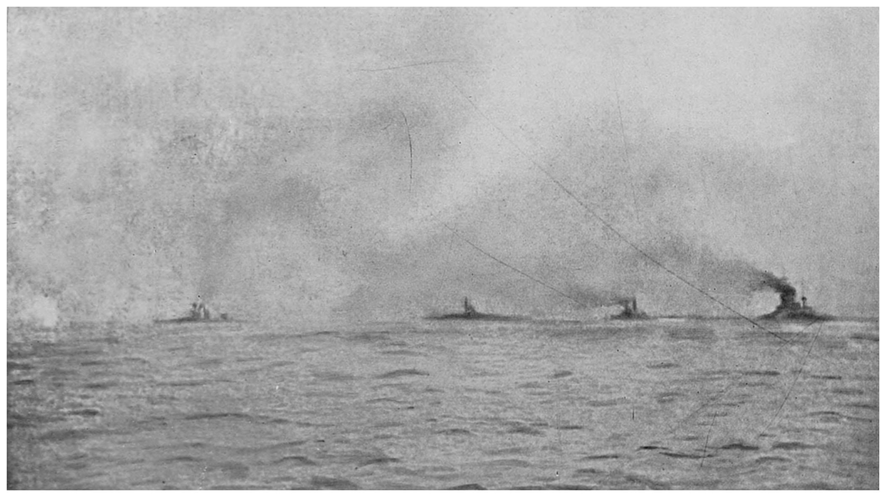
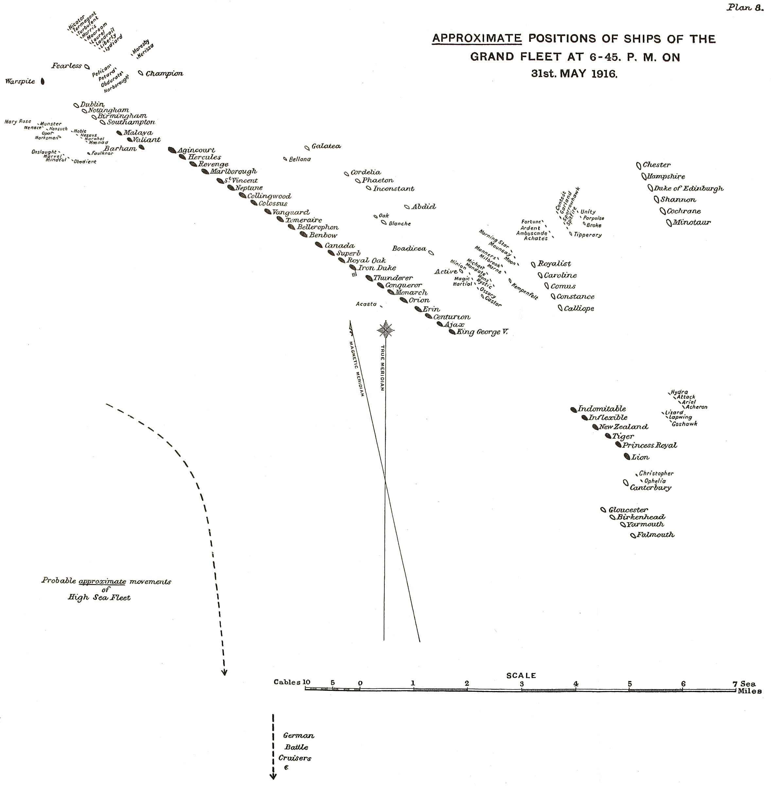

以下第一人称叙述依据史料重建，主视角为英国大舰队司令约翰·杰利科。

## 一、我的任务，是把舰队带到能打赢的位置

一九一六年五月三十一日下午，德国舰队的位置还没有在我的海图上固定下来。前方传来的报告已经证明有战列巡洋舰在交战，但我需要知道的是德国战列舰在哪里，向什么方向航行。我拥有足以压倒对方的主力，却必须先将六列航行的战列舰展开为一条战列线。向左展开还是向右展开，决定谁先挨打，谁能够集中火力，也决定还没有完成转向的军舰是否会暴露在鱼雷攻击之下。[^jellicoe][^dispatch]

这场战斗发生在日德兰半岛西侧的北海，德国称它为斯卡格拉克海战。本文的作战范围从五月三十一日下午双方侦察舰艇接触，延续到六月一日上午追踪结束，并交代受损舰艇返港的过程。日期使用公历，叙述钟点统一采用英国战报所用的格林尼治平时。舍尔回忆录中这一战的钟点比它晚两个小时；例如德国记载的晚九时十七分，对应本文十九时十七分。双方记录在个别事件上还存在数分钟差异，不能仅靠换算消除。

我的旗舰是铁公爵号。大卫·贝蒂率领的快速舰队在南面搜索，霍勒斯·胡德率领第三战列巡洋舰分舰队随主力行动。敌人一侧，由莱因哈德·舍尔统率公海舰队，弗朗茨·希佩尔指挥前出的战列巡洋舰。双方前卫的接触与追逐最终把主力带到同一战场，但没有任何一方能够随时看见海图上全部舰艇。德国主力终于出现在我的炮口前时，战斗已经进行了数小时；到了入夜，它又从视线和报告中消失了。[^jellicoe][^scheer]

这篇文章要回答的问题是：英国拥有更多重型军舰，为什么能够两度取得有利的交战位置，却没有把德国舰队截住？答案要从战列线上的每一次转向和每一份迟到的报告中寻找。日德兰的结果包含两件同时成立的事：英国付出了更大的舰艇和人员损失，德国也没有改变英国控制北海出入口的基本局面。战场上的打击能力、战役中的截击成果和战争中的制海权，在这一天并没有落到同一个胜负结论里。

在出海之前，我首先要处理的是英国舰队的日常责任。北海封锁依靠巡逻、检查和航路控制长期维持，主力舰队则给这些行动提供最后的武力保障。只要公海舰队仍然存在，巡逻舰艇和海上交通就需要这种保障。德国若能逐批消灭我们的分遣舰队，便可能缩小双方差距；我若让自己的主力被分割，也可能把全国海上优势消耗在几次看似局部的战斗中。因而侦察兵力必须走得足够远，又必须能够把敌情送回来，让主力及时赶到。[^jellicoe]

这要求舰队长期保持可以出动的状态。斯卡帕湾、克罗马蒂和罗塞斯分别容纳不同部队，出港后还要会合。航海计划需要考虑驱逐舰燃料、军舰维修和训练，舰队不可能永远以最高航速在北海巡逻。大战列舰的航程较长，小型舰艇却会先受到限制；如果它们因为燃料不足掉队，主力就会失去防潜警戒和实施鱼雷攻击的工具。作战计划里的一次低速航行，往往是在为后面数小时的高速接敌留下余地。

贝蒂的战列巡洋舰适合前出，因为它们把大口径火炮与较高航速结合起来。它们可以压倒敌方巡洋舰，迫使对方的侦察兵力后退，也可以在危险扩大时脱离。但它们的防护并不等同于同代战列舰，面对敌方战列舰主炮时，速度并不能消除炮弹穿透和弹药起火的风险。舰型提供了一组选择，也规定了一组限制。把快速部队派到主力前方，必须同时接受这样一种可能：它们在主力赶到以前，会独自承受相当猛烈的攻击。[^jellicoe]

我在战后解释过，把战列巡洋舰放在前面的理由，是为了取得接触并保持接触。若侦察部队一见敌军就退回，主力可能整天都追不上一个准确的位置；若它追得太远，敌方战列舰又可能切断归路。五月末的安排是让第五战列舰分舰队临时配属贝蒂，以四艘快速战列舰增强他的力量。这四艘舰的十五英寸主炮很有威力，但是临时配属并不会自动消除指挥程序上的差异。它们必须及时看懂前方旗舰的航向变化，才能把纸面上的增援转化成实际射击。

## 二、出港前，我怎样安排侦察与会合

五月三十日晚，我率铁公爵号及第一、第四战列舰分舰队离开斯卡帕湾。第二战列舰分舰队从克罗马蒂方向赶来，按预定航路与我们会合。胡德的第三战列巡洋舰分舰队此时随主力出动，贝蒂则带着第一、第二战列巡洋舰分舰队和第五战列舰分舰队从罗塞斯出海。这个部署把快速侦察力量放到南面，同时让主力在北面逐步集中。海军部提供的敌方活动警报，使这次出动具有截击的可能，但它没有给我一幅完整的敌方作战图。[^jellicoe][^gchq]

我的计划为贝蒂规定了南面的会合区域。他先到北纬五十六度四十分、东经五度附近，随后向北航行，争取与主力建立目视联系。主力预定在更北、更西的位置接近。这样的安排不是把两个舰群拴在同一点上，而是给侦察部队一段搜索空间。代价也很直接：一旦贝蒂向南追敌，他与我的距离就会增大；我向他靠近时，接敌位置也会随他的转向不断改变。预定会合点能够组织出航，却不能代替交战以后的动态报告。[^jellicoe]

五月三十一日上午，第二战列舰分舰队加入主力。到了下午，二十四艘战列舰以六列纵队航行，每列四艘。舰队正面因而较宽，前后长度则比单一战列线短。采用这种航行队形，可以在接敌后选择向一侧展开，让各列依次接入。最左列由乔治五世号领航，最右列由马尔伯勒号领航；铁公爵号位于中间的一列。我能够向两翼发出指令，但必须等到敌人的方向比较明确，才能决定哪一翼成为战列线的先头。

战列线的道理很简单：军舰前后排列，可以让舷侧重炮同时向一个方向射击。问题在于几十艘军舰不能瞬间变成一条线。每一列要转向，每一舰要保持间距，前面的舰艇减速时，后面的舰艇也要及时知道。若敌人从右侧突然出现，而我令全舰队向右侧那一列集中，最靠敌的一列就可能独自迎接德国主力，其他军舰还在转弯。若向左展开，距离会暂时拉开，但更多军舰能在交战前站到合适的位置。下午六时以后，我必须在很短时间里作出这种选择。

先把实际参战力量放在一起，可以看清当天的部署。以下是作战兵力的归属和作用，兵力数字按实际出动的主力舰计算；不同机构列出的全舰总数会因辅助舰和中途折返艇的计入方法而相差一两艘。全战区所有军舰、维修中的舰只和后来才出港的部队，都不能直接加入当日下午的局部比较。[^jellicoe][^scheer][^nrs]

| 一方与舰群 | 主要指挥官 | 本次主要舰艇 | 开始时的位置及任务 |
| --- | --- | --- | --- |
| 英国主力战列舰队 | 杰利科；杰拉姆、斯特迪、伯尼等 | 第一、第二、第四战列舰分舰队，共二十四艘无畏型战列舰 | 北面会合后南下，形成决战主力 |
| 英国前出快速部队 | 贝蒂 | 狮号、王家公主号、玛丽王后号、虎号、新西兰号、不倦号，六艘战列巡洋舰 | 南面搜索并保持敌情接触 |
| 英国第五战列舰分舰队 | 休·埃文－托马斯 | 巴勒姆号、勇士号、厌战号、马来亚号，四艘快速战列舰 | 临时支援贝蒂；后接入主力尾部 |
| 英国第三战列巡洋舰分舰队 | 霍勒斯·胡德 | 无敌号、不屈号、不挠号 | 起初随主力，随后奉命支援前方 |
| 德国侦察主力 | 希佩尔 | 吕措号、德弗林格尔号、塞德利茨号、毛奇号、冯·德·坦恩号，五艘战列巡洋舰 | 前出侦察，吸引英军向主力靠近 |
| 德国公海舰队主力 | 舍尔；贝恩克、施密特、毛弗等 | 十六艘无畏型战列舰、六艘前无畏型战列舰 | 从南面跟进，寻求攻击英国分遣力量 |
| 双方轻型兵力 | 各巡洋舰与驱逐舰队指挥官 | 英军另有装甲巡洋舰、轻巡洋舰和驱逐舰；德军有轻巡洋舰及大型鱼雷艇 | 搜索、报告、遮蔽、鱼雷攻击与夜间警戒 |

这里的英国勇士号是快速战列舰 Valiant；后文被击沉的武士号是装甲巡洋舰 Warrior。舰名相近，舰种与任务却完全不同。无畏型战列舰是以统一的大口径主炮为主要武器的新式战列舰；德国的六艘前无畏型战列舰属于较早的设计，航速和远距离火力都受到限制。它们跟随出动增加了舰数，也使整个舰队在长时间高速追击时更难保持整齐。这个问题在舍尔的战前取舍和夜间退却中都会显现。

这类问题在战前演习中已经出现。一九一一年，我指挥大西洋舰队参加演习时，就接触过较大规模的驱逐舰攻击训练；接掌大舰队以后，如何在主力交战中应对鱼雷仍是必须研究的课题。演习提供了队形和信号的共同语言，却没有充分解决低能见度下敌艇突然接近的问题。我的权限可以决定全舰队航向与展开，舰长仍须在本舰遭到炮击、碰撞或鱼雷威胁时立即操舰。总司令的统一命令与各舰的临机避让，从出港时起就是同时存在的两层指挥。[^jellicoe]

我能够调动的兵力还包括巡洋舰和驱逐舰。装甲巡洋舰可以在主力前方形成搜索线，但在新式战列舰的炮火下很脆弱。轻巡洋舰负责近距离侦察和引导驱逐舰，后者携带鱼雷，能够迫使比自身大得多的军舰改变航向。于是舰队的战斗力并非单看重炮数量。侦察舰若发错位置，重炮可能开不成火；驱逐舰若落在后面，主力即使占据优势，也可能无法抵近敌人。

## 三、从海图到海面，还有一层信息的距离

我出港时要面对的北海，并没有一条可以像公路那样看见的前线。德国舰队基地在东南方，返回时可能沿荷尔恩礁方向进入受保护的通道，也可能采取其他朝向德国海岸的航路。英国舰队从苏格兰基地南下，常常需要经过很长距离才能接触敌人。舰艇以航速和航向推算自己的位置；长时间转向、避弹和追逐以后，推算结果就会分离。两名指挥官都可能诚实地报告位置，却把同一片海面画在不同地方。[^jellicoe]

这直接影响援军如何接近。侦察舰报告敌人位于自己东南方时，我必须同时知道侦察舰在哪里。若它的位置错了十余海里，敌人相对我的方位便可能从前方变成右前方；二十节航速下，十分钟又会走过三海里多。舰队越接近，这种误差越难靠笼统的方向词弥补。大舰队到达战场时面临的困难，正是敌人已经进入炮程，而前方位置报告还没有拼成一个可靠的整体。

无线电能够越过视线传递消息，旗号和探照灯则承担近距离的许多战术指令。每一种手段都有自己的条件。旗号需要看见并正确读出；探照灯信号需要对准接收者；无线电可能受到干扰，也可能因为设备中弹而失效。把发出信号的钟点记在日志上，并不意味着另一艘舰在同一分钟已经执行。一个命令从司令的决定，到信号人员编码发出，再到接收、辨认、交给舰桥，最后转舵，需要跨过几个步骤。[^jellicoe]

能见度又会改变这些步骤的速度。烟囱排烟、火炮射击产生的烟雾和海面的薄雾，会把一支庞大舰队切成几个局部画面。前列军舰能看见的目标，中间位置的旗舰可能只能看见炮口闪光；后列的观察员有时反而能够看见更多敌舰。舰队的长度越大，这种差别越明显。指挥官既不能把自己看不见的东西当作不存在，也不能把所有报告的爆炸都当成击沉。

这些条件还解释了为什么我不能一味要求全舰队使用最高航速。长战列线必须留出航速余量，后面的舰艇才有能力补上因转向、避雷或临时减速形成的间距。舰队命令十七节，某艘舰为恢复位置可能需要开到二十节。若一开始就让所有舰艇用尽动力，落后的舰就无法追上。煤烟也会在高速下增加，遮挡射击和信号。战术速度因此是一种编队能力，不能简单用每艘舰试航时的最高数字代替。[^jellicoe]

至于德国指挥官真正打算怎样行动，我当时掌握的只是片段。战后对照舍尔的叙述，他原来想以袭击英国海岸吸引部队出动，配合潜艇在英国基地外的伏击。天气妨碍飞艇侦察，潜艇在外待机的时间又不能无限延长，计划转向斯卡格拉克方向。德方希望利用侦察群引出有利交战，却没有在会战前得到英国主力准确的位置。这样，双方各自的计划都依赖侦察链条，真正开始交战时却仍在寻找对方最重要的一块兵力。[^scheer]

在我的第一人称叙述继续之前，需要记住这片海面的空间关系：贝蒂在南面，德国主力还在更南面，我从北面接近。希佩尔的战列巡洋舰处于贝蒂与舍尔之间。当贝蒂追向南面时，双方的距离组合有利于德国；当贝蒂转向北面时，同样的追逐又可能把德国舰队带向我。方向改变之后，海上每一段距离的意义也随之改变。接下来数小时的战斗，就发生在这一组不断移动的关系中。

## 四、十四时二十分以后：前卫把战场带向南面

最初的接触来自前方巡洋舰。十四时二十分，加拉蒂亚号报告发现敌舰；贝蒂转向南南东，试图切在敌人与荷尔恩礁之间。随后东面出现更多烟柱，他又向东及东北转向。我在北面截收到前方报告，最先需要做的是使主力进入随时能够加速和作战的状态。十五时十分，舰队准备战斗；十五时三十分，我让各将领把敌情通知各舰。此时的消息首先指向轻型兵力和战列巡洋舰，还不足以证明德国整个战列舰队已经出动。[^jellicoe][^dispatch]

后来整理前方记录时，可以看清这次接触的起点：双方轻型舰艇都因为一艘中立商船向同一区域靠近。德方舰艇前去检查商船，英国巡洋舰则发现了附近的活动。这种偶遇使原本可能相互错过的搜索线接上。它没有决定后面的每一次战斗，却决定双方侦察部队开始朝哪里聚集。海战的第一步并不是两名总司令同时发现彼此，而是外围舰艇先看见烟、船体和对方的侦察兵力。[^scheer]

贝蒂的前方部署迅速变化。轻巡洋舰展开到东面，形成搜索屏幕；第二轻巡洋舰分舰队加速赶到战列巡洋舰之前。十五时三十一分，英国前卫确认五艘德国战列巡洋舰。贝蒂把自己的六艘舰排成战列线，舰速提高到二十五节，向东南方向接近。这时第五战列舰分舰队仍在后方偏西北位置。四艘快速战列舰拥有很强的火力，但在开战的最初阶段，它们还没有处在能够与前面六艘舰同时有效射击的位置。[^dispatch]

十五时四十分，贝蒂关于敌方五艘战列巡洋舰的报告传来。我据此继续向接触区域靠近，并把胡德的部队向前派遣。原先让胡德争取截住敌军轻型舰艇的意图，随着敌情扩大而改变；十六时前后，他的任务明确转为支援贝蒂。派出三艘战列巡洋舰能够提前增加前方力量，但它们仍要穿过位置不清的海面，寻找正在高速运动的友军。此时从北面赶来的援军，不能直接把海图上的交会线当成已经看见的目标。[^jellicoe]

十五时四十八分，前方双方主炮开始射击。按照贝蒂的战报，开火距离约一万八千五百码，双方随后在大体平行的东南向航线上交战。这个距离约十七公里，远远超过肉眼辨认舰桥细节的尺度。炮术人员需要判断落点，区分己方和友舰炮弹溅起的水柱，修正距离，再发出下一轮射击。哪一方更早取得有效夹叉，哪一方就可能先破坏对手的炮塔、测距和通信设施。[^dispatch]

这些具体打击不会立即完整地传到铁公爵号上。狮号中部炮塔遭到严重命中，不倦号在十六时前后、玛丽王后号在十六时二十六分左右先后爆炸沉没，是我后来才能拼出的事实。在当时，我所面对的是仍在向南发展的交战，以及前方敌舰数量和运动的报告。把后来知道的损失提前放进我的判断，会使这场战斗看起来像是我明知前卫正在遭受灾难却不采取行动；实际问题是，主力正在全速接近，而消息的内容远远落后于前方的全部经历。

十六时八分左右，第五战列舰分舰队终于投入远距离射击。它们的十五英寸炮给德国战列巡洋舰带来新的压力。德方记录也承认，这批军舰的射击使希佩尔的处境恶化。双方轻型舰艇随之向两条战列线之间推进：英国驱逐舰试图接近鱼雷发射位置，德国鱼雷艇也在寻找同样的机会。它们先与对方轻型舰艇近距离交火，随后才有条件向大型军舰攻击。鱼雷战因而不能从重炮战中抽出来单独计算，它必须争取一条能够接近目标的通路。[^dispatch][^scheer]

英国驱逐舰中，内斯特号、游牧民号和尼凯特号继续向敌方靠近。游牧民号受创停下，其他舰艇在攻击和规避之间转向。德方的两艘鱼雷艇也在这一阶段沉没。后来德国主力赶到，失去机动能力的英国驱逐舰便陷入更大的危险。舰艇一旦停在两支主力之间，既无法选择距离，也难以依靠速度脱身；同伴继续留在近旁救援，也会进入同一个火力范围。战斗结束后获救和被俘的人数，必须与当时能否撤走这艘舰分别看待。[^dispatch][^scheer]

我在北面并没有因此放慢接近。主力把航速提高到二十节，并停止原来的曲折航行，以便尽快赶到前方。危险是很清楚的：如果贝蒂继续向南，而德国主力就在他前面，我们之间的距离会在最需要支援的时候变得更大。解决办法却不是隔着数十海里直接指挥他每一次转舵，而是让主力持续推进，让侦察报告尽快说明敌方战列舰是否已经出现。这个答案在十六时三十八分前后到来。[^jellicoe]

## 五、十六时三十八分至十七时四十分：追逐方向倒转

古德纳夫指挥的第二轻巡洋舰分舰队发现了德国战列舰。南安普敦号的报告改变了整场战斗的规模：贝蒂面对的已经是德国快速部队与跟进主力的组合。十六时四十二分，贝蒂开始依次向右回转，向北撤离，并要求第五战列舰分舰队跟随。他把自己的部队带离德国主力的前进方向，同时把追逐引向正在接近的我。这是一次在敌军优势压力下的脱离，也创造了与大舰队会合的机会。[^jellicoe][^dispatch]

从铁公爵号的位置看，最重要的变化是双方距离开始迅速缩短。此前英国前卫向南，我向东南追赶，支援始终不容易赶上。现在贝蒂转向北面，敌军跟在后面，我和前卫在相向运动。杰利科的战后计算把这时两支英军的距离列为五十余海里，合拢速度约每小时四十五海里。即使如此，也还需要相当时间才能使主力炮火真正覆盖前方。报告里的一句发现敌方战列舰，并不能让二十四艘战列舰越过这段海面。[^jellicoe]

前方转向并不整齐划一。第五战列舰分舰队落在较后位置，接收和执行转向的过程使它继续向德军靠近了一段距离。等四艘舰转回北面，便成了英军撤离方向上的后卫。德国战列巡洋舰与领先战列舰向它们集中射击，英国快速战列舰则一边退向北面，一边以尾部和舷侧主炮还击。它们的装甲、航速和重炮在这里发挥了作用：既承受追击，又持续给追兵造成命中，避免后卫立即被压垮。[^jellicoe][^dispatch]

这个过程常被画成两条方向相反的箭头，实际上各舰必须穿过不断变化的射界。转弯会使某些炮塔暂时不能指向目标，后舰又要避免冲入前舰的尾流和射线。敌人若在转向点附近找到距离，后续舰艇会依次通过危险区域。因而命令传到得早一些还是晚一些，会改变全分舰队受火的时间。第五战列舰分舰队并非在一个瞬间从支援力量变成后卫，它是在追随前方转向的过程中逐渐落入这个位置的。

德国主力同样需要调整。舍尔的战列舰向北赶来，为希佩尔提供支持；发现英国部队正在脱离以后，又提高航速追击。前列较新的战列舰比后面的老式舰艇更容易保持速度，整个队列因此出现拉伸。德军的目标是把一艘或几艘已经受伤的英国重舰打得更慢，使它们无法继续逃向北方。但是这一次，英国快速战列舰没有被截留下来。德军能够毁灭的，是先前已丧失机动能力的驱逐舰；英国重舰继续把战场向北带。〔这些德方行动为战后对照。〕[^scheer]

我接到敌军主力出现的消息以后，必须进一步确定它相对英国前卫的位置。问题不再只是有没有德国战列舰，而是它们会从哪一侧进入我即将展开的战列线。古德纳夫靠近敌人获取信息，本身也在规避炮火；他的位置推算和贝蒂的位置推算，与铁公爵号的推算并没有完全吻合。敌情报告越来越多，舰队却不能因此自动得到同样精确的定位。真正危险的是，司令部在海图上按报告估计的交会点，可能比实际交会晚十几分钟。

前卫的炮击还在继续。贝蒂逐步把航向从北方转向东北，试图到主力前面占据位置。希佩尔为了不丢失接触也随之改变方向，战列巡洋舰之间的交战距离时而扩大，时而缩小。德方旗舰的无线电设备受损，前方所见更难及时送到舍尔手中。这意味着德国总司令也可能在缺少前卫完整说明的情况下继续前进。英国前卫并不是一个清晰可见的诱饵标志，德国主力也不是始终按照舍尔预先画好的路线前行。[^scheer]

胡德的三艘战列巡洋舰则从北面赶向声响和报告所在的区域。他带着切斯特号和坎特伯雷号等轻巡洋舰，原本要找贝蒂，却先接近了两支侦察屏幕之间的战斗。浓烟和不断移动的舰群使他无法简单地直线归队。前卫和增援分别看见不同的敌舰，局部交战开始在主力前面重叠。正是在这些重叠中，德国轻巡洋舰遭到重炮射击，英国巡洋舰也进入越来越危险的位置。主力会战尚未开始，连接两支舰队的轻型兵力已经承担了沉重代价。[^jellicoe]

十七时四十分以后，我的舰队逐渐接近炮声。主力前面的巡洋舰报告交战舰艇，翼侧军舰看见闪光，但这些报告中仍有身份不明和方位相互难以对应的内容。我继续向东南偏南推进。此时若过早展开到错误一侧，几十艘舰就要用很长时间重新调整；若继续等待，右侧先头又可能突然撞上德国战列舰。留给我的选择时间，正在被每一分钟的前进压缩。

## 六、十七时四十五分至十八时十六分：我要的是战列舰的位置

十七时四十五分，科默斯号从主力前方报告南面有猛烈炮声。不久，我们能看见南偏西方向的炮火闪光，但还看不清作战舰艇。阿巴斯诺特的巡洋舰也传来正在交战的报告，说明有舰艇朝东北运动。我无法仅凭这些信息辨认它们属于哪一方，更不能据此判断德国战列舰的队形。让主力展开需要一个相当具体的答案：敌方主力在我右前方、正前方，还是更偏向一翼？[^jellicoe]

我让旗舰舰长德雷尔安排测距人员检查不同方向的能见度，寻找比较适合交战的方向。回报显示南面相对较好。这项工作没有给出敌舰位置，却提供了另一种限制：即使可以选择航向，也应尽量让舰队获得能够识别目标和测量距离的射界。海图上最漂亮的交叉位置，如果被烟雾完全遮住，就不能发挥预期火力。主力展开因此同时受到敌人方位与可视条件的约束。

十七时五十五分，我向位于右侧的伯尼询问他能看见什么。他的答复是右前方有炮口闪光和猛烈炮声，约十分钟以后才传到我这里。随后他报告看见正在向东航行的英国战列巡洋舰。报告通过探照灯传递，等我收到并处理时，目标已经继续运动。杰利科后来特别拿这一过程说明，发出报告与收到报告之间的间隔，即使在人员熟练、事情紧急的条件下，也不能忽略。[^jellicoe]

十八时前后，我终于看见西南面的一群舰艇，认出它们是英国战列巡洋舰。它们正向东穿过主力前方，狮号在前。但我仍不能凭雾中的轮廓清点所有军舰，更不知道它们在此前损失了哪些同伴。舰队内外的炮声已经连成一片，而最关键的敌方主力还隐藏在这些运动后面。看见自己的前卫是一项进展，也带来新的问题：展开的战列舰必须避免被它们挡住射线。

十八时二分，我令各列领舰一起转向南，后续各舰依次跟进，并将航速降低到十八节，让队形靠拢。这次调整使主力向右侧争取了一些空间，又保留了六列队形。接着，狮号报告敌方战列巡洋舰在东南面。此前古德纳夫的报告则给出了敌方战列巡洋舰与战列舰之间另一组相对方位。把它们简单叠在一起，竟似乎会得出德国战列舰跑到战列巡洋舰前面的结论。我不能把这种矛盾直接当作可靠事实。[^jellicoe]

所以我继续询问。十八时一分发给贝蒂的问题，是敌方战列舰队在哪里；十八时十分，这个问题再次发出。与此同时，我把主力重新指向东南，并在十八时八分命令驱逐舰转入战斗部署。驱逐舰需要赶到合适的前方位置，保护主力、压制敌方鱼雷艇，并寻找自己的进攻机会。可是这个命令发出后，主力很快又要展开；驱逐舰原有位置、舰队转向和双方的相对速度，会使它们很难立即到站。

十八时十四分，贝蒂终于报告看见敌方战列舰队，方位南南西。十八时十五分，埃文－托马斯也报告德国战列舰在他的南南东。两份报告没有给出完整距离，却从不同位置提供了能够相互参照的方向。考虑到当时能见度有限，敌人显然已经很近。我现在可以确定，危险正在主力右侧发展，而且已经没有足够时间等待更完整的敌情图。[^jellicoe]

十八时十六分，我命令舰队以左翼纵队为基准，展开成战列线，航向东南偏东。乔治五世号所在的左列成为战列线前部，其他纵队依次接入它的后方。马尔伯勒号原在最右侧，因而要到整个战列线后部去。与此同时，舰速降到十四节，让贝蒂的战列巡洋舰从前方通过。若保持较高速度，主力可能过快逼近自己前卫，既妨碍射击，也增加碰撞和队形混乱的危险。[^jellicoe]

我的理由不是抽象地偏爱谨慎，而是右列已经可能进入敌方主力炮程。若在右侧展开，伯尼的几艘舰会先面对大量敌舰，其他纵队则还在调整。转到左侧能让主力较完整地横向伸展开，把火力集中到从西南接近的德国先头。战后复盘还会检查这种选择的代价；在这一刻，它首先解决的是不要让最靠敌的一小部分军舰替整个舰队承受初次打击。展开命令既是作战命令，也是把分散兵力变成共同火力的组织命令。

*杰利科一九一九年著作所收战时照片，原题说明为铁公爵号及第三战列舰支队在日德兰展开。图中可见舰间距离与烟雾；照片不能单独提供所有舰艇的精确位置。来源：Project Gutenberg 收录原书插图，公版。*

## 七、十八时十六分至十八时四十分：战列线展开，巡洋舰付出代价

展开进行时，距离敌人最近的英国舰艇已经在承受重炮。马尔伯勒号所在一翼先与敌方战列舰交战；其他各列还在依次接入。这不是所有军舰同时开火的整齐场面。浓烟使一些舰看不清目标，另一些舰则已经找到射击距离；前方还有英国战列巡洋舰和巡洋舰穿行。铁公爵号需要先确认目标身份，才能让火炮投入。把舰队展开成一条线，和让整条线立即发挥有效火力，是两个相连却不同的过程。[^jellicoe]

在我前面的战场上，胡德已经同敌方轻型舰艇交手。切斯特号先进入猛烈炮火，受创后退向有重炮掩护的方向，第三战列巡洋舰分舰队随即介入。德国威斯巴登号轻巡洋舰被打得失去有效机动，留在两支主力即将交会的区域。它的处境吸引更多英国舰艇接近，也成为德国舰艇和鱼雷艇设法掩护的对象。一艘受损轻巡洋舰因此把本来分散的战斗拉到同一片水面，几类不同军舰的射界开始交错。〔这里的局部过程依据战后汇集的报告。〕[^jellicoe][^scheer]

阿巴斯诺特率防御号和武士号装甲巡洋舰接近这场交战。它们的火炮足以打击轻巡洋舰，但自身防护不足以承受德国战列巡洋舰与战列舰的集中射击。防御号在接近敌方主力时遭到毁灭性打击，爆炸沉没；武士号也被多次命中，逐渐失去继续作战能力。它们当时的行动不能用后来海图上全部已知的敌舰位置来理解，但结果清楚地暴露了装甲巡洋舰进入现代主力战列线之间的危险。[^jellicoe][^dispatch]

第五战列舰分舰队此时从西南方向接近主力。埃文－托马斯先看见马尔伯勒号及其邻舰，一度以为那就是整条英国战列线的先头，准备在它们前面占位。随后他看见更多战列舰，才确认主力正在向左翼展开，于是改为绕转，准备接在战列线尾部。这项判断变化说明，连本方主力的完整队形也可能在雾中被误读。看见四艘军舰，并不能证明自己已经看见二十四艘军舰的排列。[^jellicoe]

就在转向过程中，厌战号操舵发生故障，继续转出一个大圈。它偏离预定路线，受到德国重炮猛烈射击，船体受损并进水。它的出现也暂时分散了对武士号的炮火，使后者得到脱离的机会。厌战号后来恢复控制，向北驶离危险区域，经上级许可独自返航。这是一次机械故障造成的偶然掩护，不能写成舰长事先设计好的一场救援；武士号暂时脱身，也没有改变其最终失去的结局。[^jellicoe]

胡德的第三战列巡洋舰分舰队则赶到贝蒂舰群前方，在德国战列巡洋舰能够出现的方向实施射击。它们的炮术给德国舰艇带来严重压力，但无敌号随后在雾隙中成为清楚目标。十八时三十分前后，无敌号遭命中并发生致命爆炸，胡德随舰阵亡。英国又失去一艘战列巡洋舰。对附近观察者来说，这是能够直接看见的巨大爆炸；对整支舰队来说，它还意味着一名分舰队司令、旗舰通信以及一个战术单位的突然消失。[^jellicoe][^nrs]

铁公爵号上的开火条件直到十八时三十分前后才明确。我们确认前方英国战列巡洋舰已经让开，右前方出现德国国王级战列舰，于是向其中的领先舰射击，距离约一万二千码。我的旗舰很快取得命中，周围舰艇也逐渐加入。能见范围里通常只有几艘敌舰，舰长们因此必须对各自能够辨认的目标开火，无法完全按照理想的统一分配表把火力平均布置。主力优势是在多个局部射击机会中发挥的，不是一整条战列线同时看见同一条敌方队列。[^jellicoe]

十八时三十三分，战列巡洋舰已经通过，我把主力航速提高到十七节。十四节的短暂减速在队列后部造成拥挤，因为减速信号传过去需要时间；恢复速度也要让各舰重新拉开间隔。到了十八时三十八分左右，主力的展开基本完成，第五战列舰分舰队剩余三舰接入尾部。最初并列的六支纵队成为一条能够共同作战的长线，但前后各部分所见敌情仍有明显不同。[^jellicoe]

从后来英德记录的对照看，英国舰队此时横在德国先头的进路上，取得了通常称为占据“T字横头”的有利位置。横向的一方可以使用较多舷侧火炮，迎面接近的一方则容易受到集中打击，后续舰艇还会被前舰遮挡。这个优势并非几何图形自动赠送的胜利：英国的可视目标有限，德国仍能转向，双方轻型舰艇也都在活动。但它足以使舍尔不能继续按原来的追击方向前进。

我当时无法从旗舰看清德国整个队列，更不知道舍尔何时在他的旗舰上下达了脱离命令。我能确认的是敌舰受到猛烈射击，目标随后又被烟雾遮住。若把这一刻写成我看见德军全体同时掉头，再从容决定下一步，就会抹掉实际指挥中的盲区。我的下一次转向，仍然要依据可见炮火、少量舰艇和各处传来的报告。[^jellicoe]

## 八、十八时四十分至十九时十分：敌人消失后，怎样继续接近

敌舰从视线中消失，并没有告诉我它们已经去了哪里。英国战列线继续向东南方向前进，先头的乔治五世号为了接近敌人，逐步向南调整。十八时五十分，我命令各支队转向南。这里采用的是按支队同时改变方向，目的是让较长战列线的各部分一起向敌人靠近，缩短单舰依次通过同一个转向点所需的时间。这种做法可以更快改变整个舰队的位置，也会使相邻支队暂时遮挡部分火炮。[^jellicoe]

铁公爵号附近就出现了友舰射线受到影响的情况。后面一支队的先头与前面一支队的后部不再完全在一条直线上，雷神号的炮火一度越过铁公爵号舰艏方向。只要队形控制得当，这类短暂遮蔽可以接受；但它提醒我们，快速改变舰队正面并非没有代价。舰队司令需要在尽快接近敌人和维持全部火力之间取舍，舰长则必须同时顾及距离、射界和邻舰的位置。

十八时四十五分前后，马尔伯勒号被鱼雷击中，舰体向一侧倾斜。伯尼向我报告可能中了水雷或鱼雷。我根据许多军舰已经经过同一区域而未受损的情况，判断鱼雷的可能性更高。马尔伯勒号没有立即退出战列线，仍继续射击并规避后续威胁。它在短期内保持行动，使主力尾部没有立刻失去指挥，但水下损伤已经开始限制舰艇的持续航速。到夜间，这个问题将再次影响队形。[^jellicoe]

关于鱼雷的消息也很难形成统一认识。有的舰看见航迹并转舵避开，旗舰未必看见；有的观察员认为发现了潜艇，有的则把水面异常解释为碰撞或爆炸。后来知道德国潜艇没有直接参加这场舰队炮战，并不能改变舰长当时需要立即处理疑似水下威胁的事实。对我而言，一艘主力舰已经确实受到水下打击，这比任何抽象估计更能说明，靠近敌人需要同时考虑炮程和鱼雷射程。

战后才知道，舍尔在十八时三十分以后组织了全舰队战斗转向。德国各舰大体同时掉头，原来的后方转为新的前方，舰队由接近英国战列线变成向西撤离。与所有军舰依次绕过一个点相比，这种动作能更快把先头从危险中拉出来。它要求各舰熟悉同时转向的操纵方法，也要求指挥体系能够在烟雾和炮击中让命令生效。德国舰队的训练在这一处发挥了很大价值。[^scheer]

第一次脱离以后，舍尔仍然面临返回基地的问题。他没有把暂时退出炮战当作整场行动已经结束，而是在约十八时五十五分再次转向东面。他在回忆录里提出的理由，包括避免英国舰队追向自己后方、争取重新打乱对手，以及援助留在危险区域的威斯巴登号。不同理由在实际决定中各占多大分量，不能只凭战后自述确定。但行动本身有记录：德国主力重新朝英国舰队所在方向靠近。[^scheer]

此时我并不知道敌军已经完成了两次这样的掉头。铁公爵号能见范围中的目标时有时无，后部某些英国军舰却能看见比我更多的德国舰艇。我的舰队继续向南及西南方向争取接触，德国舰队的回转也把它再次带到我们的炮火范围内。两支舰队在烟雾两侧分别改变方向，最后形成了第二次有利于英国的接触。它不是一方在清晰海图上等着另一方自投罗网，而是几次各有理由、各有盲区的运动叠加出来的局面。

十九时前后，英国部分军舰重新找到目标。马尔伯勒号尽管受伤，仍能参与猛烈射击；铁公爵号也在短暂清晰的视线中获得了较远距离的测距数据。德军的前列和战列巡洋舰承受越来越密集的火力。舍尔现在必须再次解决先头受压和队形暴露的问题。他所用的手段，比第一次单纯脱离更为激烈：让战列巡洋舰向敌人迫近，让鱼雷艇实施攻击，为战列舰转出争取时间。[^jellicoe][^scheer]

这里要区分英国舰队实际做到的事和可能做到的事。实际发生的是，德国主力再次遭到有利位置上的英国重炮射击。可能发生的，是英国继续保持接触并迫使德国遭受更多损失。后者还需要解决鱼雷攻击、烟幕和即将结束的白昼。正是这些未完成的条件，使第二次接触没有自然地变成歼灭战。

*杰利科《大舰队》原书第八图，绘制五月三十一日十八时四十五分的大致队形。原图附海里比例尺，英国舰列与轻型舰艇位置为战后整理；左下德舰航迹在原图中即标为推测。读图时按中央真北箭头辨认方向，页面上方并非严格正北。公版原图，经 Project Gutenberg 数字化。*

## 九、十九时十分至二十时四十分：鱼雷改变了追击的方向

十九时以后，铁公爵号能够看见敌方驱逐舰和鱼雷艇在烟雾附近活动。它们从西南方向靠近，试图向战列线发射鱼雷。我的主力用火炮对付这些目标，距离由一万码左右缩短到更近；部分敌艇转开，并制造烟幕。对这些小型舰艇来说，迫使英国战列舰转向已经可能完成任务，即使鱼雷没有命中，也能让德国战列舰获得距离和遮蔽。[^jellicoe]

我最初把舰队航向调整到南面，以便一边保持战斗，一边应对攻击。随后鱼雷威胁继续扩大，舰队在十九时二十三分前后向左转两个罗经点，又根据进一步警报转开两个点。一个罗经点约十一又四分之一度，因此这不是整支舰队突然回头逃离，而是以较小角度逐步改变航向，使军舰远离鱼雷可能穿越的区域。到了十九时三十三分，舰队重新向南偏西航行。[^jellicoe]

这种避让究竟改变了多少距离，杰利科在战后进行了计算。他认为主要转向使英德距离增加约一千七百五十码。这一数字来自他的复盘，不能视为每艘舰、每一分钟都相同的实测结果。它说明的是，司令把避雷看成有限度的战术调整，准备危险过去后继续接近。实际后果则更复杂：距离增加与德国烟幕、同时掉头、目标识别困难结合，使英国失去了继续集中炮击的机会。一个并不很大的横向移动，也可能在低能见度条件下切断接触。

英国驱逐舰本应在主力前方帮助对付这种攻击，但不少艇还没有抵达理想位置。十八时八分才下达的战斗配置命令，随后遇到主力展开和连续向南、向西转向。小型舰艇必须绕过大舰队、避免挡住炮火，再追赶不断移动的先头。它们的最高速度虽快，也不能穿过友舰的船体和射线。等部分驱逐舰赶到时，第一轮关键的鱼雷威胁已经迫使主力自行应对。[^jellicoe]

到下一次敌方攻击出现时，英国轻型兵力的位置已有改善，能够更积极地冲向对方。它们接近、开火，试图破坏鱼雷艇的编队并迫使其提前转离。两支舰队的轻型兵力在这里执行的是不同而又相互关联的任务：德国艇要给撤退的大舰争取空间，英国艇要把这个空间压缩回去。决定效果的往往不是发射器总数，而是谁先到达能够实施攻击的角度，谁还有足够鱼雷可用，谁能够在烟幕中认出目标。

从德方记录看，舍尔约在十九时十七分下达又一次全舰队掉头命令。战列巡洋舰和鱼雷艇的攻击为这次转向作掩护。已经受到重创的德国战列巡洋舰因而继续暴露在英国重炮之下，德弗林格尔号等舰遭受严重破坏。把这一行动称为一次轻松而完美的撤退，会忽略它依赖前卫承受额外损伤；把它写成毫无目的的冲锋，也会忽略它确实帮助战列舰脱离了不利位置。〔本段为战后德方记录对照。〕[^scheer]

希佩尔的指挥同样受到损伤限制。吕措号进水严重，他必须离开原旗舰，经小型舰艇转移，后来才在毛奇号上恢复较完整的指挥位置。这个过程使前卫部队无法始终围绕同一个通信中心行动。舰长和其他指挥官继续根据已有命令、可见目标和邻舰运动作战。德国舰队能够脱离，并不表示各级指挥始终顺畅；它也依赖部属在旗舰受损、司令转移时继续执行基本战术动作。[^scheer]

十九时四十一分，我令主力按支队转向西南，希望重新接近敌人。十九时五十五分左右，重炮射击大体停止，但关于德国舰艇方向的消息仍然传来。贝蒂报告敌人位于其西北偏西，距离约十至十一海里。我需要把他的报告换算成相对主力的位置，而这又取决于狮号究竟在我前方多远。主力先头本身已不总在铁公爵号视线内，快速舰群的位置也只能依靠报告判断。[^jellicoe]

十九时五十九分，我再次下令向西调整。前方战列巡洋舰在二十时二十分以后还短暂与敌军交火，试图把德国舰队保持在接触中。到二十时三十八分左右，轻巡洋舰报告的最后一段接触也结束了，德军再次转离。白昼已经进入最后阶段。主力和前卫都没有获得一个可以持续追踪的清楚目标，继续朝炮声出现过的方向前进，只会把夜间部署拖到更晚。[^jellicoe]

这里的停止射击并非停战。受损舰艇仍在争取航速，德国舰队正寻找回家的通道，英国驱逐舰还要重新部署。双方都知道敌人在附近，却不再知道对方全部舰艇的位置。我需要在日光完全消失以前决定夜间航向，因为一旦入夜，大规模视觉信号和复杂队形变换会变得更难。白昼的优势如果不能转化为夜间可执行的拦截方案，就可能随着最后一次目视接触一起消失。

## 十、二十一时至午夜：我向南封路，敌人穿向舰队后方

我对夜间局势的判断，是德国舰队大体位于我们西侧，而英国舰队仍在它与基地之间。敌人白天几次转向都在我们的内侧完成，我方则逐步从东南转到南面和西面；这种相对运动支持了我的估计。我的目标是在夜间继续保持隔断位置，待天亮重新展开战斗。为此，二十一时我命令主力按支队转向南面，随后编成较紧凑的平行纵队，各纵队之间相距约一海里。[^jellicoe]

我没有选择主动寻求主力舰之间的夜间近战。自己的战列舰在探照灯控制、副炮集中指挥和夜间识别方面仍有不足，驱逐舰又可能从极近距离突然出现。在这样的条件下，数量较多的重炮未必能按白天那样发挥优势。一艘己方驱逐舰穿过战列舰附近，也可能被误认为敌艇。我希望把主力保存为天亮以后能够统一作战的整体，同时让轻型兵力承担夜间接触和攻击。这个决定的得失，要由后来真正发生的航迹来检验。[^jellicoe]

驱逐舰被安排在主力后方约五海里。这样既能降低它们被己方重舰误射的危险，也可能在德国舰队向南返回时实施攻击。我还在二十一时三十二分命令阿卜迪尔号到荷尔恩礁方向的预定海域布雷，试图在敌人可能使用的退路上增加一道障碍。这些安排表明，我并未放弃夜间截击，而是把主要夜战任务交给驱逐舰和布雷舰。问题在于，这套安排依赖我对德国舰队方位的估计仍然正确。

实际的德国航路后来证明，它正逐渐从英国舰队后方穿过。舍尔让主力朝东南方向返回荷尔恩礁，较完整的战列舰在前，受损部队跟进，小型舰艇保护不同方向。英国主力向南航行，英国驱逐舰落在后方，两条航迹便使夜间接触集中发生在我们的后方屏幕。双方总司令都没有一张实时显示这种交叉的地图；英国小型舰艇首先遇到的敌军，也不一定能立刻识别为整支德国主力的通过。〔本段为战后航迹对照。〕[^scheer][^jellicoe]

二十二时四分左右，卡斯托号与敌舰近距离遭遇。它遭到快速射击，舰桥及无线电设备受损，使它难以向自己率领的驱逐舰队发出完整指示。部分英国舰艇发射鱼雷，另一些因为不能确定目标身份而没有发射。对舰长而言，夜色中的大型船影既可能是敌方巡洋舰，也可能是自己舰队的一部分；把识别延误全部归为怯懦，不能解释当时真实的误击风险。[^jellicoe]

二十二时二十分左右，古德纳夫的第二轻巡洋舰分舰队又与德国巡洋舰近距离交火。南安普敦号和都柏林号承受猛烈打击，舰上起火、消防设施受损，人员伤亡增加。双方在很短距离内开炮，交战持续时间不长，却远比远距离炮战更难承受。德国轻巡洋舰弗劳恩洛布号在这一阶段被鱼雷击中沉没。对英国主力来说，能从夜空中看见闪光，并不能自动知道是哪一批敌舰、正在朝哪个方向穿过。[^jellicoe][^scheer]

主力继续向南，而后方的战斗越来越分散。二十三时三十分前后，第四驱逐舰队与德国舰艇接触。领舰蒂珀雷里号遭到重创并起火，指挥官温图尔阵亡。另一艘领舰布罗克号操舵受损后与雀鹰号相撞，使本来准备攻击的队形进一步破碎。舰艇转向避弹、闪开友舰、寻找目标，又可能在黑暗中与下一批敌舰遭遇。夜战把白天尚能维持的舰队层级，拆成了若干只有几艘船的短暂战斗。[^jellicoe]

喷火号与德国大型军舰相撞的经历，也说明夜间识别有多混乱。英国初期报告把相撞对象认作巡洋舰，后来对照可确定涉及德国拿骚号战列舰。近距离炮口冲击、碰撞和擦过舰体造成的破坏，已经无法用正常炮战距离来理解。喷火号仍能脱离，带着从敌舰擦下来的部分外板返回；它的幸存是一艘小型舰艇在碰撞后恢复航行的结果，不等于那一片海面的敌情已经传回我的指挥所。[^scheer][^jellicoe]

午夜前后，更多驱逐舰投入攻击，也遭到德国战列舰副炮和探照灯系统的打击。幸运号、热烈号等舰在连续遭遇中沉没。德国舰艇使用照明和迅速集中射击，使接近到很短距离的英国驱逐舰处境极为危险；英国驱逐舰仍然发射鱼雷，试图击中正在通过的主力。在几分钟的交战后，各舰可能只剩下爆炸、烟柱和一个已经失去联系的目标方位。能确认敌舰正在穿越，与能把足够准确的航向航速及时报告给舰队司令，仍是两件事。

铁公爵号及主力其他舰艇听到炮声，也能看到照明弹。我知道驱逐舰正在与敌人交战，但从旗舰收到的消息，没有形成一份足以让我立刻把全舰队转向拦截的完整报告。我继续执行向南封堵、天亮再战的部署。事后的问题正出在这里：后方的战斗实际上已经说明德国主力正在通过，而我的作战图没有及时更新。这个夜晚的失机，既不能只归结为某一封电报，也不能因为旗舰缺乏完整消息就认为整个指挥体系没有责任。

## 十一、六月一日：天亮以后，我没有再找到德国主力

午夜以后，英国舰队后方的交战仍未结束。掉队的黑太子号装甲巡洋舰接近德国战列舰，遭到极近距离的集中射击，爆炸沉没。没有幸存者能够从舰上说明最后的判断过程，因此不能替舰长编出一套确定的心理活动。德方记录足以确认它进入德国重舰火力范围并被摧毁，却不足以让我们知道舰上每一步识别究竟怎样进行。对我的旗舰而言，它的失踪也没有立即变成一条完整的夜战报告。[^scheer]

英国第十二驱逐舰队在凌晨遇见德国战列舰。斯特林率领的福克诺号发现目标后，试图取得与敌平行并能够超前攻击的位置，再转向发射鱼雷。英国记录把这次攻击写在二时前后，德国对波美拉尼亚号被击沉的记录折算后在二时二十分左右。双方钟点与目标识别并不完全一致，可以可靠确认的是，这艘德国前无畏型战列舰遭鱼雷攻击后发生剧烈爆炸，全舰覆没。英国驱逐舰付出了代价，也确实在夜间打中了德国主力。[^jellicoe][^scheer]

斯特林曾用无线电报告发现敌方战列舰，但杰利科的记录说，这份电报没有被己方其他舰艇收到。他把原因推测为德国无线电造成的强烈干扰。报告失去的具体技术原因不能仅凭这一个解释完全确定，作战后果却清楚：我没有据此重新安排主力的截击。其他驱逐舰对爆炸和敌舰数量的判断，也在后来被汇总成高于实际的击沉估计。夜战既造成真实损失，也制造了难以当场核实的战果。[^jellicoe]

二时，伯尼报告马尔伯勒号无法继续维持十七节，必须减速到十二节，以免水密隔壁承受过大压力。我命令这艘受损战列舰离队返港，避开已知德国雷区。伯尼经无惧号（Fearless）轻巡洋舰转移到复仇号，继续指挥自己的部队。旗舰转移、受损舰减速和夜间航行造成的差距，使第一战列舰分舰队的一部分落在后面。天亮时，我要重新集中舰队，首先就得把这些分离的部队找回来。[^jellicoe]

二时四十七分，晨光开始出现，我令主力转向北面，重新组成单一战列线，准备遇敌后立即作战。但能见度比前一天还差，只能看出数海里。巡洋舰和驱逐舰没有全部归队，部分主力舰也尚未出现。我可以让现有战列舰立即冲向荷尔恩礁，也可以先集中警戒兵力、查明敌人的位置。考虑到德国雷区、潜艇威胁以及己方屏幕不完整，我选择后者；这使重新交战的条件更完整，也使最后的截击窗口进一步缩小。[^jellicoe]

三时三十分前后，一艘德国飞艇被发现。轻巡洋舰和主力先后向它开火，我曾根据它出现的位置向西搜索，随后又转回北面。飞艇的出现说明敌人可能掌握我们的行踪，却没有把德国战列舰带进英国舰队视野。后来对照德方报告，那些空中侦察同样受低云和薄雾限制，无法同时看清全部英国舰群。飞艇不是覆盖整个北海的透明眼睛，它也只能在几个局部目标之间寻找联系。[^jellicoe][^scheer]

德国方面，吕措号的进水已经无法控制，舰员撤到鱼雷艇后，军舰被自行击沉。罗斯托克号和埃尔宾号也没有返港。受损的塞德利茨号则艰难返回，在进水和吃水变化中维持航行。舍尔的主力逐渐进入荷尔恩礁附近的回航通道；东弗里斯兰号还在返航时触雷，但仍能自行入港。脱离英国主力没有立刻结束德国人的危险，接下来的任务是把能救的舰和人带回去。〔以上为战后德方报告对照。〕[^scheer]

我在清晨继续搜索。都柏林号曾报告敌方巡洋舰与驱逐舰，贝蒂受命前往查找；主力也寻找可能因伤掉队的德国重舰。可是后续报告说明目标已经在雾中消失，并未显出无法航行的迹象。约六时，自己的巡洋舰逐渐出现；驱逐舰到九时前后才陆续集中。等警戒屏幕恢复，测向资料和其他信息已经表明，德国主力在清晨通过荷尔恩礁，正向基地返回。[^jellicoe]

海面上留下的残骸和伤员仍需要处理。雀鹰号因碰撞受损过重，舰员撤走以后被己方击沉。武士号曾由水上飞机母舰恩加丁号拖带，后来无法继续保持漂浮，舰员和伤员转移后弃舰。对武士号是否可能仍然漂浮的疑虑，又促使我派出巡洋舰搜寻。战争中的结束并不是最后一炮停止的那一分钟：还有拖船、护航、伤员转运，以及确认一艘失联军舰究竟在哪里的工作。[^jellicoe]

到六月一日中午，继续在原战区寻找德国主力已没有现实成果。我命令舰队返航，罗塞斯部队独立返回自己的基地。马尔伯勒号的回航仍令人担忧，随后又遇到天气恶化与排水问题，直到六月二日抵达亨伯河才解除主要危险。大舰队回到基地后补充燃料，六月二日晚报告已能够在四小时通知后再次出海。我的这次海上指挥行动到此结束，德国舰队仍然存在，英国也没有失去继续控制北海的主力。[^jellicoe]

## 十二、战后复盘：两名总司令并没有同一幅海图

现在退出第一人称，把英德双方真正的部署与当时的认识放在一起。日德兰最值得复盘的第一个节点，是双方为什么会在这样的位置接敌。舍尔希望对英国分遣兵力建立优势，这与德国总兵力较少的现实相符。希佩尔的快速舰群承担吸引对手、搜索敌情和支持主力的多重任务。贝蒂前出也有同样的结构：先发现、先接触，再把较大的战斗交给杰利科。两套部署的共同弱点，是前卫既要与敌交战，又要持续向后方提供准确图像。[^scheer][^jellicoe]

德国原计划包含潜艇伏击与飞艇侦察。潜艇布在英国基地外，本来可能警告英国舰队出动并打击它们；天气和时间限制使配合不能按最理想方式展开。舍尔在没有获得英国主力完整动向的情况下继续行动，说明他接受了一定情报风险。这并不等于不知道英国有主力舰队，而是没有确认那支舰队已经集中到能在当天介入的位置。战略上知道敌人更强，与战术上知道敌人正在何处，是完全不同的信息。

英国的优势在于有密码分析支持。海军部能够从德国通信中看出活动征兆，促使舰队提前出动。但信号情报不会自动以原始面貌送到海上。为保护来源，报告要经过筛选和改写，指挥官未必知道某个位置来自敌军自己的电文，还是来自误差较大的无线电测向。杰森·海因斯对这一问题的研究提出，海军部体系对情报源保密的优先考虑，是信息未被充分用于作战的重要原因；它使简单的“有人忘了转发”解释显得不足。[^hines]

英国政府通信总部的回顾同时介绍了传统解释：有人根据留在基地的呼号活动，把德国主力判断为仍在港内。它也提到海因斯对这套故事的重新评估。本文采用的结论是，英国在战前得到有效预警，却没有在战斗全程得到同样清楚、可靠且注明来源的敌情。密码分析成功与舰队运用情报成功，需要分开衡量。至于每一位工作人员在每一份电报上的责任，现有公开材料和不同研究仍不能让人把全部过程压成一个简单失误。[^gchq]

第二个节点，是贝蒂向南追击与随后向北转向。向南追击使他远离杰利科，也让希佩尔有机会把他引向德国主力。可是如果英国前卫始终不接近，主力也很可能失去接敌机会。真正需要审查的是保持接触时使用了多少兵力、各部之间相隔多远、第五战列舰分舰队能否及时加入，以及发现德国战列舰后能否迅速完成共同转向。这个节点的核心是快速舰群内部的协调，而不是一句“追敌一定错误”或“诱敌完全成功”。[^dispatch]

从实际局部兵力看，开火时英国六艘战列巡洋舰面对德国五艘，英国四艘快速战列舰没有立即同时发挥作用。等第五战列舰分舰队进入射击位置，英国火力才明显增强；等德国主力出现，局部对比又迅速倒向德国。再等杰利科到场，整体优势转回英国。把二十八艘英国战列舰与二十二艘德国新旧战列舰从下午三时就放到同一张比较表里，会把最关键的时间差抹掉。双方的总量优势是在不同阶段、不同位置才发生作用的。

前卫转向北面成功保存了剩余重舰，并使德军继续向英国主力接近。但这个结果不代表英国快速部队的全部行动都有效。两艘战列巡洋舰已经沉没，第五战列舰分舰队转向迟缓，前后位置报告有明显误差。这些问题没有因为最终把敌人带到杰利科面前而消失。相反，它们把后续总司令展开的难度推高：主力不得不在已经接近敌方炮程时，才获得足以决定展开方向的信息。

若作一个受约束的替代方案推演，更紧密的第五战列舰分舰队配置、更清楚的共同信号程序，可能使四艘快速战列舰更早参加射击，并减少北返时暴露的时间。这种方案不需要贝蒂预先知道德国主力的准确位置，因而具备讨论价值。但它也有成本：部队更紧密可能减小搜索覆盖，战列舰的持续航速和转向特性也不完全等同于战列巡洋舰。合理的改进是在既有兵力下减少协同损失，不能假定所有舰艇都能像同一种船那样运动。

对舍尔而言，同样可以追问追击何时应该停止。他得到的消息显示英国快速部队正在撤离，而不是英国主力已经在前方展开。继续追击符合原来的局部歼敌目标，也可能让他过度依赖前卫能够维持清楚联系。希佩尔旗舰通信受损、可视条件恶化以后，继续向前的风险上升了。舍尔没有及时确认英国主力的位置，直到先头进入有利于英军的炮火布局。双方都为情报空缺付出了代价，只是英国的代价先体现在舰艇爆炸，德国的代价随后体现在主力不得不紧急脱离。

## 十三、展开与掉头：训练怎样改变一次错误的后果

第三个关键节点是十八时十六分的展开。杰利科面临的实际选项，是以靠敌的右翼为基准展开，或以较远的左翼为基准展开；继续保持六列队形等待也曾是短暂选项，但敌方重舰已经逼近，使它迅速失去可行性。向右翼展开可能更快让先头开火，却让少数军舰先承受德国整支先头的攻击。向左翼展开则用距离换取展开空间，让更多战列舰形成连续火力。[^jellicoe]

在这里，杰利科自己的说明有很强的解释力。他指出每个支队接入需要时间，转向以后还要重新取得射击诸元。如果在右翼展开，不仅最靠敌的军舰面临集中火力，后面接入的军舰还可能不得不追加转向，以免敌人取得横切位置。这个判断与实际展开后的有利局面相符。即使不接受回忆录中所有为自己辩护的措辞，也很难否认左翼展开解决了一个真实而急迫的战术难题。

但不能把一次成功展开扩展为整场指挥毫无缺陷。杰利科到六时十四分才得到能采取有效行动的敌方方位，驱逐舰战斗配置又在展开前几分钟才开始落实。主力成功站成战列线，轻型兵力却没有同步到位。后来面对鱼雷攻击，重舰必须更多依靠自身规避。也就是说，展开成功保住了舰队主要火力，却没有让整套攻击和防护体系同时完成配置；这正是随后“占据好位置却留不住敌人”的一部分原因。

德国第一次战斗转向，是另一种训练价值。舍尔的先头已经受到猛烈打击，继续向前可能让更多军舰逐次进入不利射界。全舰队同时反向，使承压最重的前列迅速离开前进方向，而烟幕和低能见度又帮助它们消失。这个动作并不需要每一艘舰知道英国所有舰艇的位置，只需要理解共同命令并保持操纵秩序。日常训练因此缩短了从危险识别到实际脱离的时间。[^scheer]

反过来说，训练也不能消除决策本身的风险。舍尔随后第二次朝东回转，又把自己带到英国有利的火力前方。他在回忆录中列出的主动出击、打乱敌人计划和援助威斯巴登号等理由，说明他希望重新掌握行动主动；但这并没有带来一个更清楚的敌情。再度接近时，德国舰艇仍然主要面对炮口闪光，英国战列线则能集中射击。成功完成一次撤离机动，不能证明再回到相同危险中就一定有更好的结果。

第三次转向还需要部属临机处理。舍尔记述，旗舰自身的转法与其他舰艇不同，而施密特没有机械等待后舰先转，而是根据现场情况带领本分舰队行动。这说明所谓整齐的全队掉头，也包含局部例外、对司令意图的理解和避免碰撞的调整。德国舰队并非只靠一条完美的信号脱险，而是信号、操舰训练与下级主动性共同维持了队形。[^scheer]

第四个关键节点是鱼雷攻击下的英国避让。杰利科的实际选择不是攻击与逃跑两项，而是继续靠近、迎向鱼雷来向缩小被击面积，或者转离以增加鱼雷需要跑完的距离。不同选择对炮火接触、编队一致性和水下风险的影响各不相同。鱼雷是否必然会命中，并不是下令时可以知道的事；已经中雷的马尔伯勒号又使威胁具有直接证据。

从结果看，英国转离帮助德国切断接触，这是不能回避的机会成本。若要推演迎向攻击，必须承认战列舰会更接近敌人、可能重新保持火力，也必须承认舰队将进入更复杂的鱼雷区，各舰临时避让可能破坏队形。假定所有鱼雷后来都没有命中，就反过来断言当时可以安全直冲，是把结果替代了风险判断。正确的批评应问：驱逐舰是否本可提前到位，侦察能否更连续，避让后恢复接触的措施是否足够快。

这四个节点共同说明，日德兰没有一名将领从头到尾完全控制事态。贝蒂的接触和撤离创造了会战，也付出巨大损失；杰利科的展开获得优势，后续轻型兵力与夜间信息却没有把优势封闭起来；舍尔两度进入不利位置，又依靠训练和掩护避免覆灭。评价他们时，应该把一次决定解决的问题，与它留下的新问题同时摆出来。

## 十四、夜间封堵失败，问题发生在哪一层

第五个关键节点是夜间航向与情报传递。杰利科希望向南保持隔断位置，德国则坚决向荷尔恩礁方向穿过英国后方。英国主力没有遭到夜间鱼雷群的大规模打击，德国也没有被迫在次日重新接受主力决战。双方各自的夜间部署都实现了一部分目标，却不是同样重要的一部分：英国保存了统一作战能力，德国取得了最急需的脱离通道。[^jellicoe][^scheer]

把英国失败简单解释为“不肯夜战”，会漏掉驱逐舰确实进行了持续而激烈的攻击。轻型兵力有命令、有部署，也造成德军损失。缺少的是让这些局部接触足够快地修正总司令的总体判断。一艘驱逐舰看见六艘大舰，并不一定能确认它们是德国哪支分舰队；无线电受损或干扰，又可能阻止报告传递。旗舰听见后方炮声，也可能仍把它理解为自己部署的夜间攻击正在进行，而不是德国整个主力已经越过封堵方向。

这个解释可以说明失机如何发生，却不能把失机视为自然灾害。整套计划本来就应当考虑，接敌部队会在黑暗中分散、通信会损坏，主力对敌方位置的判断需要不断修正。若驱逐舰的任务除了攻击以外，还明确要求持续报告大型舰群的航向、数量与通过位置，并安排能够转发的巡洋舰，旗舰获得有效警报的机会可能增加。这里提出的是制度层面的替代方案，不是要求某艘已经中弹失联的舰艇凭意志恢复电台。

另一种反事实是让主力更早转向东面，直接逼近荷尔恩礁通道。它可能缩短对德国归路的距离，也可能把英国舰队带到雷区附近，并在警戒兵力尚未集中时遭到攻击。这一方案还要求较准确地掌握德国实际航向。如果只凭“德国最后从那里回去了”来选择当晚航线，就是使用了战后答案。比较可行的推演，应当以当晚能够传递的目击和截获信息为基础，检验它们若被及时综合，是否足以改变向南航行的决定。

第六个节点是六月一日清晨是否继续逼近。英国舰队仍有压倒性的重炮力量，但驱逐舰、巡洋舰和部分战列舰尚未集中，能见度很差，德国舰队又接近自己熟悉的防护通道。继续搜索受损落后舰是可以实行的，事实上也已经实行；立即深入德国防御海域追求主力决战，则需要承担更高风险。这次选择保存了英国舰队，却也确认日德兰的歼敌机会已经结束。判断它时应当把清晨仍存在的局部机会，与夜间已经失去的主力截击窗口分开。

舍尔在回航中的坚持值得分析。他把到达荷尔恩礁作为明确目标，要求主力在夜间攻击下继续前进；其战列线虽然不断规避和重新归位，整体航路却没有因此完全散掉。较完整的战列舰放在前面，受损战列巡洋舰居后，有助于让先头具备冲过夜间阻拦的能力。德国的成功并不依靠清楚掌握全部英国舰艇，而是依靠一个相对明确的撤退方向、足够的剩余机动能力，以及英国主力没有及时改变拦截线。[^scheer]

这也给“偶然性”一个具体位置。雾、烟、损坏的电台和没有收到的报告，都不是可以精确安排的因素；但是舰队怎样配置侦察、怎样训练夜间识别、怎样规定报告优先级，会决定偶然事件造成多大影响。偶然并没有替代组织，组织也没有消灭偶然。日德兰的夜战把两者的关系放大了：一条报告失去，一支舰群的位置就可能在总司令的判断中停留在一小时前。

## 十五、爆炸、进水与疲劳：纸面火力以外的战斗力

英国三艘战列巡洋舰的损失，不能只用舰艇总数解释。它们不是在漫长进水中逐步沉没，而是在弹药系统遭受灾难性影响后迅速毁灭。装甲防护、炮塔和弹药输送通路的防闪焰能力、推进剂的存放和操作，都关系到一次命中能否发展成全舰灾难。苏格兰国家档案馆的专题回顾把防护不足与追求射速时的弹药处理并列为重要因素。这里不能把所有沉舰都还原成同一种未经观察的内部过程，但可以确认，防止火焰向弹药库传播具有决定意义。[^nrs]

火炮口径较大，不保证每发炮弹都能造成更大有效破坏。炮弹能否在穿甲以后合适地起爆，与它是否在装甲外过早破碎，造成的后果不同。杰利科在自己的总结里把英国穿甲弹性能与舰艇防护列为需要改进的问题。德方重舰在多次命中后仍能保持队形，也说明炮弹命中数量与击沉数量之间隔着结构防护、损管以及命中部位的差别。能够命中敌人，只是摧毁敌舰过程中的一环。[^jellicoe]

同样，德国舰艇更能承受损伤，也不代表它们可以无限承受炮击。吕措号就是清楚的反例。它的舰艏持续进水，速度、操纵和火炮使用逐步受限，最终失去继续回航的条件。舰员能撤离，并没有挽救军舰。塞德利茨号则在严重受损后返回，说明保持水密分隔、排水和操舰配合可能使结果发生变化。比较这两艘舰，应当看具体水下破坏与救援条件，不能从一艘幸存舰推出某国设计绝不会沉没。[^scheer]

英国马尔伯勒号的情况展示了另一种限制。它中雷后还能射击，说明武器并未同时失效；到夜间却必须减速，说明船体和隔壁承受能力不能因炮塔还能工作而忽略。受损军舰是否还能战斗，没有一个只有“能”或“不能”的开关。它可以保持部分火力，却无法跟上高速队列；可以自行航行，却需要额外驱逐舰护送；可以暂时保持浮力，却在海况变坏后重新陷入危险。这些变化会把战场损伤转化成整支舰队的行动负担。[^jellicoe]

基层人员的经历能让这种负担变得具体。新西兰号的炮塔军官亚历山大·戴维·博伊尔在六月六日的信中记述，炮塔受损以后旋转受到阻碍，人员检查滚轮通路，清理卡住的金属和弹片，才恢复转动与射击。他通过装甲观察缝能够看见的范围很窄，炮塔内部人员甚至不知道附近两艘战列巡洋舰已经沉没。这个记录说明，一艘舰仍在开火的背后，可能是局部故障排除和高度分隔的信息环境。[^boyle]

博伊尔还写到通宵值更造成的疲劳，以及靠舰用饼干和罐头肉进食。他描述自己到凌晨才由年轻军官接替，在炮塔内短暂休息。这些细节来自参与者记录，不需要另加想象的对白。它们揭示了持续作战的另一个边界：人员并非在每个时刻都保持同样的观察力，舰上的轮换、食品和休息安排会影响次日还能怎样战斗。夜间辨认一个远处目标，本来就困难；在数小时炮战和紧张值更之后，困难还会增加。[^boyle]

使用这封信也需要保留它的尺度。博伊尔关于个人炮塔修复的说明很具体，对整场战斗的时序、友舰损失和德国损伤则存在与其他记录不一致的地方。本文采用他的岗位经历，不用他的整场战果判断替代交叉核对。一个目击者可以非常准确地记住自己拆掉了什么障碍，同时误以为远处燃烧的舰已经沉没。这不是取消证言价值，而是让证言回答它真正能够回答的问题。

伤员后送也不能只放在战果表里。舰艇进水、起火、倾斜时，转移伤员会占用通道和人手；救援舰靠近受损大舰，又要承担碰撞和敌情风险。恩加丁号从武士号转移人员，英国驱逐舰救援同伴，德国鱼雷艇接走吕措号舰员，都属于决定死亡与幸存的实际作战过程。击沉一艘舰与使其人员全部死亡并不等价，后者还取决于爆炸速度、海况、救援时间和附近是否有能够停下来的船。[^jellicoe][^scheer]

所以日德兰的装备比较必须同时考虑大舰、轻型舰艇和舰上组织。重炮使对方无法继续沿原航向接近，鱼雷迫使对方改变位置，通信决定哪批火力能及时出现，损管决定挨打以后还能维持什么能力。英国在主力数量上占优，德国在若干防护、炮弹和战术操纵环节表现较好，双方又各有明显失误。将战果全部归于某一种舰型或某一项技术，会把这场战斗最重要的相互作用拆散。

## 十六、最终战果：哪些舰真的没有回来

两国在战后都迅速建立了对自己有利的叙述。德国强调击沉更多英国军舰，英国强调迫使敌人退出战场并继续掌握海上优势。宣传之外，首先能够核实的是实际沉舰。英国失去三艘战列巡洋舰、三艘装甲巡洋舰和八艘驱逐舰；德国失去一艘战列巡洋舰、一艘前无畏型战列舰、四艘轻巡洋舰及五艘鱼雷艇。双方都没有无畏型战列舰在本次战役中沉没。[^royal][^scheer][^dispatch]

| 损失项目 | 英国 | 德国 | 统计说明 |
| --- | --- | --- | --- |
| 战列巡洋舰 | 不倦号、玛丽王后号、无敌号，三艘 | 吕措号，一艘 | 吕措号是在撤员后自行击沉，仍计入本战损失 |
| 无畏型战列舰 | 无沉没 | 无沉没 | 受损、退列与沉没分别计算 |
| 前无畏型战列舰 | 无 | 波美拉尼亚号，一艘 | 鱼雷命中后爆炸沉没 |
| 装甲巡洋舰 | 防御号、武士号、黑太子号，三艘 | 无 | 武士号在拖带失败、弃舰后沉没 |
| 轻巡洋舰 | 无沉没 | 威斯巴登号、弗劳恩洛布号、罗斯托克号、埃尔宾号，四艘 | 包括战伤后弃置及自沉 |
| 驱逐舰／鱼雷艇 | 八艘 | 五艘 | 英方包括碰撞重损后由己方击沉的雀鹰号 |
| 沉舰合计 | 十四艘 | 十一艘 | 同一战役损失口径，不含六月五日汉普郡号触雷 |
| 死亡 | 皇家海军百年纪念采用六千零九十四人；苏格兰国家档案馆采用六千零九十七人 | 两机构均列二千五百五十一人 | 保留公布数字的小幅差异，不拼成一个假精确总数 |
| 负伤 | 英国官方纪念册称接近六百七十五人 | 同册称超过五百人 | 使用纪念册的近似口径，未与死亡人数简单相加 |
| 被俘、失踪及其他减员 | 有驱逐舰幸存者被德方救起并俘虏；本篇未重建统一名册 | 本篇未取得可独立核对的统一分类名册 | 未单列者不代表零，海上失踪后确认死亡者不可重复加入 |

*沉舰与死亡数字据英德战报、皇家海军及苏格兰国家档案馆交叉核对；伤员近似数字据英国政府发布的百年纪念册。*[^royal][^nrs][^programme]

舍尔回忆录中的最初战果估计，还包括一艘英国伊丽莎白女王级战列舰和更多巡洋舰、驱逐舰。这些判断不能保留到最终表中。厌战号确实遭到重创，却没有沉没；德国观察员看见它脱离、倾斜或受到火力覆盖，并不能证明它后来消失在海底。英国方面也把某些爆炸、目标消失和独立报告相互叠加，估计击沉了德国无畏舰，甚至认为攻击了潜艇。实际德军无畏舰没有沉没，潜艇也没有直接进入这场主力炮战。[^scheer][^jellicoe]

这些错误有几种来源。第一，炮烟把一艘舰遮住时，观察者可能把它理解为沉没。第二，不同位置的军舰可能报告同一次爆炸，汇总以后却像发生了两次成功攻击。第三，黑暗中舰型难辨，轻巡洋舰、装甲巡洋舰和战列巡洋舰容易误认。第四，战后的政治和军种声誉又会影响哪些报告被强调。仅仅说双方都夸大战果，还不够严谨；需要检查每一项宣称能否与对方实际舰艇清单、返港记录和沉舰事实对应。

死亡数字的小幅差异则属于另一类问题。六千零九十四与六千零九十七之间的差距，不会改变英国人员损失远高于德国的结论，却提醒读者名册统计也会调整。本文没有实际逐人重建死亡名单，因而不把某一种公布值说成自己重新核算出的唯一精确结果。类似地，负伤、后来伤重死亡、海上失踪和被俘可能采用不同截止日期；若没有相同口径的底表，就不应把不同出版物中的数字直接相加。

舰艇损失也不能只按吨位估计战争代价。一艘舰代表受训炮术人员、轮机人员、信号人员和舰队组织经验。爆炸造成的大量人员同时死亡，使人员损失与船体损失一起集中发生。幸存舰艇还需要维修，期间又暂时不能出动。英国拥有较大的工业和舰队储备，能够继续维持优势；德国舰艇虽沉得较少，受损战列巡洋舰和部分主力也需要较长修复时间。沉舰数是清楚的一项结果，却不能独自给出次日和次月的可用兵力。

舍尔在回忆录所载七月报告中，预计到八月中旬，除德弗林格尔号和塞德利茨号外，公海舰队能够准备新的行动。这一表述反映出修理周期的重要性。杰利科六月二日晚报告舰队能再次出动，也不等于每一艘受损舰都已修复；它说明还有足够的主力能够执行任务。把“舰队可出海”理解为“所有舰艇没有受伤”，和把“多艘舰需要修理”理解为“舰队已经完全丧失作用”，都会误读战役后的力量状态。[^scheer][^jellicoe]

## 十七、海面仍由谁控制，下一场战争方式又怎样改变

日德兰的战术结果有利于德国：它以较少沉舰和人员损失给英国造成更重打击，并在不利局面下保住公海舰队主体。战役目标却只完成了一部分。舍尔希望通过打击英国分遣力量改善海上力量对比，实际取得了损失交换的优势；他也遭遇了原本希望避免的英国主力集中，没能摧毁贝蒂剩余重舰，更没有突破北海出入口的控制。撤回基地是成功脱险，不是打开通向大西洋的自由航路。[^scheer]

英国也不能仅凭战略局面未变，就把战役写成完全达成目的。它获得了与德国主力交战的机会，两次形成有利位置，最后却没有把对手截住。三艘战列巡洋舰的毁灭、巡洋舰误入危险区和夜间报告失效，都属于需要解释的损失和失机。保存制海权是重要成果，未能充分利用这次会战则是同样真实的局限。战略任务较为保守，并不会自动使每一项战术选择都成为正确选择。

舍尔自己的战后判断尤其值得注意。他向皇帝指出，即使海上会战取得很大成功，也难以单靠这种方式迫使英国媾和；英国的地理优势和物质力量，使德国难以通过主力舰队消除封锁。他因而强调潜艇攻击英国商业交通的作用。这里能够直接看见，日德兰的经验被用于支持另一种战争方式。它并未使战列舰立即过时，却削弱了德国依靠一次水面舰队胜利改变战争的希望。[^scheer]

随后潜艇战扩大、美国参战与整个战争结局之间存在重要联系，但不能把它们写成日德兰当天自动触发的一条单线因果链。德国政治领导、外交风险、经济压力和后续军事形势都参与了决定。日德兰提供的是一项有力经验：即使公海舰队给英国造成更大损失，北海的基本战略结构仍可能保持。舍尔从这一经验中得出的政策主张，是战役影响的一部分，不是后来一切事件的唯一原因。

常见的另一种说法是德国舰队从此再也没有出海。这与后来的行动不符。奥克尼博物馆的专题明确指出，双方舰队此后仍曾出海，日德兰改变的是风险评估和行动方式。公海舰队继续作为一支存在的力量牵制英国，英国也仍要维持能够迎战的主力与警戒体系。没有再次发生同等规模的主力会战，不等于舰队停止活动，更不等于英国可以把全部海军资源立即转作其他用途。[^orkney]

指挥官的命运也没有在六月一日终结。杰利科继续指挥大舰队，后来转任第一海务大臣；贝蒂随后接掌大舰队。舍尔则继续指挥公海舰队，之后承担更高层的海军职务。相反，胡德和阿巴斯诺特在战斗中阵亡，温图尔也未能从夜战返回。对一个舰队来说，这些损失不仅是名字从名册上消失，还意味着部队要在战后重建指挥、训练和经验传承。幸存的将领能够撰写回忆录，阵亡者的决定则更多要靠他人的报告重建。[^jellicoe][^scheer]

这也是阅读日德兰文献时必须保持的尺度。杰利科可以详细解释为何左翼展开、为何避雷和为何不主动夜战；舍尔可以解释为何重新转向东面、为何以鱼雷艇掩护撤退。这些材料极有价值，因为它们把实际选择与约束保存下来。但两位作者都在战后为自己承担的责任作解释，且当时掌握的敌方损失资料并不完整。将一方回忆录视为整场战斗的最终裁判，会把其个人视野误当作全知视野。

回到开头的问题，英国为何占优而未能歼敌？它在舰队集中和主力展开上取得成功，却在接触维持、轻型兵力及时到位和夜间情报综合上出现断裂。德国在追击中进入不利战场，又以训练有素的转向、战列巡洋舰承压、鱼雷攻击和明确的回航路线，把局部脱离变成了全舰队撤退。雾和夜色帮助了撤退，真正穿过夜色的仍是能够操纵、能够传令、仍有动力和人员组织的军舰。

日德兰留下的军事经验因此有具体适用条件。远距离舰队作战需要先把侦察转换成共同位置认识，再把数量转换成能够同时使用的火力；占据有利位置以后，还需要足够连续的接触才能取得歼灭成果。对依赖海上交通的大国而言，保住主力和制海权可以维持战争基础；对寻求打破封锁的一方而言，打沉更多敌舰也未必改变战略困境。这场海战的结局，正是这些不同层次的成功与失败在同一天叠加的结果。

## 战役时间线

| 时间（格林尼治平时） | 主要事件 | 对下一阶段的影响 |
| --- | --- | --- |
| 五月三十日晚 | 英国各部出港，按计划集中 | 主力提前进入北海 |
| 五月三十一日十四时二十分前后 | 英国巡洋舰报告敌舰 | 前卫向接触区域集中 |
| 十五时四十八分 | 英德战列巡洋舰开始主炮交战 | 战场向南移动 |
| 十六时八分前后 | 英国第五战列舰分舰队投入射击 | 英国前卫获得重炮支援 |
| 十六时三十八分前后 | 古德纳夫报告德国战列舰 | 贝蒂准备北返 |
| 十六时四十二分以后 | 英国前卫回转向北 | 德国追击逐渐接近英国主力 |
| 十八时十四至十六分 | 杰利科取得关键方位报告，命令左翼展开 | 英国主力形成有利战列线 |
| 十八时三十分前后 | 无敌号爆炸；英国主力逐步集中开火 | 英国继续损失重舰，德国先头承压 |
| 十八时三十分以后 | 德国首次全队转向脱离 | 双方一度失去持续接触 |
| 十八时五十五分前后 | 舍尔重新向东回转 | 再次进入英国重炮火力范围 |
| 十九时十七分前后 | 德国再次掉头，以快速舰艇及鱼雷攻击掩护 | 德国主力争取脱离空间 |
| 十九时二十三至三十三分前后 | 英国主力转向避雷，再恢复南偏西航向 | 接触进一步减弱 |
| 二十时三十八分前后 | 最后一段白昼接触结束 | 双方开始夜间部署 |
| 二十一时以后 | 英国主力向南，驱逐舰置于后方；德国向荷尔恩礁返回 | 夜战集中到英国后方 |
| 二十二时至六月一日凌晨 | 巡洋舰、驱逐舰与德军主力多次近距离交战 | 德军突破后方屏幕，双方继续受损 |
| 六月一日二时前后 | 波美拉尼亚号在夜间鱼雷攻击中沉没；马尔伯勒号奉命离队 | 德军仍继续回航，英军需重新集中 |
| 二时四十七分以后 | 英国主力转北搜索，随后继续寻敌 | 未能恢复主力接触 |
| 六月一日中午以后 | 杰利科决定返航 | 主力战役行动结束，救援与返港继续 |
| 六月二日 | 英国主力回港补给，受损舰陆续抵达 | 双方进入维修、统计与经验总结阶段 |

## 参考资料与注释

本文以两位舰队司令的战后记述和英国公开战报建立行动主线，使用机构资料核对损失、舰种与后续影响，并以岗位书信补充人员处境。回忆录中的敌方击沉宣称均与实际损失分开处理。未查阅原件的电报和档案不列为直接查档成果；本文未使用未经实际核对的书籍页码。

[^jellicoe]: John Rushworth Jellicoe, *The Grand Fleet, 1914–1916: Its Creation, Development and Work*, New York: George H. Doran Company, 1919。实际使用第十二至十五章，重点核对接敌报告、十八时展开、鱼雷规避、夜间部署、六月一日搜索及返港。开放全文：[Project Gutenberg 数字化原书](https://www.gutenberg.org/cache/epub/75323/pg75323-images.html)。配图亦出自此书。作者对敌方损失和夜间若干目标的识别带有当时资料限制，本文不沿用其全部战果判断。

[^scheer]: Reinhard Scheer, *Germany’s High Sea Fleet in the World War*, London: Cassell and Company, 1920，第十章“斯卡格拉克海战”。实际使用战前计划、追击、三次战斗转向、夜间回航、损失及七月报告所载战略判断。开放转录：[第十章甲](https://www.wtj.com/archives/scheer/scheer10a.htm)、[乙](https://www.wtj.com/archives/scheer/scheer10b.htm)、[丙](https://www.wtj.com/archives/scheer/scheer10c.htm)、[丁](https://www.wtj.com/archives/scheer/scheer10d.htm)。本文将该章德国钟点统一减去两小时；转录中的舰型误认与夸大战果不作为确认事实。

[^dispatch]: John Jellicoe，六月二十四日战报，含 David Beatty 前卫战斗报告节录，英国海军部一九一六年七月公布，*London Gazette* 第29654号相关刊载。实际核对贝蒂开战、第五战列舰分舰队加入、驱逐舰攻击和主力接合。全文转录：[Naval-History.net，Royal Navy Despatches, Part 1](https://www.naval-history.net/WW1NavyBritishLGDispatchesNavy1914-16.htm)。网页另外附加的现代战斗序列与原始战报有明确分界，本文不把附表误称为一九一六年战报原文。

[^boyle]: Alexander David Boyle，HMS New Zealand，写于一九一六年六月六日的书信。实际使用炮塔滚轮故障排除、岗位视野、值更疲劳和进食记录。转录机构：新西兰皇家海军国家博物馆，[Battle of Jutland – LT AD Boyle](https://navymuseum.co.nz/explore/by-themes/world-war-one/battle-of-jutland-lieutenant-a-d-boyles-account-from-hms-new-zealand/)。其整场时序和远方战果有误，本文未以之建立时间线。

[^hines]: Jason Hines, “Sins of Omission and Commission: A Reassessment of the Role of Intelligence in the Battle of Jutland,” *The Journal of Military History*, 72, no. 4, October 2008。本文核对在线可读的摘要及通信情报处理分析段落，用于介绍保密优先的解释，未声称直接查阅文中所引档案原件。[论文与在线文本](https://www.academia.edu/36579597/Sins_of_Omission_and_Commission_A_Reassessment_of_the_Role_of_Intelligence_in_the_Battle_of_Jutland)，[DOI](https://doi.org/10.1353/jmh.0.0092)。

[^gchq]: GCHQ，[Signals intelligence and the Battle of Jutland](https://www.gchq.gov.uk/information/signals-intelligence-and-battle-jutland)，二〇一六年五月二十七日，后有更新。实际使用战前预警、传统呼号解释与海因斯修正意见的介绍；不采用该页关于德国舰队此后活动的过度概括。

[^nrs]: National Records of Scotland，[Battle of Jutland 1916](https://nrscotland.gov.uk/learning-and-events/first-world-war/battle-of-jutland-1916/)，二〇二四年十一月一日。用于交叉核对英国主力构成、战列巡洋舰弹药防护问题及其公布的死亡数字；使用的是机构专题及其展示材料，未宣称另行调阅馆藏原件。

[^royal]: Royal Navy，[The Royal and German Navy remember the Battle of Jutland](https://www.royalnavy.mod.uk/news/2016/june/02/160602-the-royal-and-german-navy-remember-the-battle-of-jutland)，二〇一六年六月二日。用于核对二十五艘总沉舰、英方十四艘，以及六千零九十四、二千五百五十一人的纪念统计。

[^programme]: 英国政府发布，*Battle of Jutland Centenary Commemorations*，二〇一六年纪念册，伤员与救护部分。[官方 PDF](https://assets.publishing.service.gov.uk/government/uploads/system/uploads/attachment_data/file/528035/Jutland_Final_PDF_Commemorative_Programme_Spread.pdf)。实际使用接近六百七十五名英方伤员与超过五百名德方伤员的近似数字，不据此另行拼算总减员。

[^orkney]: Orkney Museums / Scapa Flow Museum，[World War I – Battle of Jutland](https://orkneymuseums.co.uk/world-war-i-battle-of-jutland/)。用于核对战后双方仍有出海行动及英国继续控制北海的判断；该专题其他简化表述未全部沿用。
