以下第一人称叙述依据史料重建，主视角为美国陆战第1师师长奥利弗·史密斯。

朝鲜战争爆发近三个月后，1950年9月15日，联合国军在朝鲜西岸仁川登陆；9月28日前后，首尔城区的有组织抵抗基本结束；10月7日，陆战第1师完成阵地交接。本文讨论这一仁川—首尔战役及其直接追击收尾，日期使用公历，行动时间依战史所记当地时间。文中首尔即当时中文通常所称汉城，永登浦位于其汉江南岸，议政府位于首尔以北。联合国军的目标是夺取港口与首都交通枢纽，配合釜山方向反攻，瓦解人民军在南方的作战体系。朝鲜人民军则力图保住后方交通，阻止登陆军沿汉江进入首尔，并为南方部队的调整与撤退争取时间。

战役以联合国军控制仁川、金浦、首尔及北面要道告终。麦克阿瑟负责总体战略，第10军军长阿尔蒙德统率登陆后的地面战役，海军斯特鲁布尔与多伊尔负责相关海上与两栖指挥，史密斯指挥陆战第1师。面对这支联合作战力量的人民军守备部队不断增援和重组，不能以登陆当天月尾岛守军的人数概括整个战役。全文要回答的问题是：为什么能够在一天内建立的海上突破口，还需要连续的渡河、高地争夺和城市战，才能变成切断敌方交通的战役成果？[^montross][^appleman]

## 一、东京，1950年8月22日：先把登陆日期变成一项能够执行的任务

8月22日，我抵达东京。负责两栖作战的詹姆斯·多伊尔海军少将将我接到停泊在港内的“麦金利山”号指挥舰。我的参谋人员已经先期开始工作，作战参谋鲍泽向我说明：计划中的登陆地点是朝鲜西岸的仁川，日期暂定9月15日，主力必须利用傍晚的高潮进入海岸。这个时间表留给我们三个多星期，要完成部队集结、装船、航渡和登陆计划。与此同时，师的各部分仍在不同地点。它们还没有组成一支能够在同一片训练场上演练的完整部队。[^montross]

我的任务包括占领港口、向内陆推进、夺取金浦机场、渡过汉江，再攻入首尔。仁川距首尔不远，这使它适合威胁朝鲜人民军的后方运输。但对师的指挥而言，地图上这一段距离包含几种连续而不同的战斗：从舰船进入海墙内侧，从港口转入道路与村镇，再从汉江南岸转到北岸，最后进入人口稠密的城市。登陆时带到岸上的车辆、火炮和弹药，需要支撑这些任务；后续梯队的到达次序，也必须跟上部队的实际推进。[^montross]

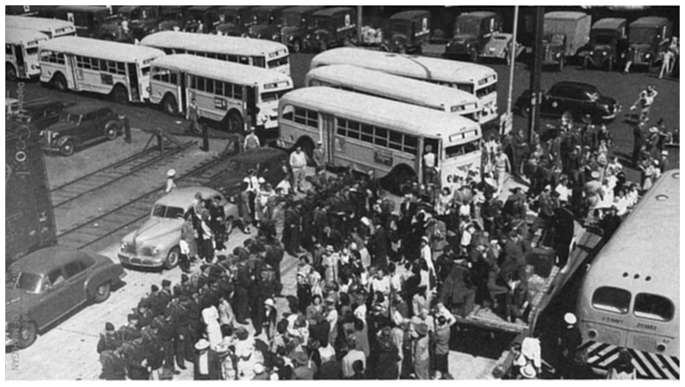

*图1:西雅图集结、准备前往彭德尔顿营的海军陆战队预备役人员。美国海军照片。 来源：蒙特罗斯、坎佐纳《仁川—首尔作战》所收美国政府战史图版，[原图](https://www.gutenberg.org/cache/epub/65008/images/i_068a.jpg)。*

麦克阿瑟在当天接见我时说明了他的战略判断：人民军主力投入釜山防御圈，仁川—首尔方向相对空虚，登陆部队能够利用这一部署打开后方。他希望通过首尔交通枢纽切断南方人民军的补给，并与第8集团军从釜山方向发动的反攻配合。这使我的部队成为整个计划中深入敌后的一翼。我能够规划师的登陆与推进，却不能决定第8集团军何时取得突破，也不能把尚未证明的敌军虚弱当作每一道地形障碍都将无人防守的保证。[^montross][^appleman]

第10军将为这次行动组建，军长由爱德华·阿尔蒙德担任。他同时是麦克阿瑟的参谋长，直接参与远东司令部的筹划。我的陆战第1师承担突击登陆，陆军第7步兵师随后投入。海军则负责把这支军的人员、装备和补给送进港口，并以舰炮和舰载飞机掩护。军、师、舰队之间必须交换的不只是进攻方向，还包括某一艘船何时能够进入水道，某一批车辆能否赶上卸载，哪一支部队暂时隶属哪个指挥部。[^montross]

第二天的会议把一个具体缺口摆在了面前：师被要求渡过汉江，而当时第10军尚未具备为这条河架桥的器材和装备。渡河任务已经写进构想，渡河能力仍需落实。这也是准备工作的实际状态。我们不能等到全部器材、运输和参谋机构都到齐后才开始制定计划；已经形成的计划，又必须随着能够获得的兵力与器材继续调整。[^montross]

## 二、海水决定时间，港口决定登陆方向

仁川的海岸在退潮后会露出大片泥滩。通航水道狭窄，潮流又会使登陆艇偏离预定方向。把船开到港外，并不等于能够把士兵送到海墙下。登陆艇需要足够水深越过浅滩，运送重装备的坦克登陆舰吃水更深，必须利用更高的潮位。战史记载，计划人员分别按约25英尺和29英尺的高潮条件考虑这些船艇的行动。这里的数字是当时筹划中的通航条件，直接影响可用日期和卸载窗口。[^montross]

9月中旬的大潮因此成为行动时间表的基础。主力傍晚登陆后，能够利用的白昼很短；一旦海水退去，后续船艇进入的条件就会发生变化。我们需要在这一段时间内建立能够守住的阵地，让弹药、饮水和车辆上岸，并为夜间防御准备火力。计划中的“抢滩”由此包含两个同时推进的目标：步兵夺取空间，岸勤与工兵人员把这个空间变成能够接纳补给的入口。[^montross]

港内的月尾岛控制着接近航路。它与仁川之间有堤道连接，守军能够利用岛上高地和阵地向港内射击。如果它仍然保持有效火力，傍晚的主力登陆就会受到侧面的直接威胁。我们将第5陆战团第3营用于清晨夺岛，主力再利用傍晚高潮进入仁川。两个登陆阶段之间存在一个白天的间隔：先上岛的部队必须自行守住阵地，舰炮和飞机继续提供支援。[^montross]

在仁川本土，第5陆战团的另外两个营负责红滩，进入港区并夺取墓地山、观测山一带。第1陆战团在东南方向的蓝滩登陆，向控制仁川陆上出口的道路与高地推进。红滩关系到港口设施能否使用；蓝滩关系到我们能否向内陆展开，并从侧后威胁港区守军。两个团之间的距离和不同地形，使它们必须按照各自目标组织行动，而师的指挥所必须持续掌握两边的进展。[^montross]

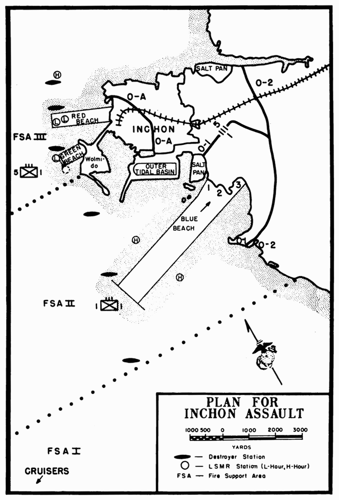

*图2:仁川登陆计划图。Wolmi-do为月尾岛，Red、Green、Blue分别为红、绿、蓝滩；原图附码制比例尺，箭头表示计划行动。 来源：蒙特罗斯、坎佐纳《仁川—首尔作战》所收美国政府战史图版，[原图](https://www.gutenberg.org/cache/epub/65008/images/i_068.png)。*

蓝滩并不是一条条件相同的连续海岸。部分地段有海墙，部分地段的上岸通道受到沟渠与陡坡限制。航空照片无法完全回答履带车辆能否从每一道缺口驶上岸。两栖履带车能够在水中航行和陆上行驶，但车体遇到深泥仍可能陷住。我们安排攀登器材、工兵和火力支援，也必须让一线指挥官在发现实际通路后调整登陆组织。[^montross]

第7陆战团尚不能参加第一天的突击。第5陆战团来自釜山战场，第1陆战团则在短时间内重新集结和补充。师部也分散在朝鲜、日本和航行中的运输船上。我们采用共同的两栖作战程序，让不同来源的部队能够接上同一套计划；但训练程序无法消除人员刚刚补充、缺少合练、照片传阅时间有限这些具体困难。登陆计划由师部集中制定后下达，团营拥有的准备时间尤其紧迫。[^montross]

8月30日，师收到第10军第1号作战命令。次日发布装载命令，9月4日完成师第2—50号作战命令的最后文本。第5陆战团当时仍在朝鲜战场执行任务，联络军官必须把登陆日程带到正在作战的团部。这套命令传递过程本身说明，仁川部队的集结不是一项已经结束的准备工作。战斗与准备同时进行，前线抽调、海运时刻和下一场作战的需要互相牵动。[^montross]

## 三、9月15日上午：月尾岛的占领与等待

清晨阶段由罗伯特·塔普利特中校指挥第5陆战团第3营实施。海军舰艇和航空兵此前已经连续轰击目标。9月13日，驱逐舰近距离接近月尾岛，诱使岸炮暴露位置，再由海上火力压制。这个过程也带来舰艇损伤和人员伤亡。轰击削弱了岛上的防御，却不能代替步兵占领；阵地、洞穴和被绕过的守军仍需在登陆后逐一处理。[^montross]

第一批部队在15日6时33分到达绿滩。登陆点受到残骸限制，实际可以利用的正面很窄，后续波次必须经过同一片空间。突击连上岸后向无线电山和通往仁川的堤道方向推进。随队坦克包括普通坦克、喷火坦克和推土车辆，它们承担的任务并不相同：有的提供直射火力，有的处理步兵无法迅速接近的工事，有的帮助改变障碍本身。[^montross]

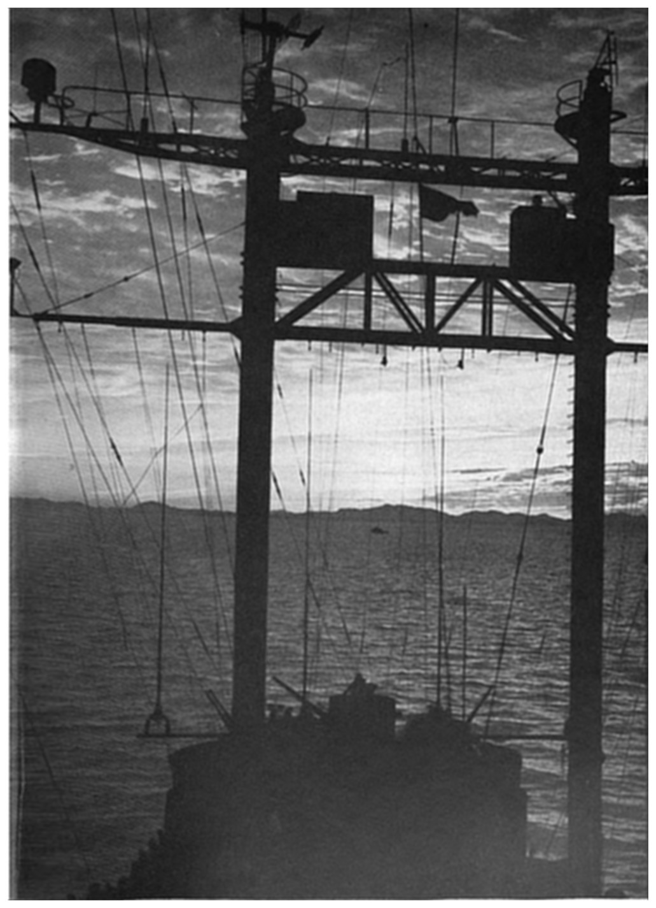

*图3:从“麦金利山”号观察仁川方向。原图题为“仁川日出”；美国陆军照片。 来源：蒙特罗斯、坎佐纳《仁川—首尔作战》所收美国政府战史图版，[原图](https://www.gutenberg.org/cache/epub/65008/images/i_068c.jpg)。*

塔普利特在7时05分向指挥舰和“马里昂堡”号报告突击连按计划推进，7时45分又报告俘获45人、抵抗较轻。这些报告为师判断夺岛进展提供了依据。它们也只是报告发出时的局部情况。第3营的预备连随后遭遇了先头部队绕过的海岸阵地，必须再组织火力与装甲车辆处理。先头部队通过一处地点，与该地点已经完成搜索和控制，是两件连续的工作。[^montross]

上午8时，营控制了无线电山。接下来还要处理通过另一条堤道相连的小月尾岛。守军在狭窄通路另一端开火，塔普利特暂缓地面突进，申请航空兵攻击，再让工兵、坦克与步兵协同前进。主要战斗在11时15分结束，洞穴和残余阵地的搜索仍继续了一段时间。主岛和附属小岛的控制，为傍晚从海上接近仁川提供了更有利的条件。[^montross]

中午，我命令副师长爱德华·克雷格在傍晚潮水到来时登上月尾岛，带前进指挥梯队建立岸上指挥所。师部其余部分安排第二天上岸。这个先后次序让指挥机构逐步转移到陆地，也避免在最初就占用过多有限的登陆空间。此时海墙以内的仁川仍有守军，岸上可以部署人员、车辆和通信设备的地区，要靠接下来的进攻继续扩大。[^montross]

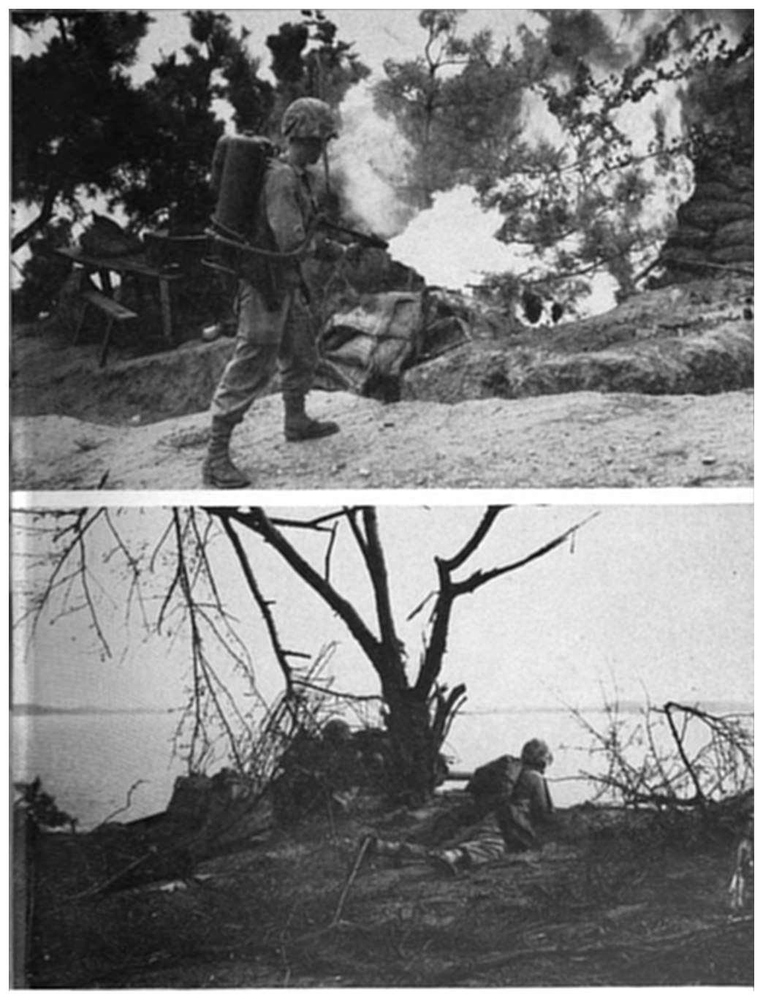

*图4:月尾岛作战照片：上图为对洞穴使用喷火器，下图为岛上搜索行动。海军陆战队照片。 来源：蒙特罗斯、坎佐纳《仁川—首尔作战》所收美国政府战史图版，[原图](https://www.gutenberg.org/cache/epub/65008/images/i_068e.jpg)。*

塔普利特曾请求从月尾岛沿堤道派出较强的步坦部队，向仁川实施侦察或进攻。指挥舰没有批准。师仍按原定方案组织傍晚的主力登陆。第3营继续控制岛屿阵地，红滩和蓝滩的舰炮、登陆波次及补给按既定时刻安排。[^montross]

退潮期间，岛上的岸勤人员开始建立弹药、给养和其他物资的堆放地点，通信人员部署设备，炮兵侦察人员选择后续火炮阵地。岛屿已经夺取，战斗体系仍在形成。对于师部而言，这几个小时需要完成的不是等待潮水这一件事，而是把先期占领的岛屿接入下一阶段的登陆、观察、火力和运输组织。[^montross]

## 四、9月15日傍晚：红滩与蓝滩同时上岸

我们把主力登陆时刻定在17时30分。下午，控制舰核对了潮流，海军将确认后的时间传给各部。巡洋舰、驱逐舰和飞机持续攻击岸上目标，登陆艇按波次进入航路。红滩的第5团必须向仁川内部展开，蓝滩的第1团必须夺取东南面的出口和高地。两处登陆相隔近三英里，实际遇到的抵抗和通路条件都不同。我需要从两个团分别取得进展，不能把一处海岸已经突破的消息作为另一处也已打开的依据。[^montross]

红滩南侧，E连第一批登陆艇在17时31分抵达海墙；北侧A连的部分艇只在两分钟后抵岸。艇首跳板不能直接越过海墙，士兵使用梯子攀登。一艘运送A连人员的艇发生发动机故障，使原定同批上岸的部队被分开。E连的先头部队较快进入墙后，掩护后续波次；A连部分部队受到侧面和正面阵地的射击，被压在狭小的岸边。登陆波次正在继续到来，前面的通路却还没有完全打开。[^montross]

第5团的目标包括墓地山和观测山。它们从港口建筑之间突出，既能用来观察海岸，也能控制向城内推进的通路。拿下海墙后，步兵还要处理高地、道路和建筑之间的火力关系。A连有一支排越过海墙缺口后沿街深入，另一部分则仍在海岸受阻。连长必须将已经前出的兵力调回协助，先使登陆点附近的攻击能够继续。这是一个很小范围内的兵力重新集中，却关系到随后数百人能否摆脱拥挤的滩头。[^montross]

巴尔多梅罗·洛佩斯中尉在这一阶段阵亡。他登陆后接近守军掩体，投掷手榴弹前受伤，最终以身体覆盖已经解除保险的手榴弹，保护附近人员。战史的记载将这一事件放在A连受阻的背景中。对团营指挥来说，失去基层军官与突击人员，还意味着必须立即补上现场指挥，重新组织火力，继续清除那处阻止部队离开岸边的阵地。[^montross]

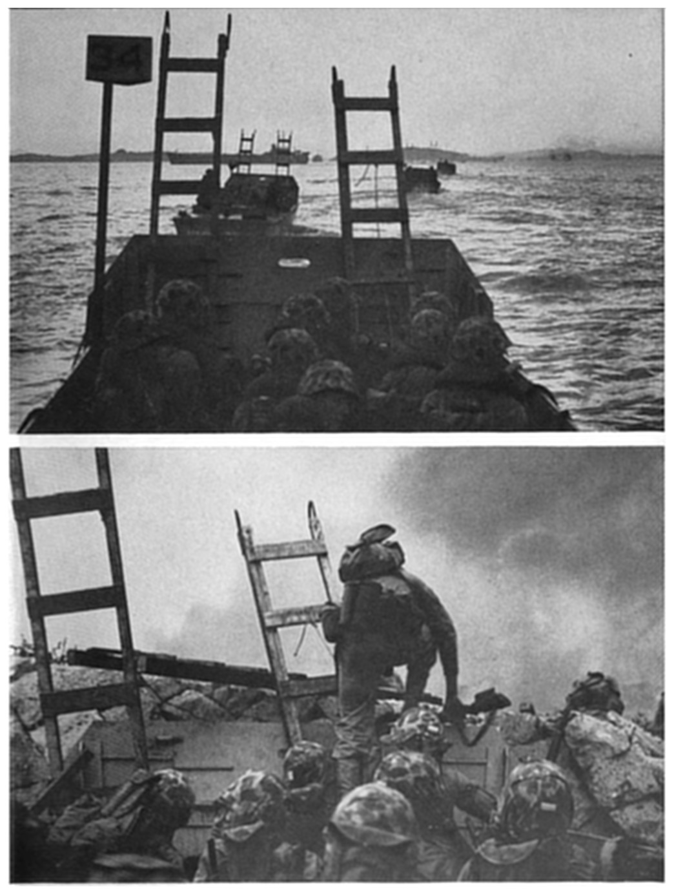

*图5:上图为携带梯子前往蓝滩的登陆部队，下图为红滩攀越海墙。海军陆战队照片。 来源：蒙特罗斯、坎佐纳《仁川—首尔作战》所收美国政府战史图版，[原图](https://www.gutenberg.org/cache/epub/65008/images/i_068g.jpg)。*

第5团指挥所于18时30分上岸，设在月尾岛堤道的仁川一端附近。两个营向各自的高地推进，逐步取得墓地山和观测山。夜幕降临时，团的预定控制线还没有处处形成连续的阵地。默里要求难以直接防守的部分至少派出警戒。于是，部队向内潮汐池方向派出巡逻，确认路线后再布置兵力。图上的弧线只有经过巡逻、联络和部署，才成为能够执行夜间防御的实际位置。[^montross]

蓝滩上的困难首先集中在辨认海岸和寻找出口。烟雾与降雨影响观察，登陆波次发生混杂。第1团第3营在蓝滩二号地段下船，部分士兵从两栖履带车上使用梯子攀墙；有的梯子弯曲，工兵便把卸载网固定在墙上，让人员和装备能够继续通过。另一部分履带车试图沿沟渠上岸，领车陷入泥中，堵住了后面的车辆。G连下车徒步离开，不能让全连随着车辆一道停在通道里。[^montross]

第3营营长托马斯·里奇与副营长雷金纳德·迈尔斯在右侧查找通路，分别利用斜坡及后来称作蓝滩三号的湾角上岸。后续车辆被引导到这些出口。它们改变了原定的落地点，也造成不同方向上岸的人员交错；但能够上岸并在陆地重新编组，总比在海墙前继续等待更符合任务。普勒上校随较早波次登陆，组织第1团各营恢复秩序，继续向预定高地和道路推进。[^montross]

第1团在蓝滩的任务带有明显的向外封锁性质。第2营要控制道路交会点与117高地，第3营向233高地靠海的一端以及94高地方向展开。掌握这些位置，可以把仁川的陆上出口置于登陆军的影响之下，同时保护部队上岸的侧翼。第5团在港区夺取设施，第1团在港区外建立向内陆发展的支点；两者的分工使夺港和封锁陆路出口能够同时进行。[^montross]

这天晚上，师仍依靠舰上的指挥体系协调登陆。克雷格率前进梯队进入月尾岛，团营指挥所则分别在各自登陆地区工作。没有一个指挥所能够直接观察所有街道和山坡。部分位置已经占领，部分只能用巡逻确认，部分联络要在黑暗中建立。最初的命令规定了各部应该到哪里，随后的报告告诉我们实际走到了哪里。师的部署就建立在这两种信息不断对照的基础上。[^montross]

## 五、9月15日夜至16日：把登陆场变成能够供养部队的港口

步兵仍在扩展控制范围，装载物资的坦克登陆舰已经驶向红滩。我们安排八艘舰在晚潮期间抢滩并搁岸卸载。它们船体大、目标明显，所载的油料与弹药使中弹的后果尤其严重。然而，要让前沿部队度过第一个夜晚并在次晨继续推进，饮水、炮弹、车辆和给养就必须及时到达。把所有卸载都推迟到次日，会使登陆部队在最初阶段承受另一种风险。[^montross]

每艘舰除正常装载外，还带有为这次突击配置的弹药、口粮、饮水和燃料。海墙使部分舰艇不能立即放下跳板，最先卸下的推土机便沿海岸清除妨碍卸载的墙体。步兵夺取的是墙后空间，工兵改变的是运输工具能否进入这片空间的条件。前一阶段用梯子解决人员上岸，后一阶段则必须让车辆、重武器和成批物资真正离开舰艇。[^montross]

搁岸舰艇确实受到射击。“973”号的燃料桶被迫击炮弹击中，燃油泄漏；“857”号也有汽油桶被打穿。舰上人员采取防火措施，未发生足以毁掉整批补给的大火。另一个问题来自己方射击：有的舰艇对岸上枪焰还击，而陆战队已经进入相邻地域。岸上军官登舰要求停止射击。海军的火力在接近阶段保护部队，部队上岸后，这些火力又必须根据己方位置及时限制。[^montross]

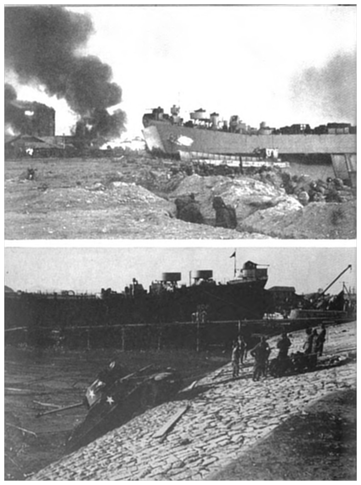

*图6:上图为红滩登陆舰补给，下图为越过海墙转运坦克，背景为LST—802。分别为海军陆战队、美国海军照片。 来源：蒙特罗斯、坎佐纳《仁川—首尔作战》所收美国政府战史图版，[原图](https://www.gutenberg.org/cache/epub/65008/images/i_068h.jpg)。*

红滩的卸载空间狭窄，物资不能立即按理想布局堆放。岸勤部队先把车辆和货物移出舰艇，再随着控制范围扩大建立较有秩序的堆放场。八艘舰需要赶上次晨高潮退出，好让下一批进入。因此，卸载既受敌火影响，也受潮汐截止时间约束。夜间工作是否完成，将影响第二天能否继续增加兵力，而不只是影响已经登陆的人是否拿到更多补给。[^montross]

蓝滩的卸载安排规模较小，重点是支持第1团最初的作战。预装物资的两栖履带车中，有一部分因逆流与迟延错过水位条件，停在泥滩上。团判断现有物资尚能支撑，便等待下一次高潮重新驶入，没有组织士兵在泥中长距离手搬全部货物。港口使用逐渐集中到更合适的地点，蓝滩完成初始使命后关闭，岸勤人员转向月尾岛。这些调整使卸载组织能够从应急阶段转入持续供应。[^montross]

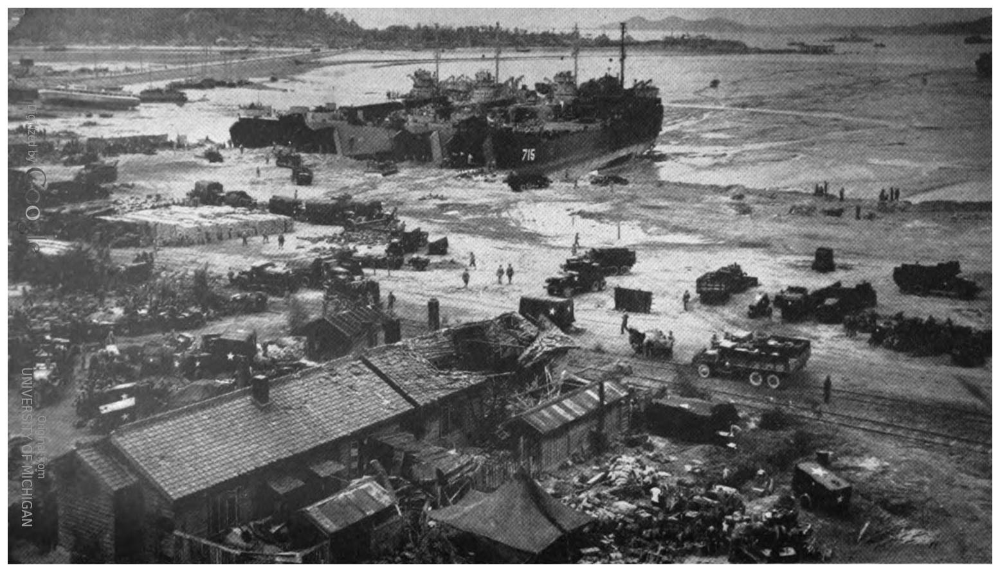

*图7:登陆后第二天的红滩卸载与卡车运输。美国陆军照片。 来源：蒙特罗斯、坎佐纳《仁川—首尔作战》所收美国政府战史图版，[原图](https://www.gutenberg.org/cache/epub/65008/images/i_068p.jpg)。*

伤员后送也需要沿着这些水陆接口进行。海军外科队随登陆舰到岸，紧急手术可在配有临时手术室的登陆舰上实施。月尾岛的小码头在低水位时仍能接近，帮助解决退潮后的转运问题。伤员从连队到收集点，再进入船艇或师级医疗机构，需要有与进攻同时运转的人员和通道。若这些通道堵塞，战斗损失会更快削弱前沿单位，后送负担也会占用本来用于输送弹药的车辆与艇只。[^montross]

16日，我把师指挥所移到岸上。部队继续清除仁川的残余抵抗并向登陆场外缘推进，第1团和第5团准备沿不同轴线向首尔方向发展。占领港口并未立即产生一条容量充足的补给线。第2工兵特种旅负责港区运输组织，车辆不足仍是问题，铁路却比预计更早恢复：港内开始使用调车机车和车厢，之后又向阿斯科姆城输送人员。港口、铁路、道路和机场将逐步接在一起，支持离海岸越来越远的部队。[^montross]

这一阶段还需要处理平民与地方行政。仁川居民陆续返回，城内有死伤者、失去照顾的儿童和需要食物的人。我后来与韩国海军参谋总长孙元一商议地方官员人选，并任命能够重新组织行政的市长。军队占领了地面，城市生活却不会自动恢复。医院、警察、粮食分配和尸体处理都需要有人负责；这些事务与前沿进攻同时存在，也影响港区后方是否能够维持基本秩序。[^montross]

## 六、9月17日至19日：金浦机场改变补给线，也扩大了需要防守的地域

17日，我们向金浦机场推进。第5团负责向东北夺取机场，第1团继续沿仁川通首尔的主要道路向东，准备接近永登浦。二者并肩推进的方向并不完全平行：第5团将向汉江渡口靠拢，第1团则面对首尔南岸的工业区。师需要用这两个方向的成果互相支持，同时使后续陆军部队逐步接手南翼，避免两个陆战团把兵力耗散在越来越宽的正面上。[^montross][^appleman]

从港口驶出的坦克不能任意穿越所有地面。第5团第2营步兵向机场前进时，配属坦克要另找适合车辆的道路，途中还遇到损坏的桥梁。工兵修桥后，装甲部队才能追上步兵。装甲的速度优势必须建立在桥梁承载、道路通行和燃料补给都允许的情况下；在这一段推进中，步兵走得通的路线，并不保证同样能让重型车辆及时通过。[^montross]

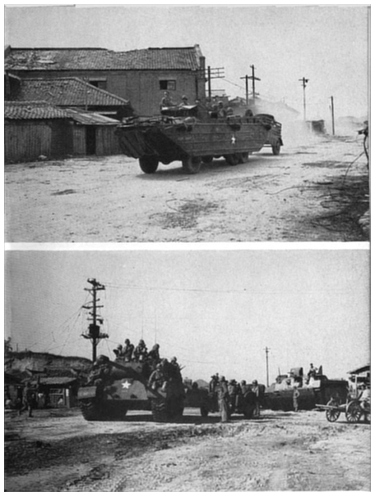

*图8:上图为第1陆战团使用两栖运输车推进，下图为仁川东北面的坦克和两栖履带车。美国陆军照片。 来源：蒙特罗斯、坎佐纳《仁川—首尔作战》所收美国政府战史图版，[原图](https://www.gutenberg.org/cache/epub/65008/images/i_068k.jpg)。*

第2营先侦察机场以南的高地。先头排登上目标后，报告阵地没有守军，机场方向的低地也未见强有力的阻挡。营长哈罗德·罗伊斯据此继续推进，没有为了占满每一座山头而把整个营留在原处。D连与E连展开，坦克赶到后分别支援。17日18时左右，先头部队到达金浦主要跑道南端，随即安排机场与周围高地的防守。速度在这里来自对眼前具体情况的判断，也来自部队抵达后立即准备抵御反击。[^montross]

人民军随后对机场地区实施反击。机场跑道是便于辨认的目标，却很大，夜间难以从一个阵地覆盖全部边缘。步兵必须控制接近地和主要建筑，坦克和支援火力则协助阻止敌军重新进入。第5团向东北推进时，团部与交通线上也发生战斗。敌方部队可以从未完全清理的村落和道路接近，已经前出的营不能因此假定团部以西全部安全。[^montross]

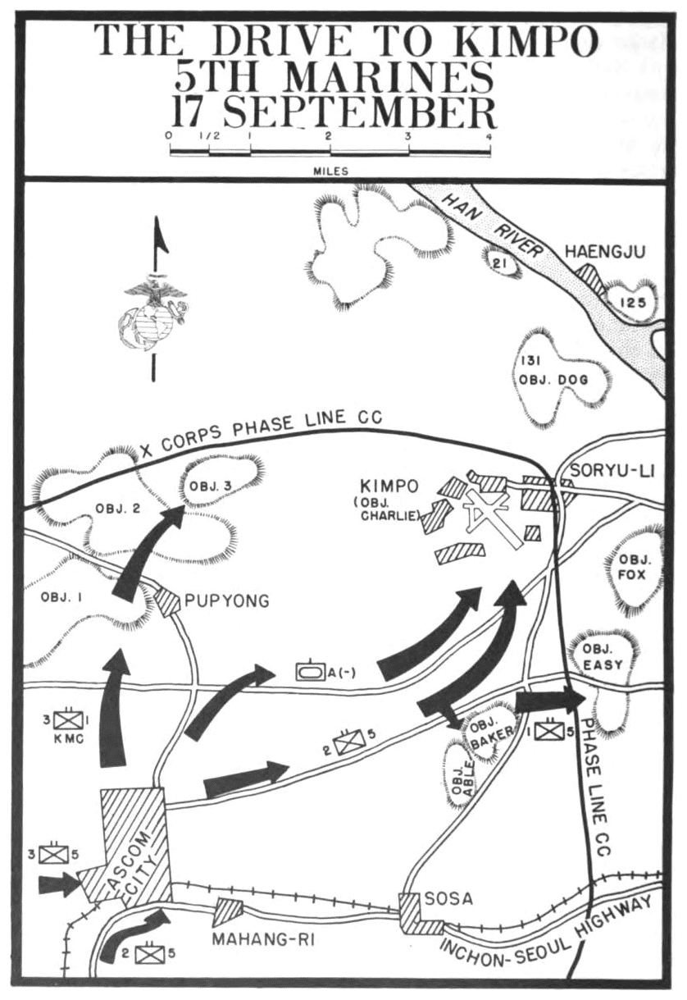

*图9:9月17日第5陆战团向金浦推进图。Kimpo为金浦，Han River为汉江，Haengju为幸州；原图附英里比例尺。 来源：蒙特罗斯、坎佐纳《仁川—首尔作战》所收美国政府战史图版，[原图](https://www.gutenberg.org/cache/epub/65008/images/i_154.png)。*

机场的价值很快表现出来。18日起，运输机把弹药、航空汽油和其他物资送入金浦。19日，夜间战斗机和部分“海盗”式飞机抵达，20日开始从当地执行任务。最初条件很简陋，燃油与装弹设施不足，地勤要利用可以获得的器材开展工作。跑道的夺取只是第一步，航空兵的运转还要依靠油料、弹药、维修零件、通信和地面管制的连续到达。[^montross]

这一变化把师的空中支援基地向前推近，也增加了必须保护的目标。机场一旦投入使用，就有飞机、油料与运输活动不断集中；北面和侧翼的敌军活动仍可能威胁它。金浦半岛的警戒和搜索因而不能取消。后来空运进入的第187空降团战斗队部队承担机场与相关地域的任务，使陆战队能够继续向汉江北岸投入。接替后方任务的增援，其作用体现为释放前沿兵力。[^montross]

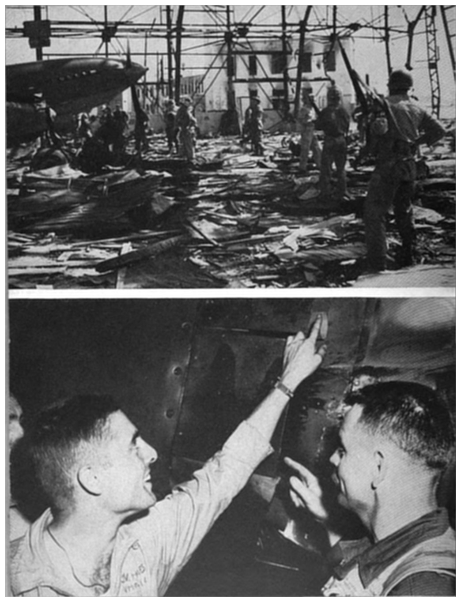

*图10:上图为金浦机场的被缴获雅克战斗机，下图为检查“海盗”式飞机损伤。分别为美国陆军、海军照片。 来源：蒙特罗斯、坎佐纳《仁川—首尔作战》所收美国政府战史图版，[原图](https://www.gutenberg.org/cache/epub/65008/images/i_180d.jpg)。*

第1团面对的道路战斗也在发展。人民军坦克与步兵试图沿道路反击，陆战队用坦克、反坦克火箭、地雷与炮兵阻止这些攻击。道路让坦克快速接近，也把它们带入相对狭窄的射界。坦克自身能够承受部分小武器射击，却仍需要步兵发现道路两侧的近距离威胁。当其随伴步兵被火力分开时，装甲车辆的冲击就难以持续转化为对阵地的占领。[^montross]

第7步兵师的第32团随后接近我师右翼。它需要夺取南面的山地和道路，保护第10军的侧翼，并逐步向水原方向展开。我们既要推进，也要交接阵地：哪一营已经接替、原部队何时离开、两支部队的火力界线在哪里，都关系到接下来的作战。到19日，第5团准备渡过汉江，第1团准备进攻永登浦，仁川登陆已经转入一场分布在不同地形上的连续地面作战。[^montross][^appleman]

## 七、9月19日夜至20日：汉江上的第一次尝试失败了

19日14时30分，师发布第7—50号作战命令，令第5团在幸州附近渡汉江，夺取125高地，再沿铁路向东南推进。克雷格此前侦察了河流与通往首尔的道路，建议使用旧渡口。这里河面约四百码，北岸有村落、堤岸、稻田和高地。渡过河并建立桥头阵地后，第5团才能把后续部队送入首尔西北方向的接近地。[^montross]

我们为第5团配置侦察连、韩国陆战队部队、坦克和两栖履带车，炮兵优先支援这次行动。工兵和岸勤单位负责渡河设施及转运工作。团部的初步安排是先由游泳小组侦察北岸，确认条件后召来侦察连主力，再为第3营接续渡河建立阵地。情报人员已经提到北岸有敌军增援的报告，计划仍较大程度依赖抵抗较轻的预期。[^montross]

20时以后，肯尼思·霍顿上尉带领的小组下水，约20时40分抵达北岸。侦察人员向125高地和幸州方向搜索，霍顿在岸边没有发现足以阻止登陆的敌方活动，便在巡逻组完全返回之前发出信号。此时侦察连主力还要从金浦沿道路前往渡河地点。岸边的判断、车辆到达的时间和主力开始下水的时刻，并没有紧密衔接在一起。[^montross]

履带车到河岸后，狭窄地段限制了展开，它们以较长的队列进入水中。北岸随后出现机枪和迫击炮射击。部分车辆受水流影响偏离航向，在泥中搁浅，车载电台又干扰了步兵使用的通信网。两岸人员之间的报告变得断续，原本负责不同高地的排难以形成统一行动。船艇的机动、岸上的敌火和通信问题在同一时段叠加，侦察连未能建立预定桥头阵地。[^montross]

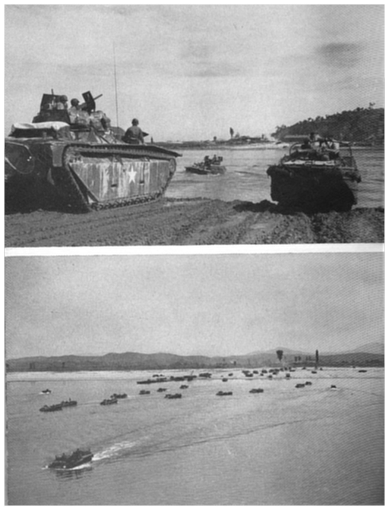

*图11:汉江渡河照片：上图为陆战队与韩国陆战队渡河，远岸为125高地；下图为第32步兵团使用两栖履带车渡河。两图表现不同渡河行动；美国陆军照片。 来源：蒙特罗斯、坎佐纳《仁川—首尔作战》所收美国政府战史图版，[原图](https://www.gutenberg.org/cache/epub/65008/images/i_180f.jpg)。*

北岸游泳小组撤回，部分车辆中的人员也游回或涉水返回南岸。霍顿受震伤后得到救助，仍搁浅的车辆要等后续处理。有关撤回命令究竟由谁下达，战史没有形成确定结论。师、团能够确认的结果是：侦察行动失败，北岸有组织抵抗存在，按原先设想让侦察连先占三座高地的条件没有实现。渡河计划需要立即改变。[^montross]

20日凌晨，第5团决定由第3营实施白昼强渡。炮兵准备之后，两栖履带车分波进入河中，将步兵送向北岸。装甲车体保护了渡河中的人员，但下车、展开和接近高地时仍要承受射击。航空兵攻击125高地，履带车用重机枪提供支援，步兵则组织分路进攻。最初的夜间尝试把隐蔽与小部队先行放在前面，白昼行动把火力准备和有足够兵力的突击放在前面。[^montross]

I连承担125高地的主要攻击。部队在半山地段受阻，一部分退下重新展开，预备排投入，其他人员从两侧推进。连内的指挥和编组随着伤亡进行调整，工兵及连部人员也补入进攻。航空兵继续攻击，守军最终从高地撤离。至9时40分，第3营取得包括125高地在内的预定目标。另两处高地抵抗较弱，部队利用履带车向内陆延伸，切近道路与铁路。[^montross]

10时，第2营开始接续渡河，并通过第3营继续向前。坦克和其他重装备需要渡运设施，人员的通过速度不能直接代表全部战斗力量已经到齐。到夜间，第5团主要部队、部分坦克及韩国陆战队已经在北岸形成可以继续发展的阵地。工兵继续改善渡口，让补给和增援能够通过。桥头阵地的意义由此超过一处河岸：它使首尔西北方向成为我师能够实际进攻的地域。[^montross][^appleman]

渡河过程中留下的人员与装备问题也逐步查清。前夜一名被报为失踪的士兵后来安全归队，搁浅车辆得到回收。初始报告中的失踪与最终损失并不总是相同。师需要依据更新后的情况安排人员和装备，而战役结束后的统计也必须保留这种核实过程。渡河失败与第二天成功，发生在同一渡口、相隔不到一昼夜，改变结果的是部署、火力、兵力与通信条件的重新组织。[^montross]

## 八、9月20日至22日：永登浦的堤岸与一个连的纵深突入

第5团在汉江北岸扩大阵地时，第1团正在南岸攻打永登浦。这里是首尔的工业区，也是从仁川向东接近城市的重要通道。稻田、河沟、堤岸和厂房把道路分成几个不同的战斗地段。步兵可以沿堤岸前进，但堤岸也给守军提供了相互支援的射击位置。坦克能沿道路提供火力，却难以随意越过水田，替步兵占领每一段堤埂。[^montross]

20日清晨，人民军坦克和步兵对第1团第2营所在地域发动反击。部队用反坦克武器、地雷、炮兵和近距离射击阻止进攻。反击被击退后，向永登浦推进的任务仍然存在。守军可以从前出反击转回堤岸防御，而我方必须把坦克、步兵和火炮重新组织成能够向前移动的队形。阻止敌方一次冲击，尚未解决如何越过接下来的河沟与防线。[^montross]

这一天，协同问题具体表现为一处影响第2营行动的高地。高地位于陆军第32团的责任区，陆战队希望炮击那里，但射击许可需要通过双方指挥系统。请求经过第7步兵师、第10军与我师等环节，等到可以执行时已经入夜，观察条件发生变化。第2营面前的障碍因此没有在白天及时清除。地图上的分界线方便各部队管理火力，也意味着越界射击必须确认友军位置；两套系统连接不畅时，前沿营要用等待和伤亡承担代价。[^montross]

我们还有火箭炮能够提供大面积火力，但能够把发射器开到阵地，与能够正常发射，是两回事。配套引信的缺乏使相关火箭炮一时无法发挥预定作用，替代引信的尝试也没有解决问题。这种缺口不容易在兵力表中显示，却影响团长能够实际使用多少火力。攻击部队不能按照装备名册上的数量，安排每一段防线都得到同样程度的压制。[^montross]

21日，第1团继续进攻。第1营在较北的地段接近卡尔川，B连利用桥梁与堤岸向前，在水田边缘遭遇侧射。夺取一段堤岸之后，部队还要转变射击方向，压制与它相连的另一段。炮兵支援必须跟着这个变化移动。过程中出现了关于友军所在位置的混淆：地图上认为在己方后面的地域，实际上已经被前进的部队越过。直到位置重新核实，火力才得以更有效地配合。[^montross]

第2营的进攻同样受到地形分割。左侧部队沿道路缓慢推进，右侧部队受到敌占高地压制，难以与邻部保持同样进度。部分连需要在航空兵掩护下撤回调整。第3营于下午投入，以增加进攻力量并接替已经承受损失的部队。投入预备队在这里解决的是眼前的兵力与战线问题，不能让各条攻击轴线立刻同步。道路、堤岸和水田仍在限制部队互相支援。[^montross]

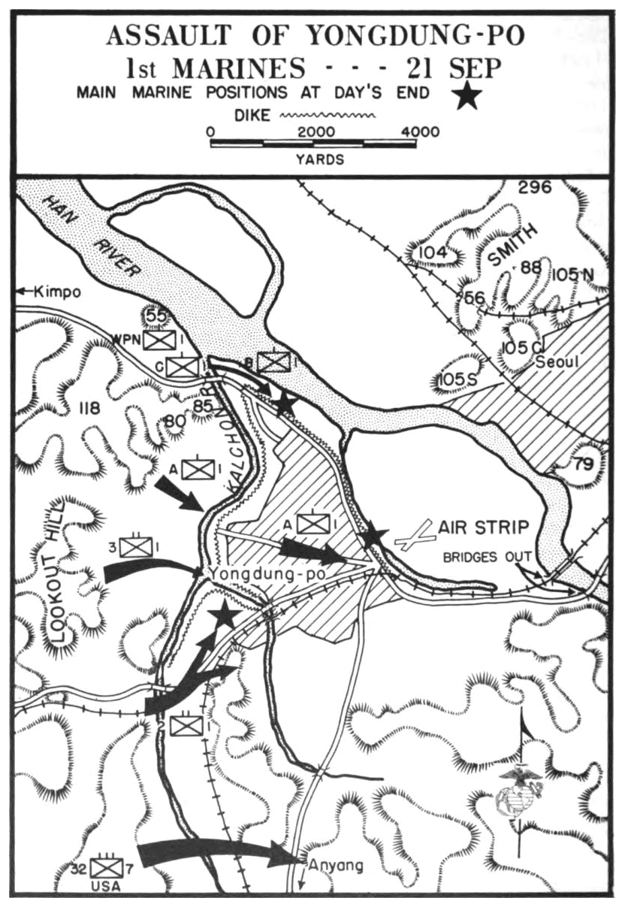

*图12:9月21日永登浦攻击图。Yongdung-po为永登浦，Kalchon为卡尔川；星号表示当日末主要阵地，原图附码制比例尺。 来源：蒙特罗斯、坎佐纳《仁川—首尔作战》所收美国政府战史图版，[原图](https://www.gutenberg.org/cache/epub/65008/images/i_224.png)。*

同一天，罗伯特·巴罗上尉率第1营A连发现了一条抵抗较弱的进入路线。这个连穿过稻田与卡尔川，从永登浦西面向内推进。营长霍金斯允许它继续发展，于是一个连逐渐走到两翼尚未到达的位置，进入城区内部。它到达重要道路交会处和补给设施附近，破坏弹药，控制了守军原本用于组织战斗的部分空间。[^montross]

这样的突破给团的战斗带来了机会，也产生了新的风险。A连与后方之间仍有未清除的地域，侧翼部队无法立即靠拢。连队的无线电电池逐渐耗尽，联络变得困难。向前的距离一旦超过可靠通信与补给能够覆盖的范围，营、团就不容易及时掌握这个连需要什么。A连必须就地形成能够各向防御的阵地，等待后续部队打通通路。[^montross]

入夜以后，A连利用堤岸组织防御。迫击炮弹药耗尽，一些炮手加入步兵防线。人民军坦克接近和通过其阵地附近，步兵又对防线发动数次攻击。连队依靠现有反坦克武器与自动火器守住位置。完整的战斗情况是在后续汇报中才逐渐清楚的；当时，上级能够得到的无线电信息很有限，无法像地图上的箭头那样连续追踪每一次接触。[^montross]

22日8时，第1营与第3营再次前进，遭遇的抵抗已经明显减弱，很快与A连会合。永登浦的守军撤走，留下部分重武器、装备和补给。第1团继续向东，随后整理部队并派出巡逻。23日，第3营夺取控制汉江破坏桥梁附近地域的108高地。南岸工业区的争夺由此转入下一项任务：把第1团送到北岸，与已经接近首尔西北面的第5团会合。[^montross]

永登浦的战斗没有按照所有连同时到达同一条线的方式结束。正面的堤岸攻击吸引并固定了守军，A连从薄弱处穿入内部，夜间守住位置，第二天邻部再与它接通。对师而言，重要的是把这个局部突入产生的机会接续起来，同时保持北岸部队继续作战。第1团不能长时间留在永登浦庆祝一次突破，第5团也不能因为南岸尚在战斗而停止向首尔接近。[^montross]

## 九、9月22日至25日：首尔西面的山头，必须一座接一座地夺取

汉江北岸的推进很快遇到新的防御。首尔西北面的丘陵控制公路、铁路和低地通道，守军能够从高处观察我们的展开。第5团的三个突击营与配属韩国陆战队沿不同方向前进，面对的是彼此联系的高地阵地。一个方向取得进展，会暴露相邻防线的侧面；相邻方向如果仍受阻，已经前出的连也可能遭到侧射。[^montross]

地名本身就可能造成误解。西部防线有三处都以海拔105命名的高地，战史用北、中、南加以区分，即105北、105中与105南。它们不在同一个点上，所控制的接近路也不相同。更北面有296高地，前面还分布56、88等高地。团、营命令需要说明具体哪一座山，而不能只用“105高地”概括整个阵地群。[^montross]

22日，第5团攻击开始后，一些单位迅速接近目标，报告也随之到来。但是占领一个山顶，并不等于整个山体的反斜面、支脉和相邻火力点都已清除。296高地方向的行动显示，先头部队可以进入一段高地，随后仍需面对其他位置的抵抗。南侧第1营向105南发展，中间韩国陆战队进攻56与88高地方向，受到了沉重火力阻击。[^montross]

韩国陆战队在22日和23日的攻击未能按预定速度打开中部通路。第5团因此需要改变兵力使用，把第2营投入中央地域，接替并继续攻击。配属部队的勇敢不能改变防线仍在的事实，伤亡、地形、支援火力与组织条件都要计入下一次部署。师必须继续提供新的力量，避免让一个已经受挫的单位仅凭相同方式重复冲击。[^montross]

我们终于得到第7陆战团。这个团并未与最初突击梯队同时到达，21日才开始在仁川登陆。它的加入，使我可以在汉江北岸展开三个陆战团。23日中午，我命令第7团渡河，在第5团后面通过，再向较北的地段展开。新增一个团能够延伸战线、保护侧翼、增加下一阶段兵力，但它仍需经过港口、道路和渡口，实际到达前沿的时间取决于这些运输条件。[^montross]

24日，第5团第2营继续攻打中央高地。D连在56高地方向承受很大损失，部队要在接近、冲击和整理中不断重组。航空兵实施攻击后，以约定方式向地面部队示意火力转换，步兵利用这个间隙继续上攻。飞机飞离目标，并没有消除所有掩体；连队仍需用近距离战斗逐段夺取阵地。[^montross]

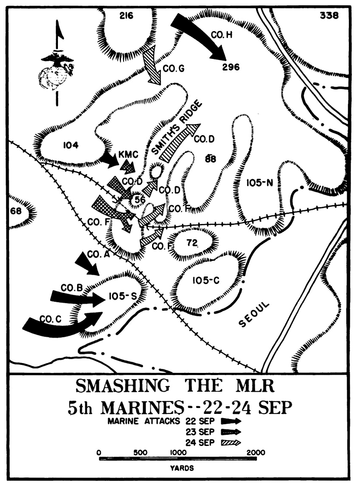

*图13:9月22日至24日第5陆战团攻击高地群。105—N、C、S对应北、中、南三处105高地；原图附码制比例尺，箭头样式区分日期。 来源：蒙特罗斯、坎佐纳《仁川—首尔作战》所收美国政府战史图版，[原图](https://www.gutenberg.org/cache/epub/65008/images/i_242.png)。*

D连的人员损失使其战斗编组逐渐缩小，原有排、班结构已经难以完整维持，连部和支援人员补入突击力量。有关这一天的精确伤亡数字，应在战后根据连队与医疗记录核对；战斗中，团长首先要知道的是还有多少人能够继续控制阵地，邻连能够从哪里接近，弹药和伤员通道是否畅通。把伤亡报告转成可执行命令，需要比一个百分比更具体的信息。[^montross]

中央防线的逐步破坏，使后续攻击能够继续指向88及105中等高地。到25日，第5团在这一带取得连续进展，西部接近地的防御被逐步打穿。步兵夺下观察点后，炮兵可以更准确地向城市边缘与道路射击，坦克也得到较安全的前进路线。高地的作用因而既是阻挡步兵，也是决定谁能观察、谁能引导火力、谁能把重装备送向城区。[^montross]

与此同时，我与阿尔蒙德对进攻部署仍有分歧。他希望从不同方向加快首尔的包围，考虑让南岸部队继续由较东面进入。我则需要把第1团送过汉江，使它与第5团、第7团组成能够互相支援的北岸战线。我的三个团分别到达首尔附近，不等于三个团已经能够在同一场攻击中协调行动。渡河地点、攻击边界和支援关系必须首先明确。[^montross][^appleman]

24日下午，我们在永登浦的会面进一步调整了安排。第1团向北岸转移，陆军第32团与韩国第17团承担更偏东的渡河和攻击任务。第1团利用105南附近较有利的掩护建立北岸部署，而第32团准备从首尔南面越过汉江。整个第10军于是形成多方向进入首尔的态势：陆战队主要从西面和西北面推进，陆军及韩国部队从南面接近。[^montross][^appleman]

这个安排给我师提供了集中使用所属部队的条件，也使军长能够继续实施南面的压力。各部之间的界线必须随之重新确定。旧部署下安全的射击方向，在邻部渡河后可能经过友军。每一次改变进攻边界，都需要传到炮兵、航空联络人员和前沿营，而不能只停留在军、师参谋部的地图上。进入城市以前，协同本身已经是一项持续的作战工作。[^montross]

## 十、9月25日至26日凌晨：撤退报告传来，前沿却仍在交火

25日，陆军第32团开始从南面渡过汉江。最先渡河的第2营F连约在6时30分出发，随后其他部队接续通过。这个渡河场的初始抵抗较弱，部队得以把力量送到北岸，向南山推进。下午，陆军已经控制这座能够俯瞰城区的重要高地。韩国第17团在其东侧行动，继续夺取相关高地并保护侧翼。第10军南面的进攻因此与西面的陆战队攻击形成呼应。[^appleman]

我师正在把经过山地战斗的部队转入城市边缘。第1团接近建筑密集的地域，第5团继续扩大高地战果，第7团在北侧担负延伸战线与侧翼任务。各团的位置和可用兵力不同。有的营刚刚经过河流，有的连已经连续攻山，另一些部队还在摸清道路和友邻的位置。我们拥有总体优势，却不能假定每一条街道都可以立即投入完整的突击队形。[^montross]

25日傍晚，关于人民军向北撤退的空中观察报告传来。对第10军而言，这意味着可能出现追击机会。军长希望避免守军利用夜间撤出城市，要求迅速向前。20时40分左右，军向我师发出立即实施夜间进攻的命令。命令所要求的速度，必须由正处在不同战斗阶段的几个团共同实现。[^montross]

师作战参谋鲍泽向军部询问命令内容，我也与军参谋长拉夫纳联系。前沿部队仍面对抵抗，夜间在城区进行快速运动会增加失去联络、误入邻部地段和友军误击的风险。军的命令维持。我在22时左右向普勒和默里传达行动要求，要求注意可辨识的前进路线与团际联络。部队要执行进攻，同时需要防止在黑暗中把自己的战线拆散。[^montross]

第5团的行动首先受到敌方攻击阻碍。团的部分部队需要应付来自正面的火力与反击，派出的巡逻也未能顺利建立预定联系。对于这些营而言，前面并不是一条已经打开、只需向前走的通道。它们必须守住刚夺取的位置，确认敌方攻击方向，再安排步兵继续前出。[^montross]

第1团计划在26日凌晨1时45分开始进攻，并安排短时间炮火准备。前出的巡逻却遇到了人民军正在组织的反击，部队报告敌情，炮兵随即需要转向阻止迫近的进攻。原本用于掩护向前运动的火力，成为保护出发阵地的屏障。命令的目标仍是向城区发展，眼前的执行条件已经改变。[^montross]

人民军步兵与坦克向第1团阵地推进。坦克沿道路接近，步兵利用建筑与街道组织冲击。陆战队的反坦克武器和炮兵承担拦阻，前沿连守住路口与能够相互支援的位置。夜间视野限制双方对战场的认识，炮火照顾的是已确定的接近路线，步兵则需要防止敌方从建筑间隙穿入。进攻时间表因这场交战被打断。[^montross]

相近时段，第5团的部队也遭到攻击。不同团面对的敌军未必属于同一个统一的冲击梯队，但结果相同：原本准备快速前进的部队，被迫先处理眼前敌情。第5团的一些阵地持续交火到接近天明。南山方向的陆军第32团也在26日清晨遭到反击，到早晨才逐渐稳定局面。[^montross][^appleman]

到26日天亮，夜间快速追击没有取得军部所希望的结果。各团继续组织白昼进攻，处理障碍、射击位置和被损坏的道路。我的指挥所需要按照部队实际所处的位置重新衔接行动，不能把夜间命令上的预定到达线当作已经建立的战线。友邻联络、弹药补充和伤员后送，都必须以新的情况为基础。[^montross]

撤退报告与前沿激战在同一个夜晚出现。在战斗当时，我们能够证实的是自己面对的火力、已经发现的敌方运动，以及本部队的推进状态。城市另一端有多少部队离开，哪些守军接到什么撤退命令，需要后来对照其他记录才能判断。此时我师仍要完成当前任务：打通西部通道，与南面的友军衔接，控制首尔的主要地域。[^montross][^appleman]

## 十一、9月26日至28日：把通往市中心的道路逐段打开

26日，首尔街道上的路障成为主要障碍。守军利用沙袋、车辆和建筑组织射击位置，有的道路被封锁，侧面的房屋又可以掩护机枪。坦克能够用主炮射击路障和已确认的火力点，但需要步兵保护近距离侧翼。步兵沿道路前进时，也要搜索相邻建筑，避免从一处看似打开的路口进入另一处交叉火力。[^montross]

各连的推进因而不是单纯沿街道直线行军。先由火力压制能够识别的抵抗，再由步兵向前占领或从侧面接近，随后让坦克与其他支援力量移动到新的位置。道路上的障碍被清除后，下一段街区仍需重新观察。指挥员必须知道友军已经进入哪座建筑、哪个路口仍在交火，才能把炮火和航空兵继续向前引导。[^montross]

当天，第1团在城区取得进展，但距离有限，部分地段整天推进不到一英里。第5团在北侧继续向城市和山地交界处发展，并建立与第1团的联系。两团接触线的衔接十分重要：没有可靠联络，分别从不同街道前进的连可能误判对方，或在中间留出让守军穿行的空隙。[^montross]

北侧第7团的战斗也没有因市中心越来越近而结束。其D连进入一处道路切口附近后受困，周围高地的射击限制了移动。相邻部队与坦克试图建立接触，伤员需要后送，弹药也要补充。航空兵向受困单位空投物资，地面部队继续寻找能够打通的路线。城市边缘的一处局部战斗，仍然可能迫使一个团投入大量支援力量。[^montross]

对于师来说，不能只按地图上距政府大楼还有多远来判断胜利是否已经到来。北侧部队若失去联系，进入中心城区的道路就可能受到侧翼威胁；伤员若不能撤出，战斗单位的行动也会受限。第7团的任务包括扩大北面的安全空间，使第1团和第5团能够继续向城内集中力量。[^montross]

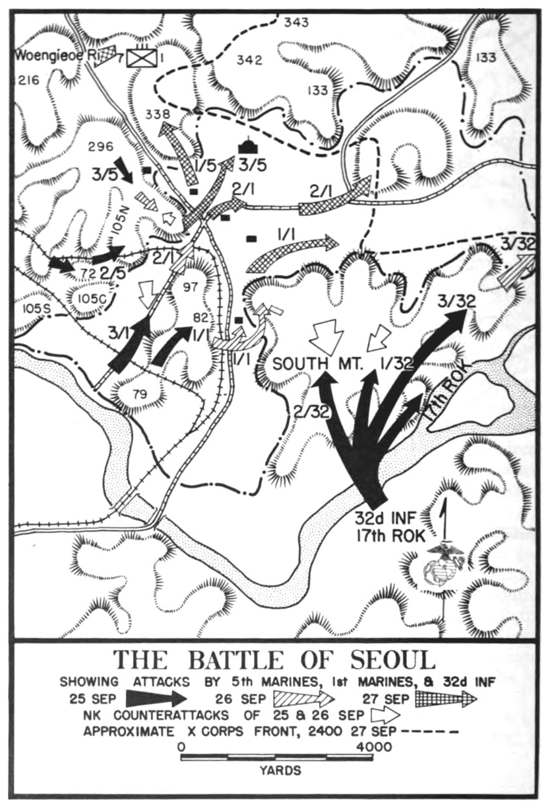

*图14:首尔9月25日至27日攻击与反击图。South Mt.为南山；不同箭头区分日期，虚线表示27日午夜近似战线，原图附码制比例尺。 来源：蒙特罗斯、坎佐纳《仁川—首尔作战》所收美国政府战史图版，[原图](https://www.gutenberg.org/cache/epub/65008/images/i_266.png)。*

27日，进攻进一步深入。第5团第3营G连在下午进入政府大楼地域，战史记录其到达时间为15时08分。与此同时，其他营继续攻打城市北缘高地。第1营到晚间夺取338高地，使这一区域的防御进一步瓦解。政府大楼具有显著政治与地理意义，山地阵地则关系到能否真正控制它周围的接近路。[^montross]

第1团继续从西面向东推进，夺取街区和交通节点。对于已经突破的连，命令要求把前进转化为对地域的控制：留出警戒、明确友邻、处理俘虏、标明伤员集合地点，再向下一段街道前进。建筑密集地区让部队容易分散，营、团必须不断重新确认连队位置，防止局部成功变成缺少支援的孤立前出。[^montross]

28日，第1团向城区东北侧的132与133高地方向发展，北侧第7团仍在224高地等地域遭遇阻击。城市内成片的有组织抵抗已经明显减少，部队开始把更多力量用于搜索、警戒与后续推进。人民军在城区的防御体系被打散，但北面的道路仍需要通过战斗取得。[^montross]

伤员和城市居民的问题同时进入指挥体系。战斗破坏了住宅、医疗设施与供给，医院需要处理大量伤者，地方行政也需要重新组织。军事单位已经控制的街区，可能仍有伤员、失散人员和未清除的危险。师的战斗任务继续向北延伸，后方人员则需要在刚结束交火的地域建立救治、交通和秩序。[^montross]

9月29日，首尔举行恢复韩国政府控制的仪式。麦克阿瑟到达金浦后进入首都，在政府大楼举行交接活动。仪式标志着首都政治控制的变化，但我师的作战责任尚未终止。北面仍有抵抗，部队要继续保护首尔并接近议政府方向的道路。一个城市的交接时间，与师完成整场战役任务的时间并不相同。[^montross][^appleman]

## 十二、9月29日至10月7日：议政府方向的追击与最后交接

首尔被控制以后，我师的下一步行动指向北面。议政府是道路汇合地点，连接首尔与更北的交通线。守军若在那里继续保持有组织的阻击，就能够延缓我方前进，并为撤退部队争取时间。第7团承担主要追击任务，其他部队继续整理、警戒和准备后续调动。[^montross]

追击并没有取消进攻所需的准备。北行道路经过狭窄地段与高地，地雷限制车辆运动，遭破坏的通路需要工兵处理。坦克、火炮和补给车能够前出的速度，取决于道路是否真正安全。步兵即使已经走过一段地域，也不能保证车辆可以立即保持同样速度跟上。[^montross]

10月1日前后，第7团继续向议政府方向推进。部队沿公路接近目标，敌方后卫利用道路两侧地形阻击。敌人的主力撤退，并不意味着沿途所有防守者都只愿稍作射击便离开。一个相对小的后卫单位，只要控制车辆必须通过的地段，就能迫使追击者展开、侦察并组织攻击。[^montross]

2日，议政府以南的战斗加剧。第7团在距目标数英里的地域遭遇坚决抵抗，前沿营无法只沿道路继续向前。火力需要压制山地阵地，步兵则准备从道路两侧改变攻击方向。先到达的营承担接敌与固定守军的作用，后续营利用新的部署寻求突破。[^montross]

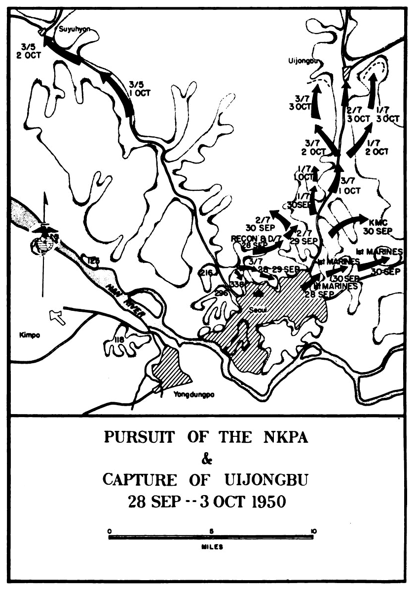

*图15:9月28日至10月3日向议政府追击图。Uijongbu为议政府；原图附英里比例尺，箭头及番号表示不同部队行动。 来源：蒙特罗斯、坎佐纳《仁川—首尔作战》所收美国政府战史图版，[原图](https://www.gutenberg.org/cache/epub/65008/images/i_288.png)。*

3日，第2营通过第1营所在地域，从东侧发展；第3营从西侧行动。这样的展开使正面道路以外的空间被利用起来，守军不能再仅靠封锁公路阻止全部前进。随着两翼压力增加，第7团进入议政府，战史把主要进入时间记在当日17时左右。控制道路节点以后，部队继续安排警戒与接替。[^montross]

这几天的战斗仍然造成伤亡。伤员必须从较前出的山地和道路送回，连续作战单位需要补充弹药、恢复车辆并调整人员。首尔的胜利已经确定，但在我师的实际任务中，最后一段推进仍然需要付出代价。以城市中心升旗作为整场作战的终点，会遗漏这些后卫战以及完成交接之前的行动。[^montross]

与此同时，下一次任务的筹划已经开始。第10军准备转向东海岸方向，陆战第1师需要重新集中并准备海运。10月5日发布的师级命令安排部队重新集结，原有阵地由其他单位接替。接替包括前沿边界、警戒地域、道路控制和补给设施，并非将各团从地图上划去就算结束。[^montross]

10月7日9时35分，我向多伊尔报告，转入下一次两栖行动的准备。当天中午，第7团最后的相关阵地完成向第8集团军部队的交接。至此，我师在仁川—首尔及其直接追击阶段的指挥任务结束。部队从港口登陆，夺取机场，两次组织重要渡河，攻下城市外围高地，进入首都，再把北面的交通地域交给接替者；这些连续行动共同构成了战役的完成。[^montross]

## 十三、战后复盘：登陆军的优势，怎样在不同地点变成实际兵力

从这里开始，叙述转入战后研究者视角。史密斯能够接触的情报，主要来自所属部队、友军与上级；今天分析战役，还要把海军准备、陆军行动、人民军部署与政治决策放在一起。最需要先纠正的，是把仁川的海岸守备、首尔守军和整个朝鲜南方战场当成同一组敌我力量。麦克阿瑟利用的是人民军主力南下造成的部署缺口，但缺口大小随时间变化。9月15日海岸防御较弱，不能推导出9月24日西部高地也同样空虚。[^montross][^appleman]

史密斯的相关经验来自第二次世界大战的两栖与联合行动：他曾在新不列颠指挥团级登陆，在贝里琉担任陆战第1师副师长，又在冲绳担任第10集团军副参谋长。阿尔蒙德则有欧洲战场师级指挥经历，此时兼有远东司令部参谋长与第10军军长身份。前者熟悉师内两栖部队如何组织持续攻击，后者更直接承担麦克阿瑟整体方案的推进压力。经历能够帮助解释两人关注的问题，却不能据此认定他们此后的每一次意见分歧都已经由性格决定。[^montross]

陆战第1师本身也在战役中持续形成。它由已有作战经验的部队、从美国与其他驻地调来的人员、迅速补入的预备役人员及各种支援单位共同组成。第5团此前参加釜山防御圈战斗，其经验有助于在登陆后迅速展开；第1团承担另一个主要登陆方向；第7团稍后抵达，才使师在首尔外围具备三个步兵团。不能把三个团后来的完整存在，提前放到15日傍晚的海滩上。[^montross]

战史附录列出的9月23日实力，是一种较适合说明集结状态的数字：师属陆战队与海军人员20,218人，另有舰队陆战部队配属人员2,973人，合计23,191人。这个总数包含司令部、通信、医疗、汽车运输、工程和其他支援人员，既不等于步枪手，也不代表同一时刻都在攻击线。它的价值在于说明一个已经加强的师靠怎样的组织维持作战，而非直接与某座高地的守军人数相除。[^montross]

表中三个陆战团的23日实力分别为第1团3,393人、第5团3,170人、第7团3,666人。即使这些数字清楚，也不能据此认定每团都有同样多的人员可用于下一次攻击。营、连可能已经伤亡，人员可能分担警戒与后送，团部和支援分队又不能全部变成突击步兵。第2营D连在高地战中迅速减员，就是总表无法呈现的局部状态。决定某次冲击能否继续的，是那个连当时还能组织多少有效射击与机动。[^montross]

陆军第7步兵师的兵力构成同样需要拆开。阿普尔曼记其赴朝前总兵力24,845人，其中8,637人为配属的韩国人员。他们在很短时间内进入美军单位，语言、训练与组织磨合都存在困难。这些人员提高了名义人数，但与训练充分、通信顺畅的同规模部队不能简单等同。第32团渡汉江前的统计为4,912人，其中3,110名美国人员、1,802名韩国配属人员；韩国第17团另属一支部队，不能重复并入这个数字。[^appleman]

韩国部队的作用不仅是增加人数。韩国陆战队参加金浦、汉江北岸与西部高地战斗，韩国第17团在首尔南面和东面行动，韩国海军参与沿海事务。当地人员还在语言、地理与行政恢复上承担任务。把整个战役写成美国陆战队单独完成，会同时遗漏正面攻击中的韩国伤亡，以及美军各单位实际依赖的本地联络能力。另一方面，也不能把韩国人员都看成训练与组织相同的一支力量：独立团、陆战队与刚补入美军的人员，准备程度和指挥关系不同。[^montross][^appleman]

海军力量提供的是登陆军无法自行创造的条件。舰艇运送人员与重装备，舰炮压制海岸，舰载机掩护和支援，水道与港口组织保障后续补给。澳大利亚战争纪念馆的资料特别说明，英联邦第91特遣舰队承担封锁与掩护，其中包括澳大利亚的“巴丹”与“瓦拉蒙加”号。它们的作用不能从首尔街巷里的步兵叙述中直接看见，却属于登陆与后方航运安全的一部分。[^awm]

人民军的兵力则远没有同样完整的公开逐日名册可供对照。美国官方战史根据俘虏讯问、缴获材料与部队报告，重建了守备和增援情况：仁川有当地守备部队，金浦有机场及相关防御力量，首尔外围又投入独立团、旅和其他单位。第78独立团、第25旅等在西北高地的抵抗，显示守军并非始终只有最初海岸上的那部分人。第18师相关部队在首尔及其南面活动，也使南岸与城区战斗不能分割统计。[^montross][^appleman]

就人民军基层指挥而言，陆战队战史将第78独立团指挥官记录为Pak Han Lin上校，将第25旅指挥官记录为Wol Ki Chan少将。这些姓名来自美方整理的罗马字记录，本文保留原拼写，避免在缺少朝鲜文核对时强定汉字姓名。该书对两部组织和人数的叙述来自情报资料，能够说明西北防线有新部队进入，却不足以完整重建首尔守军统一指挥机关逐日如何下令。人民军一方的计划还原因此主要止于其部署、反击、阵地坚持与撤退行动所能支持的范围。[^montross]

阿普尔曼对仁川、水原与首尔地域实际投入力量给出三万余人的事后估计，另讨论未完全投入或来迟的人员。这是一个地域较大、时间跨越较长的累计判断，包含构成不完全清楚的部队。把它写成“仁川滩头三万守军”，会把作战难度放大到错误地点；把登陆初日较少的守军写成整场战役的全部对手，又会抹去首尔外围的增援和抵抗。本文保留“估计、累计、不同地域”的限定，不给它制造逐日精确性。[^appleman]

双方在局部的力量关系不断变化。仁川海岸，登陆军可以集中舰炮、飞机与突击部队攻击有限守点；幸州夜间侦察中，人数较少且通信混乱的美军却处于不利状态；白昼强渡时，火力与兵力重新集中，局势随之逆转。首尔高地上，守军利用地形让进攻连在局部承受猛烈射击，直到相邻阵地与支援条件发生变化。总体优势规定了双方能够长期承受的压力，局部部署决定了某一小时的伤亡与进展。[^montross]

## 十四、战后复盘：麦克阿瑟的选择与海军必须解决的风险

第一个关键决策是选择仁川，并坚持利用9月中旬的潮汐窗口。仁川的收益来自它与首尔交通体系的关系。登陆在这里，能够从后方威胁人民军向南方主力输送人员和物资的线路，并迫使其在正面继续进攻与保卫后方之间分配兵力。若只把它理解为一处抵抗薄弱的港口，就无法说明为什么愿意承担泥滩、海墙与潮流的困难。选择地点的军事价值，在于它能把成功登陆转化成对整个南方战局的压力。[^appleman][^montross]

但战略价值不能让航道自动变宽。舰队进入受限制水域时，机动空间较小；登陆艇若错过潮位，可能无法接近岸边；重装备卸载若延误，已经登陆的步兵就要在较长时间内依靠有限补给。麦克阿瑟可以决定接受这些风险，海军与陆战队却必须把风险拆成能够处理的具体问题。潮汐计算、船艇编组、目标分配、引导标志和装载顺序，都属于决策能够执行的组成部分。[^montross]

可讨论的替代方案包括在其他海岸登陆，或把更多力量投入釜山正面。但这些选择会改变行动所能触及的后方深度。位置更方便的海岸未必能同样直接威胁首尔，正面增兵又未必能迅速迫使人民军调整整个部署。这里的反事实推演不能先假定替代方案也会取得与仁川一样的突然性、推进速度和交通破坏效果，再只比较海滩条件。需要同时比较登陆难度与登陆后能够造成的战役压力。[^appleman]

推迟行动也有成本。一个更充裕的准备期可能改善训练、装备和装载，却会给守军更多时间加强港口与近岸防御，也会延后对釜山战局的支援。官方战史记录的计划困难，说明仁川并非零风险的正确答案；实际成功则说明，在当时海空控制、敌方部署与联合国军组织能力的组合下，这一风险可以被承担。评价选择应围绕这些条件，不能把“大胆”本身当成保证成功的原因。[^montross][^appleman]

第二个关键决策，是先夺月尾岛，再利用傍晚高潮实施主登陆。月尾岛控制港口接近地，若守军仍能从岛上观察并射击，主力艇波通过时就会增加危险。上午夺岛，把这个威胁提前清除；但从上午到傍晚的间隔，又使岛上部队需要独立守住有限地域。进攻者接受了一个分阶段行动窗口，以换取主登陆时较有利的条件。[^montross]

这个安排的成功依赖海上火力和后续组织。月尾岛部队不需要独自面对整个内陆守军，舰炮和海上控制使守军难以自由反扑；主登陆部队也不是临时等到黄昏才开始寻找位置，而是按照预先安排进入攻击航道。把两次高潮之间的空档当成纯粹幸运，会忽略这种隔离与掩护；把它当成完全安全，又会忽略敌人若能及时集中火力可能造成的损失。[^montross]

第三个关键决策涉及最初一个夜晚如何维持登陆场。突击步兵要从海墙向内陆夺取足够地域，登陆舰则要把重装备和补给送上岸。部分舰艇在潮退后无法马上离开，既承担运输作用，也承受在固定位置受击的风险。胜负因而不只取决于先头士兵是否越过海墙，还取决于岸勤组织能否让弹药、火炮、医疗与车辆在有限窗口内进入可用状态。[^montross]

8月31日的装船命令提供了观察这一问题的原始依据。命令把补给分成作战装载、单位装载和船队装载等不同层次，安排水容器装满，规定个人携水，并给予蒸馏设备较高卸载优先级。车辆、油料与弹药也按不同用途分配装载位置。这样的分类反映了一个实际原则：第一波需要立刻使用的物资，必须能够及时拿到；总库存很多，若被压在无法卸载的位置，仍然无法支持当夜战斗。[^embark]

从这份命令还能看出，作战计划已经把饮水和持续供应纳入考虑。水是人员能否继续行动的基本条件，蒸馏设备则帮助把舰船上的储量转化为登陆后的生产能力。帐篷等物资受到限制，是为了把有限空间优先留给更紧迫的物品。这并不表示所有安排都按计划实现，而是说明登陆军的准备具有明确的次序。实际卸载中出现的车辆不足、码头损坏与搬运困难，应当同这套安排一起分析。[^embark][^montross]

因此，仁川的首日胜利包含两个相互依存的结果：守军未能阻止部队进入海墙内侧，登陆军又把这一立足点变成能够继续得到补给的港口地域。前一个结果由突击与火力直接取得，后一个结果需要岸勤、工兵、海军与后续运输共同完成。若只有前者，首日的战术成功可能在内陆推进中失去力量；正因为两者逐步接上，金浦与首尔方向的连续作战才成为现实。[^montross]

## 十五、战后复盘：渡河、高地与夜间追击中的三次信息考验

第四个关键决策，是幸州侦察失败后转为有准备的强渡。最初计划把小部队隐蔽先行作为开端，希望在北岸建立足以接应主力的位置。问题并不只是侦察人员判断失误，还包括先遣小组未完成全部搜索便发出信号、主力到达延迟、车辆在河岸难以展开、水流与无线电互相干扰等因素。这些环节任何一个发生变化，都可能使原先适用的判断过时。[^montross]

小组在某一时刻没有遇敌，能够证明的只是该次搜索范围内暂未发现抵抗。它不能证明周围所有高地都没有守军，更不能保证主力稍后进入河中时仍处在相同条件下。侦察结果必须连同观察范围和时间一起传达。实际行动中，这种信息被赋予了超过其覆盖范围的作用，部队于是按较乐观的前提进入一个仍能遭到集火的渡口。[^montross]

白昼强渡改变了前提。第3营、炮兵、航空兵与两栖履带车能够把较大力量投入同一地域，北岸主要目标也得到明确分配。即使守军开火，攻击仍有继续执行的资源，不再完全依赖隐蔽和突然性。125高地上的步兵仍付出损失，但营可以投入预备力量、调整进攻方向，并让后续营通过。这里真正有解释力的，是一个失败方案被及时替换成另一种具备执行条件的方案。[^montross]

反事实上，是否可以在19日夜等待更完整侦察？可以提出这一选择，但代价是渡河时间后移，同时未必能消除黑夜、泥岸和通信条件。是否可以一开始就白昼强渡？也存在可能，但当时指挥部对北岸抵抗的认识并不完整，选择夜间先遣有其争取速度与突然性的理由。合理批评应针对计划把有限侦察当成较强保证，以及各梯队时间没有接紧，而不是要求指挥官预先知道后来每一个火力点。[^montross]

第五个关键决策，是把第1团送到汉江北岸，并同时用陆军第32团从南面发展。史密斯着眼于师内三个团的集中与相互支援，阿尔蒙德着眼于整个第10军从多个方向加快包围。两人面对的是不同层级的问题。师长若只服从地图上的快速箭头，可能让部队在两岸分散；军长若完全接受每个师对自身完整性的要求，又可能错过跨单位集中战役压力的机会。[^montross][^appleman]

进度压力还包含政治性的日期期待。陆战队战史根据史密斯记录，记述阿尔蒙德曾强调希望在9月25日取得首尔，以便在战争爆发三个月之际宣布胜利。这个要求能够解释为什么军部反复关注速度，但不能代替敌情判断。到达一个象征性日期的愿望，只有通过战斗单位实际能够完成的任务才能实现；当外围高地抵抗强于预期时，日程必须面对这一事实。[^montross]

实际形成的部署兼顾了两种需求：陆战队在北岸形成较连续的进攻正面，陆军和韩国部队从南面渡河。南山的夺取给城区带来新的压力，也有助于封锁和观察部分通路。其结果说明，军、师之间的争论不必用一个人正确、另一个人愚蠢来概括。关键在于争论能否转化成明确的边界、渡河顺序和火力协调；这些问题落实后，分歧才不至于变成部队在战场上的互相妨碍。[^appleman][^montross]

第六个关键决策，是9月25日夜的立即进攻命令。战后对照显示，人民军确有部分力量向北撤离，同时保留部队继续抵抗并反击。阿普尔曼讨论了第18师相关部队在这一阶段撤退的情况。空中人员观察到道路上的撤离，陆战队报告前沿遭到攻击，两者观察的对象与地域不同。把其中一项宣布为虚假，会丢失理解当晚局势的关键。[^appleman]

阿尔蒙德希望抓住撤退机会，这一目标有明确军事意义：如果守军顺利撤走，后续战役仍需面对这些力量。史密斯担心夜间在陌生城市中失去组织，也有实际依据：部队刚经历山地战和渡河，街道障碍未清，友邻位置不断变化，局部抵抗仍强。争议真正涉及的是，能否把观察到的局部撤退，迅速转化成整个师都适合立即追击的判断。实际执行表明，这种转化过快。[^montross][^appleman]

可行的替代方案，应限定为当时能够组织的行动：加强侦察，明确哪些道路已经开放，在保持营、团联络的条件下实施有限推进，并用炮兵与航空兵攻击已确认的撤退通路。这样的方案可能减少无准备夜攻的混乱，却未必能够完整封住所有北行路线。首尔周边的山地与多条通道、有限的部队位置、夜间观察条件，都限制了把局部退却变成合围歼灭的能力。这是有约束的推演，不能当作保证更大战果的未用妙计。[^montross][^appleman]

这些决策共同显示，信息价值取决于能否与行动时间匹配。幸州的问题是把较早、较小范围的观察用于稍后的较大行动；首尔夜攻的问题是把部分方向的撤退用于推断整个进攻正面的状态。两者都不是简单缺少情报，而是情报覆盖的范围与命令要求的范围不一致。有效指挥需要不断检查这个差距，并允许前沿遭遇的事实改变行动方法。[^montross][^appleman]

## 十六、战后复盘：火力为何有效，为什么又不能代替步兵

联合国军的技术与后勤优势十分明显，但它们在不同战场上的使用方式不同。海岸攻击可以让舰炮集中打击有限目标，汉江渡河需要压制北岸观察与射击位置，首尔高地要求步兵接近掩体，城区则需要识别建筑中的火力点。只有把武器、目标与地形对应起来，才能解释优势如何转化为进展。用一句“海空优势压倒守军”，无法说明为什么有的攻击迅速成功，有的连却在一座山上遭受严重损失。[^montross]

舰炮的贡献包括登陆前压制、掩护接近和登陆后支援。但炮击结束以后，地面部队仍要确认阵地是否被摧毁，守军是否转入其他掩体。火炮能够破坏工事、限制移动，却不自动产生对地面的持续控制。月尾岛和海墙附近的步兵行动因此仍是必需的。进攻部队需要在火力转换后及时接近，否则守军可能重新进入射击位置。[^montross]

在首尔西部，航空兵与地面部队之间的联系尤其重要。飞机抵达目标区时，飞行员需要知道友军在哪里，哪一道山脊才是需要攻击的目标，攻击结束后步兵何时向前。战史记录的前沿引导与信号，体现的是把空中火力接入地面行动的组织能力。若只计算飞机架次而不考虑目标辨识、联络和地面跟进，就会把本来依赖协同的效果误写成飞机天然能够实现的效果。[^montross]

第7步兵师炮兵指挥官霍默·基弗在1951年1月10日的信中，对陆战航空兵支援作了具体评价。他提到为步兵营配置战术空中管制人员，以及海军陆战队联络分队对相关人员的训练，认为这种安排让营长更容易控制和协调近距离支援。这份信由战史附录全文收录，能够用来解释陆军部队怎样接入同一套支援体系。它反映的是一位参与者对组织方法的评价，赞扬性目的也很明显。[^kiefer]

基弗信中所列1,024架次，统计期为1950年9月19日至12月20日，跨越仁川—首尔以后多个阶段。这个数字不能当作首尔一役的架次，也不能把信中关于没有误击伤亡的陈述无限推广到所有联合国军行动。本文使用它，是因为其中说明了控制人员如何配置到营级，以及跨军种支援怎样组织；这比把一个较长统计期的漂亮数字移植进单一战役更有解释力。[^kiefer]

炮兵协同同样依赖明确位置。永登浦越过部队责任区的火力请求延误，说明拥有火炮并不等于每个前沿营能立即使用它。责任区划分的目的包括防止误击和分配任务，但当一处敌阵同时影响两个单位时，层层转递可能使射击许可来得太晚。改进方向应是加强邻部联络和提前安排跨界支援，而不是取消所有控制，任由火力越过不明友军地域。[^montross]

反坦克战也不能只按坦克型号比较。人民军的T—34坦克在道路上可以带来直接压力，但经过狭窄通路时容易遭到地雷、火箭与集中炮火攻击。步兵若不能跟上，坦克就难以清理近距离威胁；陆战队自己的坦克进入城区时同样需要步兵保护。区别在于联合国军能够较稳定地把步兵、火炮、工程与补给结合起来，而守军在交通受破坏、部队被分割后越来越难维持这种配合。[^montross][^appleman]

道路和渡口构成另一种火力之外的限制。一个营可以先渡河，炮兵、坦克与补给却可能稍后才能到达。在这段时间里，营拥有的是不完整的战斗组合。桥头阵地必须足够稳固，岸勤人员必须能组织来回运输，伤员后送又不能完全堵住向前补给。幸州成功后还要继续改善渡运，正是因为夺取北岸只解决了开始过河的问题，没有一次性解决整师越河后的持续作战。[^montross]

金浦机场则缩短了部分运输距离，并使航空部队更接近前线。但机场运行还需要油料、弹药、地勤、修理和警戒。越多飞机与物资进入，越需要保护这个节点。后续部队接替机场任务，释放陆战队向前推进，说明预备队的作用并不总是在最后时刻投入冲锋。接替一个已经取得的目标，也能把有经验的战斗单位从后方释放出来，改变前沿可用力量。[^montross]

伤员后送影响部队恢复速度，也影响指挥员能够承担的风险。海上医疗、岸上收集点、师医疗营和车辆构成连续通道；如果前沿单位知道伤员能够及时移交，就不必用过多步枪手长期承担搬运。另一方面，炮火、坏路和受阻街道会延长后送，使轻伤、疲劳与失联暂时从可用兵力中消失。战役实力应看当日实际能够行动的人，而不能只拿开战时名册减去最终阵亡人数。[^montross]

史密斯10月8日发布的师备忘录，回顾了从扩编、重新装备、跨洋运输，到在神户换装两栖舰船的紧迫过程，还提到台风造成的干扰和第1临时陆战旅直到9月上旬才脱离南方战斗。这份文件用于表彰部队，但其中的具体准备经历能够解释，为什么计划中会不断出现人员、装载和运输的调整。胜利并不是一支已经完美准备的部队照表演出，而是在时间压力下把分散资源逐步组织起来。[^smithmemo]

## 十七、战后复盘：损失数字、俘虏统计与城市居民的处境

陆战队战史附录J按日列出9月15日至10月7日的损失：阵亡366人，伤重死亡49人，失踪6人，负伤2,029人，合计2,450人。本文采用这一组作为陆战第1师相关战斗损失的主要口径，因为日期与本文收尾范围一致，而且分类能够复算。阵亡与伤重死亡分列，表示资料对死亡时间和原因作了区分；负伤项目也应依表的统计定义使用，不能把所有列随意解释成同一时点的医疗住院人数。[^montross]

阿普尔曼正文列出另一组陆战队数字：阵亡364、伤重死亡53、负伤1,961、失踪5，合计2,383；相关注释又保存史密斯提供的2,430人统计。它们与2,450之间有差异，说明记录形成、核实与纳入对象并非完全一致。现有公开文本不足以逐人解释每一项差额。正确处理方式是交代所用口径及其他说法，不能取各表中最大的分项拼成一份从未存在的“最终统计”。[^appleman][^montross]

陆军第7步兵师的572人损失，在阿普尔曼所述截至9月底的相关统计中，分为阵亡106、负伤409、失踪57，其中包括166名韩国配属人员。这166人已经包含在572人内，不能再加一次。它也不是所有韩国部队损失：独立作战的韩国第17团与韩国陆战队，不能因为同样是韩国人员就被视为已经全部计入。两支美国师的统计期又不完全相同，所以本文不把2,450与572简单包装为整个联合国军精确总损失。[^appleman]

非战斗减员同样存在。陆战队23日实力表所据人员报告，列出此前阶段非战斗损失286人，同时有补充人员与返回岗位者。这个数字属于一个阶段的人员流动，不能当成整个战役疾病、事故、疲劳的永久减员总数。它提醒读者：人员状态每天都在变化，返回岗位可以抵消一部分减员，医疗记录中的就诊人数又可能包含同一人在不同阶段的处理。[^montross]

俘虏数字有一处可以直接复算的文本问题。陆战队战史附录J逐日战俘数相加为4,692人，正文也给出4,692；附录总计栏却印作6,492。本文采用与逐日加总及正文一致的4,692，并把6,492视为高度疑似数字倒置，仍保留原表存在差异的说明。阿普尔曼有关注释另列4,792，差一百人的来源未能从已核对文本中确定。复算可以解决表内矛盾，不能凭空解决两个来源之间的全部差异。[^montross][^appleman]

人民军死亡和负伤更难准确统计。美军报告中的敌方损失包含战场观察、尸体清点、俘虏讯问和推算，覆盖范围各不相同。战史讨论的陆战队战区敌军伤亡估计13,666人，不能自动改写为阵亡人数。第10军层面的约14,000名敌军被击毙、约7,000名俘虏，则属于更大的报告口径，不能与陆战队数字相加。不同单位可能在同一地域先后战斗，重复报告也需要警惕。[^montross][^appleman]

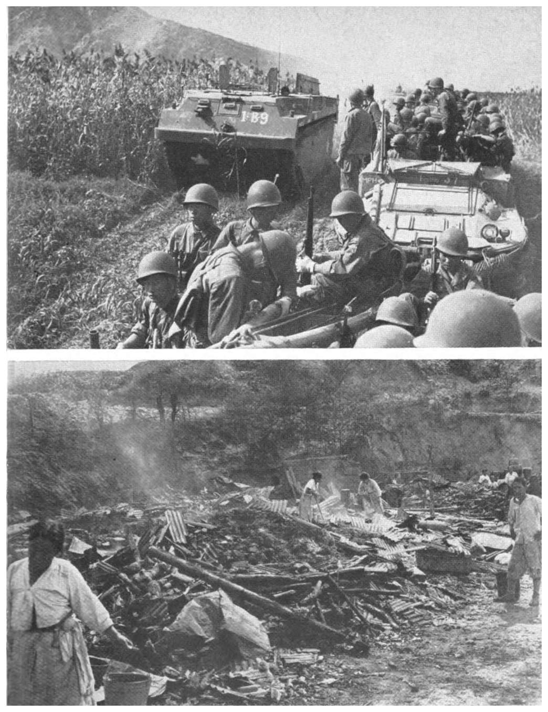

*图16:上图为韩国陆战队使用两栖履带车前进，下图为居民返回首尔郊区受毁房屋。美国陆军照片。 来源：蒙特罗斯、坎佐纳《仁川—首尔作战》所收美国政府战史图版，[原图](https://www.gutenberg.org/cache/epub/65008/images/i_180k.jpg)。*

装备战果也有类似问题。坦克被击中、暂时不能行动、被遗弃、被缴获与不可修复损毁，是不同状态；同一辆车可能先被航空兵攻击，再被地面部队发现。陆战队的坦克战果曾从38辆调整为44辆，第10军较大地域的估计又包含水原等方向。本文将这些作为各层级报告，避免用一个看似精确的总数掩盖识别与归属问题。可以较可靠确认的是，人民军在这一带丢失了相当数量的重装备，撤退部队保留组织和机动能力的条件被严重削弱。[^montross][^appleman]

平民受到的伤害必须与军事损失并列观察。首尔有大量住宅和公共设施遭破坏，炮击、空袭、街道战斗及人员流动共同形成危机。陆战队战史记第1医疗营为1,908名韩国平民提供各类治疗，这说明军方医疗机构确实处理了规模可观的平民需求，但该数既不是平民死亡总数，也不是全城受伤总数。未能到达军方医疗机构的人，以及由其他医院处理的人，不会自动出现在这张表里。[^montross]

同一战史在首尔车站叙述中记载发现妇女与儿童尸体，并判断其死于人民军处决。就该段实际给出的证据而言，作者主要依据尸体位置和现场情形推断，未在此提供完整法医鉴定或逐一身份记录。因此可以说明战史作出了这一指控，却不能把其推断升级为已经独立核验的全部事实，更不能据此估计整个首尔的屠杀人数。对严重暴力事件，保留证据层次比接受胜方叙述的肯定语气更重要。[^montross]

战俘处境同样不能从被俘人数直接推知。医疗营统计中有战俘就诊，证明部分俘虏进入了救治系统，却不能说明所有俘虏的待遇，也不能证明没有发生虐待。本文所用资料主要来自美方作战与行政记录，对人民军被俘人员的个人经历覆盖很少。这是资料结构的限制，不能通过推演填补。城市恢复行政、粮食分配和医院运作，解决的是占领后的部分急迫问题；它们不意味着居民的住房、家庭和安全已经恢复到战前状态。[^montross]

这些限制并不妨碍判断战役结果。联合国军夺取了仁川港、金浦机场、首尔及北面直接追击地域，人民军失去重要交通与行政节点，首尔防御体系瓦解。精确到个位的敌军损失并不是确认这些结果的必要前提。相反，把能够证实的地理控制变化与较不确定的伤亡估计分开，才能让战役评价建立在稳定的事实基础上。[^montross][^appleman]

## 十八、战后复盘：赢得首尔之后，为什么战争仍未结束

在战术层面，登陆军完成了一系列性质不同的任务：占领岛屿、越过海墙、抵御道路反击、渡河、夺山、清除街垒和追击后卫。它没有仅凭一个绝妙动作解决全部困难，而是在连续行动中不断把海空与后勤优势转换为局部力量。守军在部分地域造成严重损失，却未能同时维持海岸、机场、河流和城市外围的完整防御。首尔的陷落是这些具体变化累积的结果。[^montross]

在战役层面，仁川登陆与第8集团军从釜山方向的反攻相互作用。人民军南方主力既面对正面压力，又面对后方交通被切断的威胁，调整和撤退越来越困难。两翼行动的联合效果，大于其中任何一翼单独取得的地理进展。因此不能说只要拿下仁川就已经摧毁所有南方部队，也不能把第8集团军突破理解成与登陆完全无关的平行事件。双方正在共同改变人民军能够补给、集中和撤离的条件。[^appleman]

麦克阿瑟向联合国安理会提交的第六次报告，在陆战队战史所录节选中，把首尔补给体系受破坏与人民军南方部队瓦解联系起来，并强调海空控制保障了联合国军两翼持续供应。这是统帅对战役成功的正式解释，能够说明他认为何种机制带来了胜利。报告又把协调形容得极为顺畅；与永登浦火力请求、幸州侦察失败和首尔夜攻执行记录对照，就能看出总结性胜利报告如何压缩了过程中的摩擦。[^macreport]

对这份报告的合理使用，是承认其关于后方交通与海空支撑的解释有重要依据，同时不把统帅评价当作每一个基层行动的准确概括。战役成功可以与局部失误并存，甚至恰恰依赖组织能够发现和修正局部失误。幸州由夜间侦察改为白昼强渡，就是这种适应能力的例子。若把所有环节写成预先安排好的成功，读者反而无法理解指挥系统在不完整信息下怎样工作。[^montross][^macreport]

战略层面则出现了一个新的问题：恢复韩国主要地域控制以后，下一步战争目标是什么。9月26日发给美国驻联合国代表团的指令草案，把摧毁朝鲜人民军作为军事目标，并讨论在特定条件下越过三八线；9月27日，马歇尔将相关指令提交杜鲁门批准，编者注记载同日获得批准并发给麦克阿瑟。北进由此涉及新的政治授权和国际风险，不能仅被解释为首尔街道战的自然延长。[^frus543][^frus553]

这组文件对中国和苏联可能介入设置了条件，并限制越过朝鲜半岛边界的行动。它说明决策者并非完全没有意识到战争扩大风险，但意识到风险与能够正确判断风险何时成为现实，是两回事。本文讨论的战役结束时，联合国军已经获得向北发展的军事优势；这种优势能否持续，取决于更大范围的政治与军事变化。仁川成功证明了一次后方登陆可以改变当时战局，没有证明后续每一次深入都将面对相同条件。[^frus543][^frus553]

对于人民军而言，丢失首尔意味着补给、行政与部队联系遭到重大打击，但撤退者并没有全被歼灭。部分部队沿仍可使用的通路北撤，部分残部在其他地域继续活动。战场上未能形成完整包围，是理解“决定性战役胜利”与“战争立即终结”之间差距的一个方面。更重要的是，战争的参与力量和政治目标可能改变，不能只用9月底已经投入的双方兵力去预测整个战争结局。[^appleman]

史密斯、阿尔蒙德与麦克阿瑟的后续任务也反映了这个转变。首尔战斗结束后，第10军与陆战第1师准备新的东海岸行动，首尔及其北面阵地交由第8集团军相关力量接替。胜利部队并没有全部停在港口周边形成固定占领军，而是进入新的战役筹划。与此同时，参加攻城的各团仍需补充人员和装备，恢复训练与组织；上一场战斗的胜利并不会自动消除下一场出发前的疲劳和损失。[^montross]

关于仁川最常见的简化，是把它写成一个统帅凭个人意志压倒所有反对意见，随后敌军自然崩溃的故事。这样的说法抓住了麦克阿瑟选择登陆地点的重要性，却省略了把选择变成现实的大部分工作：船艇与港口组织、扩编与装载、岸上部队的临机调整、韩国部队和其他军种的参与，以及釜山方向的反攻。个人判断是因果链中的重要一环，但不能替代整条因果链。[^montross][^appleman]

另一种简化，是把首尔抵抗激烈理解为仁川计划失败。事实上，后方登陆的目的在于迫使敌方改变部署并破坏其作战体系，并不要求每一支守备部队都不抵抗。首尔高地与城区的战斗增加了胜利成本，也使原先过于乐观的进度预期受到检验，但交通枢纽最终失守，联合国军两翼仍然形成了战略上的压力。评价成本与评价目标是否实现，需要同时进行。[^montross][^appleman]

这场战役留下的具体经验，是海上机动只有接上陆上持续作战，才能发挥深远影响；情报只有连同时间和观察范围使用，才能支持可靠命令；不同军种只有把支援能力送到实际需要的单位，优势才会变成战果。它们都受当时条件约束：联合国军拥有海空控制、可调用的运输与增援、能够恢复的港口机场，而人民军主力集中在南方。理解这些条件，才能解释为什么1950年9月的仁川—首尔行动取得胜利，也才能看清这场胜利不能替代对下一阶段战争的重新判断。

## 战役时间线

| 日期（1950年，公历） | 主要行动 | 战役意义 |
|---|---|---|
| 8月22日至9月14日 | 东京协调、部队集结、装载、航渡与海岸火力准备 | 把登陆构想转化为可执行的兵力和运输安排 |
| 9月15日上午 | 第5陆战团第3营夺取月尾岛及小月尾岛 | 清除港口接近地的重要威胁 |
| 9月15日傍晚至16日 | 红滩、蓝滩登陆，港口卸载，扩大登陆场 | 建立向内陆持续作战的基地 |
| 9月17日至19日 | 第5团夺取并巩固金浦机场，第1团向永登浦接近 | 打开空运节点，分向汉江渡口与工业区发展 |
| 9月19日夜至20日 | 幸州侦察渡河失败，随后第3营强渡成功 | 在汉江北岸建立继续进攻的桥头阵地 |
| 9月20日至22日 | 永登浦争夺，A连突入并守住纵深位置 | 清除南岸主要防御，准备第1团渡河 |
| 9月22日至25日 | 西北高地群争夺，第7团加入，第1团转到北岸 | 逐步打破城市外围防线 |
| 9月25日至26日晨 | 第32步兵团渡河占领南山；夜间追击命令遭遇反击 | 多方向压力形成，快速夜攻未能实现预期 |
| 9月26日至28日 | 街垒战、政府大楼及北缘高地争夺 | 城区有组织防御基本瓦解 |
| 9月29日 | 首尔政府交接仪式 | 政治控制恢复，外围战斗仍继续 |
| 10月1日至3日 | 第7团北进，攻占议政府 | 清除直接追击道路上的后卫阻击 |
| 10月7日 | 陆战第1师完成相关阵地交接 | 本文所述师级战役职责终止 |

*时间线依据蒙特罗斯、坎佐纳第III—XIV章及阿普尔曼第25—26章；上午、夜间等精度依原记录保留。*

## 双方兵力与指挥关系对照

| 一方及层级 | 主要指挥与单位 | 可核对的兵力口径 | 初始任务与后续投入 |
|---|---|---|---|
| 联合国军战略指挥 | 道格拉斯·麦克阿瑟 | 不以整个战区人数充当本战役兵力 | 仁川后方登陆与第8集团军正面反攻配合 |
| 联合国军海上与两栖指挥 | 阿瑟·斯特鲁布尔；詹姆斯·多伊尔及有关舰队指挥机构 | 舰艇总数包括多种运输、支援与作战舰种 | 运送、火力准备、掩护、卸载与持续补给 |
| 第10军 | 爱德华·阿尔蒙德 | 军内单位分期投入 | 指挥登陆后的地面战役与首尔多方向进攻 |
| 陆战第1师 | 奥利弗·史密斯；第1团刘易斯·普勒，第5团雷蒙德·默里，第7团霍默·利岑伯格 | 9月23日师属20,218人、另列配属2,973人，合计23,191；包含支援人员 | 第1、第5团首日突击；第7团21日登陆后增援北岸 |
| 第7步兵师 | 戴维·巴尔；第32团查尔斯·比彻姆等 | 赴朝前24,845人含8,637名韩国配属人员；不同于首日到岸兵力 | 南翼与水原方向任务；第32团25日渡河进入首尔南面 |
| 第32步兵团 | 属第7步兵师 | 渡河前4,912人，含1,802名韩国配属人员 | 南山及首尔东南侧作战 |
| 韩国地面部队 | 韩国陆战队、韩国第17团等 | 与美军内韩国配属人员分别计列；本文未取得一致全程人数 | 登陆后地面战、汉江北岸高地与首尔南东侧攻击 |
| 人民军仁川—金浦守备 | 当地守备、机场部队等 | 登陆日局部人数与首尔后续增援分别理解 | 海岸、月尾岛、机场与道路阻击 |
| 人民军首尔及外围部队 | 第78独立团、第25旅、第18师相关部队等 | 美国战史对仁川—水原—首尔较大地域累计实际投入估计三万余；并非同日全部参战 | 高地防御、永登浦战斗、城区反击与撤退掩护 |
| 人民军北面后卫 | 美方战史辨识为第31师第31团等部 | 编制番号来自美方事后整理，实到人数不详 | 议政府以南道路与高地阻击 |

*陆战队实力见战史附录B；组织见附录C、E、H；陆军与人民军估计见阿普尔曼第25—26章。各行存在隶属和包含关系，不能纵向相加。*

## 战果与损失对照

| 项目 | 联合国军 | 朝鲜人民军 | 口径说明 |
|---|---|---|---|
| 地域与交通 | 控制仁川、金浦、首尔及直接追击地域 | 丢失港口、机场、首都交通与行政节点 | 这是可以较可靠确认的战役结果 |
| 陆战第1师战斗损失 | 阵亡366、伤重死亡49、失踪6、负伤2,029，合计2,450 | — | 9月15日至10月7日；战史附录J |
| 陆战队其他统计 | 阿普尔曼正文2,383，相关注释另见2,430 | — | 与上述统计不混用、不取分项最大值拼接 |
| 第7步兵师损失 | 阵亡106、负伤409、失踪57，合计572 | — | 阿普尔曼截至9月底相关统计；含166名韩国配属人员 |
| 韩国独立部队损失 | 本文资料未能形成一致全程总数 | — | 不以美军内韩国配属人员代替 |
| 人民军人员损失 | — | 陆战队战区敌军伤亡估计13,666；第10军另报告约14,000被击毙 | 敌方损失报告，范围与分类不同，不能相加或视为精确最终数 |
| 战俘 | 陆战队逐日表可复算4,692；第10军较大范围约7,000 | 被俘人员损失 | 附录误印6,492与阿普尔曼4,792均在正文说明 |
| 坦克战果 | 陆战队报告由38辆调整为44辆 | 多辆坦克被毁、遗弃或缴获 | 不等同所有战区装备损失，不与军级战果相加 |
| 平民医疗 | 第1医疗营记录治疗韩国平民1,908人 | — | 各类治疗人数；不是平民死亡或全城受伤总数 |

*损失表依据蒙特罗斯、坎佐纳第XIV章、附录B与J，以及阿普尔曼第26章；无法统一的统计保留差异。*

## 参考资料与注释

本文实际使用两部官方战史、一项历史机构资料，以及六份经公开整理本查阅的原始文件或报告节选。经战史转录的文件与战史本身存在来源依赖；它们用于核对不同问题，并不代表九种互相独立的研究传统。美方记录最为详细，人民军部署与损失主要依据其事后识别，未直接查阅朝鲜方面完整作战档案。下列书籍按实际阅读章节与附录定位，不标注未经逐页核对的纸本页码。

[^montross]: Lynn Montross、Nicholas A. Canzona，*U.S. Marine Operations in Korea, 1950–1953*, Volume II: *The Inchon-Seoul Operation*，Washington: Historical Branch, G-3, Headquarters, U.S. Marine Corps，1955。实际使用第II—XIV章及附录B—K相关内容；主要用于部队准备、登陆、渡河、攻城、追击与损失逐日表。公开全文：[Project Gutenberg电子版](https://www.gutenberg.org/ebooks/65008)；[带章节定位的HTML全文](https://www.gutenberg.org/cache/epub/65008/pg65008-images.html)。对军种评价和敌方损失不直接采用其肯定性语气。

[^appleman]: Roy E. Appleman，*South to the Naktong, North to the Yalu (June–November 1950)*，Washington: Office of the Chief of Military History, Department of the Army，1961。实际使用第25章“The Landing at Inch'on”及第26章“The Capture of Seoul”；用于与陆战队叙述交叉核对第10军、陆军、人民军撤退与损失口径。哥廷根大学保存的美国陆军战史网页：[第25章](https://webdoc.sub.gwdg.de/ebook/p/2005/CMH_2/www.army.mil/cmh-pg/books/korea/20-2-1/sn25.htm)、[第26章](https://webdoc.sub.gwdg.de/ebook/p/2005/CMH_2/www.army.mil/cmh-pg/books/korea/20-2-1/sn26.htm)。

[^awm]: Australian War Memorial，“Out in the Cold: Australia's involvement in the Korean War — The Inchon landing”，2021年2月17日更新。实际用于英联邦第91特遣舰队及澳大利亚舰艇的封锁、掩护任务。[机构页面](https://www.awm.gov.au/visit/exhibitions/korea/ausinkorea/inchon)。

[^embark]: 1st Marine Division，*Embarkation Order 1-50*，1950年8月31日，补给与装备规定，经蒙特罗斯、坎佐纳上引战史[附录D“Supplies and Equipment for Inchon”](https://www.gutenberg.org/cache/epub/65008/pg65008-images.html#APPENDIX_D)转录查阅。实际用于装载层次、携水、蒸馏设备卸载优先级与补给组织；未查阅该命令档案原件。

[^kiefer]: Homer W. Kiefer，致美国海军陆战队司令信，题为“Marine Air Support”，1951年1月10日，及随附背书，经上引战史[附录K](https://www.gutenberg.org/cache/epub/65008/pg65008-images.html#APPENDIX_K)查阅。实际用于营级空中管制和跨军种联络机制；信内统计期为1950年9月19日至12月20日。

[^smithmemo]: Oliver P. Smith，*Division Memorandum No. 192-50*，1950年10月8日，经上引战史[附录I](https://www.gutenberg.org/cache/epub/65008/pg65008-images.html#APPENDIX_I)全文转录查阅。实际用于师扩编、神户换装、台风与南方部队抽调的时间压力；属战后表彰性质文件。

[^macreport]: Douglas MacArthur，提交联合国安全理事会的第六次报告节选，经上引战史[第XIV章结尾“MacArthur's Report to United Nations”](https://www.gutenberg.org/cache/epub/65008/pg65008-images.html#CHAPTER_XIV)查阅。实际用于分析统帅关于首尔交通体系破坏及联合行动的战果解释；只查阅整理本所录节选，未把整份原报告列为已读。

[^frus543]: 代理国务卿致美国驻联合国代表团电报317，1950年9月26日13时，收录于 *Foreign Relations of the United States, 1950, Korea*, Volume VII，第543号文件。实际用于当时拟议军事目标、北进授权条件与边界限制；该件为指令草案。[美国国务院历史办公室全文](https://history.state.gov/historicaldocuments/frus1950v07/d543)。

[^frus553]: 国防部长乔治·马歇尔致杜鲁门总统，1950年9月27日，收录于同卷第553号文件及编者注。实际用于核对指令提交、批准与发出时间；编者注说明最终文本还包括9月26日另一电报的修订。[美国国务院历史办公室全文](https://history.state.gov/historicaldocuments/frus1950v07/d553)。
