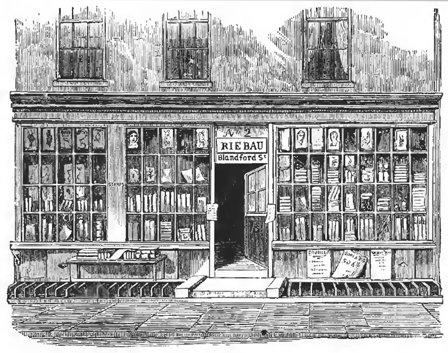
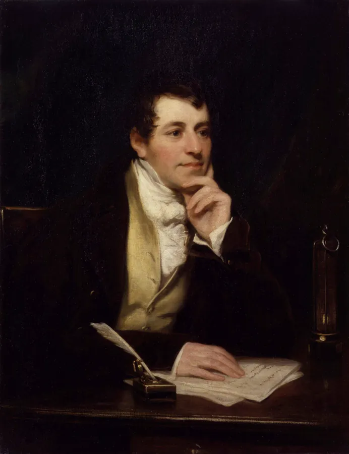
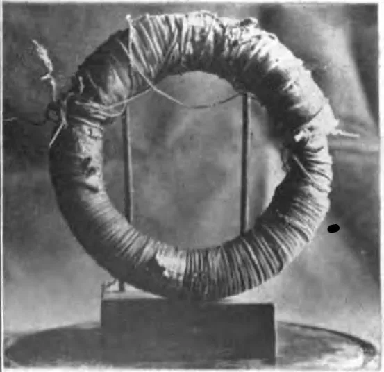
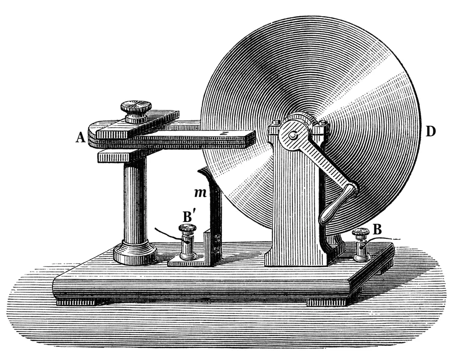
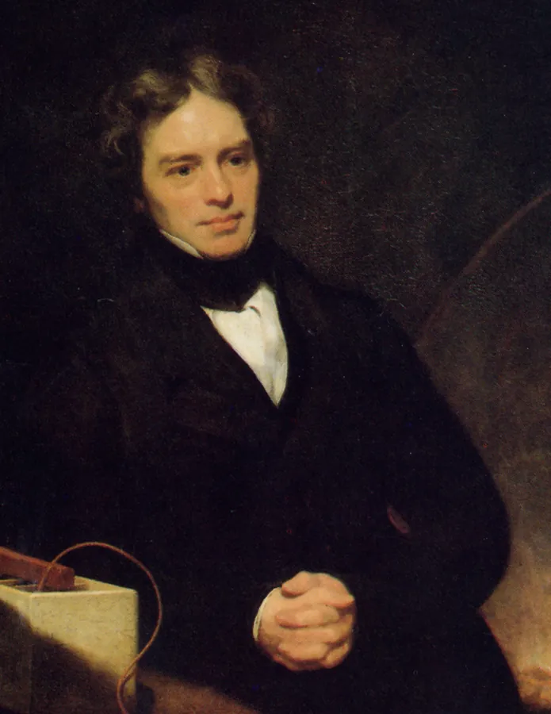
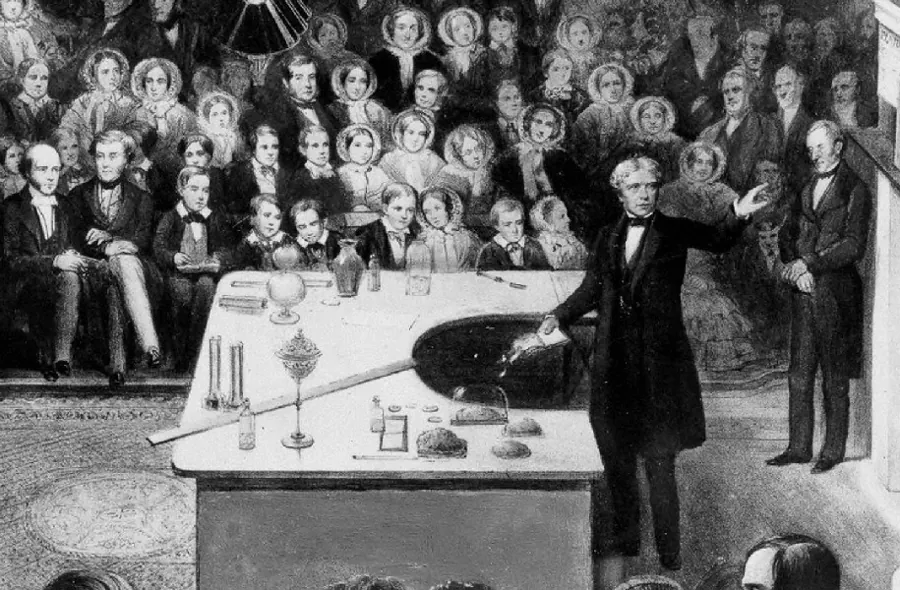

**文 / qscqesze**

一八三一年九月二十三日，迈克尔·法拉第写信给化学家理查德·菲利普斯。信里说，他最近又忙起电磁学，自以为有了一个很好的结果；他暂时不告知细节，因为助手要是把这行字看去，消息便不只在两人之间了。他要等后面的实验。信写得轻松，也给发现划了一道界限：一件器材已经能让他看见效果，还没到别人只需按书上步骤去做的地步。[^1]

此前将近一个月，在伦敦皇家研究院，他让一组导线连上电池，观察另一组导线所接仪器的指针。两边没有接成同一条通路。指针在接通的一瞬偏转，随后回到原处；断开时，又向相反方向偏了一下。倘若观察者是在电池已经接好以后才看，这套器材几乎和没起作用一样。要把这件事变成知识，除了使针动，还得说明它什么时候会动、什么时候不会动，怎样排除两组线碰在一起，或附近的磁铁直接掀动仪器。[^2]

法拉第这时刚满四十岁。一八一三年，在同一幢楼里，他拿一份按星期算的工资，做的是清理器物、按人要求准备试验的工作。研究院给他工资和住房；有些重要的实验器材则须另行借用；他的试验做成什么，还取决于谁在旁操作、哪几位友人有能力看懂他的笔记、谁可以同他商量结果如何报告。那封暂时保密的信也正是写给同行的。一个从装订铺出来的人，已经可以决定把哪条细节先留下，哪条在实验尚未完成时不拿给别人。[^1][^2][^3]

## 把讲演订成一册书

迈克尔一七九一年九月二十二日生于伦敦泰晤士河南岸的纽因顿巴茨。父亲詹姆斯做铁匠，母亲玛格丽特来自英格兰北部乡间。父母从北边迁到伦敦，后来一家迁到河北岸，曾住在曼彻斯特广场附近的马车房楼上。父亲长期有病，一八一〇年去世。后来的传记说，母亲在韦茅斯街靠接纳房客维持过家计，儿子有收入后也负担她的生活。家里没有给迈克尔准备一个从小学一直通往大学的教育计划；他晚年记得自己在普通学校学到的是读、写和一点算术。此后怎样接触更难的书，与他能在哪里工作合在一起。[^3][^4]

他先在乔治·里博的店里做送报跑腿的活。按一八〇五年十月七日订下的契约，他随后学装订、文具和书籍买卖，期限七年。契约说明，因他此前服务勤恳，不收学徒费。这不是家庭突然有能力让一个孩子专事阅读。期满前，他每天做的是把纸页按次序放好、钉缝书帖、给书做外壳等付得起账的活。可送到案上的书不会全是同一种，他在自己还有空的时候往里读。将来他写给同行的书信、试验图和讲演记录，也常需要让散开的纸保持原来的次序，供人翻找过往做过的一件事。[^3][^4]

多年后他回忆学徒时代，提到《不列颠百科全书》关于电的文字，也提到简·马塞特写的《化学谈话》。马塞特让一位女教师带几个年轻女子在问答中认识实验。它的读者不用先有职业资格，即可跟着书里摆出的器物想一遍。法拉第做得比阅读多一步：他回忆自己每周只花几便士做得起的化学实验，先拿一只玻璃小瓶，后来用玻璃圆筒做产生静电的装置。装置不会因为书上说能产生电就立刻可用；要在摩擦后看见效果，导体放哪儿、玻璃如何支持以及什么东西将电带走，都得由手边能置办的材料决定。[^4][^5]

<figure>
  
  <figcaption>乔治·里博的书店。佚名版画，见亨利·本斯·琼斯《法拉第生平与书信》卷一，第 9 页（1870 年版），为后出的店面图。<a href="https://commons.wikimedia.org/wiki/File:Faraday-riebaus_shop.png">图像来源与许可</a>（公版）。</figcaption>
</figure>

在里博许可下，他还去听约翰·塔特姆的夜间自然哲学课。一场要一先令，哥哥罗伯特给过这笔钱。父亲去世之后，哥哥自己也靠手艺谋生；这时一次听讲的机会，先从一位靠做工挣钱的人口袋里支出。迈克尔把课记下来，装订成册；他也遇见了本杰明·阿博特等青年。阿博特在商号任职，后来成为他往来密切的通信者。他们通信谈实验，不必每次都同意。一封接近出师时写的信分析阿博特让火花经过一张卡片的办法，推测为什么电火花会在一处处分开，又问下一轮怎样区别不同的解释。两人靠各自做的东西给对方提问，学历差别并没有让全部话都由一人讲。[^3][^4][^6]

里博的顾客威廉·丹斯给了他听汉弗里·戴维在皇家研究院讲课的票。一八一二年，他听了四场，转写成更完整的文字，配上能补出的图，做成一册交给戴维。写给皇家学会会长约瑟夫·班克斯的求职文字，没得到他能继续据以做什么的答复。戴维回信愿同他面谈，但并没有当即许给他一个位置。法拉第已要结束里博这里的学徒期限，不能无限等下去。他按装订工的身份另到一处工作，工作不合意也还得照常做。那本讲稿能够让戴维看见他对课理解了多少，也让戴维看见这位申请者能完成一件从记录、补图到交付的工作。等职位空出来，才有另一次谈话。[^3][^4][^7]

一八一三年三月，皇家研究院管理者通过戴维的提议，聘法拉第接替威廉·佩恩。工资每周二十五先令，另有楼上房间。聘任记录把职位写成接替已离职的人，说明研究院不能为每位听讲来求职的青年专造一席。新人的职责是把所需的器具和材料交给在楼里做实验或讲课的人，收拾用过的东西，有时还要办理矿物藏品等杂务。站在讲席下记笔记与留在楼内管东西不是同一回事。后一份工作有工资和房间，也要求他在别人需要某种气体、玻璃或清洁的器皿时，负责让东西以可用的样子出现。[^3][^4][^7]

## 跟戴维出门

早期实验室对新人并不安全。法拉第给阿博特写信，谈到样品装在玻璃里爆开。研究含氯的活泼物质时，容器正是要保护观察者的东西，又可能在反应太快时成为伤人的东西。做实验不仅是认出反应，还是学怎样配制少一点的材料、何时隔开身体，以及出事以后怎样安排下一次操作。戴维已经有这方面经验，仍会因操作受伤；助手因处在相近的位置，承担的是同一种物质的危险。法拉第这时努力把手上工作写给旧友，而旧友不在研究院里领薪，能追问的是讲清之后是否仍有一处说不通。[^4][^6][^8]

<figure>
  
  <figcaption>托马斯·菲利普斯绘汉弗里·戴维，1821 年，英国国家肖像馆 NPG 2546。<a href="https://commons.wikimedia.org/wiki/File:Sir_Humphry_Davy,_Bt_by_Thomas_Phillips.jpg">图像来源与许可</a>（公版）。</figcaption>
</figure>

戴维于一八一三年秋赴欧洲大陆，约法拉第同行，带妻子简一道出发。戴维以公开讲演和化学研究出名，此时已获封爵士。他能在战时通行、向外国同行索取样品、在旅途中继续研究；法拉第随行能接触的地点，远超一名研究院助手靠周薪可以独自到达的范围。巴黎有一批正在讨论碘的人，法拉第看戴维怎样依据物质反应同法国同行争论；在意大利，旅行一行把钻石放在氧气里燃烧，通过生成物检验组成。钻石能经一次烧灼消失，但要把这过程供人判断，还要留住或辨认烧后出现的东西。这样的训练和书店里读一段已经写定的结论之间，隔着许多次准备与等待。[^3][^4][^9]

同行的条件也另有一面。法拉第原以办科学事务和文书为主，临出发前戴维的贴身男仆不去，他答应先帮忙办必不可少的事，等到了巴黎再雇人。巴黎没有合用的人，后面几站也没换来固定的男仆。两年后留在信纸上的，是法拉第自己的解释：戴维本人很多小事照常亲手做，并尽量少让他难堪，但戴维夫人喜欢在她认为该服从的事情上行使权力；他与她有过争执。夫妻旅行要维持各自原有的生活安排，科学助手却不愿把自己的职业一语说成家仆。他可以给朋友抱怨，也可以想办法离开；只要还想随去那些实验和会面，转身离开就要放掉其中一部分机会。别的当事人没有留下同等详细的书信来说明这次分工。[^9]

旅途将结束时，他从布鲁塞尔给母亲写信，让她不要特意跑到皇家研究院打听返伦敦的日期，他一到就会去见她；有一些人他想自己告诉，原来的师傅里博便是其中之一。一八一五年回国后，研究院重新聘他管实验室和矿物收藏，周薪升到三十先令。家书的收件人和他的履历在这里相逢：他仍有母亲与先前的同业要顾，但已能拿着在大陆见过的样品、仪器和做法，开始做不全由戴维指定的问题。后来在电磁学上给他寄装置和通信的人，也有欧洲大陆的化学家。他终于不必等到下一次作为雇员出国，才知道对方能够做出什么。[^3][^4][^9]

## 化学家的周薪和房间

在伦敦，城市哲学学会给他一个比皇家研究院讲堂更容易练习的地方。一八一六年，他在那里讲化学，提到物质、燃烧和热，约七场。朋友读他写的文字、听他说、提出疑问。他在研究院的工作又让他能分析别人送来的样品。有一类生活以工作表为单位：雇主在哪天需要讲演，谁去搬器具，什么东西须在开始前试过。另一类生活以贫乏的闲时为单位：在这段时间读、做、写，第二天仍按时回到原有工作。法拉第从前额外靠学徒之外几便士买玻璃，现在可以暂借好一些的器材，但使用多少好处要看工作安排是否容得下。[^3][^4][^10]

一八二〇年七月，他写信向莎拉·巴纳德表白。他知道她可以只肯维持原有友谊，没有把共同信仰或两家熟识当成她应当同意的理由。信中他承认自己希望她回应，也说如果少见反倒有益于她，他愿意这样做。两家都和桑德曼派教会有来往。这个不设有薪神职的小教会，把亲属、婚姻、礼拜和日常相助在小范围内接在一起。共同教会使他认识对方，却没有替他们处置结婚后住哪儿、每年从哪里领取一笔稳定收入。研究院同意他让妻子住进楼中的房间；一八二一年六月两人结婚。[^3][^4][^11]

婚前研究院把他的职务调整为房屋兼实验室主管，原先约一百英镑的年工资没有随调整立即增加。礼拜以外，同一座房子现在还是夫妻生活的场所。两人没有自己的孩子，家中有侄辈、亲族与旧友来往，晚年莎拉与两名亲属还把材料提供给最早为他整理文献的人。本斯·琼斯在编书序里向她们致谢。听法拉第讲演的人能见到院方为他备下的桌子，难以同时见到是谁留好家书、允许身后有人翻检，还愿意把私人手稿借去付印。相比早年求职的信和后来名下的论文，这些家中的动作留下的记录常更简短。[^3][^4][^11][^12]

法拉第的化学工作也连着在工场里谋生的人。外科器具商詹姆斯·斯托达特希望改进做刃具的钢，法拉第同他试制含少量其他金属的合金。要判断同一种锻造做法在材料变化后有什么效果，光看熔锅内的东西不够；还得看成品能不能冷却、锻成、磨利，能否承受原定用途的损耗。有的合金在实验中能做成，不等于适合大批交付；用什么炉、能取得多纯的添加物，也同小量造样不同。两人把若干结果发表。这份合作不是后来不锈钢生产方法的直接交付，一位商人和一位实验者各自知道的限度，却都进了对钢的判定。[^3][^4][^13]

到一八二三年，他检查氯的水合物，依戴维建议在封闭玻璃管里加热。组成物分开，生成的氯不能自由逸出；在封管内积起的压力下，可见有液体形成。后来他改用不含水的氯气重复，排除那层液体只是同水一起产生的另一种化合物。把这样所得的氯放回普通压力，它又会逸散；操作者不能随意开管来把什么东西举给别人看。戴维曾建议尝试的条件，法拉第需要通过实验说明是什么结果。论文让两种贡献各有位置；随后把相似办法用在别种气体上，也得另看该气体在一定压力和温度下有什么行为。[^4][^14]

他对煤气和油气设备周边材料的研究，则受益于商人交来的东西。一八二五年，他发表从压缩油气留下的液体分离若干物质的研究，分离的一种后来称为苯。原始论文提到戈登先生供给较多的液体，得以继续早先只能在少量样品上做的尝试。液体不是一种纯品；须先让不同成分在不同温度下分出，再检查所得材料。法拉第当时使用的名称反映他的分析办法，不能把后来关于苯分子结构的知识塞回原来的烧瓶中。能确定的成果是，后来化学家可以从这些较为杂乱的油质残液里讨论一个可单独处理的对象。[^4][^15]

## 没有止点的转动

当时许多实验由一件外国同行已经做到的事开始。一八二〇年，奥斯特公布电流能让附近的磁针偏转。把一根导线放在针旁，在电池接通后看针转向，并不能直接分辨针所受的作用究竟怎样分布在导线周围。安培用更多实验与理论说明电流、磁作用的关系。法拉第参与整理外国研究，要说明这些实验怎样摆放，便须拆开传闻、报道和自己眼下能做的事。他的复演很快变成另一个问题：如果放开导线，不让它只能向一侧走一段，磁铁能不能使通着电的导线绕它连续运动。[^16][^17]

一八二一年九月，他用能导电的水银维持活动的一端与电路接触，让导线和磁铁其中一件可以绕另一件运动。这种器材能把单次偏转与连续转动明显分开。导线一端若固定死了，电流通过时也可能只使周围器物偏转；在允许它绕轴移动的情况下，继续供电的效果可以重复许多圈。翻换电的方向，或改变磁极的一面，转向也随之变化。它没有承担机器车间需要的力量，水银接触也不宜拿去驱动日常器具。要看见什么运动可以由电流和磁铁共同造成，用得上的恰是很小、摩擦较少而又能自由移动的装置。[^16]

他在九月十二日写给夏尔－加斯帕尔·德拉里夫，感谢他寄来装置，同时区分安培已经发表的实验证据与理论推论。次年致安培的信也还在谈转动。信里的分歧不能简化为一方相信电与磁有关、另一方不信；两边都知道有足够的实验等待解释。法拉第希望从移动的东西出发，分出哪些描述只是可能，哪些通过换接线或站位便能在器具上看出来。安培的工作给了他一个可以重复布置的物理问题，他并未因对理论的一些保留就不与对方交换结果。[^16][^17]

威廉·海德·沃拉斯顿此前考虑过让载流导线绕自己的轴转。后来一些人认为法拉第没有充分说明在先设想，谈到两者著作所争的是谁先完成同一件事。绕自身一轴转，和一根线绕外部磁铁回旋，并非同一实验。法拉第去找沃拉斯顿当面解释；到他的皇家学会提名书递交时，沃拉斯顿的名字列在签名者前面。提名书上这个可以辨认的动作，比用传闻替人裁定他们到死都怀着怎样的情绪稳妥。它也不抹去在新实验招来关注时，哪些动作先在私人场合尝试、哪些在纸上发表，本来就可能被人混作一项。[^4][^17][^18]

戴维当时任皇家学会会长，反对法拉第的当选。关于他如何要求撤去提名材料，主要由法拉第多年后叙述、经早期传记编收；动机没有同样直接的记录。法拉第在一八二三年记下几次商谈的日子，反对最终没有阻止他于一八二四年当选。戴维不必被写成只肯庇护、也不必被写成从此只管打压。聘他入院和同意他在院内安顿家庭有戴维的支持，这一次的反对也有可辨认的材料。皇家学会的学术席位由一群拥有投票资格的人决定，皇家研究院的工作机会则由另一组人和另一套安排维持。对于仍在后者任职的人，两处关系都要接着处理。[^3][^4][^18]

## 一炉玻璃与六册记录

一八二五年，法拉第成了皇家研究院实验室主任。此时他并不只做后来归为电磁学的工作。皇家学会把改进光学玻璃交给一个小组，成员包括约翰·赫歇尔、光学器械商乔治·多伦德和法拉第。照分工，法拉第研究配料与制造，多伦德试磨玻璃、判断它作为制造镜片的材料能否使用，赫歇尔检查折光和色散一类性质。实验者可以分别测出玻璃对不同颜色光的作用，制镜师却需要相对大而均匀的一整块。某一次熔炼能让样品的数据合乎要求，不会自动满足后面切、磨、装配的条件。三个人能够把同一种材料交到下一人手里，也能因此指出前一人的成功还离可用的镜片多远。[^3][^4][^19]

皇家学会请皇家研究院拨地方造炉，一八二七年实验房和炉子建成，退役炮兵军士安德森来做助手。实验房不能像讲堂那样，开过一场就把桌面上的东西撤掉了事。连续加热、观察和让材料冷下来的工序都要有人照管，下一次如果换料，就还得知道这一回炉子曾怎样使用。安德森后来留在法拉第身边多年。一八四五年法拉第发表新的电磁实验，专门在脚注中写起安德森，说他起于做玻璃的实验，此后一直帮忙，做事精确可靠。这样的署名不等于两人承担同样的职务，却让读者知道，许多发表在一个人名下的操作依靠另一人照管。[^4][^19][^20]

一八三一年七月四日，法拉第写给皇家学会的彼得·马克·罗杰特，送去四大两小共六册玻璃实验的手稿。他说明这项任务已经占了自己的空闲时间，请暂停一阵，好做别的研究；如果日后再做，也不能许诺完善一门工业，因为自己不是制造商。交还账册、写清谁能决定下一步做什么，比立刻赞扬或否定一种玻璃更重要。皇家学会得到积累多年的记录，法拉第保出时间。他并不抛开此前全部成果，一种高密度玻璃留了下来。多年以后，他用它照察磁场中光的变化。那时取用这块东西，不意味着当年已经预见了这项用途。[^4][^19][^21]

实验玻璃不是他必须从研究院的职位中挤出去的唯一工作。一八二七年他出了《化学操作》，把器材摆放、加热、称量、处理气体和留下笔记写成别人可以使用的手册。讲实验的书不必把失败写成轶事，却得说明遇上读数不可靠该先看哪个环节。研究院的周五晚间讲演也逐渐成为正式活动；在伦敦的不同场合及后来在伍利奇的皇家军事学院，他靠讲课所得补足院方的工作。收入多少与能自由研究多长时间常相牵连。同一名实验者答应集中精力做玻璃，却需要另找时间写书、备课，也需要留几天给没有在合同里写明会有什么结果的题目。[^3][^4][^22]

## 指针只动一下

法拉第的第一篇感应报告把几种办法列在同一篇里。先把两组导线缠在一根非铁质的圆筒上，使它们相近，却隔开导线表面。把电池接到其中一组，以另一组接检流的仪器。有些情形下显示极弱，有些没有他能辨认的效果；电池一时接着并不等于观察者应能见到稳定电流。他把导线加长、改变电池、调整位置，为的是区分效果确实不在与测起来太弱。这时使实验往前走的一步，是承认仪器如果自己回到原处，不必判定刚才的动作没有意义。设计能够显示从头到尾的经过，才有机会找到应当盯住的那一瞬。[^2]

一八三一年八月二十九日，软铁环进入实验。环的外径约六英寸。一边绕三段彼此隔开的铜线，按需要可以单段用或连起来用；另一边绕的是另一组。两边的线不必彼此碰上，铁环则可在电池通电时迅速响应。取后来报告的一组安排为例：用十对极板的电池接第一侧，以离环约三英尺的检流计接另一侧。电池接上时，后者的针偏转良多；电池继续相连，针仍回原位；再断开，则向反向偏转。这三个可分的动作一道写下，才使后来从头接线的人知道，接上后过半晌才去观察，会漏掉最有信息的一段。[^1][^2][^23]

<figure>
  
  <figcaption>1831 年试验所用软铁环，皇家研究院藏。照片摄影者不详，1922 年刊于英国电气工程师学会会刊，卷 60，第 XIV 图版。<a href="https://commons.wikimedia.org/wiki/File:Faraday_ring_transformer.jpg">图像来源与许可</a>（美国公版）。</figcaption>
</figure>

他更换接上电池的方向，观察偏转方向是否有系统地变动。只在检流那一侧开、闭回路，也没有由电池那一侧改变时可见的效果。在一些条件下把电池增强，可以让针的动作大得明显；把第二回路两端接到炭上，还能看到很小的火花。试验并没有要求每次看得见火花。持久通电不再产生偏转，而断开又可观察，对理解已经足够；火花只对另一个问题有用，即除了针动，装置是否在第二回路产生了另一种常见电效应。法拉第想避免给针的每一下运动都安上同一个原因：碰触仪器、附近铁器移动、导线通路改变，让指针动起来时表面可能相像。[^2]

铁环可以帮助电流产生的磁性变化更有效地及于第二组线。若把现代说法说得直白些，接通电流时铁环里的磁状态在变，断开时变回去；电流通过后稳定的时段，第二组线不再经历同样的变化。早期报告并没有使用今日教科书一模一样的推导，实验上却已经把变动与不变的时段做出比较。这样的结果也未直接等于后来接交流电长期工作的变压器。法拉第原来的电池不自动周期换向，想让另一侧延续产生电的作用，还得改造供电方式，或者持续进行某种机械动作。[^2][^23]

于是他把永磁体与线圈的相对运动另作一组试验。磁铁迅速放进绕组，仪器向一侧动；抽出来，又反向。留在中间不动，效果不再按原样持续。这里连负责制造磁性的电池都省去，线圈里的电作用仍随着疏近往返而出现。为了使现象更强，他利用皇家学会所属的一架大磁铁，并写下在伍利奇得到塞缪尔·亨特·克里斯蒂的帮助。试验的地方、谁负责设备、检流计同装置相隔多远，都可影响结果有没有说服力；给出这几项，读者也就知道不能把某处针的动作未经修正地带到另一套布置上。[^2]

他的另一项安排不是在线圈中一次次送入、拔出磁铁，而是让铜盘在磁极间连续转动。从盘轴附近与盘缘分别取电，接上外部回路。一个接点须在盘还转着时也能接触边缘。从连续供给机械转动，可以得到持续的电流；调转盘旋向，电流方向也随之改变。实验所用转盘很难同后来大功率发电机的构造相提并论，然而它同铁环相邻有一项实际意义：获得可持续的效果，不再靠眼睛总去等打开或关上电池的一次变化。下一位制作者仍得解决接点磨损、效率和供转轴使用的动力，这些事不在检流计读数里自动办完。[^2][^24]

<figure>
  
  <figcaption>法拉第圆盘原理的后出装置图，刊于阿尔格拉夫、布拉尔《电灯》1884 年英译本，第 224 页图 142；并非法拉第原装置。<a href="https://commons.wikimedia.org/wiki/File:Faraday_disk_generator.jpg">图像来源与许可</a>（美国公版）。</figcaption>
</figure>

给菲利普斯写完那封暂不详说的信之后，他继续整理观察，第一辑电学论文在一八三一年十一月由皇家学会宣读，次年刊行。抄在实验室里的问题与发表的文章并非一个东西。发表所需的是可以由一件安排走到下一件安排的次序：给出接线，述说无结果的条件，在另一个装置中改变一处作比较。同样重要的是把读者的目光从一个物件带去下一项过程。铁环的照片可以让人认出导线包住什么；什么证据证明这不是两路之间漏电，则只能由实验步骤重建。[^1][^2][^23]

## 一次火花和一瓶气体

在第一辑论文面世前，戴维已经去世。关于电的一些疑问却是从他那里传下来的。一个装置靠摩擦起电，放电时能冒出很长的火花；另一个装置由成对金属和液体组成，能把电流连续送过一段导线。这些电作用下，金属、空气和溶液的表现并不总一样。认为电的来源不同而性质相同，固然能把不少已知现象归到一起；认为电池内化学反应送出的东西与干燥玻璃上摩擦取得的东西不同，也能举出实例。戴维就在遗下的论文里把一些差异看得很重。法拉第现在有了第三种办法，可以叫磁铁和导线在相对运动时给出电流。他必须说明，新添的办法与旧办法究竟应当在哪些条件下比较。[^25]

他在第三辑开始时列开要比的项目，涉及发热、磁作用、化学分解、放电和对人体的作用。有些在别人的实验里已经很清楚，另一些要考察仪器究竟量到了什么。比如，把摩擦起电机放在桌上，在空隙里放一次电，眼睛和耳朵都告诉人刚发生了一件事；但若问它能在湿润纸上析出多少物质，等一会儿去看纸，痕迹可能少到不能判断。换电池则可能长久作分解，普通电池在相同距离上未必跳得出那样的火花。只比两种仪器各自最引人注目的表演，差距不会消失。法拉第把问题拆开，分别考察电流能不能引起同一种变化，能够输送多少电，以及每种装置有多容易使电穿过隔开的地方。[^25]

为使摩擦取得的电可靠地通过湿试纸，他要给电一个可以循行的通路，避免旁边的火花替它走了更容易的路线。又须区分尖端发生的化学变化与单有火花在空气中作用后留下的变色。纸上出现一小点颜色只是一项观察；弄清这一点出在哪边，倒转接法时又出在哪边，才可以拿去与电池的效果并排。用检流计也有相似的麻烦：针偏多少，既受一时流得猛烈与否影响，也涉及电通过的时间，如果针还在来回摆，就更不能把一次目测当成全部。法拉第用接法和观测条件来约束比较。这样的测试不能从头证明一套关于电的理论，范围虽小，却足够逐项消解那些由比较方式引起的矛盾。[^25]

此后他的报告又摊开了一个当时容易忽略的差距。人们能用肉眼记得一回猛烈放电，却很可能低估一小块金属在电池中发生化学变化所牵涉的电量。同一量级的问题，如果一定要按火花数和声响来想，化学与物理之间的比例就根本无从着手。法拉第让电先后经过相接的仪器，有意在外观很不相同的两处造成可比较的结果。在一处数火花，在另一处观察化学作用或检流的效应。从他的报告中还不能读出今天通用的一套电量单位，但他已经为这种量找到了可以操作的意思：把一段时间中过去的电累加起来，多少不能只问最高的一刻。[^25][^26]

电解试验给这种思路一个持续用得上的工具。装在玻璃器具中的水若要稳定地导电，实验需要适当的溶液和不容易被反应吃掉的电极。通电后，实验者在液面上方收集气体，等它在刻度上占据一个可以读出的体积；把这只器具同另一处分解装置串接，通过两处的是同一份电量。想要研究不易直接称量的分解，可以借较容易收集的气体为尺度。读数还得记得温度和压力会使气体伸缩，逸出的气体也不会自己回到刻度管里。法拉第所称的电量计，用的是这一类化学量作标记；若把名称会错意，想成隔着两个接点测量今天所谓电压的表，正好把这里的用处倒了过来。[^26]

他再让相同的电量通过不同的化合物。在一份溶液里电使金属析出，在另一份里可能放出别的物质。称量或者由气量折算之后，数值并不相等，比例却有规律；在相同反应条件下，要析出原先两倍的量，须送入两倍的电。换另一种物质，对于同一电量该析出多少，可以同化学家在别处已使用的化学当量作比较。法拉第由此讨论电与物质组成之间的定量联系。这样的发现靠许多次称与量才能站稳：如果有副反应同时消耗电量，只量主反应的产物会显得少；化合物的组成与所处的变化不同，同种元素也不必每回都用相同的数值去折算。[^26]

他仍须决定怎样在文章里称呼这些变化。用两极的惯称，读者可能在尚未察看溶液前，就认定造成分离的是两片金属吸引远处的物质。法拉第想要的是可以照实验通路来认位置、又不必先赞成某一种解释的名称。英语还没有一套现成的词。他把校样寄给剑桥学者威廉·休厄尔。休厄尔懂希腊语，也关心科学家怎样整理概念；他能提供词根，最后怎样在新论文里让别的化学家读懂，法拉第还得自己掂量。一八三四年五月三日信里，他一度较偏于能同所选东西方基准相合的词，又说自己喜欢另一组词的音节，只是给人看时，读者误把其中一个会意成无路可行。他请休厄尔想想有没有更短的替代，也请他核对给印刷工人的词源说明。约定在实验报告上的语言，就这样经过了印刷前的几轮修改。[^27]

出版的第七辑用上了 anode、cathode、ion 及由此派生的名称。今天分别译为阳极、阴极、离子；若从电极所起的反应来分，氧化发生处为阳极，还原发生处为阴极。对那类外面用电源推动的分解，阳极接电源正端，但换成自己对外送电的电池，两极的正负关系须按该装置来看。这个区别说明法拉第为什么力求把名字与实验规定明白地搭在一起。休厄尔在书斋里能帮他省去生硬的长词；使几个短词不至于流成含混比喻的，却是各章里看得见方向、量得到产物的化学过程。[^26][^27]

皇家研究院给这些试验提供了场所，但研究员每日怎样用自己的时间，并不是由一次发现永久决定。约翰·富勒出资在研究院设立化学讲席，法拉第一八三三年成为首任教授。原先要协调的项目和院里的职责没有凭此消失；讲席让日后谈及这家研究机构怎样留住法拉第时，可以指给人看一项明确的安排。一八三五年又有每年三百镑的政府年金。发给年金的人并不替他选次日要分解哪种物质，而按年支付意味着他一部分生计可以同每件工作的即时报酬分开。书信和早期传记记下年金磋商的不快；这项收入不是在发表感应论文的一天自然而然落到账上的。[^28]

有了这个条件，他可以拒绝一些酬金不错、却会占去长期实验时段的委托。他并未从此停止做有明确客户的事：一八三六年成为三一公会的科学顾问，海上灯标和灯塔的监督者要向他问不同种光源的实际效果。他要去现场，并往往把灯、油、灯芯、烟道和灯室各分开考察。同在职业生活中，院方可以希望他在周五晚讲出一项新结果，公会可能只问研究表明某个夜里该用什么灯。前者要使听众在短时间跟上问题，后者还须让值夜的人懂得下一步怎样操作。[^28][^29]

一八三六年，他在研究院安排了一次比小瓶里的化学分解更显眼的试验：造一间每边约十二英尺的小室，在支架上覆以能够相互导通的金属材料。小室的外部可以充上电，外面也可以发生放电；他在里面另用检测手段找可以觉察的静电影响。入内并非仅为表演，人本身的感觉不足以判定此事。记录的关键是壳内的仪器没有在那种安排下检出作用，沿导体外部则能得到效果。封在里面的气体和仪器并未变成别的物质。分开内部与边界以后，原来易被看成从带电处向四方无阻碍伸出的作用，可以拿边界上电荷的分布来研究。[^30]

后世用法拉第笼来称许多隔屏装置；他当日检验的问题有边界，不能拿来保证由任意网罩挡掉所有频率的变化，更不能说在小室里用磁针看不见地磁。就在这一批实验里，他关心不接触的物体怎样彼此影响，把空气、玻璃、硫之类的绝缘介质放进不同的安排中。若在同样的导体外形和距离下换一种介质，受到的感应能不同，不能把中间物一概当作纯粹的分隔。他制作能互换的球形装置，试图让这个比较可重复；如果两个金属球形状和间隔没有先调到可以相较，结果便容易掺进器物本身的差异。[^30]

电从何来，也仍有他想亲手看的例子。早一辑报告谈动物放电时，法拉第用过同行对电鳐的观察；一八三八年有机会在伦敦研究一条活电鳗，他可以把取电点换到鱼身体的不同位置，查验对检流计或化学试验所起的作用。单说触碰时感觉到了震动，不能告诉人外部回路有怎样的方向，更不能衡量电鳗一次释放多少。他报告了不靠感觉所得的几项效应，把不同取电安排的结果写入动物电的论文。这件工作同电解的区别在于，实验者可以随意接断自造电池，却不能命令动物依同一周期放出恰相等的电；测得一回，重复时便要留意动物的状态和装置的接触。到这一时期，他往往用了实验室一个看似很小的便利，只改接点、不换整只仪器，来分辨两种解释。[^31]

## 从布赖顿寄出的信

<figure>
  
  <figcaption>托马斯·菲利普斯绘迈克尔·法拉第，约 1841–1842 年，英国国家肖像馆 NPG 269。<a href="https://commons.wikimedia.org/wiki/File:M_Faraday_Th_Phillips_oil_1842.jpg">图像来源与许可</a>（公版）。</figcaption>
</figure>

一八四〇年四月，法拉第在布赖顿回信给巴塞尔的化学家克里斯蒂安·弗里德里希·舍恩拜因。他把到海边或乡下稍住视作恢复体力的办法，好回去接续这一季的职责。手边没有对方来信，他说自己也不敢说记得里面完全写了什么。信却并非一纸告病。舍恩拜因正在追究一种特殊的气味，法拉第从自己的电量计说起，详细写到把同一块铂片屡次接作正端，气味渐渐消退，铂片上出现较暗的东西；换另一块作正端，气味又回来。做电解定量时妨碍仪器保持原状的细节，到了朋友手里可能成为别一项研究的起点。[^32]

怎样让这份观察出去，也是信的一部分。舍恩拜因如果准备把研究先收入别的报告，皇家学会就不会把同一篇东西正式印在自己的会刊。法拉第把文章交给学会秘书克里斯蒂，等待会议能否先予介绍；还在信里提到，如有需要，可以把文稿取回，送给《哲学杂志》。这是那位没有记牢来函细节的人同时在办的事。信中的自述有轻重：他承认正在休息，也分得清自己亲手见过的铂片变化、朋友尚待分离出来的东西，以及某个化学说法该用怎样的证据检验。拿记忆减退解释这一时期的所有起落，会漏掉这样的工作。[^32]

一八四一年，莎拉同他去了瑞士。旅途本身使他有一段较长的时间离开研究院，通信和出行记录都留下了痕迹。伦敦的亲友此时已知道不能把排得太满的工作当成一桩值得庆贺的事。近年的试验要靠反复读数和逐日接续，讲演要把次序保持在听众能够追随的程度；这两种职责都不能单凭有一天感觉好些就恢复从前的安排。他陆续减轻负担，但未完全停止实验和函件往来。后人时而把这些不适归于他过去接触的某种化学品，现存描述不足以成就一个确切诊断。能看得清些的是他如何安排离开伦敦的间歇，以及哪些报告迟一些才完成。[^3][^4][^32]

他的另一份日常责任来自教会。伦敦的桑德曼派人数少，长老是面对相识的会友工作，不是持一个荣誉头衔便罢了。法拉第约在一八四〇年担任长老。后来叙事常把一八四四年短暂被教会排除，说成王室邀宴与星期日礼拜相撞。记录能支持的是发生过排除，并在数星期后重新接纳；不能据此把一桌晚餐与会众的决议连成因果。研究这件事的杰弗里·坎特把它放回当时的内部教会纪律争议。分歧没有使夫妻同这个团体从此断绝，他后来又承担长老工作。与其从少数信札猜他在教堂门外的心情，能确定得更多的是他此后仍肯分出原本就有限的时间去承担这类义务。[^33]

就在一八四四年秋，另一种义务把法拉第和地质学家查尔斯·莱尔送到达勒姆郡的哈斯韦尔煤矿。内政大臣要他们调查爆炸的成因和防止再发的办法。采空处的形状与煤层走向关系到瓦斯积聚在哪里；爆炸过后，有些地方能走到，有些只能从支柱、石块和封隔破坏的方向推求。地质训练与化学分析在这里各有用处，矿井管理人员认识巷道和风路，也有判断爆炸从何处传来的经验。两位受命者的地位足以把这些人请来问话，却不可能从未能逃出的人那里找回当时的顺序。[^34]

在报告所指的可能起爆区域，调查者取得了戴维式安全灯。这种灯用金属网隔住火焰，完好的网能使穿过它的气体冷却，降低灯内燃烧把外面可燃混合气点着的风险。现场取到的灯有砸伤的，有一盏的加油孔塞不在原位；另有网罩留下燃烧加热的迹象。这样的组合不能独立证明是谁拿错了一盏灯。相同的物件可以在火起前已受损，也可以在火起后被坍落的石块砸坏。报告把几种先后关系留在纸面上，没有把能够找到的灯直接选定为确定的起火源。在戴维的学生来检验戴维灯的这一回，物件是否出自受尊敬的发明人，同报告能否排除其他可能并无关系。[^34]

两人也看到了已经烧结的煤尘，粘在支柱、煤壁和其他突出部位的一侧。气浪过处，煤尘可被带起来，在氧气足够的地方参与燃烧。报告把沉积物和煤磨成的粉作对照，烧过的样品失去不少原有可挥发的组分。这一项观察的用处尤其在爆炸怎样蔓延；发现尘土参与，就不必硬说第一点火来自煤尘。从中可提出减少瓦斯积聚、改善通风以及检查废弃空间同作业处之间联系的问题。十月十九日内政部又来信，问另一处造成伤人的爆炸该不该一并调查，是否还应查达勒姆与诺森伯兰的各主要煤矿。由一次现场勘验推至普遍巡查，已经是另一项需要人数和经费的工作。信问两位科学家值不值得做，政府不可能单靠他们俩去代替各矿的管理人。[^34]

## 玻璃重新上台

一八四五年，法拉第又寻起光和磁可能发生的联系。他曾试过不少安排，没有得到预想结果；报告发表时也提到瑞士物理学家瓦特曼在一条相近的路上得出的否定结果。法拉第对各种物理作用存在联系的信念足以促使他回来再试，无法指定他该看见什么。他可以重新选择透明材料、增加磁的作用，或改变光穿过装置的方向。十多年前烧过的重玻璃就在他能调用的材料里。原来判断它究竟好不好，关心的是在望远镜里能否给出均匀的光学效果；现在要用一块试样比较磁铁通、断时看见的光有无差别。[^19][^35]

一束灯光先经过能选出特定偏振方向的部件，再通过待测玻璃，到末端用另一件能转动的光学器具观察。先调到同起始方向配合而显暗的位置，光在那里被挡掉大部；如此，随后一小点方向变化就能让人看到亮起来。磁铁的布置也有选择：要使磁场沿着光在玻璃中通过的路线有足够分量。这个设置下，接通电磁铁，视野会发生变化；断电以后回到原状。把磁的方向反过来，转过的方向也随之倒转。法拉第用后端器具重新对好较暗的位置，就能比较转动的方向与大小，而不必仅记一条光亮或不亮的印象。[^35]

这束光没有变成能吸起铁屑的磁铁；在这种透明物和所加磁场的共同条件下，发生变化的是偏振方向。报告原题用了照亮磁力线这样的措辞，容易让人以为附近的空间显出了发光的线，法拉第付印前特添说明，交代自己是怎样借透过物质的光辨认磁作用的方向。这里反复弄清用语和一八三四年的经验相通，又有新的危险：光本来就在眼前，如果名字听上去像在说光之外还有一项发光的东西，后来的读者可能找错现象。实验表中不同材料和方向的结果，限定了题目里的动词该怎样读。[^35]

同年十一月他写给舍恩拜因，告诉他现有所得。这位收信人不只知道报告可能面世的消息，也能回想两人早几年讨论过没有结果的尝试。院内谁能帮忙操作也有分量。年长的助手安德森并非研究论文上的共同作者，但法拉第长年仰赖他照管仪器和执行已经约定的实验操作。在要换接电流或把物体移出光路的工作里，如果做的人在每次观察前后没有照同样的次序行事，有经验的观察者也无法从结果里辨出哪一项变化要紧。教人如何手持、何时移开，属于法拉第制得一套可操作实验的工作；能够接下来执行它，也需要助理知道什么地方可以自己动手，什么地方不能省去。[^4][^36]

紧随光学报告之后，法拉第又让许多材料进入强磁铁的两端之间。有的材料在常见的小磁铁旁不显可见运动，放进较强而分布不均匀的场里，才有可能让轻轻悬起的小块发生可见的偏转。软铁容易被拉向作用强的地方；一小根铋在相同安排下没有照铁的方式对准两极，适当悬挂则能让两端退离较强的位置。单靠一块铋的方向既不能说明什么是物质的普遍性，也可能把悬线本身的扭力算进去。他换样品、改悬挂位置并比较通电与断电，才得以把这些物质的反应列成与铁或其他受吸引材料不同的一类。后来说的抗磁性有了一个探针：并不响亮的一点移动，只要能在相反的条件下往回走，便可积累成可比较的观察。[^37]

由此引出的争论有一部分不在材料名单上。法拉第惯于把磁铁对物体的作用沿着空间中的方向来讨论。把铁屑布在磁铁近旁，可以粗略看出各处方向怎样接续；铁屑之间也彼此影响，所以图样无非一种帮助眼睛辨认的办法。法拉第不满足于把这些线看成纸面上免去长话的替代品，他要知道放进介质的变化以及附近不同点的关系能表达什么。譬如，把导线朝一个方向移过时有电效应，换方向或停下时效应又异，画法就必须跟得上手怎样移动。光也给了另外一种检查这些方向的办法，但仍要经过材料。这令后来的人可以采纳他的几何关系，同时对于究竟该把它理解成什么，持不同意见。[^2][^35][^38]

年轻的詹姆斯·克拉克·麦克斯韦在剑桥取得的是另一种训练。写《论法拉第的力线》时，他没有简单地把老实验逐件重述；他借流体流动等数学类比来处理分布在空间中的量。类比能标出某处的方向与强度，还能让一项检验涉及不同位置之间应有的数量关系。法拉第一八五七年收到文章后写信致谢；同年十一月又问，数学家从自己的办法得出的结论，是否也能用普通语言说到同样明确。这个问题并非要求删掉演算。读过一封满是符号的信之后，下一次把光送进玻璃或把导体放进磁场的人，需要知道应该集中观察哪个项目，自然会追问符号和那项操作的关系。[^38]

一八六一年，麦克斯韦再寄来很长一封信。他用当时关于电和磁的测定数值，和已知的光速相比，认为电磁作用传播所涉的媒介和传光所涉的媒介有理由合为一体；仍问自己是否有资格用法拉第的几个说法，称呼在他自己的理论里有了特别含义的东西。这位读者已经在造一套能通向新推论的理论，结果并非在法拉第原有报告中找齐。他同时列出手边实验遇到的难题，其中一个是地磁可能掩盖装置要量的作用。两个人的区别在纸上很清楚：一方可以写出将待测量联系起来的比例，另一方先看对象进到一架真正的仪器里会给出什么。两种工作直到这封信还没有合并成一份无须继续验证的结论。[^38]

## 一盏灯怎样守到天亮

在法拉第担任三一公会顾问的早年，值夜人的工作里已有可以用化学知识来减轻的麻烦。一八四一年二月，他谈到把灯的燃烧产物沿烟管直接引出去。一个灯室既要挡住风雨，又要让光透过玻璃；烟气和水汽如果留在里面，玻璃的状况就要靠守灯人不断查看。法拉第将火焰产生的水汽同人的呼吸分开估量。前一项在源头导走，留下的负担可以由室内换气来对付。这是一封给管理人的信，不需要他们知道他在研究院刚做了怎样的感应实验；他提供的是烟道与灯如何接合，以及为什么不能只在潮气聚集后擦玻璃。[^39]

公会后来请他查看电光，最先面对的并不是电灯有没有足够亮过一次。一八五四年试验一套伏打电池供电的装置时，他指出上下两根碳棒都逐渐烧耗。下棒的端点下降，如果任它烧去，光源也会往下走；上棒须同时照顾同下棒的间距。透镜按灯芯的位置来聚光，光源位置漂移，即使电弧还能发亮，送出去的光也会变。试验的制作者用电磁装置调节碳棒，确实处理了这一难题；然而当时试验中螺丝、杠杆和绝缘件都有可能失灵，懂得把它们复位的人又不一定就在灯塔。公会没有继续采用这套设备。亮度、焦点的位置和守灯人能否接手，是三桩得分别验证的事。[^40]

在复核沿海电灯的那些年，法拉第曾在伦敦给另一种公众报告递过一封信。一八五五年七月七日下午，蒸汽船载他经过市中心一段泰晤士河，水位低，他估计潮水快要转向。河水混浊并带臭味，这两项印象原也不难向人诉说，但他手边有白色卡纸，就撕成小块，先润湿使它们能沉下去，每到一处码头便丢进几块。按他写给《泰晤士报》编辑的记载，还不到一英寸深，便无法在水里辨出白纸；有的纸片竖着落下，下端在上端仍露出水面的时候已经看不见。他列举圣保罗码头、黑衣修士桥和亨格福德等地点，当日观察过的区段清清楚楚，并未说自己沿伦敦全城河段逐一作过试验。[^41]

白纸在水里消失得有多快，和后来塔窗前的灯在哪个方向显不出来，有一点相通：观察者要让可见与不可见的界线对应到他确实做过的事。在河上没有刻度槽，也没有办法让潮汐停在同一个水位；所得并非几处水质的定量取样，而是同一航程中、同一办法所见的多个结果。臭味的强弱更难比较，他在信里说自己刚从乡下回来，或许比别人更受影响。他没有因而把这项感官证据从信里删去；同时把较容易重复的纸片试验放在前面，让不能闻到那股气味的读者还有别的东西可据。[^41]

这封信刊于七月九日。写信给报纸，和受公会委托来信不同：他没有一份能要求别人照做的职务，没能从船上量定排污量，也未交来下水道设计。信末所要求的是让有权处置河务的人把一条穿过全城的河也当作需要负责的地方；或许那日的情况格外坏，容许它在大城中发生仍是一件值得处理的事。后来伦敦改造排水，与这封信并非单线因果。信在当时能做到的，是使依惯例用鼻子判断某条街、某个水池污浊的人，读到河上一段路接连出现的问题。它不如皇家学会论文详尽，却留下足供别一位乘客再试的地点、时段和东西。[^41]

弗雷德里克·霍姆斯拿出了另一套供电方式。在南福兰上灯塔的试验中，蒸汽机推动磁电机，转动的铁芯与线圈在磁铁近旁产生电流，经导线送上灯室。产生光的地方仍消耗碳棒，而发动机器的能量来自烧掉的燃料；它省掉的是靠一排伏打电池持续做化学变化来供电。发电部分和灯分在上下，意味着在灯室内只须照顾光和换灯，机器的故障却不能由会换灯的人自然解决。第一轮试验从一八五八年十二月八日开始，没能持续，设备有些地方要改。次年三月二十八日重开。法拉第等第二轮进行了一段日子，才把前后差异一起写进交给公会的报告。[^42]

一八五九年四月二十日，他同其他观察者在海上看灯，从邓杰内斯附近出发的观察点距南福兰约二十一英里半。在那份报告里，暮色后上灯先像一颗微弱的星，下灯尚看不见；船改变方向并向东行，下灯才渐渐显出。上灯也有几次明显变弱，一次几乎灭去，而下灯没有同时变化。他们上船前记过灯窗竖条的方位：发光部分很窄，竖条比它宽，船行到几道遮挡的延长线上，便可能从强光陡然落到阴影里。他把在海上变暗的方向同原先量的方向对照。这个结果使灯光消失的报告多出一种可以检验的解释，不能只按机器停开去算次数；若要改装，也可从窗条和光学装置着手。[^42]

次日他在灯塔分别察看机器和灯。待蒸汽机已经可以启动，把机器开动到供出电流，大约要半分钟。灯室有另外两盏灯可沿导轨推入；在他观察到的条件下，一人可以在十到十五秒内完成换灯。这是两项各有前提的计时：若锅炉未备好，从开始生火就不能照这个数；如果发电机已坏，换上另一盏灯也不会生出电。霍姆斯的装置在这两天显示出实际进步，随报告送上的问题仍有怎样备机、储水、排蒸汽和留工具。能负责锅炉与冷凝器、知道灯怎样吃进电流并判断配件何处受损的常驻工程人员，并不是旧式油灯值班表上原有的一格。[^42]

报告还把来自不同地点的观察分出好坏。邓杰内斯在三月下旬到四月中旬交来一百六十次记录，在其中八十六次看见南福兰上灯，四十次看见下灯，远在法国岸上的格里内角灯有四十四次可见；还有许多时候三灯都不见。这些次数允许几盏灯在同一次观察中同时出现，不应拼成彼此排斥的三类。另有一处送来的文字不曾把两灯对应，法拉第认为无法从中取出有效比较。如果某夜两座塔的灯一同动摇，也要考虑沿途空气的条件。对新光源的支持由此建立在一个有条件的结论上：试验塔的位置、所比的旧灯、每回的能见度都必须跟着结果留下。[^42]

即使亮度有明显好处，公会仍须决定在哪些地方值得用。新灯的初装要有放设备的房子、蒸汽机、供水和额外人员的住处；以后要发工资、买燃料和维修，还涉及专利人的要求。旧灯的简便使一时供不上煤或找不着技工不至于产生同样的影响。到一八六〇年试用期结束，他主张在本处或别处延长实际试验，同时承认不掌握得出结果的确切成本；对于暂时高一些的费用，可以容许到哪一步，他也把理由和限制写给公会。公会要把管理者须付的钱和船上实际得到的光放在一起，找出值得再试的站点。[^42][^43]

一八六二年邓杰内斯已经装上磁电灯，他收到四个站点送来的五份观测报告。其中有两个观测者在若干相近时间对邓杰内斯和格里内角两灯的强弱评得相反。这一次没有把较强的灯选出来作为一切报告的注脚；他抄列可按时查对的记录，指出不同人判断不完全一致。两灯高度、距离和朝向不能只靠一串强弱字样去抵消。测试结果能说明多少，要看报告有没有记清观察位置、时刻和对照的灯。维持灯塔需要这样的重复收报，也意味着议论了一辈子实验用语的人，晚年仍得认真看人家把光亮记在第几列。[^43]

## 把蜡烛借给听众

在研究院的讲堂里，他要让听众自行从前一项实验走到后一项。星期五晚的公开讲演在一八二〇年代发展起来；给青少年的圣诞系列稍有不同，听众可以连续回来。早期一轮讲演是约翰·米林顿讲自然哲学；法拉第此后多年参加，讲过化学、电和金属。一八四八年讲蜡烛，后来又开同一题目。最后一轮在一八六〇年圣诞季，原以为此前的系列便是最后一次，院里临时需要他再讲。威廉·克鲁克斯编成的六讲于一八六一年印出；印本保有示范次序和图，可以追随他的论证，但一页文字本身无法保证记录了讲堂内说过的每句插话。[^44][^45]

<figure>
  
  <figcaption>亚历山大·布莱克利石印画局部，约 1855 年，描绘法拉第在皇家研究院讲演，早于 1860 年蜡烛讲演。<a href="https://commons.wikimedia.org/wiki/File:Faraday_Michael_Christmas_lecture_detail.jpg">图像来源与许可</a>（公版）。</figcaption>
</figure>

头一讲从实物开始。蜡烛燃着一阵，上端内凹，盛住融化的燃料；若侧边受热而破开，小池便可能沿边流下。此时不远处的蜡仍能保持固体，观众可以看到它如何限制液体能够去的地方。燃料须从这个小池到火焰去，灯芯纤维间的细窄空隙让液体沿纤维上升。为使人不必凭蜡烛上的颜色猜液体走到了哪儿，他把较易看见的液体换到别的材料上，在通常可见的例子里认出同类作用，例如布接触水后湿处扩大。物件近在眼前，也仍要让其中一个看不清的过程借别的东西显出来。[^45]

怎样让观众相信从灯芯升起的还不是已经烧掉的东西？书中把熄灭后的白缕送到旁边的火上，火焰沿它回到灯芯，那里再点起来。另一次用管子从火焰还没烧尽的一带引出可燃物，远离灯芯也能点燃。若火只是棉线烧出的，隔开棉线后这两种安排就不好解释。讲演将焰心和外侧分别处理，也比较亮焰和不那么亮的火焰。在适当位置放冷的表面，能截出黑色炭粒；在火焰外部给足空气，同类小粒可以燃烧，有光而不留下同样的黑痕。让一块东西变黑再说明为什么在另一位置不那么黑，这个次序把烟迹从污损变成了一项证据。[^45]

往后的讲次改看燃烧已经送入空气的东西。冷表面上出现的水滴不能仅凭透明来辨认，于是法拉第把焰上取得的水同别处熟悉的水比较，再表演水怎样给出氢、氧以及这些物质怎样重新结合。他还让另一种燃烧所得气体通过石灰水，白浊可以在容器里给人看见，处理人的呼气也能出现可比的变化。法拉第此处用的是当时习用的二氧化碳名称。呼气与蜡烛都能使石灰水变化，不等于人体里有一支蜡烛，等同的只是某些可从空气里取证的化学产物；要解释呼吸，还需讨论人体怎样从食物取得可转变的物质。每改换一次装置，就把听众曾看见的结果带到一个更大的对象上。[^45]

取日用品入讲，未必比讲一个已经调好的磁铁容易。法拉第必须预先顾到木桌、玻璃管和观众的位置：熄灭蜡烛后上升的可燃物消失很快，主持者如果一边等人看完另一端的东西才去接火，试验本身就会错过时候。印本把物件如何安排也留下来，使后来没有资格进讲堂的读者可以想清楚由哪件事看出哪一项。不过，当年帮忙管理场地、灯和来客的人，并未随着讲者的名字一道成为这本小书的作者。年轻时在戴维身后记录结果、照看器具的法拉第，此时既清楚让一件实验完整发生须有人事先准备，也已经成了在前台可以获得署名的那一个。[^4][^44][^45]

最后一次星期五晚讲演另有主题。威廉·西门子要介绍利用废气热量先把下一批送入炉中的气体或空气预热的装置；法拉第在一八六二年写信给这位发明者，希望把这件事带给研究院的听众。用可让观众理解的模型展示实际炉子，须说清冷的进料和热的排气走哪边、轮换是怎么回事；只给一张炉口的图看不出来热怎样在两个时段之间留下。六月讲完这一题，他不再主持星期五的讲演。和送几项灯塔观测报告到公会不同，一夜讲演不能在讲到一半时把临时遗漏的试验留到明早再做。旧友格莱斯顿后来记下这次邀请和准备，也提到最后的摘要并非全由讲演者本人执笔。[^46]

## 两处地址

退休并不是一日之间退出所有事情。王室于一八五八年把汉普顿宫附近的一处住所给法拉第夫妇居住，因而可以从伦敦的研究院搬出一部分生活；伦敦的房间暂时仍在使用。研究院住处同器材和助手近，能迅速下楼看一样东西；离开城区后，一些来访、持信要答的朋友和约定要面对面处置的事务，得重新商量日期。关于接受住所，早年传记还提到法拉第怕无力支付修葺费用，王室得知后安排了整修；这条记载比把住所只说成供名人欣赏景色的奖品，更能解释为什么当事人须先考虑一座房子能否住进去。[^3][^4][^47]

研究院、教会和三一公会没有同一套交接手续。法拉第的长老工作到一八六四年也放下，院里的房舍及实验室监督职务随后交卸；三一公会的科学咨询由约翰·廷德尔接下。廷德尔熟悉研究院，在法拉第身体尚可时已经与他共事多年，也有自己关于热、光以及磁性的实验。即使有这样的接手人，也不能把前任的判断整套交到另一双眼睛里。一份灯塔报告要记清在甚么条件下获知一个装置可靠，接手人才能决定仍应照办，还是换新仪器后须重试；研究院若只保存正式印出的论文，今后知道哪些调试没有成功也会更难。[^3][^4][^48]

莎拉与外甥女简·巴纳德一直在晚年生活中照料他。认识他们的访客留下了细节丰富的追忆，有些只在早期传记里出现；更能确切跟定日子的材料，是家人往来的信和研究院有关交卸的记录。他没在最后一次灯塔报告之后立刻不再问实验。廷德尔和舍恩拜因等人的来往，使人还可以追问他何时请人帮忙转达、什么时候已经不能接一件新的工作。晚年的活力有时够用来关心一件新的磁电机器，却未必要由此恢复长篇论文。他和若干朋友保持通信，书信装得下间隔和遗漏；它比实验台和讲堂允许更慢的节奏。[^4][^48]

一八六七年八月二十五日，法拉第在汉普顿宫住所去世。五天后安葬在伦敦海格特公墓。简朴的私人葬礼与他的安排相合。其后医生亨利·本斯·琼斯着手整理生平与通信。能编进去的，有老同事保存的信，也有带着一手工作细节的实验记录；编者后来在再版序中还订正了自己对法拉第幼年生活的一项推断。档案于是把装订铺和讲堂再次放在同一本书里，沿着另一条次序：遇到一处说不准的事，可以改去查信、查实验、查另一位参加者写的文字。那封一八三一年先不细说的信还在。其中没有后来简图上的铁环说明；具体怎样接通又断开，要把旁边的实验报告展开来看。[^12][^47][^48]

<!-- biography-body-end -->

## 简明年表

| 年份 | 事件 |
| --- | --- |
| 1791 | 9 月 22 日生于伦敦纽因顿巴茨。 |
| 1805–1812 | 在乔治·里博店里学装订；听塔特姆和戴维的讲演。 |
| 1813–1815 | 受聘为皇家研究院实验室助理；随戴维夫妇游历欧洲大陆，回伦敦后复职。 |
| 1821 | 与莎拉·巴纳德结婚；发表电磁旋转研究。 |
| 1823–1827 | 液化氯气；当选皇家学会会员，研究油气冷凝物；任研究院实验室主任，出版《化学操作》。 |
| 1831–1834 | 用铁环等装置检验电磁感应；比较不同来源的电，发表电解研究。 |
| 1833–1836 | 任富勒化学讲席教授，获政府年金；受聘为三一公会顾问。 |
| 1844–1845 | 与莱尔调查哈斯韦尔矿难；用重玻璃检验光与磁的关系，开展抗磁研究。 |
| 1855–1859 | 致信《泰晤士报》谈河水污染；与麦克斯韦通信；获汉普顿宫住所，评估南福兰电灯。 |
| 1860–1862 | 最后一次圣诞讲演以蜡烛为题；结束星期五晚讲演，继续处理灯塔观测资料。 |
| 1867 | 8 月 25 日去世，30 日葬于海格特公墓。 |

## 资料与注释

实验事实主要据法拉第的论文编号和书信日期。早年家庭与师徒关系同时参考传记；书信记述当事人所知，后出的回忆涉及争议时不作为唯一依据。正文的电量、偏振方向等术语采用现代读法，不能据此将后来形成的理论归给当事人。灯塔记录里的可见次数按原报告分别计算。

- Michael Faraday, [*Experimental Researches in Electricity*](https://www.loc.gov/item/03006832), 3 卷，伦敦：Richard and John Edward Taylor，1839–1855。第一卷正文使用[1849 年第二版电子文本](https://www.gutenberg.org/cache/epub/14986/pg14986-images.html)。
- Frank A. J. L. James 编，[*The Correspondence of Michael Faraday*](https://www.rigb.org/explore-science/explore/collection/michael-faradays-correspondence)，6 卷，伦敦，1991–2008；单封信据 Ɛpsilon 所载转录。
- Henry Bence Jones, [*The Life and Letters of Faraday*](https://en.wikisource.org/wiki/The_Life_and_Letters_of_Faraday/Volume_1)，第 2 版，伦敦：Longmans, Green and Co.，1870。
- Silvanus P. Thompson, [*Michael Faraday: His Life and Work*](https://www.gutenberg.org/files/65735/65735-h/65735-h.htm)，伦敦：Cassell，1898 年印本。对晚年日期的误记以同期讣告及馆藏目录订正。
- Michael Faraday, William Crookes 编，[*A Course of Six Lectures on the Chemical History of a Candle*](https://www.gutenberg.org/cache/epub/14474/pg14474.html)，伦敦：Griffin, Bohn, and Co.，1861。

[^1]: 法拉第致理查德·菲利普斯，1831 年 9 月 23 日，[Faraday0515](https://epsilon.ac.uk/view/faraday/letters/Faraday0515)。

[^2]: 法拉第，《电学实验研究》卷一[第一辑](https://www.gutenberg.org/cache/epub/14986/pg14986-images.html)，尤其 §§6–30、36–65、81–101；原刊 *Philosophical Transactions* 122（1832），125–162。

[^3]: 皇家研究院，[Michael Faraday (1791–1867)](https://www.rigb.org/explore-science/explore/person/michael-faraday-1791-1867)；英国皇家学会[人物目录](https://catalogues.royalsociety.org/CalmView/Record.aspx?id=NA8218&src=CalmView.Persons)。

[^4]: Thompson，[*Michael Faraday: His Life and Work*](https://www.gutenberg.org/files/65735/65735-h/65735-h.htm)；学徒契据、实验室经历、家庭及晚年分见各章。早年材料多取自家人提供的材料及本斯·琼斯编本。

[^5]: Thompson，同书[第一章](https://www.gutenberg.org/files/65735/65735-h/65735-h.htm)，载法拉第的自述及里博所给证明；本斯·琼斯[再版序](https://en.wikisource.org/wiki/The_Life_and_Letters_of_Faraday/Volume_1)说明使用自述的限度。

[^6]: 法拉第致本杰明·阿博特，1812 年 9 月 [20 日](https://epsilon.ac.uk/view/faraday/letters/Faraday0011)、[28 日](https://epsilon.ac.uk/view/faraday/letters/Faraday0012)；Thompson，同书第一章。

[^7]: 戴维致法拉第，1812 年 12 月 24 日，[Faraday0017](https://epsilon.ac.uk/view/faraday/letters/Faraday0017)；法拉第致亲属，1813 年 9 月 13 日，[Faraday0028](https://epsilon.ac.uk/view/faraday/letters/Faraday0028)；任用细节见 Thompson 所录皇家研究院决议。

[^8]: 法拉第致阿博特，1813 年 4 月 8 日，[Faraday0020](https://epsilon.ac.uk/view/faraday/letters/Faraday0020)。

[^9]: 法拉第致阿博特，1815 年 2 月 23 日，[Faraday0049](https://epsilon.ac.uk/view/faraday/letters/Faraday0049)；旅途书信与返回后的任职见 Thompson，同书第二章。

[^10]: Thompson，[第二、三章](https://www.gutenberg.org/files/65735/65735-h/65735-h.htm)；皇家研究院[人物条目](https://www.rigb.org/explore-science/explore/person/michael-faraday-1791-1867)列早期任职。

[^11]: 法拉第致莎拉·巴纳德，1820 年 7 月 5 日，[Faraday0115](https://epsilon.ac.uk/view/faraday/letters/Faraday0115)；结婚日期、婚前后收入及教籍参见 Thompson，第三、八章。

[^12]: 本斯·琼斯，[*The Life and Letters of Faraday* 卷一再版序](https://en.wikisource.org/wiki/The_Life_and_Letters_of_Faraday/Volume_1)，1870 年 3 月 18 日；编者对幼年每周面包来源的更正。

[^13]: James Stodart、Michael Faraday，“On the Alloys of Steel”，*Philosophical Transactions* 112（1822），253–270；过程另见 Thompson，[同书第三章](https://www.gutenberg.org/files/65735/65735-h/65735-h.htm)。

[^14]: 法拉第，1823 年发表的液化氯气实验和戴维的附记，见 Thompson，[同书第三章所录原文及述评](https://www.gutenberg.org/files/65735/65735-h/65735-h.htm)。

[^15]: Michael Faraday，“On New Compounds of Carbon and Hydrogen, and on Certain Other Products Obtained During the Decomposition of Oil by Heat”，[1825 年《哲学杂志》重刊本](https://upload.wikimedia.org/wikipedia/commons/b/b3/The_philosophical_magazine._Volume_66%2C_1825._%28IA_s2id13416390%29.pdf)，卷 66；原刊 *Philosophical Transactions* 115（1825），440–466。

[^16]: Thompson，同书第三、四章；John Tyndall, [*Faraday as a Discoverer*](https://www.gutenberg.org/files/1225/1225-h/1225-h.htm)，电磁旋转部分。

[^17]: 法拉第致夏尔－加斯帕尔·德拉里夫，1821 年 9 月 12 日，[Faraday0148](https://epsilon.ac.uk/view/faraday/letters/Faraday0148)；致安培，1822 年，[Faraday0165](https://epsilon.ac.uk/view/faraday/letters/Faraday0165)。

[^18]: Thompson，《法拉第的生平与工作》关于沃拉斯顿实验、皇家学会提名及投票的叙述；和 Tyndall [同书](https://www.gutenberg.org/files/1225/1225-h/1225-h.htm)的追述合读。私人对话只见转述，不能确定戴维反对的全部缘由。

[^19]: Michael Faraday，“On the Manufacture of Glass for Optical Purposes”，[*Philosophical Transactions* 原刊影印](https://upload.wikimedia.org/wikipedia/commons/f/f1/Philosophical_Transaction_Of_The_Royal_Society_Part-i%281830%29_%28IA_dli.ernet.26957%29.pdf)，120（1830），1–57。

[^20]: Thompson，[同书第三、六章](https://www.gutenberg.org/files/65735/65735-h/65735-h.htm)，安德森与玻璃项目；原试样后来再用，见第十九辑 §§2150 起。

[^21]: 法拉第致彼得·马克·罗杰特，1831 年 7 月 4 日。[皇家学会目录 MC/1/316](https://catalogues.royalsociety.org/CalmView/Record.aspx?id=MC%2F1%2F316&src=CalmView.Catalog)记日期和寄件；信全文见 [Thompson 第三章](https://www.gutenberg.org/files/65735/65735-h/65735-h.htm)。

[^22]: Michael Faraday, *Chemical Manipulation*, 伦敦，1827；版本见[皇家研究院目录](https://www.rigb.org/explore-science/explore/person/michael-faraday-1791-1867)，操作与读者对象参 Thompson 第三章。

[^23]: 皇家研究院，[Michael Faraday’s ring-coil apparatus](https://www.rigb.org/explore-science/explore/collection/michael-faradays-ring-coil-apparatus)，实物、年代及绕法；操作按第一辑 §§27 起。

[^24]: 《电学实验研究》[第一辑](https://www.gutenberg.org/cache/epub/14986/pg14986-images.html) §§81–101，同铜盘图示区别见图注。

[^25]: 《电学实验研究》[卷一第三辑](https://www.gutenberg.org/cache/epub/14986/pg14986-images.html)，§§265–379，比较不同来源的电并估计电量。

[^26]: 《电学实验研究》[卷一第七辑](https://www.gutenberg.org/cache/epub/14986/pg14986-images.html)，§§661–874，术语、电量计和定量电解，原刊 *Philosophical Transactions* 124（1834），77–122。

[^27]: 法拉第致威廉·休厄尔，1834 年 5 月 3 日，[Faraday0714](https://epsilon.ac.uk/view/faraday/letters/Faraday0714)；印行所用词见第七辑 §§661–667。

[^28]: 墨尔本勋爵致法拉第，1835 年 11 月 24 日，[Faraday0837](https://epsilon.ac.uk/view/faraday/letters/Faraday0837)（编者注说明年金金额）；讲席和职务见[皇家研究院人物条目](https://www.rigb.org/explore-science/explore/person/michael-faraday-1791-1867)及 Thompson。

[^29]: 皇家学会[人物目录](https://catalogues.royalsociety.org/CalmView/Record.aspx?id=NA8218&src=CalmView.Persons)；法拉第自述对三一公会的职责及历年报告，1860 年，[Faraday3732](https://epsilon.ac.uk/view/faraday/letters/Faraday3732)。

[^30]: 《电学实验研究》[卷一第十一辑](https://www.gutenberg.org/cache/epub/14986/pg14986-images.html)，§§1173–1174（屏蔽试验）、§§1186 起（介质和装置）。

[^31]: 《电学实验研究》卷一第三辑 §§350 起；卷二[第十五辑](https://www.loc.gov/item/03006832)关于电鳗 *Gymnotus* 的研究，原刊 *Philosophical Transactions* 129（1839），1–12。

[^32]: 法拉第致舍恩拜因，1840 年 4 月 24 日，[Faraday1261](https://epsilon.ac.uk/view/faraday/letters/Faraday1261)。

[^33]: Geoffrey Cantor，[“Why Was Faraday Excluded from the Sandemanians in 1844?”](https://www.cambridge.org/core/journals/british-journal-for-the-history-of-science/article/abs/why-was-faraday-excluded-from-the-sandemanians-in-1844/9A3412842589142ABF03F89CF39922D3)，*British Journal for the History of Science* 22.4（1989）；长老任期参 Thompson 第八章。

[^34]: Charles Lyell、Michael Faraday，哈斯韦尔调查[报告（议会印本影印）](https://www.mineaccidents.com.au/uploads/1845-haswell-colliery-report.pdf)，1844，尤其起爆处及煤尘部分；内政部塞缪尔·马奇·菲利普斯（与化学家理查德·菲利普斯并非一人）致两位调查者，1844 年 10 月 19 日，[Faraday1624](https://epsilon.ac.uk/view/faraday/letters/Faraday1624)。

[^35]: Michael Faraday，[《电学实验研究》第十九辑](https://www.science.uwaterloo.ca/~abroderi/index_files/doc_files/Faraday-1846.pdf)，尤 §§2146–2164 及 1845 年 12 月 15 日题释；1845 年宣读，原刊 *Philosophical Transactions* 136（1846），1–20。

[^36]: 法拉第致舍恩拜因，1845 年 11 月 13 日，[Faraday1785](https://epsilon.ac.uk/view/faraday/letters/Faraday1785)；助手安德森的分工另见 Thompson，同书第六章。

[^37]: 《电学实验研究》[卷三第二十辑](https://www.loc.gov/item/03006832)，磁场中材料的运动；参 Tyndall，[同书抗磁章节](https://www.gutenberg.org/files/1225/1225-h/1225-h.htm)。

[^38]: 法拉第致麦克斯韦，1857 年 [3 月 25 日](https://epsilon.ac.uk/view/faraday/letters/Faraday3260)、[11 月 13 日](https://epsilon.ac.uk/view/faraday/letters/Faraday3357)；麦克斯韦致法拉第，1861 年 10 月 19 日，[Faraday4081](https://epsilon.ac.uk/view/faraday/letters/Faraday4081)。

[^39]: 法拉第致三一公会，1841 年 2 月 10 日，[Faraday1337](https://epsilon.ac.uk/view/faraday/letters/Faraday1337)。

[^40]: 法拉第呈三一公会的伏打电灯试验报告，1854 年，[Faraday2878](https://epsilon.ac.uk/view/faraday/letters/Faraday2878)；不再继续试用见编注。

[^41]: 法拉第致《泰晤士报》编辑，1855 年 7 月 7 日，[Faraday3003](https://epsilon.ac.uk/view/faraday/letters/Faraday3003)；原刊 1855 年 7 月 9 日，第 8 页 f 栏。

[^42]: 法拉第给三一公会的南福兰报告，1859 年 4 月 29 日，[Faraday3590](https://epsilon.ac.uk/view/faraday/letters/Faraday3590)。海上观察、换灯计时、各站报告和开支分项均见原文。

[^43]: 法拉第致三一公会，1860 年，[Faraday3733](https://epsilon.ac.uk/view/faraday/letters/Faraday3733)；给彼得·亨利·伯森，1862 年 12 月 23 日，[Faraday4278](https://epsilon.ac.uk/view/faraday/letters/Faraday4278)。

[^44]: 皇家研究院，[圣诞讲演史](https://www.rigb.org/christmas-lectures/history-christmas-lecturesr)；星期五讲演沿革参 Thompson。

[^45]: 法拉第，克鲁克斯编，[《蜡烛的化学史》](https://www.gutenberg.org/cache/epub/14474/pg14474.html)，第一至三讲（灯芯、可燃蒸气和水），第五至六讲（二氧化碳及呼吸）。

[^46]: J. H. Gladstone，[*Michael Faraday* 第 3 版](https://dev.gutenberg.org/cache/epub/47396/pg47396-images.html)，载法拉第 1862 年 3 月 22 日致西门子信及最后一次星期五讲演的记述。

[^47]: 本斯·琼斯，[皇家学会同期讣告](https://mathshistory.st-andrews.ac.uk/RS/faraday_rs.pdf)，*Proceedings of the Royal Society of London* 17（1868–1869）；住房与去世日期可与[皇家学会人物目录](https://catalogues.royalsociety.org/CalmView/Record.aspx?id=NA8218&src=CalmView.Persons)及该讣告对读，Thompson 的 8 月 26 日误记未采用。

[^48]: Thompson，[同书晚年章节](https://www.gutenberg.org/files/65735/65735-h/65735-h.htm)与[皇家研究院院史](https://www.rigb.org/about-us/our-history)；海格特葬礼见 Walter Jerrold，[*Michael Faraday*](https://www.gutenberg.org/files/46763/old/46763-h/46763-h.htm)及皇家学会讣告。
