以下第一人称叙述依据史料重建，主视角为乔治·华盛顿。

1781年9月28日，美法联军向弗吉尼亚的约克镇推进；10月19日，查尔斯·康沃利斯指挥的约克镇与格洛斯特驻军投降。本文以这段围城行动为核心，向前追溯联军改换目标及集中兵力的过程，向后写到俘虏移交、部队撤离和战争政治局势的变化。日期均用公历。一个问题贯穿整个过程：一支依靠海军运输的军队，为什么会在临海港口失去继续作战的能力？

## 一、我原来准备攻击纽约

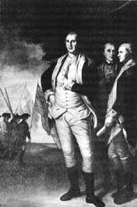

*图：华盛顿肖像，NPS手册据安纳波利斯州议会大厦所藏皮尔绘画翻印。 [图像来源](https://npshistory.com/handbooks/historical/14/images/hh14b5.jpg)。*

1781年夏天，我指挥的大陆军与罗尚博率领的法国陆军在纽约以北会合。英国仍控制纽约，亨利·克林顿在那里维持着陆军、港口和海上运输之间的联系。我们若能攻下这座基地，便能取得重大战果；即使只迫使克林顿召回南方部队，也能减轻南方战场的压力。五月制定计划时，这两种效果都在考虑之中。我的准备包括调集步兵、火炮、舟艇和物资，安排美法军队协同接近英军阵地。纽约是一个真正研究过、为之组织过行动的目标。〔资料：[美国陆军战争学院历史科《约克镇围城，1781》，第十四章，所引1781年5月22日日记及5月27日致国会信。](https://webdoc.sub.gwdg.de/ebook/p/2005/CMH_2/www.army.mil/cmh-pg/books/revwar/Yorktown/AWC-Ytn-14.htm)〕

这个目标有几个必须同时满足的条件。首先，州政府需要补足大陆军的兵额，并在必要时召集民兵。其次，法国舰队要在海面上取得优势，且能够协助封锁或进入港湾。最后，重炮和补给必须跟上步兵。若英国舰船能够不断输送兵员和物资，我在陆地上集中的兵力便只能压迫港口的一面。围城所消耗的粮食与弹药会持续增加，敌军却可能从水路得到我们无法阻止的补充。

我向炮兵指挥官亨利·诺克斯提出的准备要求，也给改变目标留下了余地。为纽约筹集的攻城器材，将来可以用于规模较小的行动。这个安排很重要：计划的目标可以改变，火炮、炮弹、马匹、舟艇和训练却需要提前准备。等到某个机会已经完全显露，再从头征集它们，机会很可能早已过去。纽约攻势的筹备，因此也逐渐形成了一套能够转用的攻城资源。〔资料：[同书第十四章所引1781年2月10日致诺克斯信。](https://webdoc.sub.gwdg.de/ebook/p/2005/CMH_2/www.army.mil/cmh-pg/books/revwar/Yorktown/AWC-Ytn-14.htm)〕

七月，我们继续侦察纽约以北的英军据点。侦察要确认道路、营地、工事和可能的登陆位置，也要看英军是否因向南方分兵而露出破绽。与此同时，拉法耶特从弗吉尼亚送来消息。我在七月十三日要求建立从弗吉尼亚到费城的接力通信，使南方部队能够与北方总部更稳定地交换情报。军队在地图上相隔很远，传递命令仍要靠骑马的信使和沿途驿站；一次行动是否能够协调起来，首先取决于消息能否及时送达。

到七月下旬，纽约方向的兵力条件仍未落实。州政府实际交到军中的士兵，距离征集目标很远。我不能把纸上的征兵数字当作已经站在营地中的营，也不能把未来可能抵达的法国舰队当作当天能够调动的力量。七月二十日的日记保留了这种不确定性：先为纽约作准备，同时保留向南方行动的方案，等法国海军到来时再根据兵力和条件作决定。〔资料：[同书第十四章所引7月13日致拉法耶特信、7月20日日记。](https://webdoc.sub.gwdg.de/ebook/p/2005/CMH_2/www.army.mil/cmh-pg/books/revwar/Yorktown/AWC-Ytn-14.htm)〕

八月初，我开始调查能够取得多少运输船。调查分向不同方面进行：向商人询问船只的数量和筹集所需时间，也向负责财政的罗伯特·莫里斯了解费城及切萨皮克湾的运力。我还安排将部分储粮放在可以经水路装运的地点。这些措施并没有立刻使军队南下，却使下一步选择不至于被运输条件完全封死。只要火炮仍散在无法运走的地方，任何新计划都只是一道无法执行的命令。

八月十四日，德巴拉转来的消息改变了局面。德格拉斯将率法国舰队驶向切萨皮克湾，并带来陆军。舰队在北美海岸能够停留的时间有限，法国海军军官对强行进入纽约港也有顾虑。结合大陆军补充不足的实际情况，我决定放弃进攻纽约，将罗尚博的军队与一部分大陆军调往埃尔克河上游，再设法运到弗吉尼亚，与从西印度群岛前来的部队协同。〔资料：[同书第十四章所引8月1日及8月14日日记。](https://webdoc.sub.gwdg.de/ebook/p/2005/CMH_2/www.army.mil/cmh-pg/books/revwar/Yorktown/AWC-Ytn-14.htm)〕

这项决定把进攻目标从固定的城市换成了一支可以被截断退路的敌军。康沃利斯正在弗吉尼亚；法国舰队若能控制海湾，我们便有机会把他同纽约之间的海路切断。机会的有效期由海军部署决定。陆军要在期限内赶到，集中火炮，展开包围，并迫使守军屈服。每一个步骤都需要时间，而其中任何一环延误，都会缩短真正能够实施围攻的天数。

北方防务仍要有人负责。我把留下的部队交给威廉·希思，要求以西点及哈得孙河高地诸据点的安全为首要任务。南下部队只是大陆军的一部分。留下的部队不能凭空消失在战役叙述中，因为克林顿仍在纽约，仍能采取行动。如果为了弗吉尼亚的机会而丢掉北方重要据点，整个战局的得失就要重新计算。我的行动因此同时包含进攻与留守两份安排。〔资料：[同书第十四章，8月14日决定后的调兵与留守安排。](https://webdoc.sub.gwdg.de/ebook/p/2005/CMH_2/www.army.mil/cmh-pg/books/revwar/Yorktown/AWC-Ytn-14.htm)〕

## 二、把军队送到弗吉尼亚，比在地图上画箭头困难

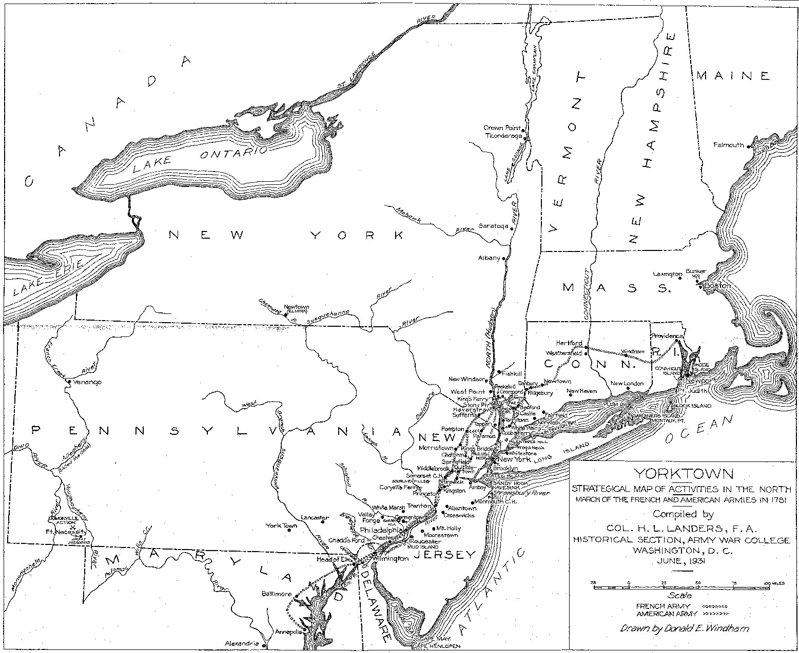

*图：美法军队在北方的集中与南下路线。H. L. Landers编、Donald E. Windham绘，1931年官方军史地图；原图带英里比例尺，路线范围止于切萨皮克湾上游。 [图像来源](https://webdoc.sub.gwdg.de/ebook/p/2005/CMH_2/www.army.mil/cmh-pg/books/revwar/Yorktown/map3.jpg)。*

南下需要渡过哈得孙河，再穿越新泽西。美军和法军按不同路线与次序运动，炮车、辎重和部队都要经过渡场。罗尚博部从八月十九日起离开原驻地，随后在国王渡口一带渡河。渡河行动持续数日。这里的关键不只是先头部队走了多远，而是最后一辆装着军需的车辆什么时候能够跟上。没有辎重的长途行军很快会耗尽随身物资，没有火炮的先头部队也不能完成接下来的围城。

我安排哈曾部与新泽西部队在查塔姆、斯普林菲尔德一带活动，以掩护设置在那里的法国军用面包房，并使英军仍需顾虑斯塔滕岛方向。另有平底船装在车辆上随军运输。这些船既能让英军难以判断我们的实际目标，又能够在弗吉尼亚派上用场。对克林顿的欺骗建立在真正的行军与器材调动上；它需要争取的，是英军识别方向并作出反应之前的那一段时间。〔资料：[同书第十四章，8月19—30日行军及日记摘引。](https://webdoc.sub.gwdg.de/ebook/p/2005/CMH_2/www.army.mil/cmh-pg/books/revwar/Yorktown/AWC-Ytn-14.htm)〕

经过新泽西以后，继续隐藏方向已越来越困难。部队向特伦顿集中，南下的意图会随行军路线逐渐显露。行动的重点也随之改变：在最初阶段，需要让对手不确定我们要去哪里；在后来阶段，需要使对手即使明白，也来不及赶上。掩护并不能代替速度，速度也不能代替运输。若沿路的桥梁、粮秣和船只没有准备，任何保密措施都无法把停在路上的军队送到海湾。

八月三十一日，我先到费城，催促征集船只。原来的设想，是让部队在特伦顿登船，沿特拉华河下降。实际能够征集的船不够同时装载士兵和物资。我与罗尚博商议后，决定让部队继续走陆路到埃尔克河上游，再从那里设法渡运。这个调整增加了士兵的步行路程，却使有限的船能够优先运输难以陆运的负载。我们必须依据到手的运力重新编排行程。〔资料：[同书第十四章末段。](https://webdoc.sub.gwdg.de/ebook/p/2005/CMH_2/www.army.mil/cmh-pg/books/revwar/Yorktown/AWC-Ytn-14.htm)〕

离开费城后，我在切斯特收到德格拉斯已抵达切萨皮克湾的消息。当时送到我这里的报告，包括他的舰队规模和随舰陆军，以及将部队送上岸与拉法耶特会合的安排。这是对行动前提的一次重要确认：海军援助已经到达我们选定的地区。可是，海湾中的舰队仍可能遇到英国舰队，控制海面的状态也可能改变。陆军运输不能仅凭一次到达报告就认为整条航线从此安全。

九月八日，我离开埃尔克河上游，先行前往弗吉尼亚。途中收到法国舰队驶出海湾的消息后，我曾下令已上船的部队暂停向下游航行，等待进一步确认海上情况。对在北方行军的人而言，海战是一封报告；对载满步兵的运输船而言，海战的结果会决定他们能否进入目的地。指挥部必须把无法亲见的海上变化，及时转化成对运输队的具体命令。〔资料：[同书第十六章开头。](https://webdoc.sub.gwdg.de/ebook/p/2005/CMH_2/www.army.mil/cmh-pg/books/revwar/Yorktown/AWC-Ytn-16.htm)〕

九月十四日，我到达威廉斯堡，与拉法耶特会合。获悉法国舰队重新控制海湾后，我派费尔森向北催促林肯尽快带部队前来。此时，拉法耶特的部队已与圣西蒙率领的法军会合。威廉斯堡西侧的集结地有池塘、溪流、湿地与城镇建筑可供依托，使已到部队能够保持阵地，等待其余部队抵达。先遣军必须稳住康沃利斯通向内陆的方向，才能让正在路上的主力拥有一个可以安全加入的战场。

运输问题仍在继续。九月十五日，我请求德格拉斯派船到海湾上游接运部队。法国海军已经着手安排：德巴拉带来的运输船以及取得的其他船只被送往巴尔的摩方向，部分舰员为运输任务让出位置。这里的协同很具体。舰队不仅阻挡敌军，也把自己的运力投入陆军集中；陆军不能只向海军要求在海湾口打胜仗，还需要它运人、运炮并保护补给航线。〔资料：[同书第十六章，9月14—17日行动。](https://webdoc.sub.gwdg.de/ebook/p/2005/CMH_2/www.army.mil/cmh-pg/books/revwar/Yorktown/AWC-Ytn-16.htm)〕

九月十七日，我与罗尚博、沙斯特吕、诺克斯和迪波尔泰登上法国旗舰巴黎城号，同德格拉斯商谈围城。我们要确定舰队能够停留多久，是否能派船驶过约克镇与格洛斯特之间的水道，以及需要时能否再提供登陆兵力。我向他提交的问题把两个节奏放在一起：按正规程序围攻，需要时间；若因舰队即将离开而仓促强攻，伤亡和不确定性都会增大。〔资料：[同书第十六章转录9月17日协同问题。](https://webdoc.sub.gwdg.de/ebook/p/2005/CMH_2/www.army.mil/cmh-pg/books/revwar/Yorktown/AWC-Ytn-16.htm)〕

德格拉斯同意将停留期限从原定的十月中旬延长到月底。这使我们能够按围城程序行动，但并没有获得无限时间。他是否能把战舰开到英军据点上游，还需侦察河道后判断。海军能够提供的兵力，也附带用途限制。作为陆军指挥官，我必须把这些边界计入计划：盟军的支持是商定的协同关系，舰队需要同时考虑水深、锚地、敌舰威胁和自身补给。

返回威廉斯堡的航程又受到逆风影响，我们直到九月二十二日才回到营地。这几天里，更多部队已经抵达。风向可以使一艘载着指挥官的船不能按预定时间靠岸，也可以使成队运输船延误；它是会影响行动日程的实际条件。此前我要求各部加速，到了海上，能够执行的速度仍要由船只和风共同决定。〔资料：[同书第十六章，9月18—22日。](https://webdoc.sub.gwdg.de/ebook/p/2005/CMH_2/www.army.mil/cmh-pg/books/revwar/Yorktown/AWC-Ytn-16.htm)〕

集结即将完成时，又出现一项必须处理的变化。德格拉斯获悉英国海军获得增援，九月二十三日来信提出将主力舰队驶向外海，留下部分舰艇封锁河口。他担心舰队困在不利的位置，无法迎战救援舰队。我在二十五日答信，请他重新考虑：围城、补给运输和重炮卸载都依赖舰队继续保障海湾；陆军已为此付出巨大准备和行军成本。〔资料：[同书第十六章转录9月23日德格拉斯信、9月25日华盛顿信。](https://webdoc.sub.gwdg.de/ebook/p/2005/CMH_2/www.army.mil/cmh-pg/books/revwar/Yorktown/AWC-Ytn-16.htm)〕

法军海军将领商议后继续支持围城，并试验了约克河口锚地。实际水域条件不如海图所显示的理想，舰队又返回亨利角以内的锚地，在那里补充淡水与木材，并保留选择锚泊作战或出航迎敌的余地。对陆军而言，关键在于海军仍承担阻断救援、保障运输的任务。九月二十七日，主要部队已在威廉斯堡附近集结，我发布向约克镇推进的部署。一次跨越北方与南方、连接陆军和海军的集中，终于进入可以实施包围的阶段。

## 三、九月二十八日：把部队展开在城外

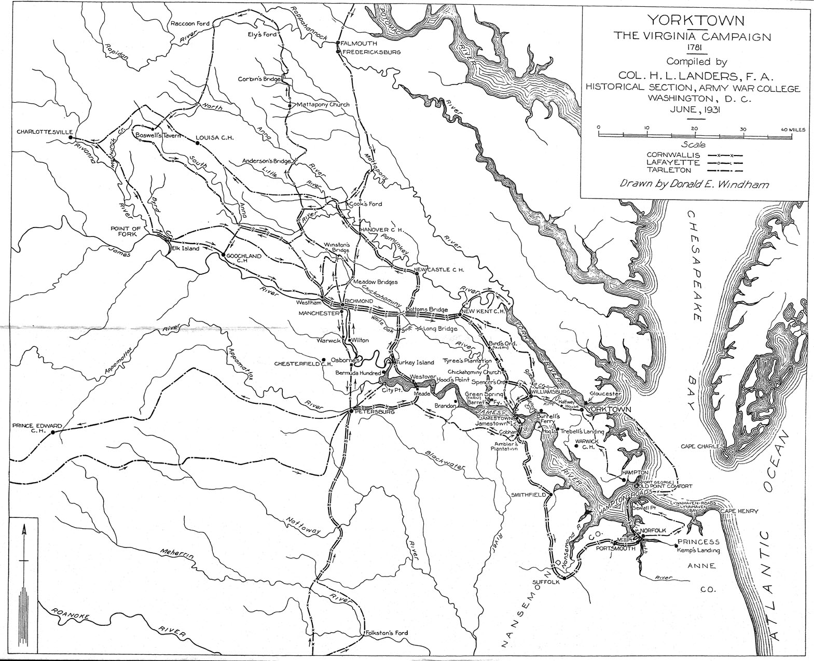

*图：弗吉尼亚战役地理与部队路线。1931年军史地图，带英里比例尺；约克镇、格洛斯特、威廉斯堡及半岛两侧河流位于右下方。路线包含围城前行动。 [图像来源](https://webdoc.sub.gwdg.de/ebook/p/2005/CMH_2/www.army.mil/cmh-pg/books/revwar/Yorktown/map2.jpg)。*

九月二十七日的命令规定，美军组成联军右翼，法军组成左翼。林肯作为资深大陆军将领负责美军右翼的总体安排；拉法耶特指挥穆伦贝格、哈曾两旅，施托伊本指挥韦恩与吉斯特所属部队，林肯另直接统辖戴顿和克林顿的两个旅。斯蒂文斯与劳森的民兵旅配置在第二线。炮兵、工兵和弗吉尼亚州军团安排在两线之间。罗尚博负责法国军队的具体部署。〔资料：[美国陆军战争学院历史科《约克镇围城，1781》，第十六章转录9月27日战斗序列。](https://webdoc.sub.gwdg.de/ebook/p/2005/CMH_2/www.army.mil/cmh-pg/books/revwar/Yorktown/AWC-Ytn-16.htm)〕

这些安排使不同性质的部队各有位置。轻步兵和有经验的大陆军将承担前沿任务，民兵在后方构成支持力量，炮兵与工兵则需要得到保护并保持通路。美法两军仍有各自的军官体系、编制与勤务制度，联军指挥要确定共同目标和相接位置，同时让各军在熟悉的组织内执行。若一开始就把部队混在一起，语言和指挥程序的差异会使调动更加困难。

二十八日清晨五时，部队从威廉斯堡向约克镇出发。大陆军与法军组成左侧纵队，民兵走右侧道路。接近战场后，美军从通往约克镇的主路转向右方，朝芒福德桥方向展开；法军继续沿主路前进。民兵经另一条道路接到美军之后。利用分路行军，可以减少一条道路上的拥挤，但各纵队必须在预定地区重新衔接，才能形成围城所需的连续阵线。

中午前后，先头部队接触英军警戒部队，并将其推向主阵地。到傍晚，各部逐渐到达分配的位置。此时的首要任务，是在敌前建立稳定的部署，确认彼此之间没有容易被利用的缺口。进军与列阵相连，能够看到英军工事并不意味着所有部队已经准备好攻城。士兵必须从道路上的纵队变成面向敌人的阵线，指挥官还要找到炮兵位置、通信路线与营地。〔资料：[同书第十六章，9月28日行动。](https://webdoc.sub.gwdg.de/ebook/p/2005/CMH_2/www.army.mil/cmh-pg/books/revwar/Yorktown/AWC-Ytn-16.htm)〕

约克镇位于约克河南岸，对岸是格洛斯特角。英军控制两岸据点，彼此之间可以用船联系。城镇南面是陆上接近方向，地面被沟谷、溪流与湿地切割。一些沟谷妨碍直线推进，另一些又能遮蔽部队，使接近者避开城内直接射击。工程军官要判断每一段地形究竟帮助哪一方，不能只在地图上把河流看成天然屏障，把平地看成进攻通道。

英军右侧的沟谷与湿地较深，前方还有一座突出的小堡，后来通常称为燧发枪兵堡或星形堡。那里的工事控制西侧接近道路，并受到附近河上武装舰船的支持。英军左侧则朝向我们的右翼，地形中存在可以利用的接近路线。我们的主要围攻工程将向这一面展开，法军左翼同时牵制另一侧，使康沃利斯不能把全部注意力和火力都集中到同一处。

在进攻者与城镇之间，英军已修筑外线工事，主路附近有小堡，倒下的树木构成鹿砦。鹿砦是把树干与枝杈交错放置、朝外伸出尖枝的障碍物，能拖慢步兵并使其在火力下聚集。它对攻方的妨碍取决于位置、完整程度以及守军能否持续射击。一个胸墙并不很厚的小堡，如果前面的障碍物保存良好，仍可能使仓促冲锋付出很大代价。〔资料：[同书第十六、十七章地形与工事描述。](https://webdoc.sub.gwdg.de/ebook/p/2005/CMH_2/www.army.mil/cmh-pg/books/revwar/Yorktown/AWC-Ytn-16.htm)〕

二十九日，美军进一步向右移动，在比弗坝溪东侧建立营地。英军有零星炮击和前哨射击，双方继续观察对方部署。我的部队还需要弄清外线防御的范围以及向城镇接近的路线。当天的行动以调整围城位置为主，重炮和完整攻城工程尚未投入，联军还没有进入以连续炮击摧毁工事的阶段。

三十日清晨，我们发现英军放弃了大片外线阵地，退入更靠近城镇的工事。联军随即占领这些地点。这一变化缩短了我们接近城镇时必须争夺的距离，也给后续工事提供了起点。我们能够利用被放弃的小堡及附近地形，而不用先在守军火力下逐个攻取它们。至于康沃利斯为什么在这一夜收缩，以及他同纽约之间交换了什么消息，当时并不属于我可以完整掌握的情况。〔资料：[同书第十六章末与第十七章首。](https://webdoc.sub.gwdg.de/ebook/p/2005/CMH_2/www.army.mil/cmh-pg/books/revwar/Yorktown/AWC-Ytn-16.htm)〕

占领旧工事以后，工程军官仍需改造它们。原来朝向城外的防御设施，若要变成进攻军的支撑点，就必须调整面向与用途。十月一日，美军在主路南侧修建一座新堡，并改造汉普顿道路上的工事。这些工程与占领的小堡相连，在两侧沟谷之间形成了保护集结地域的支点。攻城首先需要为攻方建立安全工作区，才能继续向守方推进。

法军也侦察了英军西侧小堡。圣西蒙所属部队的一支分队与守军前哨接触，在遭遇较强抵抗后撤回。这个行动提供了关于守军仍然控制哪些地点的实际信息。英军放弃外线，未使城镇四周的所有据点都空出来。继续侦察，能够防止我们把一处撤退误认为全线溃散，也能使下一阶段工程选线建立在实际接触之上。〔资料：[同书第十七章，9月30日至10月2日。](https://webdoc.sub.gwdg.de/ebook/p/2005/CMH_2/www.army.mil/cmh-pg/books/revwar/Yorktown/AWC-Ytn-17.htm)〕

## 四、开壕以前，先把炮和材料运到阵前

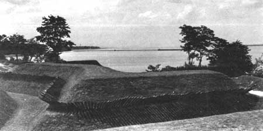

*图：燧发枪兵堡遗址景观，NPS历史手册照片。照片表现后世保存、整理的地形与工事。 [图像来源](https://npshistory.com/handbooks/historical/14/images/hh14b6.jpg)。*

十月初，部队大部分时间用于准备攻城工程。我们需要柴捆、装土筐、工具和运送它们的车辆。柴捆可以固定土体、帮助构筑工事；编织的大筐装满泥土以后，可以迅速形成炮位或壕沟的掩护。对在城内等待援助的守军来说，围攻在这几天似乎还没有全面展开；对阵外士兵来说，战斗准备已经是一项持续的体力任务。材料必须先制成，再被搬到需要使用的位置。

重炮和物资从詹姆斯河上的特雷贝尔登陆点向前运送。这里与面对约克河的英军阵地分属半岛两侧，海运把沉重器材送到相对安全的后方，陆运再完成最后一段。水路运输节省了很长距离的拖曳，却没有消除上岸以后的负担。必须有车、挽畜和可通行的道路，才能把炮管、炮架和弹药送到阵前。步兵早到几天，并不能让尚在登陆点的大炮立即开火。

我在十月六日致国会的报告中说明，两军正在制作攻城材料、运输大炮、臼炮和补给。车辆和挽畜从埃尔克河上游到来以后，这项工作才得到改善。工程军官认为所备材料已经足够开始作业，因此决定在当晚开壕。报告中的先后次序很清楚：先确认运输与储备，再确定夜间动工。军队要把紧迫的战役时间转化成能够执行的工程安排。〔资料：[同书第十七章所引10月6日致国会信。](https://webdoc.sub.gwdg.de/ebook/p/2005/CMH_2/www.army.mil/cmh-pg/books/revwar/Yorktown/AWC-Ytn-17.htm)〕

所谓平行壕，是大致沿守军正面展开、供围攻部队集结与展开火力的壕线。它不是一条笔直的线，选址必须配合起伏、沟谷与炮位。第一道平行壕应在能够支援后续接近、又不至于使劳役队承受过强近距离火力的位置形成。等到第一线的火炮压住守军，再修筑第二道更靠近城镇的壕线，把火炮和步兵送到更有利的位置。工程和火力由此逐次向前推进。

我们的第一道平行壕从靠近约克河的高地向西展开，穿过沃姆利溪上游的沟谷地区，跨过汉普顿道路，接向另一侧的低地。各处与守军的距离并不相等。美方叙述通常以约八百码概括这道线的位置。这样的距离不能代替具体地形判断：某一处能够利用沟谷遮蔽，另一处则必须在较开阔地面修筑，作业难度和暴露程度都不同。〔资料：[同书第十七章对第一平行壕路线的描述。](https://webdoc.sub.gwdg.de/ebook/p/2005/CMH_2/www.army.mil/cmh-pg/books/revwar/Yorktown/AWC-Ytn-17.htm)〕

开壕时，需要把劳动与掩护分开安排。十月六日晚，约一千五百人承担挖掘任务，另有约二千八百人负责警戒与保护。这些数字是当晚勤务的分配，体现了动工本身需要军事保护。拿着铁锹挖土的人不能同时保持完整战斗队形；若英军突然出击，必须有已经准备好的部队接战，让施工队避免在毫无组织的情况下从劳动转入战斗。

我发布的围城勤务规定，要求各师轮流执行任务，劳役人员先从当值部队中抽出，其余人员组成保护壕沟的部队。负责壕线的将军应先侦察道路、集结位置与有利角度，确定遇到攻击时如何部署。轮换通常每二十四小时进行一次。标准化的安排使后续各天不必重新发明整套勤务制度，也使每支部队知道自己何时上前、何时接替、由谁负责。〔资料：[同书第十七章转录10月6日勤务命令第1、4、5、17项。](https://webdoc.sub.gwdg.de/ebook/p/2005/CMH_2/www.army.mil/cmh-pg/books/revwar/Yorktown/AWC-Ytn-17.htm)〕

前线纪律同样针对实际危险制定。哨兵需要观察守军是否出动，并对飞来的爆炸弹给出警报。军官巡视壕沟时，士兵不举行通常的礼仪，而保持战斗准备。围城不意味着敌我隔着工事便各自安全，炮火、出击、误报与换班混乱都可能造成伤亡。指挥制度的作用，是在连续多日的相似任务中，减少那些会重复发生的疏漏。

六日傍晚，部队开始前进。林肯等将领率领美军分队执行作业与掩护，法军也派出所属团的人员进入规定地段。法军左侧另外修筑炮位，对付英军西侧的突出据点。主攻方向与牵制方向同时准备，使守军必须在整个正面维持观察和防御。对工兵而言，能够让守军无法集中火力，本身就是保护劳役队的一种方式。〔资料：[同书第十七章，10月6日晚部署。](https://webdoc.sub.gwdg.de/ebook/p/2005/CMH_2/www.army.mil/cmh-pg/books/revwar/Yorktown/AWC-Ytn-17.htm)〕

到七日天明，第一壕线已经形成。我在日记中判断，主要工程的施工隐蔽而迅速，守军大概直到天亮才充分发现。这个判断属于当时我对执行结果的认识；法军左侧已有伤亡，整个夜晚也不是所有地段都未被发现。第一夜最重要的成果，是大批士兵已经获得可供继续加深、加固的掩护位置。白天到来以后，他们无需重新从完全暴露的地面开始工作。〔资料：[同书第十七章所引10月6—7日日记。](https://webdoc.sub.gwdg.de/ebook/p/2005/CMH_2/www.army.mil/cmh-pg/books/revwar/Yorktown/AWC-Ytn-17.htm)〕

## 五、十月七日至十一日：把第一道壕线变成火力阵地

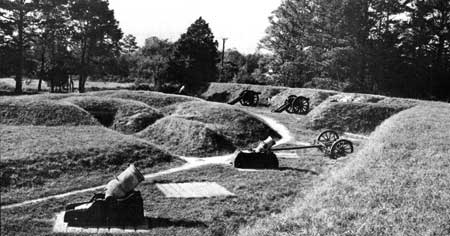

*图：重建后的法国大炮台，NPS历史手册照片，可见炮位与土工掩护的关系。 [图像来源](https://npshistory.com/handbooks/historical/14/images/hh14a1.jpg)。*

七日中午，拉法耶特所属部队接替壕线勤务；法军也在相应地段换班。美军当值部队须在规定时间列队，经能够提供掩护的沟谷前往前沿。这种路线安排把地形优势落实到每天的具体行动中。一个安全的壕沟若只能从无遮蔽的平地进入，换班时仍会造成损失；保护前沿与保护通向前沿的道路，需要一起考虑。

八日由施托伊本所属部队接替，九日又轮到林肯所属部队。不同将领轮值，不代表围城方案每天更换。持续的工程目标与固定勤务程序，使各部可以在统一计划下接续完成任务。劳役、警戒、炮兵布置和补给运输交错进行，前一天修成的壕段成为后一天作业的依托。工事逐渐改善，进入壕线的部队也获得更可靠的掩护。〔资料：[同书第十七章，10月7—9日轮换记录。](https://webdoc.sub.gwdg.de/ebook/p/2005/CMH_2/www.army.mil/cmh-pg/books/revwar/Yorktown/AWC-Ytn-17.htm)〕

炮兵进入阵地后，需要形成能够持续射击的体系。炮位必须承受火炮发射时的后坐，弹药要送到附近，炮手要在胸墙后装填与操作。臼炮和榴弹炮则以不同弹道攻击掩体与城内空间。炮兵数目只是战斗能力的一部分；如果缺少炮架、弹药、运输或熟练操作人员，再多炮管也不能转化成连续压力。诺克斯与法军炮兵军官的任务，是把这些环节连接起来。

九日下午三时左右，法国左侧炮位开始射击；约五时，美军右翼炮位也开火。当天的日记记下了两处炮位的开火时间与效果：对面持续射击的英军火炮被迫从射口退下。炮击首先要削弱守军阻挠工程的能力。只要守军能够稳定地从炮眼射击，后续挖掘就会更加危险；当他们必须把炮退到胸墙后，攻方就获得进一步接近的条件。〔资料：[同书第十七章所引10月9日日记。](https://webdoc.sub.gwdg.de/ebook/p/2005/CMH_2/www.army.mil/cmh-pg/books/revwar/Yorktown/AWC-Ytn-17.htm)〕

法军左侧火力还对付英军突出的小堡及附近舰船。小堡继续抵抗，守军仍能在某些地段使用火炮，但河上的舰船受到陆上炮位威胁。原来可以帮助掩护英军侧翼的水面位置，逐渐变成必须躲避炮击的区域。沿河港口的军队依赖水运，也会因河面上缺乏掩蔽而受到远程火力限制。船只被迫移动以后，对岸与本岸之间可安全使用的空间也会缩小。

十日又有新的炮位投入。法国主炮位分成几个部分，部署在汉普顿道路两侧；其他臼炮炮位与美军炮位也加入射击。不同方向和不同弹道使守军难以只用一道胸墙保护全部人员和器材。正面直接火力压制炮眼，曲射的爆炸弹威胁胸墙后方，城内建筑与存放物资的地方也受到影响。第一平行壕由施工位置转成了能够维持围城进展的火力基础。〔资料：[同书第十七章，10月10日炮位配置。](https://webdoc.sub.gwdg.de/ebook/p/2005/CMH_2/www.army.mil/cmh-pg/books/revwar/Yorktown/AWC-Ytn-17.htm)〕

我能够观察到英军火力明显减弱，却不能据此认定城内每门炮都已被摧毁。把炮从射口撤下，也可能是守军为了减少损失而采取的临时措施。攻击者需要分辨压制效果与永久毁伤，因为工程继续向前时，原本沉默的炮仍可能重新开火。围城中对于敌情的判断，必须不断用后续行动检验。

随着炮击增强，进入第二道平行壕阶段的条件逐渐成熟。它的位置大约在第一道壕线与英军主要防御之间，距离守军约四百码。靠近以后，火炮射击更有效，步兵将来发动攻击所需穿越的距离也会缩短；与此同时，劳役队更容易受到守军火枪、炮弹和突然出击的威胁。推进的收益与风险一起增加，必须配备足够的掩护力量。〔资料：[同书第十七章，10月11日决定。](https://webdoc.sub.gwdg.de/ebook/p/2005/CMH_2/www.army.mil/cmh-pg/books/revwar/Yorktown/AWC-Ytn-17.htm)〕

## 六、第二道平行壕被两座小堡挡住

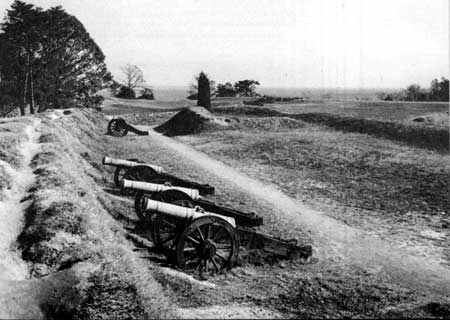

*图：美军第二炮台展示区，NPS历史手册照片，用于说明土垒、壕沟和炮位空间。 [图像来源](https://npshistory.com/handbooks/historical/14/images/hh14b7.jpg)。*

十一日至十二日夜间，第二道平行壕开始施工。施托伊本负责美军壕线勤务，韦恩、吉斯特部队承担美军一侧工作；法军在另一侧组织施工与支持部队。各部同时向前，能够让守军难以只针对某一处开工点集中反击，但两军交界位置也要保持清楚。一道壕线可以由多个单位分段完成，受到袭击时却必须有人迅速协调左右两边。

新壕线位于更靠近英军的位置，作业需要更直接的火力掩护。原来在第一线开火的炮兵，要从正在施工的友军上方或侧方射击。法军炮火曾因危及前方劳役队而暂停，但守军随即利用这个间隙加强射击，法军又恢复炮击。这个过程揭示了围城技术的实际困难：己方火炮越接近能够压制敌人的位置，也越需要准确掌握友军在哪里。〔资料：[同书第十七章，第二平行壕施工记录。](https://webdoc.sub.gwdg.de/ebook/p/2005/CMH_2/www.army.mil/cmh-pg/books/revwar/Yorktown/AWC-Ytn-17.htm)〕

这里没有一项不带代价的简单选择。停火能减少友军被误伤的危险，却会给守军更多射击机会；继续开火能够压住对方，却必须调整火力关系。工程军官与炮兵需要随进展重新确定位置，步兵则要维持秩序并保护施工人员。两道壕线之间的关系不只是前后距离，也是同时在场的工兵、步兵和炮兵之间的协同关系。

我在十二日向国会报告第二壕线的进展，并估计当夜施工损失很小。同时，我对康沃利斯是否会展开有力反击保持警惕。英军还没有失去全部主动行动能力，新工事的存在会迫使他们面对更大的危险，也可能促使他们集中兵力出击。因而，工程取得进展以后，保护施工的任务并未减轻。〔资料：[同书第十七章所引10月12日致国会信。](https://webdoc.sub.gwdg.de/ebook/p/2005/CMH_2/www.army.mil/cmh-pg/books/revwar/Yorktown/AWC-Ytn-17.htm)〕

第二壕线在左侧可以继续修筑，在右侧却受到两座英军前出小堡的阻碍，即后来惯称的九号堡和十号堡。它们位于英军左翼前方，其中十号堡更靠近约克河岸。守军在这里保持据点，就能威胁我们把壕线继续延伸到河边。工程部队无法把敌人仍在占据的堡垒当作不存在，继续向前施工；它们的火力与位置必须先被处理。

前出小堡的用途，是迫使攻方停下来组织额外行动。堡内驻军规模有限，却能够利用障碍物、壕沟和胸墙，把自己的射击范围变成攻方不能安全施工的空间。对联军而言，攻取这两座堡的价值不仅是俘虏守军或夺得火炮，更在于解除它们对整条壕线的限制。一个局部目标可以由此影响后续大批部队的部署。

十二日至十四日，部队继续加强已完成的第二壕线和炮位。前沿越靠近英军，炮击造成的损失仍在发生。换班、运送材料和补给都必须继续，没有哪个阶段能够简单地说成“等到攻击”。准备本身就在敌人火力范围内进行，而攻击能否成功，也取决于准备是否把部队、路线、火力和接替人员安排妥当。〔资料：[同书第十七章末。](https://webdoc.sub.gwdg.de/ebook/p/2005/CMH_2/www.army.mil/cmh-pg/books/revwar/Yorktown/AWC-Ytn-17.htm)〕

十四日，联军炮兵对英军前沿工事和障碍物继续射击，左右两端均受到压力。当晚，法军在西侧突出据点附近实施牵制行动，主攻部队则准备进攻东侧的九号、十号堡。两处行动使英军需要同时判断不同方向的威胁。真正的突破点在东侧，牵制则尽可能使守军不能从其他地段从容抽调力量来援。

## 七、十月十四日夜：夺堡以后，立即把壕线接上

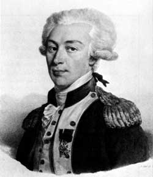

*图：拉法耶特肖像，NPS历史手册图版；他指挥美军轻步兵师并安排十号堡攻击。 [图像来源](https://npshistory.com/handbooks/historical/14/images/hh14a3.jpg)。*

我与罗尚博确定，由拉法耶特所属美军攻击靠河的十号堡，法军攻击较内侧的九号堡。任务分给两支部队，目标却属于同一项工程计划：攻取以后，将两堡纳入第二平行壕，使壕线延伸到河岸。攻击人员与随后进入的工兵、劳役队因此需要先后衔接。若夺得堡垒后停在那里等待下一道安排，守军仍可能用炮火或反击把新占位置变成负担。

拉法耶特将美军突击任务交给亚历山大·汉密尔顿统一指挥。吉马的营在主要突击纵队前方，菲什率领另一营接续；劳伦斯率约八十人迂回，任务是封住守军退路。主纵队前面还有先遣人员及工兵。这种分工使突击不只包含正面越过障碍，也包含阻止堡内守军逃出、让攻击结果能够被巩固的行动。〔资料：[美国陆军战争学院历史科《约克镇围城，1781》，第十八章，所引汉密尔顿攻击报告。](https://webdoc.sub.gwdg.de/ebook/p/2005/CMH_2/www.army.mil/cmh-pg/books/revwar/Yorktown/AWC-Ytn-18.htm)〕

美军奉命不装填枪弹，以刺刀突击。这个命令把行动重点放在迅速通过危险地带并进入堡内。夜间若在障碍物前停下射击，部队容易拥挤，攻击节奏也可能中断。命令能否执行，还取决于队形和军官控制：前方部队遇到阻碍时，后方必须继续前进却不能把整列挤成无法行动的人群。刺刀突击因此需要组织，不能用“勇敢”一词代替过程。

法军由维奥梅尼尔统辖攻击安排，实际突击部队由德庞率领，抽自加蒂奈团与皇家双桥团的掷弹兵、猎兵。约四百名主攻人员按任务编成纵队。前部有人携带柴捆，有人携带梯子，后面还有支援与预备队。进攻前，军官侦察行进路线并安排细节。法军接到的射击限制，是到达胸墙顶部以前不要开火。〔资料：[同书第十八章，德庞行动记录。](https://webdoc.sub.gwdg.de/ebook/p/2005/CMH_2/www.army.mil/cmh-pg/books/revwar/Yorktown/AWC-Ytn-18.htm)〕

双方的装备与队形都针对堡垒的具体障碍作准备。柴捆可以帮助通过壕沟，梯子可以帮助登上高处，工兵需要处理鹿砦与尖桩。守军的作用则是利用这些障碍使攻方减速，再以火力造成损失。攻击是否顺利，要看障碍物破坏程度、守军数量与反应、接近路线和突击人员组织等多项条件。两堡虽在附近，也不是完全相同的目标。

发出攻击信号后，两支部队向各自目标推进。按照汉密尔顿后来提交的报告，美军主攻部队到达鹿砦时，没有等待工兵把全部通道清理完毕便越过障碍，继续冲向堡内。菲什的部队按预定安排向左展开，参与攻击。劳伦斯分队同时执行封堵退路的任务。十号堡的抵抗很快被压倒，幸存守军投降。〔资料：[同书第十八章转引汉密尔顿报告。](https://webdoc.sub.gwdg.de/ebook/p/2005/CMH_2/www.army.mil/cmh-pg/books/revwar/Yorktown/AWC-Ytn-18.htm)〕

九号堡的法军在鹿砦前需要切开通路，之后进入壕沟，越过尖桩，登上胸墙。德庞的记录描述了最后近距离抵抗与守军放下武器的过程。作为联军统帅，我接到的是下级执行任务的结果与报告；堡前每一段具体动作，是通过这些报告才能进入我的叙述。美法两军夺取了指定目标，第二壕线右侧的阻碍由此被移除。

攻击造成了真实损失。现有报告对美军损失记录较集中，对法军数字的表述则有不同口径。我首先需要确认堡垒已经被占领、各支部队能否继续守住、劳役队能否进入作业。夜间夺堡的战术成功，还需要变成天亮后可以持续使用的阵地。

两堡被迅速接入新的壕线。到十五日天明，第二平行壕已延伸到河边，并有交通壕与第一线联系。交通壕使人员与物资能够在两线之间移动，减少暴露；被夺取的小堡成为联军工程的一部分，原来用于阻止我们接近的设施，现在帮助我们把火力送向城镇。战果从两个孤立据点扩大为整条攻击线的改善。〔资料：[同书第十八章末。](https://webdoc.sub.gwdg.de/ebook/p/2005/CMH_2/www.army.mil/cmh-pg/books/revwar/Yorktown/AWC-Ytn-18.htm)〕

我需要继续推进炮兵阵地，而不只是保有步兵占据的堡。十五日，美军在夺得的两堡各安置榴弹炮，并在下午开始射击；两堡之间还计划建立更大的炮位。新炮位设计了较多火炮与臼炮，但并非全部来得及完成或开火。工事的预定容量显示下一步意图，已经投入的炮才构成当天对守军的压力。〔资料：[同书第十九章首。](https://webdoc.sub.gwdg.de/ebook/p/2005/CMH_2/www.army.mil/cmh-pg/books/revwar/Yorktown/AWC-Ytn-19.htm)〕

法军也在第二线完成炮位，火力部署逐渐向前移动。我们已经具备从更短距离打击主要工事的条件。第一道壕线提供出发与支持位置，第二道壕线承担更直接的压迫。围城进入了守军必须迅速作出重大选择的阶段：继续承受火力、尝试破坏我们的新炮位，或者寻找其他出路。下一步行动，仍需在前线保持警戒中观察。

## 八、十月十六日：守军出击，新炮位恢复射击

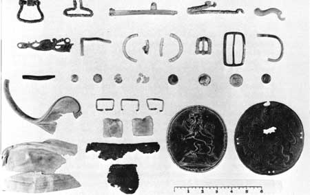

*图：九号堡重建前考古发现的部分遗物，NPS历史手册图版。 [图像来源](https://npshistory.com/handbooks/historical/14/images/hh14b9.jpg)。*

十六日拂晓前，英军对第二平行壕发动突袭，攻击美法两军炮位相接的一带。部分炮位被他们冲入，几门炮受到破坏。维奥梅尼尔与沙斯特吕所属法军的防御体系中，诺阿耶率部反击，重新夺回被突入的位置。英军的行动来得突然，却没有使他们长期占住新壕线，也未把我们的工程整体推回第一道壕沟。〔资料：[美国陆军战争学院历史科《约克镇围城，1781》，第十九章。](https://webdoc.sub.gwdg.de/ebook/p/2005/CMH_2/www.army.mil/cmh-pg/books/revwar/Yorktown/AWC-Ytn-19.htm)〕

这种突袭说明，前一天的成功并没有取消守军行动的能力。敌军仍可以选择一个局部地段，以集中起来的步兵攻击正在部署的炮兵和工事勤务人员。新占阵地往往尚未完成防御布置，攻击者也可能利用换班或警戒薄弱的位置接近。对围攻部队而言，越接近胜利，越不能把工程进度当作敌军已经失去抵抗意愿的证明。

英军破坏火炮的方法，是堵塞引火孔，使炮手不能按正常程序点燃发射药。这样的损坏是否持久，取决于使用的材料、操作方式与可用时间。突袭人员必须在对方反击前撤离，未必能对每门炮进行难以修复的破坏。夺回阵地以后，炮兵检查并修理火炮，受损炮位恢复作用。英军赢得了局部接触，却没有获得足以改变围城进程的停顿。

我的下一步仍是推进第二壕线炮兵。此前准备的炮位继续完善，能够使用的火炮陆续向前转移。炮兵行动受到道路、地面和警戒条件约束，无法把一整条阵线在同一瞬间搬到前方。逐步展开的火力却足以增加英军工事的压力。前线还须维持对突袭的防备，修复、运输和警戒同时进行，第二壕线才真正成为稳定阵地。

十六日至十七日夜间，更多火炮从第一线转到第二线。到十七日早晨，新位置向英军开火。炮口与目标之间的距离缩短，守军的胸墙、炮位和后方空间继续受到打击。我从阵外可以看到破坏与火力压制的结果；英军内部当夜曾如何讨论出路、是否准备渡河，仍需以后取得的报告才能说明。〔资料：[同书第十九章，10月16—17日。](https://webdoc.sub.gwdg.de/ebook/p/2005/CMH_2/www.army.mil/cmh-pg/books/revwar/Yorktown/AWC-Ytn-19.htm)〕

第二线投入并不要求所有规划中的炮位都彻底完成，才能产生战役效果。守军面对的是已经出现、而且还会继续增加的火力。他们若想打断进程，需要造成足够持久的损害；仅仅让少数火炮暂停几个小时，很难抵消我们在材料、人员和位置上的累积优势。十六日突袭后工程继续运行，便是这种优势在实际行动中的表现。

## 九、十月十七日至十九日：停火要变成可执行的投降

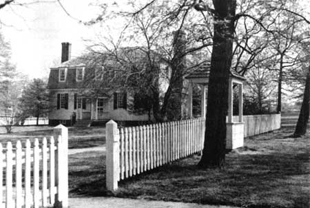

*图：修复后的摩尔宅邸，NPS历史手册照片；双方代表在此拟定投降条款。 [图像来源](https://npshistory.com/handbooks/historical/14/images/hh14b10.jpg)。*

十七日上午约十时，英军派出停战使者。康沃利斯请求停止敌对行动二十四小时，并由双方各派两名军官，在摩尔宅邸商定约克镇与格洛斯特驻军的投降条件。这个请求承认了谈判的对象：两岸据点及其驻军。它同时要求一整天停止行动，而在援军可能到来的背景下，时间本身仍有军事价值。〔资料：[同书第十九章转录10月17日康沃利斯来信。](https://webdoc.sub.gwdg.de/ebook/p/2005/CMH_2/www.army.mil/cmh-pg/books/revwar/Yorktown/AWC-Ytn-19.htm)〕

我没有直接接受二十四小时的停火。我的答复是，先给两小时，请他把具体建议写出来送到美军阵线。这样，双方可以确认最基本的条件是否可能达成，再决定如何安排详细谈判。炮火已经能够迫使英军面对严峻选择，联军没有必要在尚未知道对方要求时就把这种压力撤去一整天。我的回复同时表明，希望尽快达成能够接受的条件，以减少流血。

十七日下午，康沃利斯送来进一步建议。我们继续交换书面意见，确定哪些可以接受，哪些必须修改。十八日，我明确提出，守军获得的军事礼遇与此前查尔斯顿守军投降时相同。答复仍带有期限，要求对方接受或拒绝基本条件。谈判在停火框架内进行，恢复作战的可能性仍然存在，因此文书往返与阵地控制必须一起维持。〔资料：[同书第十九章转录17日下午与18日通信。](https://webdoc.sub.gwdg.de/ebook/p/2005/CMH_2/www.army.mil/cmh-pg/books/revwar/Yorktown/AWC-Ytn-19.htm)〕

英军接受基本框架以后，详细条款由代表会商。大陆军派约翰·劳伦斯，法军派诺阿耶，英军派托马斯·邓达斯与亚历山大·罗斯。摩尔宅邸位于围城阵线后方，代表们在那里逐项讨论。双方不仅要商定士兵何时走出工事，还要处理军官的私人财产、士兵去向、医院、船只、军需以及不同军种俘虏的归属。战斗结束需要一套能够由军队实际执行的安排。

陆军俘虏交由美国方面管理，海军人员则交法国海军。这个区分反映了联军内部的分工。英军火炮、武器、公款和军需应完整交出，防止在交接时被毁坏。军官可以保留佩剑与私人文件，士兵私人物品也受到条款保护；然而，属于当地居民的财产可以要求返还。私人财产与缴获军需之间的界限，因此成为投降管理的一部分。〔资料：[《投降条款》，1781年10月19日，第1、2、4条，NPS手册附录2转录。](https://npshistory.com/handbooks/historical/14/hh14i.htm)〕

病伤人员不能按普通俘虏的速度行军。条款允许本军医官在假释条件下照顾他们，要求提供医院，并允许在需要时从纽约取得进一步医疗供应。护送军官行李与病伤者照护所需车辆，也成为协商内容。围城造成的后果并不会在停止射击时自动消失，医院和运输是接收驻军必须面对的实际工作。

康沃利斯要求不追究加入英军的当地居民。我们没有同意将这一项写成军事投降所能保证的赦免，理由是它属于民事管辖。另有条款允许他使用“博内塔”号运送公文和一定人员去纽约，船只之后交给法国方面。两项安排并置，显示投降条件既有严格边界，也存在用于处理具体人员和通信需要的渠道。它们的法律与社会后果，会在战后复盘中进一步讨论。〔资料：[《投降条款》第8、10、11、12条。](https://npshistory.com/handbooks/historical/14/hh14i.htm)〕

十九日，条款签署。联军的名字包括我、罗尚博，以及代表法国海军的签署；英方包括康沃利斯与约克河海军指挥官托马斯·西蒙兹。陆军、海军和两岸驻军都被纳入协议。只要仍有某支部队或某处据点不受条款约束，投降就可能留下继续作战或破坏物资的缺口，因此签署者的身份与权限具有实际意义。

协议规定，中午先移交约克镇左侧两处工事，分别由美军步兵与法国掷弹兵接收；约克镇驻军随后按规定路线出城，旗帜收卷，携枪前往指定地点放下武器，再返回营地等待分送。格洛斯特一侧另有工事移交与出城缴械时间。交接分阶段执行，使联军在大批守军离开阵地以前，已经占住关键位置。〔资料：[《投降条款》第3条内容；NPS转录版的条文标题有排印缺项，相关交接文字完整保存。](https://npshistory.com/handbooks/historical/14/hh14i.htm)〕

当天下午，两军沿道路列队，英军走向指定场地缴械。康沃利斯没有亲自出席，由奥哈拉代表，林肯承担接收投降的任务。对于此前在查尔斯顿经历投降的林肯而言，这是他的军事经历中明显不同的一幕；对于整支联军，重要的结果是敌军依照协议放下武器，两岸据点及军需开始移交。围城从施加军事压力，转入解除武装与管理俘虏。

我在十九日晚向国会报告结果，并说明罗尚博与德格拉斯及所属官兵对行动的贡献。二十日的命令进一步感谢指挥壕线的林肯、拉法耶特与施托伊本，工程与炮兵军官，以及弗吉尼亚民兵。这个名单也反映了围城真正依赖的工作：陆海协同、前沿轮值、工程建设、火炮与军需运输，缺少任何一项，最终的缴械仪式都不会按这一时间出现。〔资料：[美国陆军战争学院历史科《约克镇围城，1781》，第十九章转录10月19日致国会信及20日总命令。](https://webdoc.sub.gwdg.de/ebook/p/2005/CMH_2/www.army.mil/cmh-pg/books/revwar/Yorktown/AWC-Ytn-19.htm)〕

## 十、围城以后，我仍要安排俘虏、病员与军队的去向

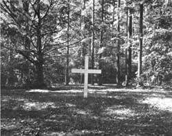

*图：战场营地区的法国墓地纪念十字架，NPS手册称此为传统认定的安葬地点。 [图像来源](https://npshistory.com/handbooks/historical/14/images/hh14d8.jpg)。*

十月十九日以后，约克镇不再是一个需要继续攻击的敌军据点，却成为需要接收和管理的军队驻地。缴械的士兵暂回营地，随后才按条款送往内地。十月二十一日起，英军和德意志辅助部队的俘虏开始向温彻斯特、弗雷德里克及其他指定地区行进。他们需要粮食、护送人员与行军安排，生病的人又不能与健康人员一同移动。〔资料：[NPS《围城以后大事记》。](https://www.nps.gov/york/learn/historyculture/afterthesiege.htm)〕

我还必须处理联军自身的病伤人员。在投降协议正式完成前后，医院床位已经成为紧迫问题。我要求寻找更多可以安置病员的空间，尤其考虑威廉斯堡，并把天花病人与其他人分开。战场上停止射击以后，军队中原有的疾病和照护缺口仍然存在。作战成功没有使医院突然得到足够的毯子、铺草、木柴和医护人员。〔资料：[玛丽·C.吉列特《美国陆军医疗部，1775—1818》，第五章所据华盛顿通信与医院资料。](https://achh.army.mil/history/book-rev-gillett1-ch5/)〕

有些士兵能够立即返回部队，有些需要留下继续治疗。部队转移时，必须保留人员照看留院者，并安排他们康复以后如何归队。十一月初，承担北返任务的部队开始离开，另有部队被派往南方继续支持格林。法国陆军留在弗吉尼亚过冬，法国舰队则返回西印度群岛。不同部队因各自后续任务分开，围城时集中起来的联合力量由此逐渐解散。〔资料：[吉列特第五章；NPS历史手册《约克镇》“后续”部分。](https://achh.army.mil/history/book-rev-gillett1-ch5/)〕

至此，我在这场围城中的职责已从进攻部署、督促工程、协调舰队，走到接收投降和安排战后转移。约克镇的英军已经失去继续作为一支完整野战力量行动的能力，北方与南方的战争却仍需要军队。我的任务并未因为一次胜利而结束，接下来要面对的，是如何在新的军事形势中维持已有成果。

## 战后复盘：把两边的行动放回同一张时间表

以下转入史料研究者视角。华盛顿能够接到的命令回报，已经交代了联军如何推进；接下来需要把英军内部处境、海军行动、双方实际兵力与战后统计放到一起，检查胜利是怎样形成的。康沃利斯的报告、英军救援通信和不同层级的记录，提供了前面第一人称无法同时知道的信息。

## 十一、另一岸的战斗，怎样压缩英军的活动范围

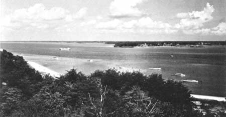

*图：从约克镇望向格洛斯特角，照片摄于跨河大桥建成以前，载NPS历史手册。 [图像来源](https://npshistory.com/handbooks/historical/14/images/hh14b8.jpg)。*

约克河把约克镇与格洛斯特分开，也把围城分成了两个相互联系的陆上区域。河流可以成为运输通道，亦会迫使撤退军队依靠渡船。只围住约克镇南面，仍会留下康沃利斯经对岸向内陆脱离的可能。联军在格洛斯特方向安排部队，因此是包围的一部分。它还要阻止英军从周边乡村继续搜集鲜肉与草料，减少守军在封锁中维持牲畜和骑兵的能力。

初期负责这个方向的是乔治·威登率领的弗吉尼亚民兵。劳赞军团随后加强了这支力量，其中包括骑兵，法国舰队又提供登陆人员，最终由舒瓦西统一指挥。按照NPS历史手册的概数，先后投入的部分包括约一千五百民兵、六百劳赞军团官兵及约八百海军登陆人员。这些数字反映增援构成，不能未经日期核对便拿来与约克镇主阵地人数作同一时点的精确加减。〔资料：[NPS历史手册《约克镇》“格洛斯特一侧”。](https://npshistory.com/handbooks/historical/14/hh14b4.htm)〕

英军在对岸也有正规部队与骑兵。塔尔顿的英军军团以及西姆科的王后游骑兵，使格洛斯特不只是一个孤立的小型步兵据点。骑兵可以向外搜集物资，侦察联军位置，并掩护其他部队行动。只要他们还能在据点外围活动，康沃利斯便保有一定的外部资源和机动余地。联军若要使包围更有效，就必须把这些部队赶回固定阵地。

十月三日，舒瓦西向格洛斯特角推进，试图收紧包围。在称为“胡克”的地区，联军与英军发生交战，劳赞和塔尔顿的骑兵参与其中。战斗结束后，联军保持了取得的地面，英军退回据点。这里的意义在于围城外侧的控制范围发生变化：英军以后难以再像此前那样自由地派出搜集队，联军则更接近能够监视和阻断出路的位置。〔资料：[同上；NPS《围城大事记》10月3日条。](https://www.nps.gov/york/learn/historyculture/siegetimeline.htm)〕

这场接触与约克镇南侧开挖平行壕不是同一种作战。在南岸，工程部队逐步建立能够压制城镇的火力体系；在北岸，部队首先要限制骑兵与外出队伍，稳固包围。两者都消耗守军的选择，却通过不同机制发生作用。南岸炮火使英军工事越来越难守，北岸控制则使放弃工事后的脱离也越来越困难。

两岸之间没有现代意义上的即时通信。康沃利斯可以借助渡船派出命令与部队，但每次渡运都需要集结、装载、横渡和卸载，夜间行动还需要辨认地点、维持秩序。一支军队在南岸遭遇压力，不意味着北岸部队能够随时无成本地返回增援。河流既连接英军据点，也使两处力量的转换受到运输能力约束。这种约束在十六日夜间最后一次撤退尝试中变得决定性。

格洛斯特方面并未经历与南岸完全相同的逐层炮击和攻堡过程。它最终被纳入共同投降条款，说明康沃利斯的两个据点构成同一指挥问题。北岸驻军仍存在局部战斗能力，并不等于它能独立解决全军的战略处境。继续守在对岸、突破舒瓦西部队、接应南岸军队大规模渡河，是几种不同任务，需要的兵力和时间也不一样。

## 十二、十六日夜到十七日上午：康沃利斯的最后撤退尝试

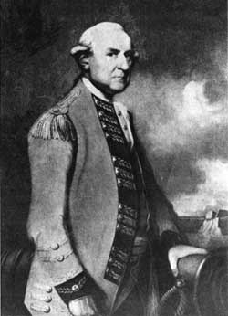

*图：康沃利斯肖像，NPS历史手册图版。 [图像来源](https://npshistory.com/handbooks/historical/14/images/hh14a4.jpg)。*

把康沃利斯十月二十日的报告与联军记录对照，可以看清英军十六日行动的先后。白天以前的突袭由阿伯克龙比指挥，投入约三百五十人。其目标是两处较接近完成的炮位，企图破坏火炮，阻止第二平行壕全面发挥作用。英军报告宣称堵塞了十一门炮，并使法军损失约百人；美方匿名记录与后来的军史汇编给出的数字较低。〔资料：[康沃利斯致克林顿，1781年10月20日；殖民地威廉斯堡馆藏匿名军人日记；《约克镇围城，1781》第十九章。](https://webdoc.sub.gwdg.de/ebook/p/2005/CMH_2/www.army.mil/cmh-pg/books/revwar/Yorktown/AWC-Ytn-19.htm)〕

具体毁炮数需要保留差异。各记录可能统计了不同炮位、不同种类损坏，也可能受到战后夸大战果的影响。英军突击人员在短时间内完成任务后撤退，难以准确统计对方死伤；联军各单位也可能只掌握本部损失。可以较可靠确认的结果是，英军确实冲入部分炮位并造成破坏，但破坏很快得到修复。康沃利斯自己的报告也承认，这次行动没有带来明显的持续收益。

对英军来说，修复速度消除了突袭最有价值的部分。突袭成功本来可以为防御争取时间，甚至打乱联军工程计划；如果火炮在几个小时内恢复，英军只是短暂改变了前沿情况。与此同时，第二平行壕继续加固，联军的人员和材料仍能送到前方。英军面对的压力具有可恢复性，而英军自己的损失和疲劳却很难从外部补充。

康沃利斯于是决定把尽可能多的可用步兵送到格洛斯特一侧。按照他的报告，准备了十六艘较大船只，计划夜间渡过步兵，抛弃行李，并留下人员为城内居民及病伤者办理投降。这个安排明确显示，撤退已不是带着全部军队、炮兵和军需有序转移。它是试图保住还能行军战斗的核心人员，同时放弃不能携走的大量负担。〔资料：[康沃利斯10月20日报告。](https://teachingamericanhistory.org/document/cornwallis-to-clinton/)〕

夜间渡河以前，还需要通知格洛斯特的骑兵准备行动。英军设想渡过去以后突破北岸联军，再向北脱离。这个方案有几道连续关口：南岸部队要能按时上船，船要能往返，北岸要能够容纳并重新组织抵达部队，随后还要打通陆路。任何一个环节失败，军队都可能被分割在两岸。单纯看到约克河宽度有限，不能据此认为渡过就是脱险。

第一批轻步兵、大部分近卫军和第二十三步兵团的一部分已经抵达对岸。康沃利斯的报告随后记载，天气突然转为强烈风雨，船只被吹向下游，其中一些仍载着士兵。这里的天气细节有明确当事人报告支持。它直接破坏了渡运工具的集中，使后续部队无法按原次序过河，也使已经过河的人暂时不能被及时接回。

大约凌晨二时，康沃利斯下令把已渡过去的部队接回。由于船只离散，命令不能立即执行。到天明，联军炮位开火，两岸水面受到威胁，船只逐渐归来以后才把已渡河的部队运回。英军报告称，这一回撤没有遭受很大损失，但作战时间已经耗尽：最适合隐蔽渡运的夜间结束，而部队仍回到了原先越来越难守的阵地。〔资料：[同上。](https://teachingamericanhistory.org/document/cornwallis-to-clinton/)〕

撤退尝试失败以后，英军指挥体系仍然运作。康沃利斯与工程军官、主要军官商议，评估工事状态和继续防御的可能。他们判断一些位置已经能够被强攻，继续承受炮击数小时会使防御更加危险。报告还列举了爆炸弹不足、火炮难以在受攻正面露出射口、兵员因疾病与战斗减少、值勤负担沉重等因素。这些具体条件共同支持了投降决定。

所谓失去继续作战能力，在这里不是所有枪炮同时消失，也不是每个士兵都已倒下。它意味着守军已无法以现有力量维持整个防御体系，并且没有可信的办法在预计时间内得到救援或撤离。部分部队还能局部反击，部分炮也可能尚存，但联军正在从越来越近的位置持续施压，英军却不能恢复对应的防御条件。

十七日上午提出停火，因此是数项失败选择之后的结果。康沃利斯先前依靠救援预期留守，随后尝试用突袭干扰炮位，再试图跨河撤退。每个行动都有具体目标，也都受到当时资源和时间限制。风暴使最后一个方案失败，却不是围城中唯一造成败局的因素。没有此前形成的海上封锁、南岸炮击、北岸包围和英军疾病损耗，一场夜间风雨不会自动使一支军队投降。

## 十三、五个决策关口：哪些选择仍然可行

*图：罗尚博肖像，NPS历史手册图版；他负责法国陆军部署及与华盛顿的协同。 [图像来源](https://npshistory.com/handbooks/historical/14/images/hh14b4.jpg)。*

第一个关口，是华盛顿是否坚持纽约。五月到八月的文书表明，纽约方案的地位发生过变化：它曾是重点准备的进攻目标，也一直带有条件。到八月十四日，法军舰队的目的地、停留期限、纽约港进入难度与美军补员状况共同促成南下。把此前一切准备都解释成早已设计好的佯动，会抹去真正的调整过程，也会低估法军海军决定对陆军方案的影响。〔资料：[《约克镇围城，1781》第十四章所引同期日记、书信。](https://webdoc.sub.gwdg.de/ebook/p/2005/CMH_2/www.army.mil/cmh-pg/books/revwar/Yorktown/AWC-Ytn-14.htm)〕

华盛顿在战后多年答复诺亚·韦伯斯特时，对这段计划形成有更概括的回忆。同期日记和调兵文书则保留了逐步改变的痕迹。两类材料用途不同：后来的信可以说明当事人怎样总结自己的战略，早期文件更适合确定某一天有哪些准备正在进行。研究者需要用同期记录约束回忆，尤其不能把成功后的整体解释，直接投射为行动开始时已经完全清楚的蓝图。

可行的替代方案是继续对纽约施压，同时让南方部队维持防御；它不要求指挥官拥有未来知识，也确实符合此前部署。但在舰队决定进入切萨皮克湾后，继续把主要攻城资源留在纽约附近，就难以利用法军海上优势。这个选择可以保守地降低长途转移风险，却会放弃围住康沃利斯的机会。其得失应在当时船期、兵力和运输条件下评估。

第二个关口，是康沃利斯在九月继续留守。他收到克林顿的救援承诺，并把它写进自己不作冒险突破的理由。九月二十四日的信表示有望十月五日从纽约出航，二十九日送到约克镇以后，他决定退入内线。站在他的时间位置上，这不是一封已被证实无法履行的承诺；它来自上级统帅，并涉及舰队与援军。〔资料：[《约克镇围城，1781》第十六章所引双方通信。](https://webdoc.sub.gwdg.de/ebook/p/2005/CMH_2/www.army.mil/cmh-pg/books/revwar/Yorktown/AWC-Ytn-16.htm)〕

然而，承诺的可靠程度与军队需要支撑的天数之间存在落差。信使到来时，信中描述的是几天前纽约的估计。修舰、补给、装载和天气又会改变出航时间。康沃利斯在收到消息后仍要判断工事能坚持多久，不能仅以援军预计日期替代防御评估。他自己的报告承认工事准备不足，这使继续等待救援成为一个风险逐渐增大的决定。

提前脱离或主动攻击联军，是当时确有可能讨论的替代方向。它们需要冒险通过陆上部队或渡河，并可能抛弃一部分物资，也没有保证成功。不能因为后来投降，就声称任何更早的突围都必然奏效。但随着联军主力和重炮到达，英军可用的时间与空间确实不断缩小。越晚行动，越需要在敌军已经布置好的条件下完成复杂的兵力转换。

第三个关口，是九月二十九日放弃外线。塔尔顿后来批评这项决定过早，使联军轻易占到有利的工程起点。保留外线可以增加进攻者的工作量，并争取完善城内防御的时间；收缩阵地则可以减少防线长度，让有限兵员集中使用。两种选择各有军事理由，争议在于外线能争取多少时间，以及守军能否在受压后安全退入内线。〔资料：[同书第十六章末引塔尔顿叙述及康沃利斯信。](https://webdoc.sub.gwdg.de/ebook/p/2005/CMH_2/www.army.mil/cmh-pg/books/revwar/Yorktown/AWC-Ytn-16.htm)〕

从实际后果看，联军迅速取得外线地面，利用旧堡与新筑工事形成前进支点。康沃利斯的收缩没有阻止正规围攻，反而给攻方减少了最初的争夺。与此同时，城内可供纵深防御的空间不足，火炮容易从不同角度作用于狭窄区域。收缩所节约的守备人力，无法完全弥补防御空间和时间的损失。

第四个关口，是华盛顿与罗尚博选择按工程程序推进。舰队停留时间有限，德格拉斯也曾希望尽快行动。急攻可能在更短时间内取得结果，却会使士兵在准备不足时面对工事。联军通过协商延长海军支持时间，获得了先运炮、修壕、压制火力再推进的机会。这样的选择把风险从一次正面冲锋，转移到运输、持续施工和盟军时间协调上。它仍然有风险，只是风险的性质不同。

这个选择之所以可行，是因为联军拥有足够的兵力、攻城材料与重炮，并能保持后方通路。若没有海军封锁，守军可能不断得到补给；若没有法国运输船，火炮可能迟迟不能到达；若兵力不足，施工队也无法得到保护。正规围攻的效果要放在这些条件中理解。它不是任何军队在任何城下都能复制的固定公式。

第五个关口，是十四日夺堡后立即续接壕线。联军把突击目标与工程目标紧密相连，使一次短时步兵攻击直接转成第二壕线的完整展开。若仅以夺堡为结束，守军仍可利用间隔或反击恢复影响；当夜施工则使失去的堡垒迅速变成进攻者的支撑点。康沃利斯十五日致克林顿的信已经承认，新筑土工难以承受联军炮火，救援舰队与陆军不宜为拯救他冒过大的风险。〔资料：[同书第十八章末所引10月15日信。](https://webdoc.sub.gwdg.de/ebook/p/2005/CMH_2/www.army.mil/cmh-pg/books/revwar/Yorktown/AWC-Ytn-18.htm)〕

这里最有说明力的不是突击持续了多少分钟，而是突击以后发生了什么。步兵、工程兵与炮兵之间的接续，使局部胜利产生了超出目标本身的后果。英军十六日的反突袭未能破坏这种接续，第二线炮兵遂继续部署。战役的决定性变化，来自一系列能够相互利用前一项成果的行动。

## 十四、兵力表里的数字，不能直接当作战壕中的人数

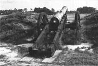

*图：NPS手册所示“拉法耶特炮”：W. Bowen于1759年铸造的12磅炮。此为馆藏展示照片。 [图像来源](https://npshistory.com/handbooks/historical/14/images/hh14d5.jpg)。*

常见概要把联军写为约一万七千六百人，把康沃利斯的驻军写为约八千三百人。这组数字有助于认识大致规模，却不能单独解释任何一天某段壕线的力量对比。联军包含法国正规军、大陆军、民兵以及各类支持人员；英军方面包含英国部队、德意志辅助军、北美保王派部队及海军人员。不同统计有时纳入后勤、病员与营随人员，有时只算能够服役的士兵，数字自然会发生变化。〔资料：[NPS《围城史》；《约克镇围城，1781》第二十章。](https://webdoc.sub.gwdg.de/ebook/p/2005/CMH_2/www.army.mil/cmh-pg/books/revwar/Yorktown/AWC-Ytn-20.htm)〕

康沃利斯战后报告说，提出投降时，约克镇一侧能够服役的人员只剩三千二百余，格洛斯特一侧约六百，其中包含骑兵。这个数字描述的是他报告中的可用力量，既不同于战争开始时的编制，也不同于最后被接收的全部俘虏。它还带有解释败局的文书背景，应该与病伤记录、俘虏名册和其他报告一起阅读。

同一封报告把联军估为八千余法国军人、近似数量的大陆军和五千民兵，总数明显高于常见联军汇总。守军未必能准确分清阵外各营的实际人数，也可能根据营地、轮换和不同方向接触扩大估计。这个例子说明，一份报告可以对本军某项状态较有价值，同时对敌军规模估计较差。可靠性应逐项评估，而不宜把整份文件简单划成可信或不可信。

匿名美军日记提供了另一端的观察。作者强调攻方被施工、警戒和其他勤务分散，认为真正能立即迎击守军出击的兵力没有总数看上去那么多。他的具体推算不能直接替代全军统计，却提醒读者关注总兵力与可集中战斗兵力的区别。一千多人正在挖土、另有部队在护送物资和看守医院时，他们都属于这支军队，却不会同时列在一段战壕后方。

这份日记也有明显的整理痕迹与日期问题，例如列出九月三十一日，末尾还评价康沃利斯后来的报告。其开壕时间和距离也不能与其他材料机械拼接为分钟级时间表。使用它的价值，在于观察一名美军记录者怎样描述施工、友军炮火危险和轮换负担，再用总部命令与其他记录校正。它记录“我看见什么”的部分，与推断“敌人为什么这样做”的部分，需要分别判断。〔资料：[殖民地威廉斯堡数字图书馆，匿名军人日记，馆藏SCMS1981.5。](https://research.colonialwilliamsburg.org/DigitalLibrary/view/index.cfm?doc=Manuscripts%5CM19815.xml)〕

德意志辅助军也不应被压缩为一个没有内部差别的“黑森兵”标签。安斯巴赫—拜罗伊特部队与来自黑森—卡塞尔的世袭亲王团、冯·博泽团、猎兵，具有不同来源和此前经历。冯·博泽团的一部分官兵参加了九号堡防御，安斯巴赫—拜罗伊特部队又与最后撤退方案中的后卫安排有关。具体单位承担的任务，比笼统称呼更能解释战场过程。〔资料：[NPS《约克镇的德意志辅助部队》。](https://home.nps.gov/york/learn/historyculture/german-auxiliary-units-at-yorktown.htm)〕

NPS单位介绍所列人数，与最终投降汇总并不完全一致。例如安斯巴赫两个营的介绍数字合计八百余，而投降表对应两营包含更多人员。两种表格的统计时点及人员类别没有在简短介绍中完全统一，因此本篇不将它们合并为一份看似精确的逐团开战实力表。可以确认的是，这些部队在驻军中占有重要位置，战斗损失和投降人数必须分别阅读。

联军指挥结构则把不同部队的经验投入不同任务。罗尚博及法军工程、炮兵人员带来欧洲正规围城经验；大陆军已拥有多年战争锻炼，也有能够承担轻步兵突击与壕线勤务的部队；地方民兵为外围封锁、支援和地区任务提供力量。部队质量与作用不能只用正规军或民兵两种名称决定，还需要看具体任务、军官组织和得到的支持。

## 十五、海上胜利为什么能够决定陆上的投降

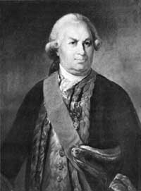

*图：德格拉斯肖像，NPS手册据美国海军学院所藏绘画翻印。 [图像来源](https://npshistory.com/handbooks/historical/14/images/hh14b2.jpg)。*

九月五日切萨皮克海战发生在本文围城起点以前，却决定了后来行动能否展开。格雷夫斯率领的英国舰队未能把法军逐出海湾，德格拉斯随后返回控制入口，并与德巴拉部会合。德巴拉带来的运输与攻城资源进入海湾，陆军集中和重炮运输得以继续。海战的战役意义，首先体现在谁能够安全使用这片水域。〔资料：[《约克镇围城，1781》第十五、十六章。](https://webdoc.sub.gwdg.de/ebook/p/2005/CMH_2/www.army.mil/cmh-pg/books/revwar/Yorktown/AWC-Ytn-15.htm)〕

英国舰队没有被全歼，仍然能够回到纽约，修理后再出航。可是，约克镇需要的援助具有期限：康沃利斯的工事与可用兵员只能维持一定时间。即便英国仍拥有数量可观的舰船，只要在这段时间不能打开海湾，它们就无法把纽约的陆军优势转化为城内的援兵。海军存在与海军能够及时到达，是两件需要分开计算的事实。

海战造成的舰船损伤还影响第二次救援。纽约必须修复舰只、补足物资、安排人员登舰，克林顿不能单方面命令这些工作立即完成。舰队和陆军各有指挥官、专业要求与安全判断。出航日期在通信中不断向后移动，使城内守军一直面对一个正在接近、又不断推迟的时间点。这种情况尤其容易使驻军延迟作出高风险的脱离决定。

十月十九日，英国救援舰队终于驶离纽约。它出发的同一天，约克镇驻军已经缴械。陆军战争学院汇编所列这次实际登舰人员为七千一百四十九，早期承诺常写约四千或五千；两者属于不同阶段的计划与执行数据。将较大的最终人数倒放到九月，会夸大康沃利斯当时获得的承诺；只写早期计划数，又会低估最后实际组织的救援规模。〔资料：[同书第十六章，9月6日至10月19日救援筹备。](https://webdoc.sub.gwdg.de/ebook/p/2005/CMH_2/www.army.mil/cmh-pg/books/revwar/Yorktown/AWC-Ytn-16.htm)〕

德格拉斯在九月下旬是否出海迎敌的争论，也说明制海权需要持续经营。他考虑英国增援后，提出保留部分舰艇封锁，主力到外海取得更方便作战的位置；华盛顿则强调运输和围城需要稳定海上支持。两人的目标都与共同战争有关，却面对不同的直接风险。协商把这两种需求重新结合，使陆军没有因海军调整而被迫仓促强攻。

法国舰队的作用因而包含多个环节：阻挡英国舰队、限制河口航行、运送步兵与重炮、提供登陆力量，并在围城期间继续保护补给。任何单一海战画面都无法完整表现这些工作。陆军最后在阵前接受投降，是这些海上行动与陆上工程共同产生的结果。法国的贡献可以具体落实到运输、火力和时间，而不只是抽象地称为“援助”。

## 十六、伤亡、疾病和俘虏：胜利的不同账目

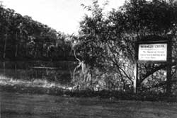

*图：沃姆利溪磨坊坝道路，NPS历史手册照片；这种溪谷与通路关系影响部队接近和运输。 [图像来源](https://npshistory.com/handbooks/historical/14/images/hh14d7.jpg)。*

美国陆军战争学院汇编的英军伤亡表，统计九月二十八日至十月十九日，列阵亡一百五十六、负伤三百二十六、失踪七十，合计五百五十二。对应的投降人员汇总为七千二百四十一，其中列军官四百六十二、士兵六千六百零二、其他人员一百七十七。这份表包含具体单位及部分营随人员，不能当作只统计健康步兵的数字。〔资料：[《约克镇围城，1781》第二十章。](https://webdoc.sub.gwdg.de/ebook/p/2005/CMH_2/www.army.mil/cmh-pg/books/revwar/Yorktown/AWC-Ytn-20.htm)〕

阵亡、负伤与被俘也不是三个可以直接相加的互斥类别。伤员可能在医院内投降，某些先前被俘者也可能在最后汇总中另有栏目。若把伤亡总数与投降人数机械相加，便可能重复计算同一人。海军人员的归属又由投降条款另行安排，概要中包含水手与陆战队的驻军总数，常会高于单独陆军俘虏表。

联军的损失统计同样要保留范围。美国战场信托的现代概要列出联军阵亡八十八、负伤三百零一，合计三百八十九，可作为围城战斗损失的常用估计。美法军队原来分别报告，攻堡损失与整个围城损失也不是同一组数字；某些记录只算阵亡和负伤，另一些又加上医院死亡。因此，这个概数适合与英军战斗伤亡对照，不宜再把医院人数叠加进去。若要进一步拆成各国、各团的逐日损失，还需要逐份比较原始回报的日期与人员分类。〔资料：[American Battlefield Trust，Yorktown，战果统计栏](https://www.battlefields.org/learn/revolutionary-war/battles/yorktown)。〕

医院资料提供了一种与战斗伤亡表不同的观察角度。吉列特的医疗史指出，约克镇美军一份十月医院报告，列月底尚有六百四十六人，其中记录了大量间歇性发热和腹泻患者。这个月末存量不能称为围城造成的六百四十六名新伤亡：它可能包括此前入院、正在康复以及战斗后仍在治疗的人。报告也没有提供足以重建全部入出院流量的数据。〔资料：[吉列特《美国陆军医疗部，1775—1818》，第五章。](https://achh.army.mil/history/book-rev-gillett1-ch5/)〕

同一研究叙述，英军投降时，大约六百名美军病伤人员需要超出营地医院能力的照护，分别安置在威廉斯堡和汉诺威。这里的数量说明医疗负担，并不意味着六百人都在战壕中被击伤。疾病、长期行军、地区环境与物资不足共同造成的减员，会直接减少能执勤、挖掘或护送物资的人数。围城的后勤优势也必须承担维持这些人员的责任。

医院建筑并不等于完整的医疗能力。威廉斯堡的学院、宫殿与教堂被用于安置病员，房屋解决了部分空间问题，却仍需要毯子、木柴、铺草、药物和照护人员。汉诺威曾出现医生去世、由病员承担照护责任的情况。这样的记录能使普通士兵的处境进入战役分析，而无需编造病床上的对白或个人心理。

胜利后，疾病仍持续产生后果。十一月底还有患者留在威廉斯堡与汉诺威，军队北返时必须留下人员照顾他们。后来医院又遭遇火灾等困难。以十月十九日为战役结束日，是按照敌对行动与投降划定的军事界线；伤员、病员和照护者经历的时间则更长。战后安排是否有效，也是军队维持组织的一部分。

对英军而言，疾病尤其削弱了防御中的可用兵力。康沃利斯报告强调，疾病比敌军火力更严重地减少了他的力量。这个判断带有为投降解释的目的，却与他需要在狭小阵地持续安排值勤、劳役和修复的处境相符。兵员越少，剩余人员工作越重；疲劳又会影响维修、警戒和反击能力。围城压迫通过这种循环不断增加。

## 十七、投降没有给所有人带来同一种结局

对美法军队而言，约克镇是重大胜利；对英军正规士兵而言，结果主要表现为缴械与被俘。对跟随英军的当地居民、逃离奴役的人和其他非战斗人员而言，投降涉及的危险有所不同。条款保护部分私人财产，也允许追索属于当地居民的财产。置于当时仍存在的奴隶制度中，这种语言不能被理解为对所有人的自由提供平等保护。

第十条对当地居民免受处罚的要求未获同意，明确留下民政处置问题。联军指挥官可以接受军事投降，却没有在这份文件中统一解决各州对保王派的法律追究。军事协议的完成，因而可能把某些人的处境从军队保护转交给其他权力机构。对这些群体的后续遭遇，需要使用地方档案与个人记录进一步追踪，不能仅凭将军之间的礼遇推断所有俘虏及营随人员都得到同样待遇。〔资料：[《投降条款》第4、7、8、10、11条。](https://npshistory.com/handbooks/historical/14/hh14i.htm)〕

康沃利斯在报告中高度评价法国军官在投降后提供的礼遇和经济援助。这是军官之间的经历，能够说明联军与英方高层之间的一部分交往；它不能覆盖普通士兵的押送、医院内的照护，更不能代表所有非战斗人员。将“败军受到礼遇”作为整个战后过程的概括，会把不同身份者面对的差异掩盖掉。

城镇也承受了炮击、军队驻扎与医院使用。战争的破坏不限于火炮击中的工事，还包括房屋占用、物资征集和居民生活中断。已有资料能够确认这些活动，但不足以在本文给出完整的平民死伤表。保留未知，能使军队统计与社会损失之间的边界清楚：没有完整统计，并不意味着没有损失。

## 十八、约克镇改变了战争的前景，和平仍需完成

康沃利斯的军队投降，剥夺了英国在这一地区一支重要野战力量，也使继续投入兵力以恢复局势的成本显著增加。英国仍控制纽约等据点，海军仍在作战，战争还具有加勒比海、地中海与印度等更广的范围。约克镇的意义，在于它改变了英国继续争取原定政治目标的前景，并给美国与法国提供了更有利的谈判地位。

消息传到伦敦后，政治压力上升，诺斯政府最终在1782年下台，和平谈判逐渐推进。1782年十一月签订初步和平条款，1783年九月签订正式巴黎条约。条约签署、批准与英军撤离是不同程序，不能把约克镇缴械之日直接写成战争法律上的终结。也不能把后来的和平完全归给一位将军的一次命令，而忽略联盟战争与政治选择。〔资料：[NPS《围城史》与《围城以后大事记》；正式条约日期按签署表述。](https://www.nps.gov/york/learn/historyculture/afterthesiege.htm)〕

从战术层面看，联军通过壕线、炮位、突击和及时巩固取得成功。由材料运输开始，经过第一平行壕压制守军，再以第二平行壕和夺堡缩短距离，每一阶段都为下一阶段建立条件。英军的局部出击未能打断这个过程，最后撤退又因风暴与渡运条件失败。

从战役层面看，联军实现了把海上优势转化为陆上合围的目标。华盛顿调整进攻方向，罗尚博与法军参与集中和围攻，德格拉斯控制海湾并维持协同，德巴拉运入重要资源，拉法耶特及其他部队限制康沃利斯的行动。英国方面则未能使救援时间与守军能够坚持的时间相衔接。决定性差别存在于行动的连接，而不只是双方谁拥有某一种武器。

从战略层面看，胜利增加了独立获得承认的可能，却没有取消继续维持军队、照顾病员、管理俘虏和争取和平的需要。约克镇之所以值得完整地阅读，是因为它同时显示了成功计划中的变化和限制：纽约方案转为南下，海军方案需要协商，工程要等待运输，部队在既定安排中仍会遭到突袭。最终结果明确，形成结果的道路却充满需要逐次解决的问题。

康沃利斯并非在一开始就注定投降，华盛顿也未从春天起便掌握秋天的全部答案。更可靠的解释是，联军逐渐把暂时机会变成可持续优势，而英军可用的时间、空间和补充来源逐渐减少。到十月十七日，守军的主要选择已经被此前一连串行动压缩；十九日的缴械，才把这一军事事实正式落实。

## 战役时间线

| 日期（公历） | 行动 | 对后续的作用 |
|---|---|---|
| 1781年8月14日 | 华盛顿收到法国舰队将赴切萨皮克湾的消息，确定南下 | 攻城资源转向弗吉尼亚 |
| 8月下旬 | 美法陆军渡过哈得孙河，经新泽西南进 | 集中兵力，同时保留北方防务 |
| 9月5日 | 切萨皮克海战 | 英国舰队未能打开通向驻军的海路 |
| 9月14日 | 华盛顿到达威廉斯堡 | 协调先到部队、后续运输和围城准备 |
| 9月17日 | 美法陆军指挥官与德格拉斯会商 | 协调舰队停留期限及支持方式 |
| 9月28日 | 联军从威廉斯堡推进，开始包围约克镇 | 围城行动起点 |
| 9月29—30日夜 | 英军收缩外线，联军随后占领 | 联军获得前进工事位置 |
| 10月3日 | 格洛斯特方向交战 | 英军外出活动受到进一步限制 |
| 10月6—7日夜 | 第一平行壕形成 | 为重炮部署建立掩护 |
| 10月9日 | 主要炮位开始射击 | 压制英军炮兵，破坏工事 |
| 10月11—12日夜 | 第二平行壕开工 | 将进攻阵地移近守军 |
| 10月14日夜 | 联军夺取九号、十号堡 | 第二壕线接通至河岸 |
| 10月16日拂晓前 | 英军突袭炮位 | 造成短暂损坏，未中断围城 |
| 10月16—17日夜 | 英军跨河撤退尝试失败 | 最后脱离方案未能实现 |
| 10月17日 | 康沃利斯提出停火谈判 | 从交战转向投降协商 |
| 10月18日 | 双方代表在摩尔宅邸拟定条款 | 确定军队、船只、军需和病伤者处理 |
| 10月19日 | 签署、移交工事及缴械 | 约克镇与格洛斯特驻军投降 |
| 10月下旬—11月初 | 俘虏移送、病员安置、联军分赴后续任务 | 围城力量逐步转移 |

*时间线依据兰德斯第十四至十九章、投降条款与NPS围城大事记；海战列为围城形成的前提。*

## 双方力量与指挥关系

| 区域或兵种 | 联军 | 英方 | 统计说明 |
|---|---|---|---|
| 全局指挥 | 华盛顿统筹联军陆上行动；罗尚博指挥法国陆军；德格拉斯指挥海军 | 克林顿在纽约；康沃利斯负责约克镇、格洛斯特驻军 | 海陆军须分别协调，统帅不能直接消除运输限制 |
| 约克镇陆上正面 | 美军右翼：林肯、拉法耶特、施托伊本；法军左翼由罗尚博部署 | 英国正规步兵、德意志辅助部队、炮兵等 | 双方均有劳役、病伤和其他勤务人员 |
| 格洛斯特 | 威登民兵、劳赞军团、法国海军登陆部队，舒瓦西统一指挥 | 包括塔尔顿、西姆科部队及其他驻军 | 与南岸相连，但跨河调兵依赖船只 |
| 工程与炮兵 | 诺克斯、迪波尔泰及法国专业军官 | 炮兵指挥官罗克福特、工程军官萨瑟兰 | 大炮到位、弹药和劳役同样决定效能 |
| 海上 | 德格拉斯舰队、德巴拉分舰队与运输资源 | 格雷夫斯等舰队；当地西蒙兹指挥海军力量 | 纽约救援舰队不是围城内驻军 |
| 规模概数 | 约17,600人（NPS概要） | 约8,300人（NPS概要） | 只作规模参照，各项细分类别与时点不完全统一 |
| 英方自报投降前可用人员 | 不适用 | 约克镇3,200余；格洛斯特约600 | 康沃利斯10月20日报告，不能等同全部被俘人员 |

## 战果与损失对照

| 项目 | 美法联军 | 英方 | 来源与口径 |
|---|---|---|---|
| 军事目标 | 取得两岸据点，解除驻军武装，阻止救援及时到达 | 未能保住基地或使主力撤离 | 投降条款与双方报告 |
| 全围城战斗伤亡 | 常用估计：阵亡88、负伤301，合计389 | 阵亡156、负伤326、失踪70，合计552 | 联军：American Battlefield Trust概要；英方：兰德斯第二十章9月28日至10月19日回报，详见正文口径说明 |
| 投降人员 | 接收陆军俘虏；法国方面另接收海军人员 | 表列7,241：军官462、士兵6,602、其他177 | 同章陆军投降表；不可再与伤员人数简单相加 |
| 疾病与医院 | 十月美军一份医院报告月底存量646；另有不同医院、日期的报告 | 康沃利斯称疾病为可用兵员减少的重要原因 | 吉列特第五章；康沃利斯报告。均非完整非战斗死亡总数 |
| 火炮及军需 | 接收约定交出的武器、军需与船只 | 按协议完整移交公共军需和现存船只 | 条款第2、13条；本文不填未经核对的缴获总数 |
| 战后位置 | 法军在弗吉尼亚过冬，美军分赴北方与南方任务 | 普通俘虏送内地，部分军官获准假释离开 | 条款第5—6条、NPS后续史及吉列特第五章 |

## 参考资料与阅读说明

1. H. L. Landers，*The Virginia Campaign and the Blockade and Siege of Yorktown, 1781*，Historical Section, Army War College，Washington: Government Printing Office，1931，Senate Document No. 273。[书名页与目录](https://webdoc.sub.gwdg.de/ebook/p/2005/CMH_2/www.army.mil/cmh-pg/books/revwar/Yorktown/AWC-Ytn-fm.htm)。本文简称《约克镇围城，1781》，使用第十四至二十章相关部分；网页为哥廷根大学保存的美国陆军军史网站镜像。引述的日记、命令与信件，按该书转录或摘引使用，未声称核对手稿原件。
2. Charles E. Hatch, Jr.，*Yorktown and the Siege of 1781*，National Park Service Historical Handbook No.14，1954，修订版1957。[目录](https://npshistory.com/handbooks/historical/14/hh14toc.htm)。使用包围、格洛斯特、两道壕线及投降部分；其中较戏剧化的仪式细节未直接采用。
3. Charles Cornwallis，致Henry Clinton的战役报告，1781年10月20日，[Teaching American History转录](https://teachingamericanhistory.org/document/cornwallis-to-clinton/)。用于英军突袭、渡河撤退、兵员状态与投降判断；其自辩和敌军数量估计与其他材料分开评估。
4. *Articles of Capitulation*，1781年10月19日，[NPS手册附录2转录](https://npshistory.com/handbooks/historical/14/hh14i.htm)，原注据国会图书馆Washington Papers。用于接管次序、俘虏归属、病伤者、财产与当地居民条款。
5. *Anonymous American soldier, journal, September 15–October 17, 1781, of the battle of Yorktown*，[Colonial Williamsburg Digital Library](https://research.colonialwilliamsburg.org/DigitalLibrary/view/index.cfm?doc=Manuscripts%5CM19815.xml)，CWF Rockefeller Library Special Collections，SCMS1981.5。转录实际延及投降；日期、人数与回顾性评论需要交叉校对。
6. Mary C. Gillett，*The Army Medical Department, 1775–1818*，U.S. Army Center of Military History，1981，[第五章：From Defeat to Victory, June 1778 to 1783](https://achh.army.mil/history/book-rev-gillett1-ch5/)。本文使用弗吉尼亚围城前后医疗与撤离段落，未将全章涉及的其他战区资料混入本战役损失。
7. National Park Service，[History of the Siege](https://www.nps.gov/york/learn/historyculture/history-of-the-siege.htm)。用于总体规模、战略背景与战争后续概览，详细行动日期另与同期文书及专著校对。
8. Jim Eccleston，National Park Service，[Chronology of the Siege of Yorktown](https://www.nps.gov/york/learn/historyculture/siegetimeline.htm)，1993。用于阶段时间交叉核对；若与同期日记冲突，保留差异。
9. Jim Eccleston，National Park Service，[Chronology of Events After the Siege](https://www.nps.gov/york/learn/historyculture/afterthesiege.htm)，1993。用于俘虏移送与军队转移；该页将1783年9月3日称为条约批准，本文按签署日期表述。
10. National Park Service，[German Auxiliary Units at Yorktown](https://home.nps.gov/york/learn/historyculture/german-auxiliary-units-at-yorktown.htm)，1988年编纂。用于辅助军来源、单位经历与战场任务；其单位人数不与另一日期的投降表强行合并。

11. American Battlefield Trust，[Yorktown](https://www.battlefields.org/learn/revolutionary-war/battles/yorktown)。使用联军战斗伤亡概数；该页其他兵力及英方总计与原表存在差异，本文未以之替换兰德斯所收英军回报。
