以下第一人称叙述依据史料重建，主视角为尤利西斯·格兰特。

1862年4月6日至7日，北方联邦军与南方邦联军在田纳西州匹兹堡登陆场附近交战。战役因战场上的希洛教堂而得名，也称匹兹堡登陆场战役。阿尔伯特·西德尼·约翰斯顿率邦联密西西比军团发起进攻，阵亡后由博勒加德接任；格兰特的田纳西军团坚持到援军抵达，与唐·卡洛斯·比尔的俄亥俄军团共同反攻，迫使对方退回科林斯。本文以两日会战为核心，写到4月8日的追踪侦察与后卫交战。日期采用公历。需要回答的问题是：一支接连失去营地、被压向河岸的军队，怎样保住指挥、补给和增援通道，继而在第二天夺回主动权？

## 一、三月：我要到科林斯去，却必须先等另一支军队

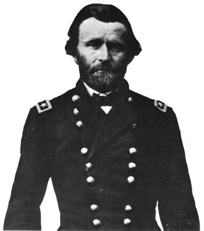

图注：尤利西斯·格兰特历史肖像。国家公园手册标注原藏美国国家档案馆。 [图像出处](https://npshistory.com/handbooks/historical/10/hh10c.htm)

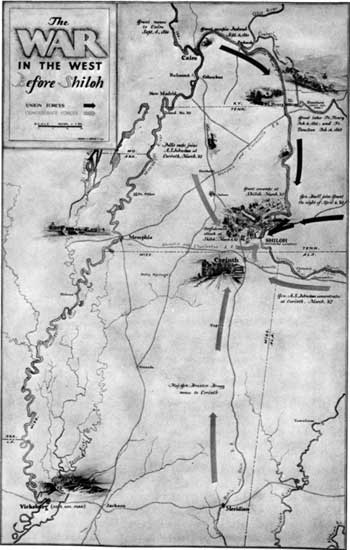

图注：希洛战役之前的西部战局示意图。1955年国家公园手册所载历史地图，用于说明河道与铁路位置。 [图像出处](https://npshistory.com/handbooks/historical/10/hh10b.htm)

我在三月十七日重新接掌田纳西河沿岸部队时，面对的是一支尚在集中的军队。一部分兵力驻在东岸的萨凡纳，一部分已到西岸匹兹堡登陆场，刘·华莱士的部队则在更靠下游的克伦普登陆场附近。田纳西河把这些驻地连起来，也把它们隔开。汽船可以运来整团步兵、火炮、粮食和弹药；可是一旦在西岸交战，东岸的士兵必须先走到渡运地点，再找到船，才能成为战线上可以使用的兵力。我把萨凡纳的主力继续移向西岸，留下必要的守备。我的下一步目标是科林斯，出发位置必须与它处在河流的同一侧。（[资料1，第二十四章](#source-1)；[资料2，战役背景](#source-2)）

二月的胜利使这个目标成为可能。亨利堡和多纳尔森堡相继失守以后，邦联原先横贯肯塔基和田纳西的防线被突破。亨利堡关系田纳西河，多纳尔森堡关系坎伯兰河；河道通航的改变，意味着北方军队可以把运输力量送入南方腹地。约翰斯顿不得不收缩原来的部署。科林斯位于密西西比州北部，两条重要铁路在那里交会，一条把孟菲斯与东部连接起来，一条贯通南北。夺取这个枢纽，能够妨碍敌军横向调动和从南方输送物资。因此，我在河边集中，敌人在铁路边集中，我们准备争夺的其实是两种运输网络接触的地方。（[资料2，战役背景](#source-2)）

我的权限还有一个明确上限。西部战区的亨利·哈勒克要求我与比尔会合，在兵力集中前避免引发大规模交战。三月的战区调整把两支军队置于他的统辖之下，但军队之间并没有因此立刻形成一个在前线运作的共同司令部。比尔从纳什维尔方向赶来，我需要知道他走到哪里、哪个师先到、应在什么地点渡河。等两支军队会合，哈勒克还准备亲自到前线指挥。于是，进攻目标已经确定，开始进攻的条件却尚未满足。我能安排驻地、训练、侦察和运输，不能把等待援军的命令自行改成马上向科林斯发动总攻。（[资料2，战役背景](#source-2)）

匹兹堡登陆场的选择也早于我的全部集中部署。查尔斯·弗格森·史密斯此前负责沿河行动，谢尔曼曾试图在更上游登陆，破坏科林斯以东的铁路。连续降雨使低地积水，支流回水威胁部队返回汽船的路线，这次行动未达到铁路。匹兹堡的高岸则能容纳卸货，通向内陆的道路又与科林斯联系。谢尔曼和赫尔伯特的师在这里展开，营地向内陆延伸，给后续部队留出空间。我接管的是这套已在形成的集结布局，随后把更多部队纳入其中。（[资料1，第二十四章](#source-1)；[资料2，战役背景](#source-2)）

在这种布局下，最靠近敌人的部队并不全是最有经验的部队。谢尔曼的第五师有许多新兵；普伦蒂斯的第六师还随着新团抵达而逐步组成。麦克勒南的第一师，以及原属史密斯、现由威廉·H·L·华莱士暂代指挥的第二师，拥有经过亨利堡、多纳尔森堡战斗的人员。刘·华莱士的第三师也参加过此前的作战，却在克伦普附近。为避免两个华莱士混淆，下文把第三师师长写作刘·华莱士，把第二师师长写作威廉·华莱士。他们没有亲属关系，也没有互相隶属的关系。（[资料1，第二十四章](#source-1)；[资料2，联邦军编制](#source-2)）

我把训练放在很重要的位置。新到的部队需要熟悉装填、队列、听从军官口令以及团与团的配合。有些军官和士兵刚刚成为同一个组织，连彼此都还不熟悉。我曾让工程军官詹姆斯·麦克弗森考虑筑垒线；按我后来留下的说明，拟定的位置落在现有营地后方，供水也不理想。我最终没有把集结地改造成一套坚固的防御阵地。这个决定与我对战役方向的判断相连：我预计离开河岸去攻击设防的科林斯。战后回看，训练与筑垒的取舍成为争议；在此时的命令体系里，部队继续操练、侦察和等待会合。（[资料1，第二十四、二十五章](#source-1)）

克伦普一带使我分出另一部分注意力。敌军在普尔迪及铁路沿线活动，那里接近刘·华莱士的驻地，也可能威胁汽船和物资。我担心的行动之一，是敌人突然袭击这个较孤立的驻点，然后在援军到达前退走。因此，各师之间的支援路线需要准备，刘·华莱士不能简单地把整个师都搬到匹兹堡。战前存在的这份警惕，方向却与四月六日真正承受主攻的位置不同。它影响了我的命令，也影响了华莱士后来选择哪条道路增援。（[资料1，第二十四章及其补注](#source-1)）

我仍把司令部留在萨凡纳，并经常白天到匹兹堡、晚间返回。比尔预期由萨凡纳抵达，在那里会面便于安排两军会合。这个安排的代价是，前沿出现危机时，我必须乘船赶到战场，不能在接敌的最初时刻直接控制各师。四月四日，我在夜间往返途中因马匹滑倒伤及脚踝，随后一段时间行走需要拐杖。伤势没有解除我的指挥职责，却使本已依靠马匹、汽船和传令军官维系的指挥，更不适合被想象成一个始终站在战场中央、看得见所有部队的过程。（[资料1，第二十四章](#source-1)）

## 二、河岸与林地：我的营地为什么既有屏障，也有缺口

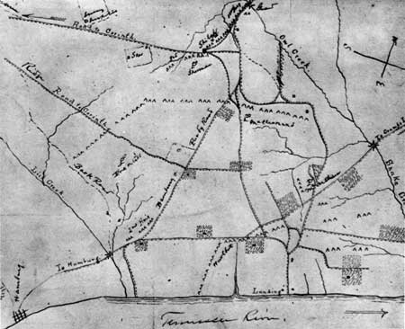

图注：谢尔曼在战后不久绘制的希洛战场图，图中田纳西河位于下方。原图未见明确比例尺，本文不据此测量距离；道路、溪流与驻营关系用于辅助阅读。来源：国家公园手册。 [图像出处](https://npshistory.com/handbooks/historical/10/hh10b.htm)

从匹兹堡登陆场向西南看，通往科林斯的道路是军队将来推进的主轴。登陆场本身是陡岸下的装卸地点；离开河边向内陆走，部队进入起伏的林地，间有农舍、果园和开垦地。森林并不是一块平整的绿色地毯。山脊之间被沟谷切开，低处有流水和泥地，有些树林较疏，有些地段灌木浓密。一个团在道路上可以紧凑行进，转成战斗横队穿过这样的地形，左右两端就可能落在不同的坡度、视野和阻力之中。师长知道团的大致位置，并不意味着能从一个观察点看清全师。（[资料2，战场地理](#source-2)）

北侧的蛇溪和猫头鹰溪、南侧的利克溪，构成天然侧面屏障。春季水位较高，河谷泥泞，能让成队步兵、火炮和车辆可靠通过的桥路有限。对驻营的军队而言，这些水道减少了敌人从侧翼大规模迂回的便利；对前来增援的友军而言，同一条溪也会成为必须准确找到桥梁的障碍。侧翼有溪流保护，不等于侧翼不需守卫。桥在谁手里，桥的南端连到哪一条阵线，往往比地图上两支军队相距几英里更加重要。（[资料2，战场地理](#source-2)）

谢尔曼把大部分部队放在希洛教堂附近及其两侧。教堂所在的脊地控制主路，前面的小溪和坡面可以使攻击者暂时暴露于火力之下。其右翼的麦克道尔旅靠近猫头鹰溪桥；巴克兰旅在教堂以西；希尔德布兰德旅在教堂以东。另一个由戴维·斯图尔特指挥的旅却远在全军左翼，守着接近利克溪的道路。这个旅虽仍属第五师，战斗一旦开始，谢尔曼很难同时照顾两处相隔甚远的战场。隶属关系写在同一张编制表上，实际支援却需要走过道路和树林。（[资料3，四月十日报告](#source-3)）

普伦蒂斯的新师驻在谢尔曼主力与斯图尔特旅之间，营地分布受到来兵次序影响。赫尔伯特的第四师在较靠后的路口一带，威廉·华莱士的第二师在其右侧；麦克勒南的营地在谢尔曼右后方。这样的队形为进攻集中提供了营地和道路，却没有把所有团安置在一条互相衔接的战斗正面上。前方两个师一旦遭到强攻，后面的师必须走出营地、辨明受威胁的方向、选择道路，再展开到尚在变化的战线里。它们不是开战后自动出现的一堵整齐屏障。（[资料2，联邦军部署](#source-2)）

在主路之外，还有东科林斯路、汉堡—普尔迪路，以及连接沿河驻地的道路。这些名字看起来复杂，作用却可以分成三类：有的把敌人从科林斯引向营地，有的让部队在不同战斗地段之间横移，有的把前线连回渡口。上午争夺教堂，意味着争夺敌军进入营区的主轴；中午争夺营地后面的横向道路，关系到各师能否继续接合；傍晚守卫靠河的阵地和蛇溪通道，则直接关系到援军能否进入。战场的重心会随我军后退而移动，不能用清晨那张驻营图解释整天的命令。（[资料2，战场地理及两日战斗经过](#source-2)）

军队也受到补给方式的约束。弹药和粮食由河运送到登陆场，还要经过陆上短程搬运才能到达团、旅。一个团的士兵在连续射击后耗尽随身弹药，不能靠河边还有库存继续作战；弹药必须实际送到他所在的地段。炮兵则同时依赖炮弹、前车、挽马和道路。一个炮位受到侧射时，撤走火炮需要时间，炮手或挽马受损还可能使原本能够继续使用的炮落入敌手。这些限制在两天里都反复出现，夺炮和失炮也因此不完全等同于对方炮兵已被永久消灭。（[资料3，四月十日报告](#source-3)）

四月初前沿已有骑兵冲突。四日，谢尔曼的前哨受到袭击，他派部队追击，并把情况报告给我；五日仍有敌军活动。谢尔曼在十日的报告中承认，五日他认为对方主要在作强力示威。我们知道敌人在附近，却没有把零星接触拼成一场全军进攻即将发生的判断。当天我发往上级的消息仍把敌军主力放在科林斯。前线的警戒和上级的预期之间，出现了决定性的距离：哨兵可以发现来人，师长和军团司令部还要判断这些来人代表什么规模的行动。（[资料3，四月十日报告](#source-3)；[资料4](#source-4)）

五日，比尔军队的先头已到萨凡纳，威廉·纳尔逊师的行军与渡河仍待安排。我准备与比尔会面，下一阶段似乎很快就可以开始。可是两军合流仍有几个实际步骤没有完成：部队要走完陆路，渡运要安排，登陆后的阵位要分配。援军在地图上已经靠近，不代表它已经在前沿。六日清晨响起的炮声，使会合的性质发生改变：我们原来准备把两支军队合起来进攻，现在必须在一支军队已经承受攻击时完成会合。（[资料1，第二十四章](#source-1)；[资料5](#source-5)）

## 三、四月六日上午：炮声把我从萨凡纳带到前线

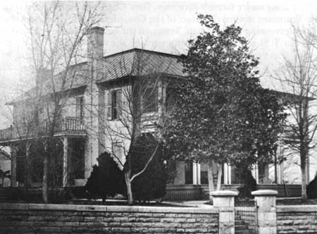

图注：萨凡纳的切里宅邸，格兰特司令部所在地。战后建筑照片，来源：国家公园手册。 [图像出处](https://npshistory.com/handbooks/historical/10/hh10b.htm)

六日清晨，我在萨凡纳听到匹兹堡方向的持续炮声，立即改变原定行程。我留下消息，请比尔加速把部队送来，并要求纳尔逊沿东岸走到战场对面。我乘传令汽船向上游赶去。这里的先后顺序很重要：在我确认战场情况以前，援军已经需要动起来；如果先等到前线把每个师的损失报清，再回头安排东岸部队行军，最宝贵的时间就会消耗在往返传递之中。我的第一批决定是让通往战场的人和船开始运动。（[资料1，第二十四章](#source-1)；[资料2，首日战斗](#source-2)）

经过克伦普登陆场时，我与刘·华莱士联系，要他把部队准备好，等待行动命令。他报告部队已在戒备。此时我还不能仅凭远处炮声判断克伦普是否也会受袭，因此没有在这一刻取消当地全部守备。继续向匹兹堡前进后，战斗规模才逐渐明确。我的主力正在受攻，克伦普需要留下警卫，但第三师大部应当调来。于是我派参谋部的军需军官巴克斯特返回，催华莱士向战场增援。那道命令的具体传达方式后来引起长期争执；可以确定的是，我需要他的师，而他没有在白天的战斗中到达。（[资料1，第二十四章及补注](#source-1)）

我到达时，前沿各部已经自行投入作战。最早的接触发生在营地以南，普伦蒂斯部队的侦察队遇到邦联前哨，随后敌军主力推进。清晨出动的侦察队使一些团获得了起身列队的时间，但它没有足够兵力把攻势挡在远处。部队所传回的情况，从前哨交火迅速变成营区正面的步兵攻击。军团层面没有预先下达一套完整的防御部署，各师是在听到枪炮、收到邻部请求和看见敌军以后，把能够找到的团送入战斗。（[资料2，首日战斗](#source-2)；[资料3，四月十日报告](#source-3)）

谢尔曼在接敌后向麦克勒南请求支援左翼，又向普伦蒂斯通报敌军来势，并要求赫尔伯特支援普伦蒂斯。这些动作构成最初的横向联系。师长没有等我的到场才开始互相支援。麦克勒南派出部队，试图稳住谢尔曼左侧和沃特豪斯炮兵连；赫尔伯特和威廉·华莱士也把后方兵力向前移动。但一批增援从自己的营地走出去时，它所要接上的友军位置可能已经改变。支援命令是明确的，支援对象的实际正面却在移动。（[资料3，四月十日报告](#source-3)；[资料2，首日战斗](#source-2)）

我的任务是把这些局部战斗连接起来。我沿各师阵地往返，了解谁还保持组织、哪里需要弹药、哪里能够加入新的团。军团司令部没有一条能随阵线移动的即时通信网络，参谋与传令骑兵必须找到实际所在的指挥官。树林里传来的枪声能说明某处正在交战，却不能准确说明哪一团正在退后，哪一条路已落入敌人手中。我能提出支援要求和作战方向，具体让哪个连转向、哪个炮连退出，常常仍由近处的军官决定。（[资料1，第二十四章](#source-1)；[资料3，四月十日报告](#source-3)）

普伦蒂斯的前沿营地承受猛烈攻击，新编部队在压力下后退。师长能够收拢的只剩原师的一部分，其他人有的伤亡，有的散入后方，有的后来加入别的队伍。重要的变化并不是一个番号从地图上消失，而是完整的师失去了原来的作战形式。普伦蒂斯带着收拢的人员进入后方正在建立的新阵线，与威廉·华莱士、赫尔伯特的部队接合。他的营地已经丢失，他本人仍在战斗。午后的中央防御，必须从这个变化理解。（[资料2，首日战斗](#source-2)）

我也开始处理后方散兵。岸边能给脱离队伍的人提供遮蔽，通往渡口的道路同时吸引伤员、军需车辆和退下来的士兵。如果全部人员都向同一个地点拥挤，指挥官将越来越难把他们重新送出去。我把骑兵用于收拢散兵；能够恢复行动的人被编成临时队伍，按需要补充前线，不一定回到原团。这会使战斗序列更混乱，却能把已经离开战斗的人转回可用兵力。在这个阶段，保持每一个单位形式上的完整，与尽快填上实际缺口，往往无法同时做到。（[资料1，第二十四章](#source-1)）

我没有在登陆场安排全军撤过河去。河上汽船承载着补给和援军，若把它们同时变成撤退工具，前线必须掩护大量士兵分批下岸登船。军队一旦失去高岸，船还可能受到近距离炮火威胁。现有地形给我军后方留下了危险，也留下了条件：只要岸上的防线还能维持，东岸援军便可以继续渡来，河运物资也仍能补充战斗。我的命令围绕继续作战展开，战场上的选择因此集中在如何维持各师、让援军进来，而不是如何从每一处丢失的营地立即撤到河东。（[资料1，第二十四章](#source-1)；[资料2，首日战斗](#source-2)）

## 四、教堂到营区后沿：谢尔曼与麦克勒南把后退变成连续抵抗

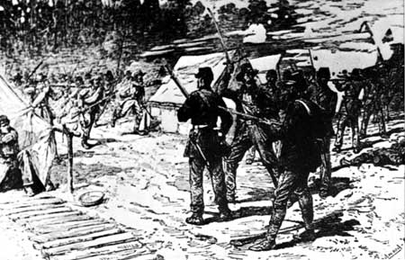

图注：表现邦联攻击普伦蒂斯营区的历史插画，原载《内战战役与领袖》。属于事后绘制的战斗表现。 [图像出处](https://npshistory.com/handbooks/historical/10/hh10c.htm)

我到谢尔曼一带时，他已经把攻击判断为全面进攻。这里的地形给守军一些机会：敌军需要穿过前方的溪谷，再向我军所在的坡地上来；炮兵可以射击开阔地，步兵可以利用树木遮蔽。但敌人的运动不只发生在正面。普伦蒂斯方向的变化，使谢尔曼左侧越来越暴露；原本面向前方的炮位，会受到侧面逼近的步兵威胁。谢尔曼试图把兵力留在教堂，因为主路仍是敌军向登陆场推进的通道。守住这里，既能拦截正面来敌，也给后方各师展开争取时间。（[资料3，四月十日报告](#source-3)）

局部阵线的破裂首先表现为一些新兵团离开原位。谢尔曼报告，阿普勒的俄亥俄第五十三团、芒根的第五十七团退后，沃特豪斯的炮兵因此失去侧面保护。麦克勒南派来的伊利诺伊部队曾继续支撑，赖思上校负重伤后，支援部队也出现混乱，三门炮被夺。这里不是一道抽象的防线突然下降了士气，而是一连串可以追踪的变化：步兵离开，炮兵失去掩护，前来补位的指挥官倒下，敌军靠近火炮，余下人员再选择后退。每一个环节都缩短了下一个环节能够处理局面的时间。（[资料3，四月十日报告](#source-3)）

教堂以西的巴克兰、麦克道尔所部继续抵抗。谢尔曼向他们发出坚持命令，并试图保住泰勒炮兵的射界。可是当敌军已经向左翼后方推进时，继续把整个师留在原营地，会使教堂位置从支撑点变成一处突出部。谢尔曼遂把泰勒炮兵以及仍有组织的部队撤向汉堡—普尔迪路。这次调整不是军团司令部事先画好的第二阶段，而是现场指挥官在邻部后退和侧翼受威胁以后作出的应对。我沿线掌握的情况，也必须随着他的后撤重新更新。（[资料3，四月十日报告](#source-3)）

道路能帮助撤退，也会聚集风险。谢尔曼在路口遇到贝尔的炮兵连，要它转入战斗、用火力阻滞追兵。贝尔很快中弹，驾驶兵和炮手撤离，炮兵连大部分火炮被留在原地。火炮并不是因为弹药已经打光才被放弃；军官伤亡和炮组溃散，使它们还没充分发挥作用就失去机动。失去这批炮后，守军又少了一段能够掩护重新列队的火力。谢尔曼只能继续靠拢麦克勒南，把残存的组织放到另一条更有支撑的阵线上。（[资料3，四月十日报告](#source-3)）

麦克勒南此时不能只把自己的师当作后方预备队。他的一个旅已在谢尔曼方向交战，其他部队也要承担直接防御。双方在营地、林缘和开垦地之间反复变换位置。后来的部队记录把麦克勒南先后据守的阵地分成若干条线，说明他的部队持续受压，也说明每一次退后之间仍有抵抗。前一条线失守以后，下一条线能否形成，取决于能否聚拢士兵、把炮转过来，并且找到尚未撤退的邻部。军团司令的命令只有通过这些具体动作，才会成为战场上的时间。（[资料2，首日战斗](#source-2)）

谢尔曼把麦克道尔旅投入敌军侧面，协助麦克勒南减轻正面压力。随后两人的兵力借助树木、倒木和右侧林谷继续战斗。部队的混合从这时起更加明显：一个师的团可能在另一个师的正面，一名旅长可能失去本旅大部分人员，却仍留在战场协助别的指挥官。希尔德布兰德的旅已严重离散，他本人没有离开。这类情况使番号不能简单等同于战力；一张完整编制表上的旅，可能已经不能整体行动，而散入其他队伍的人仍在开火。（[资料3，四月十日报告](#source-3)）

中午前后，麦克勒南与谢尔曼一侧还发动过反击，夺回一部分营区。进攻者也需要在林地中重新列队、补充弹药，不能把每一处得手立刻接成不间断的追击。反击利用了这种间歇，暂时把敌人推离一些重要位置。然而，我军没有因此恢复到开战前的完整阵线。两翼和中央承受的压力并不同步，反击向前的团还必须顾及邻部。夺回一座营地与把全军重新安置在原来的半圆形驻地之间，隔着很大的组织距离。（[资料2，首日战斗](#source-2)）

我在这一带反复处理的另一件事是弹药。谢尔曼的报告提到，部队多次耗尽弹药，而我从后方维持补给。他要求一些弹药已用完的团暂时坚守，是因为整团退走可能使邻部也以为阵线正在崩溃。这并不是可以长期维持的办法。空着的弹药盒不能阻止下一次攻击，送来的弹药也不能自动分到每一个仍在树林中的连。守住位置与把物资送到位置上，需要同时进行；如果只有一个成功，阵线仍会失效。（[资料3，四月十日报告](#source-3)）

下午，谢尔曼和麦克勒南再向靠河方向调整。他们选择的新阵位把右翼放在能掩护蛇溪桥的地方，因为刘·华莱士仍可能由那里来。这个选择把眼前防御与期待中的增援连接起来：守住桥路，援军便能展开到现有阵线的外侧；若任由敌人占领出口，援军即使按时到达，也可能先打一场渡溪战。谢尔曼报告，这一带的一些炮兵和第二十九伊利诺伊团击退了近处攻击，部队终于得以在新位置支撑到夜间。左翼的局势仍在恶化，但右翼与增援道路的联系尚未被切断。（[资料3，四月十日报告](#source-3)）

## 五、中央与左翼：保持联系比守住一个地名更困难

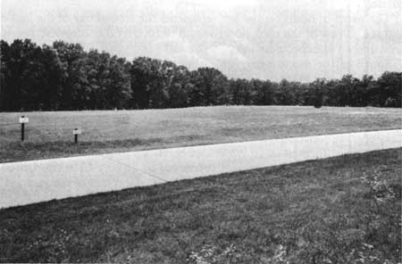

图注：邓肯田地的战后地形照片，便于理解开阔地与林缘之间的关系。来源：国家公园手册。 [图像出处](https://npshistory.com/handbooks/historical/10/hh10f.htm)

威廉·华莱士与赫尔伯特的部队向前展开时，必须填补的不止一个缺口。赫尔伯特把维奇旅送去支援麦克勒南，自己带其他部队向桃园一带推进。威廉·华莱士的麦克阿瑟旅则被拆开使用：有部队守蛇溪桥，有部队去支援右翼，还有部队转向左侧。一个师名义上仍在我麾下，实际能供师长直接集中运用的团数却已经减少。后方兵力投入后，军团没有一支同等规模、完全未被触动的预备队随时等候。（[资料2，首日战斗及联邦部队行动](#source-2)）

中央新防线沿邓肯田地附近的林缘和一条旧道路展开，威廉·华莱士的塔特尔旅在那里形成重要支撑。普伦蒂斯把收拢的残部接到这条线上，旁边还有陆续补来的单位。敌军要攻击这里，一些方向必须先穿过开地，再接近林缘步兵和炮位。防御者可以利用这种暴露射击。后人把这个地段称为“黄蜂窝”，但我在当天首先需要了解的是中央有没有部队、还有没有弹药、两边是否保持联系。地名说明不了一条防线的全部状态。（[资料2，首日战斗](#source-2)）

中央的坚守给我军带来了时间。正面的攻击遭到抵抗后，敌人必须重新集合、把火炮拉到能够开火的位置，再投入下一批步兵。我军各团在相对稳定的地段作战，也较容易把传令、弹药补充和伤员后送维持下去。可是稳定是局部的。右翼正在从教堂向后缩，左翼也在受压；如果中间的部队仍留在原位，原本面向南方的正面就会越来越像伸向敌军的突出部分。某一点越能坚持，不等于它在整个阵线里的处境越安全。（[资料2，首日战斗](#source-2)）

我曾到普伦蒂斯所在的地段，要求保持抵抗。这个命令服务于全军的需要：中央突然打开，会让敌军更容易冲向后方，也可能把正在撤退的两翼分开。要求坚持并不能消除现实变化。指挥官是否知道邻师已经后退，是否仍有一条能通往河边的道路，传令兵是否还能往返，决定着坚持能持续到什么时候。对我而言，巡视途中看到一个师长仍在阵地，与半小时后同一地段是否已被包围，是两种不同的信息。没有一条报告能永久代表现场。（[资料1，第二十四章](#source-1)；[资料2，首日战斗](#source-2)）

在更靠东的左翼，斯图尔特旅承担着另一种孤立。他远离谢尔曼的主力，面对从南面和西面逼近的威胁，必须依靠附近部队而不是等待师长从教堂赶来。其四月十日的报告记载，他一度只能找到伊利诺伊第五十五团和俄亥俄第五十四团的大部，另一个团的去向并不清楚。他转移到新的坡地，把部分第五十四团派去阻止侧面接近的敌人，并等待承诺的支援。这里的阵线不是从容摆好的整旅横队，而是在不断寻找人员、判断侧翼和改变朝向中形成。（[资料6](#source-6)）

斯图尔特最后面临弹药枯竭。其部队已取用伤亡人员身上的弹药，仍无法维持原有射击强度。他与部下军官商议后后撤，试图在另一个高地重组；敌军火炮能够继续威胁那个位置，于是又不得不转移。这个过程经由溪谷和曲折路线完成，避开了部分直接火力，却让部队更难与邻部保持整齐接合。到他受伤交出指挥时，该旅的人员已通过不同路线向后集中。师长的报告和旅长的报告因此看见了不同片段，必须在战后对照才能拼出完整过程。（[资料6](#source-6)）

我在靠近后方炮位的地方遇到其中一部，命令马尔姆堡把人列成战线。斯图尔特的报告记载，我的参谋军官此前已要求拦住向登陆场移动的部队，并说明弹药正在送来。马尔姆堡将本旅残部与其他零散人员组成新的防御队伍。重新收拢的意义在这里十分具体：这些人不必先恢复原来所有连、营、团的关系，才有资格进入战线；他们先需要有位置、有指挥官、有弹药，能够与旁边的炮兵和步兵共同抵抗。随后再恢复组织，已是夜间和第二天的任务。（[资料6](#source-6)）

左翼残部的指挥权也不是一次整齐的移交。斯图尔特肩部受伤以后，史密斯承担旅级指挥；史密斯又去寻找此前向左侧分遣的费舍尔部队，马尔姆堡因而暂时负责就地聚集的人员。费舍尔所带的是第五十四俄亥俄团的四个连，原任务是保护左侧，不能因暂时看不见他们就认定这些人全部阵亡或逃散。随后他们重新归入队伍，仍能成为守住后方的力量。这里的每一次接替，都围绕受伤、分遣与重新集合的实际需要展开。（[资料6](#source-6)）

斯图尔特报告还记下第七十一俄亥俄团少量人员在后撤途中加入，以及该团另一部到河边向炮舰示意的情况。旅名下的三个团此时已经分处不同地点。对后方收拢工作的要求因此很具体：辨认来的军官还能带多少人，把可以作战的一部先停住，继续寻找其他分遣队，然后接入现有炮线。把一个团记成“离开原阵地”，不足以说明该团每个人此后的行动；同样，收拢了一批人，也不能立刻宣布原旅已经完整恢复。（[资料6](#source-6)）

赫尔伯特左侧的压力最终迫使其部队向后调整。威廉·华莱士和普伦蒂斯所在的中央仍在抵抗时，左右两侧向河岸后缩的趋势已经越来越明显。原来分配到不同方向的部队，很难再全部收回来拼成同一条线。有些团能够穿过尚未封闭的间隙撤出，有些团因命令、距离或敌人接近而滞留。前线每向后移动一次，整个指挥系统就需要重新寻找通路，而敌人也在利用这些间隙向内转。中央的危险由正面火力逐渐变成多面威胁。（[资料2，首日战斗](#source-2)）

黄蜂窝最后被包围。威廉·华莱士在试图退出时负致命伤，塔特尔带一部分部队脱离，更多人留在包围圈中；普伦蒂斯与一批军官、士兵于傍晚投降。约两千二百名被俘者包含两个师的人员，不能全部写成普伦蒂斯的整师。消息抵达后，我失去的是一片重要阵地，也失去了两个师按原有结构继续作战的能力。另一些幸存者仍能加入后方防线。军队的中央遭受重创，但登陆场附近的抵抗并没有随投降同时结束。（[资料2，首日战斗](#source-2)；[资料1，第二十四章](#source-1)）

## 六、没有到来的第三师，以及正在渡河的援军

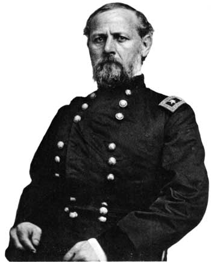

图注：唐·卡洛斯·比尔历史肖像。国家公园手册标注原藏美国国家档案馆。 [图像出处](https://npshistory.com/handbooks/historical/10/hh10c.htm)

在前线逐步后缩的同时，我一直等候刘·华莱士。第三师距离战场并不遥远，又有此前战斗的经验，及时到达可以成为一支相对完整的力量。可是“距离近”只说明行军可能需要的时间，不能证明命令已经送达、路线已经说清、部队已经开始走。我派出巴克斯特以后，没有很快收到第三师进入战线的回报。随着需求加剧，我又让参谋军官去找他。不同叙述对这些使者的先后、出发时刻和途中会面的时间有差别；共同的事实是，寻找援军本身消耗了新的时间。（[资料1，第二十四章及补注](#source-1)；[资料2，首日战斗](#source-2)）

华莱士没有在我希望的路线上直接出现。军官们终于找到他，才把战场已经后退的情况与他所依据的路线联系起来。他正在走向战前我军右翼所在的方向，而谢尔曼已经放弃了那一带。旧的接合点不再存在，继续按旧地形目标前进，会把第三师带到危险位置。于是部队需要改道，重新走向靠河的道路和蛇溪桥。对等待援军的一方来说，这表现为援军迟迟不来；对行军中的一方来说，则是目的地的战术意义发生改变，路线必须重算。（[资料1，第二十四章补注](#source-1)）

当时我能确认的是第三师尚未到达，因此不能把它已经列入眼前防御线。命令如果把一个“正在赶来”的师当作已经可以依靠的邻部，现有部队就可能留出无人守卫的空当。谢尔曼仍须掩护增援通路，我仍须用正在战场上的人抵挡进攻。后来关于华莱士动机的争论不应搬进这个时刻。没有证据可以让我以第一人称声称，当时已经知道他沿途的每一次停顿或真实想法。我所采取的动作，是继续催促，并且在他真正到来以前维持现有防线。（[资料1，第二十四章](#source-1)）

东岸的情况不同，却同样需要把“援军接近”拆成多个步骤。纳尔逊的部队从萨凡纳向匹兹堡对岸行进，抵达后必须渡船。比尔本人来到登陆场，与我会面，我们首先需要处理的是怎样把他的部队运到西岸。汽船不只是一个方便的背景：没有渡运，东岸完整的师在西岸战线上仍是零。渡过河以后，部队还要登上高岸，避开后方拥挤，找到应占领的位置。增援的实际速度由行军、船只周转和岸上组织共同决定。（[资料1，第二十四章](#source-1)；[资料5](#source-5)）

我发给纳尔逊的催援信息说明了新部队的双重作用：既增加战斗力量，也使已经苦战的部队看见支援到达。前线士兵当然不会从一纸总兵力统计里获得帮助，整齐的生力军沿道路出现，才会改变附近部队对局势的判断。不过，精神上的作用仍以实际行动为前提。新团要能接替射击、补上缺口、掩护炮位，才能让老部队整顿。只在渡口看见旗帜，和在傍晚防线上得到一个能够开火的团，并不是同一件事。（[资料5](#source-5)；[资料2，首日战斗](#source-2)）

纳尔逊师的阿门旅先头在傍晚进入西岸，其中印第安纳第三十六团支援靠左的炮位。关于它对当晚守住登陆场的作用，我后来与比尔一方有不同评价；这里能够确定的是，先头部队在第一天结束前到达，随后还有更多部队陆续过河。第一天的主战斗已使我军严重损耗，援军无法追回白天已经失去的营地和人员，却能为夜间布阵及第二天行动提供新的选择。是否已到、到了多少、是否已经展开，是三个需要分别回答的问题。（[资料2，首日战斗](#source-2)；[资料1，第二十四章](#source-1)）

刘·华莱士到达时天色已晚，第三师进入我军右翼。谢尔曼因此调整自己的位置，给它展开空间。这个师没有参加白天那些反复争夺营地的战斗，保存了较多完整组织，也带来新的炮兵和军官系统。它的价值不能简单用全师名册人数表示，因为还要扣除克伦普守备等人员；但是与眼前那些混合团相比，完整的旅和指挥链条特别重要。第二天右翼进攻需要的不只是更多枪口，还需要一支能够听令转向、保持侧面联系、继续向前运动的部队。（[资料1，第二十四章](#source-1)；[资料2，次日战斗](#source-2)）

到夜间，两条增援路径终于在同一个战场上产生效果。刘·华莱士由北侧桥路进入，比尔各师由河上进入。它们没有共同参加清晨抵抗，也不应被提前算进第一天的局部兵力对比。它们在不同时间完成抵达，却共同改变了下一天的条件。我可以让原有部队继续占据中间地段，把较完整的新师放到两翼，重新组织向前的行动。白天保住登陆场和蛇溪通道的结果，在这一刻转化为可用的兵力。（[资料1，第二十四章](#source-1)；[资料2，次日战斗](#source-2)）

## 七、最后的防线：把河岸变成继续作战的支点

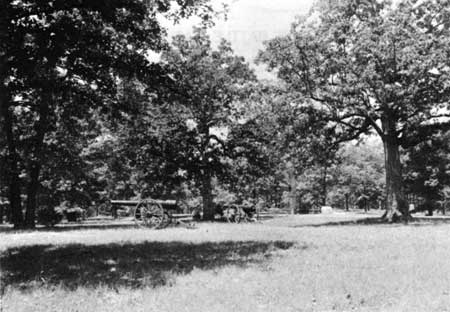

图注：格兰特最后防线遗址及陈列火炮的战后照片。来源：国家公园手册。 [图像出处](https://npshistory.com/handbooks/historical/10/hh10f.htm)

傍晚的防御不能等到所有部队撤齐才安排。韦伯斯特上校在登陆场前方组织炮兵，把重炮和从前线退下来的野战炮纳入新的阵地。炮线沿高处展开，前面有沟谷，靠河的一端又受到舰炮支援。炮兵集中使攻击者必须面对比零散营地更强的火力，但火炮仍需步兵保护。赫尔伯特和其他退下来的单位在炮位周围列队，右翼由谢尔曼、麦克勒南等部接续。我的目标是把各种仍能作战的单位接合成一条有效防线，不能因为它们来源不同就等到整编完成再使用。（[资料2，首日战斗](#source-2)；[资料7](#source-7)）

这一线的价值部分来自阵地缩短。上午的营地散在广大林区，部队之间有缺口；后撤把许多仍有组织的兵力压缩到较小地域内，炮兵、弹药和河运节点也更靠近。缩短并不自动带来优势：后方拥挤会阻碍运输，敌人一旦突入就很难再退。但在没有被突破的情况下，它使我军能把较多火力集中在攻击者必须经过的坡面和通道上。对我来说，继续作战的基础仍然是这些实际存在的炮位、部队和通路，而不只是保有一个叫作“登陆场”的地点。（[资料2，首日战斗](#source-2)）

迪尔支沟横在靠河阵地前面，沟底与两侧坡面使攻击难度增加。敌军若要冲上北面的高地，必须先下到低处，再重新攀升；横队通过时会受地形挤压，后方火炮也不容易保持同样速度。我们在高处射击的步兵与炮兵因此有机会把火力集中到来敌。这个地段与白天的开阔农田不同，不能把某部下午在营地里推进顺利，推算成它傍晚也必然能轻易冲到水边。（[资料2，首日战斗](#source-2)）

河上的“泰勒”号和“列克星敦”号也参与阻止敌人接近左翼。白天大片森林和起伏地形限制了舰炮观察，射击很容易危及友军；到我军收缩后，敌军接近靠河沟谷，舰炮才更有条件发挥作用。船上的火力不能代替陆上的阵线，却能增加攻击者的压力，使他在接近炮位时同时面对侧面和高处火力。海军与陆军的配合由射界和友军位置决定，没有证据支持把两艘炮舰写成从清晨开始就能随意轰击全战场的浮动堡垒。（[资料1，第二十五章](#source-1)；[资料2，首日战斗](#source-2)）

敌军最后的接近没有把我军从高岸上赶下去。前线仍发生炮击和零星进攻，渡来的先头也加入防御，但是全面突破没有出现。这里的结果十分明确：到战斗逐渐停止时，河岸还在我军手中，渡运仍可进行，第三师能够从北侧进来。白天的严重损失已经发生，无法用傍晚守住阵地来抹去；同样，营地陷落也不能证明军团已失去全部组织。我的一部分师仍有能指挥的骨干，另一些残部能在新指挥官身边继续行动。（[资料1，第二十四章](#source-1)；[资料2，首日战斗](#source-2)）

后方的散兵与前线的坚持同时存在。我后来回忆岸边有大量脱离队伍的人，而谢尔曼报告自己的夜间部队已经是混合组织，只有部分旅保持原有形态。这两种记录说明，不能从河岸一处拥挤景象推出整个军团都已不能作战，也不能从某个旅仍在阵地上推出全军毫发无损。司令官需要按实际状态分配任务：完整单位适合较复杂的机动，混合部队可以承担相对明确的地段防御，无法恢复的人员暂时不能算进战线上。夜间整顿要处理的正是这些差别。（[资料1，第二十四章](#source-1)；[资料3，四月十日报告](#source-3)）

我把第二天的方向定为进攻。我向师长们安排，天明后用较强的散兵线向前探明敌情，主力在能够支援的距离跟进，接敌后展开攻击。散兵是拉开间隔、先于密集队列前进的士兵，他们的作用是寻找敌人的实际位置、避免主力在未知情况下直接撞上完整阵地。这道命令并没有预知敌军夜里停在哪里，也没有指定每一个团必须在某一分钟夺取哪座农舍。它要求部队重新取得接触，把主动探明敌情和继续推进结合起来。（[资料1，第二十四章](#source-1)）

夜间下了大雨。士兵在白天战斗后暴露于风雨之中，伤员需要救护，弹药和食品还要向前线补充。军队没有因为枪声减弱便恢复到清晨状态。谢尔曼派人寻找失散单位，斯图尔特旅的幸存者也需要重新归队；其他军官同样要找回部下、核实还能使用的炮和人员。我的脚踝仍影响行动，进攻命令则已向各师传达。援军陆续到来后，已有足够条件组织次日行动，至于各部怎样把命令落实到队列里，仍要靠这一夜的具体整顿。（[资料1，第二十四章](#source-1)；[资料3，四月十日报告](#source-3)）

## 八、四月七日清晨：两翼的新兵力把战线重新推向南方

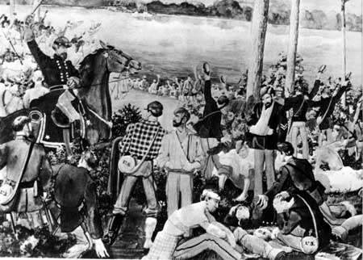

图注：联邦援军抵达的历史插画。来源：国家公园手册，作为战后图像叙事阅读。 [图像出处](https://npshistory.com/handbooks/historical/10/hh10d.htm)

第二天，我原有部队大体组成右翼，比尔指挥他的部队在左翼。由我军最右侧向左看，刘·华莱士在外侧，接着是谢尔曼、麦克勒南和赫尔伯特；比尔一侧的麦库克、克里滕登、纳尔逊等部依次展开，纳尔逊靠近河流。这个排列描述的是进攻逐步展开后的关系，不是说所有师在同一秒钟同时准备完毕。麦库克部分部队的抵达、火炮登岸和从后方赶上，都使阵线的形成具有先后。相邻部队之间必须边走边建立联系。（[资料1，第二十四章](#source-1)；[资料2，次日战斗](#source-2)）

刘·华莱士率第三师从右翼前进，首先遇到前方的邦联部队。完整的师组织使他能够把正面压力与外侧机动结合起来：向前推进的同时，设法把右翼伸到敌人左侧。那里仍是受溪流、林地和沟谷限制的地带，外翼不能无限延伸，但只要迫使对方担心侧背，便可以帮助正面部队取得空间。第三师的出现还使谢尔曼不必独自承担最外侧的防护，可以把更多注意力放在与麦克勒南的接合和前方阻力上。（[资料2，次日战斗](#source-2)）

谢尔曼接到我的命令后，派参谋去找还没有集中起来的部队，特别是前一天与师主力分离的斯图尔特旅。他带着残存的师部队、密苏里第十三团和其他混合单位前进，重新进入麦克勒南原营地右翼附近。前方炮火迫使他停顿和展开，他还需要判断比尔一侧是否已在向前。步兵如果只顾自己这一段走得快，可能形成一个暴露的突出部；如果每一段都等邻部先动，又会丧失整个进攻的势头。谢尔曼用前方炮声、传来的消息以及近处部队位置判断继续推进的时机。（[资料3，四月十日报告](#source-3)）

左翼的纳尔逊也向前探进，逐渐接触敌军重新组成的阵线。昨天我军在这里失去的桃园、林缘和路口，今天变成需要重新夺取的地形。新到部队有较完整的组织，但不是在空地上检阅。炮兵能否跟上，决定步兵遭到反击时有没有支援；一支旅推进到邻旅前面，就可能受到侧射。比尔必须把纳尔逊、克里滕登和陆续到来的麦库克部队衔接起来，我则必须使田纳西军团中间各师与它们保持接触。两支军队的行动彼此关联，仍分别通过各自的师长传达。（[资料2，次日战斗](#source-2)；[资料8，第二日](#source-8)）

七日的战斗因此没有从一开始就成为单向追赶。敌人重新形成阻击线后，也发动反击，一些我军部队被迫退回重新集合。阵地的易手与前一天相似，都是步兵、炮兵和近旁部队接合的结果；变化在于，我军有更充足的完整单位可以继续投入，对方则必须用昨天已经打散的部队重新填线。生力军不保证每一次局部攻击成功，却使一次失败不那么容易变成整条战线无法修复的缺口。（[资料2，次日战斗](#source-2)；[资料8，第二日](#source-8)）

当我沿线查看时，不能把“重新占领旧营地”理解为战斗已经结束。营地可能在敌军当前防线后面，也可能处于双方炮火能够覆盖的位置；帐篷和原来的师部所在，只能帮助识别地点，不能告诉我现在守着那里的是哪个旅。谢尔曼后来报告，他看到敌军在教堂附近及汉堡路方向的炮位，能够向接近林地的部队射击。夺回营地需要先打破这些实际防御，不能靠沿昨天的道路一直走过去。（[资料3，四月十日报告](#source-3)）

中间地段的战斗逐步把两军的进攻连在一起。麦库克师的部队进入科林斯路一带，与麦克勒南、谢尔曼的战斗发生直接联系。威廉·华莱士师的残部由塔特尔组织，也作为可用力量参与支持。昨天的师已不能以原结构完整出现，幸存者却可以在第二天担当新的任务。军团没有等待每个番号恢复到原样，而是在能够确定其指挥和位置以后继续使用它们。这个调整使严重受损的组织仍能贡献战力，而不是把第一天的损失机械地当作第二天永远缺少的整师兵力。（[资料2，次日战斗](#source-2)）

从河岸到前方，战线的移动又使弹药运输逐渐变长。炮兵需要从临时防御位置向南跟进，步兵前进得越远，与夜间补给地点的距离越大。谢尔曼让赶来的火炮进入阵位，并在推进中用人力移动部分炮位、继续射击。前进、停下、开火、再前进，构成实际的攻击节奏。持续进攻不等于每一分钟都在向前跑；在敌人炮位仍能射击时，把自己的炮先带到能够压制它的地方，可能比让步兵更快冲进去更能保持攻势。（[资料3，四月十日报告](#source-3)）

这一段前进可以沿谢尔曼报告所给的几个位置看清。约上午十时，主科林斯路方向的枪炮声逐渐接近，第三师又在其外侧掩护，他才把纵队带到麦克勒南右翼，展开面向南方的战线。巴克兰旅横跨山脊，斯图尔特旅的幸存部队进入右侧树林。两旅并不是沿同一条道路一前一后走，而是分别占据山脊和林地，在正面上相互接续。山脊提供展开空间，树林却使队形和邻部更难辨认；这也是他强调缓慢、持续推进的具体环境。（[资料3，四月十日报告](#source-3)）

我安排从后方继续输送弹药，补给实际怎样进入前线，可以从谢尔曼师的炮兵行动看见。泰勒从后方取弹回来时，带来芝加哥轻炮兵甲连的三门炮，由伍德中尉指挥。谢尔曼没有把它们留在远处统一轰击，而是让炮手用人力向前移动炮位，停下射击后继续推进。步兵借它们的火力逐渐接近科林斯路穿越麦克勒南营区的地点。这几门炮并没有在统计表中增加整个军团的火炮总数；它们从后方来到正确地段，才使原已拥有的装备重新成为进攻力量。（[资料3，四月十日报告](#source-3)）

科林斯路附近的接合比阵线草图更加复杂。谢尔曼终于在近处看见比尔部队的完整队列，随后目睹维利希指挥的一个团进入林木突出部。这个位置约在希洛教堂以东五百码，树林后方有抵抗力量，接近路线又受到敌炮威胁。该团进林后激烈交火，约二十分钟后退出。这是谢尔曼报告中的时距和距离，不能据此推出全军所有地段都在同一分钟遭到反击；它能说明的是，援军到场以后仍须夺取一个由敌人火力掩护的具体林地，而不是直接接收一条已经开放的道路。（[资料3，四月十日报告](#source-3)）

这次局部受挫没有让两个军团各退回自己的出发位置。谢尔曼继续保持与麦克勒南及麦库克部队的接触，炮兵则成为可以跨越隶属关系分配的支援。对我来说，后方补给必须持续，因为这时前线并没有停止消耗。谢尔曼后来特别列出伊利诺伊第四十团与密苏里第十三团：弹药盒已经空了，仍被要求在火下守住位置。这不是没有弹药也能继续射击，而是暂时不让阵线因一个团自行退下而出现缺口，等待补给恢复。在这种情况下，把弹药运到部队手里，比再向纸面兵力数字里增加一个番号更为紧迫。（[资料3，四月十日报告](#source-3)）

## 九、七日下午至八日：夺回营地之后，追击为什么停下

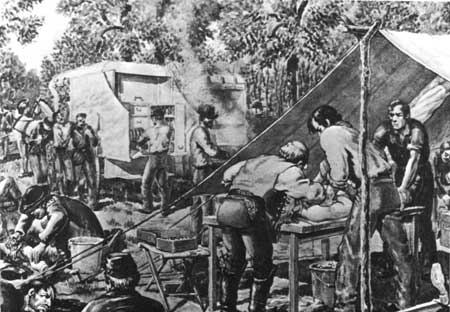

图注：表现战地帐篷医院的历史插画，不是救护现场照片。来源：国家公园手册；不据此断定希洛是帐篷医院的最早使用地。 [图像出处](https://npshistory.com/handbooks/historical/10/hh10d.htm)

到中午以后，科林斯主路和教堂附近的争夺仍然激烈。谢尔曼看到麦库克师的部队进入前方林地，遭受猛烈射击后退回；随后更大的攻击力量再次组织起来。他把自己的部队与这批援军并列推进，并把能用的炮送到重要地段。几支部队在这里的配合，给我军带来了突破机会。战场上的指挥不再是两个军团各自完全分离的一次进攻，而是不同来源的旅、团和炮兵在同一个路口附近互相提供条件。（[资料3，四月十日报告](#source-3)）

麦克勒南向谢尔曼请求炮兵支援，谢尔曼把赶到的炮分出，又让参谋寻找其他能用的火炮。麦卡利斯特的榴弹炮随后参与射击。前方敌军有炮位能够打击逼近林缘的纵队，步兵如果没有火力配合，进入开地就会付出很大损失。炮击压制敌炮之后，步兵才有更大机会接近和占领。这里决定推进速度的是兵种协同的先后，而不只是前沿指挥官愿不愿意下达冲锋命令。（[资料3，四月十日报告](#source-3)）

这一轮协同有明确的接续次序。谢尔曼先把伍德的三门炮交给求援的麦克勒南，再派参谋把后面另两门炮带上来；它们是麦卡利斯特炮队的二十四磅榴弹炮。到约下午两时，教堂附近及汉堡路方向的敌炮仍能用近距离霰弹威胁向林地前进的队列。炮兵必须先与这些炮位交战，才给步兵并进创造较好的条件。不同炮队在这里先后出现，不能写成清晨就已集中好的一个大炮群。（[资料3，四月十日报告](#source-3)）

麦库克师再次投入的是卢梭旅。谢尔曼命令由蒂·基尔比·史密斯接替指挥的斯图尔特旅接在它右边，巴克兰旅再接在更右边，一起向前。这个排列与上午山脊上的部署不同，说明旅级部队正在围绕眼前突破点重新接合。谢尔曼亲自指导重炮射击，报告先压住左侧敌炮，再压住教堂附近敌炮；三个旅所构成的并进正面随后越过争夺地段，到约下午四时回到原来前线。这里的时间来自他的战报，是该地段的行动节点，不代表所有邦联部队直到四时才开始撤退。（[资料3，四月十日报告](#source-3)）

我在下午继续于各部之间往返。敌军一些地段开始后退，仍有部队在主路附近反击，企图稳住防线。我在接近谢尔曼与麦克勒南部队交界的一带收拢附近人员，推动一次向前攻击。回忆录把这次行动记为我亲自带到可以实施冲锋的位置；这是一项局部动作，不能代替各师整天的推进，更不能证明敌人全军在同一瞬间溃散。我的视野首先是眼前的地段，其他地方的后退、掩护和队列变化，需要由各部报告才能知道。（[资料1，第二十四章](#source-1)）

谢尔曼报告，他与麦库克师部队的并进，在下午重新夺回原来的前沿营地。教堂和主路一带的敌军退出，田纳西军团回到前一天失去的位置。此时最直接的战果是登陆场危机解除，我军恢复对会战场地的控制。至于敌人撤离了多少火炮、后卫停在哪里、主力是否还可能重新发起攻击，不能只根据前面枪声减少便作出确定判断。部队的疲劳和混合状态也还存在，胜利并没有把所有团立刻变回一支适合长途追击的新军。（[资料3，四月十日报告](#source-3)；[资料1，第二十五章](#source-1)）

我没有在七日下午发动全军紧追。士兵已连续作战，许多人还经历了无掩蔽的雨夜；道路被降雨和车辆碾压，炮兵与补给运输都受到限制。我与比尔之间也没有一套事先约定的追击分工。作为资历较高的现场指挥官，我应当承担决定行动方向的责任；但比尔仍拥有自己的军队指挥系统，不能把他的每个师视作我可以在不沟通的情况下随时拆分的部队。我后来的回忆提到，当时没有及时与他面谈并作出有效安排。（[资料1，第二十五章](#source-1)）

八日，我让谢尔曼和比尔军中的托马斯·伍德部队向前侦察，确认敌军撤退及可能的再攻威胁。他们沿科林斯方向推进，遇到被遗弃的营地、伤员与野战医院。侦察部队仍然需要防范埋伏，因为树林、溪谷和狭窄道路可以给后卫创造条件。前一天敌人退出会战场，并不等于从匹兹堡到科林斯的整个空间已经没有有组织的抵抗。我的部队要用实际接触核实敌情，而不能用胜利的结果替代侦察。（[资料8，第二日](#source-8)；[资料1，第二十五章](#source-1)）

在后来称作“倒木地”的地点，邦联骑兵袭击了谢尔曼前出的步兵和骑兵，使其发生混乱；接近后面的联邦步兵主力后，骑兵又被击退，福雷斯特负伤。这个后卫战没有改变七日的会战结果，却说明追击并不只是沿路收取俘虏。侦察人员与主力之间的距离、倒木对队列的干扰、前方敌人规模的不明，都能让一支正在获胜的军队在小范围内受挫。谢尔曼等部随后返回，全面紧追没有继续展开。（[资料8，第二日](#source-8)）

战场上的伤员与死者仍需处理。我要求各部埋葬自己的死者，并组织人员埋葬阵前的邦联死者；对敌方埋葬人数的报告没有全部完整执行。这个缺口后来使损失判断更加困难：从某处战场看到很多尸体，不能直接推算全军伤亡，也不能把不同部队报告的埋葬数未经核对就相加。救护、收容、登记、掩埋与整理武器同时进行，都是战斗结束后的实际职责。部队恢复占领，也意味着必须承担留在战场上的双方伤员。（[资料1，第二十五章](#source-1)）

希洛的两日会战到此结束，八日侦察又确认邦联主力已退向科林斯。我的军队保住了河运基地，敌军没有完成消灭我军和夺取登陆场的目标；我们也没有在撤退途中消灭敌军。哈勒克随后到前线统筹更大规模的集中，进攻科林斯成为下一阶段行动。我的部队仍在他的战区体系内，希洛战场上临机组织两军抵抗和反击的阶段已经过去。接下来应当回答的，不再是我在当天能下达哪道命令，而是两天里那些各自有限的消息和行动，怎样合起来造成最后结果。（[资料1，第二十五章](#source-1)；[资料2，战斗结果](#source-2)）

## 战后复盘：把双方的行动放在同一条时间线上

第一人称叙述至此结束。下面依据双方报告、格兰特与谢尔曼的回忆录、早期战场调查和后来的研究，检查指挥官在战斗时看不见的另一面。希洛的结果需要分成三个问题：约翰斯顿为什么能够把主力带到联邦营地前；邦联为什么在推进一整天后仍未夺取登陆场；格兰特为什么能够反攻，却未能歼灭撤退中的敌军。它们分别涉及情报判断、战场执行和胜利之后的行动条件。

| 时间 | 联邦军主要行动 | 邦联军主要行动与变化 |
|---|---|---|
| 3月中下旬 | 在匹兹堡、克伦普集中；等待比尔 | 在科林斯集中，准备抢在两军会合前进攻 |
| 4月3日至5日 | 前哨交战，仍准备向科林斯推进 | 向北行军，因道路、雨水和组织问题延迟 |
| 4月6日黎明 | 前出侦察接敌，各师陆续应战 | 主力由南面推进 |
| 6日上午 | 普伦蒂斯营区失守；谢尔曼与麦克勒南后撤重组 | 突入营区，部队逐渐混杂 |
| 6日中午至下午 | 中央继续抵抗，两翼后缩 | 扩大进攻；约翰斯顿约下午两点半死亡 |
| 6日傍晚 | 中央一部投降；靠河阵线守住，援军陆续抵达 | 夺取俘虏，最后接近未能突破河岸防线 |
| 6日夜至7日晨 | 完成更多渡运，布置反攻 | 部队散驻，重组不充分 |
| 7日上午至下午 | 两军推进，历经反击后夺回营地 | 临时组成防线，下午撤退 |
| 8日 | 向前侦察，在倒木地交战后返回 | 骑兵后卫阻滞，主力继续退向科林斯 |

## 十、约翰斯顿抢到的机会，怎样在进攻队形里消耗

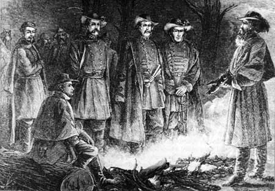

图注：表现战前一夜邦联军议的历史插画，并非现场照片。手册依次标注博勒加德、波尔克（坐者）、布雷金里奇、约翰斯顿、布拉格及吉尔默；哈迪未在图中。 [图像出处](https://npshistory.com/handbooks/historical/10/hh10b.htm)

约翰斯顿的出击有明确的时间压力。联邦军已经掌握通向田纳西腹地的水路，比尔又在西进；如果让两军会合并由哈勒克统一推进，科林斯将面对更大的兵力。邦联可以继续守铁路枢纽，也可以在联邦尚未集中时抢先攻击。选择后者意味着离开较容易组织补给的驻地，带着新近拼合的军队进入陌生而泥泞的道路。其收益是短暂的局部优势，风险则是行军稍有拖延，攻击时间就会与敌方援军到达重合。（[资料2，邦联军集中与进军](#source-2)）

这支军队由此前不同地域的部队组合而成。波尔克、布拉格、哈迪和布雷金里奇分别指挥军级部队或预备军，名称上的统一并没有立刻带来熟练协同。四月三日开始的前进，因道路、车辆、炮兵和部队次序问题耗费时间，预定的攻击没能在五日清晨实施。到五日晚，部队才在接近联邦营地的位置完成部署。双方前哨已经接触，攻击者还能不能保有突然性，并不是邦联司令部可以确定的事。约翰斯顿最终继续发动进攻，赌的是联邦还没有将附近的迹象转化成完整防御准备。（[资料2，邦联军进军](#source-2)）

攻击队形加深了指挥困难。哈迪的部队大体构成前列，布拉格在后，波尔克与布雷金里奇的部队又作为后续力量。前列正面不够宽时，还要把本属后列的旅加到外侧。这样的层层推进可以在前方遇到阻力时补充兵力，却让几个高级指挥官的所属部队在同一条正面混合。前面的旅偏向哪边，后面的旅可能就沿其打开的通道前进；一旦遇到营地、溪谷和林缘，原来的间隔很难保持。增援到达某处以后，往往由当地最高级军官直接使用，而不再经由完整的原隶属关系。（[资料2，邦联战斗部署](#source-2)）

约翰斯顿希望攻击联邦左侧，切断其通向河岸的联系，把对手推离补给和渡口。实际进攻却在整个正面展开，联邦军逐步向自己的河运基地退去。这不是计划与结果之间一个无关紧要的角度差异。退向河岸的联邦军仍可接近弹药和援军，邦联则要越过越来越多受损、散乱的营区继续推进。前线在不同方向取得的成功，若没有统一导向截断渡口，就可能把敌人压缩到一个更集中的防御位置，而不是把它推入无路可走的孤立地带。（[资料2，首日战斗](#source-2)；[资料8，第一日](#source-8)）

查尔默斯的战报把这种执行变化记录得很具体。他的旅原在后续位置，随着战场正面变宽而被拉入第一线；突入一片联邦营地后，又奉命停止、后移并转向右侧。向利克溪方向运动以后，部队还要逐渐转向北面，在溪谷与果园间展开。每次转向都可能符合眼前需要，却消耗时间、改变队形，并使炮兵落后于步兵。他报告炮兵必须在崎岖地带开路才能跟上，弹药车距离较远也曾迫使步兵暂停。这里的摩擦来自道路和组织，不需要假定官兵缺乏勇气。（[资料9](#source-9)）

联邦斯图尔特旅的报告与查尔默斯的报告，可以互相校验这一侧的战斗条件。两者都记载了开阔地、沟谷、炮兵侧射以及弹药不足，但对敌军人数、某次推进的效果和接敌时刻各有判断。斯图尔特看见的是本旅能集合多少人、支援有没有到；查尔默斯看见的是所属各团如何越过地形、炮兵何时跟上。把两份报告放在一起，可以确认这里的战斗长期牵制双方，却不能把各自宣称击溃的敌军人数直接相加。双方都在有限视野下报告战果。（[资料6](#source-6)；[资料9](#source-9)）

约翰斯顿约在下午两点半受致命伤并很快死亡，博勒加德继任。这使高级指挥发生变化，但邦联进攻并未随之终止。中央后来被包围、普伦蒂斯等部被俘，均发生在约翰斯顿死后。由此可以排除一种简单因果：主帅死亡，并不等于全军立刻停止战斗，也不能据此证明若其生还，所有问题都会自行消失。队形混杂、弹药补充、疲劳、联邦向渡口收缩等情况，在他死亡前已存在，继任者需要在既成条件下继续指挥。（[资料2，首日战斗](#source-2)）

## 十一、五个决策关口：当时究竟还有哪些选择

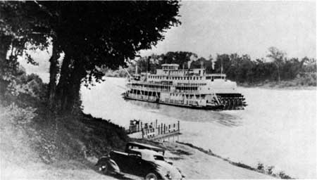

图注：离开匹兹堡登陆场的游览船。战后照片，用于展示登陆场与河岸关系。来源：国家公园手册。 [图像出处](https://npshistory.com/handbooks/historical/10/hh10f.htm)

第一个关口是战前警戒。格兰特与谢尔曼并非不知道附近有敌人，他们低估的是附近敌情所代表的规模和迫近程度。联邦指挥系统把等待会合、避免主动引发大战作为重要限制，结果前哨出现的危险信号，被解释为骑兵侦察和示威。这里应区分战略上的意外与士兵是否在睡梦中被袭击：前沿一些团确有时间列队，而军团司令部没有准备迎接这场大规模进攻，两件事可以同时成立。谢尔曼十日的报告明确承认了自己此前的判断，格兰特五日的通信也与他晚年较强的自我辩护形成张力。（[资料3](#source-3)；[资料4](#source-4)）

可行的替代方案属于推演：加强前出侦察，要求几个前沿师交换所获俘虏和接触信息，并预定遭遇大规模步兵时的集合线。它不要求格兰特预先知道约翰斯顿的完整计划，也不要求违反哈勒克命令向科林斯开战。巡逻与防御准备可以和等待援军并存。筑垒同样可以有局部方案，例如先掩护重要炮位和道路，而不是只在全面筑垒与完全不筑垒之间选择。不过，短期工事需要工具、劳力、位置勘测和射界整理，无法保证把所有新兵都转变成可靠守军。（[资料1，第二十四、二十五章](#source-1)；[据此分析](#source-1)）

第二个关口是第三师的增援。刘·华莱士依据战前支援联系所了解的道路前进，格兰特需要的则是他经靠河道路到新的战线。原命令缺乏可以完整核验的存留文本。格兰特在回忆录补注里承认，命令先由他口授，再经军官转达，他不能确定华莱士实际接到了怎样的措辞。这一承认十分关键：它使“有意违抗明确路线命令”的结论缺少充分基础。能够确认的失效，是目的地、路线和战线变化没有及时成为双方共享的信息。（[资料1，第二十四章补注](#source-1)）

可行的替代方案也是推演：使者带去的不仅是“来支援”，还应包含当前接合点、指定桥路，以及友军原右翼已后退的说明；接到命令的一方则应尽快确认采用的路线，并派前导与前方取得联系。这样做不需要实时通信技术，只需要把路线当作命令的一部分。它仍不能消除泥泞、桥梁和纵队长度造成的延误，但可以降低走向旧接合点的风险。评价华莱士时，应把选路误会与得知变化后组织改道的效率分别讨论，不能因为起点存在误会就认定后续所有耗时都不可避免。（[资料1，第二十四章补注](#source-1)；[据此分析](#source-1)）

第三个关口是中央坚守与退出的时机。黄蜂窝部队阻止正面迅速突破，确实给其他地段争取时间；两翼后退以后，其坚守又提高了被包围的风险。关键不在于坚持本身对错，而在于全军是否有明确、可传达的退出条件。通信被战斗打断，师长所见的邻部变化也不完整，这使局部防御难以在最佳时刻与全军收缩同步。反事实推演中，较早撤出部分中央兵力可能减少被俘，却可能同时开放敌军通向后方的道路；不能只保留前者收益，忽略后者代价。（[资料2，首日战斗](#source-2)；[据此分析](#source-2)）

第四个关口是博勒加德在六日傍晚停止进攻。查尔默斯称其部队仍在尝试接近河岸炮线，同时明确记载陡坡、敌炮、炮舰以及疲劳阻止了进一步突破。早期官方战史与各部报告对最后攻击的规模和时刻存在差别，但都没有提供一支完整、弹药充分、已经越过联邦最后防线的突击集团。继续攻击可能造成局部得失，也可能加重损耗。把停止命令撤销，就一定能把格兰特赶进河里，是把未发生的结果当作已具备的能力。（[资料9](#source-9)；[资料2，首日战斗](#source-2)）

博勒加德仍有需要承担的判断问题。联邦援军正进入战场，邦联没有得到同等规模的新部队；在这种变化下，夜间重新整理兵力、明确次日防御和撤退通路十分重要。实际部队散驻于缴获营地及更后方，第二天不得不仓促组成新线。这里更有分析价值的替代方案，是改善夜间集合与警戒，尽早核实渡口方向的增援，而不是让已经耗损的各旅在黑夜中无限延长进攻。它未必能逆转兵力变化，却可能减少次晨被动应战带来的损失。（[资料2，夜间及次日战斗](#source-2)；[据此分析](#source-2)）

第五个关口是七日的追击。格兰特保存军队并取得会战胜利之后，没有及时形成一支有明确任务的追击力量。他在回忆录里承认，立即追击可能多俘获一些人员和火炮，同时解释疲劳、道路与两军指挥关系的限制。推演一个较有限的追击是合理的，例如以较完整部队跟踪、迫使后卫更早展开，并在可返回范围内收容掉队者；推演无代价地歼灭邦联全军则超出了证据。八日倒木地的抵抗说明，对手还保有能够打乱追击前锋的部队。（[资料1，第二十五章](#source-1)；[资料8，第二日](#source-8)）

## 十二、把兵力表还原成能在某处作战的人

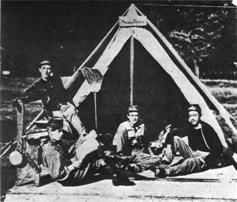

图注：新奥尔良华盛顿炮兵部队士兵，手册说明照片摄于希洛战役前。 [图像出处](https://npshistory.com/handbooks/historical/10/hh10d.htm)

以下表格首先列出指挥关系与投入次序。它帮助识别部队，不把两日累计参战人数压成一张清晨的对阵照片。师一般由若干旅组成，旅又下辖步兵团，并配属或支援以炮兵、骑兵。这里的“军团”用于译两支军队的 Army 名称，邦联下辖的 Corps 则写作军。相同中文习惯下容易混淆的层级，需要结合表内的具体指挥关系阅读。

| 阵营与指挥层级 | 主要部队、指挥官 | 开战位置与实际作用 |
|---|---|---|
| 联邦西部上级：哈勒克 | 统辖格兰特与比尔两军 | 不在六日最初战场，要求会合后推进科林斯 |
| 田纳西军团：格兰特 | 第一师麦克勒南 | 谢尔曼后方，逐渐投入右翼持续防御 |
| 同上 | 第二师威廉·华莱士 | 较靠后营地，中央与两侧分遣支援；师长致命伤后残部重组 |
| 同上 | 第三师刘·华莱士 | 克伦普周边，六日晚到场，七日从右翼攻击 |
| 同上 | 第四师赫尔伯特 | 后方路口附近，支援左右各部并守桃园方向 |
| 同上 | 第五师谢尔曼 | 教堂及两侧；斯图尔特旅另在极左翼 |
| 同上 | 第六师普伦蒂斯 | 前沿偏左，新编；营地失守后残部参与中央防御 |
| 俄亥俄军团：比尔 | 纳尔逊、克里滕登、麦库克诸师，伍德部后续抵达 | 六日先头、夜间与七日陆续投入；托马斯师未参加本次主要交战 |
| 邦联密西西比军团：约翰斯顿，后由博勒加德继任 | 第一军波尔克、第二军布拉格、第三军哈迪、预备军布雷金里奇 | 由科林斯方向北进，六日层次展开，战斗中大量混编 |
| 联邦人数口径 | 4月5日匹兹堡五师39,830人；克伦普第三师另7,564人 | 战前可执行勤务数；旧手册两日累计65,085，非同时在阵兵力 |
| 邦联人数口径 | 首日43,968人；后续731人；两日合44,699人 | 旧官方表与公园手册口径，不能作为每时每地的有效兵力 |
| 联邦河上支援 | “泰勒”号、“列克星敦”号 | 靠河地段火力支援，不能覆盖全部林地战场 |

里德据战前报表列出，匹兹堡登陆场五个师四月五日可执行勤务人员为三万九千八百三十，克伦普第三师另有七千五百六十四。这个数字包含步兵、炮兵、骑兵的官兵，不能与某师实际进入战斗横队的人数混用。格兰特晚年把六日有效兵力估作约三万三千，又认为真正留在阵线上者更少；这是一种对有效战力的回顾估算，和战前按表统计的勤务人数回答不同问题。两者并列有解释价值，直接选一个给另一个判错则会失去口径。（[资料2，联邦部署](#source-2)；[资料1，第二十五章](#source-1)）

旧版国家公园手册给出两日联邦累计投入六万五千零八十五，说明不含留在克伦普的一千七百二十七名守备。这个累计值用于表示两天内先后进入战役的规模，适合与损失总表一起阅读。它不意味着七日清晨同时有六万五千人可以发起冲锋，更不意味着六日开战时格兰特就拥有这个数量。伤亡者、散兵、警卫、尚未登岸者与正在前沿的部队，无法在同一时刻承担同一种任务。战力变化应沿时间线计算，而不只在表头写“兵力”。（[资料8，结果](#source-8)）

邦联方面，里德和旧公园手册采用首日可执行勤务约四万三千九百六十八。手册另外列出后来到来的希尔所率田纳西部队七百三十一人，合为两日四万四千六百九十九。与比尔各师陆续进入相比，这不是同等规模的补充。敌军在第一天消耗了许多完整单位，第二天虽然仍可把散部拼成防线，却缺少一支足以改变全场兵力关系的新军。现代网页有不同总数，且有转录不一致的情况，本文因此以明确说明口径的早期表格为主，不把不同总数平均成一个看似更精确的答案。（[资料2](#source-2)；[资料8，结果](#source-8)；[资料10](#source-10)）

单位人数还不能直接代表其完成任务的能力。刘·华莱士第三师六日没有进入主要战斗，七日能够提供相对完整的旅级组织；一些首日坚守部队虽然仍有许多幸存者，却失去师长、旅长或团长，集合时必须转交新的指挥官。谢尔曼十日的报告甚至与格兰特回忆录中“师仍完整”的概括形成明显反差：他详细列出哪些旅保持组织，哪些已经散失，哪些外来单位加入。对反攻而言，这些具体资料比“某师尚存若干人”更能说明它能否实施复杂运动。（[资料3](#source-3)；[资料1，第二十四章](#source-1)）

装备也要放回使用条件之中。步兵枪械的射程和装填速度当然影响火力，但希洛的林地、坡面与视野使许多交战发生在相对近的距离。炮兵即使在理论上能射得很远，也必须看得见目标、避免打中友军，并有足够挽马和道路把炮带到位置。斯图尔特和查尔默斯分别提到弹药耗尽，后者还记述第二天在缴获营地找到合适口径弹药。武器规格只有通过弹药供给和阵位选择，才能转化成持续战斗力。（[资料6](#source-6)；[资料9](#source-9)）

## 十三、两万余人的损失，为什么不能拆成两张胜负账

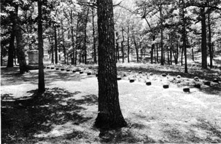

图注：邦联阵亡者集体墓地的战后照片。来源：国家公园手册。 [图像出处](https://npshistory.com/handbooks/historical/10/hh10f.htm)

希洛的损失规模，使它成为当时战争中极为震动公众的一战。最稳定、也最适合核查的办法，是把战后整理的阵亡、负伤、失踪与被俘分类列出，保留统计时间和分类限制。这里采用里德及国家公园手册相合的两日总数。它们体现的是军队报告体系里的分类，并不等于每一名伤员最后的生死结局都已确定；因伤后来死亡者，可能在某份表中仍列为负伤。

| 类别 | 联邦军 | 邦联军 | 阅读限制 |
|---|---:|---:|---|
| 阵亡 | 1,754 | 1,728 | 两日战后汇总口径，不能代表全部后来因伤死亡者 |
| 负伤 | 8,408 | 8,012 | 不是仍能随军行动的人数，亦非最终康复人数 |
| 失踪或被俘 | 2,885 | 959 | 包含不同处境，不能全部解释为已确认战俘 |
| 合计 | 13,047 | 10,699 | 两军相加为23,746；不宜未经校验再叠加另列俘虏数 |
| 非战斗减员 | 无可在此统一合并的数字 | 无可在此统一合并的数字 | 战后疾病、疲劳、住院数与会战伤亡范围不同 |
| 火炮与其他物资 | 首日失炮、次日收复及缴获并存 | 首日缴获、次日遗失及撤走并存 | 缺少逐炮核对时，不把各部宣称简单累计 |
| 战场与交通结果 | 保有登陆场、重新占领营地 | 退向科林斯，保有主力撤路 | 两日会战未直接占领科林斯 |

联邦失踪与被俘类别明显偏高，与六日中央包围有直接关系。但中央被俘约两千二百人的说法，是已经包含在全军损失体系中的重要事件，不能在两千八百八十五之外再加一次。早期记载对这个局部数值有约数和精确报数，范围也可能包含此前零星俘虏。两师混合人员被俘，使按师归属统计更加复杂。稳妥的表达是说明事件规模和组成，而不是把一个近似的局部数字强行分摊到每个团。（[资料2，首日战斗与损失表](#source-2)）

邦联损失同样存在战后争论。格兰特依据自己看到的战场与不完整的埋葬报告，怀疑对方阵亡数过低，提出更高估计。这体现了他的判断，却不足以替代成套统计。埋葬队可能在相邻地区工作，报告不全，也可能把不同情况下的死者归并。没有逐项核对，就不能因为胜方占据战场便自动认为它对敌损的估算最准确。本文保留较稳定的报告数字，承认其历史统计局限，不把格兰特的疑问改写成已证实的额外死者。（[资料1，第二十五章](#source-1)；[资料2，损失表](#source-2)）

现代汇总页面也需要检查。美国战场信托的希洛页面在本次查阅时，南方总损失显示一万零六百六十九，而所列一千七百二十八、八千零一十二、九百五十九相加为一万零六百九十九。本文采用后一个与旧官方表相合的和数。这样的差异不是新的战史发现，只是需要做基本算术和来源比对的提醒。可靠机构提供的材料仍可能有转录错误，引用机构名称不能取代核验具体数据。（[资料10](#source-10)；[资料8，结果](#source-8)）

对士兵而言，数字之外还有指挥链条的损失。威廉·华莱士在六日负致命伤，次日被联邦军找到，数日后死亡；普伦蒂斯成为战俘，不能继续指挥自己的师；约翰斯顿死亡，使邦联最高指挥权在作战中转移。大量旅、团军官的伤亡，使幸存者必须在战斗中接受新指挥官。人员损失由此具有两层后果：减少能够开火的人，也减少组织这些人共同运动的能力。七日双方大量临时混编，正是这种后果在阵线上留下的形状。（[资料2，编制与战斗结果](#source-2)）

救护和掩埋也占用部队的时间、运输与人员。河运给联邦提供了后送条件，但伤员仍要从树林和谷地送到收容点；邦联向科林斯撤退时，伤员和炮车同样使用拥挤道路。帐篷医院、临时医院和战场救护的条件很有限。本文不把旧手册中“第一次”的纪念性表述当作所有战争医疗实践的绝对起点，能够确认的是希洛出现了规模可观的战地收容需求。占领战场的一方，也要处理对方无法带走的伤员与死者。（[资料8，第二日、结果](#source-8)；[资料1，第二十五章](#source-1)）

## 十四、战场记忆如何改变解释：黄蜂窝、名将与两支援军

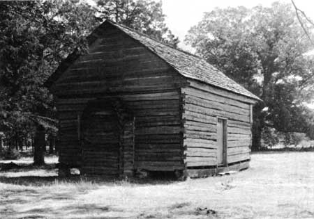

图注：战场木屋的战后照片。手册说明该屋战后曾迁址，现有位置不能直接用作1862年的部队坐标。 [图像出处](https://npshistory.com/handbooks/historical/10/hh10f.htm)

黄蜂窝是理解战斗的重要地点，但它的名气容易遮住别处的同样重要行动。威廉·华莱士的部队是中央防御的主要力量之一，普伦蒂斯率领的则包括本师收拢的人员；教堂与麦克勒南营区的持续抵抗、斯图尔特旅在左侧的战斗，也都消耗了邦联的时间和力量。如果把整个首日写成普伦蒂斯一人守住一个神奇据点，其他地段的后撤、反击和最后防线便无从解释。（[资料2，首日战斗](#source-2)）

道路本身也需要谨慎解释。旧战史把所谓“沉路”描述得很突出，后来的研究者蒂莫西·史密斯指出，同时期记录不足以支持把它当成深陷地面的天然战壕。本文因此用林缘、开地、道路与各部交叉支援解释防御条件，没有把防御效果全部归给一条深沟。旧材料中常见的十一轮攻击、六十二门炮集中，也不宜脱离各部到场先后，写成每一次都有同等规模、所有火炮都同时开火的整齐过程。（[资料11](#source-11)；[资料2](#source-2)；[资料8](#source-8)）

类似的问题出现在主帅形象上。约翰斯顿亲临前方与其死亡，容易被写成整场战争失去唯一胜机的瞬间；格兰特坚持不退，又容易被写成他从清晨就掌握全部局势。现有证据支持更具体的评价。约翰斯顿抓住敌人尚未完全集中的窗口，却未能把分层攻击稳定导向切断登陆场。格兰特误判攻击规模，又在危机出现后继续维持军队与补给通道。两个结论并不互相抵销，一个指挥官可以在战前判断上失误，同时在战斗应变中发挥重要作用。（[资料2](#source-2)；[资料1](#source-1)；[资料3](#source-3)）

比尔与刘·华莱士的作用也应按时间划分。六日白天的抵抗主要由格兰特原在匹兹堡的五个师承担，不能把夜间到达的完整兵力提前算进去；七日的反攻又明显受益于这些新到兵力，不能因第一天主要不是他们打的，便否认其对最终胜利的贡献。谢尔曼的战报对麦库克部队在主路方向的表现给予明确肯定，这比战后军队之间争论“是谁救了谁”的概括，更能说明具体配合。（[资料3](#source-3)；[资料2，次日战斗](#source-2)）

同样，战术成功与战役目标应分别衡量。邦联六日夺取营地、火炮与大量俘虏，取得真实的局部战果；其目标却是趁联邦分散时击败并摧毁格兰特的军队、夺走登陆场。到七日撤退时，这些主要目标没有实现。联邦取得最终会战胜利，保住进攻科林斯的基地和继续集中兵力的条件，但付出巨大损失，且没有歼灭对手。若只用当天前进了多远判断胜负，就会把六日的推进误认为整场战役已经结束。（[资料1，第二十五章](#source-1)；[资料2，结果](#source-2)）

史料之间还存在能够直接检验的分歧。谢尔曼四月十日的报告猜测，约翰斯顿可能是在星期日上午攻击巴克兰旅时阵亡，并在句中承认自己可能弄错。战场调查与邦联方面记录把死亡时间置于下午、地点放在另一侧的进攻地区。本文采用后者，而没有因为谢尔曼是亲历师长便接受他的猜测。一个人完全可能准确报告本师炮兵怎样展开，却无法知道几千米外敌军统帅何时中弹；可靠程度应按具体问题判断，不能一次判定整份报告全真或全假。（[资料3](#source-3)；[资料2，首日战斗](#source-2)）

斯图尔特与谢尔曼的报告也显示了消息汇合的时间差。谢尔曼写报告时，尚未收到斯图尔特的完整报告，因此他对这个分遣旅的首日经历不能像对教堂附近各旅那样详细。斯图尔特报告则能列出本旅分兵、缺弹、退却和指挥权转交的过程，却无法独立解释军团右翼发生了什么。两份报告即使署着同一天，也不是来自同一个信息集合。本文把它们用于各自最有依据的地段；格兰特视角中涉及旅内细节之处明确注明事后报告，避免把后来的整理误写成司令官当天已经逐项掌握的消息。（[资料3](#source-3)；[资料6](#source-6)）

查尔默斯把中央大批俘虏投降写在下午四时左右，里德的重建则把最后投降放得更晚。战斗中的报时可能是估计，也可能对应包围、局部停止抵抗和最后交枪中的不同阶段。这里没有足够依据为所有当事人强行校准时钟。因此，正文只把中央最后投降放在傍晚的战斗序列里，不用某份报告的一个整点去计算最后防线究竟还有多少分钟。可以确认的顺序，比未经校准的精确时刻更牢靠：两翼后撤使中央孤立，中央被俘以后，靠河阵线仍然抵抗。（[资料9](#source-9)；[资料2，首日战斗](#source-2)）

这些分歧也限制了损失比较。报告某个团弹药用尽时仍留在原位，能够说明它在特定时段维持组织，不能推出该团整天从未后退。报告夺得敌炮，可以证明局部缴获，却还要查它是否随后又被夺回，才能进入最终装备损失表。一个旅报告自己击退进攻，也不能自动证明全军已经阻止对方推进。希洛的记录之所以需要双方对读，是因为每次后撤、重组和跨旅接合，都使某位指挥官的真实局部经验与整个战场的最终变化之间留下一段距离。（[资料2](#source-2)；[资料3](#source-3)；[资料6](#source-6)；[资料9](#source-9)；[据此分析](#source-9)）

## 十五、从希洛到科林斯：胜利改变了什么，又留下什么

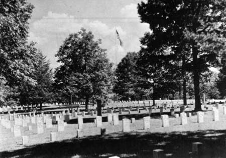

图注：希洛国家公墓的战后照片。来源：国家公园手册。 [图像出处](https://npshistory.com/handbooks/historical/10/hh10e.htm)

希洛没有立即把科林斯交给联邦。哈勒克到场后，继续集中部队并组织向铁路枢纽推进，邦联到五月三十日才放弃科林斯。两者存在清楚的因果联系：希洛保住联邦桥头阵地，使大军仍可利用田纳西河补给并从匹兹堡向内陆行动；而科林斯的撤弃，是下一阶段军队集中、推进与对峙的结果。把五月的结果全部算作四月两日战斗的直接战果，会夸大会战的即时影响。（[资料8，结果](#source-8)；[资料2，结果](#source-2)）

对格兰特而言，胜利没有阻止争议。前沿营地遭突袭、师级组织严重受损、第三师迟到和追击不足，都成为评价其指挥的主题。他的回忆录既保留重要细节，也带有维护自己和部队声誉的目的。因此，阅读时应特别重视他愿意修正的地方：关于华莱士命令传达的补注，关于麦库克疲劳情况的更正，都说明一名亲历者也会在新证据出现后改变叙述。这样的修正比把整本回忆录当作绝对可靠或一概不可信，更有研究价值。（[资料1，第二十四、二十五章](#source-1)）

对邦联而言，最高指挥官死亡、部队耗损与进攻失败，使它丢失了在两支联邦军队完全会合前改变西部局势的机会。博勒加德把军队撤回科林斯，保存了继续作战的力量；保存军队并不能使此次出击变成战略胜利，却也说明联邦没有把会战成功扩大为歼灭。军事评价需要同时容纳这两个事实，才能理解为什么双方后来仍能继续组织大规模行动，战争没有随着两天的伤亡结束。（[资料2，次日战斗](#source-2)；[资料8，结果](#source-8)）

希洛还改变了格兰特对于战争长度的判断。他在回忆录里写到，此前曾期待一次决定性胜利使叛乱迅速崩溃，希洛以后不再抱有同样期待。这个战后自述可以用来解释其认识变化，但不宜据此断言他在某个确切时刻已经形成以后所有战略。战争中的学习往往来自一系列经历，希洛提供了其中非常沉重的一课：失去营地的军队可以重组，攻势看似成功的军队也会耗尽继续推进的能力，双方社会与军队都没有因一次打击就停止抵抗。（[资料1，第二十五章](#source-1)）

综合全战过程，联邦获胜首先依赖于它没有在六日丧失军队组织与水路联系。各师在不同位置接续抵抗，使邦联不能把突袭转化为短时间内的彻底突破；后方炮线、沟谷与舰炮共同增强了最后阵地；桥路与渡口仍可使用，让援军最终进入。第二天，新的完整部队与原军幸存者共同推进，迫使疲惫且缺少相等增援的对手退出。这里没有一种武器或一个人的性格能够单独解释所有环节，必须把它们按先后关系连起来。（[资料1](#source-1)；[资料2](#source-2)；[资料3](#source-3)）

邦联的失败则体现了进攻成果转化的困难。接近营地、夺取营地、迫使敌军后退、切断其补给和消灭其主力，是几个不同层次的任务。约翰斯顿与继任者完成了前面的一部分，却没有完成最后两项。复杂队形在林地中混杂，弹药和炮兵难以及时跟上，部队疲劳又与敌军援兵抵达同时发生，使最初的机会逐渐消失。判断一次进攻是否仍值得继续，应看还能组织出什么力量、对方正在获得什么条件，而不能只看已经夺得的地面。（[资料2](#source-2)；[资料9](#source-9)；[据此分析](#source-9)）

最后，希洛给出的军事经验有适用条件。河流在这里帮助联邦，是因为它拥有汽船、可用登陆点和对岸援军；同样的背水位置，若失去船只或渡口，就会成为更严重的危险。后撤在这里最终保住军队，是因为沿途仍有部队重新列队、补给继续进入、炮位能够建立；没有这些条件，后撤也可能变成无法收拢的败走。格兰特获得的不是一个可以照抄的“背水反胜”公式，而是在极不完整的信息下，通过许多具体组织动作，把一次险些失控的会战维持到条件发生改变的结果。

## 参考资料

以下按正文“资料”编号列出实际使用的资料。原始战报用于核对各部动作，回忆录用于重建格兰特的命令与事后解释，早期官方调查用于交叉比对编制和战场位置。不同版本的计时、敌情判断与伤亡数字仍有差异。未核对纸本页码的资料仅标明章节或报告日期。

1. **尤利西斯·S·格兰特，*Personal Memoirs of U. S. Grant*，第一卷，纽约：Charles L. Webster & Co.，1885。** 本文使用第二十四、二十五章，以及涉及刘·华莱士行军命令的补注；实际阅读的是 [Louisiana Anthology 全文转录本](https://louisiana-anthology.org/303_download/texts/grant--memoir/grant--memoir.html)。晚年回忆存在自我辩护与事后知识，不能一概等同于当天所获情报。

2. **戴维·W·里德，*The Battle of Shiloh and the Organizations Engaged*，1902年初版、1909年修订，华盛顿：Government Printing Office，1909。** 希洛国家军事公园委员会编印。实际使用战场地理、战前集中、两日战斗叙述、编制与损失表；参见 [美国国会图书馆书目](https://www.loc.gov/item/10035128/) 和 [Internet Archive 数字化全文 OCR](https://archive.org/download/battleofshilohor00unit/battleofshilohor00unit_djvu.txt)。这是早期官方重建，仍需与参战者报告及后来研究互校。

3. **威廉·T·谢尔曼，致约翰·A·罗林斯的战斗报告，1862年4月10日。** 后收入其 *Memoirs* 第十章，本文实际使用 [The War Times Journal 转录文本](https://www.wtj.com/archives/sherman/sherman10d.htm)。用于谢尔曼师两日部署、后退、炮兵协同和组织状态；报告中关于约翰斯顿阵亡的猜测不予采用。

4. **美国国家公园管理局，〈Was General Grant Surprised by the Confederate Attack at Shiloh?〉。** [全文](https://www.nps.gov/articles/000/was-general-grant-surprised-by-the-confederate-attack-at-shiloh.htm)。用于对照格兰特战前通信与战后关于突然性的叙述。

5. **美国国家公园管理局，〈Highest Praise: The Army of the Ohio at Shiloh〉。** [全文](https://www.nps.gov/cane/highest-praise-the-army-of-the-ohio-at-shiloh.htm)。用于俄亥俄军团增援、格兰特催促纳尔逊的信息及两军协同背景。

6. **戴维·斯图尔特，第二旅战斗报告，1862年4月10日，*Official Records*，第一系列、第十卷、第一部分。** 实际阅读 [美国战场信托转录本](https://www.battlefields.org/learn/primary-sources/official-report-col-david-stuart-usa)。用于左翼分遣旅的行军、缺弹、撤退和指挥交接；保留其对敌军与邻部观察的局限。

7. **美国国家公园管理局，〈Shiloh Auto Tour Introduction—Grant's Last Line, Stop #1〉。** [全文](https://www.nps.gov/places/shiloh-auto-tour-introduction-grant-s-last-line-stop-1.htm)。用于最后防线的位置、炮兵与地形关系；不同资料对局部炮群及整条防线的统计不能混合。

8. **Albert Dillahunty，*Shiloh National Military Park, Tennessee*，National Park Service Historical Handbook Series No. 10，华盛顿：Government Printing Office，1955，1961年重印。** [目录](https://npshistory.com/handbooks/historical/10/index.htm)；本文使用 [首日](https://npshistory.com/handbooks/historical/10/hh10c.htm)、[次日及追踪](https://npshistory.com/handbooks/historical/10/hh10d.htm)、[结果](https://npshistory.com/handbooks/historical/10/hh10e.htm) 与 [战场导览](https://npshistory.com/handbooks/historical/10/hh10f.htm)。图像亦来自本手册，各图已分别链接。手册年代较早，其纪念性表述和战场传说不自动作为定论。

9. **詹姆斯·R·查尔默斯，旅战斗报告，1862年4月12日。** 实际阅读 [美国战场信托转录本](https://www.battlefields.org/learn/primary-sources/official-report-brig-gen-james-chalmers)。用于邦联右翼行军、转向、炮兵跟进和弹药问题；其战果宣称与时刻须与联邦报告及战场调查对照。

10. **美国战场信托，〈Shiloh〉战役资料页。** [全文](https://www.battlefields.org/learn/civil-war/battles/shiloh)。用于核对现代常用伤亡汇总；本文指出本次查阅版本中邦联总计与分项加总不一致，未直接沿用错误合计。

11. **Timothy B. Smith，〈Battle of Shiloh: Shattering Myths〉，美国战场信托，2009年发表，页面标注2025年3月19日更新。** [全文](https://www.battlefields.org/learn/articles/battle-shiloh-shattering-myths)。本文仅借用其对“沉路”形态和传统解释的质疑，未将没有实际阅读的其他专著列入依据。
