以下第一人称叙述依据史料重建，主视角为美军第五军军长伦纳德·T·杰罗。

1944年6月6日，盟军在法国诺曼底实施登陆，奥马哈是其中一个海滩代号。本文讨论第五军从当日强渡海岸，到6月13日建立并扩大桥头堡、奉命转入防御的这一阶段，包括奥克角救援、伊西尼方向推进、奥尔河与埃勒河渡河，以及科蒙方向作战；不把整个诺曼底战役算在其中。日期采用公历，具体时刻沿用所引美军战史的作战时间。杰罗之上有布莱德雷的第一集团军、蒙哥马利主持的地面作战指挥以及艾森豪威尔的最高统帅部；当面的德军主要属于克赖斯的第352步兵师，另有第716步兵师所属海岸部队，随后得到新的增援。问题并不只是美军怎样冲上海滩，而是：当最初的登陆秩序被打乱，怎样把零散突破变成能够输送车辆、接续兵力、连接友军的桥头堡？

## 一、出发之前：我的任务不是占住一条沙滩

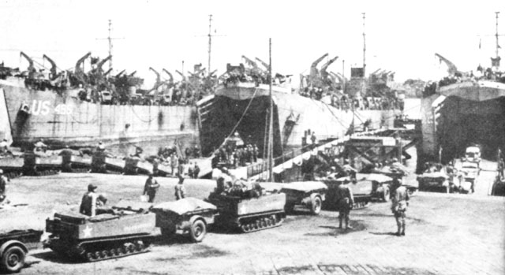

图注：英国港口为登陆装载坦克登陆舰，车辆包括M－29履带运输车；摄于登陆准备期间。 来源：美国战争部《奥马哈桥头堡》官方历史照片，[原图](https://www.ibiblio.org/hyperwar/USA/USA-A-Omaha/img/USA-A-Omaha-21.jpg)。

我接掌第五军时，军队仍在英国准备进攻欧洲大陆。此前指挥第二十九步兵师的经历，让我熟悉它的组织和训练；军长的职责却要求我同时安排不同师、坦克、炮兵、工兵与海上运输。军是一种能够控制几个师及其支援部队的指挥单位，并不意味着所有这些部队已经在同一地点，更不意味着一个命令可以绕过海峡，把后方人员直接变成前线火力。诺曼底行动首先要求把它们按顺序送到法国，再让这个顺序经受敌人抵抗。我的权限覆盖陆军第五军，而舰艇的航行、抢滩组织和舰炮射击，还必须通过海军指挥体系协调。（[资料1，准备与计划](#source-1)；[资料2，第八章](#source-2)）

奥马哈位于美军犹他海滩与英军黄金海滩之间。西面，第七军将在科唐坦半岛东岸登陆，随后争夺瑟堡；东面，英国部队需要向巴约及更远的内陆发展。我的部队若只在海边站住，两个美国登陆场之间仍有河流、沼泽和敌军据点，英美之间也可能留下空隙。敌人能够利用空隙保持横向交通，或者集中兵力切断某个登陆场。第五军因此必须向三个方向展开：向西争取伊西尼和维尔河一线的联系，向东接近英军，向南取得让滩头免受直接威胁的纵深。这些方向互相依赖，也争夺同一批兵力。（[资料1，计划](#source-1)）

我不能把这项任务缩减成寻找最容易登陆的海岸。选择诺曼底，是整个盟军战略的一部分。它处在英国基地能够提供航空掩护的范围内，距离可利用的海峡港口和未来争夺的大陆港口不至于过远，防御密度又不同于德军高度警惕的加来地区。奥马哈本身并不理想：海岸后面的高地让防御者拥有俯视射界，天然出口很少。然而，若避开这一段而使西侧与东侧登陆区相距更远，整个登陆正面的连接会更加困难。第五军要解决的，是战略布局交给它的局部难题。（[资料1，战略背景与海岸地形](#source-1)）

第一步由克拉伦斯·许布纳的第一步兵师控制登陆作战。这个师的第十六步兵团在东侧，第十八团随后跟进；第二十九师的第一一六团加强配属到这个体系中，在西侧突击。这里的“团级战斗队”不只是一支步兵团，还包括为它配属的坦克、炮兵、工兵和其他人员。把团级战斗队人数与一支纯步兵团相比，会产生虚假的兵力优势。同样，第二十九师番号出现在登陆计划里，不代表查尔斯·格哈特从第一分钟就以完整的师部、三个团和全部支援单位在岸上独立作战。指挥关系要随着人员和通信系统上岸而逐步转换。（[资料1，兵力与计划](#source-1)）

我的后续安排包括投入第二十九师其余部队，再让沃尔特·罗伯逊的第二步兵师参加扩大桥头堡。登陆部队要先攻下海滩出口，向维耶维尔、圣洛朗和科勒维尔推进，再争取更远的道路与高地。这些目标分属不同层次：海滩上一个机枪点是否被压制，决定一批步兵能否站起来；出口是否可通行，决定坦克和榴弹炮能否离开潮水威胁；内陆道路是否掌握，决定师与师是否能够相互支援。计划需要这些步骤接续发生，实战却可能让第一步只完成一部分，第二步几乎没有开始，第三步又已经出现零散人员。（[资料1，计划与登陆后推进](#source-1)）

人员并非没有接受过训练。五月的“法比乌斯一号”演习，由第五军负责具体展开，第一师、第二十九师所属突击部队、两个坦克营、游骑兵和海滩工兵都参加了相应训练。部队在英国南部装船，再到斯拉普顿沙滩演练登陆。演习使各单位按照真实任务接触同一套运输程序，而不是各自完成孤立训练。浮渡坦克在演习中下水，工兵模拟清障和开放出口，后续步兵接着进入。指挥机关因此有机会检验时间表和配合关系。（[资料8，第七章“法比乌斯”演习](#source-8)）

训练也留下了不能忽略的问题。登陆人员清单没有及时交接，交通指示标志和宪兵到位迟，车辆在海滩集中，通信人员比本单位更晚上岸，电话线路铺设不当而损坏，救护站人员与器材不能同时抵达。这些都不是抽象的行政缺点。一辆运弹药的卡车找不到卸载点，会挡住下一辆运炮的车辆；一个营已经前进而通信班还在海上，司令部就可能把没有报告误当作没有进展。演习结束后能够纠正一些缺陷，但登陆日期已近，没有时间重新设计整个组织。这是计划真实的成熟程度。（[资料8，第七章演习检讨](#source-8)）

海军也规定了情报如何流动。西部特遣舰队的情报计划要求突击部队指挥官把实际登陆位置、时间偏差、海滩状况变化和新发现的防御障碍上报；海军获得的陆空情报，要通过协同的陆空军指挥官取得。缴获文件先提取紧急信息，再沿规定渠道转送。这些制度说明，作战情报不是一份出发前印好的地图，而是需要持续修正的共同记录。它们并不能保证消息在炮火中及时抵达，却明确了应该报告什么，也让我们能够在战后区分计划要求和执行结果。（[资料5，情报计划B、E、J、K项](#source-5)）

我需要依赖海军少将约翰·霍尔的突击运输与火力支援。他指挥的舰艇不是我的陆军直属单位，两套指挥系统却必须对同一个登陆时刻负责。舰艇提前开火，可能打草惊蛇或让敌人躲入工事；过迟转移射击，又可能威胁已经接近海岸的步兵。航空轰炸也面临类似问题，云层会改变目视投弹的条件。各军种拥有不同的速度、武器和判断距离，不能把它们画在一张计划图上，就当作已经获得一种自动同步的能力。（[资料1，登陆准备](#source-1)；[资料5，情报与报告程序](#source-5)）

## 二、地形、兵力和情报：必须通过的几道窄门

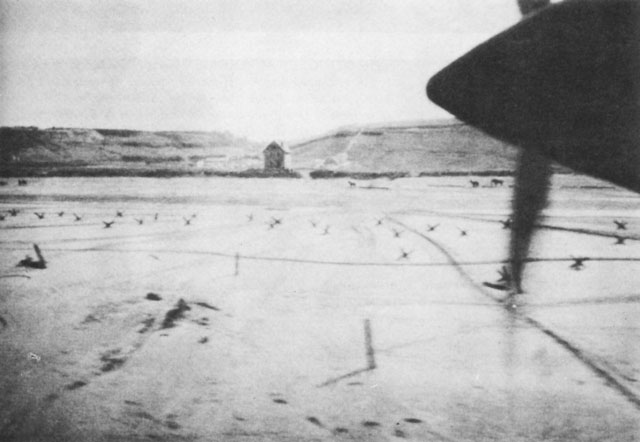

图注：1944年5月19日侦察照片：低潮时E－1出口前的潮间带。 来源：美国战争部《奥马哈桥头堡》官方历史照片，[原图](https://www.ibiblio.org/hyperwar/USA/USA-A-Omaha/img/USA-A-Omaha-4.jpg)。

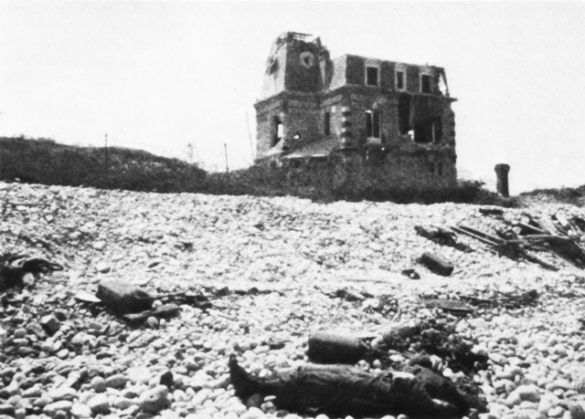

图注：D－3前方的卵石堤。它可为步兵提供有限遮蔽，却妨碍车辆通行；原图未注明确切拍摄日期。 来源：美国战争部《奥马哈桥头堡》官方历史照片，[原图](https://www.ibiblio.org/hyperwar/USA/USA-A-Omaha/img/USA-A-Omaha-5.jpg)。

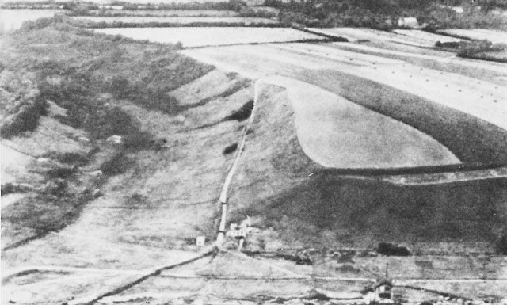

图注：1943年6月航拍的E－1地形，早于后来大规模岸防建设，不能用来判断登陆日工事完备程度。 来源：美国战争部《奥马哈桥头堡》官方历史照片，[原图](https://www.ibiblio.org/hyperwar/USA/USA-A-Omaha/img/USA-A-Omaha-10.jpg)。

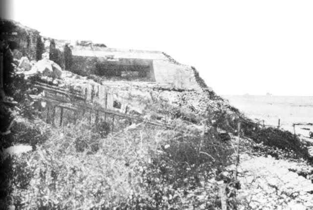

图注：维耶维尔D－1出口附近的德军混凝土工事，原书用于说明海岸防御形态；未注明确切拍摄日期。 来源：美国战争部《奥马哈桥头堡》官方历史照片，[原图](https://www.ibiblio.org/hyperwar/USA/USA-A-Omaha/img/USA-A-Omaha-15.jpg)。

奥马哈海岸是一段弯曲的沙滩，低潮时露出宽阔的潮间带。涨潮会逐步吞没这一空间，也会盖住敌人布设的障碍。岸边的卵石堤和局部海墙能够暂时遮挡低射弹道，但它们后面并不是直接通向内陆的大道。部队还要越过开阔地，攀上陡缓不一的坡面。高地通常高出海面数十米，个别小沟与坡褶能遮蔽步兵，车辆却无法跟着走。海滩上“有掩护”和“能够前进”是两件不同的事。（[资料1，地形](#source-1)）

我们把出口标上代号，便于海陆空各方识别。西边的D－1通向维耶维尔，D－3通向莱穆兰与圣洛朗方向；再往东，E－1和E－3连接圣洛朗、科勒维尔一带；更东还有需要改善的F－1通路。下文保留这些代号，是因为一个出口被堵，能够改变邻近几个团的登陆路线。敌人也理解这些出口的价值，把火力和障碍集中在沟口附近。正面向道路冲击，本来是让车辆尽快出海滩的最直接方法，却也是迎向密集火力的方法。（[资料1，地形与敌军工事](#source-1)）

德国人的工事并非一堵沿海完全均匀的墙。机枪、反坦克炮和其他火炮配置在互相支援的据点中，一些火炮从侧面扫射沙滩，混凝土翼墙遮住海上观察者的视线。只看到朝海的墙面，未必能够看见实际射口。前方有木桩、斜坡状障碍、钢制障碍与部分装雷设施，后方还有铁丝网和雷区。对敌人来说，最有效的结果不是击沉全部登陆艇，而是让步兵、坦克和工兵在不同位置被迫停下，使它们不能同时攻击一个据点。（[资料1，防御体系](#source-1)）

潮汐使清障任务具有期限。低潮附近，工兵能够接近裸露障碍并装设炸药；随着潮水上涨，装药、检查导爆索和标示航道都会变难。登陆艇若撞进已经准备爆破的区域，会破坏起爆线路，人员若躲在障碍后面，工兵也不能照时间表引爆。爆破队因此必须在海军、步兵和车辆之间工作，不能只考虑工程速度。一次迟延会沿运输序列向后传递：本该通过缺口的艇找不到航道，便转向其他地点，那里又可能堆积本不属于同一单位的部队。（[资料1，首波登陆与清障](#source-1)）

高地之后是另一种障碍。诺曼底的田地被树篱、土埂、果园与小路分隔，一条道路在地图上笔直通往目标，实际行军时却可能连续经过视野受限的路弯。敌人的少量机枪手可以在一块田边隐蔽，迫使一个连展开；这个连绕过火力点后，又可能与后方失去接触。坦克有道路优势，也有被反坦克武器堵在狭窄通路上的风险。我们必须把登陆训练接续成田野中的步坦协同，不能指望一旦离开沙滩，就恢复开阔地上的机动速度。（[资料1，内陆地形与推进](#source-1)）

更南面的奥尔河谷带来湿地和桥梁问题。其西段比东段宽，部分低地被淹，能够运送车辆的堤道有限。再向南，塞里西森林覆盖高地，既可能藏匿敌军集结，又关系我们把海滩推出敌炮威胁范围的努力。伊西尼在西翼控制道路与河流连接；科蒙在东南方拥有观察和道路价值。它们不是同一条直线上的连续路标，而是第五军扇形展开后的不同支点。争取其中一个，不能自动保护另外两个。（[资料1，地形及六月九日至十三日行动](#source-1)）

战前掌握的敌情并没有给我一张准确的实时分布图。盟军知道第716步兵师的海岸防御体系，也把第352师看作值得注意的力量，但对后者在当面实际承担的部署没有足够准确的认识。这里先保留指挥官当时的不完整视野；它究竟怎样进入防线、哪些单位真正对奥马哈开火，将在复盘中对照德方材料。对于登陆计划而言，直接后果是：我们预计能够由突击和轰炸打通的海岸，实际存在比预想更有韧性的抵抗。（[资料2，第七、八章](#source-2)）

下表用于识别实际指挥层级，不把全战区兵力相加后当成滩头对阵人数。师、团和营的到位时间不同，损失、配属与运输延迟也会改变某一时刻能投入的力量。

|方面与层级|主要指挥官、单位|本阶段的作用与统计边界|
|---|---|---|
|盟军最高与地面指挥|艾森豪威尔；蒙哥马利；第一集团军布莱德雷|决定登陆总方向、军间接合及后续主攻，不等于第五军全部可用兵力|
|第五军|杰罗|奥马哈登陆与六月六日至十三日桥头堡扩张|
|第一步兵师|许布纳；第十六、第十八、第二十六团|最初统一指挥主要登陆部队，随后向东南推进|
|第二十九步兵师|格哈特；第一一六、第一一五、第一七五团|第一一六团先加强配属第一师；师级指挥关系随后恢复，承担西翼及南进|
|第二步兵师|罗伯逊；第九、第二十三、第三十八团|六月七日起陆续进入，承担中央方向推进|
|装甲、工程与游骑兵|第741、743坦克营，随后第745、747等单位；第五、第六特种工兵旅；第二、第五游骑兵营|均须按具体配属与时点计算；不是完整装甲师同时冲滩|
|海军突击力量|霍尔指挥的O突击部队及支援舰艇|运输、火力、控制、救援；与陆军协同而非归属陆军军长|
|德军高层|B集团军群隆美尔；第七集团军多尔曼；第84军马克斯|负责远大于奥马哈的防区，不能把全军计入海滩守军|
|当面海岸与内陆|克赖斯第352步兵师，含第914、915、916团及师属炮兵；第716师部分海岸部队，包括第726团所属人员|部署横跨更宽正面；不是全部人员都在奥马哈六千余码海岸上|
|后续德军抵抗|第3伞兵师等增援逐步进入内陆方向|说明六月中旬防御重新增强，不应倒算为六月六日首波遭遇兵力|

资料依据：[资料1](#source-1)、[资料2](#source-2)。为避免把计划运输人数误当作同步交战人数，本表不制造一个貌似精确的双方总人数比。

## 三、六月六日黎明：时间表抵达了海岸，队形却没有

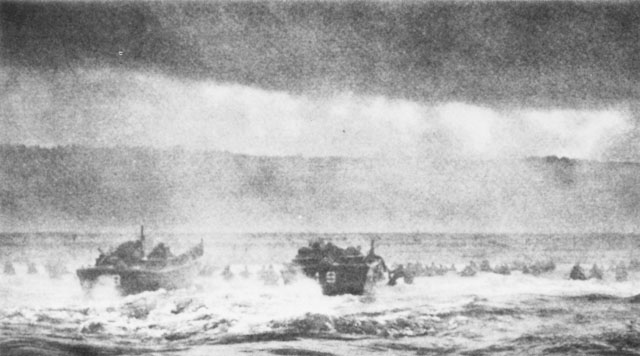

图注：原书标为六月六日约七时三十分的易红登陆照片，烟雾遮蔽了部分岸上标志。 来源：美国战争部《奥马哈桥头堡》官方历史照片，[原图](https://www.ibiblio.org/hyperwar/USA/USA-A-Omaha/img/USA-A-Omaha-24.jpg)。

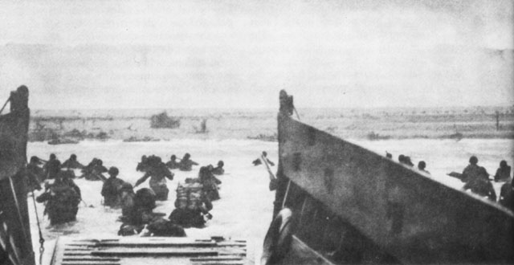

图注：登陆艇在离岸处搁浅，人员涉水前进。原书认为这批人员可能属于第十六团第一营，不把这一识别写成确定事实。 来源：美国战争部《奥马哈桥头堡》官方历史照片，[原图](https://www.ibiblio.org/hyperwar/USA/USA-A-Omaha/img/USA-A-Omaha-25.jpg)。

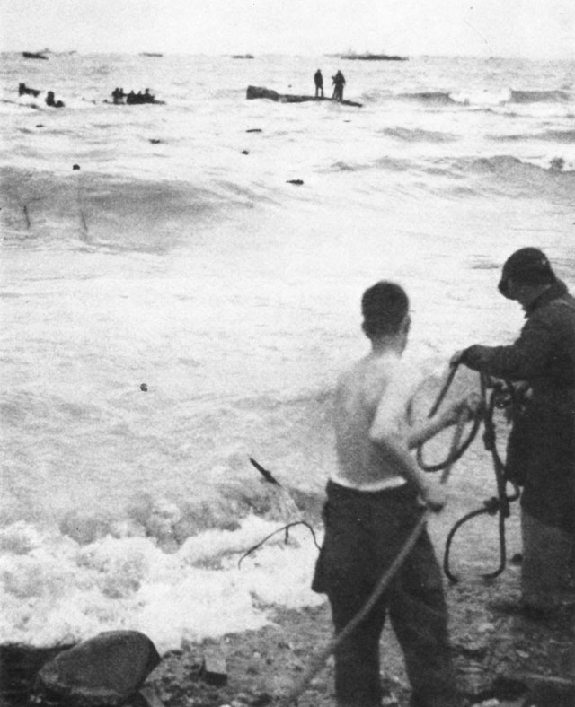

图注：从失事登陆艇撤出的人员借助救生绳上岸；原书未给出准确拍摄时刻。 来源：美国战争部《奥马哈桥头堡》官方历史照片，[原图](https://www.ibiblio.org/hyperwar/USA/USA-A-Omaha/img/USA-A-Omaha-27.jpg)。

<!-- combat-start -->
我在“安康”号上与霍尔共同面对登陆最初的进展。凌晨，运输区的舰船开始放下小艇，人员由大型运输舰转入更容易受风浪影响的登陆艇。首批部队必须在天亮前后完成这段航程。这里没有一个从码头到敌岸都能保持整齐队列的运输带：海浪、航向、艇速、集合与导航误差都在起作用。艇上人员即使没有遭到炮击，也可能因晕船和涉水而在进入战斗前消耗体力。计划规定了抵达时刻，不能消除横渡过程中出现的损耗。（[资料1，六月六日](#source-1)）

行动原定六月五日进行，因天气延后一天，最后由最高统帅决定利用六月六日的短暂条件窗口。这个决定的背景包括潮汐、月光、飞行条件，以及已经启动的装载和航运组织。延后并非简单地让所有人留在原地：有些船队已经出航，集结区也在接受下一批人员。若继续推迟，所需天文条件和军队运输序列都要重新安排。作为第五军军长，我执行的是已经确定的登陆决定；不能事后把“等待更好天气”描述成没有代价、由我个人可以随时选择的方案。（[资料3，第十章](#source-3)）

首波之前的火力准备没有实现原先期望的压制效果。海军向岸防目标射击，飞机也投下炸弹；然而云层使奥马哈上空的重轰炸机难以按目视方式精确攻击。为避免炸到接近岸边的己方部队，投弹采取了安全余量，很多炸弹落到海岸防线后方。后来统计显示，这种偏移不能用一句“飞机没有来”解释，飞机确实执行了任务，却没有在关键位置造成预期效果。对首波步兵来说，有无庞大航空力量，与正面那个射口此刻是否还能开火，是完全不同的问题。（[资料1，登陆前火力](#source-1)；[资料2，第八章](#source-2)）

坦克支援也发生了严重偏差。东侧第741坦克营的两栖坦克按计划在离岸较远处下水，浮渡过程遭遇风浪，三十二辆中只有两辆自行游到海岸，另有三辆由登陆艇送达，其余二十七辆损失在海上。这个数字只属于这批坦克，不能推广为整个奥马哈装甲力量的损失。西侧第743营所属浮渡坦克的运载人员则决定把坦克直接送向海滩，保留下更多本来可能在海上消失的火力。两侧因此从开始就拥有不同的支援条件。（[资料1，坦克登陆](#source-1)）

浮渡坦克的设计，是让履带战车靠浮幕与推进装置接近海岸，提前支援步兵。它解决的是一项特定问题，不是让坦克成为不受海况影响的船。过远下水增加暴露在波浪中的时间；改变航向或艇群动作，又可能使浮幕迎浪状态恶化。我的指挥所无法在这段过程中为每辆坦克调整航向。战后必须审查下水距离、海况判断和现场权限，但此时部队承受的结果已经出现：一些步兵原定同行的直射火力没有抵达。（[资料1，首波登陆](#source-1)）

接近海岸的小艇还被横向水流推向东侧。导航标志、烟尘与控制艇位置偏差，使不少单位落在计划之外。有的连被分散到几个不同地段，有的艇组与本团主力相距很远。错误登陆既可能把人送到更危险的地方，也可能使他们偶然避开最强据点。它的共同后果是，训练时记住的通路、邻接单位和集合点不能直接套用。军官必须先回答自己在哪里，才能决定继续向内陆推进还是沿海滩横移寻找原定位置。（[资料1，登陆分布](#source-1)）

六时三十分前后，各艇陆续进入最后接岸阶段。海滩很浅，艇首可能在离干地仍有距离的地方触底；跳下艇的人要涉过深浅不一的水道，再跨越大片无遮蔽沙地。武器、炸药、口粮和防护装备在计划中各有用途，此刻却都增加涉水负担。部分人员为了避免下沉不得不丢掉器材，有些原定用于进攻工事的重武器在抵达岸边前已经失去。不能把幸存者的数量直接等同于一支装备齐全的突击队。（[资料1，首波步兵](#source-1)）

西侧“犬绿”地段的第一一六团A连几乎正对D－1的防御体系。它准确到达计划地点，却承受来自正面和侧面的密集火力。军官和士官接连伤亡，使组织进一步崩解。幸存者有的停在障碍后，有的借潮水边缘向前移动，有的抢救伤员；涨潮又使无法离开水线的人处于新的危险中。官方战史把这个连描述为登陆后很快失去当日继续作为完整单位攻击的能力。这里的惨重损失不能推算成整个海滩每个连都经历了同一比例的伤亡。（[资料1，“犬绿”登陆](#source-1)）

其东侧的情况并不均匀。一部分第一一六团G连落到有烟幕遮蔽的地段，穿过沙滩时损失较少；另一部分落在更暴露的位置，遭受重创。F连在莱穆兰出口附近受阻，E连则偏到更东面。落在较安全位置的人，也未必马上抓住机会：军官知道自己偏离目标，却不知道左右邻居在哪里，便可能先考虑寻找本来的登陆区。海滩上已经出现局部可以利用的空隙，指挥和识别能力却没有同时恢复。（[资料1，第一一六团登陆](#source-1)）

东侧第十六团也没有形成整齐队形。原定在“易红”登陆的一些单位偏到“狐绿”，使后者拥挤，前者一度反而只有少数艇组和几辆坦克。抵达“易红”的人员中，还有偏航的第一一六团士兵。一个团的士兵不再只与本团相邻，一名军官需要把眼前不同番号的人组成能够行动的小队。战斗序列仍然决定补给与指挥归属，最初的突击行动却越来越取决于现场谁还能组织人、谁有可用武器、谁看见了通往坡面的路线。（[资料1，第十六团登陆](#source-1)）

清障分队就在这些人之间作业。它们原计划炸开连续通道，却遇到器材损失、导爆索被车辆切断、人员躲在障碍附近以及炮弹导致提前爆炸等问题。一天的结果是打通六处完整缺口，另有三处部分缺口，但只有一处能够得到有效标示。六处完整缺口中，四处在“易红”，两处在第一一六团一侧。数量本身还不能说明航道能力：没有标记，海军在涨潮后就难以放心利用；通道前方有沉艇，也会使理论上的缺口变成不能顺利通行的入口。（[资料1，特种工兵分队](#source-1)）

这支陆海军合成清障力量当日伤亡约达百分之四十一，多数发生在最初半小时。它们的遭遇说明为什么不能把工兵写成等步兵打完后才出现的辅助人员。没有它们，后续登陆艇无法按原计划靠岸；它们自身又需要步兵与坦克压制敌火，才能完成任务。三者互相等待时，进攻就会停在潮间带。随后形成的突破，必须打破这种循环，而不能只是向海滩继续投入更多同样受阻的人。（[资料1，清障损失](#source-1)）

## 四、六月六日上午：突破先发生，消息后抵达

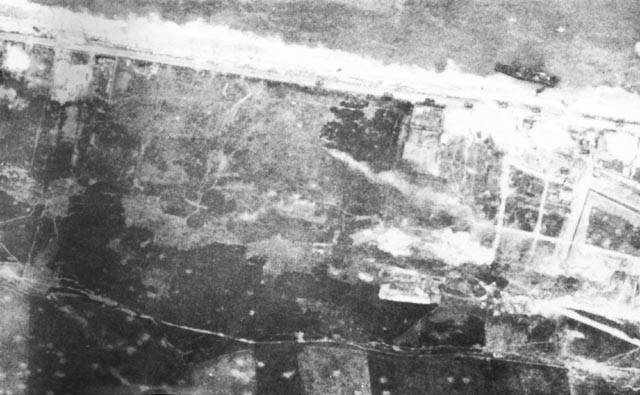

图注：六月六日中午犬白地段航拍，可见第一一六团与游骑兵突破区域；透视压缩了坡面的高度。 来源：美国战争部《奥马哈桥头堡》官方历史照片，[原图](https://www.ibiblio.org/hyperwar/USA/USA-A-Omaha/img/USA-A-Omaha-30.jpg)。

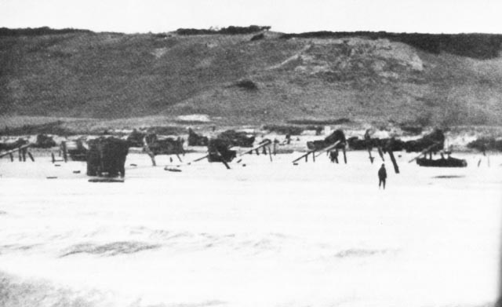

图注：六月七日拍摄的E－1附近据点与海滩，原书用于说明从高地侧后方接近工事的路线。 来源：美国战争部《奥马哈桥头堡》官方历史照片，[原图](https://www.ibiblio.org/hyperwar/USA/USA-A-Omaha/img/USA-A-Omaha-35.jpg)。

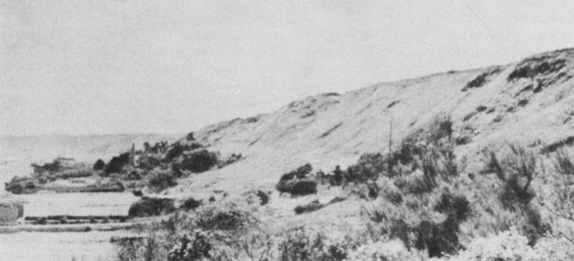

图注：1945年6月拍摄的犬绿地段高地与被毁海滨建筑，显示第二游骑兵营部分人员曾经攀登的地形；不是登陆当日照片。 来源：美国战争部《奥马哈桥头堡》官方历史照片，[原图](https://www.ibiblio.org/hyperwar/USA/USA-A-Omaha/img/USA-A-Omaha-42.jpg)。

我在舰上能获得的是断续报告，不是一幅不断更新的全景。岸上的电台有的进水，有的与通信班失散，军官有的负伤，部队之间的电话网尚未形成。一个观察者从海上看见人员仍伏在堤边，可以正确报告他所在区域的危机，却未必看见另一条坡沟中已经有人向上攀登。第五军参谋塔利乘两栖车接近海岸观察，他发出的坏消息反映了拥堵、火力和登陆艇混乱；在同一时间，一些局部突破已经开始。指挥所必须承认两种现象可以同时存在。（[资料2，第八章](#source-2)）

我要求霍尔提前安排第一一五团投入，相关决定在登陆开始时已作出，目标是让它于H时后四小时左右到岸。它不是听到上午每一条悲观报告后才临时想到的孤注一掷。第一一六团的西侧突击需要后续兵力，第十八团则应在东侧接续第一师的推进。问题在于，团被命令上岸并不等于团能够沿预定道路进入战斗。第一一五团后来也偏向东侧，与第十八团的登陆人员混在一起，使增援在数量增加的同时，给重新编组带来新的负担。（[资料2，第八章](#source-2)）

以下几个局部行动，是依据战后汇集的连、营和团级记录补全的经过；我在“安康”号上并没有同时知道这些细节。先交代这一点，才能看清军级指挥与现场行动的关系：我能够维持后续投入、与海军协调，并按得到的消息调整任务；从堤边选择一条小路爬上高地，则首先依赖当场的军官和士官。把这些行动都写成我在海上逐项下令，不但不真实，也会遮住突破真正发生的原因。（[资料1，攀登高地](#source-1)）

“犬白”地段有一批状态相对完整的部队。第一一六团C连和第五游骑兵营大部聚集在那里，第二十九师副师长诺曼·科塔和团长查尔斯·坎纳姆也在附近。这个地点位于两处主要出口之间，直接承受的集中火力较少，坡面的草火烟雾又遮蔽了部分观察。它不是没有危险的缺口，但允许步兵利用坡褶逐步前进。科塔、坎纳姆及下级军官组织人员离开海堤，而不是继续等待整个海滩被压制。（[资料1，“犬白”突破](#source-1)）

七时五十分左右，C连开始通过铁丝网。爆破筒打开的缺口和剪出的通路，让小组先到道路另一侧的壕沟中，再向坡脚移动。坡上并没有容纳完整连横队的通道，人员要以窄纵队寻找足下路线，避开疑似雷区。越接近高地，坡面的遮蔽反而使来自某些侧面射口的火力减弱。C连登顶后进入田野，遭到远处零散火力，又停下来辨认情况。突破海岸防线并未立刻变成向内陆高速前进。（[资料1，“犬白”突破](#source-1)）

第五游骑兵营随后利用相近地段向上运动，各排自行通过铁丝网和坡面，约八时半前后陆续抵达上方。有些人员与C连混在一起，有些已继续向内陆走去，另一些停下寻找本营。烟雾和坡折帮助他们接近目标，也遮住了友军。结果是，部队成功离开最危险的海滩，却又在高地失去原有队形。对于这些士兵，下一项任务不再是越过水线，而是恢复指挥、找到邻接部队，并判断眼前树篱后的敌人属于孤立据点还是更大阵地。（[资料1，“犬白”突破](#source-1)）

科塔与第一一六团指挥人员上到高地后，也面对同样的问题。团通信分队落在另一地段，一部能够工作的电台来自坦克联络人员；团部不知道各营的完整状况，也不能与师部联系顺畅。海岸线上某个出口究竟是否已被打开，甚至不是团长能够立即回答的问题。于是，出现了地图上似乎不该有的局面：指挥人员已经越过海岸防线，直属部队却散在几处，后续车辆仍困在下方。这种断裂解释了为什么一次成功突破只能先带来有限成果。（[资料1，维耶维尔方向](#source-1)）

在D－3和E－1之间，第一一六团第三营的几个连也开始攀坡。它们登陆位置偏东，不能直接按演习线路行动，便由小组寻找掩蔽地带。人员以不规则纵队向上，遇到雷区、火力和失散后再重新聚合。部分部队在九时左右到达高地，接着向圣洛朗方向移动。相邻地段的突破并非同一时刻统一发动，也没有一个所有单位都听见的总攻信号。它们通过分散行动逐步削弱防线的连续性，让后续人员有可能循着已有路径上去。（[资料1，D－3与E－1之间的突破](#source-1)）

东面“易红”的行动同样依靠小范围配合。第十六团G连在约七时登陆后保持了较好的组织，借助工兵炸开的通路向坡面前进。连长乔·道森的部队绕开和压制机枪位置，打开一条能够被其他人使用的路线。附近还有第十六团E连的约翰·斯波尔丁所率人员，以及错落于此的第一一六团士兵。它们到达高地后，能够从侧后方接近原先朝向海滩的防御工事。这改变了守军的处境：工事的坚固正面不再是唯一接敌方向。（[资料1，“易红”突破](#source-1)）

第十六团团长乔治·泰勒上岸后，面对的是混杂在堤后的人员。他组织小组沿已有通路前进，使“谁原来属于哪个艇组”的问题暂时让位于“现在谁能带这批人走”。这种处理没有消除所有混乱，却避免把恢复原编制当作行动的先决条件。第一营后续人员也开始沿坡沟进入高地，有的在雷区中继续遭到损失。突破路线因此既是进攻通道，也是危险集中点；它们需要工兵检查，需要有人指引，更需要尽快与其他通路接合。（[资料1，第十六团后续行动](#source-1)）

“狐绿”一带则显示火力支援怎样介入局部攻击。第十六团L连的人员较有组织，配合坦克、重武器和舰炮，向F－1附近的防御位置接近。这里不能让舰炮无限延长射击：当步兵靠近目标，就必须通过通信请求转移火力，以免己方遭到打击。随后对工事的突击与俘虏接收，才把被压制的阵地变成被占领的阵地。压制、接近、转移火力和夺取位置，是同一个过程中的不同环节，缺少任何一环都不能自动得到结果。（[资料1，“狐绿”突破](#source-1)）

海军驱逐舰靠近海岸，用较适合直接观察目标的距离提供支援。这种行动需要承担浅水、障碍、岸炮和误判位置的风险，也依赖舰上人员辨认目标与岸上观察员联络。舰炮的作用不只是打坏混凝土，有时是让守军暂时不能使用射口，使步兵能够穿过一段暴露地；有时则是在陆军已到高地后，继续压制另一处出口。不能因为重轰炸效果不佳，就推断整个火力体系都失去作用。舰艇在现场作出的调整，是原定准备不足以后重要的补救。（[资料1，海军火力与突破](#source-1)；[资料2，第八章](#source-2)）

海滩上的变化没有马上表现为车辆畅通。人能沿小路上坡，坦克、拖炮车、油料车和救护车辆却仍然需要出口。旧的登陆时间表因此必须让位于实际通行条件，部分船艇被要求等待或调整地点。停下一批车辆会延误前方需要的火炮，继续挤入又可能堵死整个海滩。我的任务不能被简化成“增兵越多越好”；需要保留能上岸的步兵，同时让海军和海滩组织者为下一批车辆争取通道。局部突破给了我们继续作战的理由，尚未解除整个系统的压力。（[资料1，登陆拥堵](#source-1)；[资料3，第十章](#source-3)）

## 五、六月六日下午至夜间：占了高地，还要把海滩接上

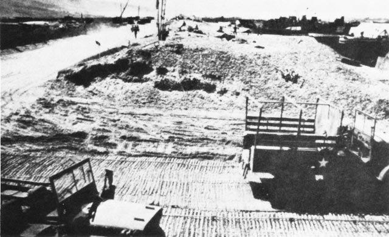

图注：易红卵石堤被工兵打开缺口后的卸载场面，摄于登陆后数日；舰艇利用潮水靠岸卸载。 来源：美国战争部《奥马哈桥头堡》官方历史照片，[原图](https://www.ibiblio.org/hyperwar/USA/USA-A-Omaha/img/USA-A-Omaha-52.jpg)。

维耶维尔方向的部队在上午后段进入村庄附近。一些第一一六团人员和游骑兵已沿沿海公路移动，另一些在田野中被树篱后的机枪阻住。攻击一个射击位置时，邻近的隐蔽火力点又暴露出来，迫使部队继续展开。第五游骑兵营试图向南运动，几个侧翼攻击接连遭到新的火力，花费数小时仍未走远。炮兵虽然开始上岸，海滩后的高地却会遮挡某些近距离射击弹道，不能所有请求一到就立即开火。（[资料1，维耶维尔地区](#source-1)）

到中午前后，部分人员已穿过维耶维尔向西，准备接近奥克角方向。但西出公路上的防御点再次截住进展，开阔田野里的迂回也受到侧射。团部自身在预定指挥所附近感到孤立，必须留出警戒人员；派向南方的巡逻没有找到预期的友军。直到傍晚，团长才逐步弄清某些营在登陆时的遭遇。对第五军来说，这意味着西端并不是地图上一块已经完整控制的区域，而是一组依靠少数道路和零散接触连起来的阵地。（[资料1，维耶维尔地区](#source-1)）

D－1出口的局面在中午发生重要变化。岸上观察员引导包括“得克萨斯”号在内的舰炮集中射击，出口防御受到严重打击，有守军离开工事投降。科塔随后沿出口下到海滩，证明从上方到下方的路线并非仍完全被火力封死。但是，火力被压制与道路可供车辆通行之间，还有反坦克障碍、地雷、散落器材和缺少组织的问题。第一二一工兵营人员分散，损失了大量装备，要先收集人手、寻找炸药，才能继续清理。（[资料1，D－1出口](#source-1)）

工事内的交通壕和掩蔽部也使清理不能草率结束。海军射击过后暂时安静的据点，可能仍藏有人；如果步兵急于越过，后来通过的工兵和驾驶员就会再遭射击。工兵不得不组织战斗巡逻，清理近旁威胁，然后返回工程任务。D－1在下午已清出道路，但后续炮击造成新残骸，妨碍使用；到夜间交通才较顺利地进入维耶维尔。这里最能说明一天作战的实际尺度：上午有人越过海岸，中午有人进入村庄，下午守军火力受压，傍晚道路才逐渐工作；不能把它们压缩成同一个“突破时刻”。（[资料1，D－1出口及当日结局](#source-1)）

圣洛朗方向仍有另一种阻力。第一一六团部分部队向那里汇集，第一一五团登陆后的人员也需要重新组织。村落、果园和附近高地中的德军抵抗使推进缓慢，部队不能沿想象中的空白地带一口气抵达计划纵深。后续团抵达相近的狭窄区域，既提供了新的兵力，也把寻找所属单位、分配道路和建立通信的工作挤在一起。军级预备队向前投入后，仍然需要营、连一级把人转化为有方向的攻击。（[资料1，圣洛朗地区](#source-1)；[资料2，第八章](#source-2)）

科勒维尔附近，第十六团已经取得比海滩更有利的位置，但也不能把村庄及周围完全当作安全后方。小股敌军利用建筑和树篱继续抵抗，前沿与后方之间没有一道清楚的线。某个小组绕过机枪点继续前进，可能使身后通路仍受威胁；留下清理人员，又减少继续向南的力量。第一师需要同时完成推进、整理和接通补给，单一方向上的里程不是评估成果的唯一指标。到晚间，我需要的是一条能够守住的桥头堡，而不是几个在地图上伸得很远的孤立尖端。（[资料1，科勒维尔与当日结局](#source-1)）

海滩组织也在改变。E－1附近成为重要卸载和指挥区域，特种工兵部队开始建立滩头管理，人员、车辆、补给和伤员都要通过狭窄空间。第一天运到岸上的人数并不算少，后勤官方战史估计超过三万四千人；但上岸的物资量与事先设定的目标差距很大。人数增加，意味着需要更多弹药、食品、饮水和医疗服务；若车辆和货物不能同步离开海滩，这个增长反而会加重局部拥堵。登陆成功必须包含组织持续输入的能力。（[资料3，第十章](#source-3)）

弹药部队的经历能够说明这种错位，详细情况也是后来才拼合清楚的。第616军械弹药连一组人员乘浮箱驳船等候上岸，遇到相互矛盾的引导与海滩炮火，当晚仍留在近岸船舶之间；另一组则已在下午登陆，在炮火下接近高地。连队原定协同设立的弹药堆场因此不能按同一节奏展开。上级的运输表会把他们列在既定波次里，前线实际得到的服务却取决于哪一组真正到岸、器材是否完整、地点是否能够使用。（[资料4，第十四章](#source-4)）

伤员后送同样需要这一套尚未成熟的系统。救护人员要把水线附近的伤员移到不被潮水吞没的位置，再送到能够装船的地点；船只还要在卸载与后送之间安排容量。海滩不是一处安静医院，岸炮、车辆、爆破与流动人员会同时干扰工作。医疗人员迟到或装备分离的问题在演习中已经出现，实战把它们放大。讲述当日战斗时若只计算上去多少人，却不写怎样把不能作战的人送回来，就会漏掉指挥系统必须承担的一半流量。（[资料1，海滩伤员与登陆](#source-1)；[资料8，演习医疗检讨](#source-8)）

许布纳及第一师指挥人员约十九时在“易红”上岸，在E－1附近建立指挥位置。我带领第五军前进指挥人员于二十时三十分离开“安康”号向岸上转移。这里采用的是离舰时间，不把它误写成准确登陆时刻。转移指挥所不是宣布一切安全，而是让军部更接近需要重新组合的部队和道路。海军仍是后方运输与火力的重要支柱，我的陆军指挥则需要在岸上把次日任务传到师、团，并得到更可靠的执行回报。（[资料1，六月六日夜间](#source-1)）

一天结束时，我们控制的纵深在最有利地段也只有约一千五百至二千码，远没有实现最初全部目标。西侧尤其薄弱，各部之间仍需加强联系，奥克角的游骑兵尚未得到充分解围。但海岸防线已经被穿透，后续兵力继续抵达，部分出口开始工作。我的选择不是把这一天简单判作成功或失败，而是根据已经取得的立足点重新安排进攻：东翼继续联系英军，西翼解除沿海与伊西尼方向的威胁，中间保证道路和部队能够接上。（[资料1，当日结局](#source-1)）

## 六、六月七日至九日清晨：把零散立足点连成正面

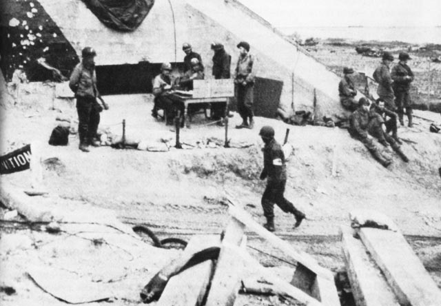

图注：E－1西侧一处德军工事后来被特种工兵旅群用作指挥所，照片未标确切拍摄时刻。 来源：美国战争部《奥马哈桥头堡》官方历史照片，[原图](https://www.ibiblio.org/hyperwar/USA/USA-A-Omaha/img/USA-A-Omaha-58.jpg)。

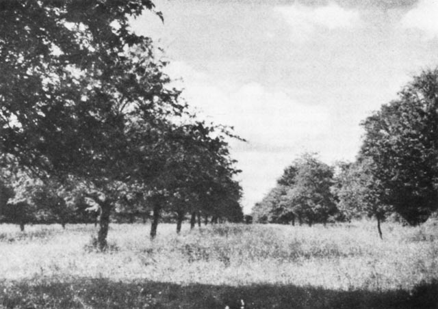

图注：1945年6月拍摄的奥克角附近果园，原书用于说明游骑兵六月六日夜间阵地的接近地形；不是当晚战斗照片。 来源：美国战争部《奥马哈桥头堡》官方历史照片，[原图](https://www.ibiblio.org/hyperwar/USA/USA-A-Omaha/img/USA-A-Omaha-61.jpg)。

六月七日，第一师首先要清除科勒维尔及附近残存抵抗，使前方运动不再被后方火力截断。第十六团继续整理阵地，第二十六团先到的营被分配给相邻团行动：一个营向东面高地发展，另一个营准备支援第十八团附近的推进。这种配属使刚上岸的部队能够直接加入现有攻击体系，却也增加交接复杂性。一个营何时脱离临时任务，何时回归本团，必须与接替部队的到位时间相配合。（[资料1，六月七日第一师行动](#source-1)）

坦克支援开始得到补充，但不能忽略前一天留下的缺口。第741坦克营所剩可用车辆很少，随后上岸的第745坦克营部分兵力成为重要补充。步兵推进时，坦克能压制树篱和村落据点，却仍要经过已开放的出口和道路。海岸到前沿的距离增长后，燃料、弹药与故障车辆回收的要求也增长。第一师不再面对单纯的滩头攻击问题，而是在逐步展开的纵深中组织一条陆上补给线。（[资料1，六月七日第一师行动](#source-1)）

第十八团向奥尔河方向运动。不同营分别经过叙兰、昂格朗维尔与贝勒方丹一带，德军在村庄和渡越地点进行迟滞。有些路线受到抵抗，部队便寻找相邻堤道；有些单位已经越河，另一侧的友军还在清理据点。这里的奥尔河与西面宽阔湿地区不同，不能把全河谷想象成同一种障碍。指挥官需要根据局部地形找出能够通过的路线，然后安排坦克与重武器跟上，而不是等待所有道路同时清空。（[资料1，六月七日第十八团行动](#source-1)）

东翼的第二十六团部分人员经过吕西向高地发展，目的是与来自黄金海滩方向的英军建立实际联系。巴约方向的英军行动改变了这一翼的敌人处境，但不会自动清除美军前方的每一处抵抗。部队要通过巡逻、接触和确认边界来建立连接，避免把远处枪声当成友军，也避免两支部队各自认为另一方已经控制某条道路。通向贝桑港的联系，既有战术价值，也关系随后沿海交通与补给条件。（[资料1，东翼推进](#source-1)）

六月八日凌晨，一份敌情突然改变了第一师与军部的工作重点。曼德维尔附近有德军渗入，后方人员受到袭击，一些报告把情况扩大为有装甲参加的严重攻击。早晨，我们集中反坦克力量、坦克与坦克歼击车准备应付威胁，原定推进因此受到影响。后来查清，事件规模小于最初报告所暗示的程度，上午八时五十分前后，情况得到澄清，进攻可以恢复。这不是可以随手删掉的一段插曲：它展示了错误敌情怎样在没有真正大战发生时消耗时间和预备队。（[资料1，六月八日曼德维尔警报](#source-1)）

我不能在收到警报时使用后来才确认的真相。若在桥头堡尚浅、道路尚乱时无视真实装甲突破，后果可能比短暂延误严重。但调集力量也不应变成无限期冻结推进，必须有人查证敌人位置、规模和行动方向。事件的解决依赖核实，而不是简单地更乐观。军部的任务，是在保留应付危险的能力与避免所有部队被同一条未经确认消息牵住之间作出调整。（[资料1，六月八日行动](#source-1)）

恢复推进后，第二十六团向图尔昂贝桑及其周围展开。一个营仍等待友军接替，另一个营已经接近新目标，团的集中因此断断续续。第三营直到下午脱离原任务，傍晚到位后继续发动攻击，夜间进入圣安娜方向。九日凌晨，部分撤退德军沿道路撞上美军位置，车辆、骑自行车人员和步兵混在一起，发生近距离交战。美军俘获人员、击毁车辆，却没有封闭所有撤路。把这类夜间遭遇写成预先设计的完整包围，会夸大指挥的控制程度。（[资料1，第二十六团推进](#source-1)）

西翼的优先级同时提高。艾森豪威尔在七日视察登陆正面时，特别关注两处美军登陆场之间的空隙；随后这一要求通过集团军落实到我的任务中。伊西尼因此不仅是原定地图上的一个目标，更是连接第七军与第五军的关键。格哈特于七日十七时接掌恢复独立行动的第二十九师指挥。第五军二十一时下达第一号作战命令，规定由第一七五团及配属坦克向伊西尼推进，第一一五团掩护其南侧，第一一六团与游骑兵继续清除沿海方向。（[资料1，第一号作战命令](#source-1)；[资料6，第十章](#source-6)）

第一七五团七日已经登陆，开始由维耶维尔一带向西集中，夜间向昂格勒克维尔和拉康布方向运动。夜行帮助部队接近目标，却也使道路、方向和队形更难掌握。它不是没有遇到抵抗的公路行军，途中仍有村落据点和反坦克火力需要处理。配属坦克提供打击能力，步兵则要保护车辆、搜索道路边缘。第一一五团的侧翼任务同样重要：如果它不占住奥尔河北面的相关高地，向伊西尼延伸的纵队就可能受到南方火力和部队威胁。（[资料1，第二十九师西进](#source-1)）

第一一五团自身推进并不顺利。部队缺少运输，需要携带弹药与重武器步行，营之间的联系也不稳定。瓦克维尔一类小村落中的石造房屋，可以支持数量不多的德军进行长时间迟滞。炮兵提供的支援逐步改善，但有时只能根据不完全观察的任务射击。一个营已经夜行到新的地点，另两个营仍可能停在更后方，师部必须重新弄清彼此位置。这种不同步，使保护侧翼不能只靠在命令中写一句“向南掩护”。（[资料1，第一一五团六月七日至八日行动](#source-1)）

沿海方向还必须解救奥克角的游骑兵。鲁德率第二游骑兵营部分连登上悬崖后，并没有在预期炮位上发现原定目标火炮；搜索部队继续到内陆寻找并破坏火炮。夺取悬崖只是任务的一部分，随后要控制公路、抵抗反击、等待接应。原计划作为增援的第五游骑兵营大部因信号与时间条件转向奥马哈登陆，后来又被西端的实际危机留住。由海上与陆上两个方向组成的行动，没有按照最初顺序重新接合。（[资料7，奥克角行动](#source-7)；[资料1，游骑兵解围](#source-1)）

七日救援纵队携坦克沿海岸公路前进，一度距奥克角已不远，却在关键路段遭到德军炮火截击。坦克能够通过的时刻，步兵未必能同时通过；步兵被炮火压住，坦克也不能单独完成救援。炮兵与舰炮试图寻找敌人火炮，前方游骑兵则继续依靠海军支援和有限补给坚持。巡逻与少量海上运送逐步缓解困境，正式接通仍需等后续推进。地图上一千码左右的距离，不能直接换算成十几分钟的支援时间。（[资料1，六月七日至八日奥克角解围](#source-1)）

八日至九日，沿海残存防御继续被清除，奥克角与主力接上，格朗康及迈西方向不再像最初那样威胁整个西端。第一七五团在九日清晨进入伊西尼。城市与桥梁周围的破坏说明，夺取道路中心不意味着马上拥有完好的交通中心。工兵仍需检查、修复和组织通行，步兵则向南和向维尔河展开。至此，第五军已经把六月六日狭窄而破碎的立足点显著扩大，但与第七军的稳定连接、南方高地的安全和持续补给仍然没有全部解决。（[资料1，西翼推进](#source-1)）

## 七、六月九日至十一日：越过奥尔河，展开三个师

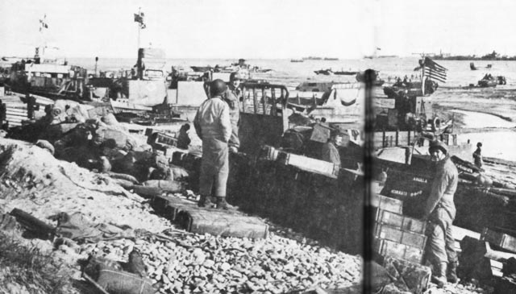

图注：船只在海滩边卸载补给，仍可见卵石堤残迹；原书用于说明登陆初期的弹药与海滩组织。 来源：美国战争部《奥马哈桥头堡》官方历史照片，[原图](https://www.ibiblio.org/hyperwar/USA/USA-A-Omaha/img/USA-A-Omaha-64.jpg)。

八日二十一时十五分，我以第五军第二号作战命令部署下一步行动：三个师并列向南发展，第二师居中，争取特雷维耶尔及塞里西森林方向；第一师在东侧推进，并协助中央部队；第二十九师在西侧渡过奥尔河，保持伊西尼和维尔河方向联系。命令规定九日中午展开攻击，但部分口头指示已经提前传达，一些部队此前就开始运动。战史中的正式命令时刻与第一支部队的出发时刻因此未必一致，不能据此想象所有行动都从同一秒开始。（[资料1，第五军第二号作战命令](#source-1)）

第二师刚从海滩陆续展开，需要在别人已经作战的地域接过任务。它要使用道路，其他部队也要沿道路撤换、运补或前进；如果接替未完成，原来配属出去的营就不能准时归建。第一师部分攻击因此晚了一两个小时。更换指挥关系是一种实际行动，需要交代前沿位置、敌情、火力计划和补给路线，而不是在编制表上移动一个方框。三个师正面同时扩大时，这种交接会反复出现。（[资料1，六月九日部署](#source-1)）

第二十九师面对的奥尔河低地没有计划所担心的那样处处深水，却充满沟渠和湿地。第一二一工兵营用浮具、木料和突击舟设备架设简易人行桥，步兵沿桥与较浅地段穿越；更坚固的车辆桥由第二五四工兵营接着修筑。渡越过程中，部队在暴露低地上消耗时间，能够通过的路线又会形成拥堵。幸运的是，部分地段德军防守很弱，使工程人员得以继续作业。但在特雷维耶尔方向，尝试另一条路线的部队遭到火力，被迫转向已经找到的通路。（[资料1，奥尔河渡越](#source-1)）

第一一五团各营随后向南展开，沿途既有轻微抵抗，也有需要清理的树林。第二营花费数小时搜索卡莱特林地，因为其中的敌火妨碍桥梁工程。这个任务服务于整个师的车辆通行，却让该营自身的长距离行军拖到夜间。它再次出发后走错路，额外增加行程，直到十日凌晨才到达勒卡尔富尔附近。疲劳、黑暗、路线错误和防御部署尚未完成，随后结合成一次严重局部失利。（[资料1，第一一五团第二营](#source-1)）

第二营在果园和道路附近准备休息、布置警戒时，一支带有装甲车辆的德军纵队突然出现。交战发生得很近，重武器尚未配置妥当，指挥官阵亡，人员向不同方向散开。美军战史记录损失为十一名军官和一百三十九名士兵。德军很可能也不是预先策划了一个针对该营的完整伏击，而是在向南撤退途中遭遇美军。关于其车辆的确切型号，早期记录并不充分，本文不把现场对“八十八毫米炮”与车辆的判断强行写成最终鉴定。（[资料1，勒卡尔富尔夜间遭遇](#source-1)）

这次失败没有让第五军正面整体倒退，因为敌人缺乏及时扩大成果的力量。第二营重新整理，接收补充人员，十日下午重新进入战线，第一一五团继续抵达埃勒河方向。局部遭遇却揭示出一个限制：敌军正在撤退，不等于我方纵队可以免除警戒；一个师总体推进顺利，不等于其中每个营始终保持完整战斗力。我的军级任务必须容纳这种不整齐的进展，让受损单位恢复，同时不让整条战线为一次局部失利停住。（[资料1，六月十日第二十九师行动](#source-1)）

在西面，第一七五团从伊西尼转向利松和拉福特莱方向，坦克支援步兵突破零散阻力。另一路人员则接近维尔河阿维尔渡口，发现桥梁已毁，敌军控制对岸火力位置。十日清晨的渡越尝试受阻，部队增配坦克、步兵和侦察力量，傍晚利用低水位，在迫击炮和自动武器掩护下涉过河流，建立对岸立足点。随后工兵开始桥梁工程。这个小桥头堡的价值，在于让接触第七军不再只是一支巡逻队的偶然会面。（[资料1，维尔河渡越](#source-1)）

与第一〇一空降师人员的初步联系在十日已出现，但接合仍然很薄。第七军正从北面争夺卡朗坦，德军也试图维持这一带的分隔。十一日，第二装甲师一个装甲步兵营进入维尔河西侧，加强已有立足点。至此，连接不是一句无线电报告，而逐渐拥有步兵、桥梁、道路和装甲支援。若其中任何一项缺失，敌军仍可能用局部反击把狭窄走廊切断。（[资料1，西翼接合](#source-1)；[资料2，第九章](#source-2)）

中央与东翼继续向塞里西森林和德罗姆河方向展开。敌军在部分地段退却得很快，原本担心会遭到强力争夺的高地与森林，并没有形成连续牢固的防线。第五军必须利用这一机会，不让残存部队有充分时间重整。但“没有连续防线”仍不等于“没有敌人”：路口、林缘和村落中的火力足以让纵队停下，前进部队必须派出巡逻查明两翼。随着距离海滩越来越远，营、团的通信与补给也必须跟着迁移。（[资料1，六月九日至十一日推进](#source-1)）

这一阶段我仍保留部分部队作为预备力量，防备敌人从尚未查清的方向反击。对比战后所知，德军的集结比我们担心的更加困难；当时却不能据此把所有守备都抽走。第五军从海滩向内陆伸展，后方桥梁和出口仍是脆弱环节。如果追击只留下细长纵队，敌人哪怕不能把我们赶回海里，也可能切断运输，使前方部队不得不回头救援。因此推进速度要与道路、侧翼和接续兵力一起判断。（[资料1，军级部署](#source-1)）

## 八、六月十二日至十三日：新的抵抗与停止推进的命令

到十一日夜间，第一师计划于十二日向科蒙方向继续推进，第十八团和第二十六团展开，第十六团保持预备。科蒙所在高地能够观察周边地区，相关道路又联系着更远的德军交通。它不是单纯值得插旗的城镇，而是第五军东南侧的一个有用支点。第一师需要推进，同时顾及中央第二师的进度；如果左侧一路走得很快，右侧未跟上，原本用来保护全军的高地行动也可能形成暴露侧翼。（[资料1，科蒙方向](#source-1)）

十二日，第十八团在较轻抵抗中向南移动，第二十六团则因道路与展开延误较晚出发。到傍晚，后者接近科蒙，夜间一个连的尝试受到抵抗，不能把城镇当作已经放弃的目标。十三日上午，部队得到第743坦克营部分力量支援，继续攻击并进入科蒙。当地敌人规模与装甲数量的初报属于战场估计，不能从它们倒推出一个完整德军编制。占领以后仍有炮击和周边敌情，需要巡逻查明，不能立即把全部兵力向更远处放出去。（[资料1，六月十二日至十三日第一师行动](#source-1)）

中央第二师面对的抵抗开始增强。第九团向利托山脊一带发展，第二十三团接近并渡越埃勒河，试图继续向圣洛东北的高地前进。河流本身不宽，但两岸坡地、树林和接近路线使防守者可以在很近的距离隐蔽开火。某些营过河后遭到反击，又因侧翼没有同时推进而撤回较稳妥的位置。我们正在接触新的防御力量，其中包括逐渐到达的德国第3伞兵师人员；六月六日海岸上那种被突破后的混乱，不能被当作此后每天的固定状态。（[资料1，第二师埃勒河行动](#source-1)；[资料2，第九章](#source-2)）

第二十九师第一一五团也在十二日遭遇困难。一个营越过埃勒河推进，旁边的营却被阻住，前沿便形成突出部。敌人利用间隙渗入，补给困难和弹药不足逐渐显现，撤退命令又未能同时传到所有连。有些部队较早后撤，有些仍留在前方，局面因此更加危险。坦克支援遭到损失，不能简单用增加几辆车辆消除地形和联系问题。第一一六团随后从预备位置调来，接替和加强这一方向。（[资料1，第一一五团六月十二日行动](#source-1)）

关于某次伤亡最初被认为来自己方短弹的报告，后来的调查没有支持这一判断。这一点说明，连伤亡发生在谁的火力之下，都可能在现场被误认。战史不能为了增加戏剧性就保留最早、最惊人的版本。对当时指挥而言，重要的是先恢复部队联系、厘清火力位置；对战后复盘而言，则需要把最初指控与后续核查分开。错误报告既可能夸大敌情，也可能错误指向友军。（[资料1，埃勒河作战](#source-1)）

十三日，第二师第三十八团投入攻击，继续在埃勒河南面推进；第二十九师也在新配置下向圣克莱尔和库万方向发展。部队取得一些地形，却还没有夺下控制圣洛方向的192高地。这个目标要在后续战役中继续争夺，不能把它算作本阶段已经完成的成果。伤亡也表明战斗没有自然消失：第二师十二日至十三日的损失明显增加，第一一五团方向同样付出代价。第五军的推进正在进入一个需要重新集中火力与组织的阶段。（[资料1，最后两日推进](#source-1)）

西侧的接合区此时仍牵动集团军。卡朗坦于十二日被第七军方面夺取，敌人却可能反击狭窄的连接地带。布莱德雷通过送达的书面指示要求加强这一方向；较早战史把某次传令概括为电话联络，后出的《跨海峡进攻》依据记录作了修正，指出当时通信中断，命令由信使送达。因此，本文不把一场没有可靠依据的电话谈话写进我的第一人称叙述。坦克和装甲步兵随后加强走廊，其中部分力量转向支援卡朗坦附近的第一〇一师。（[资料2，第九章及相关注释](#source-2)）

十三日一时二十五分，第五军收到第一集团军新的指示：暂时保持现有阵地，以积极巡逻继续牵制和侦察敌人，集团军主要进攻努力集中到第七军向瑟堡的行动。已开始的科蒙和192高地方向作战，在当天仍被允许完成一定推进；我于二十一时发布第五号作战命令，落实停止继续向192高地进攻的安排。命令不是让已经进入攻击的营在凌晨同时原地冻结，而是给当天行动划定收束条件，并把重点转向巩固。（[资料1，第九章](#source-1)）

第十九军即将于十四日中午接管相应任务，第二十九师与第三十师承担卡朗坦—伊西尼走廊的保护和扩大。我的第五军军长职务没有在十三日终止，终止的是本文讨论的桥头堡扩张阶段，以及这一阶段原有部署下的进攻任务。部队需要整理阵地，补充弹药，恢复伤员后送与车辆维修，巡逻则继续确认敌情。所谓战役结束，在这里不是敌军投降或枪声归零，而是上级重新分配兵力与主攻方向，使这轮行动告一段落。（[资料1，第九章](#source-1)）

从六月六日最初的狭小立足点出发，第五军在一周中向内陆推进了十五至二十英里左右，建立了比第一天稳定得多的正面，并与两翼友军形成联系。海滩仍在使用，道路和桥梁逐渐承担流量，后续部队已经成为陆上战线的一部分。这些成果没有替代未来的战斗，却改变了未来战斗的出发条件。到这里，第一人称重建结束。下面离开杰罗当时不完整的信息范围，对照双方部署、统计与后续记录，重新检查这一周的得失。（[资料1，第九章](#source-1)）

<!-- combat-end -->

|日期|主要变化|对下一阶段的意义|
|---|---|---|
|六月六日黎明|首波登陆、浮渡坦克与清障受挫|原定协同破裂，局部步兵必须自行组织突破|
|六月六日上午|犬白、易红、狐绿等地越过高地|防线被穿透，但车辆出口尚未全部开放|
|六月六日下午与夜间|村落争夺、清理出口、指挥所向岸上转移|形成浅窄桥头堡，继续接纳兵力与物资|
|六月七日至九日清晨|恢复师级指挥，东翼接合，奥克角解围，夺取伊西尼|把海岸立足点扩成较连续正面|
|六月九日至十一日|越过奥尔河，第二师进入中央，维尔河建立联系|争取纵深与军间交通，出现局部夜战失利|
|六月十二日至十三日|争夺科蒙、埃勒河以南高地，加强西侧走廊|遇到更强抵抗，192高地仍未夺取|
|六月十三日|集团军要求保持阵地，第五军第五号命令落实|桥头堡扩张阶段收束，主攻转向瑟堡方向|

时间线依据：[资料1](#source-1)、[资料2](#source-2)、[资料6](#source-6)。

## 九、战后复盘：五个决定，放回当时的条件

### 第一处：敌情失准，究竟错在什么地方

战后资料能够确认，第352步兵师并不是六月六日偶然在奥马哈后方演习、临时撞上登陆部队。哈里森的《跨海峡进攻》根据德军指挥记录说明，隆美尔推动部队前移后，第352师在三月已承担原第716师部分防区，第726团的一部分也置于其控制下。这个改变既加强海岸，又使原先可以被视为后方预备力量的师卷入固定防御。以“碰巧遇到一个师”解释美军损失，会同时误解德军准备与盟军情报问题。（[资料2，第七章](#source-2)）

但反过来，把第352师全部人员放到奥马哈一条海滩上，也同样不对。它承担的正面更宽，部队分布在海岸、村落、道路及后方，一部分力量还牵涉黄金海滩及巴约方向。一个师的存在，影响炮兵、反击与战线恢复能力；某个登陆艇面对的却只是特定射界内的几挺机枪和若干火炮。总体编制说明守军有多大组织基础，局部部署才解释为什么某个连被摧毁，而几百米外另一小组能够前进。（[资料1，敌军部署与首波登陆](#source-1)；[资料2，第七、八章](#source-2)）

情报失准不能仅凭结果归咎于某一个人没有认真看报告。存在零散线索，不等于线索已被确认、传达并纳入各级计划；发现一个番号，也不等于知道它的炮兵位置、换防范围和立即可投入的营数。盟军拥有强大航空侦察与情报机构，仍需在大量真假不同、时效不同的信息中判断。本文能确认的是：实际部署没有被充分转化为登陆计划所采用的敌情认识。至于每一条线索在哪个办公室失去作用，需要专门档案研究，不能由一篇战役叙述杜撰完整责任链。（[资料2，第七、八章](#source-2)）

这里存在一种可行的反事实推演：若计划在较早阶段确认第352师承担海岸防务，可以增加对内陆炮位和预备队的关注，提高对第一天不能迅速达成纵深目标的准备，并更谨慎安排预备队与火力。它不意味着盟军可以随意增加无限轰炸，也不意味着改一个情报估计就能改变海况、潮汐和运输容量。更强的预期应当改变应急组织，却未必能够消除一处具体机枪掩体对登陆艇的杀伤。情报价值在于改善选择，而不是让战场变成透明地图。（依据[资料1](#source-1)、[资料2](#source-2)的分析与推演）

德军同样受制于错误判断。海岸部队最初看到大量美军被压在水边，可能认为攻击已经被击退，却不了解坡间的小组正在穿越；上级还要同时判断其他登陆地点与空降消息。第352师无法把所有力量集中到奥马哈，因为它也面对东面的威胁。更高层对另一次主要登陆的顾虑，又影响预备队调动。双方都在部分真实信息上形成不完整结论，胜负并不是“一个全知指挥官击败一个盲目指挥官”。（[资料2，第七至九章](#source-2)）

### 第二处：坦克与轰炸，怎样理解失效而不抹掉补救

浮渡坦克的重大损失，是首波协同中一个非常具体的断点。第741营那批车辆没有抵达，就不能为步兵打击射口，也不能为工兵提供压制。它造成的后果不是少了一项锦上添花的装备，而是原定同时出现的三种力量失去一项。可这项事实也必须与西侧的不同处理并列：同样拥有浮渡能力的坦克，被艇只继续运向海岸，存活机会显著不同。技术能力、海况与现场判断之间的关系，比“坦克适合或不适合登陆”的抽象命题更能解释结果。（[资料1，坦克登陆](#source-1)）

作为反事实推演，把更多东侧坦克直接送上滩，是有真实对照条件的选择，而不是要求军官预知未来。不过直接抢滩也有代价：运载艇更接近岸炮与障碍，登陆通道更拥挤，卸载后的坦克仍可能被击毁。不能将二十七辆海上损失全部换算成二十七辆必定有效作战的坦克，更不能计算它们必然减少多少步兵伤亡。合理结论是，该选择很可能改善可用装甲支援；精确到伤亡数字的“另一场战役”没有足够证据。（依据[资料1](#source-1)的分析与推演）

空中准备的失效也要分清层次。轰炸机出动、炸弹投下，并不证明目标被摧毁；安全投弹余量可以减少误击己方的风险，却增加偏离海岸目标的概率。问题发生在任务所需精度与当日观察条件之间，而不是飞行员缺乏作战意愿。若要求轰炸更靠近海滩，就必须承认可能危及前进艇群；若要求更早或更长时间轰炸，又涉及预警和整个时间表。这里能够批评的是计划对压制效果的依赖过强，而非在事后把所有风险都删去，再宣布存在无代价的准确方案。（[资料1，空中准备](#source-1)；[资料2，第八章](#source-2)）

舰炮提供了不同的补救方式。与高空轰炸相比，靠近海岸的舰艇能够根据可见目标、岸上信号和局部态势继续调整。但这种火力依然需要识别友军位置，不能在步兵进入工事后持续覆盖同一地点。海军既提供摧毁，也提供暂时压制；步兵和工兵把暂时压制转化为占领和通行。若把胜利归于某一艘驱逐舰或某一种炮，就会漏掉观察、通信、近迫突击与清障之间的接续关系。各部分的价值来自共同完成任务，而非各自拥有最大的数字。（[资料1，攀登高地与出口争夺](#source-1)）

### 第三处：为什么道路之间的突破，比直冲道路有效

海岸防御集中于出口，是一个合理的防守选择。车辆离开沙滩需要道路，堵住道路就能限制登陆力量的规模。然而这一配置也留下相对薄弱的坡面间隔。步兵能利用坡褶、烟雾和小道接近高地，随后从侧后方攻击面向海滩的据点。“犬白”与“易红”的行动说明，进攻者不必先摧毁每个正面工事，才能跨过防线。防御的强点可以控制最便利通路，却未必同时覆盖所有不便利通路。（[资料1，攀登高地](#source-1)）

这并不意味着原计划完全错误，因为步兵绕上高地后，仍要回来解决车辆出口。一个只让轻装人员爬过去的计划，无法长期维持数个师的作战。实际成功之处，是先用可行方式打破防线，再让火力与工程力量逐步开放道路。若把这两步颠倒成“先等所有出口打通，再让步兵前进”，攻击可能在水边继续僵住；若只做第一步而不完成第二步，前方人员又会因重武器和补给不足而停下。突破的顺序发生变化，最终任务并没有改变。（依据[资料1](#source-1)、[资料3](#source-3)的分析）

现场领导的重要性，可以从具体行为判断：组织混合小组、选择通路、安排爆破、寻找掩护、呼叫火力，而不是只靠后来流传的名言。科塔、泰勒、道森、斯波尔丁及许多未被广泛记住的士官，其贡献发生在不同地点和层级。没有任何一个人掌握整个海滩，他们也不可能保证相邻单位同步。正因为上级控制受到限制，能够理解任务并在局部继续行动的组织习惯才显得关键。它是训练、经验与现场判断共同作用的结果，不能只用个人勇气概括。（[资料1，攀登高地](#source-1)）

突破中也包含偶然因素。烟雾可能遮住一段坡面，偏航可能让一队人躲过最强据点，某处守军可能已被舰炮压住。承认偶然性不会贬低士兵的行动，反而能够解释为什么同样勇敢的单位得到不同结果。真正值得分析的是，局部条件一旦出现，是否有人识别并利用，后续人员能否沿通路跟进。历史研究不能因为成功者留下了清楚故事，就把失败者的损失解释成缺少决心。（[资料1，首波与突破](#source-1)）

### 第四处：增援怎样成为力量，而不是海滩上的更多人

第五军继续投入后续团，使首波的局部突破最终没有因人员耗尽而停止。但错位登陆与狭窄出口让增援在短时间内混杂，团级组织需要重新建立。这说明预备队的价值既包括人数，也包括能否在适当地点以可控制的队形投入。第一一五团与第十八团重叠登陆，是数量增加与组织摩擦同时发生的例子。军长下达投入命令后，还需要海军引导、海滩管理、道路通行与下级重新编组共同完成这一决定。（[资料1，后续登陆](#source-1)；[资料2，第八章](#source-2)）

演习报告使我们能够进一步追问：这些摩擦是否完全不可预见？答案是否定的。交通标志、宪兵、人员清单、电话线路、医疗器材分离等问题，在“法比乌斯”中已经出现。实战当然加入了敌火、沉艇和伤亡，但它也把训练中未完全解决的问题放大。较合理的替代方向，是让关键控制人员与其器材更可靠地进入早期波次，为失散与错误登陆准备更清楚的临时归组办法，而不是假设只要把时间表写得更细，全部单位就会准确到岸。（[资料8，第七章](#source-8)）

这里的反事实仍有运输限制。把更多通信员、宪兵或救护人员提前装船，就意味着同一批艇上必须减少其他人员或装备；让指挥机关过早集中于某处，又可能在敌火下遭到一起损失。改进不等于把所有重要单位都放在第一波。可以从证据支持的范围内提出的是：需要对关键功能建立冗余，避免一部电台、一批标志或一个通信班迟到，就使整个单位无法正常运作。具体装载方案是否更好，必须用当时艇数、重量与滩头条件检验。（依据[资料5](#source-5)、[资料8](#source-8)的分析与推演）

后勤统计也提醒我们不要只看人数。官方后勤史指出，最初三天，犹他与奥马哈两处美军海滩合计卸载物资约六千六百一十四吨，仅为累计计划的百分之二十六点六；这是两个海滩合计，不是奥马哈单独数字。到D加五日，两处累计人员输入达到计划约百分之八十八，累计物资却仍不足计划一半。人员、车辆、货物的增长曲线不同，意味着前方即使拥有越来越多步兵，也可能还缺使这些步兵持续行动的运输与供给。（[资料3，第十章](#source-3)）

### 第五处：既然已经追退敌人，为什么没有直取圣洛

六月九日至十一日，德国第352师遭到持续压力，失去阵地和组织能力，第五军推进明显加快。但随后接触到的防御不再只是六月六日海岸部队的残余。德国增援陆续抵达，埃勒河、林地与高地为它们提供新的防御条件。第二师与第二十九师在最后两日的战斗说明，前进的阻力重新上升。用前一天较顺利的推进速度外推下一周，会忽略敌我双方组织正在变化。（[资料1，六月九日至十三日](#source-1)；[资料2，第九章](#source-2)）

停止推进又不是单纯被一处阵地“打停”。第一集团军要争夺瑟堡，需要保障西翼与连接走廊；第五军已取得可用桥头堡，上级因此调整主攻。十三日的命令允许部分已经展开的行动继续，再要求各部保持阵地，显示它是一项战役资源分配，而不是战场突然崩溃的应急撤退。两种因素可以同时存在：继续南进的成本上升，最高优先级又转向另一方向。把原因只归于其中一个，会抹掉另一个真实约束。（[资料1，第九章](#source-1)；[资料6，第十章](#source-6)）

反事实上，第五军可以继续尝试向192高地集中攻击，但不能据此假定必定迅速夺取圣洛。它需要更多炮兵准备、道路组织、侧翼保障和伤亡补充，也可能占用集团军用于其他方向的力量。反过来，停止推进同样给敌人重建防线的时间，并非纯粹没有代价的谨慎。评价这一决定，应比较整个第一集团军在当时要实现的目标，而不是只拿后来圣洛战斗的艰苦，倒推十三日必然应该把所有兵力继续向南投入。（依据[资料1](#source-1)、[资料2](#source-2)、[资料6](#source-6)的分析与推演）

## 十、战后复盘：德军为什么没能把局部优势变成全局胜利

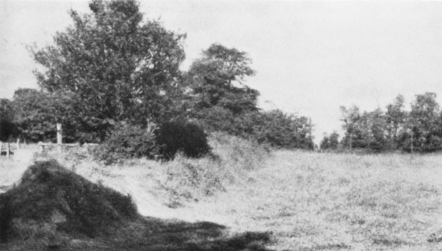

图注：1945年6月拍摄的诺曼底树篱地形，供理解视线与机动限制；不是登陆周战斗现场照片。 来源：美国战争部《奥马哈桥头堡》官方历史照片，[原图](https://www.ibiblio.org/hyperwar/USA/USA-A-Omaha/img/USA-A-Omaha-11.jpg)。

海滩守军的局部优势十分明确。它们从预设工事向涉水人员射击，弹道与地形经过准备，进攻者却正在丢失队形、重武器和通信。一处火力点可以杀伤远多于自身人数的攻击人员。这种优势主要依赖敌人必须经过可见、狭窄、缺乏掩护的区域。一旦美军越过坡面，德军就要在村落与树篱中面对越来越多的步兵、坦克和炮兵，原先沿海设置的火力关系不再能完整使用。（[资料1，首日战斗](#source-1)）

第352师的前移加强了最初抵抗，却也消耗了原可供机动的组织。哈里森强调，德国关于把兵力放在海岸还是保留纵深反击力量的争论，没有形成一种完全一致的执行方案。隆美尔担心盟军空中优势使后方部队无法及时赶到，因此主张尽早在岸边投入；其他指挥者更重视集中机动力量反击。实际部署混合两种倾向，部分力量已经固定在防线上，部分力量又远到不能迅速介入最初数小时。奥马哈的防御必须放进这种总体矛盾中理解。（[资料2，第七章](#source-2)）

所谓“机动预备队”也需要按德国当时的物质条件解释。一些步兵单位主要依赖自行车，炮兵仍有马匹牵引，汽车不足。能够离开原驻地继续作战，不等于拥有美军式的大规模汽车运输能力。盟军轰炸铁路、公路与交通节点，再加上燃料不足和破坏活动，使增援经常以零散批次抵达。师的番号被写在调动命令里，团、炮兵和补给车却未必同时出现在新战场。这与美军跨海运输中的不同步，在结构上有相似处，但双方能够调用的资源差距很大。（[资料2，第七、九章](#source-2)）

德国第七集团军在九日前后仍考虑组织反击，目标包括阻止盟军连接登陆场。可是第352师已经承受多方向压力，后来的部队又在路上，原先设想的集中进攻难以形成。某些地方依然能发动有力的连、营级反击，勒卡尔富尔夜间遭遇也给美军造成严重损失；但没有足够力量立即追击并利用这些成果。局部获胜之后必须有新的兵力、弹药、运输和命令接续，才能把对方一营的混乱扩大为整个军的退却。德军在这一层面越来越缺乏条件。（[资料1，六月九日至十一日敌方情况](#source-1)；[资料2，第九章](#source-2)）

盟军的海空优势于是呈现出两种不同效果。在第一天某个射口前，它不能保证每一名步兵安全；在随后几天的交通、增援和火力积累上，它却持续改变力量关系。德国军官难以把远方部队完整运到需要的地点，美军则通过逐渐恢复工作的海滩不断输入力量。用首日轰炸失误否定整个空中优势，或用整体优势否定首波危机，都是把不同尺度混为一谈。奥马哈的结果来自局部困难被逐步克服，以及总体资源随后真正进入战场。（[资料2，第九章](#source-2)；[资料3，第十章](#source-3)）

## 十一、战果与代价：一周统计不能冒充登陆日统计

本阶段可以较可靠确认的结果，是第五军守住并扩大奥马哈桥头堡，连接两翼，取得伊西尼、塞里西森林方向的纵深及科蒙支点；德国海岸防御未能把登陆力量驱回海中，第352师遭到严重削弱。没有发生整个德军防区统一投降，也没有在六月十三日结束诺曼底战争。圣洛及192高地仍是未来的战斗目标，卡朗坦的主要攻占行动属于第七军及第一〇一空降师，不能一并算成杰罗个人或第五军独立完成的战果。（[资料1，第九章](#source-1)；[资料2，第九章](#source-2)）

|项目|本文采用的数字或结果|口径与限制|
|---|---|---|
|第五军本阶段人员损失|5,846人，其中阵亡1,225人|采用《奥马哈桥头堡》六月六日至十三日结论；不是六月六日单日，也不是全诺曼底|
|第二十九师|2,440人伤亡|同一官方阶段统计；不能再加到第五军总数之外|
|第一师|1,744人伤亡|同上；配属和统计归属不能由番号自行推算|
|第二师|855人伤亡|同上；主要为登陆后内陆作战|
|其他军属及相关部队|总数中另有部分损失|三个师数字不等于军总数，本文不按缺乏明细的数据自行细分|
|德军被俘|约2,500人|美军官方阶段统计；不等于德军全部伤亡，也不能证明所有俘虏均属第352师|
|德军阵亡、负伤与失踪|本次所用资料不足以给出与美军完全对称的总表|不得拿单一师估计与第五军全部损失直接比较|
|第741营一批浮渡坦克|32辆中27辆海上损失，2辆游抵岸边、3辆由艇送达|只指这批车辆；不是全阶段坦克总损失|
|地理与任务结果|建立足够桥头堡，两翼接合，十三日按集团军指示收束进攻|停止追击不等于德军全部失去战斗能力|

表据[资料1，第三、九章](#source-1)。数字保留原资料统计口径，不以表格中的缺项制造精确合计。

首日奥马哈伤亡在不同研究中存在差异，原因包括单位归属、失踪人员后续归队、伤后死亡的归类，以及是否纳入海上、舰艇、工兵和游骑兵损失。早期官方战史本身也在后续材料出现后受到修正。本文为了保持阶段一致，采用一周的官方汇总，并明确它的局限；不把一组首日估计与另一组后续损失机械拼起来。对于普通读者，最重要的不是记住一个没有边界的整数，而是知道这个数包括哪些人、哪些日期和哪些损失类型。（[资料1，首日与结论](#source-1)；[资料2，第八、九章](#source-2)）

物资损失同样不能只数被击毁的武器。一辆涉水后报废的车辆、一部进水电台、一批留在错误船上的弹药，都会减少当前战斗能力，却未必出现在同一种“装备损失”表里。工兵修复、军械人员回收和维修，可以使部分损失变成暂时停用；另一些车辆虽未被敌火击中，却无法及时恢复。第616军械弹药连不同组别的遭遇表明，补给能力也会因组织和位置而受损。因此，海滩上不断出现新车辆，并不等于前沿每支单位都获得了计划配额。（[资料4，第十四章](#source-4)）

法国内陆居民则承受另一种代价。伊西尼等城镇受到轰炸、炮击与道路争夺的破坏，房屋和公共设施损毁，使军事交通恢复与居民生活恢复同时成为问题。本文没有取得能够严格对应六月六日至十三日第五军范围的平民伤亡总表，因此不把整个诺曼底地区的平民损失放进本战役统计。承认缺少可比数字，不应让平民从叙述中消失：每一处被用于防御或被列为炮击目标的村落，也原本是居民的生活空间。（[资料1，伊西尼与内陆推进图文](#source-1)）

医疗与后送决定了伤亡数字背后的后果。战斗刚结束时，部分失踪人员可能在其他单位，部分伤员尚未完成登记，海上救起的人员又可能被送回英国而不马上通知原部队。统计因此需要时间稳定下来。指挥官当天收到的“损失”与研究者后来整理的名册并不相同，不能把后者完整塞回杰罗六月六日上午的知识范围。第一人称叙述若毫无限制地预报最终伤亡，就会变成穿着军服的全知叙述，而失去理解决策所需的真实约束。（[资料1，登陆混乱](#source-1)；[资料4，第十四章救起与返英案例](#source-4)）

海滩管理还有一个容易被宏大战役叙述掩盖的环节：标志必须让实际掌舵的人看得见。六月六日少数已经竖起的标志受到炮火破坏，随后才逐步用大型标示板和夜间灯光重新明确区域。所谓“犬”“易”“狐”及其颜色分区，不只是战史作者便于描述的位置名称，而是运输艇寻找卸载点的共同语言。一个岸上司令部知道某处通路已经开放，如果没有把这一信息变成海上可识别的引导，运载者仍可能去错地方。通信并不全在无线电里，路牌、灯光、航道标记也属于指挥系统。（[资料3，第十章海滩发展](#source-3)）

清理残骸也并非单纯恢复整洁。搁浅艇只占住可用接岸位置，浸水车辆阻塞潮间带，散落障碍让后续驾驶员难以判断路线。工兵用推土机拖走车辆，能够修补的艇则尽量重新浮起，同时扩大卵石堤和海墙缺口，给软沙铺设可供车辆承重的材料。每清出一段地面，就可能增加下一轮卸载能力；每延迟一轮潮汐，海上等待的船又会更多。这样的工作没有一次冲锋那样集中的高潮，却直接决定前线能否把战斗维持到第二天、第三天。（[资料3，第十章海滩清理](#source-3)）

岸外船舶越积越多，也不等于补给越安全。物资在船上尚未成为部队能使用的物资，卸载设备、驳船和接岸能力仍是限制。最初几天，预装载的小型运输艇与驳船承担重要作用，大船不能简单开到岸边一次卸完。海滩展开的第一阶段因此依靠许多小规模搬运环节，它们对天气、潮汐、交通拥堵和引导错误都敏感。海上资源雄厚为恢复提供了余地，但恢复本身需要具体劳动和组织，不会因统计表上还有足够吨位而自动完成。（[资料3，第十章](#source-3)）

军械史记录的弹药人员还有助于区分战斗单位与支援单位的风险。它们不以夺取村庄为主要任务，却必须在同一片炮火和沉艇之间寻找堆场；指挥官如果只等待“步兵清理完成”再安排它们进入，前方又可能先缺弹。反过来，过早把大量弹药卸在暴露位置，会形成危险集中点。堆场选择因此要同时考虑靠近通路、离开直接火力、车辆能够回转，以及人员能否识别。后勤判断与战术判断在这里没有清楚的分界。（[资料4，第十四章](#source-4)；[资料3，第十章](#source-3)）

这些环节还解释了为什么桥头堡不能只按前沿推进公里数衡量。一块刚被巡逻队经过的土地，未必能够容纳弹药堆场；一座已被步兵夺取的桥头，未必允许重车通过；两支部队之间出现一次接触，也未必形成可以昼夜使用的交通线。第五军一周的任务，是让军事占领逐渐转变为持续使用。用这一标准看，工兵桥梁、道路出口与海滩管理不是战斗之外的附录，而是把战术突破转化为战役成果的必要步骤。（依据[资料1](#source-1)、[资料3](#source-3)、[资料4](#source-4)的综合分析）

## 十二、从桥头堡到持续作战：胜利究竟改变了什么

战术层面，美军突破了海岸防线，迫使守军丧失原先最有利的射击条件。战役层面，第五军把突破扩大为一片能够组织师级行动、接纳后续部队并连接友军的地域。战略层面，这片地域成为盟军在法国建立持续作战能力的一部分，德国未能在登陆力量最脆弱时将其消灭。三个层次彼此关联，却不能相互替代：杀伤大量首波人员没有让德军实现战役目标，夺下桥头堡也没有使盟军立即赢得整个欧洲战争。（[资料1，结论](#source-1)；[资料6，第十章](#source-6)）

后续物资输入尤其重要。海滩清障、标示、铺设通路、建立堆场与交通管理逐步改善以后，奥马哈才真正承担起运输基地的作用。官方后勤史把发展区分为临时堆场、内陆维护区和港口组织等阶段，但强调它们并非在固定时刻整齐交接。某个旧堆场还在使用，新堆场已经启用，港口设施同时施工。这个逐步替换的过程，正如前线部队的展开一样，需要在作战中边使用边改进。（[资料3，第十章](#source-3)）

人工港也不能被当作六月六日就已存在的万能保障。它需要拖运构件、沉放防波船、固定码头与道路，随后又遭到六月十九日至二十二日风暴的严重破坏。奥马哈的美方人工港建设最终被放弃，部分材料转用于英方设施。这一后续事件超出本文作战日期，却能说明桥头堡价值不等于某一个工程方案永远有效。海滩及其他卸载方式仍需承担任务，胜利依赖组织适应，而不是一项预先设计好的设施免受自然条件影响。（[资料3，第十章](#source-3)；[资料6，第十章](#source-6)）

杰罗的指挥贡献应放在适当尺度上评价。他没有从舰上为每个连指出攀坡路线，也没有凭个人命令消除海浪和沉艇。他所能做、也必须做的，是维持军级任务、投入后续力量、协调海陆关系，在恢复的信息中调整各师方向，并把局部立足点发展为可以承担新任务的正面。下级军官与士官创造了突破的可能，上级指挥让后续资源持续进入并安排更广阔的行动。两者缺一，首日的勇敢行动都可能停留在孤立成果上。（依据[资料1](#source-1)、[资料2](#source-2)的综合分析）

德军的坚守也不宜用“少数人阻挡整个盟军”这样的口号描述。海岸守军依托准备好的地形与火力，面对的是分批抵达、支援不完整的攻击人员；随后，它们又在更大资源差距和交通困难下逐渐失去局部优势。这既承认其实际战斗效果，也避免把所有困难归于单个将领的性格。第352师的崩解不是每个据点同时停止抵抗，而是各部分越来越难被组织成能实现共同目标的力量。（[资料1，德方情况](#source-1)；[资料2，第七至九章](#source-2)）

最常见的叙事压缩，是把奥马哈写成六日清晨数小时的故事，最后以“终于冲上高地”结束。那是最危险、最容易形成视觉记忆的阶段，却不是桥头堡形成的全部。没有随后开放出口、清除村落、救援奥克角、夺取伊西尼、跨越河流、接通两翼和停止过度延伸的过程，第一天突破的价值无法保存。战争中的结果不是一个瞬间自动向后扩散，而是许多后续行动把已经获得的机会固定下来。（依据[资料1](#source-1)、[资料3](#source-3)的综合分析）

另一个误解，是把“计划被打乱”理解成计划没有用。真实情况更复杂：登陆位置和时间严重偏离，训练过的清障、编组、火力联络与工程技能却继续发挥作用；部队记住了任务，所以能够在原路线不能使用时寻找其他办法。计划提供方向，组织使调整成为可能，现场判断决定何时偏离原定步骤。奥马哈不能证明只需勇敢冲锋，也不能证明只要拥有物资优势就必胜；它说明优势要经过运输、判断、通信和执行，才能在某个具体地方成为有效力量。（依据[资料1](#source-1)、[资料5](#source-5)、[资料8](#source-8)的综合分析）

六月十三日收束时，海滩已经从一个需要夺取的目标，变成一处需要维持的后方入口。前方仍有敌人，南面的高地尚待争夺，西侧走廊仍需加强。第五军完成了这一阶段的任务，靠的是把不完整的信息和不整齐的行动逐步组织成可持续的作战，而不是把每一步都提前算准。理解这段过程，才能同时看见首波人员付出的代价、基层突破的作用、海军与工兵的支撑，以及军级指挥在一周内真正改变的事情。

## 参考资料与阅读范围

本文主要使用公开的美军官方战史、战时计划与战后历史整理。德军部署与决策主要通过哈里森引用的德方记录交叉核对，未直接查阅德国原始档案。第一人称部分是叙事重建，不是杰罗回忆录或日记译文。以下列出实际使用的章节；网页所载原书页码未逐页核对，故引用以章节、事件和链接定位。

1. Historical Division, War Department，*Omaha Beachhead (6 June–13 June 1944)*，American Forces in Action 系列，华盛顿，美国战争部。使用第一至九章的计划、地形、登陆、内陆作战及结论，并核对前言对资料缺漏的说明；其早期统计与叙述须与后出战史对读。[目录及各章](https://www.ibiblio.org/hyperwar/USA/USA-A-Omaha/index.html)。

2. Gordon A. Harrison，*Cross-Channel Attack*，United States Army in World War II，华盛顿，美国陆军军史机构。使用第七章德军防御部署、第八章六月六日、第九章第五军桥头堡及相关注释，尤其用于校核第352师部署、预备队投入和传令方式。[第七章](https://www.ibiblio.org/hyperwar/USA/USA-E-XChannel/USA-E-XChannel-7.html)、[第八章](https://www.ibiblio.org/hyperwar/USA/USA-E-XChannel/USA-E-XChannel-8.html)、[第九章](https://www.ibiblio.org/hyperwar/USA/USA-E-XChannel/USA-E-XChannel-9.html)。

3. Roland G. Ruppenthal，*Logistical Support of the Armies, Volume I: May 1941–September 1944*，Washington, D.C.: Office of the Chief of Military History, Department of the Army，1953。使用第十章中登陆天气决定、奥马哈组织、卸载统计和海滩发展部分；两处美军海滩合计数据均明确标出。[第十章](https://www.ibiblio.org/hyperwar/USA/USA-E-Logistics1/USA-E-Logistics1-10.html)。

4. Lida Mayo，*The Ordnance Department: On Beachhead and Battlefront*，Washington, D.C.: Office of the Chief of Military History, Department of the Army，1968。使用第十四章奥马哈部分，尤其是第616军械弹药连的运输、失散、救援与登陆经历；不把书中转引的个人感受写成杰罗的感受。[第十四章](https://www.ibiblio.org/hyperwar/USA/USA-TS-OD-Beach/USA-TS-OD-Beach-14.html)。

5. Naval Commander, Western Task Force，*Annex A to Operation Plan No. 2-44, Intelligence Plan*，1944年4月21日。使用情报供应、缴获材料、必要情报及报告程序各项。这是计划文件，证明制度要求，不代表各项要求在实战中均已实现。[原计划转录](https://www.ibiblio.org/hyperwar/ETO/Overlord/NEPTUNE-OpsPlan/OpPlan-2-44-A.html)。

6. Forrest C. Pogue，*The Supreme Command*，Washington, D.C.: Office of the Chief of Military History, Department of the Army，1954。使用第十章开头关于六月七日最高层调整、连接登陆场、瑟堡方向与人工港后续的讨论。[第十章](https://www.ibiblio.org/hyperwar/USA/USA-E-Supreme/USA-E-Supreme-10.html)。

7. Historical Division, War Department，*Small Unit Actions*，Washington, D.C.: War Department，1946。使用“Pointe du Hoe”篇的任务、备用登陆方案、前出公路及发现和破坏火炮部分，并与桥头堡战史的解围经过对读。原书拼作“Hoe”，本文统一采用奥克角（Pointe du Hoc）。[奥克角篇](https://www.ibiblio.org/hyperwar/USA/USA-A-Small/USA-A-Small-1.html)。

8. Clifford L. Jones，*The Administrative and Logistical History of the ETO, Part VI: Neptune—Training, Mounting, The Artificial Ports*，Historical Division, United States Army Forces, European Theater，1946年3月。使用第七章“法比乌斯”演习部分及检讨，讨论训练中已经显现的交通、通信、医疗与堆场问题。[第七章](https://www.ibiblio.org/hyperwar/ETO/Admin/ETO-AdmLog-6/ETO-AdmLog-6-7.html)。

上述八项文献承担不同证据任务，但并非八套互相独立的见证：数部官方战史共享单位报告与访谈基础。时间、编制和命令可通过它们交叉核查，具体个人经历仍可能受早期记录缺漏影响。本文不以资料数量掩盖这一来源结构，也不把未能对应同一日期、同一范围的伤亡数字拼成完整总表。
