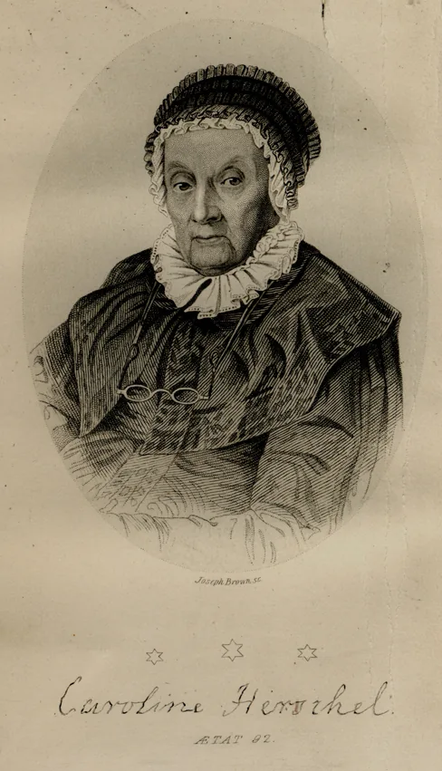
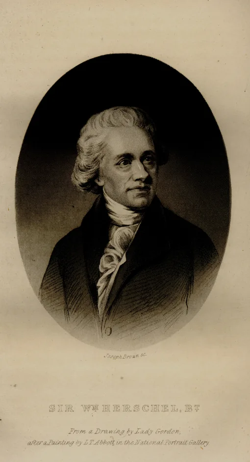
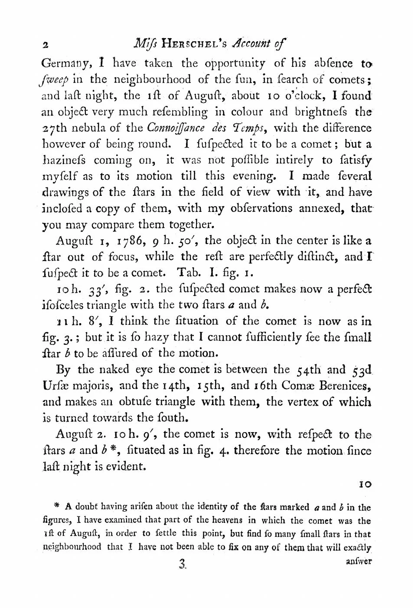
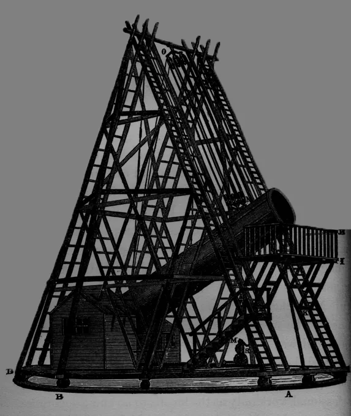
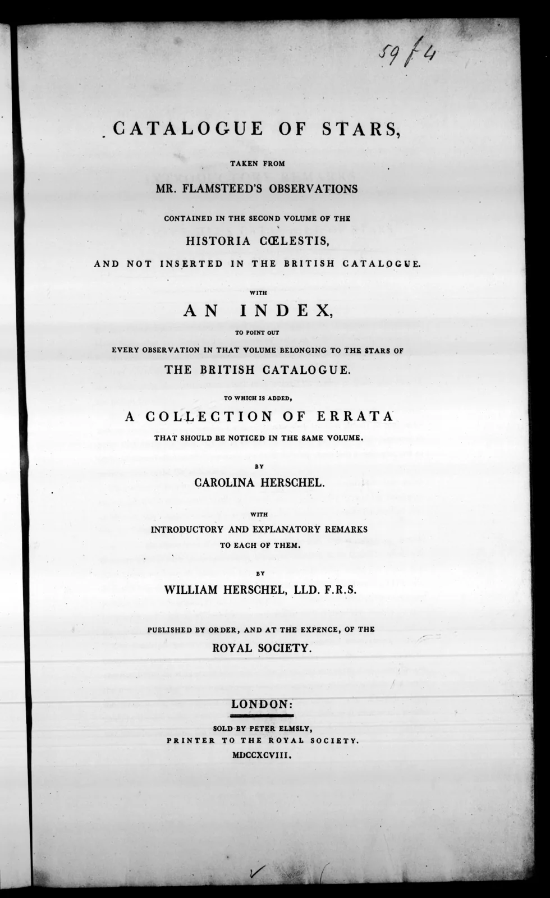
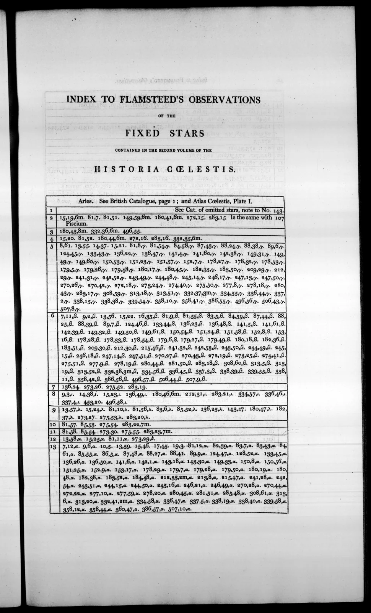

**文 / qscqesze**

一七八七年十月，卡罗琳·赫歇尔领到了十二英镑十先令。这是王室为她规定的五十英镑年薪的第一笔季度付款。她此前已经替哥哥威廉管理多年开支，也把自己的日常所需记进账里；款项从她手中过，并不表示她能够随意支配。后来回忆这笔收入时，她特意说明，这是她一生中第一次觉得有权按自己的意愿花的钱。[^1]

当时，赫歇尔家的花费远远超过这笔工资。斯劳正在建造四十英尺望远镜，木工、铁匠、铸镜工各有工钱和材料账。威廉刚又获得一笔两千英镑的资助，以及供仪器维修和夜间助手开支的一项年款。妹妹的五十英镑与这些资金同时落实，名义是哥哥的天文助手。她所获得的收入，仍与一处以威廉为中心的观测场所联系在一起。

她记得，离开巴斯以后，自己每年列作个人用途的钱通常不过七八英镑。她担心的却不止这些数目：铸镜师送来的账单过高，仪器还没有全部完成，家用每周都要付。她在回忆里承认，破产的念头曾反复困扰她。领工资使一部分不安有了着落；看见新天体、记录位置、整理目录与支付供应商，此前已在同一册工作日记里交错出现。工资确认了已有的工作，家中的杂事仍须继续。

在汉诺威长大的时候，她曾设想靠针线和音乐谋生。在巴斯，她确实登台演唱过。到了三十七岁，王室支付的这笔钱终于为她的工作规定了一个称呼。然而，工资单上简短的“助手”还不能显示，从晚间望远镜旁的一次报数，到日后别人能够使用的星云目录，中间要经过哪些计算和判断。

<figure>
  
  <figcaption>卡罗琳·赫歇尔，Joseph Brown 刻。图题记九十二岁，载于1876年《回忆与通信》卷首。<a href="https://digital.library.upenn.edu/women/herschel/memoir/front-page.jpeg">宾夕法尼亚大学数字图书馆图像</a>（原作在美国属公版）。</figcaption>
</figure>

## 汉诺威的音乐家庭

卡罗琳·卢克蕾齐娅·赫歇尔于一七五〇年三月十六日生在汉诺威。父亲伊萨克是军乐队乐师，母亲安娜·伊尔泽料理一个子女很多的家庭。卡罗琳在十名孩子中排行第八，四名手足早夭。长成的兄弟姐妹中，威廉比她大十一岁多，亚历山大比她大四岁多；最小的弟弟迪特里希后来也是家中需要安排学业与职业的孩子。[^2]

音乐既是这家人的本事，也是收入的来源。军乐队和宫廷乐团的职位、替私人学生上课、演出与抄谱，决定一家人什么时候有人在家，什么时候又要为外出的亲人准备行装。伊萨克希望儿子们成为好乐师，给他们训练，也让他们接触语言、算术和自然知识。卡罗琳记得，父亲和威廉谈起牛顿、莱布尼茨与欧拉，讨论有时拖得很晚。她也记得父亲曾带她认星座。那些接触没有组成一套连续的课程，她通常仍在做针线，或在兄弟练习时旁听。

父亲的工作又受战争支配。一七五五年，军队奉命赴英，伊萨克与两个年长的儿子一起离开。父亲把部分军饷留作家用，母亲继续纺线、做衣物，家中还有亲人搬来同住。士兵家庭的收入不能与劳作者的身体分开计算。伊萨克早年随军已损害健康，后来战事中的奔走使他的状况更坏；他归家时能够继续教课，却不再有从前的体力。

一七五七年汉诺威地区的战局改变了几个儿子的去向。威廉最终离开军乐生活前往英国。卡罗琳后来写到，家人曾把小孩子支开，自己偶然看见哥哥穿着大衣离去。她是从多年后的处境回忆这段经历，把它理解为逃开继续服役的危险。此后传回汉诺威的信，有些用英语讨论音乐理论，收信的是哥哥雅各布。对留下来的妹妹，这些信件尚不是随时可以加入的谈话。

她也上过学校，学过读写。家中与附近一些士兵的妻子需要写信时，会让她帮忙。文字给了这个孩子一种实际用处，针线则占去更多时间：她要替兄弟织袜子，补充家用织物，做家里缺少的东西。父亲偶尔教她小提琴；她记得母亲并不愿意这些学习妨碍日常工作。法语、舞蹈之类被视作多余的训练，能为家庭做事的手艺得到的许可较多。

母亲对教育的判断，还与几个儿子的离乡有关。卡罗琳在回忆里说，母亲担心更多学问会使孩子不满足于原来的生活。威廉留在英国，雅各布又不愿只接受家中现有的条件，亲人的前途因此也会成为家中争执的原因。女儿把这些事写下来时，对父亲与威廉格外亲近，对母亲和雅各布常有抱怨。她保留的早年记忆，也因这些亲疏而有所偏重。

一七六一年，她患了一场严重的热病。按她自己的说法，病后有几个月连上楼都很困难。康复以后，学校和家里的差事继续进行。父亲在一七六四年遭受中风，虽然仍收学生、抄写乐谱，余下几年一直受疾病折磨。他于一七六七年三月去世。卡罗琳当时十七岁，失去的是一位愿意教她的亲人，家庭也少了一个重要的挣钱者。

她没有立刻放弃另谋职业的念头。她曾在清晨与住在同屋的年轻女子一起学针线，以便家人起床以前，自己的时间还没有被占完。后来又获准向一位教授女帽和服装制作的妇人学习。一般的入门费用对家中有负担，最后商定按月交钱。她原以为自己会因交费少而只得到粗活，实际却受到教师照顾，并与同学来往。她也想过做家庭女教师，只是自己不会法语，能争取的职位因此受限。

雅各布同意她学习做衣物，附带的意思却是供她自己使用，不能据此另起一个职业。这种许可与她所考虑的谋生并不完全相同。她已经会为家人做许多东西，若要把同样的本领拿到家庭之外挣钱，还须获得另一层认可。音乐也处在这个位置：身边不断有人靠它生活，她却尚未取得相同的职业训练。

## 去巴斯试唱

威廉从英国提出一个办法：妹妹可以到巴斯，接受他的训练，试试能否成为冬季音乐会和清唱剧的歌手；如果两年以后不合适，他会把她送回汉诺威。这个安排保留了退路，也要求家中放她离开。雅各布起初似乎同意，后来又嘲笑这项计划，没有认真听她的歌声。她便趁其他人不在时练习，模仿自己听过的小提琴独奏中的装饰和颤音。[^3]

她准备出发时仍在做针线。母亲和弟弟还要继续生活，她尽量替他们备好衣物和袜子，把自己离开后可能缺少的东西先做出来。威廉则为母亲安排一笔小年金，使她能找人替代女儿的一部分工作。妹妹能否成行，不只是两兄妹谈妥一张船票的事；她原来承担的劳动也须有人接过去。

一七七二年八月，她终于随威廉赴英。旅程经荷兰与英格兰东岸，再到伦敦，最后前往巴斯。在伦敦，她特别记得随哥哥看的光学商店。哥哥已经对科学仪器有兴趣，同行的妹妹则还要适应语言：她会的英语很少，抵达以后与租客、仆役和商贩交涉都不容易。

威廉在巴斯已有一份繁忙的音乐事业。他是八角礼拜堂的管风琴师，教授学生，组织排练，也承担公开音乐会的事务。妹妹住进去以后，一天要上几次声乐课，练习键盘和发音，哥哥还教她英语、算术以及收支记账。英国的音乐生活向她开放了新的工作，管理这所住宅也成了她的责任。

她每周领一笔家用，须在英文账本上写清支出，留存没有花掉的现金。到市场买东西，是账本以外的另一种语言练习。亚历山大一度在同一住宅居住，替兄妹两人处理机械活计，也会帮助妹妹。他同时有自己的演奏工作，夏天常离开巴斯。家中可用的人手，会随演出与季节改变。

她不喜欢巴斯最初的几个月。她在后来记述中说自己思乡，难以用英语与周围人交谈，又要回复汉诺威传来的不幸消息。哥哥的朋友与学生使她有机会参加聚会，唱独唱、二重唱和重唱；有一次，她受邀到伦敦住了几周，看到歌剧与戏剧，也受到服装和外出费用的困扰。她想取得的音乐职业，还要求在社交场合中学会怎样穿着和行动。后来，她专门接受过舞蹈教师的训练。

这些学习有实际结果。她逐渐能够参加礼拜堂的排练和礼拜，在哥哥组织的清唱剧中承担独唱。她本可以继续完善这一行的本领；至少，在她自己的回忆里，能够凭音乐获得体面的生活始终是一项认真的愿望。她并没有把巴斯十年写成等待天文学开始的空白。

排练的职责不只唱她自己的部分。她为《弥赛亚》《犹大·马加比》抄分谱，为《参孙》准备声乐部分，还教高声部的歌手。独唱以外，整场演出有多少声音需要彼此配合，也属于她每天面对的工作。她后来回忆首次公开登台，特别提到哥哥给了十基尼准备服装，以及排练时有人称赞她的英语发音。这些是一个新来者进入英国舞台需要取得的条件：乐曲要会唱，歌词要能被听懂，衣装也须足以公开出现。[^3]

下一年，她在音乐会中已任主要歌手。编者记下伯明翰音乐节曾向她提出邀约，她没有接受，因为决定只在威廉指挥时公开演唱。这种自设的范围保护了她熟悉的合作，也限制了事业向别处延伸。她有机会离开巴斯的家庭舞台，却没有把那条路走下去。后来天文学取代音乐，发生在她已把个人演唱与哥哥指挥联在一起之后。

哥哥的时间却朝另一处流去。音乐季结束后，妹妹原以为能得到更多训练，威廉却把空下来的时间用于读天文学和光学著作。租来的望远镜让他看见书上介绍的天体，也使他想改善现有仪器。他开始向商人询价，购买别人留下的工具，继而自己制作镜面和支架。妹妹刚获得的职业机会，越来越多地与这项尚不挣钱的兴趣争用时间。

<figure>
  
  <figcaption>威廉·赫歇尔，Joseph Brown 据 Lady Gordon 摹图刻制，摹图底本为 L. F. Abbott 原画。载于1876年《回忆与通信》。<a href="https://digital.library.upenn.edu/women/herschel/memoir/118.jpeg">宾夕法尼亚大学数字图书馆图像</a>（原作在美国属公版）。</figcaption>
</figure>

## 房子里的镜面和排练

望远镜起初并不只需要一位懂得计算的人。管身、镜面、支架、车床、铸造材料和磨镜工具都要准备，放置它们的空间也须找到。威廉嫌定制大镜面的报价太高，买下一个曾尝试磨镜的巴斯居民留下的工具与半成品，自己摸索。卡罗琳帮着制作纸板管，后来还参与磨镜与整理材料。[^4]

乐器和机器占用着同一所住宅。客厅要接待学生和音乐朋友，也会有人在里面做木工；一处卧室安装车床，别处又在准备镜子的配件。亚历山大擅长机械，能够把威廉的想法做成东西，却不能一年到头留在家里。妹妹不具备哥哥们的全部手艺，仍须在需要第二双手的时候到场。

兄妹所说的七英尺、二十英尺等，通常指望远镜的焦距，并非镜面直径。焦距关乎像的位置和管架尺寸，镜面口径则影响能收集多少光；只报一项长度，还不足以描述整架仪器。

对反射望远镜而言，镜面不仅得亮，还要有合适的形状。抛光过度或不均匀，都可能使它不能把远处的星光汇成清楚的像。每一次制作需要反复研磨和检验，仅仅擦得光滑还不够。镜子变大以后，支撑它的机械装置也更重，能不能平稳转动、能不能安全到达目镜旁，开始同镜面本身一样重要。

卡罗琳记得，威廉有时长时间不肯停手，她会给他递食物，也替正在工作的哥哥读书。所读的不仅是计算材料，还有小说。她同时抄写乐谱，准备自己的演唱，料理家用。家人对时间的安排已经偏向制镜，可是房子的收入仍来自音乐。兄妹不能把已经招来的学生和付费观众暂且放在一边。

一七八一年三月，威廉观察到一个后来被确定为新行星的天体，即天王星。发现使他的姓名传到伦敦，也吸引更多人到巴斯拜访。他获得皇家学会的认可，天文学家与有地位的客人想亲眼看一看他的望远镜。卡罗琳则开始更多地抄写表格和目录，有些还是哥哥借来的整篇论文。

访客、演出和制镜继续交错。威廉曾与人合作经营清唱剧演出，并为表演者的报酬承担责任；妹妹回忆，他在这项安排上亏了钱。另一方面，为一架更长望远镜铸造的大镜面，也遇到炉体漏料和镜面冷却后开裂的失败。新行星没有使技术问题或旧职业的财务责任自动消失。

为布里斯托尔和巴斯的演出，她要准备分谱、排练歌手，让近百名演出者拿到各自的部分。威廉演出以外的时间愈来愈少，准备这些材料的工作仍由她继续。

一七八二年春，威廉把七英尺望远镜带去伦敦。原以为短期可返的行程拖长了。妹妹与亚历山大留在巴斯，学生们不断询问教师什么时候回来，他们却只能从信里知道威廉正往返伦敦和格林尼治、等待宫廷安排。威廉在信中也抱怨没有机会做自己喜欢的工作。他在天文学界获得了注意，付出的代价之一却是暂时离开自己的作坊和仪器。

宫廷要看的望远镜是一件可以移动、可以示范的实物。一次观测遇到天气不合适，威廉曾事先准备一个人造土星的图像，用它向王室成员示范。妹妹从书信中得知这些接待，也继续设法应付巴斯的事务。是否长期迁居，已不再取决于下一场音乐会在哪儿举行。

## 两百英镑的新生活

威廉终于选择接受每年两百英镑的王室收入，离开音乐职业，搬到温莎附近。卡罗琳后来记下朋友认为这笔待遇太少；对于威廉，最大的吸引力是能够把时间集中用于观测和造镜。他所接受的收入与他要建造的仪器，并不是一套事先核算妥当的预算。[^5]

兄妹于一七八二年夏天迁往达切特。新住处能提供磨镜的地方，有空地架设望远镜，也需要清理与修整。妹妹出去采购时，发现物价使她忧虑。亚历山大后来返回巴斯，继续音乐工作；没有他的长期协助，许多机械事务更难解决。几个人没有因为住在同一个家庭，就获得同一条职业道路。

这次迁居使卡罗琳放弃了已经取得的音乐位置。她在回忆里直说，自己原可通过继续训练，成为一个能够谋生的职业乐师；离开哥哥的保护以后，她又缺少独自面对公众的勇气。跟随威廉并不是从一个毫无希望的地方走向唯一的出路。她是在已有一项可能的职业时，选择进入哥哥正在建立的事业。

新的安排把天文学训练放到她面前。威廉给她适宜扫视天空的小望远镜，让她寻找彗星。留下的训练要求还包括双星、星团和星云。从一七八二年八月的记录开始，她描述扫过天空时见到的显著对象。起初，她不熟悉天空，常须翻查星图，找过的东西也不容易迅速找回。能够把一个模糊天体看进目镜，与能够告诉别人去哪里找到它，是不同的工作。

她学会按照恒星辨认位置，也逐渐记录星云和星团。到一七八三年末，她记下十四个这样的对象。这个数目是她当时记录的工作范围，并不等于十四项后来都能确认为独立的新发现。很快，威廉使用二十英尺望远镜的大规模观测，又把她叫回记录台旁。她自己的扫视只能放进剩下的空隙。[^6]

训练并非每一项都能成功。威廉想让她重测双星，沿用从前的测微器，以便和已有数据比较，又借来过中星仪，让她确定恒星的位置。她在回忆里记下多次没有结果的尝试，认为其中既有自己观察的问题，也有仪器的问题。她并没有在接过望远镜后，立即获得一套通用的测量能力。哥哥试着分配给她的某些工作，最终没有成为她最有用的部分。[^7]

她早期还选错过扫视位置。在小镜旁搜寻时，为了随时能去报时和记笔记，她常待在哥哥的大望远镜附近。这样便于协助，却未必是寻找彗星合适的天区。彗星搜寻不能只把视野中能见的对象都看一遍，还须考虑太阳方向和天体何时可见。她在回忆里承认这种安排难有收获。后来哥哥不在时能够自行安排搜索，改变的不只是几个晚上的工作量。

白天的仪器活计也继续增加。她自己研磨七英尺镜和平面镜，从粗磨做到更细的阶段，还替威廉·沃森爵士的一块镜面完成抛光。若要找外人分担，兄妹必须比较手艺、工期和价格。达切特有一位退休钟表匠曾接过机械活，威廉认为结果和收费都不能接受，后来到伦敦才继续寻找数学仪器工、光学工和铸造师。有些部分仍要等亚历山大从巴斯来时修改。仪器制作并没有随着一位发现者的成名而变得顺手。

一七八三年元旦，一块十二英寸镜面在管内冻裂，幸好从巴斯另铸的一块可以替上。这样的损失使预备镜、工人和作坊空间都成为观测条件的一部分。小望远镜容易移动，大望远镜则需要绳索、横梁和可靠的支架；若把维修留到能够看星的夜晚才做，整夜便可能失去。她记录的采购、修补与付款，正是在维持这套条件。

为大镜记录也不是坐下等候一篇口述文章。时间须同眼前的天体对应，物体移动出视场以前，描述和比较就得留下；随后读表、归算，才能将当时的报数换成较稳定的天区位置。越是暗弱的东西，越难靠观察者离开目镜后再来补写。卡罗琳熟悉哥哥的工作次序，也知道每一种册页该留下什么，因而能在下一夜之前把旧资料准备好。她逐渐占据的位置，与那些没有成功的双星重测不同。

卡罗琳学习使用的表格、星图和钟，都与这套工作有关。她不能只靠记住某个对象的外貌。星云目录需要稳定的位置和检索次序，已知恒星又是确定位置的参照。把旧星表改成适合当前扫视的排列方式，计算经过某一区域的时间与范围，补充索引，都是她后来日复一日承担的事。

仪器仍在改造，观测过程带着危险。她记下一次夜间机械架倒塌，哥哥此前才刚离开高处；还有一回，她在黑暗中急着调整装置，被铁钩扎伤腿部，受伤后仍须处理家中事务。她将这些经历写入回忆时，尤其在意观测是否因此中断。伤害落在她自己的身体上，记录里衡量损失的尺度却常是哥哥的工作。

他们也不能全靠两百英镑维持制镜。威廉制作望远镜供人购买，王室本身也是客户。售出的仪器带来收入，又占用加工和抛光的时间。他想造更大的望远镜，就得争取专门的资助。兄妹一面继续接单和做现有观测，一面等候足够的资金；扩大事业在他们的生活中意味着更多工人、更多材料以及更多必须有人收拾的纸张。

## 八月里的一颗彗星

一七八六年夏天，威廉与亚历山大赴德国，卡罗琳留在斯劳。哥哥不在，她有较多机会使用自己的小望远镜，但大批计算与家中支出也留了下来。七月底的日记记有付铁匠工钱、给钟上弦、为登记册做封面，以及整理以往扫视的工作。[^8]

旧记录并不总能顺利进入新目录。她尝试从后向前登记几次扫视，有些必须跳过，因为遇到尚未解决的困难。月底，她写下一个实际判断：这样进展太慢，不足以赶上星云目录的需要，倒着整理还可能带来不好的后果。于是她决定直接重新计算。这是一个熟悉资料的人对工作次序所作的调整。

八月一日，她白天处理了一百个星云条目，晚间发现一个可疑天体。它像一小团模糊的光，外观使她想到梅西耶目录中的对象；当夜还不能充分确定它是否移动。她按不同时间画出它与周围恒星的关系，把不能确认之处也留下来。次日晚间再看，位置的变化才使判断清楚：这是一颗彗星。

确定运动是关键。一个固定的遥远星云，在相邻几夜不会像太阳系中的彗星那样明显改变相对于背景恒星的位置。单次看到一团模糊的东西不足以完成区分。她需要前后记录，也需要周围那些可以重复辨认的恒星；即使一时不知道它们在目录里的名字，图中相互位置仍能帮助其他观察者追踪。

她向皇家学会的查尔斯·布拉格登写信，也通知天文学家亚历山大·奥贝尔。在说明中，她先交代哥哥赴德、自己因此得以扫视天空，再列出各次观察的时间与图形。她没有把第一晚的疑问写成当时已经确认的发现。信送出去以后，接下来还需要别人的仪器和天气允许别人看见它。

给两位收信人的说明并不完全一样。给布拉格登的一封列出大约二十倍放大率与较宽的视场；给奥贝尔的说明则提到约三十倍与较小的视场。两封信都在解释用什么条件看见这个对象。它们不能被压成一句对仪器毫无差别的固定数值。对于收信人，能否依照她给的位置迅速找到彗星，比夸赞发现者的语言更急迫。

她在信中很谦卑，甚至把自己说成算不上观察者。但同时，她把自己的观察材料寄出，要求对方帮助计算赤经与赤纬，让这个对象进入更多人的观测。她知道自己还缺少什么，也知道该把材料送给谁。谦逊的自称与主动的通信，是在同一封信里出现的。

布拉格登收到消息后，将发现告知在格林尼治相聚的天文学家，并向巴黎和慕尼黑传信。奥贝尔随后写来，说明自己已经依照她的指示找到彗星，并测量它的运动。科学交往在这里有可追踪的先后：她找到可疑对象，次夜确认，向外寄出材料，别的观察者继续观测，再把结果传回。

几个月后的正式刊印，仍留下一项未解决的疑问。威廉回查她图中的参照星，没有找到完全吻合的一组；他在十二月十四日所作附记里说明，月光、暮光、近地平线和朦胧的观测条件，都可能造成误认。他同时认为，附图原是用来显示彗星改变位置，不能确定参照星身份，并不抹去天体已移动的结论。她发现了什么、图能支持到什么程度，在发表时仍可分别讨论。[^9]

这也说明她寄出的图不是一张完成的轨道计算图。图上的小星用字母暂作标识，发现者所提供的是可供追索的相对位置。后来的观察者把它同其他夜晚的测量相连，才可能确定更多运动信息。她在首封信里请求人们帮助辨认和传播，与附记保留疑点的方式相合；这份报告没有因为要归在发现者姓名下，就把后来发现的问题删去。

<figure>
  
  <figcaption>卡罗琳1786年8月2日致布拉格登的彗星报告，刊于1787年《哲学汇刊》第77卷，第2页；页底是威廉补充的说明。<a href="https://archive.org/details/jstor-106702">原刊扫描</a>，皇家学会，公版。</figcaption>
</figure>

八月六日，班克斯、帕默斯顿等人来到斯劳看彗星。卡罗琳没有因访客到来就只做接待。日记里仍有每天计算的星云条目、为下一批资料所作的工作，还有找人协助铁匠、付款与采购。新发现获得名声时，她也在推动那份由威廉署名的目录完成。

哥哥回来之前，她已经结束这一阶段的一大批计算。彗星不是在她完全脱离协作、只做个人研究的生活里出现的。恰恰是在哥哥短暂离开的几个星期，她把原有任务和自己的搜寻同时向前推进。等到威廉回家，新的机会又须放进他安排的大望远镜观测之间。

<figure>
  
  <figcaption>斯劳四十英尺望远镜，1876年《回忆与通信》所附图，版画作者未署。此图为历史图像，非现代复原。<a href="https://digital.library.upenn.edu/women/herschel/memoir/29.jpeg">宾夕法尼亚大学数字图书馆图像</a>（原作在美国属公版）。</figcaption>
</figure>

## 有工资以后

翌年，四十英尺望远镜工程继续。卡罗琳记录过许多工人轮班抛光，也记得威廉不肯让某些机械细节离开自己的监督。王室的进一步资助使工程有了条件，她的五十英镑年薪则使助手身份第一次具有自己的固定收入。她此前可以从家用中列支个人费用，现在有了不必逐笔当作哥哥开支的款项。[^1]

工资仍没有给她一间与家庭事业分开的观测所。她编索引、整计算、回复通信，自己的望远镜则在不需要协助大仪器时使用。在早餐时向哥哥问的问题，她也把答案留下；问题包括怎样把恒星的运动时间换成角度、怎样寻找水星附近的恒星、怎样调整装在望远镜上的象限仪。学习是围绕要完成的工作继续展开的。

一七八八年五月八日，威廉与玛丽·皮特结婚。卡罗琳不再承担原来的管家位置，婚后住在斯劳宅地内的小屋，直到一七九七年秋才另住寓所。家庭的主人和空间安排改变了，夜间记录、白天计算以及她自己的扫视并未随之停止。一八七六年编者把一段日记的缺失同婚姻带来的痛苦联系起来；她的观测簿却仍有留存，不能把这项说法扩大成所有记录都被毁掉。[^10]

当年十二月，她又发现一颗彗星，并在次日写信通知皇家天文学家马斯基林。信里给出天琴座附近的位置和两次观察间的移动，结尾带上嫂子和兄弟们的问候。信后还有威廉补充的定位资料。一个以她本人名义报告的发现，仍带着这个家庭共同观测的痕迹。

她也开始同欧洲的天文学家往来。拉朗德写信祝贺，告诉她自己家中和其他参与计算的女性在做什么。她回信感谢，还介绍哥哥正在为她制作的一架五英尺扫视望远镜：放在屋顶，遇到不必去协助二十英尺或四十英尺仪器的时间，就能很快开始观测。它的价值不只是更大的镜面，也在于不必每次先把工作现场重新准备一遍。

这架仪器也让她更清楚地遇到测量的困难。一七九〇年四月发现彗星时，她给奥贝尔的信几乎是一张设备故障单：新的扫视镜还没做完，调节竖直方向的把手被她弄断了，测微装置的丝太细，又没有照亮它们的办法。参照丝与暗弱的彗星要同时看清，才能取得可靠的相对位置；照明本身又可能妨碍看见暗物体。仪器能显出一个对象，不表示附属的测量工具已经能够给出她希望提供的数值。[^11]

她向奥贝尔和马斯基林求助。四月十九日致班克斯的报告承认，那些移动量只是根据视场估计的。她原希望等哥哥回来，或者等另两位观察者取得更好的位置，再正式通知他；考虑到还可能耽搁几天，最后仍把已有材料送出。她在同一件事上权衡了两种损失：消息太晚，别人可能错过观察；位置不准，又会使搜寻落空。她没有用一组看起来更完整的数字遮住这个困难。

奥贝尔收到指示后起身观察，看见的只是一个暗弱的小东西。他查了弗拉姆斯蒂德星图，没有在那个位置找到恒星；准备换用更强的望远镜和测微装置时，天色与云雾已经不允许继续。他不能肯定自己看见的就是卡罗琳所报的对象，便在回信中请她再判断。马斯基林也一度没有找到，提醒她新望远镜显出的彗星，用普通夜视镜可能十分微弱。他同时把消息送往巴黎。这些观察者不是收信后立即盖章确认的人，各自的仪器、时段和视线条件会产生不同结果。

卡罗琳还有一项可以检查的证据：威廉已扫过那个天区，记有若干星云，但其中没有一项是她用这架小镜应该看得见的。她据此判断眼前的东西值得继续追踪。哥哥积累的目录在这里帮助了她自己的搜寻；她既依赖这些记录，也必须知道不同仪器看见的范围不同。四月二十二日马斯基林回信时，称她为天文学中的姐妹，并说明第二次来信加强了自己的判断。对她的礼遇与对材料是否充足的检查，并行在这次通信里。

从一七八八年十二月的第二颗开始，后来的发现分散在多次不同的搜寻中。一七九〇年一月、四月，一七九一年十二月、一七九三年十月和一七九五年十一月，她先后报告过彗星。这张名单没有给她八项排他的优先权。一七九三年的对象，梅西耶此前已经看见；她独立遇到它的记录仍然成立，却不能据此取得优先权。这样的差别也适用于最后一次发现。[^12]

一七九七年八月十四日，她在暮光中找到的彗星已可以用肉眼看到，同夜也被其他观察者发现。后来对记录的核查把斯蒂芬·李与布瓦尔列为同时发现者。她没有机会等所有人的信件汇齐，再决定是否寄出自己的报告。为了尽快把消息送到伦敦，她亲自骑马赶路。八月十七日致班克斯信中，她说明出发以前只睡过一小时，近五年来又没有一次骑过两英里以上的路；二十英里到伦敦，前面还可能有到格林尼治的六七英里，已把她累得无法照原定计划继续拜访。[^13]

她对送信速度缺少信任，有实际的来由。一七八八年十二月二十二日寄出的彗星信，到二十四日上午才到马斯基林手里。等他能够观察，已经是二十六日。发现者送出的日期、收信人的日期和第一次后续观测的日期，在报告中并不是同一件事。九年以后自己充当信使，至少能缩短其中一段不由她掌握的延迟。

这趟行程没有把她变成一个自在出入伦敦科学社交圈的人。马斯基林劝她去看班克斯，她还是回家，在信里为未能登门解释。她把这封信说成哥哥的妹妹给朋友的几行字，而非天文学家向皇家学会会长提交的正式通知；信中又逐项交代发现消息怎样传送、哪一封来信何时到斯劳。谦卑的身份措辞没有妨碍她保留这份往来记录。

一七九五年那颗彗星还有一个她当时不可能知道的后续。恩克后来把不同时年的观测联系起来，确认这是一个短周期天体，后来的名称以计算其轨道的人命名。卡罗琳的发现记录因此进入了一项跨越多次回归的研究。她擅长辨认、及时报告和促成跟踪，轨道的计算则由其他人完成；彗星的身世也在她发现的那一夜以后才渐次明白。[^12]

找彗星只是她工作的一部分。她为弗拉姆斯蒂德的观测资料编索引，原为方便哥哥查找，后来在马斯基林推动下印行。一七九八年九月的感谢信里，她承认出版使自己感到得意，并顺势比较人们怎样称呼女性的虚荣与男性的雄心。那个在信中不断把自己放低的写信人，对这种称谓的差别也有清楚的意见。[^14]

## 旧星表中的页码与疑点

要在天空中定位新发现，需要借助已经熟悉的星。威廉观察星云和恒星亮度，常要确定附近恒星是否列在现有目录里；在不同时期的记录间比较，还要知道自己是不是在比较同一个对象。弗拉姆斯蒂德留下的观测已年代久远，对这样的工作尤其有用。但印在观测卷里的项目与汇成的《英国星表》并不处处相合。一颗星可能在原始观测中反复出现，目录却没有把它收进去；也可能目录列有名字，回查观察位置时又找不到对应的记录。[^15]

卡罗琳承担的任务，最初就是使这些对应关系能被查出来。她的工作不能从重新命名开始：同一颗星在不同页上可能以星座、希腊字母、亮度，或者相对于另一颗星的描述出现。要把它们联系起来，须检查前后观测的次序、位置的差值，分清名字错了，还是读数本来就不确定。把相似的名称抄在一起，反而可能造成新的误认。

一七九八年印成的书把成果分成三部分：未收入《英国星表》的恒星目录，通向第二卷各项观测的索引，以及该卷需要注意的错误。扉页以卡罗琳的姓名署名，注明威廉为各部分作引言与说明，由皇家学会出资刊印，在伦敦经彼得·埃尔姆斯利发行。它保留了兄妹合作的分工，也把妹妹从观测台边走向正式印本的工作单独标了出来。

<figure>
  
  <figcaption>1798年《星表》扉页：卡罗琳署名，威廉作引言与说明，皇家学会出资刊印。<a href="https://archive.org/details/bim_eighteenth-century_catalogue-of-stars-take_flamsteed-john_1798/page/n0">Internet Archive原书缩微胶卷扫描</a>，公版。</figcaption>
</figure>

第一部分的遗漏星目录，没有把所有条目当作同样可靠的坐标。观测完整的放在一组；赤经、极距或两者存疑的另列；仅能知道出现在两颗参照星之间、不能确定准确通过时刻的，又归成一类。还有一些只能由描述指出位置，末尾包括复星和星团。它们同在一本书里，却不被排成一列看似均匀的精确值。

这项安排同使用者要面对的困难直接有关。赤经可用天体通过一定方向的时间来比较，极距则表示它离天极的角距离。旧记录若只说某星在另一星以北、稍早经过，编者能够保留的是相对关系；若没有进一步观察，不能从这几个词推出完整坐标。威廉在序言中解释，采用近似于自己星云目录的方式，可以使材料先被使用，不必再等一项耗时很长的全面重测结束。

表格为回查保留了十栏。顺序号之外，接着是原观测所在页、星期和当天的行数；再给恒星的名称或描述、用来定位置的参照星，以及在它前后、南北的距离。使用者不只得到一个结果，也能沿着几栏数字回到材料出处。某个星位若有疑问，就不必从一整卷里重新翻起。

书中尤其谨慎对待两种读数互相矛盾的情形。有的观测中，用仪器不同部分计算出的天顶距不相同；如果同一颗星另有观测，可以用来比较，若没有，就只能把分歧留下。序言没有授权编者挑一个较顺眼的结果。读者要知道误差尚未解决，今后须用固定仪器重新观测。这种暂不裁断的做法，使表格里的空缺也带有可用的信息。

旧稿中的点号和约数同样没有消失。弗拉姆斯蒂德在某个分、秒或螺丝读数旁标出的不确定符号，被带进新的目录。只有时间范围的条目，还要把前后两颗已知星一并列出。这样才能分清一个位置究竟是测出的，还是仅被限制在两次过中间。遗漏恒星的存在与它们位置的可靠程度，分别得到处理。

索引部分解决的是另一种查询。想查《英国星表》中的某颗星，读者可以在相应星座下找到第二卷里属于它的各次观察。每项条目以页码、行数和必要的字母、亮度信息组成，句点再隔开下一次观测。一个很长的数字串，因而替代一次次在原卷里往返寻找。对需要比较多年数据的人，能确定自己已经找全哪些记录，和新添一颗恒星同样有实际用途。

<figure>
  
  <figcaption>1798年《星表》第31页，白羊座索引，以页码、行数等信息指回弗拉姆斯蒂德的各次观测。<a href="https://archive.org/details/bim_eighteenth-century_catalogue-of-stars-take_flamsteed-john_1798/page/n30">原页扫描</a>，公版。</figcaption>
</figure>

错误表也不等于把所有旧名称改成她习惯的名字。原观测采用过而正式星表没有采用的某些字母，只要不与同星座别的星冲突，书里会注明，未必一律纠正。星座名用错、整行内容错置、同一对象前后读数不合，又各有处理。她需要辨认错误的种类，才能决定后来的观察者该改字、重算，还是重新看天空。

这部书也记录了整理工作的边界。最后的说明承认，螺丝刻度的有关计算重算过，但另一些栏位只有显出问题时才拿其他观测比较；那些依赖前两栏的结果，仍可能留有差错。新书自己还附了一页勘误。多年核对没有使印本成为无需复查的终点。

卡罗琳在一七九八年九月的信中，又给马斯基林寄了一张按赤经次序排列的表。哥哥在扫视时若看见沃拉斯顿目录以外的恒星，她便可以迅速查它是否属于弗拉姆斯蒂德的遗漏项目，再回到相应编号与注释。她特别说明最后一栏只有结合目录和注释才完整。资料的不同次序，是为不同的查找而设；印成一本书以后，熟悉它的编者还在继续提供使用办法。

出版要求也改变了她对原有手稿的处理。一七九七年十二月接到付印消息时，她原有索引尚不适合排印。到翌年三月八日，可交出的誊本才完成并送到皇家学会，夏天继续校样。私人工作中可以只由自己辨认的缩写和次序，一旦交给排字者、交给未到过斯劳的人，就必须重新安排。她在给马斯基林的感谢中，明确把付印前补做这番工作的机会也算作对方的帮助。

一七九九年四月，爱德华·皮戈特收到她送的书，回信说自己有《天界史》的各卷，因而很可能真要用它。他把索引、勘误和说明看成能延续旧观测用处的工作。卡罗琳最初为哥哥解决的查找问题，至此已交到另一些拥有原观测卷的读者手中。[^16]

## 目录没有完成的时候

迁出斯劳宅地以后，她并没有随身带走一套完备的工作场所。一七九七年十月，她寄住在哥哥的工人斯普拉特家，由工人的妻子照应生活。屋顶上的望远镜和存放观测器具的房间仍保留，她可偶尔进去；大多数日子，要在那里花几小时准备，再把能带走的工作拿回寓所。到年末，她记下自己往返得十分疲惫，需要某本书或某张纸时却不能立即取到。纸面上的自由时间，往往耗在寻找和搬运材料上。[^17]

两年后，她另租裁缝纽比家的房间，搬进去不久，执达吏便因房东的债务来查封财物。她起先计划暂去巴斯，把书和家具留在原处，由哥哥保管钥匙；得知它们也可能被一同扣押，又在离开以前急着搬走，存到嫂子的阁楼里。对靠手稿继续工作的人，能付自己的房租，还不足以保证材料安全。她所能支配的收入、房间和资料，并没有由一纸工资安排全部固定下来。

一七九九年去格林尼治的访问，也包含一项实际工作。她想把威廉所藏弗拉姆斯蒂德第二卷页边的批注，抄入马斯基林的本子。主人家不断安排活动，她不愿空手回去，后来回忆，留在格林尼治的六天中只能每夜睡一两个小时，才勉强兼顾。马斯基林的女儿玛格丽特替她写了一份访问行程，母亲苏菲娅又寄信来问旅途。卡罗琳同这个家庭的联系，已经超出寄出观测报告、等待答复。

翌年一月，她收到马斯基林送的双目光学器具和夜视镜，写了一封很长的感谢信。她记得他测量两眼距离，也记得马斯基林太太当时的鼓励；信中说，若来自别的赠送者，自己会想到器具的方便，而来自这位朋友，礼物还让她重新有了些自信。她总担心不熟悉社交规矩会损害别人对她的看法。那份不安没有使她拒绝来往，她仍去访问、寄书，也接受能供自己看天空的礼物。[^16]

一八〇〇年到巴斯时，另一种旧差事又接过了她的时间。嫂子租下的房子刚迁进家具，各种物品与马具混在一起，她先作清单，雇人协助清理，直到七月底才重新计算扫视记录，或处理从斯劳、伦敦印刷所用马车送来的抄写。亚历山大的住处也需要她整理。离开斯劳，没有使她从家务中永久解脱；工作要随着亲属的行程和房子的用途改换地点。

同年十一月七日，威廉写信催她准备回去。刚在皇家学会宣读的论文有八十页，一部分由嫂子与鲍德温小姐整理过，余下还散在已经编号的纸片里。他需要她把这些东西合拢，也要交代家人离开斯劳期间最该处理的事务。卡罗琳十四日出发，翌日抵达，吃过饭就开始计算、抄写准备送往学会的文章。论文正式出现以前，不同人的整理、判断和誊录仍在继续。

一八〇一年三月，楼上观测室的书籍、手稿被迁到威廉书房，她又失去了工作间，抱怨难以把纸张维持在需要的次序中。随后住处从温莎到查尔维、厄普顿数度更换，她携带工作来去；病得不能到哥哥家时，仍有人把抄写送来。在这些记录里，哥哥婚后增加的家庭成员有时帮她分担，有时又使空间和时间重新分配。她在几处住宅之间维持工作，又不断随家人的需要迁动。

这些迁动中，卡罗琳一直继续整理旧观测。望远镜找到的星云不会自行变成一张可靠的清单。某个对象在不同夜间可能重复出现，原有位置计算也可能需要核对；若要让另一个观察者按目录重新找到它，散在多年记录里的材料须重新排列。哥哥继续发表天文学论文，妹妹所做的许多工作则停留在手稿里。[^18]

卡罗琳把工作带回寓所，或到哥哥的书房继续处理。约翰长大以后，也参与家中的天文学活动。他是威廉与玛丽的儿子，出生时卡罗琳已经在英国住了将近二十年。姑母与侄子之间逐渐形成另一套合作：她知道过去的记录如何产生、哪些位置还需要复查，他则要把父亲的观测用于自己的研究。

威廉晚年仍愿意工作，身体却逐渐不能承受长时间接待与观测。卡罗琳的日记记着去他家住几天、替他抄写、陪他见客，以及从那里返回自己的住所。客人依旧想看仪器和著名的天文学家，家人则须考虑一次谈话会不会使他过于疲惫。几年以后，她回忆这些日子，常把工作与照料写在同一项记录里。

一八一九年威廉去巴斯时，临行嘱咐她查看书房与工作间的柜子和抽屉。有些纸包已经几十年不曾打开。她利用白天检查，晚上又继续抄写，把材料整理到能够向他报告的程度。此前她替哥哥写下正在发生的观察，现在还要使从前的工作不至于因作者年老而失去次序。

同年七月，威廉仍给她留下一张短笺，说有一颗大彗星，请她来协助准备星图和望远镜。她把这张纸保存下来，在旁边记下哥哥的字迹已经成为自己珍视的东西。这一次召唤仍是为了具体的天文学工作，同时也属于一个日渐衰弱的人与长年合作者的日常联系。

一八二二年春，她继续从《哲学汇刊》中抄录哥哥早期发表的论文；白天照顾威廉，抄写常须挪到本来可以休息的时候。她自己的身体也在衰弱，还试着整理遗嘱与物品，使侄子日后不至于为难。她并不能确定自己与哥哥谁会先离世。

那一年，她也为汉诺威的弟弟迪特里希担忧。她相信弟弟传来的困难，准备把自己五百英镑的证券转给他。办理这件事需要去银行，她又不愿在哥哥可能需要照料时离开斯劳。在她多年后的说明里，家庭、财产与能否自行作主再次连在一起；五十英镑年薪没有使她脱离亲属间的责任与依赖。

八月二十五日，威廉在斯劳去世。葬礼以后，卡罗琳决定返回汉诺威。她处理寓所的家具，分赠一些，出售一些，选择要带走的书和衣服，结清房租。迪特里希来接她，她向温莎的朋友辞行。十月，她离开居住了五十年的英国。

## 在汉诺威整理星云

她当时已经七十二岁。汉诺威是出生地，却不再是熟悉的职业环境：在那里，没有斯劳的观测设施，也不可能再每天与威廉核对工作。她很快发现，亲属对天文学的兴趣和对她的期待，与自己设想的不同。她在信中反复后悔离开英国，抱怨住所、家人和不肯按自己心意处理的事情；这些信并不把归乡写成晚年的安顿。[^19]

她也未因此停止编目。约翰要复查北天的星云和星团，需要把父亲长期积累的观察与自己的新测量联系起来。卡罗琳继续按天区整理资料，把散在记录里的对象纳入适宜查找的次序。有关目录的通信讨论具体的工作形式，并不只互道健康。她会说明哪一种手稿更方便使用，也会为自己的眼力与体力不如从前而遗憾。

她在年轻时本来就须把观察、记时与整理分开进行；回到汉诺威以后，接近望远镜的机会大幅减少，纸张成为她延续天文学工作的主要方式。哥哥去世使夜间协作结束，却没有使过去那些记录失去用途。熟悉它们的人还在，新的观察者也确实需要使用它们。

约翰旅行时写来见闻，也把欧洲天文学家对姑母的问候带给她。一八二四年从意大利寄出的信中，他说不少人知道卡罗琳，甚至误以为她是自己的姐姐。他还介绍沿途看见的仪器和观察者，谈到哪一家的镜面制作值得注意。姑母所联系的天文学世界由这些书信继续扩展，已不止于她当年亲自见过的访客。

约翰后来改变行程去汉诺威看她。对卡罗琳，侄子不仅是能够继承和理解家中纸张的人，也是向她报告眼前科学活动的人。她会把资料送给他，安排自己身后的物品；同时又希望他不要让自己在这些安排之外变得无事可做。她说自己已经老了的信，仍常带着想继续完成工作的要求。

一八二四年九月，得知侄子真的会来，她立即想到可以当面询问怎样完成总星云目录。往返通信能说明要做什么，却未必能迅速解决表格中的每一个疑问。她怕自己先提出要求，会改变约翰原定的旅行，因而一直忍住没说。现在两三天的相聚，既是亲属重见，也是她避免今后多次繁琐通信的机会。[^20]

访问以后，她给嫂子的信又回到收入。她说，威廉结婚前后曾想安排她的经济独立，她希望他代向国王请求一笔小工资，继续当助手；她不愿靠从兄弟个人财产中拿钱来生活。不过，年薪并非每季都能按时领到。按这封信的追记，曾有九个季度没有支付，她只好向威廉求助，因为他嘱咐过不要去找别人。这番回顾说明她当时坚持的谋生方式，也留下了名义工资与实际到账之间的距离。

一八〇三年汉诺威被法军占领，她为亲属惊恐，才接受哥哥与嫂子每季加给的十英镑。到了汉诺威，她又担心自己长寿会使侄子受年金牵累，甚至提出愿意放弃、迁到乡间生活。约翰答复自己有足够的钱满足需要，没有理由从她已经不多的收入里拿走任何部分。他还根据亲眼所见，确认她目前的生活不必再增款。这场讨论没有以她所愿的完全退让结束，侄子在安慰她的同时也拒绝了她的财产安排。

完成目录是她仍能坚持的另一件事。一八二五年一月，她告诉约翰，正在誊写到三十度天区，盼望复活节信使出发时寄出；身体不适会让她一停就是一两天。三月寄包裹时，她不只报一句目录已成，还说明随寄八册资料之间该怎样寻找：星数统计有自己的登记簿，扫视记录有另一册，总索引可找到某一题目的观察。例如查黄道光，就能由索引追到十二次有关扫视。[^21]

她还特意标明，抄本中两条竖线间的注记出自自己，使用时须按这个归属判断。原始观察、抄录以及后加说明没有被混成一个作者的声音。附在末尾的一批备忘也不宜全部称作勘误，有些只能留给后来的观测解决。十几年前在旧星表里遇到的难题，又出现在自家的工作中：如果尚无证据定夺，就须把疑点交代给使用者。

她没把所有书一下子寄走。五册合订的威廉论文，上面载有她不断补上的目录改正，她还要再留一阵。她怕眼力很快使自己不能阅读，也舍不得立刻失去这些曾在望远镜旁共同工作的凭据。想把东西送到有用的人手里，与想在身边留住它们，并非两个截然分开的阶段；包裹的重量、信使的行期和她还能做多少校阅，一同决定每次寄什么。

约翰四月十八日回信确认收到，当时已经用二十英尺镜重新测了室女座三十六个星云的位置。他说会亲自使用，也让别人使用这份资料。稍后的信更具体：分区目录已帮助他的扫视，但若要出版为通用参考书，还须大量计算，不能立即把姑母手稿送进印刷所。她完成的实用编排、他的重新观测和最终能够刊行的星位表，各有自己的工序与所需时间。

她在汉诺威也不是孤立的一位收书人。约翰寄来的双星论文，嘱她为高斯、哈丁和哥廷根学会分送；她要找使者，问清寄送时日，请布卢门巴赫转交。她又把多年注过的弗拉姆斯蒂德各卷和自己的索引赠给哥廷根天文台，给高斯写信说明页边备忘如何节省今后查找的时间。高斯的复信特别重视这些亲笔增补，并确认书已到天文台图书馆。保存成果在这里有明确的收件人和明确的用途。

与此同时，她已经有了不只围着天文台的生活。一八二五年九月致约翰信里，她说自己订了每周两次的戏，又加入几位女士的聚会，自己轮到星期二接待。她担心晚上都出去，白天精神又不足，工作会被耽误；还借来英文书刊，准备靠司各特、拜伦和评论杂志应付谈话。信里对女伴带着嘲讽，对自己也有调侃。她没有因为被称为学者，就欣然接受所有以学问为名的交往。[^22]

她也在意别人怎样写她。读到一篇关于哥哥的颂辞译本，发现其中把哥哥所有论文的发表都归给自己，她立刻在信中纠正，认为宁可不提她，也不该写成一件不可能的事。她实际做过大量誊录和准备，却不因此占有威廉全部著作。她反对的赞誉，同她反复担忧被忽略的工作，都发生在这段晚年通信中。

一八二八年二月，伦敦天文学会把金质奖章授予她，表彰的工作包括为星云与星团观察所作的整理。约翰当时担任学会会长，授奖时对亲属关系十分谨慎，由副会长詹姆斯·索思发表补充致辞。五月，约翰把奖章寄给姑母，信里也写到母亲的礼物、姑母送来的针线和食物，以及斯劳新安装的仪器。正式荣誉在家人的通信里仍与家常事务同来。[^23]

索思的致辞回顾了她夜间记录、次日誊清、安排下一夜工作和计算的长期职责，最后把表彰落在一项已经结束的具体工程上：将两千五百个星云的观测位置归算到一八〇〇年一月一日，使多年观察能在同一时间基准上对照。她回汉诺威以后所做的纸面工作，正是获奖理由的一部分。

此前她已经在信中向约翰要过几本自己的恒星索引。出版时曾答应送给她一百册，按她一八二七年十二月的追记，实际收到不到一半；手边准备给侄子的一本，装订又坏了。她还想送一本给剑桥公爵，记念对方多年来的关照。编者能够决定表格的次序，却未必掌握印成以后还有多少书可供自己分赠。奖章到来以前，她仍在为这件普通而具体的事写信。

她没有亲临伦敦领取奖章。荣誉送到汉诺威，不能改变她年老、眼力减退或仍需安排生活开支的状况。她向嫂子感谢年金，又为自己活得比预期长而不安，担心这笔款项终究影响侄子。与此同时，她对迪特里希一家曾作出的财产承诺仍感到后悔，却不愿靠收回承诺激起争执。受表彰的工作与缺少把握的私人生活，同时存在于这些信件里。

奖章没有把她此后的时间全部填满。寄走目录、完成校阅以后，能够继续接手的工作反而减少，她一次次向英国索取能读的消息。长寿使她不断送走早年认识的人，书籍又随着视力减退而渐次离手。来客把她看作威廉事业的见证者，她希望自己仍能给约翰一些实际帮助。两种身份会在同一封信里交替出现：她可以说明一张表怎样用，也会在末尾问，现在还留着自己有什么用。

## 侄子寄来的南天

一八三三年，约翰带着家庭与仪器启程前往好望角，展开南天的观测。他把工作写信告诉姑母。她离不开汉诺威，却能够在信中读到另一个半球的星云、星团和银河，也关心仪器是否可靠、观测怎样进行。两代赫歇尔之间的继承既包括姓氏和声誉，更包括前一批记录可以怎样在新的地点继续使用。[^24]

一八三五年二月的一封信里，约翰列出扫过天区时没有看见恒星的空场，接着又描写星团和银河明亮的区域。他也写自己寻找哈雷彗星的经过。给姑母看的材料带着读数与观察描述，不只是面向不懂工作的亲人的报平安信。她早年替哥哥记录的那些句式，现在又从侄子的信里读到。

同年，卡罗琳与玛丽·萨默维尔获授天文学会荣誉会员。她写信感谢，认为把自己的姓名与萨默维尔并列是一种很大的抬举。萨默维尔也给她来信，并准备赠书。她所加入的是荣誉会员名单，不能据此把学会当时的制度写成已经允许女性以同等条件成为普通会员。[^25]

她仍会就旧工作与别人讨论。一八三五年四月，弗朗西斯·贝利正在整理弗拉姆斯蒂德的材料，卡罗琳向他回顾自己当年为什么逐项核对，又担心时间和能力的限制曾使某些错误漏过。她解释，威廉重视弗拉姆斯蒂德的观察，因此需要一份能用于确定新天体位置的可靠材料。她所作的对照，关系到使用者能否确定新的观测位置。

她还告诉贝利，自己把附有改正的书籍、星图与资料送给哥廷根天文台，是希望它们能交到理解其用途的人手中。她怕死后纸张被误解，或落到只想出售它们的人那里。保存工作成果，对她意味着指定去处、联系收件人、把自己的注记《回忆与通信》一并交出。

她所能采取的行动比信中那些衰老的自述更多一些。一八三六年，她在报刊上读到约翰以前给普拉纳的信，便请熟识的米勒上尉找汉诺威的人协助作有关观察，把结果寄往好望角。她自己已经难以参加长时间观测，仍试着为远方的工作找一个能实行的接点。同一封信还说，萨默维尔的赠书和信经过很久才送到，贝利的出版物也一同来了。学会的称号并没有缩短实际通信需要的月份。[^26]

她读新出版物时仍会有鲜明的偏爱。听说有新观测涉及天王星和土星卫星，她常立即回想威廉何时看过、当时仪器和行星位置怎样。一八三六年十月，她把对别人的不满写给侄子，又叮嘱不会到外人面前乱说。她要保护哥哥长期观察的价值，有时也难以把新研究从这种防卫里分出来。她不是对每项新成果都同样开放的裁判。

失去哥哥以后，她始终难以承认自己在汉诺威有用。可是留在信中的事实，又与这份判断不完全相合：她分送论文，转送仪器，继续提供旧记录的线索，替英国亲属关注德国的天文学家。她对晚年一无所成的抱怨，可以说明她怎样衡量自身，却不能代替这些逐项留下的工作。

通信也使她面对科学工作仍在前进这一事实。新一代观察者使用自己的仪器，考察不同天区，不会把威廉的每一项判断原样保留下去。她对哥哥的依恋十分强烈，有时把新的成就也看成对他的挑战。临终后，侄女克尼平在给约翰的信里谈到这种情感，既表达对姑母的爱，也承认她在思想和生活中很难离开过去。那是另一位家属的观察，并不是卡罗琳自己给出的解释。[^27]

## 收到的一部书

卡罗琳年过九十以后，写作和生活都越来越依靠别人。贝蒂照顾她的日常，贝克多夫小姐、克尼平等亲友看望她，并把她的健康情形写信告诉英国的家人。来信不只报告病情，也保存了一个会回忆、会开玩笑、有时又很难被劝服的老人。她的生活并没有被一句尊称全部概括。[^27]

约翰的妻子鼓励她继续写回忆，把在英国的经历写到返回汉诺威为止。卡罗琳先前的记述已有删改，又在更晚的时候重写部分往事。后来出版的书，将这些回忆与日记、书信接在一起。幼年生活的细节因而丰富，也带着写信对象、回忆年月和家庭保存方式留下的取舍。

在九十岁生日以前，她已开始送走旧仪器。一八三八年十月二十四日，她把扫视镜的镜面箱交给豪斯曼，当晚再交出支架，在日记里庆幸仪器到了可靠的人手中。她眼力衰退，已经很难继续从它看天空，却仍要决定它的去向。镜面、支架与手稿各有归宿，须分别交付。[^28]

音乐也没有完全退出她的生活。她年近九十还去听订座音乐会，听到被人盛赞的小提琴家奥勒·布尔，却不十分满意，认为那些技巧更像变戏法。她衡量演奏的参照，仍包括自己年轻时听过的乐师和两位兄弟。早年放下的职业，至此仍让她有足以争辩的经验；天文学的荣誉没有抹去那个曾经训练歌声、熟悉排练的人。

行动越来越不便以后，窗外的汉诺威也改变了。到一八四四年，她在信里谈起新通的铁路，记下别人如何乘车往返不伦瑞克参加宴会，又解释自己所知来自转述，已经两年多没下楼。屋顶和对面房子妨碍了低处月食、彗尾的视线，她只能把报纸上的报道和亲属来信收在一起。晚年看天空的条件，与斯劳随时能到屋顶使用扫视镜的生活相距很远。[^29]

回忆稿正是在这样的处境里继续写成。一八四三年，她把早年生活送去英国，请侄子夫妻判断是否值得写下去。约翰回信说，已把故事念给年龄足够理解的孩子听，父亲的战争经历、亚历山大的遭遇和姑母的青年劳动都使他们难忘。他还安慰她字迹清楚。鼓励来自一位亲属，也来自正在组织下一代如何认识家史的人。

翌年六月，她承认几个月都不能再添一行，想请约翰的女儿伊莎贝拉将来整理誊清。她希望读者从中看见，威廉为了让她能够参与定位置，费过怎样的设计与训练。她的回忆目的始终与哥哥相连，却不得不由自己的学习、劳作和身体说起。那些关于家务与困乏的细节，原本就与器具和目录一起保存在她的纸张中。

一八四六年，洪堡转来普鲁士国王授予的科学金质奖章。随信说明了一桩小差错：原想在九十六岁生日送到，洪堡却被印刷资料误导，把三月十六日看成十月十六日，直到九月才写信致歉。卡罗琳十月的短笺只来得及说已收到奖章。此前必须把页码、行数和日期反复核对的老人，这一次成了错误日期的当事人。那封正式致意还说她长年少有疼痛，与她多年报告疾病的私信并不相合。[^30]

一八四七年七月，约翰给姑母寄去《好望角观测》的成书，特别说她或可看看重要星云的图版，也希望朋友分次读序言给她听。她已经不再能像早年那样从深夜记到白昼，仍活到了这部工作问世的时候。侄子把它看作父亲有关星云天空调查的延续，这部终于印成的观测书，也使姑母能够看到后续工作的结果。

她早已写下财物和葬礼的安排，留出费用，嘱咐不要让侄子在冬天赶来。亲人也知道，她希望那些有科学用途的书、手稿和器物有确定的去处。手边东西怎样分送，是她在最后几年仍不断处理的事。

一八四八年一月九日夜间，她在汉诺威去世，距离九十八岁生日还有两个多月。她被安葬在父母所在的墓地。贝克多夫与克尼平的信把消息传给约翰，也说明她临终以前受到的照护。身后的纸张则沿着她早已建立的家庭与天文学联系继续保存：观察簿、计算表、私人信件与回忆并没有留在同一个人手里。

一八七六年，《回忆与通信》出版，编者在序言中称颂她对哥哥的奉献。书页同时留下了另一类更具体的记录：一笔按季收到的工资、亲自寄出的发现报告、改了工作次序的日记，以及交代旧书应送往哪座天文台的信。斯劳的夜间观察早已结束，这些材料仍能使后来的观察者和读者辨认，哪些数据从她的手里经过，又在离开她以后去了哪里。

<!-- biography-body-end -->

## 史料说明与注释

以下注释采用1876年书信与回忆集、1798年星表和同期发表的彗星报告；晚年自述与后人编写的衔接不视为同时期日记。1876年印本对婚后住处、最后彗星日期与遗漏星数有不一致，相关处参照观测簿研究与1798年原书。未采用无法取得全文的现代论文中的具体论证。

[^1]: Caroline Herschel，*Memoir and Correspondence of Caroline Herschel*，署“Mrs. John Herschel”编，伦敦：John Murray，1876，第二章末，一七八七年工资及四十英尺镜工程回忆。实际采用[宾夕法尼亚大学初版转录](https://digital.library.upenn.edu/women/herschel/memoir/memoir.html)；工资第一季为十二英镑十先令，个人用款与工程款分记。

[^2]: 《回忆与通信》第一章。出生日期、家庭构成、父亲音乐工作、学校与疾病、家庭内教育争执均来自卡罗琳的晚年自述与编者接续，应与同时期记录区别。

[^3]: 《回忆与通信》第一章末、第二章初，赴英提议、替家人准备衣物、母亲年金、旅程和抵达后的训练。新取得的原稿馆藏介绍与印本抵达日表述不一致，此稿不使用精确到日的抵达日期。

[^4]: 《回忆与通信》第二章，巴斯时期制镜、音乐经营与一七八二年伦敦书信。长时间磨镜、读书、排练及铸造失败为当事人回忆，不增写现场对话。

[^5]: 《回忆与通信》第二章，王室两百英镑年款、达切特搬迁、扫视训练、一七八三年末记录与受伤回忆。仪器实作另参本书达切特时期连续回忆与霍斯金的观测簿辨析。

[^6]: Michael Hoskin，“Caroline Herschel as Observer”，*Journal for the History of Astronomy* 36.4（2005），373–406；此处用373–381页对训练要求和早期星云观测的辨析；另用385、392–394页核对住处、发现优先权与仪器去向。[NASA ADS公开扫描件](https://articles.adsabs.harvard.edu/pdf/2005JHA....36..373H)。本文没有逐项宣布早期星云观测均为新发现。

[^7]: 《回忆与通信》第二章，一七八二至一七八五年达切特时期回忆；双星重测、过中星仪尝试、研磨、钟表匠与备用镜均为当事人晚年追记。

[^8]: 《回忆与通信》第二章，一七八六年七八月日记及八月二日至七日卡罗琳、布拉格登、奥贝尔通信。两封说明中的放大率和视场不同，分别保留，不擅自统一。

[^9]: Caroline Herschel，“An Account of a New Comet. In a Letter … to Charles Blagden”，*Philosophical Transactions of the Royal Society of London* 77（1787），1–3页，1786年11月9日宣读，附William Herschel十二月十四日注，doi:10.1098/rstl.1787.0001。[原刊扫描](https://archive.org/details/jstor-106702)。

[^10]: 《回忆与通信》第三章开头与一七八八年十二月二十二日至二十七日通信；住处次序参Hoskin，385、392页。编者对结婚后心理反应的叙述含推断，正文不当成现场观察；观测簿的存续另据[皇家天文学会档案目录](https://www.ras.ac.uk/library/171-miscellaneous3/81-the-herschel-archive-caroline-herschel)，不能从私人日记缺失推断科学记录也全毁。

[^11]: 《回忆与通信》第三章，一七九〇年四月十八日致奥贝尔、十九日致班克斯、二十一日奥贝尔复信及二十二日马斯基林复信。测微器照明与视场估计均按信件交代，不将其当作精密定轨数据。

[^12]: Hoskin，前引文，390–394页，核对一七九三年梅西耶优先、一七九五年恩克彗星身份及一七九七年同时发现。此处采用八次历史发现记录的口径，不赋予八项独占优先权；一七九七年日期采用观测记录的八月十四日，区别于1876年编者叙述中的八月六日。

[^13]: 《回忆与通信》第三章，一七九〇年拉朗德往返信与一七九七年八月十七日致班克斯信。“八颗”为历史汇总口径，正文另辨一七九三年及一七九七年优先权，不以此数指八项独占发现。

[^14]: 《回忆与通信》第三章，一七九八年三月八日目录誊本完成、夏季校印、九月致马斯基林信。编目内容另对照1798年原书；不把早已被观察过的遗漏星写成她新发现的恒星。

[^15]: Carolina Herschel，*Catalogue of Stars, Taken from Mr. Flamsteed’s Observations Contained in the Second Volume of the Historia Coelestis, and Not Inserted in the British Catalogue. With an Index … To Which Is Added, a Collection of Errata …*，William Herschel作引言与说明，伦敦：Peter Elmsly，皇家学会出资刊印，1798，扉页、遗漏星目录引言、索引引言（29–30页）、索引31页及勘误部分说明。实际阅读[原书公开扫描及文字层](https://archive.org/details/bim_eighteenth-century_catalogue-of-stars-take_flamsteed-john_1798)，取用序言、说明与若干条目，未将整卷表格逐项重算。

[^16]: 《回忆与通信》第三章，一七九八年九月致马斯基林、一七九九年四月三十日皮戈特来信、八月格林尼治访问说明及马斯基林夫人八月三十日信、一八〇〇年一月致马斯基林。

[^17]: 《回忆与通信》第三章《一七九七至一八二一年日记摘录》，一七九七年十月、年末，一七九九年租房与查封记录、一八〇〇年巴斯住处与十一月七日威廉来信及其后日记；次年三月迁书与工作间记录。

[^18]: 《回忆与通信》第四章及第五章回顾，尤以一八一九年整理旧纸和七月四日威廉短笺、一八二二年抄录论文及家庭财产说明为据。未从回顾中的目录总数反推每年产量。

[^19]: 《回忆与通信》第四章末离英日记、第五章姑侄通信，含一八二四年七月至九月约翰旅行信；按区编目与寄送进度另据一八二五年一月至四月姑侄通信。

[^20]: 《回忆与通信》第五章，一八二四年九月二十五日致约翰、十月十四日致嫂子、十一月一日附言、十二月约翰回信。九季度欠薪和一八〇三年加款是她一八二四年所作的回顾，不能反写为当年的逐日账目。

[^21]: 《回忆与通信》第五章，一八二五年一月十四日、三月二十七日致约翰，四月十八日及当年稍后约翰回信；九月八日致高斯与高斯复信。目录寄送、分区用途、注记边界与赠书去向据这些通信，不把手稿寄达日期写成正式出版日期。

[^22]: 《回忆与通信》第五章，一八二五年五月三日、九月二十日致约翰。对颂辞译本的纠正、戏剧和读书会均为她本人的叙述。

[^23]: 《回忆与通信》第六章，一八二七年十二月二十二日卡罗琳来信、一八二八年二月八日索思授奖致辞、五月五日约翰寄奖章信、五月九日卡罗琳致嫂子信。一八二八年正文用当时名称伦敦天文学会，未提前加皇家称号。

[^24]: 《回忆与通信》第七章，一八三五年二月二十二日约翰自好望角信及后续通信；不把信中某片天区的观察泛指为所有南天。

[^25]: 《回忆与通信》第七章，一八三五年三月九日致德摩根、四月二日致贝利、四月十六日萨默维尔来信；会员性质对照[学会自身的历史说明](https://ras.ac.uk/education-and-careers/100-years-and-counting-women-ras-go-strength-strength)。

[^26]: 《回忆与通信》第七章，一八三六年六月二十九日、十月二十日通信。汉诺威协助观测与转寄资料属于明确请求，不能据此推称她亲自完成了那些观测。

[^27]: 《回忆与通信》第七章，一八四六年十二月八日、一八四七年七月十一日约翰来信、贝克多夫晚年报告及一八四八年一月十日与十三日家属书信。家属对其动机的解释作归属，不作未经证明的内心独白。

[^28]: 《回忆与通信》第七章，一八三八年十月二十四日、一八三九年一月二十日日记。仪器留在汉诺威的后续参Hoskin，394页，纠正1876年编者另一处关于返回英国的说法。

[^29]: 《回忆与通信》第七章，一八四三年回忆稿通信与九月十三日约翰回信、一八四四年六月四日信。铁路场面为她听来的消息，正文保留其转述性质，不作目击场景。

[^30]: 《回忆与通信》第七章，一八四六年十月一日卡罗琳短笺、九月二十五日洪堡信。奖章原拟生日赠送却因误记日期延迟；她的疾病状况另据同时期私信，不能由授奖辞倒推。

## 简明年表

| 年份 | 事件 |
| --- | --- |
| 1750 | 三月十六日生于汉诺威。 |
| 1772 | 赴巴斯，接受歌唱、英语和记账训练。 |
| 1782 | 随威廉迁达切特，开始系统留下扫视记录。 |
| 1783 | 用小牛顿式扫视镜观察，转而大量协助大镜记录。 |
| 1786 | 八月发现第一颗彗星。 |
| 1787 | 获五十英镑年薪。 |
| 1788 | 威廉结婚；十二月发现第二颗彗星。 |
| 1797 | 八月最后一次计入八颗的彗星发现；秋迁寓所。 |
| 1798 | 皇家学会刊印其恒星目录、索引和勘误。 |
| 1822 | 威廉去世；十月返回汉诺威。 |
| 1825 | 寄出分区目录及观测资料，赠批注书于哥廷根天文台。 |
| 1828 | 获伦敦天文学会金质奖章。 |
| 1835 | 与萨默维尔同获天文学会荣誉会员。 |
| 1846 | 收到普鲁士科学金质奖章。 |
| 1848 | 一月九日在汉诺威去世。 |

## 主要书目

- Caroline Herschel，*Memoir and Correspondence of Caroline Herschel*，Mrs. John Herschel编，伦敦：John Murray，1876。[初版转录及图版](https://digital.library.upenn.edu/women/herschel/memoir/memoir.html)。
- Carolina Herschel，*Catalogue of Stars …*，William Herschel作引言，伦敦：Peter Elmsly，1798。[原书扫描](https://archive.org/details/bim_eighteenth-century_catalogue-of-stars-take_flamsteed-john_1798)。
- Caroline Herschel，“An Account of a New Comet”，*Philosophical Transactions* 77（1787），1–3。[原刊](https://archive.org/details/jstor-106702)，doi:10.1098/rstl.1787.0001。
- Michael Hoskin，“Caroline Herschel as Observer”，*Journal for the History of Astronomy* 36.4（2005），373–406。[论文扫描](https://articles.adsabs.harvard.edu/pdf/2005JHA....36..373H)，doi:10.1177/002182860503600402。
