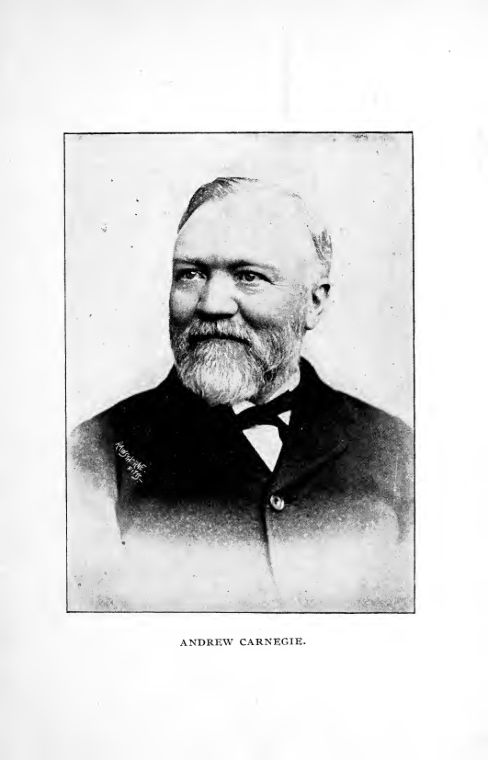
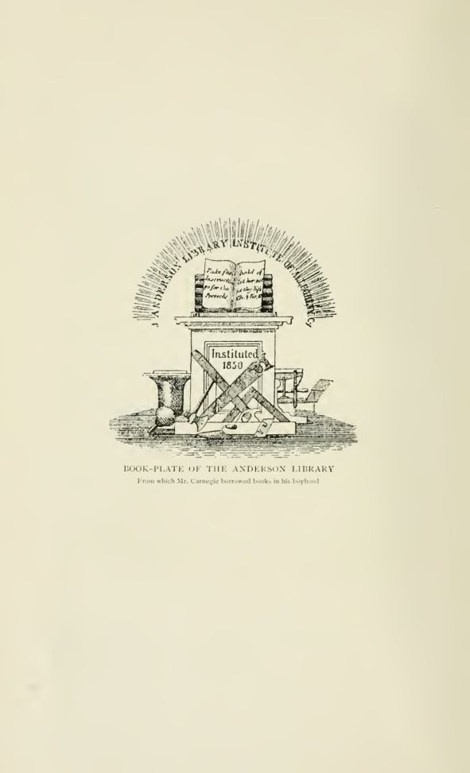
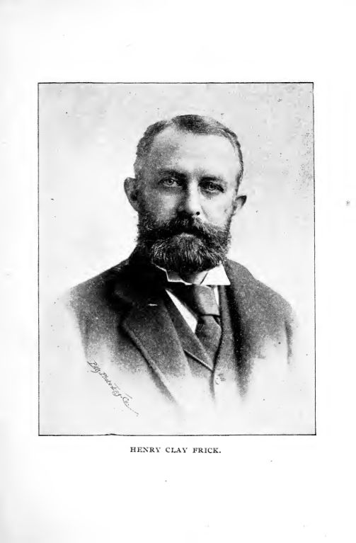
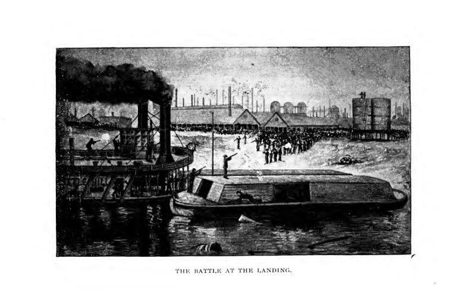
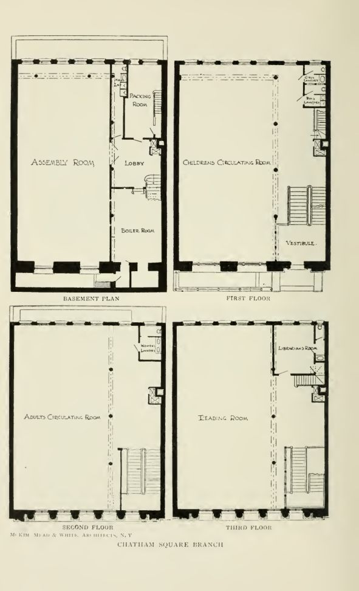
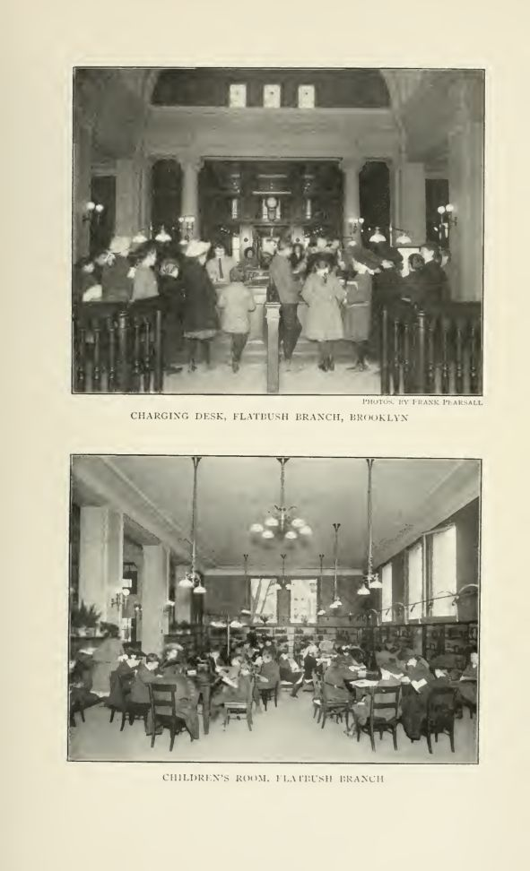

**文 / qscqesze**

一八九二年夏天，安德鲁·卡内基在苏格兰，自己控股的钢厂却在宾夕法尼亚陷入武装冲突。七月六日，平克顿侦探公司的人员乘驳船抵达霍姆斯特德，准备进入被停工工人守住的厂区。双方交火，造成死亡和重伤。随后州国民警卫队进驻，公司在军队保护下恢复生产，工会最终失去这座工厂。[^1]

多年以后，卡内基在自传里仍把霍姆斯特德列为一生不能忘掉的伤口。他说，如果自己在场，就不会让事情走到这个地步；合伙人亨利·菲普斯还为他的缺席作证，解释同伴担心他总要迁就工人，所以劝他不要回美国。书中保留了格莱斯顿的安慰信，保留了他后来与劳工领袖握手的回忆，也保留了他对当年工人要求的责备。

这份申辩没有解决另一个问题：既然他能够从大西洋彼岸批准经理的经营方针，缺席是否足以免除对结果的责任？留下的通信表明，他在冲突以前支持亨利·克莱·弗里克的立场，并非等到流血才知道公司与工会之间有争执。争执中的具体措施、谁有权代表谁说话，同企业的利润一样，都是他这门生意的组成部分。

他曾经是一个不得不在工厂做长工的孩子。后来他拥有的企业能决定数千人的工资与工时，再后来，他又规定一座城市要用什么条件接受自己的图书馆。工厂、合伙协议和捐赠文件让他的权力先后以不同形式出现。它们都要靠人来实行，而那些人并不总愿意按他的想法行事。

<figure>
  
  <figcaption>图1：1893年《霍姆斯特德》所刊卡内基肖像，原摄影者未署名。匹兹堡大学藏本，公版。<a href="https://archive.org/details/homesteadcomplet00burg">来源</a>。</figcaption>
</figure>

## 邓弗姆林留下的织机

一八三五年十一月二十五日，安德鲁出生于苏格兰邓弗姆林。父亲威廉是亚麻布手织工，母亲玛格丽特来自莫里森家族。父亲的职业并不意味着这个家庭一直赤贫。生意较好时，他拥有几架织机，家中生产与居住的空间相连；一家人面对的是已有手艺越来越难换到足够收入的过程。[^2]

蒸汽动力织造改变了这份生计。威廉的织机贬值，旧办法能做出来的布，不再总有人愿意按能够养活家庭的价格收购。卡内基晚年记得父亲把一批织品送出去，母亲等待他回来，想知道是否还有下一批活。晚年他把自己对依赖雇主的恐惧，同父亲不能持续获得工作的经历联在一起。

母亲开了一间小店，替家中添收入。安德鲁会替店里跑腿，后来也帮着记顾客的账。她能做的事情比丈夫的织机多一些，但每一项都需要她自己的时间。家中还有弟弟托马斯。生计下降时要维持的，并非一个人吃饭，而是两个孩子的衣物、学习以及一家人不愿放弃的体面。

这些人谈论社会地位时，并不接受所有现成安排。外祖父托马斯·莫里森关注激进政治，舅辈和父亲参加过改革活动。安德鲁后来回忆，自己听见人们攻击世袭特权、称赞共和国，也听见家人讲述有人因集会被捕。他从童年带走的政治语言，相当一部分属于自认为有权议论国家的手艺人。

书本和口头讲述是这种家庭生活的一部分。乔治·劳德既是长辈，也是男孩和表亲的教师。他用历史人物、诗歌与苏格兰故事训练两个孩子记忆和复述；安德鲁与小乔治的亲近，也一直延续到成年。劳德没有给他一张可在大学之间通行的证书，却使他很早便熟悉公开说话、背诵和争辩。这些本领后来进入了卡内基的商业与公共生活。

学校并没有占满他的童年。卡内基能读写和计算，也接触过代数与拉丁语，离开苏格兰后不再继续普通全日制教育。他把许多学习转到夜间、工作间隙和朋友之间。成年后的他常强调自己没有接受多少学校训练；那种说法凸显了他的自学，也容易把早年家人已经提供的文字、算术和交往能力隐去。

一八四八年，家庭决定移民美国。母亲的亲友此前已经到阿勒格尼城安顿，寄回的信息给这次迁居提供了方向。变卖财产却凑不齐旅费，母亲的朋友亨德森太太借出二十英镑，由亲属担保偿还。卡内基离开故乡的起点，因而同时有一个债主、几位担保人和一个尚待落脚的亲属家庭。

五月，他们离开邓弗姆林，后来从格拉斯哥乘船，横渡大西洋到纽约。再往内陆并不是一段可以在列车上直接坐完的路。他们经运河、湖泊和河流转运，最终到匹兹堡附近。安德鲁在回忆里把船员的友善、纽约的繁忙和漫长内陆旅程写得很细，却没有把母亲必须依靠别人的钱和住房略去。

在阿勒格尼，家人最初住进姨母提供、不必交租的两间房。父亲又开始织桌布，找不到整批收货的商人，只能自己出去销售。移民没有恢复他在旧世界失去的市场。母亲替邻近鞋匠做鞋面缝制；鞋匠的儿子亨利·菲普斯，后来成为安德鲁的重要合伙人。先是邻居、同乡和手艺人之间的联系，日后才有资本与股份。

卡内基后来把母亲描绘成这个家不可替代的支柱，对父亲则格外怜惜。他对贫困的回顾并不只是财务数字，也包含一个儿子对父母能力的不同判断。他能够离开父亲难以脱身的行业，部分因为自己还年轻，尚无一架必须继续使用的织机，也还可以试一种与织布全然不同的工作。

## 电报局里的一份姓名表

他的第一份工是在棉纺厂当换纱管的童工，按他的记载，每周一美元二十美分，工作从天亮以前延续到天黑。此后他到约翰·海的纱管作坊，每周两美元，先照看小蒸汽机和锅炉，又替新做的纱管上油。工资提高了，恐惧与不适并没有随之消失。他回忆自己担心蒸汽压力，也难以忍受油的气味。[^3]

变化从写字开始。海需要开账单，发现男孩的字和计算能派用场，便让他做一些文书工作。安德鲁与朋友又去上夜校，学习复式记账。那不是后来企业规模扩大以后才添的管理工具；在他还是一个工人的时候，能处理数字与账册，已在改变别人分给他的任务。

一八五〇年前后，他经亲属介绍到电报局当电报信差。自传把这次转换看成自己真正的开端。报酬每周两美元半，工作包括打扫办公室、送电报和轮值到深夜。父亲起初担心孩子年纪小，不能承担夜间出门的风险；原雇主同意让他试，表示不适应还可以回来。离开作坊因此既有风险，也没有完全切断退路。

送电报要求他记住匹兹堡各商号的位置。他按街道逐家认招牌，练习从街头报到街尾，再沿另一边反过来。很快，他又要认识商号里的人。若在路上碰到收件人，直接交出电报，就能省掉一段路。城市中的店铺和姓名逐渐成为他可以使用的知识；这份知识不能立即换成资本，却让年轻的电报信差不断接近掌握生意的人。

与他一起工作的有戴维·麦卡戈、罗伯特·皮特凯恩等人。相近的出身和共同的工作把几位少年联系起来，他们后来进入铁路和工业的不同职位。卡内基在回忆里愿意把他们看成从最底层起步的一群人。对当时的他们，能相互介绍职位、获得一位年长者的推荐，比日后被称作哪一类成功者更紧要。

送到较远区域的电报可以加收十美分，引起几人争执。按卡内基的说法，他提议把这部分收入汇在一起，每周平均分配，由自己保管。它是一笔很小的钱，却已经涉及怎样分工、怎样分收益，以及谁有权保管账目。合作减去了电报信差之间的一部分冲突，母亲管理的家用则仍在决定他能够存下多少。

收入逐渐使家庭有余力偿还二十英镑的借款。他记得母亲一点点把半美元存起，够了以后才汇回苏格兰。借款还清不等于摆脱同乡联系，反而让他把亨德森太太的帮助保存为终生应记住的事。后来他向别人解释自己为什么资助年轻人时，反复回到这些具体的帮助。

另一项帮助来自詹姆斯·安德森上校。安德森开放自己的藏书，让工作少年每周借阅。借阅资格一度被解释为只给有手艺、靠双手工作的人，送电报的孩子可能被排除。卡内基便给报纸写信，争辩自己和同伴也在工作，有些人以前确实做过体力活。规则后来放宽，他得以继续读书。[^4]

他没有从中得出所有人都该直接得到钱的结论。成年后，他特别喜欢图书馆这种资助：捐赠者提供进入书本的机会，读书人还须自己花力气。这个解释包含他自身受益的经历，也包含他后来挑选受助者的尺度。一个少年曾为资格过窄抗议；同一个人富有以后，又会亲自写出别人接受赠款的资格。

工作还给他剧院的入口。电报局为剧院办理业务，雇员可以因此看戏，电报信差也设法取得机会。莎士比亚通过演出进入他的阅读，而非先经一份完整课程。他后来喜欢同作家和评论者来往，这种趣味已有一段属于便宜座位、工作便利与朋友轮换差事的历史。

在办公室里，他想学会的不只是怎样把电报送出去，还包括怎样收发。他练习辨认电报码，后来能够凭声音接报，不再完全依靠纸带。代理外地业务的机会使上司能够检查他的本领，升任报务员以后，月薪达到二十五美元。他还替报纸多抄几份新闻，另挣一点钱。文字、机器、速度与商业消息，就这样逐渐合在他一份工作里。[^5]

宾夕法尼亚铁路公司匹兹堡区的主管托马斯·斯科特经常到电报局办理通信，认识了这个年轻报务员。一八五三年二月，卡内基进入他的办公室，任文书兼报务员，月薪三十五美元。原先送给商人的消息，现在也成为调度车辆、运送货物和恢复线路的一项工具。斯科特既雇用了他，也把他带到一处远比电报柜台更有权力的地方。

<figure>
  
  <figcaption>图2：安德森借阅机构的藏书票，票面标有1850年创设信息。科赫1917年书中复制，加州大学藏本，公版。<a href="https://archive.org/details/bookofcarnegieli00koch">来源</a>。</figcaption>
</figure>

## 在铁路经理身边

铁路把电报变成一套必须及时兑现的指令。单线区间上，某一列车停在何处、另一列该等多久，都不能只靠一张既定时刻表。事故会阻塞货运，错误调度还会使列车相撞。卡内基先替斯科特传令，逐渐熟悉每一次指令怎样得到答复，也熟悉主管必须在夜间赶去处理的故障。[^6]

在他自己讲过的一次事故中，斯科特不在，列车因线路事故积压。他未经正式授权，以斯科特的姓名发出调度指令，让车辆重新移动。事情没有酿成灾难，主管也没有处罚他，以后反而逐渐让他承担更多调度。自传把这件事写成一次冒险获得承认的故事。里面仍留着另一层关系：这项越权能成为晋升的凭据，取决于上司最后是否承认结果；他所冒的风险，也包括线上其他人的安全。

主管不在时处理列车，是一类机会；替主管了解工人的组织活动，则是另一类。他到阿尔图纳后，铁路发生劳资争执。有位曾受他帮助的工人向他通报车间准备罢工，随后公司取得参加者的名单，宣布解除他们的工作，破坏了组织中的联合。卡内基在书中把这件事放在知恩图报的叙述里，没有回避自己站在管理一边。霍姆斯特德并非他第一次参与雇主与工会之间的斗争。

一八五五年十月，父亲去世。家中买房的债还没有完全清偿，弟弟仍在上学，母亲继续缝制鞋面。安德鲁的收入已能承担更多开支，仍不能把生病和丧葬的费用视为小事。他后来常把父亲写成一个过于温厚、并不适合商业社会的人；父亲未能享到的安稳，又成为他解释自己为何拼命挣钱的一部分。

接近斯科特，使他得到工资以外的入口。斯科特告诉他，有机会买进亚当斯快递公司的十股股票，需要五百美元。他的储蓄远远不够，母亲便设法以已置得的房屋作担保，从亲属所能联系的资金中借钱。股票还须另付一百美元溢价，斯科特允许他以后支付。后来第一张十美元分红支票送到，他把它看成劳动以外的收入第一次进入家庭。

这笔投资不能仅由每周省下几个十美分来解释。若没有上司提供机会、允许延期支付，若没有母亲拿房屋担保，他不会在当时成为那家公司的股东。一个工人的节俭在这里取得了用途，但要把节俭变成收益，还须有人让他接触一种本来不能轻易获得的资产。

他同样通过铁路接触到卧铺车发明者西奥多·伍德拉夫。按他记载，伍德拉夫向他展示模型，他把方案介绍给斯科特，铁路同意先用两辆。伍德拉夫随后给他参与经营的机会。他接受八分之一的权益，要承担第一笔二百一十七美元五十美分的付款，又去找银行借钱。车辆开始营业后，收入被用来逐月支付费用。这份安排把他个人的信贷、铁路是否采用新车，以及乘客会不会付钱，连成了一项投资。

他后来把选择人的能力看得极重。此时的他既不是快递经营的创始者，也不是卧铺车的发明者，却能识别某件东西是否有铁路客户，并替发明者接近那个客户。资本不只从工厂里制造出来，先掌握连接交易双方的位置，同样能使一个尚无大笔储蓄的人取得份额。

一八五九年十二月，他被任命为宾夕法尼亚铁路匹兹堡区主管，重新回到自己已经熟悉的地方。弟弟托马斯学会了报务，成为他的秘书。公司线路和设备还不完善，主管要管调度、事故、人员和修复；严寒时，轨道配件破损使故障接连发生。他在晚年承认，自己常以本人的耐力要求下属，没有充分考虑人能够承受的限度。这份承认与他对勤劳的赞美同时保存在书中。[^7]

铁路所提供的机会，也使他得以搬到更好的住处。母亲跟他离开烟尘浓重的城区，到霍姆伍德安顿。附近住着富裕家庭，他开始应邀参加音乐和社交活动，与受过更多教育的人来往。他并不觉得自己已经无所不知，反而在这些接触中察觉语言、举止和阅读的差距，愿意接受熟人的纠正。后来他在富人中谈文学与公共事务，这种能力有过一段刻意学习的过程。

## 战争、桥梁与自己的生意

一八六一年战争爆发，斯科特被召往华盛顿，卡内基也跟去协助军用铁路和电报事务。受损的线路要恢复，部队和物资要运送，通信不能等一整套设施完全修好才开始。原来用于一段商业铁路的知识，被放进联邦政府的军事运输中。他不是指挥战斗的人，战争扩大了他熟悉的交通系统所承担的责任，也扩大了相关行业的需求。[^8]

对铁路公司而言，木桥着火可能使运输中断多日，磨损的铁轨又必须不断更换。卡内基看到的商机来自这些具体的不可靠。他参与组织造桥企业，把工程师和熟悉桥梁施工的人联在一起，再争取铁路的订单。约翰·派珀、亨利·林维尔等人有他不具备的技术经验；他承担融资、联络客户与商谈的工作。股份把这些不同的贡献放入一家企业，并未使出资者同时变成工程设计者。[^9]

建桥也会损失。材料涨价、货币变化和交付延期，都可能把预估利润吃掉。自传记载，一座桥在合同履行期间遇到通胀，铁路方面后来增加付款，使企业免于亏损。他称赞对方公平，恰好也让读者看见，订单并非一签下便能独立于既有关系：买方的主管认识他，也愿意重新处理约定的条件。

铁路管理者与供应商之间的界限，远没有他后来提出的独立经营原则那样清楚。斯科特和宾夕法尼亚铁路总裁约翰·埃德加·汤姆森，不只向他提供职业机会，也参与相关投资。他经营的企业又向铁路供货。现代传记作者戴维·纳索特别指出，这种由内部关系带来的合同与资金，是他的第一笔大财富形成的条件。卡内基自己更喜欢把重点放在可信的朋友、好的判断和履约上。[^10]

他还随威廉·科尔曼去宾夕法尼亚油区考察，参与购买油田。一部分收益恰在铁厂需要现金时到来。与此同时，投资者也犯过错误：他们担心地下石油很快耗尽，挖蓄油池保存产量，却遭受泄漏和损耗，预期的枯竭始终没有出现。卡内基晚年愿意把这种失算讲成一段有趣往事；在当时，它说明接触新行业不等于已经知道地下还有多少储藏。

几项生意并行以后，铁路薪水已不再是他收入的主要前景。汤姆森想继续提升他，他却决定退出公司。一八六五年三月二十八日，他正式辞去职务，向原部门的雇员写告别信，并收到一只纪念金表。他说自己以后不再为工资工作，希望能够控制自己的事业。获得这种选择时，他已经从铁路取得知识、信用、投资机会和一批合作者；辞职结束的是雇佣关系，没有结束这些关系的商业价值。

弟弟托马斯在此后逐渐承担匹兹堡的经营，菲普斯负责重要的财务和厂务，安德鲁则越来越多在纽约活动。分工使他能够离开生产现场，接触金融、签订大合同，也去欧洲旅行。纽约的大宗业务与匹兹堡的厂务，越来越需要这些伙伴分别承担。

他在欧洲参观工厂，也进入画廊、剧院和音乐厅，与政治家、作家来往。那些活动既满足他原有的兴趣，也给他新的身份。他愿意被看作有见识的美国人，向英国人介绍共和国的增长，向美国朋友讲欧洲的作品。文学和公共演说对他并非成功以后才购置的装饰，早在电报局和铁路办公室，它们便是他接近另一些人的方式。

## 把损耗写进账册

钢铁企业并不是在一张没有前史的图纸上建成的。最初的铁作坊里，安德鲁·克洛曼有机械本领，托马斯·米勒带来早期投资，菲普斯与托马斯·卡内基也各有份额。几位朋友会争执，会退出，也会组织彼此竞争的厂。随后又发生合并。卡内基能够扩大自己的控制，不只因为企业扩大，还因为他收购了不愿继续合作或不能继续出资者的权益。[^11]

他在回忆里称赞克洛曼能够造出经得起使用的设备，擅长车轴和特殊形状的轧制。工程订单若要求一种现有厂家不肯做的部件，需要有人知道怎样把它造出来；否则，出资和承诺都不能履行。卡内基愿意承接这些订单，依据的是伙伴的能力，而非自己亲手试过每一道工序。

但他也不肯只依靠老师傅的自信。他要求在厂内不同环节称重，把进料、成品和损耗逐项记账。以往只到年末才看总账的办法，无法说明某个炉子为什么耗料多，某组人为什么产出少。新的记录把各工序的结果拆开，经理能够据此相互比较。他承认这套办法不是命令一下便完成，各厂管理者有抵触，准确制度需要多年和许多文书人员才能建立。

账册扩大了老板从办公室控制生产的能力。设备运转时的知识原来分散在炉前、轧机和工头手里，记录把其中一部分变成可以传递的数字。企业主不必亲眼看见每一次损耗，也可以追问它发生在哪里。节省原料、选择设备与检查人的劳动，就此成为同一套经营判断，而工人的工作开始面对更密的比较。

采用西门子煤气加热炉也是这类判断的一部分。初期成本高，有人认为过于奢侈，他却把减少加热损耗所节省的材料算进账里。若没有称重与成本记录，改善很容易只被看成一笔新的设备支出。企业能否承受改造，还取决于它有多少钱可以等到节约兑现，不能只由一项技术是否新颖决定。

炼铁又提出更细的问题。不同矿石所含的铁、磷、硅不同，凭产地名声和经验配料，会让一座大高炉不时失常。卡内基公司雇用化学人员，分析原料，帮助调整矿石、石灰石和燃料的配比。他记述过用更纯矿石却仍按旧法加入过量熔剂，反而造成故障的经历。好原料若与不合适的配方相遇，并不自动带来好铁。

这种分析改变了购买。某些昂贵矿石不值得原来的价格，另一些被同行嫌弃的矿料和副产品，只要了解成分、使用合适，反而有价值。省钱由此不只发生在压低采购单价的一刻，也发生在知道自己究竟买进什么、能怎样使用的时候。卡内基没有发明这些化学方法，却愿意为它们支付工资，并让厂内决策听从分析结果。[^12]

与此同时，铁路对钢轨的需求正在改变铁厂的前景。铁轨在繁忙区段磨损快，钢轨更耐用，但批量炼钢需要设备、许可、技术人员和资金。卡内基考察英国的贝塞麦生产，看见了机会，也看见早先美国企业太早尝试、资金准备不足所遇到的困难。能够判断工艺可行，还不等于任何时候投入都同样安全。

他决定在布拉多克建设钢轨厂，厂名纪念汤姆森。地点靠近两条竞争铁路和河运，不让某一家铁路独占运输。汤姆森希望厂子更依赖宾夕法尼亚铁路，卡内基则要保留选择。曾经帮助他进入行业的客户，并不因此总能让他按客户的利益布局。合作者之间可以有感激，也同时保留价格与运输上的博弈。

一八七三年金融恐慌到来时，厂还在建设。客户不能付款，银行收紧，工资却必须发出。他需要的不是账上将来可以收回的一大笔钱，而是当下能付给工人的现金。自传记载，公司为取得十万美元小面额纸币，曾额外付出二千四百美元的费用。钱是否存在、什么时候到手和以什么形式到手，在恐慌中成了不同的问题。

他卖出备用证券，也同债权人周旋，钢厂建设一度停下。一些合伙人不能再缴出约定的款项，他接手他们的权益。危机不只考验企业能否活下来，也改变谁最终拥有企业。他后来把保留资本、不替外人担保看成重要原则，部分就是从这段自己曾经害怕到难以自持的经历得来。

新厂需要的管理者，不是另一位能写漂亮账本的人。他承认自己曾误以为优秀铁路审计人员可以直接管理制造业，后来发现对方缺少实际生产训练。最终在厂里建立权威的是威廉·琼斯。他熟悉设备，也能管理工人。卡内基提出让他成为合伙人，他宁可拿高工资，继续专注厂务。自传记载，公司给他的薪水达到美国总统的水平；这是一种留住关键人才的办法，也显示股份不是每个人都会接受的奖励。[^13]

在卡内基不断表彰的年轻合伙人名单外，还生活着更多不会得到股份的人。炉前和轧制岗位有熟练程度的分别，工资与生产组织也各不相同。几个人由小职员成为富人，不能据此代表整个厂的晋升经验。钢产量增长时，这个差别也进入了下一轮工资谈判。

一八七五年，埃德加·汤姆森钢厂进入生产。这使他能够把铁路时代认识的需求，变成自己控制的大批钢轨供应。但钢轨市场会涨落，不能只要铁路继续铺设，就假定每一年的报价都足以支持扩张。公司以后还需要把钢材卖往建筑、桥梁以及其他用途，设备也要能完成更多种加工。[^14]

在炼炉以外，一吨成品的成本早已开始发生。矿石要挖出、运到水路、装船，再换上铁路进入匹兹堡；煤要炼成焦炭，石灰石也要运入。厂里的炉子即使工作得很好，只要运费、原料价格或供货时间受人牵制，仍可能失去优势。卡内基从铁路转进制造业以后，又以另一种身份回到了运输问题上。

对焦炭供应的投资，使他同弗里克结成伙伴。焦炉需要适宜的煤，厂区需要稳定的焦炭；购买已经掌握煤田和焦炉的企业权益，比每次在市场上临时寻找燃料更容易安排生产。可掌握原料不只是财务交易：煤矿、焦炉和钢厂的劳动条件各有不同，不能因为公司把它们连起来，就以为一份厂务报告能够充分描述所有工人的生活。

一八八三年，卡内基方面购入霍姆斯特德钢厂。那里原有的业主、机器和熟练工组织，并不会随着产权移交一起消失。工会在收购以前已经经历罢工、建立地位，新老板获得厂房时，也接下了这份不能只按设备估值的关系。以后他会强调自己没有亲手挑选这里最初的工人，但买下正在运转的厂，同样意味着需要同原有的人重新订定条件。

在卡内基自己的收购解释里，买现成工厂可以补足已有企业的产品种类，并省去重复建设。他向原业主提出把投资并入共同生意，也允许他们领取现金离开。选择留下的人，会分享以后的增值；选择拿钱的人，则不再承担继续投入的风险。前一座铁厂合伙时的难题，在规模更大的交易中又出现了一次，只是这回掌握提议权的是卡内基。

## 合同之外的生活

钢厂投产以后，卡内基的收入不再取决于一种证券的分红。他能够把利润重新投入设备，也能够拿出一部分钱，回到苏格兰做以前连设想也要有所顾忌的事。可是家庭并未随着企业一同扩大。母亲仍在他的生活中心，弟弟托马斯又是生意中的伙伴。兄弟之间不只是股份上的关系：移民时年幼的弟弟，曾是全家一起带过大西洋的孩子。

一八八六年秋，卡内基患伤寒。病情使他不能自行安排日常事务，需要医生和护士照看；母亲也病倒，匹兹堡那边又传来弟弟患病的消息。十一月，两人在相隔不久的日子里去世。亲属起初没有把病情全告诉他，等他得知死讯时，他自己还没有脱离危险。到后来写自传，这一段仍同企业扩张的得意叙述分开。他所失去的人，也是知道他在财富以前怎样生活的人。[^15]

他同路易丝·惠特菲尔德相识已有数年。路易丝的父亲去世以后，她曾承担自己家庭的事务，并非只等一个富人来安排生活。卡内基叙述两人的交往，承认自己有过遭到退回的信。依他的解释，路易丝原先希望同一个需要她帮助、尚在奋斗的年轻人结婚，不认为已经富有的他还需要这样的伴侣。这些求偶经过，由丈夫在多年后回忆下来。

疾病以后，两人的关系有了确定结果。一八八七年四月二十二日，他们在纽约结婚，随后赴英国。蜜月后住到苏格兰，家中接待来访者，老亲属也加入这段新的家庭生活。路易丝愿意让丈夫的家人来住，渐渐同他们建立了自己的交情。她以后支持他的捐赠，不仅在公开场合陪同，也参与他晚年生活和身后文字的保存。

这次婚姻没有让卡内基放弃跨洋经营。他继续在美国工厂和英国社交圈之间安排时间。电报、定期账报、合伙人来信，使他能够不在厂里仍掌握重大问题；远离厂区也给了他写作、旅行和结交文人的时间。他乐于把自己介绍成一个读书、讲演的美国共和制度拥护者。他的公众身份逐渐多于一个钢铁商人，但厂里的工资仍要由同一笔生意支付。

一八八九年六月，他在《北美评论》发表《财富》。这篇后来被称作《财富的福音》的文章，先认可大企业、竞争和收入悬殊的存在，把它们解释为物质进步的结果。它没有从工人应取得多少报酬开始讨论分配，而是先问：财富集中到少数人手里以后，持有者应当怎么办？[^16]

他列出三条路：留给子女，死后遗赠公益，或在生前亲自管理捐赠。庞大遗产可能使子女失去谋生的能力，遗嘱又可能遭到诉讼、误解和拖延。他赞成对大额遗产加重征税，甚至把这种税当作对富人只知积累的惩戒。他所偏爱的办法，是富人在留足家庭合理生活所需以后，把剩余收入视为交自己管理的公共托付。

这种托付没有把决定权交还受助者。在文章中，组织大企业的能力，也是富人自认为能比普通人更有效地安排公共利益的依据。他用彼得·库珀创办的教育机构作比较，认为大笔资金集中用于长期设施，比多年间零散地增加个人收入更能使社会受益。工资在文中仍受到肯定，因为它是劳动所得；但同样一笔钱，先由谁保存、再由谁决定花向哪里，他选择的是业主。

对于不问对象的施舍，他的措辞尤其严厉。他担心钱会助长懒惰、酗酒和依赖，主张提供可供有志者向上攀登的设施，如图书馆、公园、艺术和教育机构。他很少追问一个人是否有余暇、健康和安稳住处来使用它们。他把自己曾经借到书、进而改变生活的经验，推广成了一套捐赠原则，也因此把个人获得机会的故事，当作判断其他人应获得何种帮助的尺度。

这些意见在霍姆斯特德冲突以前已经公开，不是流血以后临时编出的补偿计划。他也早已资助家乡图书馆。可是生前捐赠可以与持续扩张同时进行：《财富》发表以后，他的钢铁事业还在继续积累资本。对公共用途的承诺，并未使他停止争取更低的生产费用或更大的经营自主权。

## 钢坯价格怎样进入一份工资单

在卡内基的企业里，争取工人的认可与防止工会干预，可以由同一位老板同时实行。他愿意接见工人，赞成改善某些福利；在回忆录里，他也承认资本停产一段时间，往往不改变业主的衣食，工人家庭却会迅速耗尽生活费用。对于双方力量不同，他并非没有认识。

他记述过一位工人提出把月薪改为半月支付，原因是两次领薪相隔太久，家庭要靠赊购维持。他接受这个要求，又支持由工人参与管理的合作商店，以及为部分雇员保管储蓄、协助住房的办法。这些措施能够改变日常生活中的具体困难。不过，它们仍是公司或老板认可后提供的安排，不是工人在冲突中可以自行运用的谈判权。[^17]

自传还记下一种颇能说明区别的做法。他说，工资协议即使已经由工会负责人签署，他仍要求每个工人各自签字；工资因而变成个人同公司的约定。在他的叙述里，工会会费逐渐没人愿意再交，组织便退出了那座工厂。他把结果记为劳资关系改善。对工会而言，这正意味着代表全体成员订立并执行合同的能力丧失。双方使用的同一个“和谐”，包含着不同的权利安排。

霍姆斯特德的熟练工人并不愿意接受后一种安排。这里的钢铁工人联合组织，既争工资，也参与维护工序中的工作习惯和岗位规则。熟练工懂得怎样把机器的产能变成合格产品，组织起来便能影响厂方怎样指挥生产。管理者则认为这会限制引进机器、分配工作和决定用人的自由。工会在某些争执中态度强硬，甚至使厂方认为车间已经不受经理支配。双方的对抗积累在一份份合同里。[^18]

一八八九年签订的三年协议，把部分工资同钢坯售价联系起来。钢坯是继续加工成其他钢材的中间产品；以它的市场价格作尺度，可以让工人的计件收入随行情上下浮动。问题是收入下降到哪里必须停止。协议规定每吨二十五美元的价格底线，低于这一价格时，不再照同样办法继续往下扣。繁荣时有没有上限、以一个月还是一季度调整、合同在哪个季节到期，也都关系到哪一方承担跌价风险。

一八九二年，钢坯价格跌破底线，市价约在二十二至二十三美元一带。现有规则使公司仍须按二十五美元的基准计算相应工资；经理想改变这一点。厂方起初提出二十二美元的底线，后来愿意提高到二十三；工会从原有二十五退到二十四。表面只差一美元，但每次价格下跌都会通过这条规定落到今后的工资单上，不能把它当作一次性的小额让步。

到期日也没有谈拢。旧合同在六月底结束，工会希望保留夏季谈判的条件；厂方要求新合同在冬季结束。严寒季节停工，家庭燃料开支增大，寻找替代收入也更不容易。日期因此同价格底线一样，关乎未来一次冲突中双方能坚持多久。经理所要的协议，并不只是用当年的市场跌幅修正上一年的工资。

主持厂方立场的亨利·克莱·弗里克，早已在焦炭业建立事业。焦炭是炼铁需要的燃料，煤矿、炼焦炉和钢厂的结合，能使企业减少对外部供应的依赖。弗里克掌握这种原料的经营经验，又以不轻易向罢工让步著称。进入卡内基企业管理层以后，他要统一控制生产，就要面对霍姆斯特德熟练工会的抵抗。

对公司来说，提高产量的机器减少了生产每吨钢材所需的人手和时间，原来按吨计算的工资办法也就显得昂贵。对工人来说，产量增加不能单独证明他们应当降薪；操作新机器、按新速度工作的人，也在支撑增加的产量。双方都能拿出计算，但最先决定如何计算、谁可以拒绝这套算法，正是谈判尚未解决的部分。

社会调查者约翰·菲奇后来对照工资资料，指出所谓只削减少数特别高薪工人的说法不够准确。若干辅助岗位同样受影响。他列出的某类剪切工助手，按当时工作条件折算，月收入可能从九十余美元降到四十余美元；另一些岗位并不下降。不同岗位受到的冲击悬殊，辅助工与高薪熟练工在这次争端中也有了共同利益。[^19]

弗里克在五月底给出接受条件的最后期限。六月下旬最后一轮会面也没有弥合差距，厂区随后停工。工人把守出入口，组织纠察，防止替代工人进入。公司的准备则包括围栏、招募替代劳动力，以及接洽平克顿侦探公司。它已经不是只在会议桌上等待工会最后答复。

<figure>
  
  <figcaption>图3：1893年《霍姆斯特德》所刊弗里克肖像，原作者未署名。匹兹堡大学藏本，公版。<a href="https://archive.org/details/homesteadcomplet00burg">来源</a>。</figcaption>
</figure>

## 一封没有寄给工人的告示

卡内基在这一阶段赴苏格兰。缺席使他免于在每一次会议上面对工人，也让弗里克可以按自己的方式执行决定；它没有使双方失去联系。菲奇在研究中引录前秘书布里奇公布的通信，尤其指出四月的一份告示草案与六月的一封信。前一份拟在旧合同到期后停止承认工会，后一份支持不再继续会谈。这些文字经布里奇的著作传下，菲奇对真实性用了保留措辞，却认为足以说明拆除工会的想法早于七月的流血。[^20]

即使不把每一段通信都当作毫无疑问的原件，卡内基后来的自传也没有说他反对公司的工资条件。他坚持工人应该接受那些条件，只把谈判破裂的严重后果同自己不在场联系起来。他愿意认领经营方针，却想与执行方针所造成的灾难保持距离。对这一区别，工人没有理由同意。

弗里克安排约三百名平克顿人员沿水路抵达。七月六日凌晨，两艘驳船接近厂区。岸上工人和支持者阻止他们登岸，接着发生枪击。谁打出第一枪，事后叙述并不一致；双方有人携带武器，人员陆续伤亡，工厂入口成了持续交火的地点。平克顿人员并没有被正式任命为当地执法人员，他们是为公司履行雇佣任务的私人力量。[^21]

附近居民不断加入岸上的人群。向驳船攻击的办法不止开枪，还包括试图纵火；这些行动同样可能伤及不能决定谈判条件的人。到平克顿人员投降时，工人方面曾承诺安全护送，但被押走的人员遭到殴打和侮辱。保卫工会的主张不能使这些行为变成正当。暴力也给厂方把争执归结为恢复法律秩序提供了依据。

州国民警卫队随后进入霍姆斯特德。军队能够控制厂区，却不能替工会恢复原先的合同。公司在保护下安排替代人员开工，工人家庭则要维持没有正常工资的日子。最初夺下入口的胜利，没有转化成最后决定谁能回到岗位的权利。

七月下旬，无政府主义者亚历山大·伯克曼刺杀弗里克未遂，使局面又起变化。伯克曼的行动不等于工会授权，不能把两者合在一起解释；但公众接收到的是一个经理在冲突中遭到袭击的消息。工会既要继续同公司对抗，又要同这次刺杀划清关系。把厂门前的集体行动化为个人暴力的尝试，没有给工人增加谈判筹码。

随着停工延长，重返工作的人增多。到十一月，罢工失败。失去职位的人必须寻找别的谋生道路，回到厂里的人则是在工会不能再为他们争取原有条件的情况下复工。对公司而言，损失了数月生产、承担了武装行动的恶名，最后仍恢复了不受这个工会制约的经营。失去组织的工人没有同样的恢复过程。

菲奇写作时，工业合并与此后的反工会行动已经使不少钢厂处于雇主单方面决定条件的状态。他没有把所有结果都归到一八九二年一个夏天，却把霍姆斯特德看成这一转变中的关键。这里失去的不只是工资表上的某个数字，也是一群熟练工人参与决定生产条件的能力。它在卡内基企业盈利继续上升时，仍影响着留在厂里的人。

卡内基多年后回到这场争执，总爱记述工人如何信任自己，认为如果由自己出面便会不同。他把问题的一部分解释为弗里克缺少亲近工人的方式。可是他也明说，自己不会在公司所提条件上继续退让。他怀念的是可以由老板同工人直接恢复的个人信任，工会当时坚持的却是无须依靠老板好感也能履行的合同。

他在自传中大量保存安慰自己、赞许自己捐赠的文字。霍姆斯特德没有阻止他继续发表意见，也没有终止他的公益计划；但此后每当他把钱交给工人应当受益的机构，厂里那场冲突就会成为人们判断捐赠的另一份依据。

<figure>
  
  <figcaption>图4：《登陆处的战斗》，1893年《霍姆斯特德》插图，绘制者未署名，属事后绘制，非现场摄影。匹兹堡大学藏本，公版。<a href="https://archive.org/details/homesteadcomplet00burg">来源</a>。</figcaption>
</figure>

## 从合伙份额到债券

霍姆斯特德以后，公司的扩张没有停下。它所控制的不只是把钢水轧成成品的设备，还包括矿山、焦炭供应和把原料运到厂边的运输环节。每一项都需要资本，也能使别的供应者更难通过涨价分享钢厂利润。管理者因此得以在行情下跌时继续压低报价，让成本更高的厂商先遇到困难。

这样的整合并非一路买到好矿。卡内基自己记载，在宾夕法尼亚泰隆一带的矿业投资曾经亏损。矿边的样品经过长期风化显得富集，挖到深处却不够经济。此后公司在购买另一处矿产以前，按网格布置试坑，逐段取样分析；他把这次较谨慎的勘查作为后来应遵循的经验。原料的质量不能只凭矿主送来的几块好石头判断，掌握成本也不能只在炼炉里进行。[^22]

他对合伙制的偏爱，同这些收购的速度有关。少数合伙人可以迅速批准一项选择，不必每次经过庞大的董事会。他把有经营才能的人拉进来，给他们份额，又期望他们把精力和利润继续留在共同企业中。这种办法在扩张期间很有力量；有人想离开时，份额到底值多少，也可能成为最尖锐的问题。

弗里克与卡内基的合作最终走到诉讼。一九〇〇年二月，《商业与金融纪事》报道，已经辞职的弗里克起诉卡内基及其他合伙人，要求获得自己权益的公平价值。他拥有的百分之六份额，按他诉状中的计算值一千六百余万美元，卡内基愿付的数额则约为六百万。这个差别使原本只在内部运用的退出协议，进入公开争执。[^23]

厂方随后答辩，指出弗里克以前也曾用同样的“铁定协议”处理不合意的伙伴。它还强调，账面利润有相当部分必须继续投进厂产，不能全当作可立即分发的现金。双方争的既是已有资产怎样记账，也是一个仍能持续盈利的企业，能否只按内部规定的数目收回离职者的权益。

同一时期，焦炭公司的少数股东又针对向钢铁公司低价供货的合同提出诉讼。钢厂希望原料便宜，焦炭业的其他股东希望产品获得较好的价格。一体化能够降低整个集团的费用，不等于集团内每一个人都会按同样比例获益。卡内基把原料与制造接在一起，也把原本可以向外谈判的价格，变成了内部需要分配的利益。

合伙人关系因而不能只用他所喜爱的兄弟情谊解释。他确实让一些年轻管理者成为富人，也不断怀念共同创业的伙伴；但当伙伴要求按另一套尺度兑现权益时，他会维护让企业继续集中经营的协议。弗里克既不是只替他执行命令的工具，也不是从一开始就同他毫无共同利益的敌手。两人曾一起提高企业的控制能力，后来同样不愿把决定自己利益的权力让给对方。

一九〇〇年三月，双方在大西洋城谈成和解。卡内基授权公布的方案，以新泽西州设立的公司统合钢铁与焦炭权益，诉讼随重组终止；弗里克取得新公司的权益，施瓦布继续主持经营。退出争执由新的股份安排解决，双方转而以新公司的证券确认各自权益。[^23]

一九〇一年，出售整个钢铁企业提供了另一种退出办法。查尔斯·施瓦布在卡内基与银行家摩根之间传递条件。卡内基不用把厂逐座卖掉，也不用在一座座炉子继续运转时逐年取出全部利润；买方把他的企业并入更大的钢铁组合，用证券完成这笔交易。公司整体交易通常记作四亿八千万美元，由各权益持有人分享，支付形式也包括证券。[^24]

对于自己为何同意出售，卡内基的回忆把慈善责任放在突出位置。他说，事业的盈利前景仍好，自己却已需要时间管理财富的分配。他没有把售企写成经营失败，也没有承认自己终于无力同新的大组合竞争。他将退出经营解释为履行早已公开承诺的下一步，施瓦布与摩根则要把它完成为一笔双方能够接受的买卖。

收到有息债券，使给钱这件事变得比从厂里提取现金容易。他无须亲自监督每一吨钢怎样卖掉，就能安排债券的利息用途。工业经营所得从此成为图书馆、养老金和研究经费的本金。它同钢铁生产仍有财务联系，日常支配的工作却已经交给新公司。

三月十二日，他指定四百万美元、年息百分之五的债券，为钢厂工人的伤残与老年困难提供帮助，另拿出一百万同类债券支持已建的图书馆与会堂。自传后来收入工人代表的感谢文件。他把它们视为同工人关系的证明。这些援助可以真实地减轻家庭困境，但不能因此说，当年所有失去工作的人都得到了补偿，也不能把几位代表的感谢信当作全体霍姆斯特德工人对旧事的共同判断。[^25]

他从企业退出时已经结婚多年。一八九七年三月三十日，女儿玛格丽特出生，名字取自已故母亲。此后夫妻为家庭寻找长期夏居地，最后选定苏格兰的斯基博。孩子、家居、来往宾客和捐赠事务，给退休生活建立了日程。他仍能同从前的合伙人聚会，却不再是他们必须每天报送成本的业主。

<figure>
  
  <figcaption>图5：纽约查塔姆广场分馆各层平面图，McKim, Mead & White事务所设计。科赫1917年刊本，加州大学藏本，公版。<a href="https://archive.org/details/bookofcarnegieli00koch">来源</a>。</figcaption>
</figure>

## 城市也要签字

卡内基最广为人知的赠品，通常不是藏书，而是容纳藏书与读者的建筑。区别在一开始就会影响接受礼物的人。建筑可以一次造好，购书、供暖、照明、馆员薪水却每年都要支付。为一座漂亮房子举行开幕式，并不能保证几年以后仍有新书上架。

他把地方出地、承诺日常经费，作为通常的赠馆条件。到这套制度逐渐固定时，常用的最低承诺为每年拿出相当于建筑赠款十分之一的费用。给一座城两万美元建馆，便要求当地能持续拨出至少两千美元。这笔钱不交还给捐赠者；它要花在当地读者身上，却必须由当地决定如何筹集。[^26]

早年邓弗姆林和阿勒格尼的赠馆，带有浓厚的家庭与乡土记忆。匹兹堡的项目则逐渐集合图书、博物馆、美术和教育设施。一八九五年开放的一组公共建筑，把他的姓名写入他获得财富的城市。设施增多以后，经营者不可能只靠同老板本人的交情办事，建筑、维护和使用的责任需要转到董事会、城市预算与馆员手里。

一九〇一年纽约的大笔赠款，显出了这种工作的过程。图书馆负责人约翰·比林斯先研究城区需要多少分馆、馆与馆怎样联系、成人与儿童各需要多少座位。他在说明中将纽约的人均图书经费同其他城市比较，建议以中央参考馆、分馆、学校借阅点和巡回图书服务共同组成网络。钱不是先投下来，再等街区自己决定有没有需要。[^27]

三月十二日的捐赠信，提出约五百二十万美元，用于六十五处分馆建筑，并要求纽约提供地块和维护保障。计划数与估算金额，仍要经过选址和逐馆建设落实。纽约州随后通过授权法，市政府与图书馆再签订协议，处理土地取得、建筑占用、管理和经费；公益愿望必须进入地方政府能够履行的法律形式。

一块地的位置也不只是地价问题。图书馆需要靠近读者经过的地方，儿童应能抵达，书籍要能在不同地点之间运送；为了买到便宜地块把馆远远安放，会减少实际使用。馆员、建筑师、地方官员与捐赠代理人的意见，不一定同时吻合。把这些意见变成一座能用的建筑，需要有人承担与盛大开幕无关的工作。

负责处理许多来信的是秘书詹姆斯·伯特拉姆。地方申请者须说明人口、现有馆藏与收入，交代地块和持续拨款。伯特拉姆检查平面图，对不实用的空间提出异议。后来发给申请方的建筑说明，要求把有限资金优先用来容纳图书、借还服务、成人和儿童阅览、必要的工作人员设施；小馆常被建议采用一层加地下室的办法，尽可能减少无效空间。[^28]

由书架划分同一个较大房间，比用许多固定墙体切碎空间更便于管理，也给以后改变用途留余地。图中馆员柜台的位置，往往使借还与观察阅览区可以合并进行。地下层可安排讲堂和供暖等用途。建筑外表可以因地而异，但内部若需要太多人手才能看管，就会把捐款节省下来的费用重新压到城市每年的账上。

这套要求有时令人不快。地方建筑师未必愿意听一个纽约秘书批评自己的图纸，市民也可能认为捐赠附带了太多规定。可是没有这些安排，建筑最先满足的可能是捐赠者的纪念欲、地方的体面或建筑师的设计趣味。卡内基想把礼物固定成能长期使用的设施，便要不断干预接受者如何使用那笔钱。

图书馆也并不因为接受卡内基的钱，就必须改成他的名字。同期图书馆学者西奥多·科赫指出，许多接受新馆舍的机构早已存在，仍用本来的公共图书馆名称。捐赠者的名字可以刻在纪念牌上，但公共馆的工作不必从他的赠款开始计算。地方原有的藏书、组织与支持者，才使一栋新房子不至于空置。

科赫收集的资料中，也保留了馆员对这场扩张的不同解释。纽约流通部门负责人亚瑟·博斯特威克认为，阅读需要本来就在增加，公众的需求推动图书馆，不能全说成富人赠馆以后才造出了读者。他关注的不是赠款总额，而是读者能否在家附近借书、书籍是否适合他们、馆员能否应付增长的借阅。这使捐赠的故事有了另一群主角。

最低维护额并非始终够用。一九一五年，图书馆委员会联盟同基金会通信，指出小馆的供养费用并不按建筑造价同比例缩减：一万美元馆舍需要的日常经费，可能明显超过两万美元馆舍的一半。把建筑费的十分之一当成城市已经尽到的全部责任，会限制机构以后发展。基金会接受这种提醒，把说明随赠款文件一同送出。[^29]

因此，这些建筑可以同时是私人财富支付的赠品和地方税收支持的公共机构。卡内基不能独自获得它们长期运行的全部功劳，接受者也没有因为他很富，就免除自己的经费责任。每年开门的时间、购入的书、儿童能否借阅，最后取决于那些继续投钱与工作的人。

<figure>
  
  <figcaption>图6：布鲁克林弗拉特布什分馆的借还台与儿童室，Frank Pearsall摄。收入1907年图版集及1917年科赫书中，加州大学藏本，公版。<a href="https://archive.org/details/bookofcarnegieli00koch">来源</a>。</figcaption>
</figure>

## 把捐款交给别人管理

退休后的卡内基愿意一项接一项设立基金，但钱交给谁、日后能否改用途，仍须逐条安排。他熟悉用合伙人补足自己的生产知识，公益事业同样需要他没有的教育、科学与行政知识。这时董事会对他的作用，不只是替他在支票上换一个收款人。[^30]

苏格兰大学基金把一部分收入用于帮助学生负担学费，另一部分支持大学改进。它不把钱无条件交给各校现有管理者，而是另外组织受托人。根据卡内基的记载，讨论章程时，有人担心受托人改变宗旨的权力太大；他坚持不能要求后世永远照先人的办法行事。最后采用更高的表决门槛，允许以后在条件改变时调整用途。

这里的选择同他担心死后遗赠失效的想法相通。把某一座楼、某一种课程永远写死，可能在捐赠者离世以后浪费资本。他可以选第一批受托人，也愿意让继任者在规定程序下作出自己未曾预料的安排。控制权没有转给任意一个申请人，却从个人命令转向可以继续更新的机构。

华盛顿的卡内基研究机构在一九〇二年获得一千万美元有息债券。比林斯参与建议，丹尼尔·吉尔曼出任首任领导。研究经费不必全部消耗在一座大学的教学日程里，可以支持需要长时间连续进行的调查与实验。捐赠者所理解的“有用”，在这里容纳了不能立即成为商品的知识。

其中一艘以“卡内基”命名的测量船，用尽量不干扰磁场的材料建造，以改进海上地磁观测。铁钢船体自身会影响罗盘，测量就可能把船造成的偏差同海上真实变化混在一起；改用不易造成这种干扰的材料，正是把一个实际技术问题写进整个项目设计。卡内基在回忆录里很喜欢这个例子，认为美国能够用测量结果向别国偿还从前获得知识的帮助。

他资助的另一些工作由威尔逊山天文台展开。那不是捐赠者本人用望远镜取得的发现。他能做的是使仪器、地点和专业人员具备持续工作的条件；至于怎样解释观测，由有经验的研究者负责。他自传对天文成果的兴奋叙述甚至夹有过分乐观的预期，也显出他并不是科学项目的技术判断者。

工业事故使另一个项目有了不同起点。一九〇四年，他设立五百万美元英雄基金。促使他行动的，是一场矿难中救援者冒险下井并且丧生的报道。基金没有只发一枚奖章就结束，它考虑伤残者此后的生计，以及遇难者遗属如何生活。卡内基把在和平日常中救人的行动，同依靠战争杀敌取得声名的英雄观相对照。[^31]

他也知道，事后奖励不能解释救人者为什么在危险时刻行动。基金的作用在救援以后，避免救人的人因伤残失去收入、遗属因家中谋生者死亡而陷入贫困。这个领域不能简单照搬他反对个人施舍的口号：意外会使原本能够自立的人突然需要持续帮助。

在负责这些救济安排的人里，又有从前的企业伙伴。查尔斯·泰勒承担英雄基金的工作，也参与其他养老金事务。卡内基愿意把熟识人的可靠性，作为公益管理的起点。这既使基金能迅速找到可用人员，也意味着企业里建立的人际网络，在他不再炼钢以后仍掌握着大笔公共用途的资金。

大学教师的退休待遇，来自另一项他亲自看到的问题。作为康奈尔大学受托人，他注意到许多教授收入不高，难以存下退休所需；学校又不忍让已经不适宜工作的老人失去生计。这会把教师个人的困难，同教学岗位的安排绑在一起。一九〇五年设立的教学促进基金会，以养老金作为起初的重要工作，逐渐需要规定什么学校、什么任教经历符合资助条件。[^32]

捐赠因而进入学校之间的差别。要发退休金，就必须核查任职；要界定大学教师，就必须判断学校提供什么程度的教育。资金能够改善个人晚景，也会给制定标准的机构增加影响教育方向的力量。卡内基不能用一笔钱消除这些判断，更不能由他一人决定每一所学校的情况；他挑选专业管理者，把这份责任留给基金会。

他同时保留较私人的帮助方式，为早年认识的铁路工人、故人及其遗属提供养老金。回忆录里，他对这部分援助的感情尤其直接，认为自己知道受助人长期怎样生活。对大型申请，他要求程序和保证；对认识多年的具体家庭，他又依靠个人记忆来判断。两种给钱的方法并行，并没有完全服从同一套抽象原则。

到一九一一年，纽约卡内基基金会接手越来越多的赠馆与其他事务。科赫收入的创办记录，写明最初移交二千五百万美元面值的美国钢铁公司抵押金债券，不久增加到一亿二千五百万；这是当时的移交过程，不宜同后来追加及遗赠后的累计数目混写。受托人包括熟悉的同伴、各专项基金负责人以及秘书与财务管理者。[^33]

此前以他个人名义处理的请求，开始由一个能在他身后继续存在的组织处理。它可以持有、投资财产，再按宗旨分配收入。他仍希望用途服务于知识的增进与传播，但没有要求永远沿着同几条路径走。晚年的捐赠管理，终于不再依靠他能否亲自读完下一封申请信。

## 旧日园地与新的世界法庭

基金会把捐款事务变得可以延续，家乡的一片园地却让他想起另一种长久。皮滕克里夫紧邻邓弗姆林，他儿时只能从外面看进去。家族同地方地主围绕通行权有过冲突，莫里森家的孩子因此被排斥在园地之外。祖辈争过的权利，同他记忆中的游玩愿望交在一起；买下这块地，是他少数不愿只按公益效率来解释的赠品。[^34]

取得园地也经过讨价还价。经朋友居间打听，地主同意出售，卡内基在电报中接受价格，又要确认附带条件。他没有把它买成自己的另一座私人夏居，而是交给受托人供公众使用，并另外提供本金维持工作。受托人不只须保存草木和道路，还要考虑当地劳动者的日常生活怎样增加休息、娱乐与文化活动。

他给受托人的指示，用家乡孩子将来回顾童年来衡量结果：远行以后，他们是否仍觉得故乡曾使生活更好。这同要求每位申请者证明自己有志向、有能力的态度，显得不完全相同。公园里玩耍的孩子不必先证明自己将来能够成功。卡内基希望把一处自己曾被挡在外面的地方开放出来，也因此让个人记忆干预了他那套挑选“值得帮助者”的原则。

他自称共和制度的拥护者，晚年却频繁同国王、贵族和政治领袖交往。这些人可以颁勋、接待、参加仪式，也可以帮助他接近另一项远远超过图书馆的事业：国家间的和平。他尝试召集有权决定的人，资助能够持续办事的机构，再把各方同意的办法写成规则。[^35]

这个想法在美西战争后遭到过挫折。美国取得菲律宾时，他反对把远方人民变成共和国的殖民地居民，曾往华盛顿争取政治人物改变立场。在他自己的叙述里，他先试图说服麦金莱，随后又争取阻止条约有关安排获准，都没有成功。能够见到总统，不意味着能够决定总统或参议员怎样选择。

他的反对也不是对所有国际关系都持相同看法。他尤其重视英语国家之间的亲近，把英美合作看作和平的支柱；对那些没有进入他所称“文明强国”范围的人，视野仍带着自己时代的等级观念。他要结束战争，却常从少数强国有能力约束其他国家出发设想秩序。怎样让不同国家同样愿意受约束，远比募集一笔基金更难。

海牙仲裁机制给了他可以资助的具体对象。一八九九年会议后，支持者建议他出资为仲裁工作建造固定场所。他不肯只凭私人建议主动寄钱，而希望荷兰政府正式提出需要。对方经外交渠道提出请求以后，他承担了一百五十万美元的建筑捐款。这样一来，捐赠有了可以承担责任的接受者，不只是一位美国富人在欧洲摆放的纪念物。

和平宫把法庭、图书资料与国际交往安置在同一地点。建筑能够提供会议与裁决的场所，却不能使争端当事国自动同意仲裁。要让仲裁替代战争，政府还须在最不愿让步的时候接受外部判断。在回忆录中，他把建立常设仲裁机构视为和平事业的重要进展，对各国继续参与寄予厚望。

一九〇七年，他在基尔会见德国皇帝威廉二世。自传用了许多篇幅回忆这次相遇，包括对方读过他的文章、愿意谈论和平，以及双方谈及罗斯福。卡内基认为直接交谈能够消除误会，盼望将这些领导者聚在一起。他把个人交往中得到的友好回应，看成可以指望的政治信号。

这种信任有自己的限度。友好的交谈没有使德国停止扩大海军。卡内基并非完全看不到军备的危险；他认为德国扩大海军不明智，但仍相信德国的工业发展利益会使它选择和平。他在回忆录中反复用工业发展所需的和平，来解释自己为何信任德方的承诺。

一九一〇年，他拨出一千万美元设立国际和平基金，交由受托人安排研究和行动。资金能支付持续工作，也能让和平事业不完全依赖他本人不停出席会议。不过，钱能够供养工作人员，不能给他们政府的决定权。仲裁、宣传、研究与政治游说，仍要在每个国家原有的权力结构中寻找作用。

一九一四年欧洲战争爆发，他先前对威廉二世的期望受到直接打击。他在手稿末尾回读早年的赞许，补上战争已经使世界动荡的文字，又把希望转向美国总统威尔逊。他没有把和平事业宣布为徒劳，也没有为自己原来的判断找到充分辩护。手稿在这一转向后突然结束。[^36]

路易丝在身后出版的序言里说，战争使丈夫的精力和情绪都发生变化，自传无法按原来的方式继续。这位共同生活多年的家人，将他的消沉同和平希望的破灭联系起来。它也意味着，读者后来拿到的书，主要保存的是他在战争以前和战争初年怎样想象自己的一生，最后数年没有由他本人写成同样完整的叙述。

一九一九年八月十一日，卡内基在马萨诸塞州莱诺克斯逝世。他活到战争结束，却没有看到捐款消除战争的结果；也没有在生前把自己的全部财产一笔不剩地交出。遗留财富继续进入既有机构，捐赠事务因而可以在他不能再决定以后照常办理。[^37]

次年，路易丝和编辑约翰·范戴克整理的自传问世。书中既有童年借款、家庭劳动和工厂成本的细节，也有业主对霍姆斯特德的申辩、受助者的感谢与他对政治人物的信任。在他留下的图书馆里，新书仍须有人选择，馆员仍须领薪，灯火与供暖仍须由后来的人支付。

<!-- biography-body-end -->

## 简明年表

| 年份 | 事件 |
| --- | --- |
| 1835 | 11月25日生于邓弗姆林。 |
| 1848 | 全家移民美国，定居阿勒格尼。 |
| 1853 | 2月1日进入托马斯·斯科特的铁路办公室。 |
| 1859 | 12月1日任匹兹堡分区主管。 |
| 1865 | 3月28日辞去铁路职务，专营自己的投资与企业。 |
| 1875 | 埃德加·汤姆森钢厂投产。 |
| 1883 | 购入霍姆斯特德钢厂。 |
| 1886—1887 | 母亲、弟弟去世；病愈后与路易丝结婚。 |
| 1889 | 发表《财富》；霍姆斯特德订立三年工资协议。 |
| 1892 | 霍姆斯特德停工、交火和罢工失败。 |
| 1897 | 女儿玛格丽特出生。 |
| 1901 | 出售钢铁企业；大规模安排赠馆与工人救济基金。 |
| 1902—1905 | 华盛顿研究机构、和平宫、英雄基金与教学促进基金先后创办。 |
| 1910—1911 | 国际和平基金、纽约卡内基基金会相继设立。 |
| 1914 | 欧洲战争爆发，自传手稿在当年补记后中断。 |
| 1919—1920 | 1919年8月11日逝世；次年自传出版。 |

## 史料说明

卡内基自传由路易丝·惠特菲尔德·卡内基与约翰·范戴克在其身后整理，保存了大量早年工作细节和捐赠文件，也保存了作者对劳资争执的辩护。本文将当事人记忆与可核的合同、赠函和调查分别使用。自传对1848年年龄所用“in my thirteenth year”意为十二周岁；1853年入职后的年龄说法、钢厂开工和霍姆斯特德收购时序则有出入，正文采用核对后的日期。

菲奇的《钢铁工人》为匹兹堡调查的组成部分，既记录厂方资料，也注意不同工种和工会的处境。其1907—1910年所见的非工会钢铁业，不能直接当作1892年现场。布尔戈因1893年的同期记述有鲜明立场，使用其记录和图版时不沿用其中虚构式心理描写及贬损语言。科赫1917年的图书馆书收录早年文件与图版，主体多止于1907年，另有1911—1916年补充，不能把全书各项统计视为同一时点。

六幅图均取自1893或1917年原书，不含生成图；图版原作年代未详者只标确知的刊载年。逐图版本、页序、尺寸与版权依据见研究目录的图像清单。

## 参考书目

1. Andrew Carnegie. *Autobiography of Andrew Carnegie*. Edited by John C. Van Dyke. Boston and New York: Houghton Mifflin, 1920。[纽约公共图书馆藏本扫描](https://archive.org/details/autobiographyofa00carn)；[第九至十八章扫描节本](https://electricscotland.com/history/other/carnegie02.pdf)。
2. Andrew Carnegie. “Wealth.” *The North American Review* 148, June 1889, 653—664。[Carnegie Corporation提供的原文重排本](https://media.carnegie.org/filer_public/82/1e/821e3089-cb1d-4c7d-be2f-03f56f028ab5/the_gospel_of_wealth-ebook-082415-fin-3.pdf)。
3. John A. Fitch. *The Steel Workers*. The Pittsburgh Survey. New York: Charities Publication Committee, 1910。[Russell Sage Foundation公开扫描](https://www.russellsage.org/sites/default/files/Fitch_Steel%20Workers_0.pdf)。
4. Arthur G. Burgoyne. *Homestead: A Complete History of the Struggle of July, 1892, between the Carnegie Steel Company, Limited, and the Amalgamated Association of Iron and Steel Workers*. Pittsburgh: Rawsthorne Engraving and Printing Co., 1893。[匹兹堡大学藏本扫描](https://archive.org/details/homesteadcomplet00burg)。
5. Theodore Wesley Koch. *A Book of Carnegie Libraries*. White Plains and New York: H. W. Wilson, 1917。[加州大学藏本扫描](https://archive.org/details/bookofcarnegieli00koch)。
6. *Commercial and Financial Chronicle*, vol.70, nos.1808、1812、1813，1900年2月17日、3月17日、3月24日，Carnegie Steel诉讼与答辩条目。[2月17日卷](https://fraser.stlouisfed.org/title/commercial-financial-chronicle-1339/february-17-1900-534895/fulltext)；[3月17日卷](https://fraser.stlouisfed.org/title/commercial-financial-chronicle-1339/march-17-1900-534901/fulltext)。
7. David Nasaw. “Andrew Carnegie: To Try and Make the World in Some Way Better.” Carnegie Corporation, 2026-01-15。[原文](https://carnegie.org/article/andrew-carnegie-to-try-and-make-the-world-in-some-way-better/)。只使用其中对早期铁路供应关系的论述，未将Nasaw完整传记列作已读材料。
8. National Park Service. *Bost Building National Historic Landmark Nomination*，历史背景部分。[档案扫描](https://npgallery.nps.gov/NRHP/GetAsset/NHLS/99000627_text)；[Carnegie Libraries: The Future Made Bright](https://www.nps.gov/articles/carnegie-libraries-the-future-made-bright-teaching-with-historic-places.htm)。
[3月24日卷](https://fraser.stlouisfed.org/title/commercial-financial-chronicle-1339/march-24-1900-534902/fulltext)。

9. Carnegie Corporation. [Andrew Carnegie’s Story](https://carnegie.org/about/andrew-carnegie-story/)；Library of Congress. [Andrew Carnegie: Topics in Chronicling America](https://guides.loc.gov/chronicling-america-andrew-carnegie)。机构短页用于日期与金额交叉核对。

## 资料与注释

[^1]: Andrew Carnegie，*Autobiography of Andrew Carnegie*，Boston and New York: Houghton Mifflin，1920，第十七章；霍姆斯特德部分是当事人晚年申辩，不能单独据此认定指挥与责任。另对照Arthur G. Burgoyne，*Homestead*，Pittsburgh: Rawsthorne Engraving and Printing Co.，1893；John A. Fitch，*The Steel Workers*，New York: Charities Publication Committee，1910。交火与罢工结局见Fitch印刷页129—136，Carnegie申辩见印刷页228—238。

[^2]: Carnegie，前引自传，第一、二章。童年故事为晚年自述，非现场采访；迁居借款、亲属居处与母亲工作据此。1848年自述“in my thirteenth year”意为十二周岁，不应误译为已满十三。

[^3]: 同书第三章，工厂及作坊工作、周薪、写账和夜校。

[^4]: 同书第四章，安德森藏书的借阅资格、报纸争论与剧院经历。

[^5]: 同书第五、六章，报务工作及1853年2月1日入职；下一章“已到十八岁生日”与该入职日及1835出生年有出入，正文不据此计算年龄。

[^6]: Carnegie，自传第六、七章；列车越权调度和阿尔图纳罢工均为其自述，保留归属，不增写原文以外的言行。

[^7]: 同书第六、七章，1855年父丧、亚当斯快递投资、伍德拉夫卧铺车及1859年12月1日主管任命。五百美元借款与一百美元溢价分别交代，初次分红十美元不是其全部投资年收益。

[^8]: 同书第八章，内战初军事交通工作；不称其为军队战斗指挥官。

[^9]: 同书第九、十章，造桥合伙、订单、成本与油田投资，以及1865年3月28日辞职信。早期作坊与后续公司名号分开，正文不以一个精确创立年覆盖全部重组。

[^10]: David Nasaw，“Andrew Carnegie: To Try and Make the World in Some Way Better”，Carnegie Corporation，2026-01-15，https://carnegie.org/article/andrew-carnegie-to-try-and-make-the-world-in-some-way-better/ 。实际阅读原页中早期铁路供应合同与合伙论述，不把这一篇短文当成长篇传记已读。

[^11]: Carnegie，自传第十章，米勒、克洛曼、菲普斯及联合铁厂。叙述合并利益冲突时保留退出者的独立行动，不将个人回忆里的争端结论当法院认定。

[^12]: 同书第十、十三章，称重、成本会计、煤气炉、化学分析与原料采购。此为经营者回顾，技术优先权未据其自夸认定。

[^13]: 同书第十三、十四章，布拉多克选址、1873恐慌与琼斯。钢厂1875开工另见Fitch印刷页111；自传编辑脚注1874不采。

[^14]: Fitch，The Steel Workers，印刷页111（1875钢厂）；NPS，Bost Building National Historic Landmark Nomination，印刷页8—9（1883收购Homestead），https://npgallery.nps.gov/NRHP/GetAsset/NHLS/99000627_text 。Carnegie，自传第十六章220—227为原料链、收购条件与产品扩大自述；该书将Homestead交易放在1886的回忆时序不采纳，使用独立核实的1883。1882焦炭投资据其自述，但正文不以精确持股百分比认定整个后续时期。

[^15]: Carnegie，自传第十六章，印刷页212—218：1886年疾病与亲丧、1887年婚姻。对Louise求偶态度的描述属丈夫回顾，不冒充女方原话。

[^16]: Andrew Carnegie，“Wealth”，North American Review，148（June 1889），653—664；实际阅读 Carnegie Corporation 提供的全文重排本。文章中的“适者生存”、慈善效率与贫富问题解决等属于作者观点，未当成已证实社会规律。

[^17]: Carnegie，自传第十八章，工人发薪、合作商店、储蓄与个人签约段落，印刷页246—254。

[^18]: John A. Fitch，The Steel Workers，Pittsburgh Survey，New York: Charities Publication Committee，1910，印刷页118—127。1889合同期限、季度滑动工资、底线和1892谈判按该书核对。

[^19]: Fitch，前引书，印刷页127—129，工资表及其对“仅最高薪岗位减薪”的批评。数字是按当时生产条件的岗位折算，非全厂统一实发月薪。

[^20]: Fitch，前引书，印刷页126及注释，引J. H. Bridge，The Inside History of the Carnegie Steel Company（1903）所刊4月4日草案、6月10日信。未直接见原函，不作为亲读原件引语。

[^21]: Fitch，前引书，印刷页129—136，私人武装地位、交火、投降受虐、军队与罢工结局；Carnegie，自传第十七十八章，为事后申辩。另见Burgoyne，Homestead，1893，第十二章印刷页146—148：7月23日袭击及其与工会的区别。

[^22]: Carnegie，自传第十六章，印刷页220—227，锰矿、焦炭与铁矿收购，矿石取样和泰隆投资失利。矿产实验过程为其回顾，不认定其所谓技术“第一”。

[^23]: Commercial and Financial Chronicle，1900-02-17，vol.70 no.1808，“Carnegie Steel Co.—Suit”；1900-03-17，vol.70 no.1812，“Carnegie Steel Co.—Litigation”及焦炭公司少数股东诉讼条目；1900-03-24，vol.70 no.1813，“Carnegie Steel Co.—Settlement—Merger”。金额为争讼主张，非判决确认；实际读FRASER所存同期全文对应条。

[^24]: Carnegie，自传第十九章，印刷页255—256及编辑注；Carnegie Corporation，“Andrew Carnegie’s Story”，售企总价核对，不采用“世界首富”等不可简单比较的称号。

[^25]: Carnegie，自传第十九章，印刷页256—259，1901-03-12债券赠函、1903感谢文件；女儿与夏居地见第十六章，印刷页217—219。

[^26]: Theodore Wesley Koch，A Book of Carnegie Libraries，White Plains/New York: H. W. Wilson，1917，第二章，印刷页7—18，赠款方式、地方维护承诺、原有机构及名称。原书公开扫描 https://archive.org/details/bookofcarnegieli00koch 。

[^27]: Koch，前引书第三章，印刷页19—24，收录1901-03-12 Carnegie致Billings赠函、03-15转呈市长信与Billings计划、04-26授权法及07-17协议开头。计划额与分馆计划数不冒充最终竣工统计。

[^28]: Koch，前引书，印刷页17—18所录建筑说明与六种方案说明；NPS，“Carnegie Libraries: The Future Made Bright”只核伯特拉姆设计审查过程，不用该短文代替同期原书。

[^29]: Koch，前引书，印刷页17—18，J. I. Wyer, Jr.代表图书馆委员会联盟1915-11-15备忘录。博斯特威克对公众阅读需求的看法见第五章开头，印刷页42—43。

[^30]: Carnegie，自传第十九、二十章，印刷页259—261、269—270，华盛顿机构、苏格兰大学基金与修改宗旨的表决安排。

[^31]: Carnegie，自传第十九章，印刷页262—267，英雄基金及泰勒管理；叙述创办缘由按捐赠者自述，不把早期记者质疑被说服的自评当社会共识。

[^32]: Carnegie，自传第二十章，印刷页268—269；Carnegie Corporation，“Andrew Carnegie’s Story”，教学促进基金会1905创办条核对。初始款与后来追加区分，不沿用自传累计数作为初始额。

[^33]: Koch，前引书，印刷页15—17，1911基金会创办会议、首批与追加移交以及章程；Carnegie，自传第二十一章编辑注，印刷页290。

[^34]: Carnegie，自传第二十一章，印刷页287—291，皮滕克里夫的家族记忆、交易、受托与给受托人的文字。儿童被禁止入内为其晚年回忆；不把戏剧化电报或自述对话另写成现场。

[^35]: Carnegie，自传第二十一、二十八、二十九章：和平宫捐款程序、菲律宾问题与德国皇帝会面。未采用其中条约表决“议长投决定票”、菲律宾与澳门地理类比等明显需另核的说法。

[^36]: Carnegie，自传第二十九章，印刷页366—372，威廉二世会面、海军、1914补记与手稿结束；有关皇帝主张及其意图，均为Carnegie当时判断，不作为德方政策的独立证明。

[^37]: Louise Whitfield Carnegie，自传序，1920-04-16；John C. Van Dyke，编辑说明；Library of Congress，“Andrew Carnegie: Topics in Chronicling America”，年表1919-08-11条，https://guides.loc.gov/chronicling-america-andrew-carnegie ，死亡日期核对此年表，地点按同期报道整理。遗留基金按受托机构延续，不把生前捐赠金额与1901单次售企总价直接相减。
