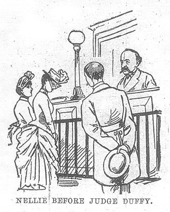
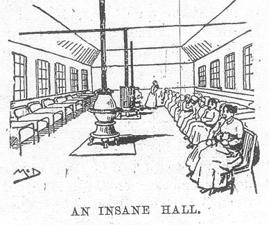
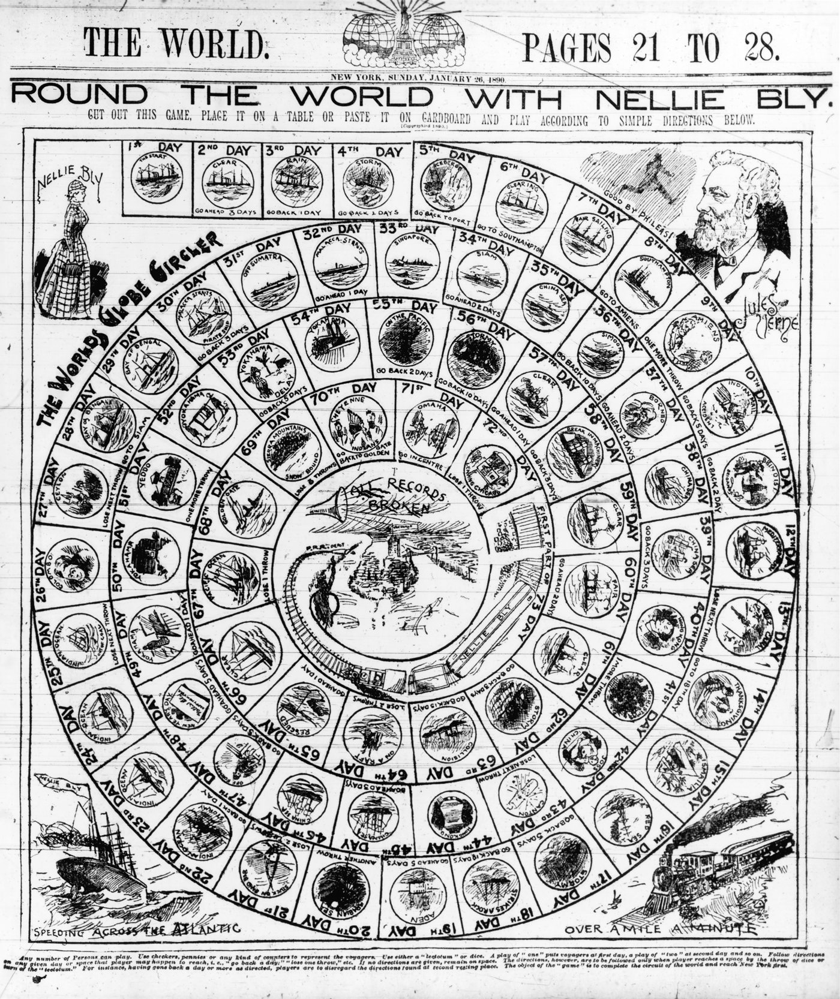

**文 / qscqesze**

内莉·布莱回到病室时，看见护士拿着自己的笔记本和长铅笔。她要求拿回来，说这些东西可以帮助记忆。护士拒绝了。几天以后，她再向医生索要，得到的答复却是：她入院时只带了一本书，没有带铅笔。她坚持说带了，医生劝她克制脑中的幻想。

这是一八八七年的纽约，地点在东河上的布莱克韦尔岛精神病收容院。布莱二十三岁，正在为《世界报》做一次卧底调查。她进院时用的名字是内莉·布朗。此刻，她已经停止装病，照常说话，要求添衣服，抱怨食物，也说明自己没有病。然而，这些要求同那支铅笔一样，都由护士和医生决定怎样记录。[^1]

报馆答应把她接出去，却没有事先告诉她具体办法。她要把里面的事情记住，再设法带回河对岸。

## 进入那道门

布莱出生时名叫伊丽莎白·简·科克伦。她的父亲在宾夕法尼亚经营磨坊、拥有土地，也做过地方司法工作。一八七〇年，父亲没有留下遗嘱便去世，六岁的女儿随家人失去了原先安稳的生活。母亲后来再婚，丈夫酗酒、虐待她；女儿在离婚诉讼中为母亲作证。十五岁时，伊丽莎白进师范学校，想获得一份可以养活自己的职业，只读了一个学期，便因家里缺钱退学。

在匹兹堡，她看见兄弟能够外出谋生，自己能找到的机会却很有限。《匹兹堡快报》的一位专栏作者说，女人应当留在家里，做饭、缝纫、养育孩子。她给报馆写信，谈那些必须靠工资生活的女子。编辑乔治·马登从来信中找到了可用的记者，邀请她来工作。她开始使用内莉·布莱这个名字，名字取自一首流行歌曲。

她写贫困女子的工作，写离婚，也写工厂里的女工。编辑后来把时装和花展等题目交给她。她去了墨西哥，寄回当地生活的报道；回国以后，等着她的仍有妇女版的任务。一八八七年，她离开匹兹堡，到纽约找工作。求职延续了几个月，直到《世界报》给了她进入收容院调查的机会。[^2]

这个任务需要她先让陌生人相信自己精神失常，再通过警察、法庭和医生，把她送进岛上。她没有请熟识的医生帮忙，也没有借朋友家作为起点。若从朋友家出发，为了把她送进面向穷人的岛上收容院，朋友还得假装拿不出钱来照料她。她最后决定从陌生人的住处走警察法庭这条路，自己安排怎样被送去检查。她选中第二大道一所给劳动妇女提供临时住处的机构，穿上旧衣服，只带少量零钱，付了三十美分住一夜。

她在屋里坚持说其他女人看起来可怕，拒绝上床睡觉，又反复寻找根本没有带来的行李箱。住客中有人害怕她，有人拿她取乐。一位叫鲁思·凯恩的女人陪着她，阻止旁人继续逗弄她，还把毯子裹在她身上。凯恩把她当作需要照料的陌生姑娘。布莱后来在书里记下了她的名字。

次日，住所的管理人员找来警察。布莱被带到埃塞克斯市场警察法庭。达菲法官看她衣着尚整齐，认为她可能遭人下药，又希望记者能查清身份。布莱的同行于是成了这场调查中可能识破她的人。她避开采访，坚持要走，把注意力重新引到丢失的行李上。医生检查舌头、脉搏、心跳和眼睛，最后开了转送贝尔维尤医院的文件。[^3]

医院里的医生问她，是否看见墙上有人脸，夜里是否听见声音。她回答，夜里的说话声很多，吵得她睡不着，有时人们还会谈论内莉·布朗。同在屋里的病人后来也接受了相似的询问。布莱坐在门外，听着检查继续进行。

报纸已经把她写成身份不明的年轻姑娘。有人来找失踪的亲人，要看看她的脸；其他报社的记者也来打听。她把披肩遮在头上，尽量避开相认。法庭上那场装病很快带来了新的新闻，而作为新闻中的人，她只能等着别人来决定下一步。

<figure>
  
  <figcaption>图1：《精神病院十日》中的法庭插图，1887年，绘者未署名。宾夕法尼亚大学所录原书图版，公版。<a href="https://digital.library.upenn.edu/women/bly/madhouse/madhouse.html">来源</a>。</figcaption>
</figure>

她在贝尔维尤认识了同样等待转送的蒂莉·梅亚德。梅亚德告诉她，自己病过，神经一直不好。后来，一批女人被送上前往岛上的船。布莱写道，上岛以后，她便不再继续扮演最初那个失忆、惊恐的姑娘，试着像平日一样与医生交谈。

在医生面前，语言不通的路易丝·尚茨连这一步也做不到。尚茨只会德语，医生叫懂德语的护士翻译，护士起初推托，最后只问出丈夫从事什么工作。检查便这样结束了。布莱把这一段经过写进报道：一个女人被收容，却没有机会用自己的语言解释处境。她与尚茨一同坐在病室里，两人的文件都已由医生写好。

轮到布莱时，医生先问了姓名和住处，又问护士有没有读过有关这个姑娘的报纸消息。随后是量身高、称体重。护士看不明白刻度，布莱自己报出一百一十二磅，由护士转告医生。她还在说明自己不想留院，医生已经把注意力转到记录和护士身上。检查结束，她被带回原处。

接下来的洗澡和梳洗也由护士安排。护士命令她脱衣洗澡时，她要求至少让围观的病人离开，要求不要弄湿头发，都没有奏效。她被擦洗，又接连浇了三桶冷水，随后换上印着院名和病区号码的衣服。第二天，四十五名女人共用少数几把梳子；梅亚德自带的梳子也被收走。

吃饭同样服从安排。女人们先在过道里排队，等门开，再去吃面包、茶、粥或肉。布莱吃不下变质黄油，一名德国姑娘告诉她，可以索要不涂黄油的面包。另一个病人愿意把自己的那份让给她。她先前拿不定怎样装出疾病，在这里却需要同病人学习怎样吃下一餐。

梅亚德劝她强迫自己吃一点，否则身体会垮。布莱仍有一顿什么也没吃下；后来饿得越来越虚弱，总算咽下部分面包。经过医护人员的厨房时，她能看见水果、白面包和较好的肉。她把病人的伙食问题告诉医生，自己离开以前，餐桌上的东西仍旧难吃。

病室里的活由病人做：铺床、擦洗、替护士照料衣服。做完之后，她们坐在长椅上，换个姿势会被责备，起身活动也会被叫回去。散步时可以看看院里的草地，却不能走上草地。有人捡起落叶或坚果，护士又让她们扔掉。布莱把长椅、散步路线和不许带回去的落叶写进了报道。

她向医生反映衣服不够。一位助理主管答应增加衣物，护士随即警告她，继续告状会有麻烦。她又看到病人遭殴打，也听见其他女人讲述受到的处罚。她起初希望进入关押暴烈病人的病区继续调查，听完从那里转来的女人的经历，便放弃了这个安排。她已经拿到足够的材料，也要保住身体，才能离开这里把事情写出来。[^4]

在布莱的记述中，梅亚德一天天变坏。她曾唱歌，想维持记忆，护士让她停下。后来，她开始怀疑布莱冒充自己，把来找人的访客都引走了。布莱无法说服她，只好减少接触。两个人起初能够交谈、互相劝慰，十天尚未过完，这种相处已经很难继续。

律师彼得·亨德里克斯终于来到岛上，说有人愿意接布莱出去。她答应离院，又请他回城后立刻送些吃的来。她离开时，熟悉的女人们仍在散步的队伍里。她向她们道别，渡河回纽约，开始写自己的十天。

报道发表以后，布莱到大陪审团作证，又陪陪审员返回收容院。这回她看见了新脸盆、白面包和整齐的病床。有的旧相识已经被接走，有的转到别处，她没能重新找到所有人。安妮·内维尔还在；据布莱记载，内维尔当着陪审员说，布朗离开后，食物、衣物和护士的态度都有改善。陪审员到厨房时，门边明摆着两桶盐，面包同布莱先前吃过的也不一样。医生承认伙食有问题，把它归于经费不足；对于护士是否虐待病人，他缺少可靠的察知办法。调查与曝光使院里的生活进入公共讨论，布莱也从求职者变成了《世界报》有名的记者。[^5]

<figure>
  
  <figcaption>图2：原书所绘病室，长椅与病床同处一室，1887年，绘者未署名。宾夕法尼亚大学所录图版，公版。<a href="https://digital.library.upenn.edu/women/bly/madhouse/madhouse.html">来源</a>。</figcaption>
</figure>

## 一个手提包的限度

她继续找工作场所里的题目：职业介绍所怎样对待求职的女佣，贫穷女工一天能够挣多少钱。她可以把自己放进交易里，看清雇主和中间人怎样说话，再把经过写出来。报纸既卖她得到的消息，也卖她亲自做过这件事的经历。

环球旅行的想法出现时，她先去轮船公司拿时刻表，再把不同线路接起来计算。凡尔纳让小说人物福格八十天回到原地，现成的邮船和火车有没有可能更快？她向报馆提出由自己去试。经理说，女人需要保护人，行李又多，只会英语也不便赶路，最好派个男人。她答复，如果另派男人，她就替别家报纸出发，争取抢先完成。报馆后来答应，这趟旅行若成行就交给她；事情又搁置了一年。[^6]

一八八九年十一月，编辑突然问她，后天能不能走。留给她的准备时间只够做衣服、买包和告别。裁缝赶制了一套耐穿的旅行装。她买来手提包，把帽子、面纱、内衣、文具、针线和洗漱用品塞进去，最后一条备用裙子无论如何也装不下。她留下裙子，塞入一件旧丝质上衣。

经理说她会被行李拖住，她就把行李压缩到一个包。代价随后也跟着她旅行：衣服要反复穿，正式晚宴没有合适的装束。装得最费劲的一罐面霜，她还是带上了，用来应付不同气候下的皮肤皲裂。

报馆给了她二百英镑的金币和钞票。钞票装进小袋，系在颈上，另有一些美国钱供她沿途试用。她只预先买好到伦敦的船票，为改换路线留下余地。出发前，报馆还在拼接时刻表，核对伦敦去布林迪西的邮车究竟哪天走、衔接的船开往哪里。等她到了布林迪西，才发现要搭的轮船实际驶往澳大利亚，自己须在中途换船。那些在地图上连成一线的地名，每到一站，都得重新落实为车票、船票和上船的时间。有人提议带手枪，她没有带。十一月十四日，她从霍博肯搭上奥古斯塔·维多利亚号，向东出发。

在陆上，她能够催车、换车、减少行李；上了海，航程便由轮船和接驳日期支配。她先过大西洋，到英国，又绕往法国亚眠拜访凡尔纳夫妇。这个绕道花掉赶路的时间，换来一篇只有她能带回报馆的采访。凡尔纳拿出地图，指给她看福格的路线，再标出她走法不同的地方。夫妇俩同她交谈需要有人翻译，凡尔纳却试着用英语祝她好运。他愿意在她七十九天完成时为她鼓掌，而她向报馆承诺的是更短的时间。访问结束，她又要去赶下一程。这次绕行，在自己的行程统计中多走了一百七十九英里半。她随后赶往布林迪西，接上东行轮船。[^7]

穿过苏伊士，经过科伦坡、新加坡，她在圣诞节抵达香港。轮船比预计早到，她却不能立即继续走。在船公司办事处，她听说另一位女记者正朝相反方向环球，已经经过这里。

那是《大都会》杂志派出的伊丽莎白·比斯兰。布莱出发时，根本不知道自己还有这个对手。办事人员告诉她，对方已经走了，自己还得等船。她在旅行记里保留了这次谈话，也保留了当时急于申明的立场：她向编辑答应的是按期绕地球一周。此后，这条航线上的延误除了可能输给八十天，还可能使另一个人先抵达纽约。[^8]

等待的时候，她到广州游览，再返回香港。她在新加坡买的一只猴子也随她转上大洋号，带来了额外的麻烦。她出发时留下的裙子没能同行，这只临时买来的动物倒一直跟到美国。旅行的行李逐渐添了礼物，最初那个手提包的约束也被打破。

横滨又有几天停留。船穿越太平洋时，布莱每天关注航行里程，低于期待的数字使剩余的时间越算越紧。船员不断安慰她，工程师尽力维持航速。大洋号的餐厅由日本侍者服务，甲板上的水手来自中国；她还得靠船医、事务长和负责行李的人把下一段路接续起来。出发前她担心一路无处洗衣，到了半岛东方公司的轮船上，却发现船上可以洗，停靠港口也有人按时间把洗净的衣物送回。少带行李所省下的麻烦，由沿途这些日常劳作补上。

临近旧金山，事务长突然找不到船舶的卫生文件，担心旅客不能上岸，可能要再等两周。后来，文件在船医的桌子里找到了。这个险些把她留在港外的插曲，发生在整段海路即将结束的时候。登岸之后，另一道阻碍仍在前面：大雪已经影响了美国铁路交通。

报社安排的专列等在那里，把她送上另一条横贯大陆的铁路线路。她有了一节卧车，沿途收到鲜花、水果和电报。站台上的人群等候她，地方报人安排接待。她起初还以为车站聚集的人们正在参加别的活动，后来才知道，他们是来等她。[^9]

在芝加哥之后，她改乘普通列车。车厢小了，收来的礼物装不下，部分鲜花和水果只好留下。离终点越近，她在车上能做的事情越少：她已经无需再说服经理，也无法靠自己把车开快一点。最后一段路由铁路、时刻表和沿途接待她的人完成。

一八九〇年一月二十五日，布莱在泽西市下车。从出发算起，七十二天六小时十一分。她在书中写，抵达时摘下帽子，也想同站台上的人一起欢呼，因为自己终于到家了。第二天，《世界报》把这次旅行做成了可以剪下来玩的棋盘，轮船、火车、凡尔纳和布莱一起围在一圈圈格子旁边。读者在桌上移动棋子，重走她经过的道路。[^10]

<figure>
  
  <figcaption>图3：1890年1月26日《世界报》第21页的环球旅行棋盘，绘者未署名。美国国会图书馆藏，公版，无已知出版限制。<a href="https://commons.wikimedia.org/wiki/File:Round_the_world_with_Nellie_Bly_1890.jpg">来源及许可</a>。</figcaption>
</figure>

## 报馆以外的日子

布莱继续采访，后来报道劳工抗争，也访问苏珊·安东尼等公共人物。一八九五年，她与年长的制造商罗伯特·西曼结婚，逐渐离开日常新闻工作。一九〇四年丈夫去世，她承担了金属制造企业的经营，管理生产，也给工人提供福利和活动设施。

她在工厂投入精力，财务监督却没有跟上。员工欺诈、债务和诉讼把企业推入破产的困境。她仍寻找资金，一九一四年去奥地利见朋友，希望为公司重新融资。战争爆发，她留在当地，转而向美国报纸供稿，报道前线，也为奥地利的妇女和儿童寻求救济。

她在那里结交官员，同情所处国家的境遇。一九一九年赴巴黎时，她想直接向威尔逊总统陈情，没有获得会面。美国军方因她的亲德言论多次询问她的情况，最终准许她回国。纽约等着她的，还有未完的公司官司。[^11]

她重新为《纽约晚报》写作，处理读者的求助，也为困境中的母亲和儿童寻找援助。年轻时，她曾需要一家报纸派律师到岛上接自己；晚年的读者把各自难以脱身的事情寄给了她。

一九二二年一月二十七日，布莱因肺炎在纽约去世，五十七岁。她的新闻工作一直延续到生命末期。她安葬在布朗克斯的伍德劳恩公墓。[^12]

<!-- biography-body-end -->

## 资料与注释

[^1]: Nellie Bly, *Ten Days in a Mad-House*, New York: Norman L. Munro, 1887，第I、XI章。[宾夕法尼亚大学全文](https://digital.library.upenn.edu/women/bly/madhouse/madhouse.html)。笔记工具被收走、入院后的日常反应出自她的调查记述。
[^2]: Arlisha R. Norwood、Mariana Brandman，“Nellie Bly”，National Women’s History Museum，2020—2022年更新，[全文](https://www.womenshistory.org/education-resources/biographies/nellie-bly-0)；PBS American Experience，“Nellie and other 19th-century writers”，[全文](https://www.pbs.org/wgbh/americanexperience/features/world-nellie-and-other-19th-century-writers/)。早年家庭、求学、入行及纽约求职参看两者；到纽约年份取PBS所述1887年。
[^3]: Bly, *Ten Days in a Mad-House*，第I—VII章。住所、凯恩、达菲、贝尔维尤检查及其他报社的采访依其亲历记述。
[^4]: 同书第VIII—XIV、XVI章。尚茨检查与语言障碍见VIII章，布莱称重见IX章，洗澡与梳洗见XI章；日常伙食、劳动和护士行为见XI—XIV章，放弃进入暴烈病区见XVI章。患者讲述的遭遇与布莱目睹的事件在原书中分列。
[^5]: 同书第XIV、XVI—XVII章。梅亚德的变化、律师办理离院、陪审团复访及内维尔陈述，均据布莱记述。
[^6]: Bly, *Nellie Bly’s Book: Around the World in Seventy-Two Days*, New York: The Pictorial Weeklies Company, 1890，第I章。[宾夕法尼亚大学全文](https://digital.library.upenn.edu/women/bly/world/world.html)。
[^7]: 同书第I—V、XVIII章。行李、200英镑资金及船票见I章，亚眠访问见III—IV章，绕行距离与时间统计见XVIII章。
[^8]: 同书第XII—XIII章。香港获悉另一位记者反向旅行的谈话、广州之行，依布莱记述。比斯兰代表《大都会》出发，亦见原书所链接的独立旅行记书名与作者信息。
[^9]: 同书第I、XIV—XVII章。洗衣见I章；猴子、候船、船上工作人员、卫生文件及专列见XIV—XVII章。
[^10]: 同书第XVII—XVIII章。结束地点为泽西市，时间取原书“72 days, 6 hours and 11 minutes”。棋盘见Library of Congress，*Round the world with Nellie Bly—The Worlds globe circler*，1890-01-26，[图版及藏品信息](https://commons.wikimedia.org/wiki/File:Round_the_world_with_Nellie_Bly_1890.jpg)。
[^11]: Library of Congress，“Nellie Bly: Topics in Chronicling America”，[年表与同期报纸目录](https://guides.loc.gov/chronicling-america-nellie-bly)；Kathryn Billington，“The Fascinating Life of Nellie Bly”，University of Wyoming, American Heritage Center，2023-04-10，[全文](https://ahcwyo.org/2023/04/10/the-fascinating-life-of-nellie-bly/)；Brooke Kroeger，“Nellie Bly: She Did It All”，*Prologue*, 28(1), Spring 1996, pp.7–15，[作者公开全文](https://brookekroeger.com/nellie-bly-she-did-it-all/)。夫亡日期据LOC年表，工厂经营及失败参看AHC；赴奥融资、战时经历、巴黎陈情及回国程序据Kroeger的档案研究。
[^12]: National Women’s History Museum、PBS，上引；死亡日期并核Library of Congress年表。墓地见National Park Service，“Nellie Bly”，[全文](https://www.nps.gov/people/nellie-bly.htm)。

### 书目

- Nellie Bly. *Ten Days in a Mad-House*. New York: Norman L. Munro, 1887。[原书全文](https://digital.library.upenn.edu/women/bly/madhouse/madhouse.html)。
- Nellie Bly. *Nellie Bly’s Book: Around the World in Seventy-Two Days*. New York: The Pictorial Weeklies Company, 1890。[原书全文](https://digital.library.upenn.edu/women/bly/world/world.html)。
- Brooke Kroeger. “Nellie Bly: She Did It All.” *Prologue* 28, no.1 (Spring 1996): 7–15。[公开全文](https://brookekroeger.com/nellie-bly-she-did-it-all/)。
- PBS American Experience. “Nellie and other 19th-century writers.” [纪录片配套资料](https://www.pbs.org/wgbh/americanexperience/features/world-nellie-and-other-19th-century-writers/)。
- National Women’s History Museum. “Nellie Bly.” Arlisha R. Norwood、Mariana Brandman，2020—2022年更新。[传记资料](https://www.womenshistory.org/education-resources/biographies/nellie-bly-0)。
