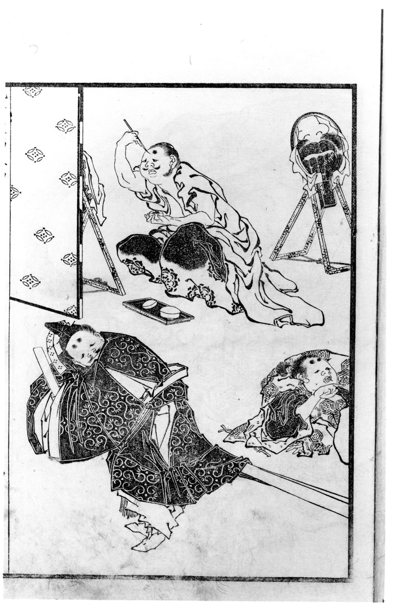
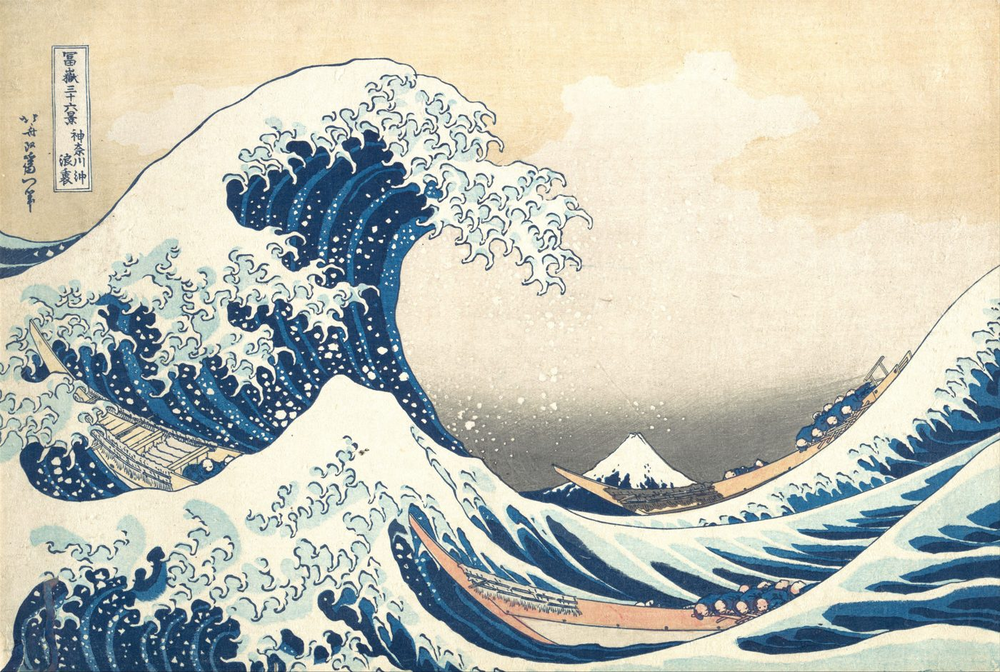
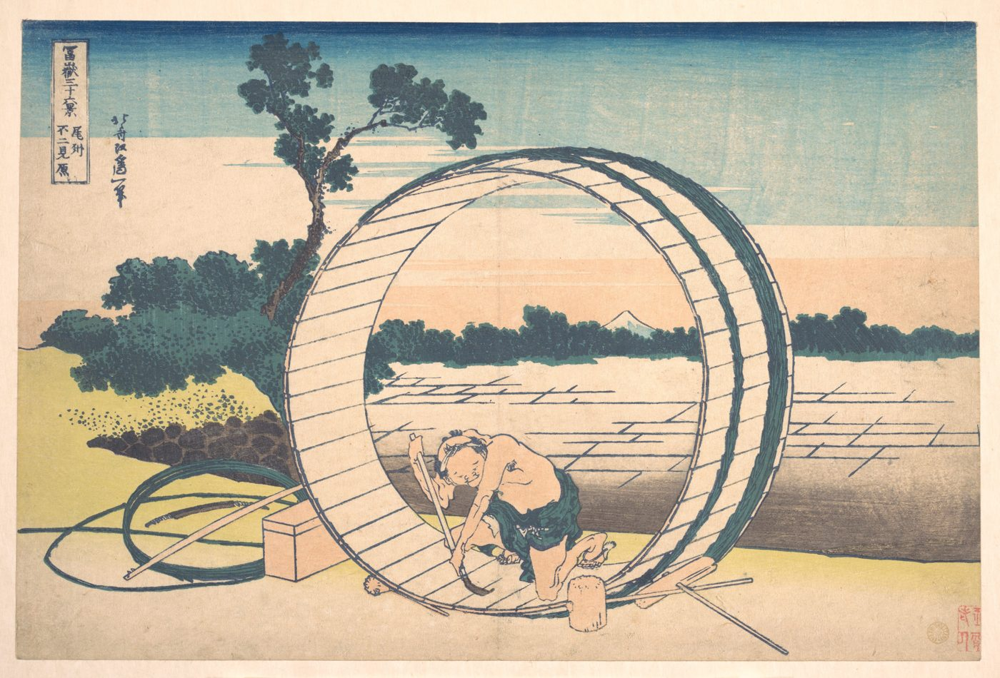
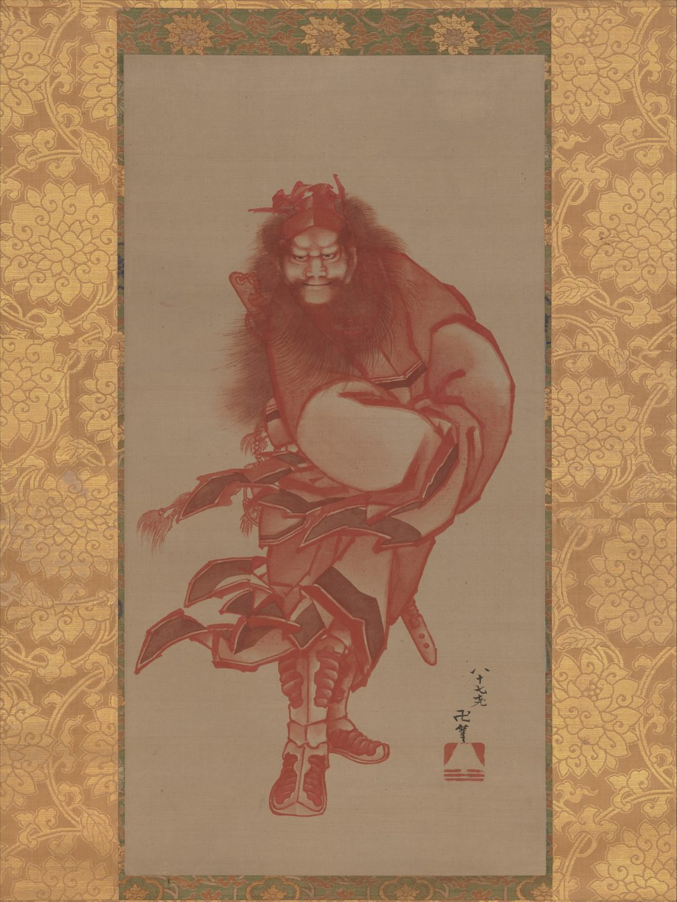

**文 / qscqesze**

北斋给江户的书商写信，说自己年纪已经很大，却只有一件衣服御寒。纸、颜料和笔也快用完了，再过些日子，他得亲自回城补充材料。他感谢对方屡次借钱，又在信上画出自己的手臂，说明这条手臂还没有衰弱，可以继续工作。

信到了末尾，他仍有事情要交代：刻工不要给人物添画下眼皮；鼻子的侧面和正面应当照着他附上的图样刻。他不喜欢当时流行的那种鼻子，也不愿人物的眼睛被改成别家的样式。

这是十九世纪三十年代，北斋暂住浦贺时寄给小林新兵卫的一封信。《神奈川冲浪里》已经问世，《富岳百景》也开始刊行。他要向书商求援，也要把刻刀怎样落在木板上说清楚。信里没有留下住址，他只解释，眼下不便公开自己的行踪。[^1]

## 春朗的名字留下以后

北斋一七六〇年生于江户本所一带，幼年被从事镜工的中岛家收养，曾用时太郎、铁藏等名字。他少年时在贷本屋做过事，又当木版雕刻学徒。书由店家借出，在读者手里流转；图画先被刻进木板，才印到纸上。他接触的这两种生计，后来都进入了自己的工作。

一七七八年，他到胜川春章门下，获用春朗这个画号。春章擅长画歌舞伎演员，年轻的春朗也照着师门的办法，画穿舞台服装的役者，替通俗故事配插图。他的作品还伸向相扑、武者、儿童和名所。订单要求画什么，他便面对什么题目。

他给“黄表纸”一类小书配图，书页黑白相间，外面有便于辨认的黄色封面。图像要同文字一起把故事带下去，角色可能刚刚还在谈话，翻页便已经卷入打斗。一本书能容纳的地方很有限，画师必须决定把哪个瞬间留下，又把哪些东西交给文字去说明。[^2]

这是一个可以凭名号辨认门路的行业。胜川的姓、春朗的号，把一个年轻画师放进已有的师徒关系，顾客也能据此寻找熟悉的样式。他要学会安排人物的衣褶、手势和脸，把他们放进一张狭长的纸，同时让买画的人认出角色。

到一七九四年，北斋离开了胜川派。随后几年，他为狂歌诗会设计私印的图页，采用宗理的名号，与俵屋一系发生联系。诗会的订印者要把文字和图像一起送给同好，纸张、色彩、压印都可以做得精细，题目也伸到室内器物、花枝和日常生活。

北斋留下过一种为音乐会制作的私印物：正面是卖水人和他的器具，背面列出音乐家改名演出的安排。画页既让人观看，也告诉收信者什么时候、到哪里赴会。它顺着诗社和演出的往来送出去，画师的名字也跟着进入这些交往。

这些图页的观众往往已经知道诗的用意，画师用很小的地方便能有所呼应。一枝梅、一把伞、一件刚刚用过的器具，都可以占据画面。北斋在这类委托中处理了许多不同于舞台人物的东西，也有了新的委托者。

一七九八年，他把宗理的名号交给学生，开始使用北斋辰政等署名。在一些作品上，新名字与原名并列，告诉买画的人，宗理已经改称北斋。改号的事要让旧客人知道，交出去的名号则继续由另一个人使用。[^3]

他此后不断更换署名，春朗、宗理、北斋、戴斗、为一、卍先后出现在纸上。一个名字可以交给学生，一批旧书也可能继续重印。他的工作得随新的署名重新被认出，书商手中已经可以出售的旧版却不会因此消失。

## 让画稿成为一本书

画师有时还要自己写书。一八〇三年，一部以日常饮食为题的通俗小书出版，北斋在序言里向委托者解释，自己先画了图，后来才补文字，接连催促使这本书有些地方衔接不稳；倘若还可以面世，请安排付刻。他把制作中的窘处也写进了将要印出的书。

小书谈米饭、汤、茶和酒，也谈不同的人怎样喝酒。北斋把人的酒量与瓶子的站立放在一起：人肚里酒少时站得稳，瓶子却恰好相反。他在食物和餐具间寻找可画、可说的东西，读者熟悉的一顿饭，被他拆成了人物的姿势和笑料。画图、补文、等着付刻，都要赶在一本小书的期限里面。

十九世纪初，北斋的画越来越多地跟着故事进入读者家里。他与曲亭马琴合作《椿说弓张月》，把源为朝的冒险画成连续的插图。读者翻过文字，还会遇见船只、武器、人体扭转和交战的场面。一次委托要接成好几册，画师也要长期同作者、书商往来。

龚古尔转述过两人合作中的一次争执：马琴看了将要出版的插图，认为与文字不合，要求改画；北斋却认为需要改的是文字。书商最后把收到的文字和图样照原样付刻。文字和图样都没有让步，书商仍把书做了下去。

书稿最后交到刻工手里。北斋把画交走以后，刻工先要把画稿贴到版木上，沿着线条的两侧下刀，剔去周围木料，只留下可供印刷的凸线。原来的那张纸，在这个过程中也被毁去。

彩色版画还要把不同颜色分到相应的版面。印工依次上色、放纸、擦印，使颜色与轮廓合在一起。画师笔尖上一处浓淡的变化，到了版木上，就变成能不能反复印准的问题。画稿由几个人接手，任何一道工序都有可能改变纸上的表情。[^4]

一八一二年，北斋到名古屋，住在牧墨僊那里。墨僊是尾张藩士，也是画家。两人谈论绘画，北斋画下了许多题目；墨僊和当地同好想把这些图样编印出来，供更多学画的人使用。

初编的序文说，北斋在交谈中画了三百余图，大家询问书名，他用了“漫画”二字。北斋提供的图页，同好们整理、编排，书商再安排雕版。一八一四年，《北斋漫画》初编出版，接着又有续编。后来汇集成的十五编，刊印一直延续到他去世以后。

北斋还有意把花费在示范上的时间变成读者可以自行练习的东西。几种画谱并行，讲画法的图样同器物纹样都能成为一本书。一八二四年的小纹样集便把方形、圆形和菱形反复交错，供衣料装饰取用。同一支笔既画伸展的身体，也为尺和圆规安排位置；学习者拿走图样，还可以用到自己的手艺里。[^5]

在这些书页里，画师可以接连变换题目。一个人在用力抬东西，腰背怎样弯；另一个人伸手去够，肩膀怎样抬。旁边又可以是鱼、虫、树木，或一群出自传说的形象。几笔衣褶连着身体转动，人物的动作被拆开、排在读者面前。

书里也留下了取乐的余地。长鼻子的天狗、走到一起的器物、不同姿态的胖瘦人物，在同一册中相遇。北斋画这些身体时，照样计算重心、弧线和伸出去的肢体。学画的人可以取用其中一个姿态，普通读者则可以看下一个图样又变出了什么。

学画的人可以在各自住处翻开同样的示范。北斋留下的图样能被反复翻看，出版社也可以继续加印。教人画画成了他长期接手的一类工作，替读本画插图的委托仍然要做。

<figure>
  
  <figcaption>图1：《北斋漫画》第十二编图页，1834年，木版印本。大都会艺术博物馆藏，JIB112，公版。<a href="https://www.metmuseum.org/art/collection/search/57805">来源</a>。</figcaption>
</figure>

北斋年过六十，使用了“为一”的号。家庭也在这些年发生变化。他的第二位妻子去世，女儿阿荣结束婚姻，回到父亲身边。她以“应为”的号作画，后来同北斋共同工作。另一位女儿的儿子则不断给祖父带来债务和纠纷，北斋要替他收拾残局，画稿也屡次被耽搁。

已经印行的画谱，不能替家里解决每一次眼前的开销。下一本书何时交稿，出版社愿意先付多少，仍需要重新去谈。

## 富士山和一封传阅的信

三十年代初，北斋为版元西村屋与八设计《富岳三十六景》。同一座山要在不同地点、不同大小的画面里重新出现。系列畅销以后，又增加了十图，三十六景最终成了四十六景。[^6]

《神奈川冲浪里》把富士放得很远。浪头卷起，白色的浪花伸成细小尖端，几条长船上的人伏低身体；远山的三角形被海水围在中间。山在纸上很小，浪和船却占满眼前。看这张画的人必须先越过近处的海，才能抵达标题里那座山。

北斋把早年画人物姿势的本领放进这些船里。船身随水面弯转，人的背沿船排列，浪花又向下收拢。一张纸容下不同方向的运动，远处的富士保留着完整轮廓。他只给了山有限的地方，却让其余部分都与山发生了联系。

另一张《尾州不二见原》，木桶工坐在一个巨大圆圈里面，正在处理桶身。圆圈另一头，富士只剩远处一个小小的尖顶。工匠的身体、工具和木料都很近，山从他做出来的空间里露出。换一张画，北斋便换了一种把山送到读者眼前的办法。

<figure>
  
  <figcaption>图2：《富岳三十六景·神奈川冲浪里》，约1830—1832年，木版套色。大都会艺术博物馆藏，JP1847，公版。<a href="https://www.metmuseum.org/art/collection/search/45434">来源</a>。</figcaption>
</figure>

这批画使用的蓝色也给他提供了新办法。靛蓝之外，进口的普鲁士蓝已经进入日本的版画制作。深浅不同的蓝能够隔开水面、远景和轮廓。颜色要从版木上准确转移到纸上，仍须依靠印工的手艺。北斋画出的线，和读者后来买到的那张彩色印本之间，还隔着一整套制作。

一八三四年，《富岳百景》初编出版。山又进入更小的书页，出现在栏杆、枝叶和人物的活动之间，也倒映在水里。有一幅画中，一个人正端水饮用，小小的富士在碗里现出。北斋已经反复处理同一个题目，仍让它在新的器物和位置中出现。

他在初编的跋里回顾，自己从六岁起喜爱描画，但七十岁以前的作品还不值得满意。他又把以后安排得很长：八十岁继续进步，九十岁理解更深，到一百余岁，希望一笔一点都能活起来。这段话随着书一起印出，读者能在他的晚年新作上，继续看到他所写的年龄。[^7]

<figure>
  
  <figcaption>图3：《富岳三十六景·尾州不二见原》，约1830—1832年，木版套色。大都会艺术博物馆藏，JP19，公版。<a href="https://www.metmuseum.org/art/collection/search/36500">来源</a>。</figcaption>
</figure>

出版新书的这几年，外孙的麻烦再次找上门来。北斋在给书商的信里解释，自己得召集亲友商议，寻找可以管束这个年轻人的人，又为他安排鱼店和婚事，费用仍由祖父承担。这些事情占用了作画的日子。他答应寄出一部分图稿，并在信上画了一只拿钱的手。

暂住浦贺期间，他还得与江户保持往来。画稿要寄回去，款项要送过来。在一封结算信中，他说明已送出三张半唐诗画稿，请书商从稿酬中扣除以前欠的账，再把余额交给送信人。欠账和新稿酬，落在同一封信里。

他也把已经答应而没有完成的工作列出来。《水浒传》和唐诗的插图不能按原来的进度送出，要把原因告知书商；先交出的几张，则希望马上换到能够使用的钱。书稿分批往来，他没有等到整部作品做完，才开始讨论结算。

向书商交代窘境的同时，他仍会挑选刻工。约一八三五年，他把一封信同时写给三家书商，请他们传阅，要求把新书交给江川留吉雕版，价格由书商直接同江川商量。他比较了以前几种书的刻印效果，认为江川能把线条处理得更清楚；刻工做得好，自己才更愿意继续画，书也更容易卖好。[^8]

他还提醒，其中一位书商曾答应不断给他工作，现在应当兑现。另一部原先交给女儿的诗歌插图，他提出由自己接手，按每位诗人的图像谈稿酬，仍然指定江川来刻。新的工作可以争取，制作条件也要一道讲明。

他在这封信里画了一个拄杖的老人，两支毛笔代替了拐杖。对着书商的行礼，也被他画成小像，放在请求旁边。一个说自己快老得走不动的人，仍然把笔当作支撑身体的东西，又要求负责制作的人听取自己的安排。

画稿上的头发尤其令他费心。他告诉书商，自己在画印度人物的发式和身体时，是按书商答应由江川负责雕刻的条件下笔的。细密弯曲的头发，到了别人手中可能走样。他希望从画的时候起，就知道最后由谁接手。

如果线条被改成另一家熟悉的样式，他也会要求纠正。那封谈到单衣和材料的信，后面附了鼻子的正面、侧面，以及他不赞成的眼睛画法。这些改刻要求，跟纸笔短缺的事一起送给了书商。

印色的问题，他也写得很细。浅墨要像清淡的贝汤，较浓的墨则可以像豆汤，不能为了求浅而把应有的力量冲掉。他用日常吃食给印工说明差别，还要看试印出来的样张，再决定怎样调整。书商拿到的既有画稿，也有这些不肯省略的叮嘱。

后来另一封信中，他说外孙已交由父亲带往东北，自己终于能喘口气，又叹息此前耗去了一整年的作画时间。信没有停在家事上。他还借着书商的一部《曾我物语》，请求再留一阵；另一个委托需要用绢，请对方赶快把绢寄来。约定交画的月份正在逼近，他又请对方把另两册插图的稿酬一并送来。

书商若要探望，他连寻找住处的办法也安排了：不要直接问北斋，附近的人未必知道；要找的是寺院院内新搬来的、会画画的僧人。纸笔和款项仍可沿着这样的地址送到他手里。

## 父女两个人的工作

应为回家以后，父亲身边有了一位熟悉材料、构图和设色的画家。她从小在家中接触绘画，婚后离开，又在离婚后返回。照顾父亲与接下绘画委托，成了同一处生活里要做的事。

她自己也有客户。应为的仕女、夜景和历史人物画显示出对色彩与光线的熟练处理；她还在给学生的信中，解释怎样制备红色颜料，并配上手势图。父女都拿小图来补充文字，两人都要把调色和用笔的办法交给不在身边的人。[^9]

北斋晚年越来越多地作肉笔画。他到小布施与商人高井鸿山往来，为当地的委托作画；回到江户，仍有图书插画要交。名所版画之后，钟馗、龙、鸟兽和宗教人物不断从他的笔下出现。人物可以直接用笔画在绢上，保留下来的也是这一笔笔墨迹。

一八四六年的《朱钟馗图》中，钟馗的脸、衣服和胡须都置于红色中，衣褶随着手臂和持剑的姿势收放。在当时的日本，红色钟馗被寄望于驱除天花。北斋在画上记下传统数岁的八十七岁。最后三年的一些作品上，他又使用“百”字印，把还想活到的年岁盖在新画上。[^10]

<figure>
  
  <figcaption>图4：《朱钟馗图》，1846年，绢本设色挂轴。大都会艺术博物馆藏，14.76.37，公版。<a href="https://www.metmuseum.org/art/collection/search/45818">来源</a>。</figcaption>
</figure>

有些委托却一直没有变成书。《万物绘本大全图》的画稿画着中国、印度和鸟兽，北斋到四十年代还为它交图，在给书商的收条中确认，三张图稿的三分金已经收到。书最后没有付印。

画里的周生攀着云梯登月，中国传说、异国人物和鸟兽被编排在一起。北斋终生没有离开日本，这项工作却要把他未曾亲见的地方画给读者。他沿用过去图书提供的题材，又重新安排人物的姿势与场面。

为这项计划准备的一百零三张版下画，因此保留下来。那些细小的笔线没有被贴到木板上，也没有在刻工的刀下消失。它们后来装进盒子，在不同藏家之间流转；原定供读者翻看的百科图书，留下了画师交出去的手稿。[^11]

一八四九年，北斋在江户病逝。应为给门人北辰写信，通知父亲治疗无效，于清晨去世，又补上第二天举行葬礼的时刻。父亲病中的照料至此结束，她还要把消息送到门人那里，安排送葬的事。

门人和故交凑钱办理了葬礼，北斋葬在浅草誓教寺。女儿那封简短信里，留下了父亲最后一天和下葬的日期。[^12]

<!-- biography-body-end -->

## 资料与注释

[^1]: Edmond de Goncourt, *Hokousaï*, Paris: Bibliothèque-Charpentier,1896，第XLIII章，转录北斋浦贺时期致小林新兵卫的信。[公版全文](https://fr.wikisource.org/wiki/Hokousa%C3%AF_(Goncourt)/Texte_entier)。单衣、材料、手臂和鼻子图样均为信中细节；其中住址不公开由北斋本人说明。
[^2]: 墨田北斋美术馆，《北斋の生涯》，[官方年表](https://hokusai-museum.jp/modules/Page/pages/view/402?lang=ja)；Goncourt，同上，第II—III章。早期家庭、贷本屋、刻版及春朗时期依年表与旧传记互核。
[^3]: 同馆年表，“宗理样式”时期；Goncourt，第V—VI章。离派采用1794年；具体离派原因，旧传记记载不一。
[^4]: Goncourt，第XVII章转录1803年《不廚庖即席料理》序文（[日本国立情报学研究所藏书目录](https://ci.nii.ac.jp/ncid/BA71038073)著录北斋以时太郎可候作、画），第XXI章转述与马琴的合作争执；Alfred Haft，“The technique of making a good impression”，British Museum，2017-06-10，[全文](https://www.britishmuseum.org/blog/technique-making-good-impression)。版下画、版木、刻线、套印与印工分工见Haft。
[^5]: Goncourt，第XXI章，所译《漫画》初编序文及图页说明；小纹样集见第XLVI章，刊年并核[法国国家图书馆藏书记录](https://catalogue.bnf.fr/ark:/12148/cb403463948)；刊年依墨田馆年表及A. Hyatt Mayor、Yasuko Betchaku，“Hokusai”，*The Metropolitan Museum of Art Bulletin*43(1),Summer1985，[馆方公开全文与PDF](https://www.metmuseum.org/ja/met-publications/hokusai-the-metropolitan-museum-of-art-bulletin-v-43-no-1-summer-1985)。初编为1814年，后续十五编跨越身后，旧传记列初编1812年有误。
[^6]: 同上，Met1985年专刊及作品记录；《三十六景》系列追加十图。本文图版年代采用所藏具体印本的馆方约1830—1832年定年，见[浪里](https://www.metmuseum.org/art/collection/search/45434)、[不二见原](https://www.metmuseum.org/art/collection/search/36500)。构图依原图。
[^7]: Goncourt，第XLII章，《富岳百景》版本与跋语；墨田北斋美术馆，《北斋について》，[原书跋语摘录](https://hokusai-museum.jp/modules/Page/pages/view/401?lang=ja)。文中七十、八十等年龄随北斋自述，为传统数岁。
[^8]: Goncourt，第X、XLIII章，三张半画稿结算、三家书商传阅信及外孙善后诸信；Frank Feltens，“Between the Lines: Hokusai in His Letters”，*Late Hokusai: Society, Thought, Technique, Legacy*,2023,pp.32–37，[作者公开全文](https://www.academia.edu/105488030/Between_the_Lines_Hokusai_in_His_Letters)。三家书商信采用Feltens约1835年定年，Goncourt作1834年。江川留吉即Egawa Tomekichi。
[^9]: Julie Nelson Davis，“Hokusai and Ōi: art runs in the family”，British Museum，2017-06-18，[全文](https://www.britishmuseum.org/blog/hokusai-and-oi-art-runs-family)。应为的返回、共同工作、独立绘画与配色信依此研究。
[^10]: 《朱钟馗图》，Met14.76.37，[藏品记录](https://www.metmuseum.org/art/collection/search/45818)；Tim Clark，“Hokusai: old master”，British Museum，2017-05-10，[全文](https://www.britishmuseum.org/blog/hokusai-old-master)。传统年龄与晚年“百”字印并参画上落款。
[^11]: British Museum，*Hokusai: The Great Picture Book of Everything*，2021年展览，[大字版完整说明](https://www.britishmuseum.org/sites/default/files/2021-09/Hokusai_The_Great_Picture_Book_of_Everything_Large_Print_Guide.pdf)，第3—7页。三张图稿收条译自北斋四十年代中期给须山房的信；画稿题签的1829年不等于全部画稿的完成年。
[^12]: Clark，同上，转录应为致北辰讣告，并引饭岛虚心1893年《葛饰北斋传》所收四方梅彦回忆。北斋卒日公历为1849年5月10日，原讣告用旧历；正文仅保留其所通知的先后。

### 书目

- Edmond de Goncourt. *Hokousaï*. Paris: Bibliothèque-Charpentier,1896。[全文](https://fr.wikisource.org/wiki/Hokousa%C3%AF_(Goncourt)/Texte_entier)。
- A. Hyatt Mayor and Yasuko Betchaku. “Hokusai.” *The Metropolitan Museum of Art Bulletin*43,no.1(Summer1985)。[全文及图版](https://www.metmuseum.org/ja/met-publications/hokusai-the-metropolitan-museum-of-art-bulletin-v-43-no-1-summer-1985)。
- Frank Feltens. “Between the Lines: Hokusai in His Letters.” In *Late Hokusai: Society, Thought, Technique, Legacy*,2023,32–37。[公开论文](https://www.academia.edu/105488030/Between_the_Lines_Hokusai_in_His_Letters)。
- 墨田北斋美术馆：《北斋の生涯》《北斋について》。[馆方年表](https://hokusai-museum.jp/modules/Page/pages/view/402?lang=ja)、[原书跋语摘录](https://hokusai-museum.jp/modules/Page/pages/view/401?lang=ja)。
- British Museum. *Hokusai: The Great Picture Book of Everything*. Exhibition large-print guide,2021。[展览说明](https://www.britishmuseum.org/sites/default/files/2021-09/Hokusai_The_Great_Picture_Book_of_Everything_Large_Print_Guide.pdf)。其他专题研究与四件作品记录见上列注释。
