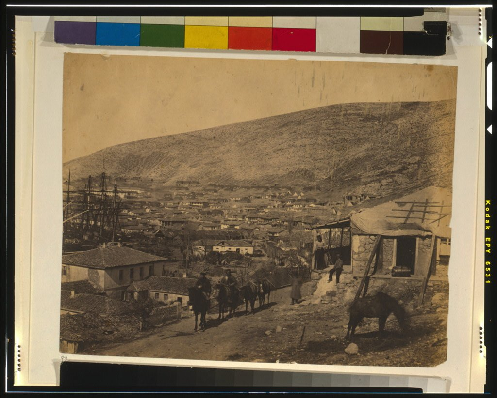
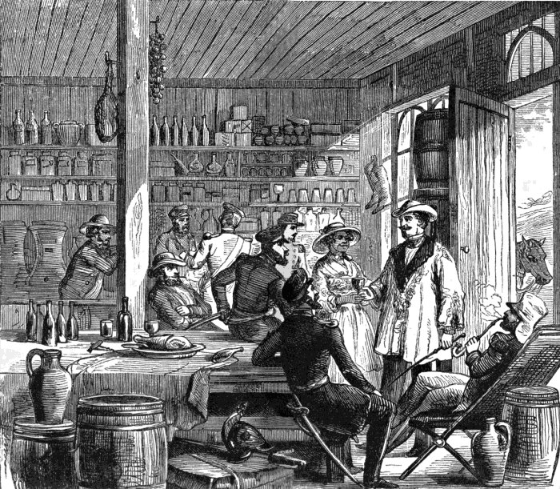
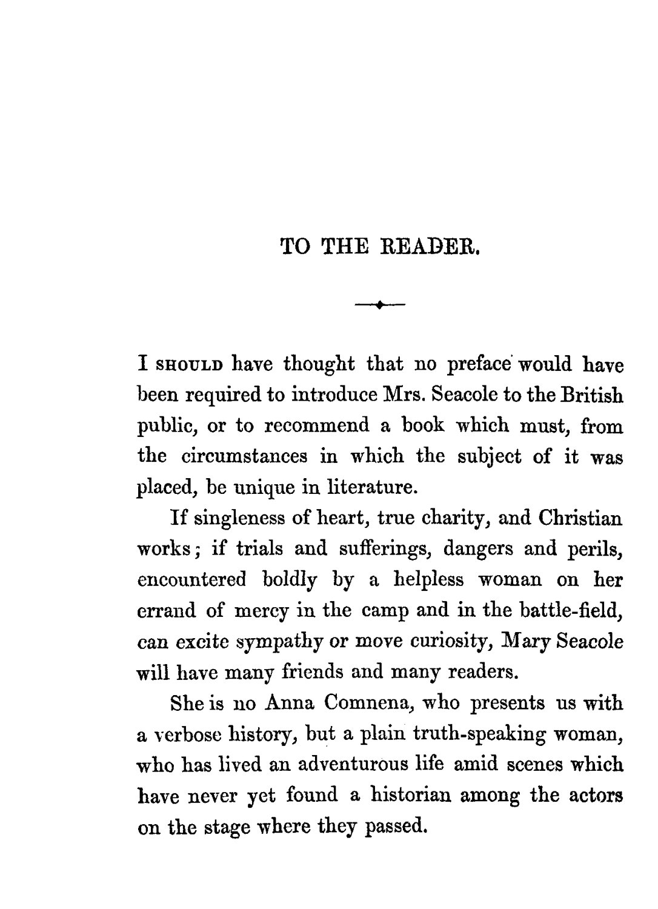

**文 / qscqesze**

和平到来后，玛丽·西科尔卖不掉店里的酒了。

每打进价四十八先令的酒，买家只肯出四先令。原来每磅十便士购入的好奶酪，售价跌到一便士以下。英军陆续撤离克里米亚，马匹、骡子、食物和远道运来的货品都要处理。她和合伙人刚扩充过库房，货架上的东西来不及卖，运回英国又不合算。

在一八五七年的回忆录里，她记下自己拿起锤子，砸碎一箱又一箱酒的经过。围观的人伸手接酒。她宁肯打碎，也不愿按那个价钱把货物送给过去的敌人。写到这里，她承认自己当时太激动，顾不上想是否做错了。

那座叫作“不列颠旅店”的房子，将在部队离开前拆掉。她带去的本金已经变成炉灶、棚屋、货物和欠款，难以重新装回行李。[^1]

## 金斯敦寄来的货物

西科尔约一八〇五年生于牙买加金斯敦，原姓格兰特。父亲是苏格兰军人，母亲经营寄宿旅店，也为病人诊治。军官和他们的妻子从附近营地来到这所房子，休养、吃饭、接受照料。母亲的生意使女儿很早就认识了军队里的人，也熟悉了发热、虚弱和漫长的恢复期。

她幼年曾在一位长辈女士家中生活，常回母亲那里。十二岁前后，她已帮着照料病人。家中没有一条把厨房、客房和治病严格分开的界线：住客需要食物，有人需要服药，有人病后吃不下平日的饭菜。她跟母亲学，也向住进旅店的军医请教。

年轻时，她两次到过英国。第二次赴伦敦，带的是准备出售的西印度果酱和腌制品。后来她去海地、古巴，也到新普罗维登斯搜集贝壳及贝壳工艺品，运回金斯敦卖。船票把她送到陌生地方，带回的货物又为下一趟出行留下余地。

一八三六年，她与埃德温·西科尔结婚，两人在黑河镇开店。丈夫身体衰弱，病重后，他们回到金斯敦母亲家。一八四三年的金斯敦大火烧毁了她的家；翌年，丈夫去世，八年的婚姻结束。母亲也相继离世。西科尔保留着丈夫的姓，重新盖房，补进存货，继续接待客人。[^2]

她逐渐有了一批熟客。驻扎牙买加的军官患病，会来找她；军医借住时，她向他们询问病症和用药。那些交往后来伸到了地中海和黑海，但眼下，一家旅店仍须靠收入维持。她在回忆录中把投资失败、煮坏果酱和失去房屋一并记作生意的挫折。火灾后，她从较小的规模重建，客房又住进了休养的军官和家属。

一八五〇年，霍乱在牙买加流行。西科尔照料病人，也从一位住在家里的军医学到处理方法。这一年，她的弟弟已到巴拿马地峡开起旅店和商店。弟弟身体不好，她决定去帮忙，把金斯敦的房子交给一位亲戚照管。

临走前，她为这趟旅行备了几星期的货。裁缝制作粗外套和裤子，女工缝衬衫；厨房里有人熬果酱、做番石榴冻，她还买了罐藏肉、蔬菜和鸡蛋。随身的药箱之外，她带走了一份可以在途中出售的存货。

地峡是前往加利福尼亚的捷径。旅客从大西洋一侧上岸，穿过去，再搭太平洋上的船，省去绕合恩角的远航。淘金的人需要饭、衣服、搬运行李的人，也需要一处等候转程的地方。铁路尚未贯通，西科尔先坐火车到加通，再沿查格雷斯河乘船，经过戈尔戈纳，抵达弟弟所在的克鲁塞斯。

旅途中的客流一批批来到镇上，又一批批走掉。她留在弟弟的旅店，开始寻找能开自己店的房子。下一批旅客未到，霍乱先到了。

## 一间只供饭的旅店

按西科尔的记述，一位与弟弟吃过晚饭的当地人突然死亡，镇上有人怀疑中毒。她看过死者，辨认出自己在牙买加见过的症状，认为是霍乱。起初没人愿意听；当天又有人发病，先前反对她的人便来求助。

克鲁塞斯缺少医生。她拿出药箱，往病人家里去。付得起钱的商店老板、旅店经营者会付诊费，许多船夫和赶骡人只能道谢。一个拥有大批骡子的人请她去照顾雇工，允诺她若能救活管事，便给重酬。她到那里，发现病人与骡子挤在同一所屋子里，于是要求打开门窗、生火，并让还能帮忙的女人一同照料。

她没能救回两名病重的男人，一个不满周岁的婴儿也死在她怀里。孩子死后，她付钱请埋葬者把遗体带到河对岸，帮助自己作了一次剖检，想从中了解疾病。她在书里称，这是自己第一次、也是最后一次做这种检查，没有详细列出发现。后来回顾早期治疗，她承认犯过严重错误，可能因此失去了一些本来能够活下来的病人。她当时使用芥末敷剂、催吐剂和甘汞，也曾使用含铅药物；写书时，她再看旧日药方，已有些不忍回顾。

不久，她自己也患上霍乱。镇上的人送来毯子和绒布，轮流来看她，探望多得妨碍了休息。她这次病得较轻，脱离危险后，身体仍虚弱。疫病最凶的时候过去，她便重新接起原先的开店计划。[^3]

她在弟弟的“独立旅店”对面租下一所破旧小屋。房子只有两间，一间作卧房，另一间供饭，月租二十英镑。她用彩色印花布装饰墙面，安排出可供五十人吃饭的地方，雇用厨子，同随行的仆人一道经营。

她把规矩定得很清楚：只供餐，不收住宿客。按弟弟的价目，一顿普通饭收四先令，鸡蛋和鸡肉另外算。她曾为两个美国女人破例留宿；据她说，两人先争吵，后打架，第二天离开时还带走了几件容易搬走的东西。她继续把旅店经营成供饭的地方。

她还请来一位名叫何塞的黑人理发师，为男客刮脸，另搭一间小屋供他使用。毛巾、剃刀和肥皂泡也成了生意的一部分；旅客既急着吃饭，又不愿等候理发，她须在这些要求之间安排人手。

她的“不列颠旅店”先在这里有了名字。客人带着路上的饥饿赶到，要求快些吃饭；厨房把她从牙买加带来的经营本领，变成可以收钱的一餐。生意赚钱，她却不喜欢镇上频繁的争执，曾劝弟弟离开。弟弟年轻、时常患病，又不肯走，她最终留下。后来弟弟死在地峡，没能与她一道回到牙买加。

雨季结束，河水变浅，船只无法继续驶到克鲁塞斯，客流随之转去戈尔戈纳。她动身晚了，没租到合用的房子，便花一百美元买下一间小屋，再雇人扩建。一个曾受她照料的美国人借出船，帮助运木料；随行的仆人把劈开的竹片和芦苇填进墙架。房子跟着通道迁移，买卖又开起来。[^4]

在地峡的一次美国独立日宴会上，有人为她祝酒，感谢她在霍乱时的帮助，又惋惜她不是白人，说若能漂白，便能进入更好的社交圈。她在回忆录中记下自己的回应：即使肤色更深，她也一样能够生活、帮助别人；至于漂白所能换来的交往，她并不羡慕。她没有因此离开美国旅客的餐桌，仍靠接待他们做生意。

一八五三年，她回牙买加住了八个月，又遇上黄热病。随后，她再去地峡，在海军湾经营商店，还参与了一项金矿计划。一八五四年秋，她来到伦敦，为那项在当地看来颇有希望、在伦敦却很难找到支持的生意奔走。

这时，英军已经登上克里米亚。

## 先把名片寄出去

西科尔认得的一些部队已开到塞瓦斯托波尔城外。她在报上读到伤病、物资短缺和医院拥挤的消息，想去那里照料熟悉的人。她的钱够买一张远行船票，却不足以让她在战地长久生活。

她先找陆军部。没能见到要找的人，又转往军需部门、医疗部门。她知道南丁格尔已离开英国，仍有护士随后出发，便去申请加入。得到的答复是人员已满。后来，她向克里米亚基金的管理者请求一张去前线的船票，到那里再找出路，也未成功。

她随身有一位金矿公司医官写的推荐信，证明自己曾经照料他。医官在信里称赞她治疗热带病的经验，也感谢她对自己的照料。她带着这样的证明，仍没能换来一个席位。在回忆录里，她怀疑那些拒绝是否与肤色有关。[^5]

随后，西科尔改了办法。她准备在前线开设自己的店，向从前在牙买加接待过的军官求援。名片先寄出，告诉老朋友，她将在巴拉克拉瓦为患病、康复中的军官供应膳食，并筹办舒适住处。卡片上列着她计划一月二十五日从伦敦登船的消息。

托马斯·戴当时也要前往巴拉克拉瓦处理航运事务，两人约定合作开店。西科尔把有限的资本分作药物和货品：由一位医生朋友帮忙购买药品，余下的钱用来采购她估计在战地难得买到的日用品。

她乘船到君士坦丁堡，收到戴的来信。信里说当地条件恶劣，劝她慎重，也列出她若坚持前来应补购的东西。她照着采购。途中在马耳他遇到的一位旧识医生，还给她写了介绍信，请她带去见南丁格尔。

西科尔到斯库塔里医院，见到一些在牙买加相识的病人。她按介绍信见到了南丁格尔，请求留宿一夜，次日继续赶路。医院安排她住进洗衣女工的住处。清早，她离开医院，回船准备横渡黑海。[^6]

<figure>
  
  <figcaption>巴拉克拉瓦城镇，罗杰·芬顿摄，1855年。美国国会图书馆藏，LC-USZC4-9211；公版。</figcaption>
</figure>

## 春山的炉灶

一八五五年，西科尔抵达巴拉克拉瓦。店还没有着落，她先住在船上，后来在岸边找到栖身之处。伤病员从前线送到码头，再装船去医院，她在等待转运的人中分送热茶和柠檬饮料。

开店的地方最后选在卡迪科伊前方，靠近铁路机车停驻处，位于港口与英军前线之间。两人把那里称作“春山”。房子要自己搭，材料和工人都难找。得到许可后，她从港内漂浮的废物中搜集建材，又到船上和营地找能使用锯子、锤子的人。

两名英国水手加入，附近奥斯曼军营的指挥官也派来木工。替她做口译的是从君士坦丁堡雇来的年轻犹太人，她称他约翰尼。在她后来写下的评价里，他是自己在克里米亚最可靠的雇员。请求人手、采购、接待不同国家的客人，都要经过这些人的工作。[^7]

旅店在施工中遭过洪水，损失了一批存货；工程进入夏天仍未完全做完。最后出现的是一间带柜台、壁橱和货架的长铁皮屋，上层堆货，旁边连接厨房，再加上她与戴的住屋、雇工住处、士兵食堂、马厩和牲口圈。她在书里把整套设施的花费算为至少八百英镑。

货物从巴拉克拉瓦运上山，需要车、马和骡子。牲畜被偷，便得向附近运输部队借牲口来拉货；老鼠啃食库房的东西，又要添一笔损耗。商店的规模渐渐长大，资本也不断沉进这些搬不走、须维护的东西里。

这里有酒、饭菜和病人需要的食物。患病军官遣仆人送来便条，有人索取药，有人只想要一只水煮鸡或烤鸡，若没有，鸡汤也好。西科尔把这样的便条留进书中。她骑马去探望病人，带饮料、肉汤、糕饼和果冻，也照价收取所带物品的钱。

普通士兵和运输、工程人员也来求助。她说，有些人怕被送进医院，宁愿来店里找她。她向付得起钱的人收费，也给无力支付的人食物与照料。店铺收入支持她留在当地，诊治又把更多人带到春山；客人与病人的身份在这里常常重合。[^8]

<figure>
  
  <figcaption>《西科尔夫人在多地的奇遇》1857年版前插图，画者未署名，表现旅店内的西科尔与厨师索耶等人。同期插图，非现场照片；公版。</figcaption>
</figure>

六月十八日，英军进攻大雷丹堡。西科尔记述，自己事先准备了面包、奶酪、三明治、禽肉和酒，也在肩袋里放好绷带、针线和药。货物由骡子驮着，她前往卡思卡特山，随后把食物送到预备部队那里，再去沃龙佐夫路边的临时救护所帮忙。

她在那里照顾等候医生的伤员：有人伤势较轻，有人只是因为人手不足还没轮到。她替他们包扎、给饮料。炮火威胁下，一次急忙伏地使她右手拇指脱位；就地包扎后，她继续走动。后来写书时，她说那只拇指始终没有恢复原来的形状。[^9]

她在牙买加照料过的军官，有些死在这场战争里。六月十八日的伤亡消息传来时，两位曾照顾她生意的军官已死在进攻中。她在次日停火时赶去，等候送回的遗体。秋天塞瓦斯托波尔陷落后，战争尚未正式结束，驻军仍需要供应。西科尔和戴增加了货物与附属房屋，准备继续做下去。

部队还办赛马和演出，她继续接单。十二月的一场赛马前，她通宵准备三明治、馅饼和点心，却在路上遇到麻烦：骡子过不了崎岖地面，食物在半路搁住。几名等不到她的军官出来寻找，帮忙把东西送到赛场。下一次，她借到一顶小帐篷，才有了遮护货品、提防窃贼的地方。

圣诞节前，布丁和肉馅饼的订单又涌进来。面粉、葡萄干和鸡蛋要提前备好，既有在店里举行的聚餐，也有送往营地的食物。新年时，她把布丁和馅饼送到附近运输部队的医院。厨房在节日里一直有活计，仓库仍须不断补货。

## 撤走以后

一八五六年，停战与和平的消息传来。春山的客人开始收拾行李，途经旅店的部队向她告别，有军官在柜台留下一张没见到她的纸条，说自己当天已来过四次，次日清早就要开拔。

货架却没有随着客人减少。她在和平后向一个俄国商人售出一批物资，为讨欠款前往巴赫奇萨赖，没有找到人，又得知循当地法律追讨还需耽搁。店里的车马和存货只能继续降价处理。她砸碎酒箱的那一刻，就在这场清算之中。

最后撤离前约三星期，他们搬到巴拉克拉瓦，暂时继续卖货。春山的铁皮屋被拆下，打包待运；其余棚屋有的烧作燃料，有的留下。费钱置办的厨房设备和炉灶，也没能收回来。她离开克里米亚时，比出发时更穷，身体也疲惫了。过去她能长时间守着病人，回英国后，少些睡眠就会使她承受不住。她把这件事与亏损一起记进结语：再开一桩生意所需要的体力，也已减少。[^10]

回英国后，她与戴又在奥尔德肖特试图重整生意，仍未挽回损失。一八五六年十一月，她被宣告破产。过去在店里吃饭、接受她照顾的人，如今为她募款。罗克比勋爵等人参加援助委员会，《泰晤士报》和《笨拙》杂志也帮助呼吁。

西科尔住到伦敦苏活广场十四号，开始整理自己的经历。一八五七年七月，回忆录出版，署着她的名字，标明由缩写为W.J.S.的人编辑；战地记者威廉·霍华德·罗素为它写序。同月，肯宁顿举行了为她募款的大型军乐活动。卖饭、售货之后，她又把自己的人生做成了一本可以出售的书。[^11]

<figure>
  
  <figcaption>1857年初版罗素序言首页。原页扫描来自GITenberg保存的公版书影；序言为战地经历提供了一位具名见证人。</figcaption>
</figure>

此后，她仍在英国和牙买加之间往返，一八六九年回伦敦居住。一八七一年，格莱兴伯爵为她塑像。她活到一八八一年五月十四日，在伦敦去世，离春山旅店关门已过去二十五年。

那座店没有留下可继续经营的房子，书却保住了她收集的信件。其中一张便条来自病重的军官，随仆人送来：他想要一只水煮鸡或烤鸡，若弄不到，请送一点鸡汤。

<!-- biography-body-end -->

## 注释与书目

[^1]: Mary Seacole, *Wonderful Adventures of Mrs. Seacole in Many Lands*, London: James Blackwood,1857，第十九章，原版页188—197，尤其195—196。清仓价格与砸酒均为本人记述。[宾夕法尼亚大学全文](https://digital.library.upenn.edu/women/seacole/adventures/adventures.html)；[公版转录与原页扫描](https://github.com/GITenberg/Wonderful-Adventures-of-Mrs.-Seacole-in-Many-Lands_23031)。

[^2]: Seacole,第一、二章，页1—8；婚年、丈夫1844去世参Jan Marsh, [NPG人物传记](https://www.npg.org.uk/collections/search/personExtended/mp70879/mary-jane-seacole-nee-grant?tab=biography)及[English Heritage传记](https://www.english-heritage.org.uk/visit/blue-plaques/mary-seacole/)。 Seacole,第二章，页8—17。早年年月多未交代；赴地峡年份采用1851。

[^3]: Seacole,第四章及第五章开头，页23—36。症状、病人结局、收费、本人患病与治疗失误均按当事人回顾叙述；药物清单不作为疗效证明。

[^4]: Seacole,第五、六章，页36—37、48—50。Independent Hotel暂译“独立旅店”；她自己的店沿用British Hotel名号，供餐与住宿规则见原书。 Seacole,第六章，页46—48，宴会发言及回应系回忆录重述。

[^5]: Seacole,第七、八章，页59、73—80。她怀疑肤色因素，官方接洽未成与原因判断分别保留归属；其伦敦接洽时南丁格尔已离英。

[^6]: Seacole,第八、九章，页80—92；广告卡原文亦见Anna Despotopoulou, “[Mrs. Seacole’s British Hotels (1855)](https://hotems.enl.uoa.gr/mrs-seacoles-british-hotels-1855/)”, Hotems, National and Kapodistrian University of Athens,2021。卡片日期为拟启航日；到港月份说法不一，正文仅列1855年。

[^7]: Seacole,第十、十一章，页92—93、97—101、108—112。约翰尼的原姓名在书中未写出；对其可靠性的评价为西科尔本人所述。

[^8]: Seacole,第十二、十三章，页113—115、124—133。八百镑是她对设施成本的回顾；食物便条见页128。店铺经营与照料方式另参Helen Rappaport, “[A Historian’s Quest to Unravel the Secrets of Mary Seacole](https://www.smithsonianmag.com/history/a-historians-quest-to-unravel-the-secrets-of-mary-seacole-an-innovative-long-overlooked-black-nurse-180980527/)”, *Smithsonian*,2022-09-06，节选自*In Search of Mary Seacole*, Pegasus Books,2022。

[^9]: Seacole,第十六章，页155—160。进攻失败后救护所活动与拇指脱位，见本人回顾。 Seacole,第十八章，页181—187，赛马供餐、圣诞订单及新年送食物。

[^10]: Seacole,第十九章及结语，页188—198，欠款之行见190—191。

[^11]: Seacole,结语与初版书名页、罗素序言；1856年11月破产、苏活广场住址、1857年7月出版及军乐募款参English Heritage传记。 English Heritage传记；卒日参Jan Marsh的NPG人物传记。现代研究对其医疗地位的判断有分歧，可参Lynn McDonald, “[Mary Seacole and claims of evidence-based practice and global influence](https://doi.org/10.1002/nop2.32)”, *Nursing Open*3(1),2016,5—18（2015在线发表）。她在店铺和前线的具体活动，见上述原书章节。

图像：同期旅店前插图的作者未定，版本与人物见[NPG图像目录](https://www.npg.org.uk/collections/search/personExtended/mp70879/mary-jane-seacole-nee-grant?tab=iconography)；巴拉克拉瓦照片见[美国国会图书馆馆藏记录](https://www.loc.gov/pictures/collection/ftncnw/item/2001698812/)；原页书影见上述GITenberg资料库。图像来源与处理记录存于[研究目录](https://github.com/qscqesze/qscqesze.github.io/tree/master/research/seacole-2026-11)。
