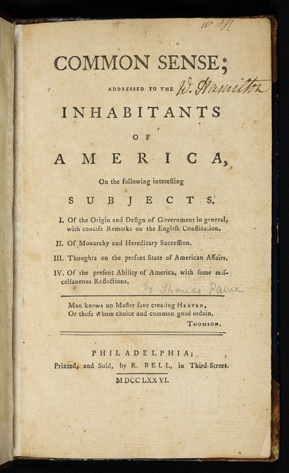
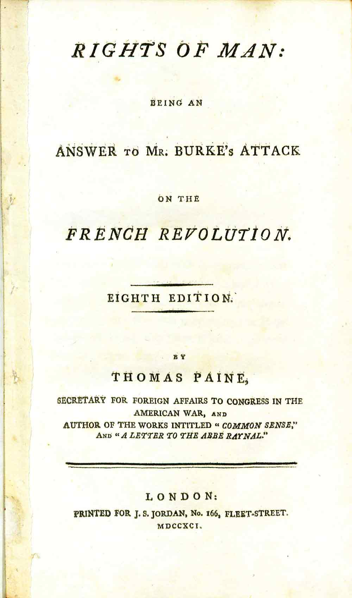
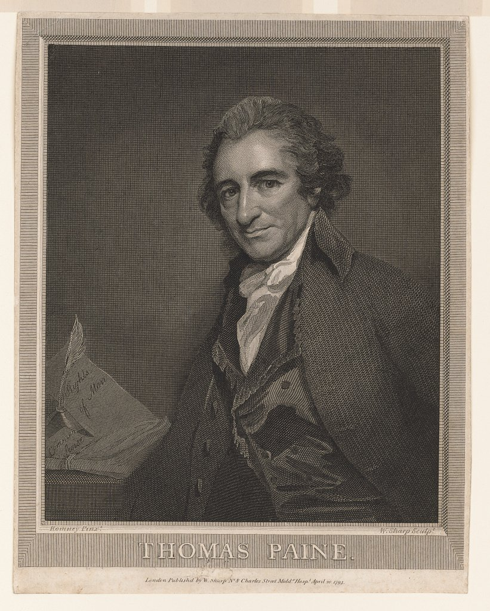

**文 / qscqesze**

1794年10月，托马斯·潘恩从巴黎的卢森堡监狱写信给美国驻法公使詹姆斯·门罗。他又病了，燃料既贵又少，蜡烛也弄不到。他算着日子：到这个月二十八日，自己就被关满十个月了。

门罗答应过帮助他。潘恩在信里追问，为什么事情仍然没有结果。他提出一个越来越尖锐的问题：门罗如今是以朋友身份替他说话，还是以美国公使的身份，要求法国释放一个美国公民？前一种帮助依靠交情，后一种要求背后应当站着一个国家。[^1]

他已经五十七岁。《常识》帮助美国人把独立说出口，《人权论》使他成为法国革命的辩护者。法国授予他的公民身份，曾经像一份跨越国界的荣誉；如今，法国把这个出生在英国的人作为外国人关了起来。一封来信又告诉他，有些美国人认为，他接受法国身份和议员席位以后，已经失去美国公民资格。

潘恩写了一份长长的申辩。他在美国生活，缴纳税款，拥有财产，为独立事业效力；法国给予他的荣誉，并没有让他宣誓放弃这些关系。门罗随后明确表示，自己并未把他排除在美国公民之外。他还向门罗解释，法国给予名人的公民荣誉，在他看来如同一个学术团体接纳外地成员，并不要求受赠者抛弃原来的国家。他列出美国生活的事实，要用它们推翻那封来信里的判断。可这番澄清到来时，他仍在牢里。他等待的已经是一张能够打开监狱大门的公文。[^2]

## 一本没有署名的小册子

他第一次横渡大西洋时，所能出示的东西远比这些少。

1737年，潘恩出生于英格兰塞特福德。父亲是贵格会教徒，以制作女用紧身胸衣为业。他在学校读过书，后来随父亲学手艺，又做过税务员和教师。第一任妻子玛丽·兰伯特婚后不久便去世。到刘易斯任职以后，他娶了伊丽莎白·奥利夫，和她经营店铺，出售杂货与烟草。工作、婚姻和小生意，一度构成他留在英国的全部安排。

税务员的收入让这些安排难以维持。1772年，同事们推举潘恩执笔，请求增加薪俸。他写出《税务员的处境》，把薪水与日常开支摆在一起，说明低薪怎样把公职人员逼入窘境。他还到伦敦争取支持，将小册子寄给作家奥利弗·戈尔德史密斯，请他帮助。文字已经成为他替自己和同业办事的工具。

这次请愿有一笔共同承担的费用。在寄给戈尔德史密斯的信里，潘恩解释，每位税务员认捐三个先令，用于活动的款项合计五百多镑。小册子印了四千份，其中三千份供同业认购，一千份用来赠送。他们请各地选民向议员推荐，再将陈情材料送到议员手中。潘恩把这些进展写得很细，希望获得的帮助也很具体：请这位有名的作家腾出一两个小时，听他谈谈问题。他署名时，称自己是一个对方尚不认识的仰慕者。

请愿没有带来加薪。1774年，他再度被税务部门解雇，债务逼近，店铺和家中的物品被拿去拍卖。他与伊丽莎白分居。此前积攒的职业经验，此刻没有一项能给他一份安稳收入。[^3]

在伦敦结识的本杰明·富兰克林替他写了推荐信。信写给费城的理查德·贝奇，建议给这个人找些事务工作，或者让他做助教、测量助手，先有办法谋生。1774年秋，潘恩带着这封信前往北美。他三十七岁，还没有一部成名作。

费城给他的机会来自印刷业。出版商罗伯特·艾特肯请他协助编办《宾夕法尼亚杂志》。1775年3月，潘恩写信向富兰克林报告近况，说杂志的订户正在增加，自己也得到一些教孩子的工作。他尚未同艾特肯商定正式的合作条件。在信中，教书所得和杂志的发展并列出现；得到朋友介绍与找到持续收入，仍然是两件需要分别解决的事情。信里谈到稿件、订户和报酬，署名还是一个试图在新地方站稳脚跟的写作者。[^4]

他到来以后不久，殖民地与英国的冲突进入战争。莱克星顿和康科德已经开火，许多反抗者仍希望国王介入，纠正议会和大臣的错误，把双方带回旧有关系。向乔治三世请愿与同英军作战，可以同时存在于一个人的政治打算中。潘恩把自己的第一场大赌注押在了切断这条退路上。

1776年1月，《常识》在费城出版，书名页没有作者姓名。印刷商罗伯特·贝尔的地址列在下方，读者可以买到一本直接讨论当下局势的小册子。开篇从政府为何产生说起，很快转到国王凭什么统治、王位为什么能够由父亲传给儿子。

潘恩没有要求读者先掌握宪政学。他用《圣经》中以色列人求立国王的故事拆解王权，又让一个简单的地理问题进入争论：一片大陆为什么必须受一座岛屿支配？一个人的后代有可能愚蠢，也有可能邪恶，血缘却能把统治别人的权力一并交给他。世袭王位在他的笔下失去了习以为常的庄严。

<figure>

<figcaption>《常识》，费城罗伯特·贝尔印本，1776年。书名页未署作者名；印第安纳大学莉莉图书馆藏，JC178 .B713 Vault。原作公版，图为原书平面复制。<a href="https://collections.libraries.indiana.edu/lilly/exhibitions/items/show/1778">藏品记录</a></figcaption>
</figure>

更迫切的问题是战争接下来要换取什么。假如付出生命和财产，只为撤销几条法令、更换几个大臣，那么和解以后，争执还可能重新开始。独立则能使殖民地自行建立政府，与其他国家开展贸易和交往。潘恩把原先容易被视为极端主张的独立，写成了一件可以计算前途、安排步骤的事。

他替担心销路的商人回答：北美出售的是欧洲仍然需要的生活必需品，贸易可以越过英国。谈到海上防卫，他又数起木材、造船材料和工匠。渔业受到封锁，水手、船匠失去工作，在他看来，正可以把这些力量用于建立舰队。读者须决定是否相信这套估算。潘恩的办法，是让独立落到货物能卖给谁、船能在哪里建造这些事情上，使一项政治决断有了读者熟悉的尺度。

小册子迅速引起回应。华盛顿在1月31日给约瑟夫·里德的信中赞许它的论述。潘恩接着与贝尔发生印售争执，转由布拉德福德兄弟刊行增订本。政治主张一旦进入印刷所，也要经过定价、版次、账目和发行渠道；他既写正文，也卷入这些事务。[^5]

同年夏天，独立宣言通过。冬天来到时，宣布成立的国家仍可能被打败。潘恩随军经历撤退，在十二月发表《危机》第一篇。那篇文章要求读者面对一个具体选择：困境加重时，要不要继续承担抵抗的代价。几个月前，他要说服人们离开英国；现在，他得说服他们留在这场战争中。

名声给他带来了职务。1777年，他成为大陆会议外交事务委员会秘书，接触到来自欧洲的文件。后来，围绕驻法代表西拉斯·迪恩及法国援助的争执，他公开撰文，指责迪恩的说法。援助背后牵涉秘密外交，他披露的内容引起法国公使抗议，也使自己在大陆会议中失去支持。1779年，他辞去秘书职位。[^6]

印在纸上的意见能替他赢得职位，也会使任用他的人难以继续容纳他。他继续写《危机》，参与为战争争取支持。战争结束后，他得到酬谢和纽约州的新罗谢尔农场，终于有了可以返回的地方。

## 过海的人权

潘恩还想造桥。他研究以铁构件组成桥拱的办法，希望用较少桥墩跨过河流。1787年，他带着这项计划前往欧洲，在法国和英国寻找支持，又在伦敦展示桥的构造。发明要得到试验机会，需要出资者、工匠和愿意采纳方案的人；他重新奔走于各种引荐之间。

法国革命使这些奔走有了新的方向。英国政治家埃德蒙·伯克出版《法国革命论》，猛烈批评革命，维护历史沿袭下来的政治秩序。潘恩认识伯克，也记得他曾支持北美殖民地。他写信表示失望，随后以《人权论》作答。[^7]

他们争的是当下法国，也是在争一个人出生以前，前人究竟能替他决定多少事情。伯克看重承袭的制度与经验。潘恩从活着的人出发：一代人能够处理自己的事务，不能永远替后世订下不可更动的政府。法国人民既然承担一个制度的后果，也应当有权改变它。

原先准备刊印的约瑟夫·约翰逊退了下来，出版风险落到另一家书商身上。1791年，《人权论》第一部由J.S.乔丹发行。潘恩把书献给华盛顿，使用的是他在美国革命中取得的声望；书的读者却包括英国本土那些无权进入议会、仍须服从其决定的人。

第二部在次年问世。潘恩把代表制政府与税收、儿童教育和老年人的生活保障联系起来，讨论国家的钱可以怎样安排。他知道，许多读者每天遇到的政治，就是薪水不够、税款要交、孩子需要养活。多年前替税务员写请愿书时，他已试过把这类生活账目写进公共争论。

<figure>

<figcaption>《人权论》第一部，伦敦J.S.乔丹，1791年第八版。威廉与玛丽学院沃尔夫法律图书馆藏。原作公版；复制图据馆方网站<a href="https://creativecommons.org/licenses/by-nc-sa/3.0/">CC BY-NC-SA 3.0</a>标示使用，保留相同许可。<a href="https://wythepedia.wm.edu/index.php?title=File:PaineRightsofMan1791.jpg">版本与图像记录</a></figcaption>
</figure>

英国政府开始起诉出版商和潘恩本人，指控《人权论》第二部构成煽动性诽谤。书中的世袭政府论述，成为起诉书摘录的内容。潘恩给总检察长写信，申明自己没有躲藏。他愿意公开承担写作的责任，同时继续回应攻击者，争论遂从书页延伸到法庭。

1792年9月，法国加来海峡省选他为国民公会议员。他离开英国，渡海赴任。到多佛时，海关检查他的行李与文件；他后来写给英国内政大臣的抗议信，逐一提到华盛顿的信、美国公使的介绍信以及法国方面的选举通知。他随身携带的纸张，已经把三个国家串在一起。

十二月，他在英国被缺席定罪。与此同时，英国一些城镇抬着他的模拟像游街、焚烧。赴法国担任议员，使他取得了参与另一场革命的位置，也使这次渡海成为长期离别。他再没有回到英国。[^8]

## 保住国王的性命

在法国，潘恩面临的一个重大决定，是如何处置已经失去王位的路易十六。

他赞成审判。国王的行为需要公开检验，旧制度怎样运作，也应当借此暴露出来。可是在1793年1月的讨论中，他主张保全路易的性命，把他送到美国。一个曾帮助美国独立的法国君主，可以在那个共和国见到没有王位的生活。

这个建议把潘恩的两段经历连到了一起。法国王室曾经出于自身目的支持美国战争；潘恩记得这份援助。他又认为，革命能够废除王权，不必继续以处死一个人为结局。他在提交给国民公会的文字中列举政治后果，也提出限制死刑的主张，希望议员们选择流放。

他用英语写成意见，由他人译成法文，提交给议会。那个在费城能用通俗语言直接打动读者的人，此时必须依靠翻译，才能让同僚听见自己的理由。路易十六最终被判处死刑，1月21日被处决。潘恩的建议没有改变表决结果。[^9]

随后几个月，革命内部的斗争吞噬了他熟悉的政治关系。与他交往的吉伦特派人物失势。到1793年12月，他被取消议员资格，二十八日以外国人身份遭到逮捕，送进卢森堡监狱。此前的法国公民荣誉和议员席位，都没有为他保住自由。

监禁持续到了第二年。罗伯斯庇尔倒台以后，许多人的处境已经改变，潘恩仍然没有出狱。他开始向新任美国公使门罗提出那一连串要求。牢里的疾病使争论变得紧迫；他把服务美国的经历写出来，将私人求援变成有关公民保护的交涉。

门罗在11月2日正式致函法国治安委员会。他列举潘恩对美国独立的贡献，说明此刻的监禁正使疾病加重，并提出交涉：如果法国对潘恩有所指控，就应当尽快依法处理；如果没有，就应当恢复他的自由。公使的信把病人的处境带进了国家之间的正式文书。11月4日，监狱放人。他随后住进门罗家养病。来年九月，门罗写给亲友的信仍提到这个病人，说明潘恩在他家已经住了约十个月。一次外交交涉结束以后，照顾身体的日子还很长。[^10]

出狱没有使他与旧友的关系恢复原状。他把自己久未获释的遭遇归咎于美国方面的冷漠，尤其怨恨华盛顿的沉默。1796年，他公开发表《致乔治·华盛顿的信》，把个人的委屈和对美国外交、政治走向的攻击写在一起。信从巴黎寄出，他已经自由了一年多，仍要追究在狱中无人充分援助自己的责任。他同时攻击美国与英国接近的政策，质问当年的革命是否正在失去原有方向。读者在同一册文字里，既会遇见共和国的政治论争，也会读到一个病人对被遗弃的愤怒。四年前，《人权论》还把华盛顿的名字放在献词里；如今，同一个名字出现在指责的对象中。

<figure>

<figcaption>威廉·夏普据乔治·罗姆尼画作雕刻的潘恩像，1793年4月20日出版。纸上列有《常识》《人权论》书名。美国国会图书馆藏，LC-DIG-pga-12728；馆方标示无已知出版限制，原作公版。<a href="https://www.loc.gov/pictures/collection/pga/item/93504024/">藏品与权利记录</a></figcaption>
</figure>

他还失去了另一批读者的信任。《理性时代》第一部在1794年出版，第二部随后问世。潘恩把自己对宗教的意见摆得和政治意见一样直接：他相信一位上帝，却拒绝接受各教会以神圣启示为依据的权威。他提出，某个人声称得到启示，那是此人的经历；当这个人把话转告别人时，别人接触到的便只是转述。

这个区别写起来简明，触及的却是许多人的信仰生活。潘恩仍在使用自己熟悉的办法，把长期受到敬畏的权威交给普通读者审问。美国革命时期的共同事业，容得下信仰各异的人；《理性时代》则使一些旧日支持者直接感到自己珍重的东西受到攻击。回美国以后，他面对的公众已经与离开时不同。[^11]

## 农场的来信

1802年，潘恩返回美国。他没有再回英国。北美不再需要他解释为何应当独立。他在纽约、新罗谢尔等地生活，仍然写作，与杰斐逊通信。身体渐衰，旧有声望带来的欢迎和政治、宗教上的敌意一同跟着他。

在法国住过的朋友尼古拉·博纳维尔一家，需要他的帮助。博纳维尔的妻子带着孩子们来到美国后，潘恩给他们安排住处，关心孩子的教育。接纳一个家庭带来的费用和日常磨合，也进入他的信件。博纳维尔夫人后来在纽约教法语谋生，孩子与潘恩继续保持生活上的联系。

1803年，他写给杰斐逊的信谈到农场里的木材：打算伐木，运往纽约出售，以取得现钱。他还想给自己造一所合意的房子，设置机械工作间，把发表过的文章和手稿编成几卷，通过订阅出版。政治消息又使计划悬而未决，他仍在留意英国可能发生的变化。

给朋友约翰·费洛斯的一封信里，他逐件清点家当：六把椅子、一张桌子、床、锅、餐具、牲畜和车。他说自己以茶、奶、果馅饼等为日常饮食，偶尔吃肉；朋友来了，就接受这里现有的招待。信里还谈到刚写的文章和别人怎样回应。他邀请人来住，却又希望对方先回信，把来访安排确定下来。[^12]

这个曾经以一册小书要求大陆脱离英国的人，晚年要计算伐木的收入、孩子的费用、剩下多少东西可以待客。他没有停止把意见寄出去。1808年，仍向杰斐逊讨论国际争端和美国的处境。1809年6月8日，潘恩在纽约去世。两天后，他的遗体被送往新罗谢尔，葬在自己的农场。[^13]

<!-- biography-body-end -->

## 注释与书目

[^1]: Thomas Paine，致James Monroe，1794年10月13日，[原信整理文本](https://thomaspaine.org/letters/to-james-monroe-october-13-1794/)。病情、照明、燃料及十个月的计算均出自信中陈述。
[^2]: Paine，1794年9月致Monroe的公民身份申辩，[芝加哥大学《建国宪法》资料选录](https://press-pubs.uchicago.edu/founders/documents/a1_8_4_citizenships11.html)，据1925年《Life and Works of Thomas Paine》爱国者版第5卷整理。该版系于9月10日；[历史协会所录原信](https://thomaspaine.org/letters/to-james-monroe-september-14-1794/)系于14日。所谓美国人否认其身份，是潘恩转述的来信消息；门罗的回应见Conway卷二第八章。
[^3]: Moncure Daniel Conway，*The Life of Thomas Paine*，2卷，New York/London：G. P. Putnam’s Sons，1893年版（初版1892），[卷一第二、三章](https://thomaspaine.org/biographies/life-of-thomas-paine-vol-i-by-moncure-conway/)，含1772年致Goldsmith信及税务部门记录。1774年解职、债务拍卖与请愿先后发生，解职原因不简化为报复请愿。
[^4]: Conway，卷一第四章，收录Franklin于1774年9月30日致Richard Bache的推荐信，以及Paine于1775年3月4日致Franklin信。
[^5]: Paine，*Common Sense*，Philadelphia：1776，[全文](https://thomaspaine.org/major-works/common-sense/)（所录文本据2月14日增订版）；初刊、印刷争执及Washington致Reed信见Conway卷一第六章。销量在不同叙述中出入很大，正文不采用具体数字。
[^6]: Conway，卷一第七至九章，分别论《危机》、委员会秘书职务及迪恩争执。正文只叙公开披露、外交抗议和辞职，不采用传记作者对争执双方动机的裁断。
[^7]: Conway，卷一第十五至二十二章，关于铁桥试验、伯克论争与两部《人权论》的出版。现代研究核对采用Mark Philp，〈[Thomas Paine](https://plato.stanford.edu/entries/paine/)〉，*Stanford Encyclopedia of Philosophy*，2013年初刊，2025年修订。
[^8]: Conway，卷一第二十二至二十四章，含潘恩1792年致总检察长、9月15日致Dundas的信、起诉书及审判材料。英方罪名为煽动性诽谤；部分旧传记称叛国罪，与所录案件性质不符。
[^9]: Paine，〈[Reasons for Preserving the Life of Louis Capet](https://thomaspaine.org/french-revolution/reasons-for-preserving-the-life-of-louis-capet/)〉，1793年1月；该网页页头日期有误，正文导言及Conway卷二第一章均将所录发言置于一月审判期间。正文区分支持审判与反对处死。
[^10]: Conway，[卷二第七、八、十章](https://thomaspaine.org/biographies/life-of-thomas-paine-vol-ii-by-moncure-conway/)，含Monroe于1794年11月2日的释放交涉信及1795年9月15日致Joseph Jones信。逮捕与获释日期分别为1793年12月28日、1794年11月4日。
[^11]: Paine，*Letter to George Washington*，Philadelphia：Benjamin Franklin Bache，1796，[全文](https://thomaspaine.org/major-works/letter-to-george-washington/)；*The Age of Reason*，第一部1794、第二部1795，[第一部原文](https://www.luminarium.org/renascence-editions/reason1.html)。其政治指控按本人立场叙述。第一部在入狱前已开始写作，正文不称全书写于狱中。
[^12]: Conway，卷二第十七章，含1803年9月23日致Jefferson信及致John Fellows信；家具、饮食、伐木和出版打算均据本人信件。博纳维尔夫人的生活选择按可确认的安排叙述，略去传记作者关于性格与动机的推测。
[^13]: Conway，卷二第二十章，含1808年7月8日致Jefferson信，及1809年去世、6月10日下葬的记录。
