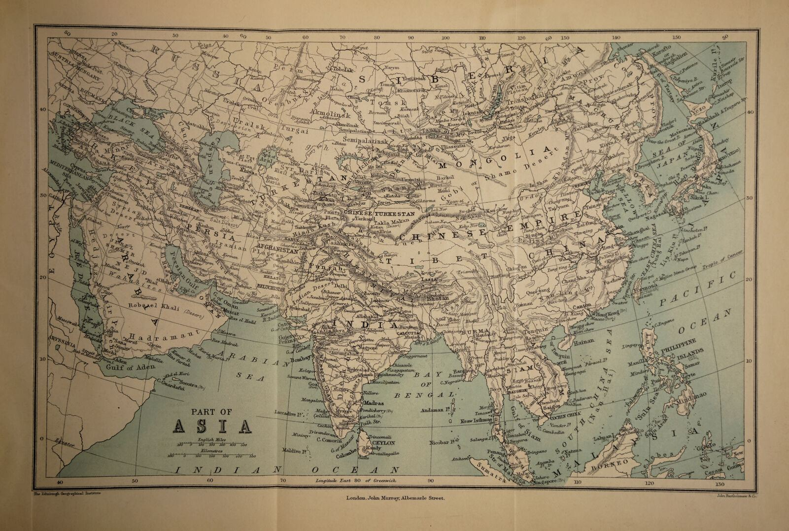
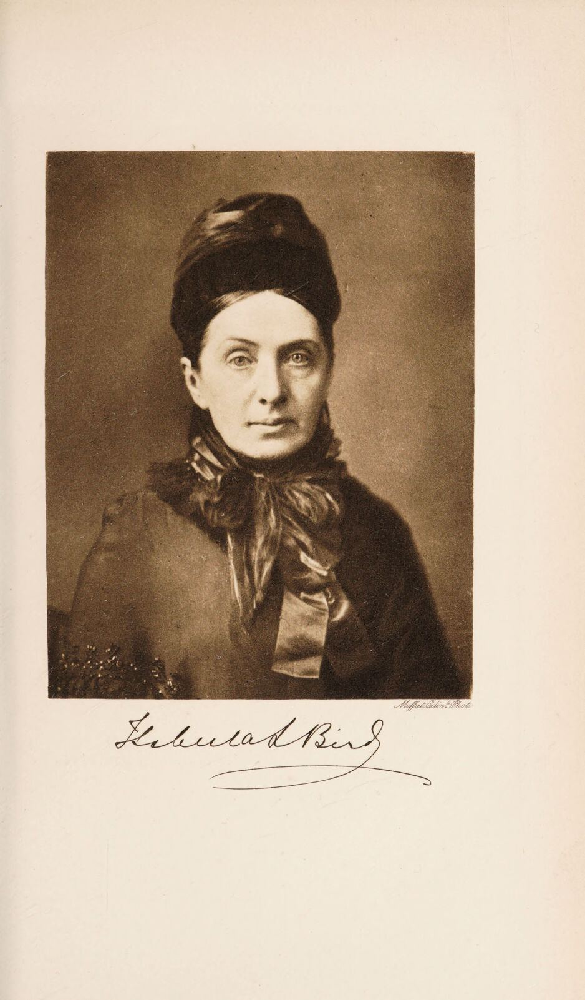
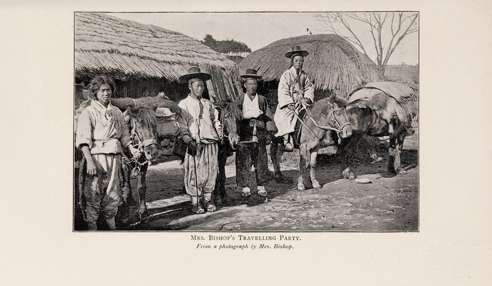

**文 / qscqesze**

离开东京向北旅行以前，伊莎贝拉·伯德已经预付了一个月的工钱。她雇下的日本青年伊藤十八岁，没有带推荐信。他解释说，信在父亲家的一场火灾中烧掉了。

伯德原先很不喜欢他。她在寄给妹妹的信里，仔细挑剔过他的外貌，又承认自己急于出发，双方至少听得懂彼此的英语。伊藤说自己能做饭，懂得压制植物标本，到过北方和北海道，可以一天走二十五英里。酬金最后定为每月十二元，他带来契约，盖上印章，伯德签了名。

第二天，他请求预支工资，她付了。一个熟人提醒她，也许再也见不到这个青年了。可伊藤按约定出现，还替她安排好了头三天的路程。她在信里告诉妹妹，这个人接下来究竟会带来好运还是麻烦，大概很快就能知道。[^1]

那是1878年。四十六岁的伯德准备从东京去日光，再往本州北部走，渡过津轻海峡，访问北海道。她无法用日语办理沿途的事务。每晚睡在哪里，马匹要多少钱，官员为什么检查证件，村民怎样回答她的问题，都将经过这个刚刚受雇的青年。

## 一百镑可以走多远

伯德于1831年生在英国约克郡。父亲爱德华是牧师，母亲多拉也深受福音派信仰影响。家中教育包括读书、观察植物和骑马。父亲带她外出，会让她留意田野、房屋和遇见的人，再把看见的事说出来。植物的名字和用途也在这些往来中变得熟悉。她后来在旅途中辨认作物、询问农事的习惯，早年已经有了起点。

她很早就被当作一个需要照料的病人。十八岁时，医生替她做了手术，取出脊柱附近的纤维瘤。此后背痛仍会发作，失眠和衰弱使她常常只能半躺着读写。医生建议换空气、去海上旅行，家人带她到苏格兰高地度夏。旅行起初列在治疗安排里。

1854年，一个机会来了：亲属要返回加拿大的爱德华王子岛，她可以同行。父亲给她一百镑，允许她在钱花完以前继续待在海外。她先随亲属过大西洋，后来游历加拿大和美国，坐驿车、铁路和轮船，也借住在介绍信通向的人家里。父亲给的款项决定旅程可以延续多久，那些引荐则使她沿途有地方落脚。

她并不能只照自己的日程行动。在爱德华王子岛，斯韦比上尉坚持留她住了六个星期，因为加拿大和美国正在流行霍乱。待她继续赶路，车站、亲友的家和换乘的码头，陆续替代了原先熟悉的家庭生活。她把乘车、住宿和遇见的人写回去，家里便能知道那一百镑正把她带往哪里。[^2]

回国后，家人保存的信件和她的笔记摆在一起。父亲劝她整理成书。1855年，她把稿子交给出版商约翰·默里，原拟书名《车与轮船》。稿子尚未送出时，一部分曾交给一位加拿大文人，请他核对和纠正；约翰·米尔福德读过若干章节，才替她介绍默里。她带来的既有一路留下的记录，也有回国以后请人校正的材料。默里觉得原书名不够好，提议叫《在美国的英国女人》。伯德嫌这个名字太张扬，最后仍接受了。

书在1856年问世。她以书商折扣价订了四十五本，默里担心这会冲击书店的销售。她回信解释，订书的是罗斯郡和斯凯岛的朋友，他们离书店太远，有一艘熟人的游艇正好能把书带过去。成书以后，她还得替寄远方的书寻找交通工具。[^3]

父亲去世后，母亲带着两姐妹迁居爱丁堡。母亲后来也去世了，妹妹亨丽埃塔成为伯德反复离开、又反复回去的亲人。两人在苏格兰生活，夏天常到马尔岛的托伯莫里。亨丽埃塔有自己的朋友、教会事务和需要照顾的人，也接收姐姐从外地寄回的长信。

1872年，伯德再次出发，目的地是澳大利亚。她在当地停留后去了新西兰，次年抵达夏威夷。原先的疗养安排逐渐变成更长的行程。她骑马穿过岛屿，访问火山地带，再转赴北美，进入科罗拉多的山地。沿途不断写给妹妹的信，后来分别成为关于夏威夷和落基山脉的书。

她也在改变骑马的方法。从夏威夷带来的骑装，适合跨坐在马背上，比惯常的侧骑便于长途赶路。在加利福尼亚租马时，马厩起初预备的是女式侧鞍。她在信里写到自己的犹豫，随后改用墨西哥马鞍，把另外穿的丝裙绑在鞍上。出发以后，骑装、鞍具与走多远的打算成了同一件事。

在科罗拉多，她想登朗斯峰，别人劝她季节已晚。住处的主人离开去丹佛后，熟悉山地的吉姆·纽金特答应带路，两个年轻人也一同前往。为了省下一匹驮骡的费用，大家把食物和毯子分装在坐骑上。伯德的靴子已经磨坏，借了一双猎靴上山。

爬到险处时，吉姆帮助她攀上岩壁。她在后来写成的登顶经过里，既记下自己的坚持，也记下身体怎样依靠向导的拉拽和支撑。下山同样艰难，登顶没有省去回程所需的力气。她把这几天单列成一封长信，并说明当时没有办法把经过写下来。

同在北美，她还遇到了银行柜台解决不了的问题。1873年的金融恐慌中，丹佛的银行虽然开着门，却暂停兑付，无法把她带的旅行信用票据换成现钱。她在信里抱怨，仿佛谁都没有钱，东西也因此卖不出去。手上的票据并不能立即支付马匹和旅店的账，她只好返回埃斯蒂斯公园，那里可以先不用现款生活，等情况改变。

山中熟人的接纳于是延长了停留。吉姆还出现在她对日常生活的记述里：他的诗、谈话、醉酒和失控。她愿意与他交谈，也写下对酗酒的忧虑。旅程结束，她离开科罗拉多，回到妹妹身边。几个月后，吉姆因枪伤死去。伯德以后整理这些材料时，仍保留了这个人反复出现在信中的位置。[^4]

## 伊藤知道的路

到日本以前，她已是有书出版的旅行者。介绍信把她带到英国公使巴夏礼夫妇的住处。有人劝她携带罐头、葡萄酒和女佣；按她自己的计算，若逐一采纳，行李就得用好几匹驮马来运。她选择削减。

出发时，她带着可支起的床、用品、钱和证件，把行李集中装运，又限制伊藤所带东西的重量。外国人离开开放口岸深入内地，需要旅行许可。她的护照规定沿途应怎样对待居民和官员，也限制经商、狩猎和长期租屋。她把装护照的袋子系在腰间，钱则分作纸钞和成卷的铜钱携带。

她先坐人力车到日光，随后更多地依靠马匹和步行。车夫、马夫、渡船上的人和旅店主人不断更换，伊藤一直留下。他去找运输机构，安排下一段的马，清洗衣物，做饭，传递她对住宿的要求。伯德写下的里程、开支与村镇见闻，也经过这些反复办理的小事才得以积累。

钱使双方都保持警觉。出发前，外国熟人已经给她列过价格表，警告雇员可能从每笔交易中抽成。伯德坚持查看费用，也会选择由运输公司供马，减少中间议价的环节。运输公司在城镇和村庄设有分支，向农户雇马，再按路段安排给旅客，交付正式收据。草料、道路和可用马匹都会影响价格。伯德愿意付给公司这笔中介费用，换取可以核对的账目；伊藤原先经手的交易，则会因此减少。她在信里写到自己想管住伊藤，而伊藤也想管住她。两个人都掌握着对方缺少的东西：她支付旅费，他能听懂旅店和运输站的人。

过夜之后，第二天未必马上能走。雨使道路难行，马匹不足，行李的安排有时也会出错。她仍想继续去地图上标出的河流和山口，伊藤要向当地人询问，回来说明哪些办法行得通。她还会坚持重问，直到找到船或马。游记一封接着一封，每封信都有新的出发，也有被迫停下的日子。

在日光，她住过金谷的家。主人在庭院里营造水流、竹桥和小湖，也陪她出门；伊藤在旁翻译，她才能向这个熟悉地方事务的人询问。她的笔记写到客房怎样从夜间的卧处变回白天活动的房间：被褥收起，木板门推开，人们扫净地面，再开始吃饭和做事。暂住一户人家，比在道路上经过多留给了她几页文字。

另一次，她获邀参加婚礼，伊藤没有得到邀请。她随主人去了，能看见嫁妆和仪式，却要等事后才能问清所见的含义。书里那些器物、衣料与礼节的长段记述，常常从这样一次迟来的解释开始。[^5]

到函馆，聘雇时留下的问题追上了他们。植物采集者查尔斯·玛里斯也在那里，伯德才得知，伊藤与他还有一份每月七元的契约；听说新工作给十二元，青年便转来受雇，没有说明原来的约定。

她把这次交涉写给妹妹，说自己很遗憾。玛里斯的采集受到影响，他曾教伊藤制作标本，也能让他独自去找种子。但玛里斯同时承认，伊藤已经好好替她工作。双方重新安排：先让他完成伯德的北海道之行，随后回到玛里斯那里。先前那份没有推荐信的契约，没有在争执中立即终止。[^6]

她继续向北海道内陆走，在平取受到阿伊努人的接待。主人给她住处，她询问饮食、家庭生活和信仰。村里有几个人能说日语，伊藤再把日语转为英语。她住了几天，记下当地人的说明，后来在书的序言里，把关于习俗的一部分知识明确归于这些讲述者。

伊藤也带着自己对阿伊努人的成见。伯德记录了两人的分歧，也称赞他在这里翻译时表现出的用心。书上的介绍、东京外国居民的意见、路途中得到的回答，并不总能接到一起。到了这座村庄，接待她的人主动让出住处，解释日常习俗，也继续做自己的事。伯德称赞主人待客周到，又猜测人们较少围观外国人，或许出于迟钝；当初对伊藤的判断，也曾从外貌推及智力。

回到东京以后，她又到关西，访问伊势等地，然后经香港和马来半岛回英国。1880年出版的《日本内地旅行记》分为两卷。后来发行较短的普及本，关西部分被删去，北行与北海道的叙述成了更多读者熟悉的伯德。[^7]

<figure>

<figcaption>1906年《伊莎贝拉·伯德传》卷末亚洲地图，涵盖她历次远行涉及的多个地区；图上国界与地名采用当时标示。约翰·默里出版，图署John Bartholomew &amp; Co.；Wellcome藏本，公版。<a href="https://wellcomecollection.org/works/naz96mkj">来源与许可</a>。</figcaption>
</figure>

## 没有人接收的长信

她在路上写信，亨丽埃塔在家里保存、阅读，帮她批评文字。姐姐远行时，托伯莫里的房子仍然运转，饭菜、往来和日常开支都有人料理。伯德回来整理日本稿，妹妹在一封给朋友的信中描述两人的日程：姐姐吃饭前写，下午写，晚饭前还写；自己则出去办事、探望村里的人，筹划下一餐吃什么。

那封信里也有妹妹的负担。她说，保持家中饭菜合意很费心，有时连凑齐食物都不容易。与此同时，她正照顾一位瘫痪的老领港员和一个患肺病的青年。姐姐得到的安静，有亨丽埃塔的工作在支撑。

1880年6月2日，亨丽埃塔去世。日本稿已经过了付印的一些工序，伯德在序言末尾补上妹妹的死讯。那位最初收信的人、帮助她改稿的人，没能等到这部书的全部出版过程结束。[^8]

约翰·毕晓普医生曾长期照料亨丽埃塔。他与伯德也一起研究过显微镜下的植物。1881年3月，伯德嫁给了他。婚礼在沃里克郡的一所教堂举行，她穿着丧服。此后的书和公开活动中，她仍会被称为伯德，也越来越多地以毕晓普夫人的姓名出现。

<figure>

<figcaption>伯德婚前肖像，J. Moffat摄于爱丁堡，约1881年；1906年传记对页138的照相凹版。Wellcome藏本，公版。<a href="https://wellcomecollection.org/works/naz96mkj">来源与许可</a>。</figcaption>
</figure>

两人一起生活、旅行，随后丈夫患病，需要到法国南部疗养。1885年1月，她写给朋友，说自己除了护理和给丈夫读书，只能做一点画、学一点法语，偶尔整理几页西奈旅行稿。默里邀她写里维埃拉的文章，她没能答应。

丈夫一度好转，她又去查看沿岸旅馆，比较设施，希望找到适合他休养的地方。病情随后继续恶化。1886年3月6日，毕晓普在戛纳去世，离两人结婚五周年还有两天。她回到英国，计划进入伦敦圣玛丽医院学习护理，并想建立一所纪念丈夫的医院。

她给朋友写信，表示自己原本不愿再渡海，可印度的医疗传教事业正吸引她。旅途将有新的用途：查看医院、接触病人，把家中的丧失变成需要安排资金、人员和地点的事业。她后来去印度，再到波斯与库尔德地区，行李里多了护理经验和医疗用品。[^9]

这也把她带回父亲熟悉的信仰世界。她为传教团体演讲，要求英国听众提供支持，在叙述亚洲社会时，经常把基督教的传播当作迫切需要。此前旅途中得到的接待、翻译和地方知识，继续进入她的书；宗教判断也越来越明确地影响她写些什么、向谁求助以及把钱用在何处。

## 相机和下一次出发

1892年，伯德成为英国皇家地理学会首批接纳的女会士之一。学会随后围绕是否继续接纳女性发生争论，她在信中批评这种倒退，也反对把男女会籍分成不同类别。她不愿为自己的会籍四处奔走，在寄给默里的信里说，若会籍只关乎交费，又不承认实际做过的工作，那就不值得费事；但排斥女性的做法仍使她愤怒。她忙于校样、查里程、修改地名，书桌上的工作没有随这项荣誉结束。[^10]

六十多岁以后，她又到朝鲜与中国。新的技术跟着她上路：相机、底片和冲洗用品都需要搬运、保管。1894年前往奉天的途中，车在坏路上翻倒，相机落在她身上，右臂受了伤。到了传教医生家里，她接受治疗，日后笔记仍提到写字困难。恢复到能够工作时，她又搜集当地资料，继续拍照。她记录河流和城镇，拍桥梁、船只、旅店与人。在后来寄回的材料里，文字之外有了可以用于成书和演讲的图像。

她在朝鲜、中国的旅行，都依靠船夫、挑夫、雇来的人员和地方上的接待。1895年在朝鲜，一位名叫Yi Hak-In的译者与她同行，她称赞他的机智和幽默。队伍还有公使馆派来的一名随员、三匹坐骑、马夫和两匹驮畜。她的照相机也拍下过同行队伍：人、马匹与驮载的行李并列在画面中。

<figure>

<figcaption>《毕晓普夫人的旅行队伍》，朝鲜，约1894—1895年；伯德摄，收入1906年传记对页306。图像转正，保留整页。Wellcome藏本，公版。<a href="https://wellcomecollection.org/works/naz96mkj">来源与许可</a>。</figcaption>
</figure>

1899年，《长江流域及其以外》出版。她还在写信、拜访朋友、准备讲演，向听众放映旅途中的照片。1901年，她又去了摩洛哥。回来后的一封信里，她清点自己从十月中旬以来讲过的四十五场演说，并说十三个月里只在自己的房子睡过一夜。旅程结束，公开活动又把她送上另一条行程。

她还想返回中国。身体已经需要更多休息，她仍断断续续收拾东西，等医生给出最后意见。这次没有成行。1904年初，她向一位老友索取一点梨和野味馅饼，食欲已经很坏；信里却又提出一个打算，若能恢复一点力气，就写一段自传。

那段自传没有写成。1904年10月7日，伯德在爱丁堡去世。她此前已安排把丈夫的棺木从戛纳迁回，三天后的葬礼把她送入迪恩公墓。家中再没有亨丽埃塔替她接信；寄给妹妹、朋友和默里家的那些信，后来成为1906年传记编者整理她一生时所用的材料。[^11]

<!-- biography-body-end -->

## 注释与书目

[^1]: Isabella L. Bird，*Unbeaten Tracks in Japan*，London：John Murray，1911普及本，[完整扫描](https://archive.org/details/unbeatentracksin00birdiala)，第四封信，原书页17—18。十二元对应原文“twelve dollars”的当时记账单位；聘雇、预付及人物评价均出自她的叙述。初版1880年两卷本的章号与后来的普及本不同。
[^2]: Anna M. Stoddart，*The Life of Isabella Bird (Mrs. Bishop)*，London：John Murray，1906，[Wellcome目录](https://wellcomecollection.org/works/naz96mkj)、[扫描与OCR](https://archive.org/details/b31358962)，第一、二章，尤页24—25、28—30。
[^3]: Stoddart，第二章，页37—39，收录1855年致John Murray信及四十五本书的往来说明。默里原书书名为*The Englishwoman in America*，1856年出版。
[^4]: Bird，*A Lady’s Life in the Rocky Mountains*，London：John Murray，1879，第六、七、十三封信，[公版全文转录](https://raw.githubusercontent.com/GITenberg/A-Lady-s-Life-in-the-Rocky-Mountains_755/master/755.txt)。吉姆及离别后的消息亦见Stoddart第四、五章；枪击后去世另核对[国家公园历史资料汇编](https://npshistory.com/series/berkeley/rensch3/rensch3f.htm)，Stoddart所录最初死讯有误，后来的记录确认其在枪击后去世。
[^5]: Bird，*Unbeaten Tracks*，第六、七、十、十二、二十四封信及北行相关信件。行装、护照条款、服务与议价据正文；对译者与书写关系的研究参见Andrew Elliott，〈[Ito and Isabella in the Contact Zone: Interpretation, Mimicry and Unbeaten Tracks in Japan](https://www.japanesestudies.org.uk/articles/2008/Elliott.html)〉，*electronic journal of contemporary japanese studies*，Article 9，2008年12月22日。
[^6]: Bird，*Unbeaten Tracks*，第三十四封信，1911本页214—215，包含玛里斯的七元工资、原有契约、双方交涉和继续北海道行程的安排。契约与交涉情况由伯德在信中转述。
[^7]: Bird，*Unbeaten Tracks*，序言及平取相关信件；1880两卷本与后出普及本删节关系核对Elliott论文的版本说明。阿伊努人通过日语使用者及伊藤传递信息，按伯德自述明确其来源。
[^8]: Stoddart，第五、六章，含Henrietta致Macdiarmid的日常工作信；Bird，*Unbeaten Tracks*序言末段。妹妹去世日为1880年6月2日。
[^9]: Stoddart，第七至十章，含1885年1月22日的护理生活信、丈夫1886年3月6日去世及护理/医疗传教计划。
[^10]: [皇家地理学会女性入会史](https://www.rgs.org/schools/resources-for-schools/gender-inequality-and-women-in-geography)核对1892年“首批之一”；她对后续政策争论的回信见Stoddart第十一章。
[^11]: Stoddart，第十二至十五章，朝鲜、中国、摄影、晚年讲演与未成行的计划，及1904年1月16日致Lady Middleton信和去世、下葬记录。旅行队伍照片的朝鲜地点与1894—1895年编年，核对Burglind Jungmann，〈[Chosŏn Entering the International Arena: Three Witnesses](https://edizionicafoscari.unive.it/media/pdf/books/978-88-6969-718-0/978-88-6969-718-0-ch-01_07LQruX.pdf)〉，载Jong-Chol An、Ariane Perrin编，*Cultural Exchanges Between Korea and the West*，Edizioni Ca’Foscari，2023，页8图2。三幅配图均取1906年传记Wellcome藏本，馆方为Public Domain Mark；图像与出处另见[研究记录](https://github.com/qscqesze/qscqesze.github.io/tree/master/research/bird-2026-11)。
